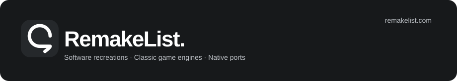
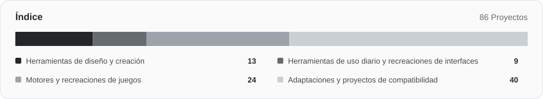

# Awesome RemakeList

Reimplementaciones de software, motores de juegos y adaptaciones a otras plataformas, con los requisitos para empezar a usarlos.

[English](README.md) · [简体中文](README.zh-CN.md) · [日本語](README.ja.md) · [한국어](README.ko.md) · **Español**

[Explorar RemakeList](https://remakelist.com/es/?utm_source=github&utm_medium=repository&utm_campaign=awesome-remakelist&utm_content=intro-es) · [Sugerir un proyecto](https://github.com/CharlexH/awesome-remakelist/issues/new?template=project.yml)

 

Los nombres de los proyectos llevan a las fuentes de sus autores. Despliega cada entrada para consultar los requisitos de dispositivos, archivos del juego y compilación; en RemakeList también encontrarás capturas y explicaciones de instalación.

## Por dónde empezar

| Proyecto | Ver detalles | Cómo empezar |
| --- | --- | --- |
| [Graphite](https://remakelist.com/es/remakes/graphite/?utm_source=github&utm_medium=repository&utm_campaign=awesome-remakelist&utm_content=graphite-featured-es) | Adobe Illustrator | [Probar en el navegador](https://editor.graphite.art/) |
| [Webamp](https://remakelist.com/es/remakes/webamp/?utm_source=github&utm_medium=repository&utm_campaign=awesome-remakelist&utm_content=webamp-featured-es) | Winamp 2 | [Probar en el navegador](https://webamp.org/) |
| [OpenTTD](https://remakelist.com/es/remakes/openttd/?utm_source=github&utm_medium=repository&utm_campaign=awesome-remakelist&utm_content=openttd-featured-es) | Transport Tycoon Deluxe | [Descargar](https://www.openttd.org/) |
| [OpenRCT2](https://remakelist.com/es/remakes/openrct2/?utm_source=github&utm_medium=repository&utm_campaign=awesome-remakelist&utm_content=openrct2-featured-es) | RollerCoaster Tycoon 2 | [Descargar y aportar tus archivos del juego](https://openrct2.io/download) |
| [D2R Mobile](https://remakelist.com/es/remakes/d2r-mobile/?utm_source=github&utm_medium=repository&utm_campaign=awesome-remakelist&utm_content=d2r-mobile-featured-es) | Diablo II: Resurrected | [Compilar y aportar tus archivos del juego](https://github.com/jhaizhou-ops/d2r-mobile/blob/main/README.md) |
| [nxnative](https://remakelist.com/es/remakes/nxnative/?utm_source=github&utm_medium=repository&utm_campaign=awesome-remakelist&utm_content=nxnative-featured-es) | Juegos de Nintendo Switch | [Compilar y aportar tus archivos del juego](https://github.com/seedds/nxnative#pack-an-ipa) |

## Explorar categoría

- [Herramientas de diseño y creación](#creative) · 13
- [Herramientas de uso diario y recreaciones de interfaces](#everyday) · 9
- [Motores y recreaciones de juegos](#classic_games) · 25
- [Adaptaciones y proyectos de compatibilidad](#ports) · 42

## Herramientas de diseño y creación

### [Compositor](https://github.com/robbietilton/Compositor)

Un editor de composición por capas y posprocesamiento para Mac con Apple silicon, diseñado en torno a flujos de trabajo similares a Photoshop.

Original o referencia: **Adobe Photoshop** · Alternativa funcional independiente  
[Descargar](https://github.com/robbietilton/Compositor/releases) · [Explorar RemakeList](https://remakelist.com/es/remakes/compositor/?utm_source=github&utm_medium=repository&utm_campaign=awesome-remakelist&utm_content=compositor-es)

Requisitos y capturas

**Plataformas:** Mac con Apple silicon · macOS 26+

**Estado:** En desarrollo · versiones disponibles

**Qué necesitas:** No hace falta instalar Photoshop. Requiere un Mac con Apple silicon y macOS 26+; compilar desde el código fuente requiere Xcode 26+. Eres responsable de los derechos sobre los medios que editas.

**Qué está disponible:** Las versiones descargables requieren un Mac con Apple silicon y macOS 26+; la interfaz actualmente solo está en inglés. La importación de PSD/PSB admite RGB de 8 bits, no CMYK, y rasteriza algunos vectores y textos verticales. Compilar desde el código fuente requiere Xcode 26+.

**Licencia del código:** [MIT](https://github.com/robbietilton/Compositor/blob/main/LICENSE)  
**Autor:** robbietilton  
[Documentación oficial](https://github.com/robbietilton/Compositor/blob/main/README.md) · Fuentes revisadas: 2026-10-12

### [PhotoCraft](https://github.com/storytold/photocraft)

Una reimplementación en Rust de flujos de edición de imágenes al estilo de Photoshop, creada por el equipo ArtCraft y actualmente en fase alfa.

Original o referencia: **Adobe Photoshop** · Reimplementación del flujo de trabajo  
[Descargar](https://github.com/storytold/photocraft/releases) · [Explorar RemakeList](https://remakelist.com/es/remakes/photocraft/?utm_source=github&utm_medium=repository&utm_campaign=awesome-remakelist&utm_content=photocraft-es)

Requisitos y capturas

**Plataformas:** Windows / macOS / Linux / FreeBSD / Web

**Estado:** Alfa · flujos en desarrollo

**Qué necesitas:** No hace falta instalar Photoshop. Las imágenes que edites deben contar con los derechos adecuados; las fuentes e iconos incluidos tienen licencias independientes. Las marcas ArtCraft quedan excluidas de la licencia del código.

**Qué está disponible:** Hay versiones alfa descargables que no requieren instalar Photoshop. El proyecto enumera compatibilidad con Windows, macOS, Linux, FreeBSD y web; la interoperabilidad PSD, la profundidad de las herramientas y la compatibilidad con complementos siguen incompletas, por lo que todavía no sustituye por completo los flujos profesionales.

**Licencia del código:** [MIT OR Apache-2.0](https://github.com/storytold/photocraft/blob/main/LICENSE-MIT)  
**Autor:** storytold  
[Documentación oficial](https://github.com/storytold/photocraft/blob/main/README.md) · Fuentes revisadas: 2026-10-12

### [Graphite](https://github.com/GraphiteEditor/Graphite)

Una herramienta de diseño vectorial de código abierto que combina capas y nodos para crear de forma no destructiva en el navegador.

Original o referencia: **Adobe Illustrator** · Alternativa funcional independiente  
[Probar en el navegador](https://editor.graphite.art/) · [Explorar RemakeList](https://remakelist.com/es/remakes/graphite/?utm_source=github&utm_medium=repository&utm_campaign=awesome-remakelist&utm_content=graphite-es)

Requisitos y capturas

**Plataformas:** Web

**Estado:** Alfa · editor web disponible

**Qué necesitas:** No hace falta instalar Illustrator ni disponer de sus archivos originales. Aporta tus propias imágenes, fuentes y recursos creativos.

**Qué está disponible:** El editor web ya está disponible para probar diseño vectorial sin Illustrator. Sigue en fase alfa; las capacidades más amplias de edición fotográfica, animación, publicación y VFX siguen evolucionando, por lo que no debe considerarse un sustituto de todo un flujo de trabajo Adobe.

**Licencia del código:** [MIT OR Apache-2.0](https://graphite.art/license/)  
**Autor:** Graphite community  
[Documentación oficial](https://github.com/GraphiteEditor/Graphite/blob/master/README.md) · Fuentes revisadas: 2026-10-12

### [Friction](https://github.com/friction2d/friction)

Una herramienta de gráficos animados 2D de código abierto con animación vectorial y de mapa de bits, líneas de tiempo y expresiones.

Original o referencia: **Adobe After Effects** · Alternativa funcional independiente  
[Descargar](https://friction.graphics/#download) · [Explorar RemakeList](https://remakelist.com/es/remakes/friction/?utm_source=github&utm_medium=repository&utm_campaign=awesome-remakelist&utm_content=friction-es)

Requisitos y capturas

**Plataformas:** Windows / macOS / Linux

**Estado:** Descargas de escritorio · gráficos animados 2D

**Qué necesitas:** No hace falta instalar After Effects. Aporta tus propias imágenes, fuentes, audio y vídeo.

**Qué está disponible:** Se ofrecen descargas para Windows, Linux y macOS. Permite crear animación 2D y gráficos en movimiento; los efectos con shaders personalizados siguen siendo experimentales y no se promete compatibilidad con proyectos, complementos o cadenas completas de efectos de After Effects.

**Licencia del código:** [GPL-3.0-only](https://github.com/friction2d/friction/blob/main/LICENSE.md)  
**Autor:** Ole-André Rodlie &amp; contributors  
[Documentación oficial](https://friction.graphics/) · Fuentes revisadas: 2026-10-12

### [OpenCut](https://github.com/OpenCut-app/OpenCut)

Un editor de vídeo de código abierto orientado a la edición al estilo de CapCut, con una versión clásica en beta temprana en línea mientras se reescribe la próxima versión.

Original o referencia: **CapCut** · Alternativa funcional independiente  
[Probar en el navegador](https://opencut.app/) · [Explorar RemakeList](https://remakelist.com/es/remakes/opencut/?utm_source=github&utm_medium=repository&utm_campaign=awesome-remakelist&utm_content=opencut-es)

Requisitos y capturas

**Plataformas:** Web

**Estado:** Beta temprana · reescritura en curso

**Qué necesitas:** No hace falta instalar CapCut. Importa vídeos, imágenes y audio que tengas derecho a usar.

**Qué está disponible:** El sitio oficial ofrece actualmente la beta temprana clásica. Su código está archivado y la nueva versión se está reescribiendo; es una opción para explorar, sin dar por hecho que pueda sustituir por completo el uso diario de CapCut.

**Licencia del código:** [MIT](https://github.com/OpenCut-app/OpenCut/blob/main/LICENSE)  
**Autor:** OpenCut contributors  
[Documentación oficial](https://github.com/OpenCut-app/OpenCut/blob/main/README.md) · Fuentes revisadas: 2026-10-12

### [Penpot](https://github.com/penpot/penpot)

Una plataforma de diseño colaborativo y prototipado de código abierto, alojada o en un servidor propio.

Original o referencia: **Figma** · Alternativa funcional independiente  
[Registrarse o alojarlo por tu cuenta](https://design.penpot.app) · [Explorar RemakeList](https://remakelist.com/es/remakes/penpot/?utm_source=github&utm_medium=repository&utm_campaign=awesome-remakelist&utm_content=penpot-es)

Requisitos y capturas

**Plataformas:** Navegador / alojamiento propio

**Estado:** Consulta la documentación oficial

**Qué necesitas:** No necesitas software ni recursos de Figma. Para migrar tus diseños, debes exportarlos e importarlos.

**Qué está disponible:** Regístrate en el servicio alojado o ejecuta tu propia instalación. Trasladar diseños existentes requiere exportarlos e importarlos; consulta la página de precios para conocer los planes del servicio alojado.

**Licencia del código:** [MPL-2.0](https://github.com/penpot/penpot/blob/develop/LICENSE)  
**Autor:** penpot  
[Documentación oficial](https://penpot.app/penpot-vs-figma) · Fuentes revisadas: 2026-10-11

### [VectorCraft](https://github.com/storytold/vectorcraft)

Una reimplementación en Rust de ArtCraft de flujos al estilo de Adobe Illustrator: dibujo con pluma, operaciones booleanas de trazados, efectos de apariencia e ilustración vectorial.

Original o referencia: **Adobe Illustrator** · Reimplementación del flujo de trabajo  
[Descargar](https://getartcraft.com/apps/vectorcraft) · [Explorar RemakeList](https://remakelist.com/es/remakes/vectorcraft/?utm_source=github&utm_medium=repository&utm_campaign=awesome-remakelist&utm_content=vectorcraft-es)

Requisitos y capturas

**Plataformas:** Windows / macOS / Linux / Web

**Estado:** Alfa

**Qué necesitas:** No se necesita la aplicación comercial original. Aporta documentos y medios que tengas derecho a usar; las fuentes, imágenes y marcas incluidas tienen licencias independientes.

**Qué está disponible:** Alfa: permite probar el dibujo vectorial cotidiano; el intercambio de archivos complejos y la fidelidad de los efectos todavía deben comprobarse. Hay instaladores de escritorio; consulta la documentación del proyecto para conocer la compatibilidad de plataformas y archivos.

**Licencia del código:** [MIT OR Apache-2.0](https://github.com/storytold/vectorcraft/blob/main/LICENSE-MIT)  
**Autor:** ArtCraft  
[Documentación oficial](https://github.com/storytold/vectorcraft/blob/main/README.md) · Fuentes revisadas: 2026-10-12

### [FilmCraft](https://github.com/storytold/filmcraft)

Una reimplementación en Rust de ArtCraft de flujos al estilo de Adobe Premiere Pro: monitores de origen y de programa, líneas de tiempo multipista y edición por recorte.

Original o referencia: **Adobe Premiere Pro** · Reimplementación del flujo de trabajo  
[Descargar](https://getartcraft.com/apps/filmcraft) · [Explorar RemakeList](https://remakelist.com/es/remakes/filmcraft/?utm_source=github&utm_medium=repository&utm_campaign=awesome-remakelist&utm_content=filmcraft-es)

Requisitos y capturas

**Plataformas:** Windows / macOS / Linux

**Estado:** Alfa

**Qué necesitas:** No se necesita la aplicación comercial original. Aporta documentos y medios que tengas derecho a usar; las fuentes, imágenes y marcas incluidas tienen licencias independientes.

**Qué está disponible:** Alfa: existen flujos de edición y exportación; el rendimiento con archivos grandes, el renderizado de efectos y el intercambio de proyectos profesionales siguen incompletos. Hay instaladores de escritorio; consulta la documentación del proyecto para conocer la compatibilidad de plataformas y archivos.

**Licencia del código:** [MIT OR Apache-2.0](https://github.com/storytold/filmcraft/blob/main/LICENSE-MIT)  
**Autor:** ArtCraft  
[Documentación oficial](https://github.com/storytold/filmcraft/blob/main/README.md) · Fuentes revisadas: 2026-10-12

### [LightCraft](https://github.com/storytold/lightcraft)

Una reimplementación en Rust de ArtCraft de flujos al estilo de Adobe Lightroom: gestión de bibliotecas fotográficas, revelado RAW y ajuste de color no destructivo.

Original o referencia: **Adobe Lightroom** · Reimplementación del flujo de trabajo  
[Descargar](https://getartcraft.com/apps/lightcraft) · [Explorar RemakeList](https://remakelist.com/es/remakes/lightcraft/?utm_source=github&utm_medium=repository&utm_campaign=awesome-remakelist&utm_content=lightcraft-es)

Requisitos y capturas

**Plataformas:** Windows / macOS / Linux / Web

**Estado:** Alfa

**Qué necesitas:** No se necesita la aplicación comercial original. Aporta documentos y medios que tengas derecho a usar; las fuentes, imágenes y marcas incluidas tienen licencias independientes.

**Qué está disponible:** Alfa: permite probar JPEG, DNG y muchos formatos RAW de cámaras; la calibración de color de cámaras y algunas variantes RAW comprimidas siguen incompletas. Hay instaladores de escritorio; consulta la documentación del proyecto para conocer la compatibilidad de plataformas y archivos.

**Licencia del código:** [MIT OR Apache-2.0](https://github.com/storytold/lightcraft/blob/main/LICENSE-MIT)  
**Autor:** ArtCraft  
[Documentación oficial](https://github.com/storytold/lightcraft/blob/main/README.md) · Fuentes revisadas: 2026-10-12

### [EffectCraft](https://github.com/storytold/effectcraft)

Una reimplementación en Rust de ArtCraft de flujos al estilo de Adobe After Effects: composición por capas, animación con fotogramas clave, gráficos en movimiento y efectos.

Original o referencia: **Adobe After Effects** · Reimplementación del flujo de trabajo  
[Descargar](https://getartcraft.com/apps/effectcraft) · [Explorar RemakeList](https://remakelist.com/es/remakes/effectcraft/?utm_source=github&utm_medium=repository&utm_campaign=awesome-remakelist&utm_content=effectcraft-es)

Requisitos y capturas

**Plataformas:** Windows / macOS / Linux / Web

**Estado:** Desarrollo temprano

**Qué necesitas:** No se necesita la aplicación comercial original. Aporta documentos y medios que tengas derecho a usar; las fuentes, imágenes y marcas incluidas tienen licencias independientes.

**Qué está disponible:** Desarrollo temprano: adecuado para experimentar con animación y composición, no para entregas a clientes; no admite proyectos AEP/AEPX ni complementos de After Effects. Hay instaladores de escritorio; consulta la documentación del proyecto para conocer la compatibilidad de plataformas y archivos.

**Licencia del código:** [MIT OR Apache-2.0](https://github.com/storytold/effectcraft/blob/main/LICENSE-MIT)  
**Autor:** ArtCraft  
[Documentación oficial](https://github.com/storytold/effectcraft/blob/main/README.md) · Fuentes revisadas: 2026-10-12

### [DesignCraft](https://github.com/storytold/designcraft)

Una reimplementación en Rust de ArtCraft de flujos al estilo de Adobe InDesign: maquetación de páginas enfrentadas, marcos de texto enlazados, páginas maestras y documentos de publicación.

Original o referencia: **Adobe InDesign** · Reimplementación del flujo de trabajo  
[Descargar](https://getartcraft.com/apps/designcraft) · [Explorar RemakeList](https://remakelist.com/es/remakes/designcraft/?utm_source=github&utm_medium=repository&utm_campaign=awesome-remakelist&utm_content=designcraft-es)

Requisitos y capturas

**Plataformas:** Windows / macOS / Linux / Web

**Estado:** En desarrollo

**Qué necesitas:** No se necesita la aplicación comercial original. Aporta documentos y medios que tengas derecho a usar; las fuentes, imágenes y marcas incluidas tienen licencias independientes.

**Qué está disponible:** En desarrollo: hay versiones con maquetación y exportación; los archivos de publicación complejos, la tipografía y los flujos de preimpresión requieren comprobaciones individuales. Hay instaladores de escritorio; consulta la documentación del proyecto para conocer la compatibilidad de plataformas y archivos.

**Licencia del código:** [MIT OR Apache-2.0](https://github.com/storytold/designcraft/blob/main/LICENSE-MIT)  
**Autor:** ArtCraft  
[Documentación oficial](https://github.com/storytold/designcraft/blob/main/README.md) · Fuentes revisadas: 2026-10-12

### [SoundCraft](https://github.com/storytold/soundcraft)

Una reimplementación en Rust de ArtCraft de flujos al estilo de Avid Pro Tools: grabación de pistas, una ventana de edición, un mezclador y arreglos MIDI.

Original o referencia: **Avid Pro Tools** · Reimplementación del flujo de trabajo  
[Descargar](https://getartcraft.com/apps/soundcraft) · [Explorar RemakeList](https://remakelist.com/es/remakes/soundcraft/?utm_source=github&utm_medium=repository&utm_campaign=awesome-remakelist&utm_content=soundcraft-es)

Requisitos y capturas

**Plataformas:** Windows / macOS / Linux / Web

**Estado:** Prealfa

**Qué necesitas:** No se necesita la aplicación comercial original. Aporta documentos y medios que tengas derecho a usar; las fuentes, imágenes y marcas incluidas tienen licencias independientes.

**Qué está disponible:** Prealfa: existen flujos de grabación, edición, mezcla y exportación de la mezcla; todavía faltan la selección de dispositivo de audio y búfer, la grabación con controladores MIDI y el intercambio AAF/OMF. Hay instaladores de escritorio; consulta la documentación del proyecto para conocer la compatibilidad de plataformas y archivos.

**Licencia del código:** [MIT OR Apache-2.0](https://github.com/storytold/soundcraft/blob/main/LICENSE-MIT)  
**Autor:** ArtCraft  
[Documentación oficial](https://github.com/storytold/soundcraft/blob/main/README.md) · Fuentes revisadas: 2026-10-12

### [CADCraft](https://github.com/storytold/cadcraft)

Una reimplementación en Rust de ArtCraft de flujos al estilo de Autodesk AutoCAD: dibujo técnico mediante línea de comandos, referencias a objetos, capas, cotas y presentaciones de planos.

Original o referencia: **Autodesk AutoCAD** · Reimplementación del flujo de trabajo  
[Descargar](https://getartcraft.com/apps/cadcraft) · [Explorar RemakeList](https://remakelist.com/es/remakes/cadcraft/?utm_source=github&utm_medium=repository&utm_campaign=awesome-remakelist&utm_content=cadcraft-es)

Requisitos y capturas

**Plataformas:** Windows / macOS / Linux / Web

**Estado:** Desarrollo temprano

**Qué necesitas:** No se necesita la aplicación comercial original. Aporta documentos y medios que tengas derecho a usar; las fuentes, imágenes y marcas incluidas tienen licencias independientes.

**Qué está disponible:** Desarrollo temprano: adecuado para probar dibujos 2D y trazado en PDF; no sustituye todos los flujos 3D, DWG y de complementos sectoriales de AutoCAD. Hay instaladores de escritorio; consulta la documentación del proyecto para conocer la compatibilidad de plataformas y archivos.

**Licencia del código:** [MIT OR Apache-2.0](https://github.com/storytold/cadcraft/blob/main/LICENSE-MIT)  
**Autor:** ArtCraft  
[Documentación oficial](https://github.com/storytold/cadcraft/blob/main/README.md) · Fuentes revisadas: 2026-10-12

## Herramientas de uso diario y recreaciones de interfaces

### [ONLYOFFICE Desktop Editors](https://github.com/ONLYOFFICE/DesktopEditors)

Una alternativa de código abierto a Microsoft Office que reúne edición sin conexión de documentos, hojas de cálculo, presentaciones y PDF en una aplicación de escritorio.

Original o referencia: **Microsoft Office** · Alternativa funcional independiente  
[Descargar](https://www.onlyoffice.com/download-desktop) · [Explorar RemakeList](https://remakelist.com/es/remakes/onlyoffice/?utm_source=github&utm_medium=repository&utm_campaign=awesome-remakelist&utm_content=onlyoffice-es)

Requisitos y capturas

**Plataformas:** Windows / macOS / Linux

**Estado:** Versiones estables disponibles

**Qué necesitas:** No hace falta instalar Microsoft Office ni tener una cuenta para editar localmente. La colaboración en la nube requiere un servicio compatible, que puede ser de pago.

**Qué está disponible:** Hay instaladores para Windows, macOS y Linux, con almacenamiento local y edición sin conexión. El uso de escritorio es gratuito; los servicios en la nube y las ediciones empresariales tienen planes independientes. Comprueba los documentos con diseños complejos antes de cambiar.

**Licencia del código:** [AGPL-3.0](https://github.com/ONLYOFFICE/DesktopEditors/blob/master/LICENSE)  
**Autor:** ONLYOFFICE  
[Documentación oficial](https://github.com/ONLYOFFICE/DesktopEditors) · Fuentes revisadas: 2026-10-12

### [Grist](https://github.com/gristlabs/grist-core)

Una alternativa de código abierto para flujos de Excel y Airtable que combina datos relacionales con edición al estilo de una hoja de cálculo.

Original o referencia: **Microsoft Excel / Airtable** · Alternativa funcional independiente  
[Descargar](https://github.com/gristlabs/grist-desktop/releases) · [Explorar RemakeList](https://remakelist.com/es/remakes/grist/?utm_source=github&utm_medium=repository&utm_campaign=awesome-remakelist&utm_content=grist-es)

Requisitos y capturas

**Plataformas:** Windows / macOS / Linux

**Estado:** Versiones estables disponibles

**Qué necesitas:** La aplicación de escritorio edita archivos locales. El alojamiento propio requiere un entorno de servidor; los planes alojados requieren una cuenta y tienen límites de uso y funciones.

**Qué está disponible:** Las versiones de escritorio editan archivos locales en Windows, macOS y Linux; la edición Community también puede alojarse en un servidor propio. Los planes alojados gratuitos y de pago son independientes y no todas las funciones empresariales forman parte del núcleo de código abierto.

**Licencia del código:** [Apache-2.0](https://github.com/gristlabs/grist-core/blob/main/LICENSE.txt)  
**Autor:** Grist Labs  
[Documentación oficial](https://github.com/gristlabs/grist-core) · Fuentes revisadas: 2026-10-12

### [LibreOffice](https://github.com/LibreOffice/core)

Una alternativa gratuita y de código abierto a Microsoft Office con Writer, Calc e Impress para documentos, hojas de cálculo y presentaciones.

Original o referencia: **Microsoft Office** · Alternativa funcional independiente  
[Descargar](https://www.libreoffice.org/download/download-libreoffice/) · [Explorar RemakeList](https://remakelist.com/es/remakes/libreoffice/?utm_source=github&utm_medium=repository&utm_campaign=awesome-remakelist&utm_content=libreoffice-es)

Requisitos y capturas

**Plataformas:** Windows / macOS / Linux

**Estado:** Versiones estables disponibles

**Qué necesitas:** No necesitas instalar Microsoft Office ni tener una suscripción o cuenta. Instala la versión de escritorio para tu sistema y utiliza archivos que tengas permiso para editar.

**Qué está disponible:** Hay descargas para Windows, macOS y Linux, con un conjunto completo de herramientas de oficina cotidianas. Prueba tus propios archivos primero si dependes de macros VBA, plantillas complejas de Office o una reproducción exacta del diseño.

**Licencia del código:** [MPL-2.0 (primarily)](https://www.libreoffice.org/licenses/)  
**Autor:** The Document Foundation  
[Documentación oficial](https://www.libreoffice.org/) · Fuentes revisadas: 2026-10-12

### [Webamp](https://github.com/captbaritone/webamp)

Una reimplementación de Winamp 2 para navegador, con la interfaz clásica del reproductor y compatibilidad con skins.

Original o referencia: **Winamp 2** · Reimplementación web  
[Probar en el navegador](https://webamp.org/) · [Explorar RemakeList](https://remakelist.com/es/remakes/webamp/?utm_source=github&utm_medium=repository&utm_campaign=awesome-remakelist&utm_content=webamp-es)

Requisitos y capturas

**Plataformas:** Navegador

**Estado:** Consulta la documentación oficial

**Qué necesitas:** No hace falta instalar Winamp. El audio y las skins de terceros conservan sus propios derechos.

**Qué está disponible:** Puedes abrir directamente el reproductor en línea en tu navegador. No hace falta el programa original; aporta el audio que quieras reproducir.

**Licencia del código:** [MIT](https://github.com/captbaritone/webamp/blob/master/LICENSE.txt)  
**Autor:** captbaritone  
[Documentación oficial](https://github.com/captbaritone/webamp/blob/master/README.md) · Fuentes revisadas: 2026-10-11

### [WinXP in React](https://github.com/ShizukuIchi/winXP)

Una recreación para navegador del escritorio de Windows XP, su menú Inicio y pequeñas aplicaciones clásicas.

Original o referencia: **Escritorio de Windows XP** · Recreación de la interfaz  
[Probar en el navegador](https://winxp.vercel.app/) · [Explorar RemakeList](https://remakelist.com/es/remakes/winxp/?utm_source=github&utm_medium=repository&utm_campaign=awesome-remakelist&utm_content=winxp-es)

Requisitos y capturas

**Plataformas:** Navegador

**Estado:** Consulta la documentación oficial

**Qué necesitas:** No requiere archivos de instalación de Windows XP.

**Qué está disponible:** Hay una demostración en línea que no necesita archivos de instalación de Windows XP. Abarca el escritorio y las aplicaciones recreadas; no puede ejecutar cualquier programa de XP.

**Licencia del código:** [MIT (project code)](https://github.com/ShizukuIchi/winXP/blob/master/LICENSE)  
**Autor:** ShizukuIchi  
[Documentación oficial](https://github.com/ShizukuIchi/winXP/blob/master/README.md) · Fuentes revisadas: 2026-10-11

### [PdfCraft](https://github.com/storytold/pdfcraft)

Una reimplementación en Rust de ArtCraft de flujos al estilo de Adobe Acrobat: lectura de PDF, anotaciones, organización de páginas, combinación y división.

Original o referencia: **Adobe Acrobat** · Reimplementación del flujo de trabajo  
[Descargar](https://getartcraft.com/apps/pdfcraft) · [Explorar RemakeList](https://remakelist.com/es/remakes/pdfcraft/?utm_source=github&utm_medium=repository&utm_campaign=awesome-remakelist&utm_content=pdfcraft-es)

Requisitos y capturas

**Plataformas:** Windows / macOS / Linux / Web

**Estado:** Alfa temprana

**Qué necesitas:** No se necesita la aplicación comercial original. Aporta documentos y medios que tengas derecho a usar; las fuentes, imágenes y marcas incluidas tienen licencias independientes.

**Qué está disponible:** Alfa temprana: hay flujos de lectura y gestión de páginas; no sustituye por completo los flujos de edición, firma y preimpresión de Acrobat. Hay instaladores de escritorio; consulta la documentación del proyecto para conocer la compatibilidad de plataformas y archivos.

**Licencia del código:** [MIT OR Apache-2.0](https://github.com/storytold/pdfcraft/blob/main/LICENSE-MIT)  
**Autor:** ArtCraft  
[Documentación oficial](https://github.com/storytold/pdfcraft/blob/main/README.md) · Fuentes revisadas: 2026-10-12

### [WordCraft](https://github.com/storytold/wordcraft)

Una reimplementación en Rust de ArtCraft de flujos al estilo de Microsoft Word: procesamiento de textos, estilos, tablas, control de cambios y diseño de documentos.

Original o referencia: **Microsoft Word** · Reimplementación del flujo de trabajo  
[Descargar](https://getartcraft.com/apps/wordcraft) · [Explorar RemakeList](https://remakelist.com/es/remakes/wordcraft/?utm_source=github&utm_medium=repository&utm_campaign=awesome-remakelist&utm_content=wordcraft-es)

Requisitos y capturas

**Plataformas:** Windows / macOS / Linux / Web

**Estado:** Alfa

**Qué necesitas:** No se necesita la aplicación comercial original. Aporta documentos y medios que tengas derecho a usar; las fuentes, imágenes y marcas incluidas tienen licencias independientes.

**Qué está disponible:** Alfa: se pueden probar la escritura y los flujos DOCX; la paginación, la fidelidad de gráficos y SmartArt al importar y exportar y la impresión nativa todavía necesitan mejoras. Hay instaladores de escritorio; consulta la documentación del proyecto para conocer la compatibilidad de plataformas y archivos.

**Licencia del código:** [MIT OR Apache-2.0](https://github.com/storytold/wordcraft/blob/main/LICENSE-MIT)  
**Autor:** ArtCraft  
[Documentación oficial](https://github.com/storytold/wordcraft/blob/main/README.md) · Fuentes revisadas: 2026-10-13

### [DeckCraft](https://github.com/storytold/deckcraft)

Una reimplementación en Rust de ArtCraft de flujos al estilo de Microsoft PowerPoint: patrones de diapositivas, temas, formas, animación y reproducción de presentaciones.

Original o referencia: **Microsoft PowerPoint** · Reimplementación del flujo de trabajo  
[Descargar](https://getartcraft.com/apps/deckcraft) · [Explorar RemakeList](https://remakelist.com/es/remakes/deckcraft/?utm_source=github&utm_medium=repository&utm_campaign=awesome-remakelist&utm_content=deckcraft-es)

Requisitos y capturas

**Plataformas:** Windows / macOS / Linux / Web

**Estado:** Alfa

**Qué necesitas:** No se necesita la aplicación comercial original. Aporta documentos y medios que tengas derecho a usar; las fuentes, imágenes y marcas incluidas tienen licencias independientes.

**Qué está disponible:** Alfa: se pueden crear y presentar diapositivas; no debe suponerse que los archivos PPTX complejos y las animaciones se comporten de forma idéntica a PowerPoint. Hay instaladores de escritorio; consulta la documentación del proyecto para conocer la compatibilidad de plataformas y archivos.

**Licencia del código:** [MIT OR Apache-2.0](https://github.com/storytold/deckcraft/blob/main/LICENSE-MIT)  
**Autor:** ArtCraft  
[Documentación oficial](https://github.com/storytold/deckcraft/blob/main/README.md) · Fuentes revisadas: 2026-10-13

### [GridCraft](https://github.com/storytold/gridcraft)

Una reimplementación en Rust de ArtCraft de flujos al estilo de Microsoft Excel: hojas de cálculo, fórmulas, tablas, gráficos y flujos de tablas dinámicas.

Original o referencia: **Microsoft Excel** · Reimplementación del flujo de trabajo  
[Descargar](https://getartcraft.com/apps/gridcraft) · [Explorar RemakeList](https://remakelist.com/es/remakes/gridcraft/?utm_source=github&utm_medium=repository&utm_campaign=awesome-remakelist&utm_content=gridcraft-es)

Requisitos y capturas

**Plataformas:** Windows / macOS / Linux / Web

**Estado:** Alfa

**Qué necesitas:** No se necesita la aplicación comercial original. Aporta documentos y medios que tengas derecho a usar; las fuentes, imágenes y marcas incluidas tienen licencias independientes.

**Qué está disponible:** Alfa: se pueden probar los flujos principales de hojas de cálculo; la fidelidad de archivos XLSX reales, el rendimiento de libros grandes, la profundidad de los gráficos y la importación de formatos antiguos todavía necesitan mejoras. Hay instaladores de escritorio; consulta la documentación del proyecto para conocer la compatibilidad de plataformas y archivos.

**Licencia del código:** [MIT OR Apache-2.0](https://github.com/storytold/gridcraft/blob/main/LICENSE-MIT)  
**Autor:** ArtCraft  
[Documentación oficial](https://github.com/storytold/gridcraft/blob/main/README.md) · Fuentes revisadas: 2026-10-13

## Motores y recreaciones de juegos

### [Vanguard Engine](https://github.com/harshilmathur/openra2)

Un motor RTS independiente para navegador que utiliza datos de Red Alert 2, actualmente centrado en una versión parcial de desarrollo con escaramuzas soviéticas para un jugador.

Original o referencia: **Datos de Red Alert 2 / Yuri’s Revenge** · Reimplementación del motor  
[Compilar desde el código fuente](https://github.com/harshilmathur/openra2/blob/master/README.md#quickstart) · [Explorar RemakeList](https://remakelist.com/es/remakes/vanguard/?utm_source=github&utm_medium=repository&utm_campaign=awesome-remakelist&utm_content=vanguard-es)

Requisitos y capturas

**Plataformas:** Navegador · servidor de desarrollo local

**Estado:** Versión parcial de desarrollo · sin lanzamiento formal

**Qué necesitas:** El modo Classic necesita archivos RA2/YR de una copia adquirida legalmente. El modo Original utiliza recursos creados para el repositorio y no necesita el juego original; ambos modos permanecen separados. Requiere Node.js 20.19+ y un servidor de desarrollo local.

**Qué está disponible:** Es una versión parcial de desarrollo sin lanzamiento formal, que requiere Node.js 20.19+ y un servidor de desarrollo local. El modo Classic necesita archivos RA2/YR obtenidos legalmente; el modo Original no necesita el juego original. Las fuerzas aliadas, el juego en red y la jugabilidad de Yuri no están completos, por lo que no es una recreación completa de Red Alert 2.

**Licencia del código:** [GPL-3.0-or-later](https://github.com/harshilmathur/openra2/blob/master/LICENSE)  
**Autor:** harshilmathur  
[Documentación oficial](https://github.com/harshilmathur/openra2/blob/master/README.md) · Fuentes revisadas: 2026-10-12

### [OpenTTD](https://github.com/OpenTTD/OpenTTD)

La jugabilidad de Transport Tycoon reconstruida para plataformas modernas, con multijugador ampliado.

Original o referencia: **Transport Tycoon Deluxe** · Reimplementación del juego  
[Descargar](https://www.openttd.org/) · [Explorar RemakeList](https://remakelist.com/es/remakes/openttd/?utm_source=github&utm_medium=repository&utm_campaign=awesome-remakelist&utm_content=openttd-es)

Requisitos y capturas

**Plataformas:** Windows / macOS / Linux

**Estado:** Consulta la documentación oficial

**Qué necesitas:** Los gráficos básicos son obligatorios; puedes usar OpenGFX2 u OpenGFX gratuitos. Los sonidos OpenSFX y la música OpenMSX son opcionales. Este método gratuito no requiere archivos del juego original.

**Qué está disponible:** Hay versiones de escritorio disponibles. Empieza con los gráficos gratuitos obligatorios OpenGFX2 u OpenGFX; los sonidos OpenSFX y la música OpenMSX son opcionales. Este método no requiere archivos del juego original.

**Licencia del código:** [GPL-2.0; third-party components have separate licenses](https://github.com/OpenTTD/OpenTTD/blob/master/COPYING.md)  
**Autor:** OpenTTD  
[Documentación oficial](https://github.com/OpenTTD/OpenTTD/blob/master/README.md) · Fuentes revisadas: 2026-10-11

### [OpenRCT2](https://github.com/OpenRCT2/OpenRCT2)

RollerCoaster Tycoon 2 en plataformas modernas, con mejoras como multijugador cooperativo.

Original o referencia: **RollerCoaster Tycoon 2** · Reimplementación del juego  
[Descargar y aportar tus archivos del juego](https://openrct2.io/download) · [Explorar RemakeList](https://remakelist.com/es/remakes/openrct2/?utm_source=github&utm_medium=repository&utm_campaign=awesome-remakelist&utm_content=openrct2-es)

Requisitos y capturas

**Plataformas:** Windows / macOS / Linux

**Estado:** Consulta la documentación oficial

**Qué necesitas:** Debes aportar los archivos de datos originales de RCT2. Los datos de RCT1 pueden añadir escenarios.

**Qué está disponible:** Hay versiones disponibles, pero debes aportar los archivos de datos originales de RCT2. Los datos de RCT1 pueden añadir sus escenarios; el motor gratuito no incluye los recursos comerciales originales.

**Licencia del código:** [GPL-3.0-or-later](https://github.com/OpenRCT2/OpenRCT2/blob/develop/licence.txt)  
**Autor:** OpenRCT2  
[Documentación oficial](https://github.com/OpenRCT2/OpenRCT2/blob/develop/readme.md) · Fuentes revisadas: 2026-10-11

### [OpenMW](https://github.com/OpenMW/openmw)

Un motor moderno de código abierto para Morrowind, con mejoras de compatibilidad y opciones gráficas.

Original o referencia: **The Elder Scrolls III: Morrowind** · Reimplementación del motor  
[Descargar y aportar tus archivos del juego](https://www.openmw.org) · [Explorar RemakeList](https://remakelist.com/es/remakes/openmw/?utm_source=github&utm_medium=repository&utm_campaign=awesome-remakelist&utm_content=openmw-es)

Requisitos y capturas

**Plataformas:** Windows / macOS / Linux

**Estado:** Consulta la documentación oficial

**Qué necesitas:** Jugar a Morrowind requiere poseer el juego original y configurar sus archivos de datos.

**Qué está disponible:** El motor se puede descargar, pero jugar a Morrowind requiere poseer el juego original y configurar sus archivos de datos. Algunos mods originales son incompatibles; comprueba si tu configuración actual de mods es compatible.

**Licencia del código:** [GPLv3; some fonts separately licensed](https://github.com/OpenMW/openmw/blob/master/LICENSE)  
**Autor:** OpenMW  
[Documentación oficial](https://github.com/OpenMW/openmw/blob/master/README.md) · Fuentes revisadas: 2026-10-11

### [OpenRA](https://github.com/OpenRA/OpenRA)

Juegos clásicos de estrategia en tiempo real reinventados con controles modernos y tres mods oficiales.

Original o referencia: **Red Alert 1 / Command &amp; Conquer / Dune 2000** · Reinterpretación del juego  
[Descargar](https://www.openra.net/) · [Explorar RemakeList](https://remakelist.com/es/remakes/openra/?utm_source=github&utm_medium=repository&utm_campaign=awesome-remakelist&utm_content=openra-es)

Requisitos y capturas

**Plataformas:** Windows / macOS / Linux

**Estado:** Consulta la documentación oficial

**Qué necesitas:** Se siguen utilizando recursos de los juegos originales. El instalador oficial puede descargar los necesarios en la primera ejecución o importarlos de discos originales.

**Qué está disponible:** Hay descargas para Windows, macOS y Linux. Se necesitan recursos de los juegos originales; según el proyecto, la configuración inicial puede descargar los recursos necesarios o importarlos de discos originales.

**Licencia del código:** [GPL-3.0-or-later (engine)](https://github.com/OpenRA/OpenRA/blob/bleed/COPYING)  
**Autor:** OpenRA  
[Documentación oficial](https://www.openra.net/about/) · Fuentes revisadas: 2026-10-11

### [fheroes2](https://github.com/ihhub/fheroes2)

Una recreación del motor de Heroes of Might and Magic II para escritorio y Android, con mejoras modernas.

Original o referencia: **Heroes of Might and Magic II** · Reimplementación del motor  
[Descargar y aportar tus archivos del juego](https://github.com/ihhub/fheroes2/releases) · [Explorar RemakeList](https://remakelist.com/es/remakes/fheroes2/?utm_source=github&utm_medium=repository&utm_campaign=awesome-remakelist&utm_content=fheroes2-es)

Requisitos y capturas

**Plataformas:** Windows / macOS / Linux / Android

**Estado:** Versiones disponibles · datos originales o de demo

**Qué necesitas:** Requiere datos del juego original completo o de la demo oficial en inglés; INSTALL.md documenta el procedimiento incluido para descargar la demo. Los recursos de la demo solo proporcionan el contenido limitado autorizado por su licencia.

**Qué está disponible:** Las versiones requieren los datos del juego original completo o de la demo oficial en inglés; las instrucciones de instalación explican cómo obtener la demo. Esta incluye contenido limitado, jugar al contenido completo sigue requiriendo recursos originales adquiridos legalmente, y la configuración varía según la plataforma.

**Licencia del código:** [GPL-2.0-or-later](https://github.com/ihhub/fheroes2/blob/master/LICENSE)  
**Autor:** ihhub  
[Documentación oficial](https://github.com/ihhub/fheroes2/blob/master/README.md) · Fuentes revisadas: 2026-10-12

### [OpenXcom](https://github.com/OpenXcom/OpenXcom)

Una reimplementación de escritorio de los dos juegos clásicos X-COM, con compatibilidad con mods adicionales.

Original o referencia: **UFO: Enemy Unknown / Terror from the Deep** · Reimplementación del juego  
[Descargar y aportar tus archivos del juego](https://github.com/OpenXcom/OpenXcom/releases) · [Explorar RemakeList](https://remakelist.com/es/remakes/openxcom/?utm_source=github&utm_medium=repository&utm_campaign=awesome-remakelist&utm_content=openxcom-es)

Requisitos y capturas

**Plataformas:** Windows / macOS / Linux

**Estado:** Motor de escritorio · requiere datos originales

**Qué necesitas:** Requiere datos originales sin modificar de UFO: Enemy Unknown o Terror from the Deep. El instalador de Windows puede extraer recursos de tu copia de Steam.

**Qué está disponible:** Las versiones de escritorio requieren datos originales sin modificar de cualquiera de los dos juegos. El instalador de Windows puede extraer recursos de tu copia de Steam; los mods adicionales pueden tener sus propios requisitos de recursos.

**Licencia del código:** [GPL-3.0-or-later](https://github.com/OpenXcom/OpenXcom/blob/master/LICENSE.txt)  
**Autor:** OpenXcom  
[Documentación oficial](https://github.com/OpenXcom/OpenXcom/blob/master/README.md) · Fuentes revisadas: 2026-10-12

### [VCMI](https://github.com/vcmi/vcmi)

Un motor de código abierto para Heroes III, con versiones de escritorio y móvil, mods y multijugador.

Original o referencia: **Heroes of Might and Magic III** · Reimplementación del motor  
[Descargar y aportar tus archivos del juego](https://vcmi.eu/download/) · [Explorar RemakeList](https://remakelist.com/es/remakes/vcmi/?utm_source=github&utm_medium=repository&utm_campaign=awesome-remakelist&utm_content=vcmi-es)

Requisitos y capturas

**Plataformas:** Windows / macOS / Linux / Android / iOS

**Estado:** Versión pública · requiere datos originales

**Qué necesitas:** Para el juego completo necesitas datos de tu copia de Heroes III Complete o Shadow of Death. El lanzador puede importar un instalador sin conexión de GOG o una instalación existente. HD Edition por sí sola no basta: es una extensión opcional y sigue requiriendo Complete/SoD. El directorio oficial de mods también documenta compatibilidad limitada con la demo.

**Qué está disponible:** La versión 1.7.5 es pública. Hay paquetes para Windows, macOS, Linux y Android; iOS utiliza TestFlight o instalación externa. No se garantiza compatibilidad total. RemakeList no lo ha ejecutado.

**Licencia del código:** [GPL-2.0-or-later code; VCMI-created assets CC-BY-SA 4.0; original game assets separate](https://github.com/vcmi/vcmi/blob/66fa496c6328a276c4eb14c0011b3a9d751dfac3/license.txt)  
**Autor:** VCMI Team  
[Documentación oficial](https://github.com/vcmi/vcmi/blob/66fa496c6328a276c4eb14c0011b3a9d751dfac3/docs/Readme.md) · Fuentes revisadas: 2026-10-18

### [Julius](https://github.com/bvschaik/julius)

Una reimplementación fiel de Caesar III para ordenadores modernos, Android y otras plataformas.

Original o referencia: **Caesar III** · Reimplementación del juego  
[Descargar y aportar tus archivos del juego](https://github.com/bvschaik/julius/releases/tag/v1.8.0) · [Explorar RemakeList](https://remakelist.com/es/remakes/julius/?utm_source=github&utm_medium=repository&utm_campaign=awesome-remakelist&utm_content=julius-es)

Requisitos y capturas

**Plataformas:** Windows · Linux · macOS · Android · Web (Emscripten) · PS Vita · Nintendo Switch

**Estado:** Publicado · requiere datos del juego original

**Qué necesitas:** Necesitas una instalación completa de tu copia de Caesar III en CD-ROM, GOG o Steam, actualizada a 1.0.1.0. Julius utiliza esa carpeta y necesita permiso para guardar partidas en ella. La licencia del código no proporciona ni licencia los recursos del juego original.

**Qué está disponible:** La versión 1.8.0 ofrece descargas para Windows, Linux, macOS y Android, además de paquetes para Vita, Switch y Emscripten. El paquete de navegador necesita configuración y tus archivos del juego. RemakeList no lo ha ejecutado.

**Licencia del código:** [AGPL-3.0 · engine code; original Caesar III assets are separate](https://github.com/bvschaik/julius/blob/34d1ecd54befb845c0139b371fa8a0438210dac1/LICENSE.txt)  
**Autor:** Bianca van Schaik and contributors  
[Documentación oficial](https://github.com/bvschaik/julius/blob/34d1ecd54befb845c0139b371fa8a0438210dac1/README.md) · Fuentes revisadas: 2026-10-18

### [CorsixTH](https://github.com/CorsixTH/CorsixTH)

Una recreación del motor de Theme Hospital para sistemas de escritorio modernos, con alta resolución y campañas de hospitales personalizables.

Original o referencia: **Theme Hospital** · Reimplementación del juego  
[Descargar y aportar tus archivos del juego](https://github.com/CorsixTH/CorsixTH/releases/tag/v0.70.1) · [Explorar RemakeList](https://remakelist.com/es/remakes/corsixth/?utm_source=github&utm_medium=repository&utm_campaign=awesome-remakelist&utm_content=corsixth-es)

Requisitos y capturas

**Plataformas:** Windows · macOS · Linux · BSD

**Estado:** Publicado · requiere datos originales o de la demo

**Qué necesitas:** Necesitas datos de una copia legal de Theme Hospital en CD o instalación digital; selecciona su carpeta de datos al iniciar por primera vez. La demo oficial es una alternativa con un solo nivel y sin la mayoría de las pantallas de gestión. La licencia del motor no concede derechos sobre los recursos originales.

**Qué está disponible:** La versión 0.70.1 está disponible para Windows y macOS, con AppImage y paquetes de distribuciones Linux. También admite BSD. La versión para Mac desactiva el MIDI por hardware de RtMidi. RemakeList no lo ha ejecutado.

**Licencia del código:** [MIT · engine code; Theme Hospital assets are separate](https://github.com/CorsixTH/CorsixTH/blob/master/LICENSE.txt)  
**Autor:** CorsixTH team and contributors  
[Documentación oficial](https://github.com/CorsixTH/CorsixTH/blob/master/README.md) · Fuentes revisadas: 2026-10-19

### [Warzone 2100](https://github.com/Warzone2100/warzone2100)

La continuación comunitaria del juego de estrategia 3D de 1999, con campaña completa, unidades personalizables y multijugador en escritorio.

Original o referencia: **Warzone 2100 (1999)** · Continuación de código abierto  
[Descargar](https://wz2100.net/) · [Explorar RemakeList](https://remakelist.com/es/remakes/warzone2100/?utm_source=github&utm_medium=repository&utm_campaign=awesome-remakelist&utm_content=warzone2100-es)

Requisitos y capturas

**Plataformas:** Windows · macOS · Linux · Web

**Estado:** Publicado · ediciones de escritorio y navegador

**Qué necesitas:** No requiere comprar por separado el juego original ni aportar una imagen de disco. Usa los paquetes oficiales; en algunas plataformas los vídeos de la campaña pueden requerir una descarga oficial adicional. El código, los datos y cada componente conservan sus licencias indicadas.

**Qué está disponible:** La versión 4.7.0 ofrece descargas para Windows, macOS y Linux; el paquete de Mac admite Intel y chips de Apple. La edición oficial para navegador incluye campaña y escaramuzas, con gráficos reducidos y sin multijugador online. RemakeList no lo ha ejecutado.

**Licencia del código:** [GPL-2.0-or-later and component licenses](https://github.com/Warzone2100/warzone2100/blob/master/COPYING)  
**Autor:** Warzone 2100 Project  
[Documentación oficial](https://github.com/Warzone2100/warzone2100/blob/master/README.md) · Fuentes revisadas: 2026-10-19

### [ScummVM](https://github.com/scummvm/scummvm)

Ejecuta aventuras clásicas como Monkey Island, Myst y Blade Runner en dispositivos modernos con motores de juego reimplementados.

Original o referencia: **Aventuras clásicas y juegos de rol** · Reimplementación del motor  
[Descargar y aportar tus archivos del juego](https://www.scummvm.org/downloads/) · [Explorar RemakeList](https://remakelist.com/es/remakes/scummvm/?utm_source=github&utm_medium=repository&utm_campaign=awesome-remakelist&utm_content=scummvm-es)

Requisitos y capturas

**Plataformas:** Windows / macOS / Linux / Android / iOS

**Estado:** Publicado · compatibilidad según el juego y la plataforma

**Qué necesitas:** ScummVM no incluye juegos. La mayoría de los títulos comerciales requieren tus propios datos de una versión compatible. La página oficial Freeware Games ofrece por separado versiones completas gratuitas, como Beneath a Steel Sky; no son las demos limitadas de la página Demos. Extrae el juego elegido en una carpeta y añádela al lanzador. Cada juego mantiene sus condiciones de distribución.

**Qué está disponible:** La versión estable 2026.4.0 ofrece descargas para Windows, macOS y Linux. El 19 de octubre de 2026, la página oficial aún enumera Android e iOS como 2026.3.0 en versiones anteriores. RemakeList no ha ejecutado ningún juego.

**Licencia del código:** [GPL-3.0-or-later engine code; individual game data retains its own terms](https://github.com/scummvm/scummvm/blob/7d2709da5136866589f7602f5f5a7b17de03420e/COPYING)  
**Autor:** ScummVM Team  
[Documentación oficial](https://github.com/scummvm/scummvm/blob/7d2709da5136866589f7602f5f5a7b17de03420e/README.md) · Fuentes revisadas: 2026-10-19

### [RigelEngine](https://github.com/lethal-guitar/RigelEngine)

Un motor nativo de Duke Nukem II con pantalla panorámica, movimiento más fluido, guardado rápido y mejor soporte para mandos.

Original o referencia: **Duke Nukem II** · Reimplementación del motor  
[Descargar y aportar tus archivos del juego](https://github.com/lethal-guitar/RigelEngine/releases/tag/v0.9.1) · [Explorar RemakeList](https://remakelist.com/es/remakes/rigelengine/?utm_source=github&utm_medium=repository&utm_campaign=awesome-remakelist&utm_content=rigelengine-es)

Requisitos y capturas

**Plataformas:** Windows / macOS / Linux

**Estado:** Publicado · en mantenimiento

**Qué necesitas:** Aporta NUKEM2.CMP de una instalación de Duke Nukem II. Los cuatro episodios completos requieren datos de la versión registrada; el shareware tiene contenido limitado. NUKEM2.F1 a NUKEM2.F5 añaden vídeos introductorios opcionales. Al iniciar por primera vez, selecciona la carpeta de datos. El README oficial enlaza un archivo shareware y un vendedor autorizado del juego completo; RemakeList no incluye datos originales.

**Qué está disponible:** Los paquetes oficiales de 0.9.1 incluyen ZIP de Windows x64, DMG de macOS x64 y DEB de Linux x64. La publicación remite a los usuarios de chips Apple a una versión universal de Mac de terceros. El README indica que la versión web no está disponible actualmente. RemakeList no lo ha ejecutado.

**Licencia del código:** [GPL-2.0-or-later engine code; original Duke Nukem II data is separate](https://github.com/lethal-guitar/RigelEngine/blob/30afeff8f0b105eac77ee0a2fbd54b06e1a49b60/LICENSE.md)  
**Autor:** Nikolai Wuttke and contributors  
[Documentación oficial](https://github.com/lethal-guitar/RigelEngine/blob/30afeff8f0b105eac77ee0a2fbd54b06e1a49b60/README.md) · Fuentes revisadas: 2026-10-19

### [OpenLoco](https://github.com/OpenLoco/OpenLoco)

Una reimplementación moderna en C++ de Chris Sawyer’s Locomotion que lleva su simulación de empresas de transporte a los ordenadores actuales.

Original o referencia: **Chris Sawyer’s Locomotion** · Reimplementación del juego  
[Descargar y aportar tus archivos del juego](https://openloco.io/download/) · [Explorar RemakeList](https://remakelist.com/es/remakes/openloco/?utm_source=github&utm_medium=repository&utm_campaign=awesome-remakelist&utm_content=openloco-es)

Requisitos y capturas

**Plataformas:** Windows x86/x64 · Linux x64 · macOS con chip de Apple

**Estado:** Publicado · requiere datos del juego original

**Qué necesitas:** Aporta datos de tu copia legal de Locomotion, como una instalación de Steam o GOG. Mantén los archivos originales separados de la aplicación. Los añadidos de OpenGraphics no eliminan el requisito documentado de datos originales; MIT no concede derechos sobre los recursos comerciales del juego.

**Qué está disponible:** v26.09 ofrece ZIP para Windows de 32/64 bits, AppImage de Linux x86-64 y una aplicación nativa macOS arm64. La descarga de Mac requiere un chip de Apple y no está firmada ni notarizada. RemakeList no ha ejecutado estas versiones.

**Licencia del código:** [MIT · engine code; original game assets are separate](https://github.com/OpenLoco/OpenLoco/blob/v26.09/LICENSE)  
**Autor:** OpenLoco developers  
[Documentación oficial](https://github.com/OpenLoco/OpenLoco/blob/v26.09/README.md) · Fuentes revisadas: 2026-10-19

### [The Force Engine](https://github.com/TheForceEngine/TheForceEngine)

Juega a Dark Forces en pantalla panorámica, con controles de ratón modernos, guardado rápido y compatibilidad con los mods de su comunidad original.

Original o referencia: **Star Wars: Dark Forces** · Reimplementación del motor  
[Descargar y aportar tus archivos del juego](https://github.com/TheForceEngine/TheForceEngine/releases/tag/v1.22.420) · [Explorar RemakeList](https://remakelist.com/es/remakes/the-force-engine/?utm_source=github&utm_medium=repository&utm_campaign=awesome-remakelist&utm_content=the-force-engine-es)

Requisitos y capturas

**Plataformas:** Windows / Linux · macOS mediante compilación del código fuente

**Estado:** Publicado · compatible con Dark Forces

**Qué necesitas:** Necesitas tu instalación adquirida de Dark Forces. El motor intenta detectar las instalaciones de Steam y GOG; si no la encuentra, selecciona la carpeta de datos en Settings &gt; Game. La licencia del motor no incluye los archivos del juego comercial.

**Qué está disponible:** Está disponible el ZIP oficial 1.22.420 para Windows. El README actual recomienda Flathub para Linux y documenta la compilación desde el código fuente para macOS. No se ha confirmado un paquete oficial de Mac listo para instalar.

**Licencia del código:** [GPL-2.0 engine code; original Dark Forces assets are separate](https://github.com/TheForceEngine/TheForceEngine/blob/master/LICENSE)  
**Autor:** Lucius and The Force Engine contributors  
[Documentación oficial](https://github.com/TheForceEngine/TheForceEngine#readme) · Fuentes revisadas: 2026-10-19

### [OpenJazz](https://github.com/AlisterT/openjazz)

Vuelve al juego de plataformas original Jazz Jackrabbit en ordenadores modernos con tus propios archivos del juego o los datos del shareware original.

Original o referencia: **Jazz Jackrabbit** · Reimplementación del motor  
[Descargar y aportar tus archivos del juego](https://github.com/AlisterT/openjazz/releases/tag/20260301) · [Explorar RemakeList](https://remakelist.com/es/remakes/openjazz/?utm_source=github&utm_medium=repository&utm_campaign=awesome-remakelist&utm_content=openjazz-es)

Requisitos y capturas

**Plataformas:** Windows / macOS / Linux

**Estado:** Publicado · requiere datos del juego original o del shareware

**Qué necesitas:** Aporta los archivos de una instalación del primer Jazz Jackrabbit que poseas o de su versión shareware original. Los datos del juego completo son independientes del motor gratuito; el shareware incluye episodios limitados. Mantén juntos los archivos extraídos e indica su carpeta a OpenJazz.

**Qué está disponible:** La versión 20260301 ofrece binarios para Windows x86-64 y Linux x86-64; la versión de Linux requiere glibc 2.35. Mac Source Ports distribuye por separado una aplicación firmada Universal 2 para Mac con Apple silicon e Intel.

**Licencia del código:** [GPL-2.0-or-later engine code; Jazz Jackrabbit data is separate](https://github.com/AlisterT/openjazz/blob/master/doc/licenses.txt)  
**Autor:** AJ Thomson, Carsten Teibes and contributors  
[Documentación oficial](https://github.com/AlisterT/openjazz#readme) · Fuentes revisadas: 2026-10-19

### [cnc-port](https://github.com/dk8827/cnc-port)

Adapta el código de Tiberian Dawn publicado por EA a sistemas modernos.

Original o referencia: **Command &amp; Conquer: Tiberian Dawn** · Continuación de código abierto  
[Compilar y aportar tus archivos del juego](https://github.com/dk8827/cnc-port#readme) · [Explorar RemakeList](https://remakelist.com/es/remakes/cnc-port/?utm_source=github&utm_medium=repository&utm_campaign=awesome-remakelist&utm_content=cnc-port-es)

Requisitos y capturas

**Plataformas:** macOS · Android depuración · iOS Simulador

**Estado:** Código fuente · móvil en desarrollo

**Qué necesitas:** Prepara datos GDI y Nod de C&amp;C Gold Windows 95. El autor enlaza copias comunitarias del freeware histórico; no incluye datos. La licencia del código no concede derechos sobre el juego original, sus imágenes ni sus datos comerciales.

**Qué está disponible:** Hay que compilar: menús y juego táctico probados en Mac; APK Android de depuración y Simulador iOS documentados. Compilar o iniciar en el Simulador no demuestra juego en dispositivos reales. Las copias no están alojadas por EA.

**Licencia del código:** [GPLv3 with additional EA terms. The code license grants no rights to the original game, artwork or commercial data.](https://github.com/dk8827/cnc-port#license-and-notice)  
**Autor:** dk8827  
[Documentación oficial](https://github.com/dk8827/cnc-port#readme) · Fuentes revisadas: 2026-10-19

### [Generals Zero Hour for Mac, iPhone &amp; iPad](https://github.com/ammaarreshi/Generals-Mac-iOS-iPad)

Generals: Zero Hour para Apple, basado en el código EA y GeneralsX.

Original o referencia: **Command &amp; Conquer: Generals — Zero Hour** · Continuación de código abierto  
[Compilar y aportar tus archivos del juego](https://github.com/ammaarreshi/Generals-Mac-iOS-iPad#readme) · [Explorar RemakeList](https://remakelist.com/es/remakes/generals-apple/?utm_source=github&utm_medium=repository&utm_campaign=awesome-remakelist&utm_content=generals-apple-es)

Requisitos y capturas

**Plataformas:** Mac Apple Silicon / iPhone / iPad

**Estado:** Adaptación jugable · requiere compilar

**Qué necesitas:** Tus archivos comerciales o Steam de Zero Hour, un Mac Apple Silicon compatible y las herramientas documentadas. La licencia del código no concede derechos sobre el juego original, sus imágenes ni sus datos comerciales.

**Qué está disponible:** Compila en Mac; iPhone/iPad requieren además Xcode y firma Apple. El autor informa de campañas y escaramuzas jugables. Proceso desde código fuente, no edición móvil oficial de EA; datos y firma son requisitos separados.

**Licencia del código:** [GPLv3 with upstream terms. The code license grants no rights to the original game, artwork or commercial data.](https://github.com/ammaarreshi/Generals-Mac-iOS-iPad#readme)  
**Autor:** ammaarreshi  
[Documentación oficial](https://github.com/ammaarreshi/Generals-Mac-iOS-iPad#readme) · Fuentes revisadas: 2026-10-19

### [geow2](https://github.com/techknight/geow2)

geow2 — Seis modos y multijugador local. Una adaptación independiente de Geometry Wars: Retro Evolved 2 para los dispositivos indicados.

Original o referencia: **Geometry Wars: Retro Evolved 2** · Reimplementación del juego  
[Descargar y aportar tus archivos del juego](https://github.com/techknight/geow2/releases) · [Explorar RemakeList](https://remakelist.com/es/remakes/geow2/?utm_source=github&utm_medium=repository&utm_campaign=awesome-remakelist&utm_content=geow2-es)

Requisitos y capturas

**Plataformas:** Windows / macOS 11+ / Linux x64

**Estado:** Paquetes publicados disponibles.

**Qué necesitas:** Aporta tus propios archivos obtenidos legalmente: Xbox Live Arcade · 584108FF · v0x102 · FFmpeg. El proyecto es gratuito; el juego original va aparte. Aquí no se ofrecen archivos del juego, claves ni paquetes listos para jugar.

**Qué está disponible:** Vía oficial: Windows / macOS 11+ / Linux x64. Paquetes publicados disponibles. Elige el paquete oficial adecuado para tu sistema.

**Licencia del código:** [MIT applies to the project’s original code only; original game content and third-party components have separate rights.](https://github.com/techknight/geow2/blob/main/LICENSE)  
**Autor:** techknight  
[Documentación oficial](https://github.com/techknight/geow2#readme) · Fuentes revisadas: 2026-10-19

### [NOVA Swift](https://github.com/SirStig/NovaSwift)

NOVA Swift — Combate espacial, historias y complementos comunitarios. Una adaptación independiente de Escape Velocity Nova para los dispositivos indicados.

Original o referencia: **Escape Velocity Nova** · Reimplementación del motor  
[Descargar y aportar tus archivos del juego](https://sirstig.github.io/NovaSwift/download.html) · [Explorar RemakeList](https://remakelist.com/es/remakes/nova-swift/?utm_source=github&utm_medium=repository&utm_campaign=awesome-remakelist&utm_content=nova-swift-es)

Requisitos y capturas

**Plataformas:** macOS / iOS / iPadOS / tvOS / Linux / Windows / Steam Deck

**Estado:** Beta; quedan errores y pruebas incompletas.

**Qué necesitas:** Aporta tus propios archivos obtenidos legalmente: EV Nova · datos originales del juego. El proyecto es gratuito; el juego original va aparte. Aquí no se ofrecen archivos del juego, claves ni paquetes listos para jugar.

**Qué está disponible:** Vía oficial: macOS / iOS / iPadOS / tvOS / Linux / Windows / Steam Deck. Beta; quedan errores y pruebas incompletas. Elige el paquete oficial adecuado para tu sistema.

**Licencia del código:** [MIT applies to the project’s original code only; original game content and third-party components have separate rights.](https://github.com/SirStig/NovaSwift/blob/main/LICENSE)  
**Autor:** SirStig  
[Documentación oficial](https://github.com/SirStig/NovaSwift#readme) · Fuentes revisadas: 2026-10-19

### [PeonPad](https://github.com/chrissotraidis/peonpad)

PeonPad — Gestos táctiles para estrategia clásica en tiempo real. Una adaptación independiente de Warcraft II para los dispositivos indicados.

Original o referencia: **Warcraft II** · Reimplementación del motor  
[Descargar y aportar tus archivos del juego](https://github.com/chrissotraidis/peonpad/releases) · [Explorar RemakeList](https://remakelist.com/es/remakes/peonpad/?utm_source=github&utm_medium=repository&utm_campaign=awesome-remakelist&utm_content=peonpad-es)

Requisitos y capturas

**Plataformas:** iPadOS 16+

**Estado:** Versión para desarrolladores · IPA sin firmar · firma propia necesaria

**Qué necesitas:** Necesitas tus propios archivos de Warcraft II y un Mac o PC con las herramientas Wargus para generar la carpeta data.Wargus completa. Cópiala tras instalar la aplicación firmada. El IPA gratuito no contiene datos del juego ni concede derechos sobre el contenido de Blizzard.

**Qué está disponible:** Versión preliminar para iPadOS 16+. La versión previa de GitHub ofrece un IPA sin firmar y sin datos de Warcraft II. Fírmalo e instálalo tú; compilar la aplicación es opcional. En un Mac o PC, extrae los datos de tu juego con Wargus y copia la carpeta data.Wargus completa a On My iPad/PeonPad/data.Wargus. No hay importador interno, App Store ni TestFlight.

**Licencia del código:** [GPL-2.0 applies to the project’s original code only; original game content and third-party components have separate rights.](https://github.com/chrissotraidis/peonpad/blob/main/LICENSE)  
**Autor:** chrissotraidis  
[Documentación oficial](https://github.com/chrissotraidis/peonpad#readme) · Fuentes revisadas: 2026-10-19

### [Pocket Wormhole](https://github.com/adamkulik/pocket-wormhole)

Pocket Wormhole — Controles táctiles e importación local de ftl.dat. Una adaptación independiente de FTL: Faster Than Light para los dispositivos indicados.

Original o referencia: **FTL: Faster Than Light** · Reimplementación del motor  
[Descargar y aportar tus archivos del juego](https://github.com/adamkulik/pocket-wormhole/releases) · [Explorar RemakeList](https://remakelist.com/es/remakes/pocket-wormhole/?utm_source=github&utm_medium=repository&utm_campaign=awesome-remakelist&utm_content=pocket-wormhole-es)

Requisitos y capturas

**Plataformas:** Android 8+ · GLES 3.0

**Estado:** Versión preliminar jugable o experimental.

**Qué necesitas:** Aporta tus propios archivos obtenidos legalmente: Steam / GOG · ftl.dat · ~280 MB. El proyecto es gratuito; el juego original va aparte. Aquí no se ofrecen archivos del juego, claves ni paquetes listos para jugar.

**Qué está disponible:** Vía oficial: Android 8+ · GLES 3.0. Versión preliminar jugable o experimental. La transferencia de partidas entre motores tiene límites; lee la guía. Elige el paquete oficial adecuado para tu sistema.

**Licencia del código:** [GPL-2.0-or-later applies to the project’s original code only; original game content and third-party components have separate rights.](https://github.com/adamkulik/pocket-wormhole/blob/main/LICENSE)  
**Autor:** adamkulik  
[Documentación oficial](https://github.com/adamkulik/pocket-wormhole#readme) · Fuentes revisadas: 2026-10-19

### [ra-port](https://github.com/dk8827/ra-port)

Port del primer Red Alert para sistemas modernos. Requiere tus datos originales y compilar el código; aún no tiene multijugador en red.

Original o referencia: **Command &amp; Conquer: Red Alert** · Continuación de código abierto  
[Compilar y aportar tus archivos del juego](https://github.com/dk8827/ra-port#readme) · [Explorar RemakeList](https://remakelist.com/es/remakes/ra-port/?utm_source=github&utm_medium=repository&utm_campaign=awesome-remakelist&utm_content=ra-port-es)

Requisitos y capturas

**Plataformas:** macOS / Linux / Android / iOS / iPadOS

**Estado:** Compilación propia · requiere juego original

**Qué necesitas:** Aporta tus archivos obtenidos legalmente que correspondan a: Red Alert 1 · Allied + Soviet discs. El contenido comercial es independiente y RemakeList no lo proporciona.

**Qué está disponible:** Solo compilación del código: macOS y Linux, más versiones debug locales para Android e iOS. No hay aplicación Mac empaquetada ni lanzamiento móvil; no tiene red multijugador.

**Licencia del código:** [GPL-3.0 with EA additional terms](https://github.com/dk8827/ra-port#readme)  
**Autor:** dk8827  
[Documentación oficial](https://github.com/dk8827/ra-port#readme) · Fuentes revisadas: 2026-10-19

### [Rugrats: Search for Reptar — Rust Port](https://github.com/toyz/rugrats)

Reimplementación en Rust de Rugrats: Search for Reptar para PC. Necesita tu disco de PS1 y compilar el proyecto.

Original o referencia: **Rugrats: Search for Reptar** · Reimplementación del juego  
[Compilar y aportar tus archivos del juego](https://github.com/toyz/rugrats#readme) · [Explorar RemakeList](https://remakelist.com/es/remakes/rugrats-rust-port/?utm_source=github&utm_medium=repository&utm_campaign=awesome-remakelist&utm_content=rugrats-rust-port-es)

Requisitos y capturas

**Plataformas:** Windows

**Estado:** Compilación propia · requiere juego original

**Qué necesitas:** Aporta tus archivos obtenidos legalmente que correspondan a: PlayStation USA · SLUS-00650 · owned disc. El contenido comercial es independiente y RemakeList no lo proporciona.

**Qué está disponible:** El autor documenta niveles jugables hasta los créditos. La instalación exige Rust y compilar el código; no se ha confirmado un instalador listo para usar.

**Licencia del código:** [MIT OR Apache-2.0 authored code; original game data excluded](https://github.com/toyz/rugrats#readme)  
**Autor:** toyz  
[Documentación oficial](https://github.com/toyz/rugrats#readme) · Fuentes revisadas: 2026-10-19

### [Rich4 Renew](https://github.com/iam567/rich4-renew-app)

Una recreación no oficial de Richman 4 para ordenadores y móviles, con gráficos redibujados en alta resolución, compraventa de propiedades, bolsa, cartas y partidas de grupo en línea.

Original o referencia: **Richman 4** · Reimplementación del juego  
[Descargar](https://github.com/iam567/rich4-renew-app/releases/latest) · [Explorar RemakeList](https://remakelist.com/es/remakes/rich4-renew/?utm_source=github&utm_medium=repository&utm_campaign=awesome-remakelist&utm_content=rich4-renew-es)

Requisitos y capturas

**Plataformas:** Windows / macOS / Android / iOS

**Estado:** Versión pública v0.6.6 · se aplican restricciones de instalación y uso de recursos

**Qué necesitas:** Ejecutar el código fuente requiere rich4-assets.tar, que el autor proporciona por separado. Contiene material derivado del juego original, gráficos redibujados en alta resolución, mapas y sonidos. Estos recursos quedan excluidos de la GPL y el autor los restringe al uso privado. Los scripts de empaquetado incluyen los recursos en las aplicaciones, pero no se ha inspeccionado de forma independiente el contenido de los paquetes publicados. Una descarga gratuita no implica permiso para redistribuir las ilustraciones ni el material del juego original.

**Qué está disponible:** v0.6.6 ofrece un ZIP para Windows, un DMG para macOS, un APK para Android y un IPA sin firmar para iOS. El autor declara compatibilidad con Intel y Apple Silicon en Mac. iOS requiere que firmes la aplicación por tu cuenta; la aplicación de macOS no está notarizada y el APK de Android utiliza una firma de depuración. No se ha verificado ninguna demo pública para navegador. RemakeList no ha instalado estos paquetes ni ha probado el juego.

**Licencia del código:** [GPL-3.0-or-later · code only](https://github.com/iam567/rich4-renew-app/blob/main/LICENSE)  
**Autor:** iam567 (Liang)  
[Documentación oficial](https://github.com/iam567/rich4-renew-app/blob/main/README.md) · Fuentes revisadas: 2026-10-20

## Adaptaciones y proyectos de compatibilidad

### [D2R Mobile](https://github.com/jhaizhou-ops/d2r-mobile)

¿Funciona D2R Mobile en tu iPhone, iPad o Mac? Revisa los archivos de Switch necesarios, los dispositivos compatibles y la instalación antes de empezar.

Original o referencia: **Diablo II: Resurrected** · Capa de compatibilidad entre plataformas  
[Compilar y aportar tus archivos del juego](https://github.com/jhaizhou-ops/d2r-mobile/blob/main/README.md) · [Explorar RemakeList](https://remakelist.com/es/remakes/d2r-mobile/?utm_source=github&utm_medium=repository&utm_campaign=awesome-remakelist&utm_content=d2r-mobile-es)

Requisitos y capturas

**Plataformas:** iPhone / iPad / Mac · A14 / M1+

**Estado:** Requiere crear el paquete y archivos propios de Switch

**Qué necesitas:** Tu copia de Switch de Diablo II: Resurrected con Reign of the Warlock, actualizada a 1.0.34.0 en la consola; las herramientas la llaman 3.3.94012. Los archivos de PC, PlayStation y Xbox no sirven como sustituto. Dos partes de tu propio juego: el programa (ExeFS) y los gráficos, sonidos y demás recursos (RomFS). Comprar o iniciar sesión no proporciona estos archivos. RemakeList no ofrece juegos, claves ni paquetes de instalación. Un dispositivo compatible y un ordenador. Reserva unos 5.6 GB para los recursos, 1 GB adicional para texturas de dispositivos antiguos y espacio para la app. Con Apple ID gratuito debes renovar la firma cada 7 días; no hay sincronización de partidas por iCloud.

**Qué está disponible:** Elige la compilación según el sistema: iOS/iPadOS 26+ usa la normal; 18–25 requiere la de interfaces antiguas. En Mac con Apple silicon: normal para macOS 26+, interfaces antiguas para 15–25. Cumplir el mínimo A14/M1 no demuestra compatibilidad probada. Sigue las instrucciones de firma del autor; Mac/Xcode es la ruta principal. El autor probó crear el paquete en Windows y firmarlo en Mac para jugar en iPhone. La firma con Sideloadly/AltStore y Linux no están verificados. El instalador con contenido derivado del juego es solo para uso personal.

**Licencia del código:** [MIT](https://github.com/jhaizhou-ops/d2r-mobile/blob/main/LICENSE)  
**Autor:** joe jiang (@happyjoejiang)  
[Documentación oficial](https://github.com/jhaizhou-ops/d2r-mobile/blob/main/README.md) · Fuentes revisadas: 2026-10-20

### [MW2 Recompiled](https://github.com/PaulCombal/mw2-recompiled)

Recompilación nativa de Modern Warfare 2 (2009) de Xbox 360 para Windows y Linux.

Original o referencia: **Modern Warfare 2 (2009)** · Recompilación estática  
[Descargar y aportar tus archivos del juego](https://github.com/PaulCombal/mw2-recompiled/releases) · [Explorar RemakeList](https://remakelist.com/es/remakes/mw2-recompiled/?utm_source=github&utm_medium=repository&utm_campaign=awesome-remakelist&utm_content=mw2-recompiled-es)

Requisitos y capturas

**Plataformas:** Windows / Linux

**Estado:** Publicado · recursos originales

**Qué necesitas:** Necesita tu ISO del disco Xbox 360, versión USA/Europa 1.0.557. El lanzador aplica la actualización 6. No incluye código ni datos comerciales.

**Qué está disponible:** v0.4.1 publicada. Requiere Windows/Linux de 64 bits, Vulkan 1.2, 8 GB y mando. Special Ops sin probar; no hay emparejamiento público. No ejecutado aquí. Juega en línea solo con amigos de confianza: el código de red de 2009 conserva vulnerabilidades conocidas.

**Licencia del código:** [GPL-3.0-only](https://github.com/PaulCombal/mw2-recompiled/blob/master/LICENSE)  
**Autor:** PaulCombal  
[Documentación oficial](https://github.com/PaulCombal/mw2-recompiled/blob/master/README.md) · Fuentes revisadas: 2026-10-14

### [Zelda 64: Recompiled](https://github.com/Zelda64Recomp/Zelda64Recomp)

Recompilación estática de Majora’s Mask para escritorio, con controles y opciones gráficas modernos.

Original o referencia: **Majora’s Mask** · Recompilación estática  
[Descargar y aportar tus archivos del juego](https://github.com/Zelda64Recomp/Zelda64Recomp/releases) · [Explorar RemakeList](https://remakelist.com/es/remakes/zelda64-recompiled/?utm_source=github&utm_medium=repository&utm_campaign=awesome-remakelist&utm_content=zelda64-recompiled-es)

Requisitos y capturas

**Plataformas:** Windows / Linux / macOS

**Estado:** Publicado · recursos originales

**Qué necesitas:** Necesita tu ROM norteamericana de Majora’s Mask para N64. Ni el repositorio ni las versiones incluyen recursos del juego.

**Qué está disponible:** Hay binarios v1.2.2 para Windows, Linux y macOS. Requiere una API gráfica compatible. No ejecutado aquí.

**Licencia del código:** [GPL-3.0](https://github.com/Zelda64Recomp/Zelda64Recomp/blob/dev/COPYING)  
**Autor:** Zelda64Recomp team  
[Documentación oficial](https://github.com/Zelda64Recomp/Zelda64Recomp/blob/dev/README.md) · Fuentes revisadas: 2026-10-14

### [MacNativeGames · Tears of the Kingdom](https://github.com/ly05010419/MacNativeGames)

Crea una app nativa de Tears of the Kingdom para Mac Apple silicon o iPhone/iPad con tus archivos de Switch. Experimental; exige compilación local y firma del dispositivo.

Original o referencia: **The Legend of Zelda: Tears of the Kingdom** · Capa de compatibilidad entre plataformas  
[Compilar y aportar tus archivos del juego](https://github.com/ly05010419/MacNativeGames#build-the-app) · [Explorar RemakeList](https://remakelist.com/es/remakes/zelda-totk-mac-research/?utm_source=github&utm_medium=repository&utm_campaign=awesome-remakelist&utm_content=zelda-totk-mac-research-es)

Requisitos y capturas

**Plataformas:** Mac Apple silicon · macOS 26+; iPhone 14+ / iPad · iOS/iPadOS 26+

**Estado:** Experimental · compilación y firma local · sin versión formal

**Qué necesitas:** Requiere tu juego Switch base v1.0.0 en XCI/NSP y claves/archivos del sistema extraídos de tu consola. Mac admite actualizaciones separadas v1.1.2/v1.2.1/v1.4.3 en NSP/NSZ; solo v1.4.3 está probada en iOS. Mac Apple silicon con macOS 26+, Metal 4 y 16 GB RAM recomendados. Además del juego: unos 25 GB para la base Mac, 17 GB extra sin clonado APFS y 40 GB para una compilación nueva actualizada. iOS necesita Xcode 26 completo, iOS/iPadOS 26+, como mínimo iPhone 14 para teléfonos, y firma con permiso de memoria ampliada; reserva 45 GB para base nueva o 60 GB con actualización. La app contiene el juego y es solo para uso propio. No ofrecemos juegos, claves, firmware, apps firmadas ni sombreadores derivados.

**Qué está disponible:** Compilación desde código sin Releases formales. El autor informa de pruebas en Mac M4 y de jugar v1.4.3 en iPhone 14 y un iPad A16; RemakeList no lo probó. Los antiguos 90 FPS aproximados con caché preparada en Mac no garantizan rendimiento estable ni completar el juego. iPhone 14 usa casi 4 GB y iOS lo cerró dos veces tras unos ocho minutos en zonas exigentes. En iOS pueden faltar objetos por sombreadores ausentes; nuevas escenas Mac pueden dar tirones. Sin online ni amiibo.

**Licencia del código:** [Project code MIT · game rights and third-party licenses separate](https://github.com/ly05010419/MacNativeGames/blob/main/LICENSE)  
**Autor:** Yong Li / liyong (@liyong2077)  
[Documentación oficial](https://github.com/ly05010419/MacNativeGames/blob/b75be8cfa704df3701e86130c8ced268e79d6b11/README.md) · Fuentes revisadas: 2026-10-20

### [Dusklight](https://github.com/TwilitRealm/dusklight)

Una adaptación nativa de Twilight Princess con resoluciones superiores, opciones de fotogramas por segundo y un explorador de mods integrado.

Original o referencia: **The Legend of Zelda: Twilight Princess** · Proyecto basado en descompilación  
[Descargar y aportar tus archivos del juego](https://twilitrealm.dev/install/) · [Explorar RemakeList](https://remakelist.com/es/remakes/dusklight/?utm_source=github&utm_medium=repository&utm_campaign=awesome-remakelist&utm_content=dusklight-es)

Requisitos y capturas

**Plataformas:** Windows / Linux / macOS / iOS / Android

**Estado:** Publicado · requiere recursos originales

**Qué necesitas:** Extrae tu propia copia comercial de Twilight Princess para GameCube o Wii. La edición coreana de Wii no es compatible. El proyecto no proporciona recursos del juego protegidos por derechos de autor.

**Qué está disponible:** Hay versiones oficiales para ordenador y móvil; iOS requiere instalación externa. Se recomienda D3D12, Vulkan 1.1+ o Metal. Los sistemas gráficos antiguos ofrecen precisión y rendimiento limitados. RemakeList no lo ha ejecutado.

**Licencia del código:** [CC0-1.0 · project code; original game assets excluded](https://github.com/TwilitRealm/dusklight/blob/main/LICENSE.md)  
**Autor:** Twilit Realm  
[Documentación oficial](https://github.com/TwilitRealm/dusklight/blob/main/README.md) · Fuentes revisadas: 2026-10-18

### [Mega Man X4 Recompiled](https://github.com/mstan/MegaManX4Recomp)

Una recompilación nativa de Mega Man X4 con cooperación experimental para X y Zero, en local o por red.

Original o referencia: **Mega Man X4** · Recompilación estática  
[Descargar y aportar tus archivos del juego](https://github.com/mstan/MegaManX4Recomp/releases) · [Explorar RemakeList](https://remakelist.com/es/remakes/mega-man-x4-recompiled/?utm_source=github&utm_medium=repository&utm_campaign=awesome-remakelist&utm_content=mega-man-x4-recompiled-es)

Requisitos y capturas

**Plataformas:** Windows / Linux

**Estado:** Cooperación en alfa · requiere disco original

**Qué necesitas:** Aporta tu imagen del disco estadounidense de Mega Man X4 (SLUS-00561), con archivos .cue y .bin. Incluye OpenBIOS; una extracción separada del BIOS es opcional. El contenido de Capcom no está cubierto por la licencia del código.

**Qué está disponible:** Hay versiones de prueba públicas en ZIP para Windows y AppImage para Linux. La cooperación está en alfa y requiere OpenGL; ambos jugadores necesitan la misma versión. Linux exige x86_64 y glibc 2.38+. RemakeList no lo ha ejecutado.

**Licencia del código:** [MIT · original project code; dependencies retain their licenses](https://github.com/mstan/MegaManX4Recomp/blob/master/LICENSE)  
**Autor:** Matthew Stanley  
[Documentación oficial](https://github.com/mstan/MegaManX4Recomp/blob/master/README.md) · Fuentes revisadas: 2026-10-18

### [Galaxy Android](https://github.com/OpenPort-Labs/Galaxy-Android)

Un port nativo inicial de Super Mario Galaxy para Android, con controles táctiles, compatibilidad con mandos y pantalla ultrapanorámica.

Original o referencia: **Super Mario Galaxy** · Proyecto basado en descompilación  
[Descargar y aportar tus archivos del juego](https://github.com/OpenPort-Labs/Galaxy-Android/blob/main/docs/INSTALLATION.md) · [Explorar RemakeList](https://remakelist.com/es/remakes/galaxy-android/?utm_source=github&utm_medium=repository&utm_campaign=awesome-remakelist&utm_content=galaxy-android-es)

Requisitos y capturas

**Plataformas:** Android 11+ · ARM64

**Estado:** Versión inicial · recursos originales necesarios

**Qué necesitas:** Aporta tu propia imagen del disco de Super Mario Galaxy para Wii, volcada legalmente; el importador extrae los archivos locales. Los materiales opcionales derivados de Shield son datos propietarios independientes y esta ficha no los proporciona.

**Qué está disponible:** Hay un APK público disponible. En las primeras versiones se han comunicado problemas gráficos, de rendimiento y cierres inesperados. La imagen es una captura de la v0.0.1 aportada por un colaborador, no una prueba de RemakeList. RemakeList no lo ha ejecutado.

**Licencia del código:** [GPL-3.0 · port code; original game assets excluded](https://github.com/OpenPort-Labs/Galaxy-Android/blob/main/LICENSE)  
**Autor:** OpenPort Labs  
[Documentación oficial](https://github.com/OpenPort-Labs/Galaxy-Android/blob/main/README.md) · Fuentes revisadas: 2026-10-18

### [Tekken 3 Recompiled](https://github.com/FishB0nes98/Tekken3Recompiled)

Una versión preliminar para Windows de una recompilación híbrida de Tekken 3, con pantalla panorámica, atuendos personalizados e importación opcional de Jun Kazama.

Original o referencia: **Tekken 3** · Recompilación estática  
[Descargar y aportar tus archivos del juego](https://github.com/FishB0nes98/Tekken3Recompiled/releases/tag/v0.1.4) · [Explorar RemakeList](https://remakelist.com/es/remakes/tekken-3-recompiled/?utm_source=github&utm_medium=repository&utm_campaign=awesome-remakelist&utm_content=tekken-3-recompiled-es)

Requisitos y capturas

**Plataformas:** Windows x64

**Estado:** Recompilación híbrida preliminar · disco propio necesario

**Qué necesitas:** Aporta tu propio disco de Tekken 3 USA (SLUS-00402), poseído legalmente, en formato CUE/BIN. Jun requiere además los ZIP arcade no fusionados tektagt (World C1) y tekken3 (World E1); desactiva Include Jun Kazama si no dispones de ellos. El proyecto indica que excluye datos comerciales del juego, BIOS de Sony y recursos donantes extraídos; utiliza OpenBIOS. La licencia del código no concede derechos sobre el juego original.

**Qué está disponible:** Versión preliminar pública Easy Setup v0.1.4 para Windows x64. La primera instalación descarga herramientas con versiones fijadas y compila localmente; requiere Internet y al menos 4 GB de espacio de trabajo. Linux y Steam Deck no están verificados. RemakeList no lo ha ejecutado.

**Código visible; sujeto a restricciones de licencia:** [Source available under PolyForm Noncommercial 1.0.0; dependencies retain their licenses](https://github.com/FishB0nes98/Tekken3Recompiled/blob/main/LICENSE)  
**Autor:** FishB0nes98  
[Documentación oficial](https://github.com/FishB0nes98/Tekken3Recompiled/blob/main/README.md) · Fuentes revisadas: 2026-10-18

### [DevilutionX](https://github.com/diasurgical/DevilutionX)

Diablo y Hellfire en ordenadores y móviles actuales, con pantalla panorámica, mandos y mejoras de comodidad opcionales.

Original o referencia: **Diablo / Hellfire** · Proyecto basado en descompilación  
[Descargar y aportar tus archivos del juego](https://github.com/diasurgical/DevilutionX/releases/tag/1.5.5) · [Explorar RemakeList](https://remakelist.com/es/remakes/devilutionx/?utm_source=github&utm_medium=repository&utm_campaign=awesome-remakelist&utm_content=devilutionx-es)

Requisitos y capturas

**Plataformas:** Windows / macOS / Linux / Android / iOS

**Estado:** Publicado · el juego completo requiere datos propios

**Qué necesitas:** Diablo completo requiere DIABDAT.MPQ de tu CD original o instalación comprada. Hellfire necesita además hellfire.mpq, hfmonk.mpq, hfmusic.mpq y hfvoice.mpq. La guía oficial ofrece spawn.mpq para la parte shareware limitada; no desbloquea el juego completo. Los textos chinos, japoneses y coreanos también necesitan fonts.mpq del proyecto.

**Qué está disponible:** La versión oficial 1.5.5 ofrece ZIP para Windows, DMG universal para macOS, versiones para Linux, APK para Android e IPA para iOS. iOS requiere instalación externa. Se revisaron las listas de paquetes y la documentación; RemakeList no ha ejecutado el juego.

**Código visible; sujeto a restricciones de licencia:** [Source available under Sustainable Use License 1.0; redistribution must be free of charge and non-commercial; original game assets excluded](https://github.com/diasurgical/DevilutionX/blob/0011dc9670c2093d5ab0084c1cdbeb086556563a/LICENSE.md)  
**Autor:** diasurgical / DevilutionX contributors  
[Documentación oficial](https://github.com/diasurgical/DevilutionX/blob/0011dc9670c2093d5ab0084c1cdbeb086556563a/README.md) · Fuentes revisadas: 2026-10-18

### [ACFA-Port](https://github.com/sulphurs16/acfa-port)

Adaptación no oficial de ARMORED CORE for Answer a Windows desde tus archivos de PS3.

Original o referencia: **ARMORED CORE for Answer** · Recompilación estática  
[Descargar y aportar tus archivos del juego](https://github.com/sulphurs16/acfa-port/releases) · [Explorar RemakeList](https://remakelist.com/es/remakes/acfa-port/?utm_source=github&utm_medium=repository&utm_campaign=awesome-remakelist&utm_content=acfa-port-es)

Requisitos y capturas

**Plataformas:** Windows x64

**Estado:** Lanzador disponible · compilación local

**Qué necesitas:** Se requieren tus archivos PS3 USA BLUS30187, RPCS3 y software de sistema PS3 4.93; actualización 01.35 opcional. La licencia del código no concede derechos sobre el juego original, sus imágenes ni sus datos comerciales.

**Qué está disponible:** Descarga el lanzador del autor, elige tus archivos y deja que compile el juego localmente. El lanzador no contiene el juego; requiere archivos compatibles y preparación inicial.

**Licencia del código:** [MIT. The code license grants no rights to the original game, artwork or commercial data.](https://github.com/SulphurS16/ACFA-Port/blob/main/LICENSE)  
**Autor:** SulphurS16  
[Documentación oficial](https://github.com/sulphurs16/acfa-port#readme) · Fuentes revisadas: 2026-10-19

### [AgePad](https://github.com/chrissotraidis/agepad)

Vista previa para iPad de Age of Empires II: Definitive Edition usando tu copia Steam para Mac.

Original o referencia: **Age of Empires II: Definitive Edition** · Capa de compatibilidad entre plataformas  
[Compilar y aportar tus archivos del juego](https://github.com/chrissotraidis/agepad#readme) · [Explorar RemakeList](https://remakelist.com/es/remakes/agepad/?utm_source=github&utm_medium=repository&utm_campaign=awesome-remakelist&utm_content=agepad-es)

Requisitos y capturas

**Plataformas:** iPad · 8 GB+ RAM

**Estado:** Vista previa · riesgo de cuenta sin resolver

**Qué necesitas:** Juego Steam para Mac, versiones compatibles de juego y Steam, Mac, iPad con al menos 8 GB de RAM y 25 GB libres y firma para instalación externa. La licencia del código no concede derechos sobre el juego original, sus imágenes ni sus datos comerciales.

**Qué está disponible:** La vista previa 0.1.0 combina en Mac el pequeño paquete del autor con tus archivos del juego y Steam; después se firma e instala. Compatibilidad con Steam y seguridad de la cuenta sin confirmar. Partidas completas en línea y otros equipos además del iPad M2 del autor no verificados.

**Licencia del código:** [MIT (AgePad code). The code license grants no rights to the original game, artwork or commercial data.](https://github.com/chrissotraidis/agepad#credits-and-license)  
**Autor:** chrissotraidis  
[Documentación oficial](https://github.com/chrissotraidis/agepad#readme) · Fuentes revisadas: 2026-10-19

### [BearBirdPad](https://github.com/chrissotraidis/bearbirdpad)

Integración móvil Apple de BanjoRecomp para Banjo-Kazooie.

Original o referencia: **Banjo-Kazooie** · Recompilación estática  
[Compilar y aportar tus archivos del juego](https://github.com/chrissotraidis/bearbirdpad#readme) · [Explorar RemakeList](https://remakelist.com/es/remakes/bearbirdpad/?utm_source=github&utm_medium=repository&utm_campaign=awesome-remakelist&utm_content=bearbirdpad-es)

Requisitos y capturas

**Plataformas:** iPhone / iPad · iOS 16+

**Estado:** Vista previa para compilar

**Qué necesitas:** Se requieren tu ROM NTSC-U 1.0, Mac Apple Silicon con Xcode e identidad de firma Apple. La licencia del código no concede derechos sobre el juego original, sus imágenes ni sus datos comerciales.

**Qué está disponible:** Compila y firma en un Mac Apple Silicon con Xcode o PadMint; las publicaciones contienen recetas, no aplicaciones. Probado por el autor en iPhone 14 y iPad Pro; mandos y ciclo de vida con verificación incompleta. Sin App Store/TestFlight.

**Licencia del código:** [GPL-3.0-or-later. The code license grants no rights to the original game, artwork or commercial data.](https://github.com/chrissotraidis/bearbirdpad#legal-and-acknowledgements)  
**Autor:** chrissotraidis  
[Documentación oficial](https://github.com/chrissotraidis/bearbirdpad#readme) · Fuentes revisadas: 2026-10-19

### [Birdman64](https://github.com/noahvl/birdman64)

Pilotwings 64 nativo para ordenador a partir de tu ROM USA.

Original o referencia: **Pilotwings 64** · Proyecto basado en descompilación  
[Descargar y aportar tus archivos del juego](https://github.com/noahvl/birdman64/releases) · [Explorar RemakeList](https://remakelist.com/es/remakes/birdman64/?utm_source=github&utm_medium=repository&utm_campaign=awesome-remakelist&utm_content=birdman64-es)

Requisitos y capturas

**Plataformas:** Windows / Linux · Android experimental · iOS requiere compilar

**Estado:** Escritorio disponible · móvil experimental

**Qué necesitas:** Tu ROM USA e internet para la primera compilación; no se descarga ninguna ROM. La licencia del código no concede derechos sobre el juego original, sus imágenes ni sus datos comerciales.

**Qué está disponible:** Publicaciones de escritorio con preparación local inicial. Android experimental; iPhone/iPad requieren compilar. La verificación móvil es limitada; no hay aplicación iOS lista para descargar.

**Licencia del código:** [MIT (project code). The code license grants no rights to the original game, artwork or commercial data.](https://github.com/NoahVl/Birdman64#license)  
**Autor:** NoahVl  
[Documentación oficial](https://github.com/noahvl/birdman64#readme) · Fuentes revisadas: 2026-10-19

### [Chupathingy](https://github.com/ChupathingyCE/chupathingyce)

Adaptación nativa multiplataforma basada en la descompilación de Halo CE y OpenCE.

Original o referencia: **Halo: Combat Evolved** · Proyecto basado en descompilación  
[Descargar y aportar tus archivos del juego](https://github.com/ChupathingyCE/chupathingyce/releases) · [Explorar RemakeList](https://remakelist.com/es/remakes/chupathingy/?utm_source=github&utm_medium=repository&utm_campaign=awesome-remakelist&utm_content=chupathingy-es)

Requisitos y capturas

**Plataformas:** Windows / macOS / Linux / Android

**Estado:** Publicado · requiere datos Xbox

**Qué necesitas:** Se requiere imagen de disco o mapas de tu copia Xbox. Mapas opcionales de PC y Custom Edition en carpetas separadas. La licencia del código no concede derechos sobre el juego original, sus imágenes ni sus datos comerciales.

**Qué está disponible:** Versiones Windows, Mac, Linux y Android; importa tus mapas Xbox durante la primera configuración. Los mapas PC no sustituyen los Xbox. Compatibilidad de red según versión; Android tiene límites adicionales de memoria.

**Licencia del código:** [GPL-3.0-or-later from 0.8.0; earlier releases through 0.7.5d CC0. The code license grants no rights to the original game, artwork or commercial data.](https://github.com/ChupathingyCE/chupathingyce#license)  
**Autor:** Milenko (MrMilenko) and ChupathingyCE contributors; credits retain OpenCE and Halo decomp authors  
[Documentación oficial](https://github.com/ChupathingyCE/chupathingyce#readme) · Fuentes revisadas: 2026-10-19

### [CTRPad](https://github.com/chrissotraidis/ctrpad)

Integración Apple de CTR Native y CTR-ModSDK para el Crash Team Racing original.

Original o referencia: **Crash Team Racing (1999)** · Proyecto basado en descompilación  
[Compilar y aportar tus archivos del juego](https://github.com/chrissotraidis/ctrpad#readme) · [Explorar RemakeList](https://remakelist.com/es/remakes/ctrpad/?utm_source=github&utm_medium=repository&utm_campaign=awesome-remakelist&utm_content=ctrpad-es)

Requisitos y capturas

**Plataformas:** Mac Apple Silicon / iPhone / iPad

**Estado:** Compilación propia · juego Apple documentado

**Qué necesitas:** BIN norteamericano NTSC-U compatible de una pista MODE2/2352, Mac Apple Silicon y herramientas Apple de compilación y firma. La licencia del código no concede derechos sobre el juego original, sus imágenes ni sus datos comerciales.

**Qué está disponible:** PadMint compila tu aplicación en Mac Apple Silicon; las publicaciones son recetas, no aplicaciones instalables. Probado por el autor en Mac, iPhone 14 y iPad Pro; matriz de mandos incompleta. Sin App Store/TestFlight.

**Licencia del código:** [GPL-3.0. The code license grants no rights to the original game, artwork or commercial data.](https://github.com/chrissotraidis/ctrpad#legal-and-acknowledgements)  
**Autor:** chrissotraidis  
[Documentación oficial](https://github.com/chrissotraidis/ctrpad#readme) · Fuentes revisadas: 2026-10-19

### [Def Jam: Fight for NY Recompiled](https://github.com/vyanhursky/defjamffny-recomp)

Def Jam: Fight for NY recompilado localmente desde tu copia Xbox USA.

Original o referencia: **Def Jam: Fight for NY** · Recompilación estática  
[Descargar y aportar tus archivos del juego](https://github.com/vyanhursky/defjamffny-recomp/releases) · [Explorar RemakeList](https://remakelist.com/es/remakes/defjam-ffny-recompiled/?utm_source=github&utm_medium=repository&utm_campaign=awesome-remakelist&utm_content=defjam-ffny-recompiled-es)

Requisitos y capturas

**Plataformas:** Windows / macOS (Apple Silicon) / Linux / Steam Deck

**Estado:** Jugable · panorámico beta

**Qué necesitas:** Copia USA compatible de Xbox original; PS2 y GameCube no sirven como sustituto. La licencia del código no concede derechos sobre el juego original, sus imágenes ni sus datos comerciales.

**Qué está disponible:** Descarga el instalador del autor para Windows, Mac Apple Silicon o Linux/Steam Deck y elige tus archivos. Combates y rutas narrativas seleccionadas comprobados; 16:9 beta, ultrapanorámico experimental. Sin multijugador de red.

**Licencia del código:** [MIT project code; separate toolkit licenses. The code license grants no rights to the original game, artwork or commercial data.](https://github.com/vyanhursky/defjamffny-recomp#credits-and-licensing)  
**Autor:** vyanhursky  
[Documentación oficial](https://github.com/vyanhursky/defjamffny-recomp#readme) · Fuentes revisadas: 2026-10-19

### [DOAXVB Native PC Port](https://github.com/norain211/doaxvb-re)

Adaptación nativa de Dead or Alive Xtreme Beach Volleyball para ordenador desde tu copia Xbox.

Original o referencia: **Dead or Alive Xtreme Beach Volleyball** · Recompilación estática  
[Descargar y aportar tus archivos del juego](https://github.com/norain211/doaxvb-re/releases) · [Explorar RemakeList](https://remakelist.com/es/remakes/doaxvb-native/?utm_source=github&utm_medium=repository&utm_campaign=awesome-remakelist&utm_content=doaxvb-native-es)

Requisitos y capturas

**Plataformas:** Windows / macOS / Linux

**Estado:** Beta jugable · problemas visuales conocidos

**Qué necesitas:** Tu imagen de disco o archivos extraídos de Xbox USA; el contenido generado permanece en tu ordenador. La licencia del código no concede derechos sobre el juego original, sus imágenes ni sus datos comerciales.

**Qué está disponible:** Sigue la preparación de escritorio del autor con tus archivos USA compatibles. Sesiones largas documentadas, con fallos de piscina y gráficos pendientes. Final de vacaciones probado desde una partida modificada del día 14.

**Licencia del código:** [GPL-3.0-or-later. The code license grants no rights to the original game, artwork or commercial data.](https://github.com/norain211/doaxvb-re#license)  
**Autor:** NoRain211  
[Documentación oficial](https://github.com/norain211/doaxvb-re#readme) · Fuentes revisadas: 2026-10-19

### [Forza Horizon 1: ReImagined](https://github.com/Dyotson/ForzaHorizon1-ReImagined)

Forza Horizon 1: ReImagined — Servicios en línea comunitarios y opciones de alta frecuencia. Una adaptación independiente de Forza Horizon para los dispositivos indicados.

Original o referencia: **Forza Horizon** · Recompilación estática  
[Descargar y aportar tus archivos del juego](https://github.com/dyotson/forzahorizon1-reimagined/releases) · [Explorar RemakeList](https://remakelist.com/es/remakes/forza-horizon-reimagined/?utm_source=github&utm_medium=repository&utm_campaign=awesome-remakelist&utm_content=forza-horizon-reimagined-es)

Requisitos y capturas

**Plataformas:** Linux x64 / Windows 10–11 x64

**Estado:** Versión preliminar jugable o experimental.

**Qué necesitas:** Aporta tus propios archivos obtenidos legalmente: Xbox 360 · 4D5309C9 · Disc 1 / Games on Demand. El proyecto es gratuito; el juego original va aparte. Aquí no se ofrecen archivos del juego, claves ni paquetes listos para jugar.

**Qué está disponible:** Vía oficial: Linux x64 / Windows 10–11 x64. Versión preliminar jugable o experimental. Juego documentado en Linux; ejecución nativa en Windows sin verificar. Elige el paquete oficial adecuado para tu sistema.

**Licencia del código:** [MIT applies to the project’s original code only; original game content and third-party components have separate rights.](https://github.com/Dyotson/ForzaHorizon1-ReImagined/blob/main/LICENSE)  
**Autor:** Dyotson  
[Documentación oficial](https://github.com/Dyotson/ForzaHorizon1-ReImagined#readme) · Fuentes revisadas: 2026-10-19

### [Gears of War 2 PC Port](https://github.com/santiquiroz/gears-of-war-2-pc-port)

Gears of War 2 PC Port — Alta resolución y cooperativo experimental. Una adaptación independiente de Gears of War 2 para los dispositivos indicados.

Original o referencia: **Gears of War 2** · Recompilación estática  
[Descargar y aportar tus archivos del juego](https://github.com/santiquiroz/gears-of-war-2-pc-port/releases) · [Explorar RemakeList](https://remakelist.com/es/remakes/gears-of-war-2-native/?utm_source=github&utm_medium=repository&utm_campaign=awesome-remakelist&utm_content=gears-of-war-2-native-es)

Requisitos y capturas

**Plataformas:** Windows 10–11 x64 / Android 10+ ARM64

**Estado:** Versión preliminar jugable o experimental.

**Qué necesitas:** Aporta tus propios archivos obtenidos legalmente: Xbox 360 · 4D53082D · default.xex + GearGame. El proyecto es gratuito; el juego original va aparte. Aquí no se ofrecen archivos del juego, claves ni paquetes listos para jugar.

**Qué está disponible:** Vía oficial: Windows 10–11 x64 / Android 10+ ARM64. Versión preliminar jugable o experimental. No se ha verificado el juego completo. Android sigue siendo experimental. Elige el paquete oficial adecuado para tu sistema.

**Licencia del código:** [BSD-3-Clause applies to the project’s original code only; original game content and third-party components have separate rights.](https://github.com/santiquiroz/gears-of-war-2-pc-port/blob/master/LICENSE)  
**Autor:** santiquiroz  
[Documentación oficial](https://github.com/santiquiroz/gears-of-war-2-pc-port#readme) · Fuentes revisadas: 2026-10-19

### [GoldenEye 007 PC Port](https://github.com/jkdansereau/goldeneye-pc-port)

GoldenEye 007 PC Port — Pantalla panorámica, ratón y pantalla dividida. Una adaptación independiente de GoldenEye 007 para los dispositivos indicados.

Original o referencia: **GoldenEye 007** · Proyecto basado en descompilación  
[Descargar y aportar tus archivos del juego](https://github.com/jkdansereau/goldeneye-pc-port/releases) · [Explorar RemakeList](https://remakelist.com/es/remakes/goldeneye-007-pc/?utm_source=github&utm_medium=repository&utm_campaign=awesome-remakelist&utm_content=goldeneye-007-pc-es)

Requisitos y capturas

**Plataformas:** Windows / Linux / Steam Deck

**Estado:** Versión preliminar jugable o experimental.

**Qué necesitas:** Aporta tus propios archivos obtenidos legalmente: Nintendo 64 · GoldenEye 007 ROM · USA. El proyecto es gratuito; el juego original va aparte. Aquí no se ofrecen archivos del juego, claves ni paquetes listos para jugar.

**Qué está disponible:** Vía oficial: Windows / Linux / Steam Deck. Versión preliminar jugable o experimental. Compatibilidad con ROM PAL y japonesas incompleta. Elige el paquete oficial adecuado para tu sistema.

**Licencia del código:** [MIT applies to the project’s original code only; original game content and third-party components have separate rights.](https://github.com/jkdansereau/goldeneye-pc-port/blob/main/LICENSE)  
**Autor:** jkdansereau  
[Documentación oficial](https://github.com/jkdansereau/goldeneye-pc-port#readme) · Fuentes revisadas: 2026-10-19

### [Gravity Rush 2 Native Port](https://github.com/HayatoG/gr2_pc)

Gravity Rush 2 Native Port — Servicios de PS4 adaptados a gráficos Vulkan de escritorio. Una adaptación independiente de Gravity Rush 2 para los dispositivos indicados.

Original o referencia: **Gravity Rush 2** · Capa de compatibilidad entre plataformas  
[Descargar y aportar tus archivos del juego](https://github.com/hayatog/gr2_pc/releases) · [Explorar RemakeList](https://remakelist.com/es/remakes/gravity-rush-2-native/?utm_source=github&utm_medium=repository&utm_campaign=awesome-remakelist&utm_content=gravity-rush-2-native-es)

Requisitos y capturas

**Plataformas:** Linux · Vulkan

**Estado:** Versión preliminar jugable o experimental.

**Qué necesitas:** Aporta tus propios archivos obtenidos legalmente: PS4 · CUSA03694 · 01.11 · libSceNgs2.sprx. El proyecto es gratuito; el juego original va aparte. Aquí no se ofrecen archivos del juego, claves ni paquetes listos para jugar.

**Qué está disponible:** Vía oficial: Linux · Vulkan. Versión preliminar jugable o experimental. Juego documentado en Linux; ejecución nativa en Windows sin verificar. Guardado y mundo abierto aún en pruebas. Elige el paquete oficial adecuado para tu sistema.

**Licencia del código:** [GPL-2.0 applies to the project’s original code only; original game content and third-party components have separate rights.](https://github.com/HayatoG/gr2_pc/blob/main/port/LICENSE)  
**Autor:** HayatoG  
[Documentación oficial](https://github.com/HayatoG/gr2_pc#readme) · Fuentes revisadas: 2026-10-19

### [inFAMOUS Second Son Native Port](https://github.com/HayatoG/iss_pc)

inFAMOUS Second Son Native Port — Servicios y gráficos de PS4 adaptados al escritorio. Una adaptación independiente de inFAMOUS Second Son para los dispositivos indicados.

Original o referencia: **inFAMOUS Second Son** · Capa de compatibilidad entre plataformas  
[Descargar y aportar tus archivos del juego](https://github.com/hayatog/iss_pc/releases) · [Explorar RemakeList](https://remakelist.com/es/remakes/infamous-second-son-native/?utm_source=github&utm_medium=repository&utm_campaign=awesome-remakelist&utm_content=infamous-second-son-native-es)

Requisitos y capturas

**Plataformas:** Linux · Vulkan

**Estado:** Versión preliminar jugable o experimental.

**Qué necesitas:** Aporta tus propios archivos obtenidos legalmente: PS4 · CUSA00223 · 1.00 + 1.07. El proyecto es gratuito; el juego original va aparte. Aquí no se ofrecen archivos del juego, claves ni paquetes listos para jugar.

**Qué está disponible:** Vía oficial: Linux · Vulkan. Versión preliminar jugable o experimental. Persisten problemas de imagen y rendimiento. Elige el paquete oficial adecuado para tu sistema.

**Licencia del código:** [GPL-2.0 applies to the project’s original code only; original game content and third-party components have separate rights.](https://github.com/HayatoG/iss_pc/blob/main/port/LICENSE)  
**Autor:** HayatoG  
[Documentación oficial](https://github.com/HayatoG/iss_pc#readme) · Fuentes revisadas: 2026-10-19

### [LAS Recomp](https://github.com/peiikai/LASRecomp)

LAS Recomp — Pantalla ultrapanorámica y aleatorización opcional. Una adaptación independiente de The Legend of Zelda: Link’s Awakening para los dispositivos indicados.

Original o referencia: **The Legend of Zelda: Link’s Awakening** · Recompilación estática  
[Descargar y aportar tus archivos del juego](https://github.com/peiikai/lasrecomp/releases) · [Explorar RemakeList](https://remakelist.com/es/remakes/las-recomp/?utm_source=github&utm_medium=repository&utm_campaign=awesome-remakelist&utm_content=las-recomp-es)

Requisitos y capturas

**Plataformas:** Windows x64 / macOS Apple silicon / Linux x64

**Estado:** Beta; quedan errores y pruebas incompletas.

**Qué necesitas:** Aporta tus propios archivos obtenidos legalmente: Nintendo Switch · v1.0.0 · exefs + romfs. El proyecto es gratuito; el juego original va aparte. Aquí no se ofrecen archivos del juego, claves ni paquetes listos para jugar.

**Qué está disponible:** Vía oficial: Windows x64 / macOS Apple silicon / Linux x64. Beta; quedan errores y pruebas incompletas. Las compilaciones Linux ARM64 no están probadas en hardware real. Elige el paquete oficial adecuado para tu sistema.

**Licencia del código:** [MIT applies to the project’s original code only; original game content and third-party components have separate rights.](https://github.com/peiikai/LASRecomp/blob/main/LICENSE)  
**Autor:** peiikai  
[Documentación oficial](https://github.com/peiikai/LASRecomp#readme) · Fuentes revisadas: 2026-10-19

### [Lets Go Recomp](https://github.com/raulzrrs/letsgo-recomp)

Lets Go Recomp — Exploración, capturas y combates de entrenadores. Una adaptación independiente de Pokémon: Let’s Go, Eevee! / Pikachu! para los dispositivos indicados.

Original o referencia: **Pokémon: Let’s Go, Eevee! / Pikachu!** · Recompilación estática  
[Descargar y aportar tus archivos del juego](https://github.com/raulzrrs/letsgo-recomp/releases) · [Explorar RemakeList](https://remakelist.com/es/remakes/lets-go-recomp/?utm_source=github&utm_medium=repository&utm_campaign=awesome-remakelist&utm_content=lets-go-recomp-es)

Requisitos y capturas

**Plataformas:** Windows 10–11 x64 · Vulkan 1.3 · AVX2

**Estado:** Versión preliminar jugable o experimental.

**Qué necesitas:** Aporta tus propios archivos obtenidos legalmente: Nintendo Switch · exefs + romfs · Eevee 1.0.0. El proyecto es gratuito; el juego original va aparte. Aquí no se ofrecen archivos del juego, claves ni paquetes listos para jugar.

**Qué está disponible:** Vía oficial: Windows 10–11 x64 · Vulkan 1.3 · AVX2. Versión preliminar jugable o experimental. No se ha verificado el juego completo. Eevee 1.0.0 es la versión más probada; Pikachu y las actualizaciones tienen menos pruebas. Elige el paquete oficial adecuado para tu sistema.

**Licencia del código:** [MIT applies to the project’s original code only; original game content and third-party components have separate rights.](https://github.com/raulzrrs/letsgo-recomp/blob/main/LICENSE)  
**Autor:** raulzrrs  
[Documentación oficial](https://github.com/raulzrrs/letsgo-recomp#readme) · Fuentes revisadas: 2026-10-19

### [Muscle March Recomp](https://github.com/tmcleroy/muscle-march-recomp)

Muscle March Recomp — Controles con palancas, táctiles y de teclado. Una adaptación independiente de Muscle March para los dispositivos indicados.

Original o referencia: **Muscle March** · Recompilación estática  
[Descargar y aportar tus archivos del juego](https://github.com/tmcleroy/muscle-march-recomp/releases) · [Explorar RemakeList](https://remakelist.com/es/remakes/muscle-march-recomp/?utm_source=github&utm_medium=repository&utm_campaign=awesome-remakelist&utm_content=muscle-march-recomp-es)

Requisitos y capturas

**Plataformas:** Windows 10–11 / macOS 13+ Apple silicon / Linux / Android 8+ ARM64

**Estado:** Beta; quedan errores y pruebas incompletas.

**Qué necesitas:** Aporta tus propios archivos obtenidos legalmente: WiiWare · USA WAD + clave común de tu propia Wii. El proyecto es gratuito; el juego original va aparte. Aquí no se ofrecen archivos del juego, claves ni paquetes listos para jugar.

**Qué está disponible:** Vía oficial: Windows 10–11 / macOS 13+ Apple silicon / Linux / Android 8+ ARM64. Beta; quedan errores y pruebas incompletas. El rendimiento publicado corresponde a pocos dispositivos. Según el autor, los paquetes incluyen código del juego traducido, aunque no archivos de datos. Elige el paquete oficial adecuado para tu sistema.

**Licencia del código:** [GPL-3.0 applies to the project’s original code only; original game content and third-party components have separate rights.](https://github.com/tmcleroy/muscle-march-recomp/blob/main/LICENSE)  
**Autor:** tmcleroy  
[Documentación oficial](https://github.com/tmcleroy/muscle-march-recomp#readme) · Fuentes revisadas: 2026-10-19

### [NSMB Wii Multiplayer Recompilation](https://github.com/WitherBlitz/NSMB-Wii-Multiplayer-Recompilation)

NSMB Wii Multiplayer Recompilation — Controles táctiles y multijugador LAN entre móviles y PC. Una adaptación independiente de New Super Mario Bros. Wii para los dispositivos indicados.

Original o referencia: **New Super Mario Bros. Wii** · Recompilación estática  
[Descargar y aportar tus archivos del juego](https://github.com/WitherBlitz/NSMB-Wii-Multiplayer-Recompilation/releases) · [Explorar RemakeList](https://remakelist.com/es/remakes/nsmb-wii-recomp/?utm_source=github&utm_medium=repository&utm_campaign=awesome-remakelist&utm_content=nsmb-wii-recomp-es)

Requisitos y capturas

**Plataformas:** Android 11+ ARM64 / Windows 10–11 x64

**Estado:** Versión preliminar jugable o experimental.

**Qué necesitas:** Aporta tus propios archivos obtenidos legalmente: Wii · USA SMNE01 · revisión 1. El proyecto es gratuito; el juego original va aparte. Aquí no se ofrecen archivos del juego, claves ni paquetes listos para jugar.

**Qué está disponible:** Vía oficial: Android 11+ ARM64 / Windows 10–11 x64. Versión preliminar jugable o experimental. Según el autor, los paquetes incluyen código del juego traducido, aunque no archivos de datos. Elige el paquete oficial adecuado para tu sistema.

**Licencia del código:** [GPL-3.0 applies to the project’s original code only; original game content and third-party components have separate rights.](https://github.com/WitherBlitz/NSMB-Wii-Multiplayer-Recompilation/blob/main/LICENSE)  
**Autor:** WitherBlitz  
[Documentación oficial](https://github.com/WitherBlitz/NSMB-Wii-Multiplayer-Recompilation#readme) · Fuentes revisadas: 2026-10-19

### [OpenSA2](https://github.com/kittycache9/OpenSA2)

OpenSA2 — Entorno nativo, controles táctiles Android y ajustes opcionales. Una adaptación independiente de Sonic Adventure 2 para los dispositivos indicados.

Original o referencia: **Sonic Adventure 2** · Recompilación estática  
[Descargar y aportar tus archivos del juego](https://github.com/kittycache9/OpenSA2/releases) · [Explorar RemakeList](https://remakelist.com/es/remakes/opensa2/?utm_source=github&utm_medium=repository&utm_campaign=awesome-remakelist&utm_content=opensa2-es)

Requisitos y capturas

**Plataformas:** Windows / Linux / Android

**Estado:** Versión preliminar jugable o experimental.

**Qué necesitas:** Aporta tus propios archivos obtenidos legalmente: PC · Sonic Adventure 2 (2012) · ejecutable y recursos. El proyecto es gratuito; el juego original va aparte. Aquí no se ofrecen archivos del juego, claves ni paquetes listos para jugar.

**Qué está disponible:** Vía oficial: Windows / Linux / Android. Versión preliminar jugable o experimental. No se ha verificado el juego completo. Elige el paquete oficial adecuado para tu sistema. Los paquetes oficiales incluyen lógica del juego recompilada y el entorno del port. Debes aportar mediante el instalador el ejecutable y los recursos de tu edición PC 2012 compatible; no son simples paquetes vacíos.

**Licencia del código:** [GPL-3.0-only applies to the project’s original code only; original game content and third-party components have separate rights.](https://github.com/kittycache9/OpenSA2/blob/main/LICENSE)  
**Autor:** kittycache9  
[Documentación oficial](https://github.com/kittycache9/OpenSA2#readme) · Fuentes revisadas: 2026-10-19

### [Ottsel](https://github.com/chrissotraidis/ottsel)

Ottsel — Controles táctiles, mandos y pantalla externa. Una adaptación independiente de Jak and Daxter: The Precursor Legacy para los dispositivos indicados.

Original o referencia: **Jak and Daxter: The Precursor Legacy** · Proyecto basado en descompilación  
[Compilar y aportar tus archivos del juego](https://github.com/chrissotraidis/ottsel#readme) · [Explorar RemakeList](https://remakelist.com/es/remakes/ottsel/?utm_source=github&utm_medium=repository&utm_campaign=awesome-remakelist&utm_content=ottsel-es)

Requisitos y capturas

**Plataformas:** iPadOS 18.5+ / macOS Apple silicon

**Estado:** Versión para desarrolladores; requiere compilar o firmar.

**Qué necesitas:** Aporta tus propios archivos obtenidos legalmente: PS2 · USA SCUS-97124 · Black Label. El proyecto es gratuito; el juego original va aparte. Aquí no se ofrecen archivos del juego, claves ni paquetes listos para jugar.

**Qué está disponible:** Vía oficial: iPadOS 18.5+ / macOS Apple silicon. Versión para desarrolladores; requiere compilar o firmar. Hay ejecuciones documentadas en iPad y Mac; iPhone físico sin verificar. Compila localmente según las instrucciones oficiales.

**Licencia del código:** [ISC applies to the project’s original code only; original game content and third-party components have separate rights.](https://github.com/chrissotraidis/ottsel/blob/main/LICENSE)  
**Autor:** chrissotraidis  
[Documentación oficial](https://github.com/chrissotraidis/ottsel#readme) · Fuentes revisadas: 2026-10-19

### [Phantom Hourglass Recomp](https://github.com/dguillot-gh/phantom-hourglass-recomp)

Phantom Hourglass Recomp — Diseños de pantalla flexibles con ARM9 recompilado y núcleo de hardware melonDS. Una adaptación independiente de The Legend of Zelda: Phantom Hourglass para los dispositivos indicados.

Original o referencia: **The Legend of Zelda: Phantom Hourglass** · Recompilación estática  
[Compilar y aportar tus archivos del juego](https://github.com/dguillot-gh/phantom-hourglass-recomp#readme) · [Explorar RemakeList](https://remakelist.com/es/remakes/phantom-hourglass-recomp/?utm_source=github&utm_medium=repository&utm_campaign=awesome-remakelist&utm_content=phantom-hourglass-recomp-es)

Requisitos y capturas

**Plataformas:** Windows / Android

**Estado:** Versión preliminar jugable o experimental.

**Qué necesitas:** Aporta tus propios archivos obtenidos legalmente: Nintendo DS · USA · ROM SHA-1: 4c8f52dd719918bbcd46e73a8bae8628139c1b85 / 7e0d26d143992f1eee182b24f1abb9e7f038eacf. El proyecto es gratuito; el juego original va aparte. Aquí no se ofrecen archivos del juego, claves ni paquetes listos para jugar.

**Qué está disponible:** Vía oficial: Windows / Android. Versión preliminar jugable o experimental. Las aplicaciones y archivos derivados del juego son privados; no los redistribuyas. Compila localmente según las instrucciones oficiales.

**Licencia del código:** [GPL-3.0 applies to the project’s original code only; original game content and third-party components have separate rights.](https://github.com/dguillot-gh/phantom-hourglass-recomp/blob/main/LICENSE)  
**Autor:** dguillot-gh  
[Documentación oficial](https://github.com/dguillot-gh/phantom-hourglass-recomp#readme) · Fuentes revisadas: 2026-10-19

### [Pinyon Shift](https://github.com/arcanite24/pinyon-shift)

Pinyon Shift — Lanzador, opciones gráficas y vía para Steam Deck. Una adaptación independiente de Forza Horizon para los dispositivos indicados.

Original o referencia: **Forza Horizon** · Recompilación estática  
[Compilar y aportar tus archivos del juego](https://github.com/arcanite24/pinyon-shift#readme) · [Explorar RemakeList](https://remakelist.com/es/remakes/pinyon-shift/?utm_source=github&utm_medium=repository&utm_campaign=awesome-remakelist&utm_content=pinyon-shift-es)

Requisitos y capturas

**Plataformas:** Windows / Linux / macOS Apple silicon / Android

**Estado:** Versión preliminar jugable o experimental.

**Qué necesitas:** Aporta tus propios archivos obtenidos legalmente: Xbox 360 · Forza Horizon disco · TU4/DLC propios opcionales. El proyecto es gratuito; el juego original va aparte. Aquí no se ofrecen archivos del juego, claves ni paquetes listos para jugar.

**Qué está disponible:** Vía oficial: Windows / Linux / macOS Apple silicon / Android. Versión preliminar jugable o experimental. Android sigue siendo experimental. Compila localmente según las instrucciones oficiales.

**Licencia del código:** [BSD-3-Clause applies to the project’s original code only; original game content and third-party components have separate rights.](https://github.com/arcanite24/pinyon-shift/blob/main/LICENSE)  
**Autor:** arcanite24  
[Documentación oficial](https://github.com/arcanite24/pinyon-shift#readme) · Fuentes revisadas: 2026-10-19

### [Road Trip Recomp](https://github.com/silentsudin/RoadTripAdventure-recomp)

Road Trip / Choro Q HG2 en ordenador y Android con pantalla panorámica y estados guardados. El primer inicio prepara tu propia imagen de disco estadounidense.

Original o referencia: **Road Trip / Choro Q HG2** · Recompilación estática  
[Descargar y aportar tus archivos del juego](https://github.com/silentsudin/RoadTripAdventure-recomp/releases) · [Explorar RemakeList](https://remakelist.com/es/remakes/road-trip-recomp/?utm_source=github&utm_medium=repository&utm_campaign=awesome-remakelist&utm_content=road-trip-recomp-es)

Requisitos y capturas

**Plataformas:** Windows / macOS / Android

**Estado:** Vista previa · requiere juego original

**Qué necesitas:** Aporta tus archivos obtenidos legalmente que correspondan a: Road Trip USA · SLUS-20398 · CUE/BIN/ISO/CHD. El contenido comercial es independiente y RemakeList no lo proporciona.

**Qué está disponible:** Se enlazan ZIP de Windows, DMG de Mac y APK de Android. El autor indica que funcionan aventura y carrera rápida. Mac necesita Apple Silicon, macOS 13+ y Command Line Tools; Android 12+ y Vulkan.

**Licencia del código:** [GPL-3.0; third-party notices separate](https://github.com/silentsudin/RoadTripAdventure-recomp#readme)  
**Autor:** silentsudin  
[Documentación oficial](https://github.com/silentsudin/RoadTripAdventure-recomp#readme) · Fuentes revisadas: 2026-10-19

### [Silent Hill — Native PC Port](https://github.com/SlickAmogus/silent-hill-decomp)

Port nativo de Silent Hill basado en la descompilación de PS1, con mejoras opcionales. Windows es la plataforma principal y necesitas los datos de tu disco.

Original o referencia: **Silent Hill** · Proyecto basado en descompilación  
[Descargar y aportar tus archivos del juego](https://github.com/SlickAmogus/silent-hill-decomp/releases) · [Explorar RemakeList](https://remakelist.com/es/remakes/silent-hill-native/?utm_source=github&utm_medium=repository&utm_campaign=awesome-remakelist&utm_content=silent-hill-native-es)

Requisitos y capturas

**Plataformas:** Windows

**Estado:** Vista previa · requiere juego original

**Qué necesitas:** Aporta tus archivos obtenidos legalmente que correspondan a: PlayStation · Silent Hill disc image · SLUS-00707 USA. El contenido comercial es independiente y RemakeList no lo proporciona.

**Qué está disponible:** Windows es la plataforma principal y el autor indica que se puede completar. Linux y Mac son trabajos inestables en curso; Android e iOS tienen versiones iniciales. La GPL solo cubre la capa del port.

**Licencia del código:** [GPL-3.0 for port layer only; decompilation and Konami material not relicensed](https://github.com/SlickAmogus/silent-hill-decomp#readme)  
**Autor:** Chris Hardin / KushAstronaut / SlickAmogus  
[Documentación oficial](https://github.com/SlickAmogus/silent-hill-decomp#readme) · Fuentes revisadas: 2026-10-19

### [SpeedBreaker](https://github.com/speedbreakerproject/speedbreaker)

Need for Speed: Most Wanted de Xbox 360 en dispositivos modernos con pantalla panorámica. Necesita tu imagen de disco; iOS sigue siendo experimental.

Original o referencia: **Need for Speed: Most Wanted (2005)** · Recompilación estática  
[Descargar y aportar tus archivos del juego](https://github.com/speedbreakerproject/speedbreaker/releases) · [Explorar RemakeList](https://remakelist.com/es/remakes/speedbreaker/?utm_source=github&utm_medium=repository&utm_campaign=awesome-remakelist&utm_content=speedbreaker-es)

Requisitos y capturas

**Plataformas:** Linux / macOS / iOS / iPadOS

**Estado:** Vista previa · requiere juego original

**Qué necesitas:** Aporta tus archivos obtenidos legalmente que correspondan a: Xbox 360 · Need for Speed: Most Wanted 2005 · owned disc image. El contenido comercial es independiente y RemakeList no lo proporciona.

**Qué está disponible:** Se enlazan paquetes de escritorio para Linux/SteamOS y Mac. iPhone y iPad usan una instalación lateral experimental; comprueba los requisitos de cada versión.

**Licencia del código:** [GPL-3.0-or-later authored code; original game content excluded](https://github.com/speedbreakerproject/speedbreaker#readme)  
**Autor:** project(u) / SpeedBreakerProject  
[Documentación oficial](https://github.com/speedbreakerproject/speedbreaker#readme) · Fuentes revisadas: 2026-10-19

### [Renegade Squadron — PC](https://github.com/gtteancum/starwars-renegadesquadron-pc)

Port de Renegade Squadron de PSP para Windows con controles modernos. Requiere tus archivos estadounidenses; persisten irregularidades entre fotogramas.

Original o referencia: **Star Wars Battlefront: Renegade Squadron** · Recompilación estática  
[Descargar y aportar tus archivos del juego](https://github.com/gtteancum/starwars-renegadesquadron-pc/releases) · [Explorar RemakeList](https://remakelist.com/es/remakes/renegade-squadron-pc/?utm_source=github&utm_medium=repository&utm_campaign=awesome-remakelist&utm_content=renegade-squadron-pc-es)

Requisitos y capturas

**Plataformas:** Windows

**Estado:** Vista previa · requiere juego original

**Qué necesitas:** Aporta tus archivos obtenidos legalmente que correspondan a: PSP USA · ULUS10292 · PSP_GAME folder. El contenido comercial es independiente y RemakeList no lo proporciona.

**Qué está disponible:** Se enlazan paquetes Windows. El autor documenta batallas en once mapas; los intervalos irregulares entre fotogramas siguen siendo un problema conocido.

**Licencia del código:** [MIT for framework/port, third-party notices separate](https://github.com/gtteancum/starwars-renegadesquadron-pc#readme)  
**Autor:** gtteancum  
[Documentación oficial](https://github.com/gtteancum/starwars-renegadesquadron-pc#readme) · Fuentes revisadas: 2026-10-19

### [Super Mario Bros. Wonder Recomp](https://github.com/BelmanteGu/SuperMarioWonderRecomp)

Recompila Super Mario Bros. Wonder para ordenador y Android. Requiere compilar el código y aportar tu juego, claves y firmware.

Original o referencia: **Super Mario Bros. Wonder** · Recompilación estática  
[Compilar y aportar tus archivos del juego](https://github.com/BelmanteGu/SuperMarioWonderRecomp#readme) · [Explorar RemakeList](https://remakelist.com/es/remakes/super-mario-wonder-recomp/?utm_source=github&utm_medium=repository&utm_campaign=awesome-remakelist&utm_content=super-mario-wonder-recomp-es)

Requisitos y capturas

**Plataformas:** Windows / macOS / Linux / Android

**Estado:** Compilación propia · requiere juego original

**Qué necesitas:** Aporta tus archivos obtenidos legalmente que correspondan a: Switch · Wonder 1.0.0 · 010015100B514000 · own keys + firmware. El contenido comercial es independiente y RemakeList no lo proporciona.

**Qué está disponible:** Requiere compilar con tu juego, claves y firmware. El autor documenta Mac, Windows, Linux y Galaxy S23; persisten problemas de GPU y un fallo de Windows tras elegir personaje.

**Licencia del código:** [MIT authored code; Nintendo game and derivatives excluded](https://github.com/BelmanteGu/SuperMarioWonderRecomp#readme)  
**Autor:** Projeto Belmante / BelmanteGu  
[Documentación oficial](https://github.com/BelmanteGu/SuperMarioWonderRecomp#readme) · Fuentes revisadas: 2026-10-19

### [Super Street Fighter II Turbo HD Remix — PC Port](https://github.com/saulob/ssf2t-hd-remix-recompiled)

Port nativo para Windows de Super Street Fighter II Turbo HD Remix de Xbox Live Arcade. Necesita tu paquete de la versión exacta; no hay juego en línea.

Original o referencia: **Super Street Fighter II Turbo HD Remix** · Recompilación estática  
[Descargar y aportar tus archivos del juego](https://github.com/saulob/ssf2t-hd-remix-recompiled/releases) · [Explorar RemakeList](https://remakelist.com/es/remakes/ssf2t-hd-remix-recomp/?utm_source=github&utm_medium=repository&utm_campaign=awesome-remakelist&utm_content=ssf2t-hd-remix-recomp-es)

Requisitos y capturas

**Plataformas:** Windows

**Estado:** Vista previa · requiere juego original

**Qué necesitas:** Aporta tus archivos obtenidos legalmente que correspondan a: Xbox Live Arcade · 584108A4 · 0.0.1.3 · STFS LIVE. El contenido comercial es independiente y RemakeList no lo proporciona.

**Qué está disponible:** La ZIP de Windows está documentada. Linux y Steam Deck son experimentales y no se han probado en hardware real; no hay partidas online. Falta licencia explícita para la revisión incluida del lanzador.

**Licencia del código:** [GPL-2.0-only authored code; TRG launcher explicit license absent at pinned revision](https://github.com/saulob/ssf2t-hd-remix-recompiled#readme)  
**Autor:** saulob  
[Documentación oficial](https://github.com/saulob/ssf2t-hd-remix-recompiled#readme) · Fuentes revisadas: 2026-10-19

### [The Last Guardian — PC](https://github.com/hayatog/tlg_pc)

Port de compatibilidad para PC de The Last Guardian. El autor probó Linux; Windows aún no tiene pruebas dentro del juego. Requiere tus archivos de PS4.

Original o referencia: **The Last Guardian** · Capa de compatibilidad entre plataformas  
[Descargar y aportar tus archivos del juego](https://github.com/hayatog/tlg_pc/releases) · [Explorar RemakeList](https://remakelist.com/es/remakes/last-guardian-pc/?utm_source=github&utm_medium=repository&utm_campaign=awesome-remakelist&utm_content=last-guardian-pc-es)

Requisitos y capturas

**Plataformas:** Linux / Windows

**Estado:** Vista previa · requiere juego original

**Qué necesitas:** Aporta tus archivos obtenidos legalmente que correspondan a: PS4 · CUSA03627 / CUSA03745 · update 01.03 · own libSceNgs2.sprx. El contenido comercial es independiente y RemakeList no lo proporciona.

**Qué está disponible:** El autor probó Linux en sesiones de más de diez minutos. Windows tiene paquetes automáticos sin pruebas de juego confirmadas; Mac está previsto. Debes aportar el juego y los archivos de sistema PS4 necesarios.

**Licencia del código:** [GPL-2.0 per port/LICENSE and README; game/firmware excluded](https://github.com/hayatog/tlg_pc#readme)  
**Autor:** HayatoG  
[Documentación oficial](https://github.com/hayatog/tlg_pc#readme) · Fuentes revisadas: 2026-10-19

### [Tiberian Sun Recomp](https://github.com/sp00nznet/tiberiansun-recomp)

Genera una versión nativa de tu instalación de Tiberian Sun y Firestorm. Estado inicial con escaramuzas y primeras misiones comprobadas, sin partida completa confirmada.

Original o referencia: **Tiberian Sun / Firestorm** · Recompilación estática  
[Compilar y aportar tus archivos del juego](https://github.com/sp00nznet/tiberiansun-recomp#readme) · [Explorar RemakeList](https://remakelist.com/es/remakes/tiberian-sun-recomp/?utm_source=github&utm_medium=repository&utm_campaign=awesome-remakelist&utm_content=tiberian-sun-recomp-es)

Requisitos y capturas

**Plataformas:** Windows / Linux

**Estado:** Compilación propia · requiere juego original

**Qué necesitas:** Aporta tus archivos obtenidos legalmente que correspondan a: Steam · Tiberian Sun + Firestorm · Game.exe / Language.dll / MIX. El contenido comercial es independiente y RemakeList no lo proporciona.

**Qué está disponible:** Compilación inicial jugable. El autor comprobó escaramuzas y primeras misiones de cuatro campañas; una partida completa sigue sin confirmar. Mac necesita Wine.

**Licencia del código:** [MIT authored tooling; EA game and generated C excluded](https://github.com/sp00nznet/tiberiansun-recomp#readme)  
**Autor:** sp00nznet  
[Documentación oficial](https://github.com/sp00nznet/tiberiansun-recomp#readme) · Fuentes revisadas: 2026-10-19

### [Wind Waker HD Android — Plus](https://github.com/Nycolazs/WindWakerHD-Android-Plus)

Fork Android de Wind Waker HD con traducción portuguesa y ajustes táctiles. Requiere tu propio juego de Wii U.

Original o referencia: **The Legend of Zelda: The Wind Waker HD** · Recompilación estática  
[Descargar y aportar tus archivos del juego](https://github.com/Nycolazs/WindWakerHD-Android-Plus/releases) · [Explorar RemakeList](https://remakelist.com/es/remakes/wind-waker-hd-android-plus/?utm_source=github&utm_medium=repository&utm_campaign=awesome-remakelist&utm_content=wind-waker-hd-android-plus-es)

Requisitos y capturas

**Plataformas:** Android

**Estado:** Vista previa · requiere juego original

**Qué necesitas:** Aporta tus archivos obtenidos legalmente que correspondan a: Wii U · Wind Waker HD · WUD/WUX + own keys / own WUA. El contenido comercial es independiente y RemakeList no lo proporciona.

**Qué está disponible:** Se enlaza una APK; necesita Android 11+, ARM64 y Vulkan. Las capturas publicadas proceden de un Galaxy S20 FE 5G con Snapdragon 865.

**Licencia del código:** [MPL-2.0 code; translation/third-party notices separate](https://github.com/Nycolazs/WindWakerHD-Android-Plus#readme)  
**Autor:** Nycolazs  
[Documentación oficial](https://github.com/Nycolazs/WindWakerHD-Android-Plus#readme) · Fuentes revisadas: 2026-10-19

### [Wind Waker HD — Mods Fork](https://github.com/asadsi/wwhd-recomp-mods)

Fork no oficial de Wind Waker HD con sucesos marítimos opcionales y un barco pirata navegable. Requiere tu juego; el cooperativo es experimental.

Original o referencia: **The Legend of Zelda: The Wind Waker HD** · Recompilación estática  
[Descargar y aportar tus archivos del juego](https://github.com/asadsi/wwhd-recomp-mods/releases) · [Explorar RemakeList](https://remakelist.com/es/remakes/wind-waker-hd-mods/?utm_source=github&utm_medium=repository&utm_campaign=awesome-remakelist&utm_content=wind-waker-hd-mods-es)

Requisitos y capturas

**Plataformas:** Windows / macOS / Linux

**Estado:** Vista previa · requiere juego original

**Qué necesitas:** Aporta tus archivos obtenidos legalmente que correspondan a: Wii U USA/EUR · Wind Waker HD · own disc dump + keys / WUA. El contenido comercial es independiente y RemakeList no lo proporciona.

**Qué está disponible:** Se documentan paquetes de escritorio; Android se compila por cuenta propia. Las modificaciones son opcionales, el cooperativo es experimental y se necesitan tus datos Wii U.

**Licencia del código:** [MPL-2.0 code; Nintendo assets excluded](https://github.com/asadsi/wwhd-recomp-mods#readme)  
**Autor:** AsadSi / asadsi  
[Documentación oficial](https://github.com/asadsi/wwhd-recomp-mods#readme) · Fuentes revisadas: 2026-10-19

### [nxnative](https://github.com/seedds/nxnative)

Crea apps para iPhone o iPad con tus propios juegos Switch compatibles, mediante una compilación local en Mac, con controles táctiles y gráficos Metal.

Original o referencia: **Juegos de Nintendo Switch** · Capa de compatibilidad entre plataformas  
[Compilar y aportar tus archivos del juego](https://github.com/seedds/nxnative#pack-an-ipa) · [Explorar RemakeList](https://remakelist.com/es/remakes/nxnative/?utm_source=github&utm_medium=repository&utm_campaign=awesome-remakelist&utm_content=nxnative-es)

Requisitos y capturas

**Plataformas:** iPhone / iPad · iOS / iPadOS 26+; Mac · compilaciones de desarrollo

**Estado:** Requiere compilar · pruebas de iPhone según el autor

**Qué necesitas:** Aporta los NSP de tu juego, con actualizaciones o DLC necesarios, y tu propio prod.keys. El script del autor genera un IPA sin firmar en un Mac con Xcode y Homebrew; después hay que firmarlo e instalarlo por carga lateral. Ni esta ficha ni el repositorio ofrecen juegos comerciales, claves o paquetes de juego listos para instalar. El IPA generado contiene código modificado y recursos del juego original: es para uso personal, no una carcasa vacía ni un juego gratuito para redistribuir. Esto no es una garantía legal; debes comprobar tus derechos sobre los archivos que aportas.

**Qué está disponible:** El autor enumera 12 juegos probados y jugables en un iPhone, entre ellos Super Mario Bros. Wonder, Metroid Dread, Breath of the Wild y Hades. Tears of the Kingdom sigue en desarrollo: solo se informa de la cueva inicial, con rendimiento aún en mejora. Crear un paquete de otro juego no demuestra que arranque. En Mac es un host de desarrollo compilado desde código, no un juego Mac terminado: los textos de menús y diálogos de Mario pueden quedar en blanco, y la lista de 12 juegos iPhone no confirma compatibilidad Mac.

**Licencia del código:** [MIT project code · game rights and third-party licenses separate](https://github.com/seedds/nxnative/blob/main/LICENSE)  
**Autor:** seedds and contributors  
[Documentación oficial](https://github.com/seedds/nxnative/blob/main/README.md) · Fuentes revisadas: 2026-10-20

### [Zelda-Mobile · Tears of the Kingdom](https://github.com/OJZen/totk-mobile)

Port nativo experimental de Tears of the Kingdom v1.4.3 para Apple silicon. Requiere tu juego y compilar el código; no se ha verificado jugar en iPhone.

Original o referencia: **The Legend of Zelda: Tears of the Kingdom** · Capa de compatibilidad entre plataformas  
[Compilar y aportar tus archivos del juego](https://github.com/OJZen/totk-mobile/blob/main/docs/getting-started.md) · [Explorar RemakeList](https://remakelist.com/es/remakes/totk-mobile/?utm_source=github&utm_medium=repository&utm_campaign=awesome-remakelist&utm_content=totk-mobile-es)

Requisitos y capturas

**Plataformas:** Mac Apple silicon; iPad M1+; iPhone 15 Pro · experimental

**Estado:** Experimental · compilación desde código · sin lanzamiento formal

**Qué necesitas:** Necesitas tu juego de Switch, actualización v1.4.3 en .nsz y prod.keys correspondientes, extraídos de tu propia consola. Solo se admite esa versión. Prepara un Mac Apple silicon con Xcode completo, herramientas de línea de comandos, Homebrew y unos 60 GB libres. iPhone/iPad requiere además iOS/iPadOS 26+, firma de desarrollo, modo de desarrollador, USB y unos 25 GB libres en el dispositivo. El repositorio y esta ficha no proporcionan juegos, claves, apps firmadas ni paquetes de sombreadores derivados. La licencia del código no concede derechos sobre el contenido de Nintendo.

**Qué está disponible:** Compilación experimental desde código, sin Releases formales. El autor informa de cargar partidas y jugar escenas en Mac con Apple silicon; no ha validado completar el juego. Los iPad M1 o posteriores están muy por debajo de 60 FPS a resolución original; los mandos no están plenamente verificados. En iPhone 15 Pro solo se verificaron instalación con firma de desarrollo, transferencia de recursos y arranque con caché hasta la pantalla de título. No se han medido juego, FPS, memoria ni temperatura. Otros iPhone, incluido el 13 Pro, no están probados. Las escenas nuevas pueden dar tirones al compilar sombreadores.

**Licencia del código:** [Original code: Apache-2.0 · reused components retain their own licenses](https://github.com/OJZen/totk-mobile/blob/main/LICENSE)  
**Autor:** JZen (@JZennm)  
[Documentación oficial](https://github.com/OJZen/totk-mobile/blob/510d95b8da159c0a7da467ad51b10a5a7c7ac133/README.md) · Fuentes revisadas: 2026-10-20

## Acerca de esta lista

Esta lista se genera a partir de las fichas publicadas en RemakeList. Las incorporaciones, modificaciones y retiradas se revisan primero en el sitio web y después se sincronizan automáticamente con GitHub. Las descripciones de los proyectos se mantienen en un solo lugar. [Notas sobre datos y sincronización](docs/data.md)

Las alternativas funcionales, las reimplementaciones y las adaptaciones describen relaciones diferentes. La licencia del código no concede derechos sobre los recursos del juego original. Las afirmaciones de compatibilidad y rendimiento proceden de las fuentes citadas y no implican pruebas realizadas por RemakeList. Este repositorio no ofrece archivos de juegos, claves ni paquetes de instalación. Algunos proyectos permiten consultar su código con restricciones de licencia y no son de código abierto.

Puedes sugerir proyectos o comunicar errores mediante una Issue. Consulta la guía de contribución para saber qué fuentes aportar. Los datos generados y las entradas del README se actualizan a través de RemakeList. [Sugerir un proyecto](CONTRIBUTING.md)

Los textos originales de la lista se publican bajo CC BY 4.0 y los scripts de generación bajo MIT. Los proyectos y materiales de terceros conservan sus propias licencias. Consulta LICENSE y NOTICE.md.

[CC BY 4.0](LICENSE) · [MIT](scripts/LICENSE) · [NOTICE](NOTICE.md)
