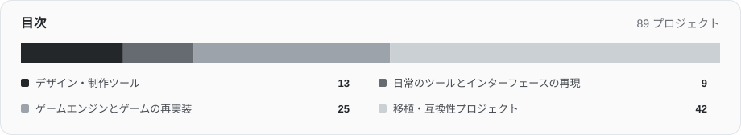

# Awesome RemakeList

ソフトウェアの再実装、ゲームエンジン、移植作品と、試す前に必要な準備をまとめたリストです。

[English](README.md) · [简体中文](README.zh-CN.md) · **日本語** · [한국어](README.ko.md) · [Español](README.es.md)

[RemakeList を見る](https://remakelist.com/ja/?utm_source=github&utm_medium=repository&utm_campaign=awesome-remakelist&utm_content=intro-ja) · [プロジェクトを推薦](https://github.com/CharlexH/awesome-remakelist/issues/new?template=project.yml)

 

プロジェクト名から作者の公開元へ移動できます。各項目を開くと、対応機器、ゲームデータ、ビルドの要件を確認できます。RemakeList にはスクリーンショットと導入の説明もあります。

## まずはこちら

| プロジェクト | 詳しく見る | 利用方法 |
| --- | --- | --- |
| [Graphite](https://remakelist.com/ja/remakes/graphite/?utm_source=github&utm_medium=repository&utm_campaign=awesome-remakelist&utm_content=graphite-featured-ja) | Adobe Illustrator | [ブラウザーで試す](https://editor.graphite.art/) |
| [Webamp](https://remakelist.com/ja/remakes/webamp/?utm_source=github&utm_medium=repository&utm_campaign=awesome-remakelist&utm_content=webamp-featured-ja) | Winamp 2 | [ブラウザーで試す](https://webamp.org/) |
| [OpenTTD](https://remakelist.com/ja/remakes/openttd/?utm_source=github&utm_medium=repository&utm_campaign=awesome-remakelist&utm_content=openttd-featured-ja) | Transport Tycoon Deluxe | [ダウンロード](https://www.openttd.org/) |
| [OpenRCT2](https://remakelist.com/ja/remakes/openrct2/?utm_source=github&utm_medium=repository&utm_campaign=awesome-remakelist&utm_content=openrct2-featured-ja) | RollerCoaster Tycoon 2 | [プログラムをダウンロード・ゲームデータは自分で用意](https://openrct2.io/download) |
| [D2R Mobile](https://remakelist.com/ja/remakes/d2r-mobile/?utm_source=github&utm_medium=repository&utm_campaign=awesome-remakelist&utm_content=d2r-mobile-featured-ja) | Diablo II: Resurrected | [自分でビルド・ゲームデータも用意](https://github.com/jhaizhou-ops/d2r-mobile/blob/main/README.md) |
| [nxnative](https://remakelist.com/ja/remakes/nxnative/?utm_source=github&utm_medium=repository&utm_campaign=awesome-remakelist&utm_content=nxnative-featured-ja) | Nintendo Switch ゲーム | [自分でビルド・ゲームデータも用意](https://github.com/seedds/nxnative#pack-an-ipa) |

## カテゴリを見る

- [デザイン・制作ツール](#creative) · 13
- [日常のツールとインターフェースの再現](#everyday) · 9
- [ゲームエンジンとゲームの再実装](#classic_games) · 30
- [移植・互換性プロジェクト](#ports) · 90

## デザイン・制作ツール

### [Compositor](https://github.com/robbietilton/Compositor)

Photoshop 型の作業手順を採用した、Apple silicon Mac 向けのレイヤー合成・ポスト処理エディター。

原作・参考元: **Adobe Photoshop** · 同様の機能を持つ独立した代替ツール  
[ダウンロード](https://github.com/robbietilton/Compositor/releases/tag/v1.5.12) · [RemakeList を見る](https://remakelist.com/ja/remakes/compositor/?utm_source=github&utm_medium=repository&utm_campaign=awesome-remakelist&utm_content=compositor-ja)

必要条件とスクリーンショット

**対応環境:** Apple silicon Mac · macOS 26 以降

**開発状況:** v1.5.12 · Apple Silicon · macOS 26以降

**必要なもの:** Photoshop のインストールは不要です。Apple silicon Mac と macOS 26 以降が必要で、ソースのビルドには Xcode 26 以降を使います。編集するメディアの権利は利用者が確認してください。

**現在利用できるもの:** v1.5.12 は macOS 26 以降の Apple Silicon Mac 向け DMG を提供します。ソースビルドには Xcode 26 以降が必要です。インターフェースは英語のみ。PSD／PSB の取り込みは8ビット RGB に限られ、CMYK は非対応です。一部のベクターや縦書き文字はラスタライズされます。RemakeList ではインストールや動作確認を行っていません。

**コードのライセンス:** [MIT](https://github.com/robbietilton/Compositor/blob/main/LICENSE)  
**作者:** robbietilton  
[公式ドキュメント](https://github.com/robbietilton/Compositor/blob/main/README.md) · 資料確認日: 2026-10-28

### [PhotoCraft](https://github.com/storytold/photocraft)

ArtCraft チームが Rust で再実装する、Photoshop 型の画像編集ツール。現在はアルファ版です。

原作・参考元: **Adobe Photoshop** · ワークフローの再実装  
[ダウンロード](https://github.com/storytold/photocraft/releases) · [RemakeList を見る](https://remakelist.com/ja/remakes/photocraft/?utm_source=github&utm_medium=repository&utm_campaign=awesome-remakelist&utm_content=photocraft-ja)

必要条件とスクリーンショット

**対応環境:** Windows / macOS / Linux / FreeBSD / ウェブ

**開発状況:** アルファ · 作業手順を開発中

**必要なもの:** Photoshop のインストールは不要です。編集画像には適切な権利が必要で、同梱フォントやアイコンには個別のライセンスがあります。ArtCraft の商標はコードのライセンスに含まれません。

**現在利用できるもの:** Photoshop なしで使えるアルファ版が配布されています。Windows、macOS、Linux、FreeBSD、ウェブへの対応が記載されていますが、PSD の互換性、ツールの充実度、プラグイン互換性は未完成で、業務全体を置き換える段階ではありません。

**コードのライセンス:** [MIT OR Apache-2.0](https://github.com/storytold/photocraft/blob/main/LICENSE-MIT)  
**作者:** storytold  
[公式ドキュメント](https://github.com/storytold/photocraft/blob/main/README.md) · 資料確認日: 2026-10-12

### [Graphite](https://github.com/GraphiteEditor/Graphite)

レイヤーとノードを組み合わせ、ブラウザーで非破壊編集ができるオープンソースのベクターデザインツール。

原作・参考元: **Adobe Illustrator** · 同様の機能を持つ独立した代替ツール  
[ブラウザーで試す](https://editor.graphite.art/) · [RemakeList を見る](https://remakelist.com/ja/remakes/graphite/?utm_source=github&utm_medium=repository&utm_campaign=awesome-remakelist&utm_content=graphite-ja)

必要条件とスクリーンショット

**対応環境:** ウェブ

**開発状況:** アルファ · ブラウザー版あり

**必要なもの:** Illustrator のインストールや原ソフトのファイルは不要です。画像、フォント、制作素材は自分で用意してください。

**現在利用できるもの:** ブラウザー版で、Illustrator なしにベクターデザインを試せます。まだアルファ版で、幅広い写真編集、モーション、出版、VFX 機能は発展途上です。Adobe の作業環境全体を置き換えるものではありません。

**コードのライセンス:** [MIT OR Apache-2.0](https://graphite.art/license/)  
**作者:** Graphite community  
[公式ドキュメント](https://github.com/GraphiteEditor/Graphite/blob/master/README.md) · 資料確認日: 2026-10-12

### [Friction](https://github.com/friction2d/friction)

ベクターとラスターのアニメーション、タイムライン、式に対応した、オープンソースの 2D モーショングラフィックスツール。

原作・参考元: **Adobe After Effects** · 同様の機能を持つ独立した代替ツール  
[ダウンロード](https://friction.graphics/#download) · [RemakeList を見る](https://remakelist.com/ja/remakes/friction/?utm_source=github&utm_medium=repository&utm_campaign=awesome-remakelist&utm_content=friction-ja)

必要条件とスクリーンショット

**対応環境:** Windows / macOS / Linux

**開発状況:** デスクトップ版あり · 2D モーショングラフィックス

**必要なもの:** After Effects のインストールは不要です。画像、フォント、音声、動画素材は自分で用意してください。

**現在利用できるもの:** Windows、Linux、macOS 向けのダウンロードがあります。2D アニメーションとモーショングラフィックスを制作できますが、独自シェーダー効果は実験段階です。After Effects のプロジェクト、プラグイン、エフェクトチェーン全体の互換性は保証されていません。

**コードのライセンス:** [GPL-3.0-only](https://github.com/friction2d/friction/blob/main/LICENSE.md)  
**作者:** Ole-André Rodlie &amp; contributors  
[公式ドキュメント](https://friction.graphics/) · 資料確認日: 2026-10-12

### [OpenCut](https://github.com/OpenCut-app/OpenCut)

CapCut 型の編集を目指すオープンソース動画エディター。次期版を書き直している間、従来の初期ベータ版を公開しています。

原作・参考元: **CapCut** · 同様の機能を持つ独立した代替ツール  
[ブラウザーで試す](https://opencut.app/) · [RemakeList を見る](https://remakelist.com/ja/remakes/opencut/?utm_source=github&utm_medium=repository&utm_campaign=awesome-remakelist&utm_content=opencut-ja)

必要条件とスクリーンショット

**対応環境:** ウェブ

**開発状況:** 初期ベータ · 書き直し中

**必要なもの:** CapCut のインストールは不要です。利用する権利のある動画、画像、音声を取り込んでください。

**現在利用できるもの:** 公式サイトでは現在、従来の初期ベータ版を提供しています。そのソースはアーカイブされ、新版は書き直し中です。試す価値のある候補ですが、日常の CapCut の作業を全面的に引き継げると考える段階ではありません。

**コードのライセンス:** [MIT](https://github.com/OpenCut-app/OpenCut/blob/main/LICENSE)  
**作者:** OpenCut contributors  
[公式ドキュメント](https://github.com/OpenCut-app/OpenCut/blob/main/README.md) · 資料確認日: 2026-10-12

### [Penpot](https://github.com/penpot/penpot)

ホスト版でもセルフホストでも使える、オープンソースの共同デザイン・プロトタイピング基盤。

原作・参考元: **Figma** · 同様の機能を持つ独立した代替ツール  
[アカウント登録またはセルフホスト](https://design.penpot.app) · [RemakeList を見る](https://remakelist.com/ja/remakes/penpot/?utm_source=github&utm_medium=repository&utm_campaign=awesome-remakelist&utm_content=penpot-ja)

必要条件とスクリーンショット

**対応環境:** ブラウザー / セルフホスト

**開発状況:** 公式ドキュメントを参照

**必要なもの:** Figma のソフトや素材は不要です。移行には自分のデザインを書き出し、読み込む必要があります。

**現在利用できるもの:** ホスト版に登録するか、自分で設置して使えます。既存のデザインを移すには書き出しと読み込みが必要です。ホスト版のプランは料金ページを確認してください。

**コードのライセンス:** [MPL-2.0](https://github.com/penpot/penpot/blob/develop/LICENSE)  
**作者:** penpot  
[公式ドキュメント](https://penpot.app/penpot-vs-figma) · 資料確認日: 2026-10-11

### [VectorCraft](https://github.com/storytold/vectorcraft)

ArtCraft が Rust で再実装する Adobe Illustrator 型の制作環境。ペン描画、パスのブール演算、アピアランス効果、ベクターイラストを扱います。

原作・参考元: **Adobe Illustrator** · ワークフローの再実装  
[ダウンロード](https://getartcraft.com/apps/vectorcraft) · [RemakeList を見る](https://remakelist.com/ja/remakes/vectorcraft/?utm_source=github&utm_medium=repository&utm_campaign=awesome-remakelist&utm_content=vectorcraft-ja)

必要条件とスクリーンショット

**対応環境:** Windows / macOS / Linux / ウェブ

**開発状況:** アルファ

**必要なもの:** 市販の原ソフトは不要です。利用権限のある文書やメディアを用意してください。同梱のフォント、画像、ブランド商標には個別のライセンスがあります。

**現在利用できるもの:** アルファ版で、日常的なベクター描画を試せます。複雑なファイルの相互変換や効果の再現性は確認が必要です。デスクトップ用インストーラーがあり、対応環境とファイル互換性はプロジェクト資料で確認してください。

**コードのライセンス:** [MIT OR Apache-2.0](https://github.com/storytold/vectorcraft/blob/main/LICENSE-MIT)  
**作者:** ArtCraft  
[公式ドキュメント](https://github.com/storytold/vectorcraft/blob/main/README.md) · 資料確認日: 2026-10-12

### [FilmCraft](https://github.com/storytold/filmcraft)

ArtCraft が Rust で再実装する Adobe Premiere Pro 型の制作環境。ソース・プログラムモニター、複数トラックのタイムライン、トリム編集を備えます。

原作・参考元: **Adobe Premiere Pro** · ワークフローの再実装  
[ダウンロード](https://getartcraft.com/apps/filmcraft) · [RemakeList を見る](https://remakelist.com/ja/remakes/filmcraft/?utm_source=github&utm_medium=repository&utm_campaign=awesome-remakelist&utm_content=filmcraft-ja)

必要条件とスクリーンショット

**対応環境:** Windows / macOS / Linux

**開発状況:** アルファ

**必要なもの:** 市販の原ソフトは不要です。利用権限のある文書やメディアを用意してください。同梱のフォント、画像、ブランド商標には個別のライセンスがあります。

**現在利用できるもの:** アルファ版で、編集と書き出しの作業ができます。大容量メディアの性能、効果の描画、業務用プロジェクトの相互変換は未完成です。デスクトップ用インストーラーがあり、対応環境とファイル互換性はプロジェクト資料で確認してください。

**コードのライセンス:** [MIT OR Apache-2.0](https://github.com/storytold/filmcraft/blob/main/LICENSE-MIT)  
**作者:** ArtCraft  
[公式ドキュメント](https://github.com/storytold/filmcraft/blob/main/README.md) · 資料確認日: 2026-10-12

### [LightCraft](https://github.com/storytold/lightcraft)

ArtCraft が Rust で再実装する Adobe Lightroom 型の制作環境。写真ライブラリー管理、RAW 現像、非破壊の色調整を扱います。

原作・参考元: **Adobe Lightroom** · ワークフローの再実装  
[ダウンロード](https://getartcraft.com/apps/lightcraft) · [RemakeList を見る](https://remakelist.com/ja/remakes/lightcraft/?utm_source=github&utm_medium=repository&utm_campaign=awesome-remakelist&utm_content=lightcraft-ja)

必要条件とスクリーンショット

**対応環境:** Windows / macOS / Linux / ウェブ

**開発状況:** アルファ

**必要なもの:** 市販の原ソフトは不要です。利用権限のある文書やメディアを用意してください。同梱のフォント、画像、ブランド商標には個別のライセンスがあります。

**現在利用できるもの:** アルファ版で、JPEG、DNG、多くのカメラ RAW 形式を試せます。カメラの色校正と一部の圧縮 RAW 形式は未完成です。デスクトップ用インストーラーがあり、対応環境とファイル互換性はプロジェクト資料で確認してください。

**コードのライセンス:** [MIT OR Apache-2.0](https://github.com/storytold/lightcraft/blob/main/LICENSE-MIT)  
**作者:** ArtCraft  
[公式ドキュメント](https://github.com/storytold/lightcraft/blob/main/README.md) · 資料確認日: 2026-10-12

### [EffectCraft](https://github.com/storytold/effectcraft)

ArtCraft が Rust で再実装する Adobe After Effects 型の制作環境。レイヤー合成、キーフレームアニメーション、モーショングラフィックス、効果を扱います。

原作・参考元: **Adobe After Effects** · ワークフローの再実装  
[ダウンロード](https://getartcraft.com/apps/effectcraft) · [RemakeList を見る](https://remakelist.com/ja/remakes/effectcraft/?utm_source=github&utm_medium=repository&utm_campaign=awesome-remakelist&utm_content=effectcraft-ja)

必要条件とスクリーンショット

**対応環境:** Windows / macOS / Linux / ウェブ

**開発状況:** 開発初期

**必要なもの:** 市販の原ソフトは不要です。利用権限のある文書やメディアを用意してください。同梱のフォント、画像、ブランド商標には個別のライセンスがあります。

**現在利用できるもの:** 開発初期で、アニメーションと合成の実験向けです。顧客への納品向けではなく、AEP/AEPX プロジェクトと After Effects プラグインには非対応です。デスクトップ用インストーラーがあり、対応環境とファイル互換性はプロジェクト資料で確認してください。

**コードのライセンス:** [MIT OR Apache-2.0](https://github.com/storytold/effectcraft/blob/main/LICENSE-MIT)  
**作者:** ArtCraft  
[公式ドキュメント](https://github.com/storytold/effectcraft/blob/main/README.md) · 資料確認日: 2026-10-12

### [DesignCraft](https://github.com/storytold/designcraft)

ArtCraft が Rust で再実装する Adobe InDesign 型の制作環境。見開きレイアウト、連結テキストフレーム、親ページ、出版用文書を扱います。

原作・参考元: **Adobe InDesign** · ワークフローの再実装  
[ダウンロード](https://getartcraft.com/apps/designcraft) · [RemakeList を見る](https://remakelist.com/ja/remakes/designcraft/?utm_source=github&utm_medium=repository&utm_campaign=awesome-remakelist&utm_content=designcraft-ja)

必要条件とスクリーンショット

**対応環境:** Windows / macOS / Linux / ウェブ

**開発状況:** 開発中

**必要なもの:** 市販の原ソフトは不要です。利用権限のある文書やメディアを用意してください。同梱のフォント、画像、ブランド商標には個別のライセンスがあります。

**現在利用できるもの:** 開発中で、レイアウトと書き出しを試せるビルドがあります。複雑な出版ファイル、組版、印刷製版は個別の確認が必要です。デスクトップ用インストーラーがあり、対応環境とファイル互換性はプロジェクト資料で確認してください。

**コードのライセンス:** [MIT OR Apache-2.0](https://github.com/storytold/designcraft/blob/main/LICENSE-MIT)  
**作者:** ArtCraft  
[公式ドキュメント](https://github.com/storytold/designcraft/blob/main/README.md) · 資料確認日: 2026-10-12

### [SoundCraft](https://github.com/storytold/soundcraft)

ArtCraft が Rust で再実装する Avid Pro Tools 型の制作環境。トラック録音、編集ウィンドウ、ミキサー、MIDI 編曲を備えます。

原作・参考元: **Avid Pro Tools** · ワークフローの再実装  
[ダウンロード](https://getartcraft.com/apps/soundcraft) · [RemakeList を見る](https://remakelist.com/ja/remakes/soundcraft/?utm_source=github&utm_medium=repository&utm_campaign=awesome-remakelist&utm_content=soundcraft-ja)

必要条件とスクリーンショット

**対応環境:** Windows / macOS / Linux / ウェブ

**開発状況:** プレアルファ

**必要なもの:** 市販の原ソフトは不要です。利用権限のある文書やメディアを用意してください。同梱のフォント、画像、ブランド商標には個別のライセンスがあります。

**現在利用できるもの:** プレアルファ版で、録音、編集、ミキシング、バウンスの作業ができます。音声デバイス・バッファー選択、MIDI コントローラー録音、AAF/OMF の相互変換は未実装です。デスクトップ用インストーラーがあり、対応環境とファイル互換性はプロジェクト資料で確認してください。

**コードのライセンス:** [MIT OR Apache-2.0](https://github.com/storytold/soundcraft/blob/main/LICENSE-MIT)  
**作者:** ArtCraft  
[公式ドキュメント](https://github.com/storytold/soundcraft/blob/main/README.md) · 資料確認日: 2026-10-12

### [CADCraft](https://github.com/storytold/cadcraft)

ArtCraft が Rust で再実装する Autodesk AutoCAD 型の作業環境。コマンドライン製図、オブジェクトスナップ、レイヤー、寸法、図面レイアウトを扱います。

原作・参考元: **Autodesk AutoCAD** · ワークフローの再実装  
[ダウンロード](https://getartcraft.com/apps/cadcraft) · [RemakeList を見る](https://remakelist.com/ja/remakes/cadcraft/?utm_source=github&utm_medium=repository&utm_campaign=awesome-remakelist&utm_content=cadcraft-ja)

必要条件とスクリーンショット

**対応環境:** Windows / macOS / Linux / ウェブ

**開発状況:** 開発初期

**必要なもの:** 市販の原ソフトは不要です。利用権限のある文書やメディアを用意してください。同梱のフォント、画像、ブランド商標には個別のライセンスがあります。

**現在利用できるもの:** 開発初期で、2D 図面と PDF 出力を試す用途に向きます。AutoCAD の 3D、DWG、業界向けプラグインのすべてを代替するものではありません。デスクトップ用インストーラーがあり、対応環境とファイル互換性はプロジェクト資料で確認してください。

**コードのライセンス:** [MIT OR Apache-2.0](https://github.com/storytold/cadcraft/blob/main/LICENSE-MIT)  
**作者:** ArtCraft  
[公式ドキュメント](https://github.com/storytold/cadcraft/blob/main/README.md) · 資料確認日: 2026-10-12

## 日常のツールとインターフェースの再現

### [ONLYOFFICE Desktop Editors](https://github.com/ONLYOFFICE/DesktopEditors)

文書、表計算、プレゼンテーション、PDF を一つのデスクトップアプリでオフライン編集できる、オープンソースの Microsoft Office 代替。

原作・参考元: **Microsoft Office** · 同様の機能を持つ独立した代替ツール  
[ダウンロード](https://www.onlyoffice.com/download-desktop) · [RemakeList を見る](https://remakelist.com/ja/remakes/onlyoffice/?utm_source=github&utm_medium=repository&utm_campaign=awesome-remakelist&utm_content=onlyoffice-ja)

必要条件とスクリーンショット

**対応環境:** Windows / macOS / Linux

**開発状況:** 安定版あり

**必要なもの:** ローカル編集に Microsoft Office のインストールやアカウントは不要です。クラウドでの共同作業には対応サービスが必要で、有料の場合があります。

**現在利用できるもの:** Windows、macOS、Linux 向けのインストーラーがあり、ローカル保存とオフライン編集に対応します。デスクトップ版は無料ですが、クラウドサービスや企業向け版には別のプランがあります。移行前に複雑な文書のレイアウトを確認してください。

**コードのライセンス:** [AGPL-3.0](https://github.com/ONLYOFFICE/DesktopEditors/blob/master/LICENSE)  
**作者:** ONLYOFFICE  
[公式ドキュメント](https://github.com/ONLYOFFICE/DesktopEditors) · 資料確認日: 2026-10-12

### [Grist](https://github.com/gristlabs/grist-core)

リレーショナルデータと表計算型の編集を組み合わせた、Excel や Airtable の作業に使えるオープンソースの代替。

原作・参考元: **Microsoft Excel / Airtable** · 同様の機能を持つ独立した代替ツール  
[ダウンロード](https://github.com/gristlabs/grist-desktop/releases) · [RemakeList を見る](https://remakelist.com/ja/remakes/grist/?utm_source=github&utm_medium=repository&utm_campaign=awesome-remakelist&utm_content=grist-ja)

必要条件とスクリーンショット

**対応環境:** Windows / macOS / Linux

**開発状況:** 安定版あり

**必要なもの:** デスクトップ版はローカルファイルを編集します。セルフホストにはサーバー環境が必要です。ホスト版にはアカウントが必要で、使用量と機能に制限があります。

**現在利用できるもの:** Windows、macOS、Linux のデスクトップ版でローカルファイルを編集でき、Community 版はセルフホストも可能です。ホスト版の無料・有料プランは別で、企業向け機能のすべてがオープンソースの中核に含まれるわけではありません。

**コードのライセンス:** [Apache-2.0](https://github.com/gristlabs/grist-core/blob/main/LICENSE.txt)  
**作者:** Grist Labs  
[公式ドキュメント](https://github.com/gristlabs/grist-core) · 資料確認日: 2026-10-12

### [LibreOffice](https://github.com/LibreOffice/core)

文書の Writer、表計算の Calc、プレゼンテーションの Impress を備えた、無料・オープンソースの Microsoft Office 代替。

原作・参考元: **Microsoft Office** · 同様の機能を持つ独立した代替ツール  
[ダウンロード](https://www.libreoffice.org/download/download-libreoffice/) · [RemakeList を見る](https://remakelist.com/ja/remakes/libreoffice/?utm_source=github&utm_medium=repository&utm_campaign=awesome-remakelist&utm_content=libreoffice-ja)

必要条件とスクリーンショット

**対応環境:** Windows / macOS / Linux

**開発状況:** 安定版あり

**必要なもの:** Microsoft Office のインストール、契約、アカウントは不要です。環境に合うデスクトップ版を入れ、編集権限のあるファイルを使用してください。

**現在利用できるもの:** Windows、macOS、Linux 向けに配布され、日常のオフィス作業をひと通り行えます。VBA マクロ、複雑な Office テンプレート、厳密なレイアウト再現が必要なら、先に自分のファイルで試してください。

**コードのライセンス:** [MPL-2.0 (primarily)](https://www.libreoffice.org/licenses/)  
**作者:** The Document Foundation  
[公式ドキュメント](https://www.libreoffice.org/) · 資料確認日: 2026-10-12

### [Webamp](https://github.com/captbaritone/webamp)

クラシックなプレーヤー画面とスキン対応を備えた、Winamp 2 のブラウザー再実装。

原作・参考元: **Winamp 2** · Web での再実装  
[ブラウザーで試す](https://webamp.org/) · [RemakeList を見る](https://remakelist.com/ja/remakes/webamp/?utm_source=github&utm_medium=repository&utm_campaign=awesome-remakelist&utm_content=webamp-ja)

必要条件とスクリーンショット

**対応環境:** ブラウザー

**開発状況:** 公式ドキュメントを参照

**必要なもの:** Winamp のインストールは不要です。音声や第三者のスキンにはそれぞれの権利が適用されます。

**現在利用できるもの:** オンラインプレーヤーをブラウザーで直接開けます。原ソフトは不要で、再生したい音声を自分で用意します。

**コードのライセンス:** [MIT](https://github.com/captbaritone/webamp/blob/master/LICENSE.txt)  
**作者:** captbaritone  
[公式ドキュメント](https://github.com/captbaritone/webamp/blob/master/README.md) · 資料確認日: 2026-10-11

### [WinXP in React](https://github.com/ShizukuIchi/winXP)

Windows XP のデスクトップ、スタートメニュー、定番の小さなアプリをブラウザーで再現。

原作・参考元: **Windows XP のデスクトップ** · インターフェースの再現  
[ブラウザーで試す](https://winxp.vercel.app/) · [RemakeList を見る](https://remakelist.com/ja/remakes/winxp/?utm_source=github&utm_medium=repository&utm_campaign=awesome-remakelist&utm_content=winxp-ja)

必要条件とスクリーンショット

**対応環境:** ブラウザー

**開発状況:** 公式ドキュメントを参照

**必要なもの:** Windows XP のインストールファイルは不要です。

**現在利用できるもの:** Windows XP のインストールファイルなしでオンラインデモを使えます。再現されたデスクトップとアプリが対象で、任意の XP ソフトを動かすことはできません。

**コードのライセンス:** [MIT (project code)](https://github.com/ShizukuIchi/winXP/blob/master/LICENSE)  
**作者:** ShizukuIchi  
[公式ドキュメント](https://github.com/ShizukuIchi/winXP/blob/master/README.md) · 資料確認日: 2026-10-11

### [PdfCraft](https://github.com/storytold/pdfcraft)

ArtCraft が Rust で再実装する Adobe Acrobat 型の作業環境。PDF 閲覧、注釈、ページ整理、結合、分割を扱います。

原作・参考元: **Adobe Acrobat** · ワークフローの再実装  
[ダウンロード](https://getartcraft.com/apps/pdfcraft) · [RemakeList を見る](https://remakelist.com/ja/remakes/pdfcraft/?utm_source=github&utm_medium=repository&utm_campaign=awesome-remakelist&utm_content=pdfcraft-ja)

必要条件とスクリーンショット

**対応環境:** Windows / macOS / Linux / ウェブ

**開発状況:** 初期アルファ

**必要なもの:** 市販の原ソフトは不要です。利用権限のある文書やメディアを用意してください。同梱のフォント、画像、ブランド商標には個別のライセンスがあります。

**現在利用できるもの:** 初期アルファ版で、閲覧とページ管理を利用できます。Acrobat の編集、署名、印刷製版の作業全体を代替するものではありません。デスクトップ用インストーラーがあり、対応環境とファイル互換性はプロジェクト資料で確認してください。

**コードのライセンス:** [MIT OR Apache-2.0](https://github.com/storytold/pdfcraft/blob/main/LICENSE-MIT)  
**作者:** ArtCraft  
[公式ドキュメント](https://github.com/storytold/pdfcraft/blob/main/README.md) · 資料確認日: 2026-10-12

### [WordCraft](https://github.com/storytold/wordcraft)

ArtCraft が Rust で再実装する Microsoft Word 型の作業環境。文書作成、スタイル、表、変更履歴、文書レイアウトを扱います。

原作・参考元: **Microsoft Word** · ワークフローの再実装  
[ダウンロード](https://getartcraft.com/apps/wordcraft) · [RemakeList を見る](https://remakelist.com/ja/remakes/wordcraft/?utm_source=github&utm_medium=repository&utm_campaign=awesome-remakelist&utm_content=wordcraft-ja)

必要条件とスクリーンショット

**対応環境:** Windows / macOS / Linux / ウェブ

**開発状況:** アルファ

**必要なもの:** 市販の原ソフトは不要です。利用権限のある文書やメディアを用意してください。同梱のフォント、画像、ブランド商標には個別のライセンスがあります。

**現在利用できるもの:** アルファ版で、文書作成と DOCX の作業を試せます。ページ区切り、グラフ・SmartArt の往復変換の再現性、ネイティブ印刷には改善が必要です。デスクトップ用インストーラーがあり、対応環境とファイル互換性はプロジェクト資料で確認してください。

**コードのライセンス:** [MIT OR Apache-2.0](https://github.com/storytold/wordcraft/blob/main/LICENSE-MIT)  
**作者:** ArtCraft  
[公式ドキュメント](https://github.com/storytold/wordcraft/blob/main/README.md) · 資料確認日: 2026-10-13

### [DeckCraft](https://github.com/storytold/deckcraft)

ArtCraft が Rust で再実装する Microsoft PowerPoint 型の制作環境。スライドマスター、テーマ、図形、アニメーション、スライドショー再生を備えます。

原作・参考元: **Microsoft PowerPoint** · ワークフローの再実装  
[ダウンロード](https://getartcraft.com/apps/deckcraft) · [RemakeList を見る](https://remakelist.com/ja/remakes/deckcraft/?utm_source=github&utm_medium=repository&utm_campaign=awesome-remakelist&utm_content=deckcraft-ja)

必要条件とスクリーンショット

**対応環境:** Windows / macOS / Linux / ウェブ

**開発状況:** アルファ

**必要なもの:** 市販の原ソフトは不要です。利用権限のある文書やメディアを用意してください。同梱のフォント、画像、ブランド商標には個別のライセンスがあります。

**現在利用できるもの:** アルファ版で、資料の作成と発表ができます。複雑な PPTX ファイルやアニメーションが PowerPoint と同じように動くとは限りません。デスクトップ用インストーラーがあり、対応環境とファイル互換性はプロジェクト資料で確認してください。

**コードのライセンス:** [MIT OR Apache-2.0](https://github.com/storytold/deckcraft/blob/main/LICENSE-MIT)  
**作者:** ArtCraft  
[公式ドキュメント](https://github.com/storytold/deckcraft/blob/main/README.md) · 資料確認日: 2026-10-13

### [GridCraft](https://github.com/storytold/gridcraft)

ArtCraft が Rust で再実装する Microsoft Excel 型の作業環境。ワークシート、数式、テーブル、グラフ、ピボットテーブルを扱います。

原作・参考元: **Microsoft Excel** · ワークフローの再実装  
[ダウンロード](https://getartcraft.com/apps/gridcraft) · [RemakeList を見る](https://remakelist.com/ja/remakes/gridcraft/?utm_source=github&utm_medium=repository&utm_campaign=awesome-remakelist&utm_content=gridcraft-ja)

必要条件とスクリーンショット

**対応環境:** Windows / macOS / Linux / ウェブ

**開発状況:** アルファ

**必要なもの:** 市販の原ソフトは不要です。利用権限のある文書やメディアを用意してください。同梱のフォント、画像、ブランド商標には個別のライセンスがあります。

**現在利用できるもの:** アルファ版で、基本的な表計算を試せます。実際の XLSX ファイルの再現性、大きなブックの性能、グラフ機能、旧形式の読み込みには改善が必要です。デスクトップ用インストーラーがあり、対応環境とファイル互換性はプロジェクト資料で確認してください。

**コードのライセンス:** [MIT OR Apache-2.0](https://github.com/storytold/gridcraft/blob/main/LICENSE-MIT)  
**作者:** ArtCraft  
[公式ドキュメント](https://github.com/storytold/gridcraft/blob/main/README.md) · 資料確認日: 2026-10-13

## ゲームエンジンとゲームの再実装

### [Vanguard Engine](https://github.com/harshilmathur/openra2)

Red Alert 2 のデータ向けに作られた独立したブラウザー RTS エンジン。現在はソ連軍の一人用小規模戦に絞って開発されています。

原作・参考元: **Red Alert 2 / Yuri’s Revenge のデータ** · エンジンの再実装  
[ソースからビルド](https://github.com/harshilmathur/openra2/blob/master/README.md#quickstart) · [RemakeList を見る](https://remakelist.com/ja/remakes/vanguard/?utm_source=github&utm_medium=repository&utm_campaign=awesome-remakelist&utm_content=vanguard-ja)

必要条件とスクリーンショット

**対応環境:** ブラウザー · ローカル開発サーバー

**開発状況:** 開発版 · 正式リリースなし

**必要なもの:** Classic モードには正規に所有する RA2/YR のファイルが必要です。Original モードはリポジトリ独自の素材を使い、原作は不要です。両モードは別です。Node.js 20.19 以降とローカル開発サーバーが必要です。

**現在利用できるもの:** 正式リリース前の開発版で、Node.js 20.19 以降とローカル開発サーバーが必要です。Classic モードには適法に入手した RA2/YR のファイルが必要ですが、Original モードに原作は不要です。連合軍、ネット対戦、Yuri のゲーム内容は未完成で、Red Alert 2 全体を再現したものではありません。

**コードのライセンス:** [GPL-3.0-or-later](https://github.com/harshilmathur/openra2/blob/master/LICENSE)  
**作者:** harshilmathur  
[公式ドキュメント](https://github.com/harshilmathur/openra2/blob/master/README.md) · 資料確認日: 2026-10-12

### [OpenTTD](https://github.com/OpenTTD/OpenTTD)

Transport Tycoon の遊びを現代の環境向けに作り直し、マルチプレイを拡充。

原作・参考元: **Transport Tycoon Deluxe** · ゲームの再実装  
[ダウンロード](https://www.openttd.org/) · [RemakeList を見る](https://remakelist.com/ja/remakes/openttd/?utm_source=github&utm_medium=repository&utm_campaign=awesome-remakelist&utm_content=openttd-ja)

必要条件とスクリーンショット

**対応環境:** Windows / macOS / Linux

**開発状況:** 公式ドキュメントを参照

**必要なもの:** 基本グラフィックが必要です。無料の OpenGFX2 または OpenGFX を利用できます。OpenSFX の効果音と OpenMSX の音楽は任意です。この無料の始め方では原作のファイルは不要です。

**現在利用できるもの:** デスクトップ版が配布されています。必須の基本グラフィックには無料の OpenGFX2 または OpenGFX を用意してください。OpenSFX の効果音と OpenMSX の音楽は任意です。この方法では原作のファイルは不要です。

**コードのライセンス:** [GPL-2.0; third-party components have separate licenses](https://github.com/OpenTTD/OpenTTD/blob/master/COPYING.md)  
**作者:** OpenTTD  
[公式ドキュメント](https://github.com/OpenTTD/OpenTTD/blob/master/README.md) · 資料確認日: 2026-10-11

### [OpenRCT2](https://github.com/OpenRCT2/OpenRCT2)

共同マルチプレイなどの改善を加え、RollerCoaster Tycoon 2 を現代の環境で。

原作・参考元: **RollerCoaster Tycoon 2** · ゲームの再実装  
[プログラムをダウンロード・ゲームデータは自分で用意](https://openrct2.io/download) · [RemakeList を見る](https://remakelist.com/ja/remakes/openrct2/?utm_source=github&utm_medium=repository&utm_campaign=awesome-remakelist&utm_content=openrct2-ja)

必要条件とスクリーンショット

**対応環境:** Windows / macOS / Linux

**開発状況:** 公式ドキュメントを参照

**必要なもの:** RCT2 の原作データを自分で用意する必要があります。RCT1 のデータでシナリオを追加できます。

**現在利用できるもの:** 配布版はありますが、RCT2 の原作データを自分で用意する必要があります。RCT1 のデータを使うとそのシナリオも追加できます。無料のエンジンに市販の原作素材は含まれません。

**コードのライセンス:** [GPL-3.0-or-later](https://github.com/OpenRCT2/OpenRCT2/blob/develop/licence.txt)  
**作者:** OpenRCT2  
[公式ドキュメント](https://github.com/OpenRCT2/OpenRCT2/blob/develop/readme.md) · 資料確認日: 2026-10-11

### [OpenMW](https://github.com/OpenMW/openmw)

互換性と描画設定を改善した、Morrowind 向けの現代的なオープンソースエンジン。

原作・参考元: **The Elder Scrolls III: Morrowind** · エンジンの再実装  
[プログラムをダウンロード・ゲームデータは自分で用意](https://www.openmw.org) · [RemakeList を見る](https://remakelist.com/ja/remakes/openmw/?utm_source=github&utm_medium=repository&utm_campaign=awesome-remakelist&utm_content=openmw-ja)

必要条件とスクリーンショット

**対応環境:** Windows / macOS / Linux

**開発状況:** 公式ドキュメントを参照

**必要なもの:** Morrowind を遊ぶには原作を所有し、そのデータファイルを設定する必要があります。

**現在利用できるもの:** エンジンはダウンロードできますが、Morrowind を遊ぶには原作を所有し、データファイルを設定する必要があります。原作の MOD の一部は非対応のため、手持ちの構成を確認してください。

**コードのライセンス:** [GPLv3; some fonts separately licensed](https://github.com/OpenMW/openmw/blob/master/LICENSE)  
**作者:** OpenMW  
[公式ドキュメント](https://github.com/OpenMW/openmw/blob/master/README.md) · 資料確認日: 2026-10-11

### [OpenRA](https://github.com/OpenRA/OpenRA)

現代的な操作と三つの公式ゲーム MOD で、名作リアルタイム戦略ゲームを再構成。

原作・参考元: **Red Alert 1 / Command &amp; Conquer / Dune 2000** · ゲームの再構想  
[ダウンロード](https://www.openra.net/) · [RemakeList を見る](https://remakelist.com/ja/remakes/openra/?utm_source=github&utm_medium=repository&utm_campaign=awesome-remakelist&utm_content=openra-ja)

必要条件とスクリーンショット

**対応環境:** Windows / macOS / Linux

**開発状況:** 公式ドキュメントを参照

**必要なもの:** 原作のゲーム素材を使います。公式インストーラーは初回起動時に必要な素材を取得するか、原作ディスクから取り込めます。

**現在利用できるもの:** Windows、macOS、Linux 向けに配布されています。原作素材が必要ですが、プロジェクトによると初回設定で必要な素材を取得するか、原作ディスクから取り込めます。

**コードのライセンス:** [GPL-3.0-or-later (engine)](https://github.com/OpenRA/OpenRA/blob/bleed/COPYING)  
**作者:** OpenRA  
[公式ドキュメント](https://www.openra.net/about/) · 資料確認日: 2026-10-11

### [fheroes2](https://github.com/ihhub/fheroes2)

現代的な改善を加えた、デスクトップと Android 向けの Heroes of Might and Magic II エンジン再実装。

原作・参考元: **Heroes of Might and Magic II** · エンジンの再実装  
[プログラムをダウンロード・ゲームデータは自分で用意](https://github.com/ihhub/fheroes2/releases) · [RemakeList を見る](https://remakelist.com/ja/remakes/fheroes2/?utm_source=github&utm_medium=repository&utm_campaign=awesome-remakelist&utm_content=fheroes2-ja)

必要条件とスクリーンショット

**対応環境:** Windows / macOS / Linux / Android

**開発状況:** 配布版あり · 原作またはデモデータが必要

**必要なもの:** 原作全体のデータ、または公式英語デモのデータが必要です。INSTALL.md に同梱のデモダウンロード手順があります。デモ素材で使えるのは、その許諾範囲の限られた内容のみです。

**現在利用できるもの:** 配布版には原作全体のデータ、または公式英語デモのデータが必要で、導入手順にデモの入手方法があります。デモの内容は限定的で、全編を遊ぶには適法に所有する原作素材が必要です。設定方法は環境によって異なります。

**コードのライセンス:** [GPL-2.0-or-later](https://github.com/ihhub/fheroes2/blob/master/LICENSE)  
**作者:** ihhub  
[公式ドキュメント](https://github.com/ihhub/fheroes2/blob/master/README.md) · 資料確認日: 2026-10-12

### [OpenXcom](https://github.com/OpenXcom/OpenXcom)

追加 MOD に対応した、初期の X-COM 二作品のデスクトップ再実装。

原作・参考元: **UFO: Enemy Unknown / Terror from the Deep** · ゲームの再実装  
[プログラムをダウンロード・ゲームデータは自分で用意](https://github.com/OpenXcom/OpenXcom/releases) · [RemakeList を見る](https://remakelist.com/ja/remakes/openxcom/?utm_source=github&utm_medium=repository&utm_campaign=awesome-remakelist&utm_content=openxcom-ja)

必要条件とスクリーンショット

**対応環境:** Windows / macOS / Linux

**開発状況:** デスクトップエンジン · 原作データが必要

**必要なもの:** UFO: Enemy Unknown または Terror from the Deep の未改変の原作データが必要です。Windows のインストーラーで所有する Steam 版から素材を抽出できます。

**現在利用できるもの:** デスクトップ版には、どちらかの原作の未改変データが必要です。Windows のインストーラーは所有する Steam 版から素材を抽出できます。追加 MOD には別の素材要件がある場合があります。

**コードのライセンス:** [GPL-3.0-or-later](https://github.com/OpenXcom/OpenXcom/blob/master/LICENSE.txt)  
**作者:** OpenXcom  
[公式ドキュメント](https://github.com/OpenXcom/OpenXcom/blob/master/README.md) · 資料確認日: 2026-10-12

### [VCMI](https://github.com/vcmi/vcmi)

デスクトップとモバイルに対応し、MODとマルチプレイを備えたオープンソースのHeroes IIIエンジン。

原作・参考元: **Heroes of Might and Magic III** · エンジンの再実装  
[プログラムをダウンロード・ゲームデータは自分で用意](https://vcmi.eu/download/) · [RemakeList を見る](https://remakelist.com/ja/remakes/vcmi/?utm_source=github&utm_medium=repository&utm_campaign=awesome-remakelist&utm_content=vcmi-ja)

必要条件とスクリーンショット

**対応環境:** Windows / macOS / Linux / Android / iOS

**開発状況:** 公開版 · 原作データが必要

**必要なもの:** 全編には、所有するHeroes III CompleteまたはShadow of Deathのデータが必要です。ランチャーからGOGのオフラインインストーラーや既存インストールを取り込めます。HD Edition単体では不足し、追加要素として使う場合もComplete/SoDが必要です。公式MOD一覧では内容限定のデモにも別途対応しています。

**現在利用できるもの:** 1.7.5版を公開。Windows、macOS、Linux、Android向けパッケージがあり、iOSはTestFlightまたはサイドロードを使用します。完全な互換性は保証されません。RemakeListでは実行していません。

**コードのライセンス:** [GPL-2.0-or-later code; VCMI-created assets CC-BY-SA 4.0; original game assets separate](https://github.com/vcmi/vcmi/blob/66fa496c6328a276c4eb14c0011b3a9d751dfac3/license.txt)  
**作者:** VCMI Team  
[公式ドキュメント](https://github.com/vcmi/vcmi/blob/66fa496c6328a276c4eb14c0011b3a9d751dfac3/docs/Readme.md) · 資料確認日: 2026-10-18

### [Julius](https://github.com/bvschaik/julius)

Caesar IIIのロジックを忠実に再実装し、原作の都市建設ゲームを現代のデスクトップやAndroidなどへ移植。

原作・参考元: **Caesar III** · ゲームの再実装  
[プログラムをダウンロード・ゲームデータは自分で用意](https://github.com/bvschaik/julius/releases/tag/v1.8.0) · [RemakeList を見る](https://remakelist.com/ja/remakes/julius/?utm_source=github&utm_medium=repository&utm_campaign=awesome-remakelist&utm_content=julius-ja)

必要条件とスクリーンショット

**対応環境:** Windows · Linux · macOS · Android · Web（Emscripten）· PS Vita · Nintendo Switch

**開発状況:** 公開済み · 原作ゲームデータが必要

**必要なもの:** 所有するCD-ROM、GOG、Steam版Caesar IIIの完全なインストールデータを用意し、1.0.1.0へ更新してください。Juliusはそのデータフォルダーを使用し、セーブを書き込む権限を必要とします。コードのライセンスは原作素材を提供せず、その利用権も付与しません。

**現在利用できるもの:** 1.8.0版はWindows、Linux、macOS、Androidのほか、Vita、Switch、Emscripten向けパッケージを提供。ブラウザー版も設定と原作データが必要です。RemakeListでは実行していません。

**コードのライセンス:** [AGPL-3.0 · engine code; original Caesar III assets are separate](https://github.com/bvschaik/julius/blob/34d1ecd54befb845c0139b371fa8a0438210dac1/LICENSE.txt)  
**作者:** Bianca van Schaik and contributors  
[公式ドキュメント](https://github.com/bvschaik/julius/blob/34d1ecd54befb845c0139b371fa8a0438210dac1/README.md) · 資料確認日: 2026-10-18

### [CorsixTH](https://github.com/CorsixTH/CorsixTH)

現代のデスクトップ環境、高解像度、編集可能な病院経営キャンペーンに対応するTheme Hospitalのエンジン再実装。

原作・参考元: **Theme Hospital** · ゲームの再実装  
[プログラムをダウンロード・ゲームデータは自分で用意](https://github.com/CorsixTH/CorsixTH/releases/tag/v0.70.1) · [RemakeList を見る](https://remakelist.com/ja/remakes/corsixth/?utm_source=github&utm_medium=repository&utm_campaign=awesome-remakelist&utm_content=corsixth-ja)

必要条件とスクリーンショット

**対応環境:** Windows · macOS · Linux · BSD

**開発状況:** 公開済み · 原作またはデモのデータが必要

**必要なもの:** 合法的に所有するTheme HospitalのCDまたはデジタル版のインストールデータを用意し、初回起動時にデータフォルダーを選択します。公式デモも利用できますが、1ステージのみで管理画面の大半はありません。エンジンのライセンスは原作素材の利用権を付与しません。

**現在利用できるもの:** バージョン0.70.1はWindowsとmacOS向けに公開され、LinuxではAppImageや各ディストリビューションのパッケージを利用できます。BSDにも対応。Mac版ではRtMidiによるハードウェアMIDIを無効化しています。RemakeListでは未実行です。

**コードのライセンス:** [MIT · engine code; Theme Hospital assets are separate](https://github.com/CorsixTH/CorsixTH/blob/master/LICENSE.txt)  
**作者:** CorsixTH team and contributors  
[公式ドキュメント](https://github.com/CorsixTH/CorsixTH/blob/master/README.md) · 資料確認日: 2026-10-19

### [Warzone 2100](https://github.com/Warzone2100/warzone2100)

1999年の3D戦略ゲームをコミュニティが継続開発。完全なキャンペーン、カスタマイズ可能なユニット、デスクトップ版のマルチプレイを提供します。

原作・参考元: **Warzone 2100 (1999)** · オープンソースでの継続開発  
[ダウンロード](https://wz2100.net/) · [RemakeList を見る](https://remakelist.com/ja/remakes/warzone2100/?utm_source=github&utm_medium=repository&utm_campaign=awesome-remakelist&utm_content=warzone2100-ja)

必要条件とスクリーンショット

**対応環境:** Windows · macOS · Linux · Web

**開発状況:** 公開済み · デスクトップ版とブラウザー版

**必要なもの:** 原作の別途購入やディスクイメージは不要です。公式パッケージを使用してください。一部の環境ではキャンペーン動画を公式サイトから別途ダウンロードする必要があります。コード、ゲームデータ、各コンポーネントには、それぞれ明記されたライセンスが適用されます。

**現在利用できるもの:** 4.7.0はWindows、macOS、Linux向けに公開され、Mac版はIntelとApple siliconに対応。公式ブラウザー版ではキャンペーンとスカーミッシュを遊べますが、描画品質が低く、オンラインマルチプレイはありません。RemakeListでは未実行です。

**コードのライセンス:** [GPL-2.0-or-later and component licenses](https://github.com/Warzone2100/warzone2100/blob/master/COPYING)  
**作者:** Warzone 2100 Project  
[公式ドキュメント](https://github.com/Warzone2100/warzone2100/blob/master/README.md) · 資料確認日: 2026-10-19

### [ScummVM](https://github.com/scummvm/scummvm)

再実装されたゲームエンジンで、Monkey Island、Myst、Blade Runnerなどの名作アドベンチャーを現代のデバイスで動かせます。

原作・参考元: **名作アドベンチャーとRPG** · エンジンの再実装  
[プログラムをダウンロード・ゲームデータは自分で用意](https://www.scummvm.org/downloads/) · [RemakeList を見る](https://remakelist.com/ja/remakes/scummvm/?utm_source=github&utm_medium=repository&utm_campaign=awesome-remakelist&utm_content=scummvm-ja)

必要条件とスクリーンショット

**対応環境:** Windows / macOS / Linux / Android / iOS

**開発状況:** 公開済み · 互換性はゲームと対応環境により異なる

**必要なもの:** ScummVM自体にゲームは含まれません。商用作品の多くは、対応するゲームデータを自分で用意する必要があります。公式のFreeware GamesページではBeneath a Steel Skyなどの無料完全版を別途配布しており、Demosページの制限付き体験版とは異なります。選んだゲームをフォルダーに展開し、ランチャーでそのフォルダーを追加してください。各ゲームの配布条件はそれぞれに適用されます。

**現在利用できるもの:** 安定版2026.4.0はWindows、macOS、Linux向けに公開されています。2026年10月19日時点で、公式ダウンロードページではAndroidとiOSのビルドを旧版欄の2026.3.0として掲載しています。RemakeListではゲームを実行していません。

**コードのライセンス:** [GPL-3.0-or-later engine code; individual game data retains its own terms](https://github.com/scummvm/scummvm/blob/7d2709da5136866589f7602f5f5a7b17de03420e/COPYING)  
**作者:** ScummVM Team  
[公式ドキュメント](https://github.com/scummvm/scummvm/blob/7d2709da5136866589f7602f5f5a7b17de03420e/README.md) · 資料確認日: 2026-10-19

### [RigelEngine](https://github.com/lethal-guitar/RigelEngine)

ワイドスクリーン、滑らかな移動、クイックセーブ、改善されたゲームパッド対応を備えたDuke Nukem IIのネイティブエンジン。

原作・参考元: **Duke Nukem II** · エンジンの再実装  
[プログラムをダウンロード・ゲームデータは自分で用意](https://github.com/lethal-guitar/RigelEngine/releases/tag/v0.9.1) · [RemakeList を見る](https://remakelist.com/ja/remakes/rigelengine/?utm_source=github&utm_medium=repository&utm_campaign=awesome-remakelist&utm_content=rigelengine-ja)

必要条件とスクリーンショット

**対応環境:** Windows / macOS / Linux

**開発状況:** 公開済み · 保守段階

**必要なもの:** Duke Nukem IIのインストールデータからNUKEM2.CMPを用意してください。全4エピソードには登録版データが必要で、シェアウェアで遊べる内容は限定的です。NUKEM2.F1からNUKEM2.F5は任意のオープニング動画です。初回起動時にゲームデータのフォルダーを選択します。公式READMEにはシェアウェアのアーカイブと正規の完全版販売元へのリンクがあります。RemakeListは原作データを提供しません。

**現在利用できるもの:** 公式0.9.1パッケージにはWindows x64版ZIP、macOS x64版DMG、Linux x64版DEBがあります。Apple silicon向けには、リリースページから別の第三者製Macユニバーサルビルドを案内しています。READMEではWeb版を現在利用不可としています。RemakeListでは未実行です。

**コードのライセンス:** [GPL-2.0-or-later engine code; original Duke Nukem II data is separate](https://github.com/lethal-guitar/RigelEngine/blob/30afeff8f0b105eac77ee0a2fbd54b06e1a49b60/LICENSE.md)  
**作者:** Nikolai Wuttke and contributors  
[公式ドキュメント](https://github.com/lethal-guitar/RigelEngine/blob/30afeff8f0b105eac77ee0a2fbd54b06e1a49b60/README.md) · 資料確認日: 2026-10-19

### [OpenLoco](https://github.com/OpenLoco/OpenLoco)

Chris Sawyer’s Locomotionを現代のC++で再実装し、運輸会社の経営シミュレーションを現在のデスクトップ環境で楽しめるようにしたプロジェクト。

原作・参考元: **Chris Sawyer’s Locomotion** · ゲームの再実装  
[プログラムをダウンロード・ゲームデータは自分で用意](https://openloco.io/download/) · [RemakeList を見る](https://remakelist.com/ja/remakes/openloco/?utm_source=github&utm_medium=repository&utm_campaign=awesome-remakelist&utm_content=openloco-ja)

必要条件とスクリーンショット

**対応環境:** Windows x86/x64 · Linux x64 · macOS Apple silicon

**開発状況:** 公開済み · 原作ゲームのデータが必要

**必要なもの:** Steam版やGOG版など、合法的に所有するLocomotionのインストールデータを用意してください。原作ファイルはアプリと別に保管します。OpenGraphicsの追加後も、資料に記載された原作データの要件は変わりません。MITライセンスは商用ゲーム素材の利用権を付与しません。

**現在利用できるもの:** v26.09ではWindows 32/64ビット版ZIP、Linux x86-64版AppImage、macOS arm64ネイティブアプリを提供しています。Mac版はApple siliconが必要で、署名および公証はされていません。RemakeListではこれらのビルドを実行していません。

**コードのライセンス:** [MIT · engine code; original game assets are separate](https://github.com/OpenLoco/OpenLoco/blob/v26.09/LICENSE)  
**作者:** OpenLoco developers  
[公式ドキュメント](https://github.com/OpenLoco/OpenLoco/blob/v26.09/README.md) · 資料確認日: 2026-10-19

### [The Force Engine](https://github.com/TheForceEngine/TheForceEngine)

ワイドスクリーン、現代的なマウス操作、クイックセーブ、従来のコミュニティ製MODに対応した環境でDark Forcesを遊べます。

原作・参考元: **Star Wars: Dark Forces** · エンジンの再実装  
[プログラムをダウンロード・ゲームデータは自分で用意](https://github.com/TheForceEngine/TheForceEngine/releases/tag/v1.22.420) · [RemakeList を見る](https://remakelist.com/ja/remakes/the-force-engine/?utm_source=github&utm_medium=repository&utm_campaign=awesome-remakelist&utm_content=the-force-engine-ja)

必要条件とスクリーンショット

**対応環境:** Windows / Linux · macOSはソースからビルド

**開発状況:** リリース済み · Dark Forcesに対応

**必要なもの:** 購入済みDark Forcesのインストールデータが必要です。エンジンはSteamとGOGのインストール先の検出を試みます。見つからない場合はSettings &gt; Gameでゲームデータのディレクトリを選択します。エンジンのライセンスに商用ゲームのファイルは含まれません。

**現在利用できるもの:** 公式1.22.420のWindows用ZIPを配布しています。現在のREADMEはLinuxではFlathubを推奨し、macOS向けにはソースからのビルド手順を案内しています。そのままインストールできる公式Macパッケージは確認できていません。

**コードのライセンス:** [GPL-2.0 engine code; original Dark Forces assets are separate](https://github.com/TheForceEngine/TheForceEngine/blob/master/LICENSE)  
**作者:** Lucius and The Force Engine contributors  
[公式ドキュメント](https://github.com/TheForceEngine/TheForceEngine#readme) · 資料確認日: 2026-10-19

### [OpenJazz](https://github.com/AlisterT/openjazz)

所有するゲームファイルや原作のシェアウェアデータを使い、現代のデスクトップ環境で初代Jazz Jackrabbitを再び遊べます。

原作・参考元: **Jazz Jackrabbit** · エンジンの再実装  
[プログラムをダウンロード・ゲームデータは自分で用意](https://github.com/AlisterT/openjazz/releases/tag/20260301) · [RemakeList を見る](https://remakelist.com/ja/remakes/openjazz/?utm_source=github&utm_medium=repository&utm_campaign=awesome-remakelist&utm_content=openjazz-ja)

必要条件とスクリーンショット

**対応環境:** Windows / macOS / Linux

**開発状況:** リリース済み · 原作またはシェアウェアのデータが必要

**必要なもの:** 所有する初代Jazz Jackrabbitのインストールファイルか、原作のシェアウェアデータを用意してください。無料のエンジンに完全版のデータは含まれず、シェアウェアで遊べるエピソードは限られます。展開したゲームファイルを同じフォルダーに保管し、そのディレクトリをOpenJazzに指定します。

**現在利用できるもの:** 20260301リリースはWindows x86-64とLinux x86-64の実行ファイルを提供し、Linux版にはglibc 2.35が必要です。Mac Source Portsは別途、Apple siliconとIntelに対応する署名済みUniversal 2 Macアプリを配布しています。

**コードのライセンス:** [GPL-2.0-or-later engine code; Jazz Jackrabbit data is separate](https://github.com/AlisterT/openjazz/blob/master/doc/licenses.txt)  
**作者:** AJ Thomson, Carsten Teibes and contributors  
[公式ドキュメント](https://github.com/AlisterT/openjazz#readme) · 資料確認日: 2026-10-19

### [cnc-port](https://github.com/dk8827/cnc-port)

EAが公開したTiberian Dawnのコードを現代のシステムに移植します。

原作・参考元: **Command &amp; Conquer: Tiberian Dawn** · オープンソースでの継続開発  
[自分でビルド・ゲームデータも用意](https://github.com/dk8827/cnc-port#readme) · [RemakeList を見る](https://remakelist.com/ja/remakes/cnc-port/?utm_source=github&utm_medium=repository&utm_campaign=awesome-remakelist&utm_content=cnc-port-ja)

必要条件とスクリーンショット

**対応環境:** macOS · Android デバッグ · iOS Simulator

**開発状況:** ソース移植・モバイルは開発対象

**必要なもの:** C&amp;C Gold Windows 95版のGDI/Nodデータを自分で用意します。作者は過去の無料配布版のコミュニティミラーを案内しますが、データは同梱しません。 コードのライセンスは原作ゲーム、画像、商用データの権利を許諾しません。

**現在利用できるもの:** ソースビルドが必要です。Macのメニューと戦術プレイは作者が確認し、AndroidデバッグAPKとiOS Simulatorの手順も記載しています。 モバイルのビルドやSimulator起動は実機プレイの検証ではありません。ミラーはEA運営ではありません。

**コードのライセンス:** [GPLv3 with additional EA terms. The code license grants no rights to the original game, artwork or commercial data.](https://github.com/dk8827/cnc-port#license-and-notice)  
**作者:** dk8827  
[公式ドキュメント](https://github.com/dk8827/cnc-port#readme) · 資料確認日: 2026-10-19

### [Generals Zero Hour for Mac, iPhone &amp; iPad](https://github.com/ammaarreshi/Generals-Mac-iOS-iPad)

EA公開コードとGeneralsXに基づく、Apple向けGenerals: Zero Hourです。

原作・参考元: **Command &amp; Conquer: Generals — Zero Hour** · オープンソースでの継続開発  
[自分でビルド・ゲームデータも用意](https://github.com/ammaarreshi/Generals-Mac-iOS-iPad#readme) · [RemakeList を見る](https://remakelist.com/ja/remakes/generals-apple/?utm_source=github&utm_medium=repository&utm_campaign=awesome-remakelist&utm_content=generals-apple-ja)

必要条件とスクリーンショット

**対応環境:** Apple Silicon Mac / iPhone / iPad

**開発状況:** プレイ可能なソース移植・自己ビルド

**必要なもの:** 自分の製品版またはSteam版Zero Hourファイル、対応Apple Silicon Mac、指定されたビルドツールが必要です。 コードのライセンスは原作ゲーム、画像、商用データの権利を許諾しません。

**現在利用できるもの:** Macでソースビルドし、iPhone/iPadにはXcodeとApple署名も必要です。作者は戦役とスカーミッシュのプレイを報告しています。 EA公式モバイル版ではなくソースビルド方式です。ゲームデータと署名は別途必要です。

**コードのライセンス:** [GPLv3 with upstream terms. The code license grants no rights to the original game, artwork or commercial data.](https://github.com/ammaarreshi/Generals-Mac-iOS-iPad#readme)  
**作者:** ammaarreshi  
[公式ドキュメント](https://github.com/ammaarreshi/Generals-Mac-iOS-iPad#readme) · 資料確認日: 2026-10-19

### [geow2](https://github.com/techknight/geow2)

geow2 — 6種類のモードとローカルマルチプレイ。 「Geometry Wars: Retro Evolved 2」を記載の機器向けに移植する独立プロジェクトです。

原作・参考元: **Geometry Wars: Retro Evolved 2** · ゲームの再実装  
[プログラムをダウンロード・ゲームデータは自分で用意](https://github.com/techknight/geow2/releases) · [RemakeList を見る](https://remakelist.com/ja/remakes/geow2/?utm_source=github&utm_medium=repository&utm_campaign=awesome-remakelist&utm_content=geow2-ja)

必要条件とスクリーンショット

**対応環境:** Windows / macOS 11+ / Linux x64

**開発状況:** リリースパッケージがあります。

**必要なもの:** 自分が適法に取得したファイルを用意してください：Xbox Live Arcade · 584108FF · v0x102 · FFmpeg。プロジェクトは無料ですが原作は別途必要です。当サイトはゲームファイル、鍵、すぐ遊べるパッケージを提供しません。

**現在利用できるもの:** 公式の利用経路：Windows / macOS 11+ / Linux x64。リリースパッケージがあります。 使用するシステムに合う公式パッケージを選んでください。

**コードのライセンス:** [MIT applies to the project’s original code only; original game content and third-party components have separate rights.](https://github.com/techknight/geow2/blob/main/LICENSE)  
**作者:** techknight  
[公式ドキュメント](https://github.com/techknight/geow2#readme) · 資料確認日: 2026-10-19

### [NOVA Swift](https://github.com/SirStig/NovaSwift)

NOVA Swift — 宇宙戦闘、物語、コミュニティのプラグイン。 「Escape Velocity Nova」を記載の機器向けに移植する独立プロジェクトです。

原作・参考元: **Escape Velocity Nova** · エンジンの再実装  
[プログラムをダウンロード・ゲームデータは自分で用意](https://sirstig.github.io/NovaSwift/download.html) · [RemakeList を見る](https://remakelist.com/ja/remakes/nova-swift/?utm_source=github&utm_medium=repository&utm_campaign=awesome-remakelist&utm_content=nova-swift-ja)

必要条件とスクリーンショット

**対応環境:** macOS / iOS / iPadOS / tvOS / Linux / Windows / Steam Deck

**開発状況:** ベータ版で、不具合や未検証項目が残ります。

**必要なもの:** 自分が適法に取得したファイルを用意してください：EV Nova · 原作のゲームデータ。プロジェクトは無料ですが原作は別途必要です。当サイトはゲームファイル、鍵、すぐ遊べるパッケージを提供しません。

**現在利用できるもの:** 公式の利用経路：macOS / iOS / iPadOS / tvOS / Linux / Windows / Steam Deck。ベータ版で、不具合や未検証項目が残ります。 使用するシステムに合う公式パッケージを選んでください。

**コードのライセンス:** [MIT applies to the project’s original code only; original game content and third-party components have separate rights.](https://github.com/SirStig/NovaSwift/blob/main/LICENSE)  
**作者:** SirStig  
[公式ドキュメント](https://github.com/SirStig/NovaSwift#readme) · 資料確認日: 2026-10-19

### [PeonPad](https://github.com/chrissotraidis/peonpad)

PeonPad — タッチジェスチャーによるクラシックRTS操作。 「Warcraft II」を記載の機器向けに移植する独立プロジェクトです。

原作・参考元: **Warcraft II** · エンジンの再実装  
[プログラムをダウンロード・ゲームデータは自分で用意](https://github.com/chrissotraidis/peonpad/releases) · [RemakeList を見る](https://remakelist.com/ja/remakes/peonpad/?utm_source=github&utm_medium=repository&utm_campaign=awesome-remakelist&utm_content=peonpad-ja)

必要条件とスクリーンショット

**対応環境:** iPadOS 16+

**開発状況:** 開発者プレビュー · 未署名IPA · 自分で署名が必要

**必要なもの:** 所有するWarcraft IIのファイルと、Wargusの抽出ツールを使えるMacまたはPCが必要です。完全なdata.Wargusフォルダーを作成し、署名済みアプリの導入後にコピーします。無料IPAはゲームデータを含まず、Blizzardの内容に関する権利も与えません。

**現在利用できるもの:** iPadOS 16以降向けの開発者プレビューです。GitHubのプレリリースにはWarcraft IIのデータを含まない未署名IPAがあります。自分で署名してインストールでき、アプリのコンパイルは任意です。MacかPCでWargusを使って所有するゲームからデータを抽出し、data.Wargusフォルダー全体をOn My iPad/PeonPad/data.Wargusへコピーします。アプリ内の取り込み機能、App Store版、TestFlightはありません。

**コードのライセンス:** [GPL-2.0 applies to the project’s original code only; original game content and third-party components have separate rights.](https://github.com/chrissotraidis/peonpad/blob/main/LICENSE)  
**作者:** chrissotraidis  
[公式ドキュメント](https://github.com/chrissotraidis/peonpad#readme) · 資料確認日: 2026-10-19

### [Pocket Wormhole](https://github.com/adamkulik/pocket-wormhole)

Pocket Wormhole — タッチ操作とftl.datのローカル取り込み。 「FTL: Faster Than Light」を記載の機器向けに移植する独立プロジェクトです。

原作・参考元: **FTL: Faster Than Light** · エンジンの再実装  
[プログラムをダウンロード・ゲームデータは自分で用意](https://github.com/adamkulik/pocket-wormhole/releases) · [RemakeList を見る](https://remakelist.com/ja/remakes/pocket-wormhole/?utm_source=github&utm_medium=repository&utm_campaign=awesome-remakelist&utm_content=pocket-wormhole-ja)

必要条件とスクリーンショット

**対応環境:** Android 8+ · GLES 3.0

**開発状況:** プレイ可能または実験段階のプレビューです。

**必要なもの:** 自分が適法に取得したファイルを用意してください：Steam / GOG · ftl.dat · ~280 MB。プロジェクトは無料ですが原作は別途必要です。当サイトはゲームファイル、鍵、すぐ遊べるパッケージを提供しません。

**現在利用できるもの:** 公式の利用経路：Android 8+ · GLES 3.0。プレイ可能または実験段階のプレビューです。 異なるエンジン間のセーブ移行には制限があります。説明を読んでください。 使用するシステムに合う公式パッケージを選んでください。

**コードのライセンス:** [GPL-2.0-or-later applies to the project’s original code only; original game content and third-party components have separate rights.](https://github.com/adamkulik/pocket-wormhole/blob/main/LICENSE)  
**作者:** adamkulik  
[公式ドキュメント](https://github.com/adamkulik/pocket-wormhole#readme) · 資料確認日: 2026-10-19

### [ra-port](https://github.com/dk8827/ra-port)

初代Red Alertを現代のシステムに移植します。原作データとソースビルドが必要で、ネット対戦は未実装です。

原作・参考元: **Command &amp; Conquer: Red Alert** · オープンソースでの継続開発  
[自分でビルド・ゲームデータも用意](https://github.com/dk8827/ra-port#readme) · [RemakeList を見る](https://remakelist.com/ja/remakes/ra-port/?utm_source=github&utm_medium=repository&utm_campaign=awesome-remakelist&utm_content=ra-port-ja)

必要条件とスクリーンショット

**対応環境:** macOS / Linux / Android / iOS / iPadOS

**開発状況:** ソースビルド・原作が必要

**必要なもの:** 次の条件に合う合法的に取得した自分のファイルが必要です：Red Alert 1 · Allied + Soviet discs。商用ゲームの内容は別扱いで、RemakeListは提供しません。

**現在利用できるもの:** ソースビルドのみです。macOSとLinux、Android／iOSのローカルdebugビルドを文書化しています。Macアプリやモバイル製品版の配布、ネット対戦はありません。

**コードのライセンス:** [GPL-3.0 with EA additional terms](https://github.com/dk8827/ra-port#readme)  
**作者:** dk8827  
[公式ドキュメント](https://github.com/dk8827/ra-port#readme) · 資料確認日: 2026-10-19

### [Rugrats: Search for Reptar — Rust Port](https://github.com/toyz/rugrats)

PS1版Rugrats: Search for ReptarをRustで再実装するPC向けプロジェクトです。所有するディスクとソースビルドが必要です。

原作・参考元: **Rugrats: Search for Reptar** · ゲームの再実装  
[自分でビルド・ゲームデータも用意](https://github.com/toyz/rugrats#readme) · [RemakeList を見る](https://remakelist.com/ja/remakes/rugrats-rust-port/?utm_source=github&utm_medium=repository&utm_campaign=awesome-remakelist&utm_content=rugrats-rust-port-ja)

必要条件とスクリーンショット

**対応環境:** Windows

**開発状況:** ソースビルド・原作が必要

**必要なもの:** 次の条件に合う合法的に取得した自分のファイルが必要です：PlayStation USA · SLUS-00650 · owned disc。商用ゲームの内容は別扱いで、RemakeListは提供しません。

**現在利用できるもの:** 作者は全ステージからエンディングまでを記録しています。導入にはRustとソースビルドが必要で、すぐ使えるインストーラは確認していません。

**コードのライセンス:** [MIT OR Apache-2.0 authored code; original game data excluded](https://github.com/toyz/rugrats#readme)  
**作者:** toyz  
[公式ドキュメント](https://github.com/toyz/rugrats#readme) · 資料確認日: 2026-10-19

### [Rich4 Renew](https://github.com/iam567/rich4-renew-app)

PCとスマートフォン向けの非公式『Richman 4（大富翁4）』リメイク。高解像度で描き直したグラフィックを採用し、不動産取引、株式、カード、オンラインパーティープレイに対応。

原作・参考元: **Richman 4（大富翁4）** · ゲームの再実装  
[ダウンロード](https://github.com/iam567/rich4-renew-app/blob/main/README.md) · [RemakeList を見る](https://remakelist.com/ja/remakes/rich4-renew/?utm_source=github&utm_medium=repository&utm_campaign=awesome-remakelist&utm_content=rich4-renew-ja)

必要条件とスクリーンショット

**対応環境:** Windows / macOS / Android / iOS

**開発状況:** v0.8.0 · 折り畳み画面対応 · 素材の制限あり

**必要なもの:** ソースからの実行には、作者が別途提供する rich4-assets.tar が必要です。原作由来の素材、高解像度の描き直し、マップ、音声が含まれます。これらの素材は GPL の対象外で、作者により私的使用に限定されています。パッケージ作成スクリプトは素材をアプリに同梱しますが、配布パッケージの内容は独自に検査していません。無料でダウンロードできても、アートワークや原作素材の再配布が許可されるわけではありません。

**現在利用できるもの:** v0.8.0 は Windows ZIP、Intel／Apple Silicon Mac DMG、Android APK、未署名 iOS IPA を提供します。開くとほぼ正方形になる画面に盤面とサイドバーを合わせ、折り畳み時に再配置し、一部のワイド画面でサイドバーが切れる問題を修正します。レイアウトの確認は作者の報告です。iOS は自分で署名が必要。デスクトップの説明では Windows は未署名、Mac は未公証です。パッケージ内容と署名は独自に検査していません。原作素材と描き直した画像は GPL の対象外で、作者の個人利用という説明は原権利者の許諾を証明しません。RemakeList ではインストールやプレイを行っていません。

**コードのライセンス:** [GPL-3.0-or-later · code only](https://github.com/iam567/rich4-renew-app/blob/main/LICENSE)  
**作者:** iam567 (Liang)  
[公式ドキュメント](https://github.com/iam567/rich4-renew-app/blob/main/README.md) · 資料確認日: 2026-10-28

### [Supermodel-VK](https://github.com/Igloo-Garage/Supermodel-VK)

Sega Model 3 アーケードエミュレーター Supermodel の Vulkan 強化フォーク。無料・オープンソースで、ゲーム ROM は合法的に別途用意する必要がある。

原作・参考元: **Sega Model 3 アーケード／Supermodel** · emulator-enhancement-fork  
[プログラムをダウンロード・ゲームデータは自分で用意](https://github.com/Igloo-Garage/Supermodel-VK/releases/latest) · [RemakeList を見る](https://remakelist.com/ja/remakes/supermodel-vk/?utm_source=github&utm_medium=repository&utm_campaign=awesome-remakelist&utm_content=supermodel-vk-ja)

必要条件とスクリーンショット

**対応環境:** Windows 10/11 x64、Linux x86-64、macOS 11 以降（Intel／Apple Silicon）

**開発状況:** 公開リリースあり。v0.9.2 は次期版のプレビューのみ。Linux と macOS は実環境での検証が比較的少ない。

**必要なもの:** ゲーム ROM は含まれない。Model 3 ROM の ZIP ファイルを合法的に別途用意する必要がある。コードの GPL ライセンスはゲームデータ、アート素材、商標には適用されない。

**現在利用できるもの:** Windows・Linux・macOS 向けの公開リリースは v0.9.0.3a-20261017。作者によると Linux／macOS は検証が少ない。macOS 版は未署名・未公証で、コマンドラインから ./supermodel で起動し、MoltenVK により性能が低下する場合がある。当サイトではインストール・動作確認を行っていない。カバーは作者による次期 v0.9.2 のゲーム内設定オーバーレイのプレビュー。v0.9.2 は未リリースで、画像内のすべての機能が現行版にあるとは限らない。

**コードのライセンス:** [GPL-3.0-or-later · emulator code](https://github.com/Igloo-Garage/Supermodel-VK/blob/master/Docs/LICENSE.txt)  
**作者:** Igloo-Garage · upstream: The Supermodel Team  
[公式ドキュメント](https://github.com/Igloo-Garage/Supermodel-VK/blob/master/README.md) · 資料確認日: 2026-10-20

### [pokerecomp](https://github.com/Decryptu/pokerecomp)

ポケモン第1・第2世代をGodotで再実装し、現代的な表示と操作を追加します。対応する自分のGB／GBC ROMから内容を読み込みます。

原作・参考元: **Pokémon Red/Blue/Yellow and Gold/Silver/Crystal** · ゲームの再実装  
[プログラムをダウンロード・ゲームデータは自分で用意](https://github.com/Decryptu/pokerecomp/releases/tag/v0.1.86) · [RemakeList を見る](https://remakelist.com/ja/remakes/pokerecomp/?utm_source=github&utm_medium=repository&utm_campaign=awesome-remakelist&utm_content=pokerecomp-ja)

必要条件とスクリーンショット

**対応環境:** Windows x64/ARM64；Linux x64/ARM64；macOS；Android；iOS；Switch自作ソフト環境

**開発状況:** v0.1.86 · 第1〜2世代 · 自分のROMが必要

**必要なもの:** 対応するハッシュに一致した、自分のRed、Blue、Yellow、Gold、Silver、CrystalのROM版を使用します。エンジンには原作ゲームを含みません。

**現在利用できるもの:** v0.1.86にはデスクトップ版、Android APK、未署名iOS IPA、Switch自作ソフトパッケージがあります。iOSは個人署名とサイドロード、Switchは既存の自作ソフト環境が必要です。第3世代は実験段階でプレイできません。非対応のROM版は拒否されます。Apple版は通常のApp Store配布ではなく、macOSはアドホック署名です。無料AppleアカウントによるiOS署名は一般に更新が必要です。

**コードのライセンス:** [The rewritten engine code is MIT. Original Pokémon code, ROM content, artwork and music remain outside that license.](https://github.com/Decryptu/pokerecomp/blob/main/LICENSE)  
**作者:** Decryptu  
[公式ドキュメント](https://github.com/Decryptu/pokerecomp/blob/main/README.md) · 資料確認日: 2026-10-28

### [Streetball Revival](https://github.com/luckvj/streetball-revival)

デスクトップ操作と実験的オンラインプレイを備える、Rust製NBA Street Vol. 2の再実装です。対応する自分の米国PS2ディスクから内容を読み込みます。

原作・参考元: **NBA Street Vol. 2 (PS2)** · ゲームの再実装  
[プログラムをダウンロード・ゲームデータは自分で用意](https://github.com/luckvj/streetball-revival/releases/tag/v0.1.4-beta) · [RemakeList を見る](https://remakelist.com/ja/remakes/streetball-revival/?utm_source=github&utm_medium=repository&utm_campaign=awesome-remakelist&utm_content=streetball-revival-ja)

必要条件とスクリーンショット

**対応環境:** Windows; Linux

**開発状況:** v0.1.4-beta · Windows／Linux · オンラインは実験段階

**必要なもの:** 必要なハッシュに一致する、自分の米国PS2版NBA Street Vol. 2 ISO（SLUS-20651）が必要です。エンジンに原作データは含まれません。

**現在利用できるもの:** v0.1.4-betaにはWindowsインストーラー／アーカイブとLinuxアーカイブがあります。オンラインは開発中で、さらなるプレイヤーテストが必要です。原作との動作一致は未完成で、CPUチーム、描画、Gamebreakerカメラなどが異なる場合があります。作者の比較表は選択された動作の検証であり、ゲーム全体の再現率ではありません。

**コードのライセンス:** [The rewritten engine is MIT. The license does not include EA’s original game data, artwork or music.](https://github.com/luckvj/streetball-revival/blob/main/LICENSE)  
**作者:** luckvj  
[公式ドキュメント](https://github.com/luckvj/streetball-revival/blob/main/README.md) · 資料確認日: 2026-10-28

### [Torchlight Rekindled](https://github.com/GreenSwampDweller/torchlight-rekindled)

Xbox 360版のコントローラー向けロジックに沿った、携帯機・デスクトップ用Torchlightエンジンです。自分のPC版またはXbox 360版データを使います。

原作・参考元: **Torchlight** · エンジンの再実装  
[プログラムをダウンロード・ゲームデータは自分で用意](https://github.com/GreenSwampDweller/torchlight-rekindled/releases/tag/1.0.2) · [RemakeList を見る](https://remakelist.com/ja/remakes/torchlight-rekindled/?utm_source=github&utm_medium=repository&utm_campaign=awesome-remakelist&utm_content=torchlight-rekindled-ja)

必要条件とスクリーンショット

**対応環境:** Switch自作ソフト環境 / Android 12+ arm64 / iOS / Windows / Linux

**開発状況:** ダウンロード可能 · 原作ゲームが必要

**必要なもの:** 自分で購入した完全なPC版またはXbox 360版からpak.zip／Pak.zipとmusicフォルダーを用意します。PCデータではプロジェクトの代替コンソールUIを使います。ゲームデータは配布されません。

**現在利用できるもの:** 1.0.2にはSwitch NRO、Android APK、Windows／Linux x64アーカイブ、未署名iOS IPAがあります。Switchは自作ソフト環境が必要です。Androidはarm64とAndroid 12以上、指定ゲームフォルダーへの全ファイルアクセス権限が必要です。iOSは未署名のため個人署名が必要です。PCの検証は作者のノートPCとコントローラーに限られ、Steam Deckは未確認です。1.0.2リリースには古い1.0.1 IPAもあるので、明示的に1.0.2と名付けられたファイルを選びます。RemakeListではインストールやプレイを行っていません。

**コードのライセンス:** [GPL-3.0 for the engine; game data and third-party components retain separate rights](https://github.com/GreenSwampDweller/torchlight-rekindled/blob/main/LICENSE)  
**作者:** GreenSwampDweller  
[公式ドキュメント](https://github.com/GreenSwampDweller/torchlight-rekindled/blob/main/README.md) · 資料確認日: 2026-10-28

### [ZQuest Classic](https://github.com/ZQuestClassic/ZQuestClassic)

初代NES Zelda風の冒険を作り、遊ぶ無料のエンジン、クエストプレイヤー、エディターです。コミュニティ作品を遊ぶことも自作することもできます。

原作・参考元: **The Legend of Zelda / Zelda風アドベンチャー** · エンジンの再実装  
[ダウンロード](https://zquestclassic.com/releases/) · [RemakeList を見る](https://remakelist.com/ja/remakes/zquest-classic/?utm_source=github&utm_medium=repository&utm_campaign=awesome-remakelist&utm_content=zquest-classic-ja)

必要条件とスクリーンショット

**対応環境:** Windows / macOS / Linux / Web（実験段階）

**開発状況:** 安定したデスクトップ版 · 実験的Webプレイヤー

**必要なもの:** エンジン／プレイヤーはクエストファイルを使用します。作者から取得するか自作してください。GPLはNintendoの名称・画像や第三者クエスト素材の権利を許諾しないため、各作品の条件を確認します。

**現在利用できるもの:** 安定版2.55.17にはWindows x64／x86、macOS、Linux版があり、公式サイトに実験的Webプレイヤーもあります。推奨する安定版は2.55.17で、3.0プレリリースは別系統です。Web版はモバイルを含め実験段階です。クエストの互換性と素材条件は作者・エンジン版により異なります。RemakeListは文書とリリース情報のみ確認し、導入やクエストのプレイは行っていません。

**コードのライセンス:** [GPL-3.0 for the engine; individual quests and their media have separate rights](https://github.com/ZQuestClassic/ZQuestClassic/blob/main/LICENSE)  
**作者:** ZQuestClassic  
[公式ドキュメント](https://github.com/ZQuestClassic/ZQuestClassic/blob/main/README.md) · 資料確認日: 2026-10-28

## 移植・互換性プロジェクト

### [D2R Mobile](https://github.com/jhaizhou-ops/d2r-mobile)

自分の Switch Diablo II: Resurrected と Reign of the Warlock のファイルを、Apple 機器、Android、HarmonyOS で使う互換レイヤーです。プラットフォームごとの準備が必要です。

原作・参考元: **Diablo II: Resurrected** · プラットフォーム互換レイヤー  
[自分でビルド・ゲームデータも用意](https://github.com/jhaizhou-ops/d2r-mobile/blob/main/README.md) · [RemakeList を見る](https://remakelist.com/ja/remakes/d2r-mobile/?utm_source=github&utm_medium=repository&utm_campaign=awesome-remakelist&utm_content=d2r-mobile-ja)

必要条件とスクリーンショット

**対応環境:** iPhone／iPad／Apple Silicon Mac／Android ARM64／HarmonyOS NEXT

**開発状況:** v2.1.0 · 自分の Switch ファイルが必要 · 実験的カメラは任意

**必要なもの:** 合法的に購入した Switch の本編と Reign of the Warlock を本体表記1.0.34.0に更新し、ExeFS／RomFS を用意してください。ツールでは3.3.94012と表記されます。PC 版や他のコンソール版では代用できません。リソースは約5.6 GB で、古い Apple チップには自分のファイルから生成する約1 GB の追加テクスチャパックが必要です。Apple は A14／M1 以降が必要で、iOS 26以降と18〜25、macOS 26以降と15〜25で標準版または旧 API 版を選びます。Android は ARM64、Android 12以降、Vulkan 1.1 が必要です。HarmonyOS NEXT は開発者アカウント、署名ツール、自分で準備した実行用パックが必要です。

**現在利用できるもの:** v2.1.0 は Android APK と2種類の iOS ビルド入力 ZIP を更新します。Android は既存の取り込みパックとセーブを継続使用でき、iOS は新しい入力と v2.1.0 ソースでアプリを作り直して署名する必要があります。未署名 HarmonyOS HAP は v2.0.0 のままで、開発者証明書による再署名と実行用パックが必要です。Mac はソースビルドのみ。オフライン専用です。Android には未完成のタッチ操作と機種固有の描画不具合が残ります。メモリ4 GB の Apple 端末は余裕が少なく、サイドロードツールでの署名と Linux でのパッケージ作成は未検証です。無料 Apple ID は7日ごとの再署名が必要で、iCloud 同期は使えません。Apple TV はキャラクター選択までのプレビューです。ゲームを含むパッケージを再配布しないでください。RemakeList ではビルド、インストール、プレイを行っていません。

**コードのライセンス:** [MIT covers project code; original game files and third-party components retain separate rights and licenses.](https://github.com/jhaizhou-ops/d2r-mobile/blob/main/LICENSE)  
**作者:** joe jiang (@happyjoejiang)  
[公式ドキュメント](https://github.com/jhaizhou-ops/d2r-mobile/blob/main/README.md) · 資料確認日: 2026-10-28

### [MW2 Recompiled](https://github.com/PaulCombal/mw2-recompiled)

Xbox 360 版 Modern Warfare 2 (2009) を Windows と Linux 向けに静的再コンパイルするプロジェクト。

原作・参考元: **Modern Warfare 2 (2009)** · 静的再コンパイル  
[プログラムをダウンロード・ゲームデータは自分で用意](https://github.com/PaulCombal/mw2-recompiled/releases/tag/v0.8.1) · [RemakeList を見る](https://remakelist.com/ja/remakes/mw2-recompiled/?utm_source=github&utm_medium=repository&utm_campaign=awesome-remakelist&utm_content=mw2-recompiled-ja)

必要条件とスクリーンショット

**対応環境:** Windows／Linux x64 · SSE4.2 · Vulkan 1.2

**開発状況:** 安定版 v0.8.1 · v0.8.2 プレリリースあり

**必要なもの:** 合法的に入手した北米／欧州版 Xbox 360 バージョン1.0.557のディスク ISO を用意してください。ランチャーが検証後、Title Update 6 をダウンロードして適用します。x64 SSE4.2 対応 CPU、Vulkan 1.2、約8 GB のディスク容量、コントローラーが必要です。キーボードはメニュー操作のみです。実験的な PC カスタムマップの取り込みには、自分の PC 版の素材も必要です。

**現在利用できるもの:** 主なダウンロードは Windows／Linux の安定版 v0.8.1 のままです。v0.8.2 は別のプレリリースです。対応する自分の ISO を使って mw2-launcher を起動し、通常のプラットフォーム別パッケージを選んでください。同じバージョンの -steam／-lan は旧ランチャー互換用の重複ファイルです。公開マッチングとランク戦は非対応で、カスタムマップはベータです。Steam SYSTEM LINK は他の Steam ユーザーから発見可能で、同じ中継サーバー／LAN のユーザーも参加できる場合があります。同じバージョンで、信頼できる友人と遊んでください。作者はネットワーク修正を報告していますが、RemakeList はセキュリティ監査、インストール、プレイを行っていません。

**コードのライセンス:** [GPL-3.0-only](https://github.com/PaulCombal/mw2-recompiled/blob/master/LICENSE)  
**作者:** PaulCombal  
[公式ドキュメント](https://github.com/PaulCombal/mw2-recompiled/blob/master/README.md) · 資料確認日: 2026-10-28

### [Zelda 64: Recompiled](https://github.com/Zelda64Recomp/Zelda64Recomp)

ムジュラの仮面を静的再コンパイルし、現代的な操作と描画設定を備えたネイティブ版にするプロジェクト。

原作・参考元: **Majora’s Mask** · 静的再コンパイル  
[プログラムをダウンロード・ゲームデータは自分で用意](https://github.com/Zelda64Recomp/Zelda64Recomp/releases) · [RemakeList を見る](https://remakelist.com/ja/remakes/zelda64-recompiled/?utm_source=github&utm_medium=repository&utm_campaign=awesome-remakelist&utm_content=zelda64-recompiled-ja)

必要条件とスクリーンショット

**対応環境:** Windows / Linux / macOS

**開発状況:** 配布版あり · 原版素材が必要

**必要なもの:** 自分で用意した北米 N64 版ムジュラの仮面の ROM が必要。リポジトリと配布版にゲーム素材は含まれません。

**現在利用できるもの:** Windows、Linux、macOS 向け v1.2.2 配布版あり。対応する描画 API が必要。当サイトでは未実行です。

**コードのライセンス:** [GPL-3.0](https://github.com/Zelda64Recomp/Zelda64Recomp/blob/dev/COPYING)  
**作者:** Zelda64Recomp team  
[公式ドキュメント](https://github.com/Zelda64Recomp/Zelda64Recomp/blob/dev/README.md) · 資料確認日: 2026-10-14

### [MacNativeGames · Tears of the Kingdom](https://github.com/ly05010419/MacNativeGames)

自分の Switch ゲームから Apple シリコン Mac または iPhone/iPad 用の Tears of the Kingdom アプリをビルド。実験段階で、ローカルビルドと端末向け署名が必要です。

原作・参考元: **ゼルダの伝説 ティアーズ オブ ザ キングダム** · プラットフォーム互換レイヤー  
[自分でビルド・ゲームデータも用意](https://github.com/ly05010419/MacNativeGames#build-the-app) · [RemakeList を見る](https://remakelist.com/ja/remakes/zelda-totk-mac-research/?utm_source=github&utm_medium=repository&utm_campaign=awesome-remakelist&utm_content=zelda-totk-mac-research-ja)

必要条件とスクリーンショット

**対応環境:** Apple シリコン Mac · macOS 26+；iPhone 14+ / iPad · iOS/iPadOS 26+

**開発状況:** 実験段階 · ローカルビルドと署名 · 正式版なし

**必要なもの:** 自分の本体から取り出した Switch v1.0.0 本体（XCI/NSP）、鍵、システムファイルが必要。Mac は別途 v1.1.2・v1.2.1・v1.4.3 更新（NSP/NSZ）も対応し、iOS は v1.4.3 のみ試験済み。Mac は Apple シリコン、macOS 26+、Metal 4、RAM 16 GB 推奨。入力ゲーム以外に本体ビルドで約 25 GB、APFS クローン不可なら約 17 GB 追加、更新込みの新規 Mac ビルドは約 40 GB。iOS は完全な Xcode 26+、iOS/iPadOS 26+、iPhone は 14 以降が必要で、メモリ上限拡張権限を保つ署名も必要。本体の新規作成は 45 GB、更新込みは 60 GB を確保。生成アプリには原作内容が入り、自分用に限ります。当サイトはゲーム、鍵、ファームウェア、署名アプリ、派生シェーダーを配布しません。

**現在利用できるもの:** ソースビルドが必要で正式 Releases はありません。作者は M4 Mac の試験と iPhone 14・A16 iPad での v1.4.3 プレイを報告しています。当サイトの実測ではありません。以前の Mac 約 90 FPS はキャッシュ準備後の観測で、全編クリアや安定速度の保証ではありません。iPhone 14 は約 4 GB を使用し、重い場面で約 8 分後に iOS に終了された例が 2 回あります。iOS で未収録のシェーダーがあると物体が欠け、Mac でも新場面で止まる場合があります。オンラインと amiibo は非対応です。

**コードのライセンス:** [Project code MIT · game rights and third-party licenses separate](https://github.com/ly05010419/MacNativeGames/blob/main/LICENSE)  
**作者:** Yong Li / liyong (@liyong2077)  
[公式ドキュメント](https://github.com/ly05010419/MacNativeGames/blob/b75be8cfa704df3701e86130c8ced268e79d6b11/README.md) · 資料確認日: 2026-10-20

### [Dusklight](https://github.com/TwilitRealm/dusklight)

高解像度、フレームレート設定、内蔵MODブラウザーに対応した『トワイライトプリンセス』のネイティブ移植。

原作・参考元: **ゼルダの伝説 トワイライトプリンセス** · 逆コンパイルに基づくプロジェクト  
[プログラムをダウンロード・ゲームデータは自分で用意](https://twilitrealm.dev/install/) · [RemakeList を見る](https://remakelist.com/ja/remakes/dusklight/?utm_source=github&utm_medium=repository&utm_campaign=awesome-remakelist&utm_content=dusklight-ja)

必要条件とスクリーンショット

**対応環境:** Windows / Linux / macOS / iOS / Android

**開発状況:** リリース済み · 原作素材が必要

**必要なもの:** 所有するゲームキューブ版またはWii版のディスクを自分でダンプする必要があります。韓国版Wiiディスクは非対応。プロジェクトは著作権で保護されたゲーム素材を提供しません。

**現在利用できるもの:** プロジェクトがデスクトップ・モバイル向けビルドを公開。iOSはサイドロードが必要です。D3D12、Vulkan 1.1以降、Metalを推奨。旧描画バックエンドは再現性と性能に制限があります。RemakeListでは未実行です。

**コードのライセンス:** [CC0-1.0 · project code; original game assets excluded](https://github.com/TwilitRealm/dusklight/blob/main/LICENSE.md)  
**作者:** Twilit Realm  
[公式ドキュメント](https://github.com/TwilitRealm/dusklight/blob/main/README.md) · 資料確認日: 2026-10-18

### [Mega Man X4 Recompiled](https://github.com/mstan/MegaManX4Recomp)

X と Zero の2人協力プレイをローカルまたはネットプレイで楽しめる、Mega Man X4 のネイティブ再コンパイル版です。現在のリリースは公開ベータ版です。

原作・参考元: **ロックマンX4** · 静的再コンパイル  
[プログラムをダウンロード・ゲームデータは自分で用意](https://github.com/mstan/MegaManX4Recomp/releases/tag/v1.0.14) · [RemakeList を見る](https://remakelist.com/ja/remakes/mega-man-x4-recompiled/?utm_source=github&utm_medium=repository&utm_campaign=awesome-remakelist&utm_content=mega-man-x4-recompiled-ja)

必要条件とスクリーンショット

**対応環境:** Windows x64／Linux x86-64（glibc 2.38以降）

**開発状況:** 公開ベータ · 2人協力プレイ · 原作ディスクが必要

**必要なもの:** 変更されていない北米版 Mega Man X4（SLUS-00561）の .cue と .bin ディスクイメージを用意してください。MOD をすべて無効にしても必要です。パッチ済みディスク、音声差し替え版、再翻訳版には対応していません。OpenBIOS が含まれ、別途 BIOS を用意するかは任意です。原作コンテンツは MIT ライセンスの対象外です。

**現在利用できるもの:** v1.0.14 は Windows x64 ZIP と Linux x86-64 AppImage を提供します。協力プレイの描画性能を改善しますが、報告された高速化は特定のボス場面の測定で、全編の保証ではありません。協力プレイには OpenGL が必要で、ネットプレイ全員が同じ版へ更新する必要があります。既存のネイティブメモリーカードのセーブは引き継げます。公開ベータのため独立カメラの速度低下や、調査中のオンラインログイン・起動問題が残ります。Linux は glibc 2.38以降が必要。4人プレイ実験は別版です。RemakeList ではインストールやプレイを行っていません。

**コードのライセンス:** [MIT · original project code; dependencies retain their licenses](https://github.com/mstan/MegaManX4Recomp/blob/master/LICENSE)  
**作者:** Matthew Stanley  
[公式ドキュメント](https://github.com/mstan/MegaManX4Recomp/blob/master/README.md) · 資料確認日: 2026-10-28

### [Galaxy Android](https://github.com/OpenPort-Labs/Galaxy-Android)

タッチ操作、ゲームパッド、ウルトラワイド表示に対応した『スーパーマリオギャラクシー』の初期 Android ネイティブ移植。

原作・参考元: **スーパーマリオギャラクシー** · 逆コンパイルに基づくプロジェクト  
[プログラムをダウンロード・ゲームデータは自分で用意](https://github.com/OpenPort-Labs/Galaxy-Android/releases/tag/v0.0.4b) · [RemakeList を見る](https://remakelist.com/ja/remakes/galaxy-android/?utm_source=github&utm_medium=repository&utm_campaign=awesome-remakelist&utm_content=galaxy-android-ja)

必要条件とスクリーンショット

**対応環境:** Android 11以降 · ARM64 · Vulkan 1.0

**開発状況:** v0.0.4b · テスター向けサイドロード版 · 更新前にセーブをバックアップ

**必要なもの:** 合法的に吸い出した Wii Super Mario Galaxy のディスクイメージ（.rvz、.wbfs、.iso、.wia）を用意し、ローカルで展開・変換してください。動画なしで約2.5 GB、動画込みで約5 GB を確保してください。任意の Shield 由来素材は別の専有データであり、この掲載では提供しません。

**現在利用できるもの:** v0.0.4b は Android 11以降の ARM64 向け GalaxyAndroid.apk を提供し、Vulkan 1.0 と3 GB 以上のメモリが必要です。OpenGL への切り替えはありません。これはデバッグ可能なテスター向けサイドロード版で、ストア向けパッケージではありません。署名証明書が変わったため、GitHub の v0.0.4／4a には上書き更新できません。アンインストールはアプリ専用領域のデータを削除するため、先にセーブをバックアップしてください。共有 GalaxyData 領域は別です。作者はこの版の検証時にスマートフォンやヘッドセットを接続していません。ネットプレイの認証と正式署名鍵の更新も未対応です。RemakeList ではインストールや実機テストを行っていません。

**コードのライセンス:** [GPL-3.0 · port code; original game assets excluded](https://github.com/OpenPort-Labs/Galaxy-Android/blob/main/LICENSE)  
**作者:** OpenPort Labs  
[公式ドキュメント](https://github.com/OpenPort-Labs/Galaxy-Android/blob/main/README.md) · 資料確認日: 2026-10-28

### [Tekken 3 Recompiled](https://github.com/FishB0nes98/Tekken3Recompiled)

ワイドスクリーン、衣装のカスタマイズ、任意の風間準の取り込みに対応する『鉄拳3』の Windows 向けハイブリッド再コンパイル・プレビュー。

原作・参考元: **鉄拳3** · 静的再コンパイル  
[プログラムをダウンロード・ゲームデータは自分で用意](https://github.com/FishB0nes98/Tekken3Recompiled/releases/tag/v0.1.4) · [RemakeList を見る](https://remakelist.com/ja/remakes/tekken-3-recompiled/?utm_source=github&utm_medium=repository&utm_campaign=awesome-remakelist&utm_content=tekken-3-recompiled-ja)

必要条件とスクリーンショット

**対応環境:** Windows x64

**開発状況:** ハイブリッド再コンパイル・プレビュー · 自分のディスクが必要

**必要なもの:** 正当に所有する米国版『鉄拳3』SLUS-00402 の CUE/BIN が必要です。風間準の追加には、非結合形式の tektagt（World C1）と tekken3（World E1）のアーケード ZIP も必要です。なければ Include Jun Kazama を無効にできます。プロジェクトは製品版ゲームデータ、Sony BIOS、抽出済み素材を同梱せず、OpenBIOS を使用すると説明しています。コードのライセンスは元のゲーム素材の権利を付与しません。

**現在利用できるもの:** Windows x64 向け v0.1.4 Easy Setup プレビューを公開中。初回設定で固定バージョンのツールをダウンロードし、ローカルでビルドするため、インターネットと 4 GB 以上の作業領域が必要です。Linux と Steam Deck は未検証。RemakeList では未実行です。

**ソース公開・ライセンスによる制限あり:** [Source available under PolyForm Noncommercial 1.0.0; dependencies retain their licenses](https://github.com/FishB0nes98/Tekken3Recompiled/blob/main/LICENSE)  
**作者:** FishB0nes98  
[公式ドキュメント](https://github.com/FishB0nes98/Tekken3Recompiled/blob/main/README.md) · 資料確認日: 2026-10-18

### [DevilutionX](https://github.com/diasurgical/DevilutionX)

ワイドスクリーン、ゲームパッド、任意の操作改善を備え、現代のPCやスマートフォンでDiabloとHellfireを動かす移植版。

原作・参考元: **Diablo / Hellfire** · 逆コンパイルに基づくプロジェクト  
[プログラムをダウンロード・ゲームデータは自分で用意](https://github.com/diasurgical/DevilutionX/releases/tag/1.5.5) · [RemakeList を見る](https://remakelist.com/ja/remakes/devilutionx/?utm_source=github&utm_medium=repository&utm_campaign=awesome-remakelist&utm_content=devilutionx-ja)

必要条件とスクリーンショット

**対応環境:** Windows / macOS / Linux / Android / iOS

**開発状況:** 公開済み · 全編には原作データが必要

**必要なもの:** Diablo全編には、所有する原版CDまたは購入済みインストールから取得したDIABDAT.MPQが必要です。Hellfireにはhellfire.mpq、hfmonk.mpq、hfmusic.mpq、hfvoice.mpqも必要です。公式ガイドのspawn.mpqは内容を制限したシェアウェア版用で、全編を解放しません。中国語・日本語・韓国語の表示にはプロジェクトのfonts.mpqも必要です。

**現在利用できるもの:** 公式1.5.5版はWindows ZIP、ユニバーサルmacOS DMG、Linux版、Android APK、iOS IPAを提供。iOSはサイドロードが必要です。配布一覧と導入資料を確認しましたが、RemakeListではゲームを実行していません。

**ソース公開・ライセンスによる制限あり:** [Source available under Sustainable Use License 1.0; redistribution must be free of charge and non-commercial; original game assets excluded](https://github.com/diasurgical/DevilutionX/blob/0011dc9670c2093d5ab0084c1cdbeb086556563a/LICENSE.md)  
**作者:** diasurgical / DevilutionX contributors  
[公式ドキュメント](https://github.com/diasurgical/DevilutionX/blob/0011dc9670c2093d5ab0084c1cdbeb086556563a/README.md) · 資料確認日: 2026-10-18

### [ACFA-Port](https://github.com/sulphurs16/acfa-port)

手持ちのPS3データから作る、ARMORED CORE for Answerの非公式Windows移植です。

原作・参考元: **ARMORED CORE for Answer** · 静的再コンパイル  
[プログラムをダウンロード・ゲームデータは自分で用意](https://github.com/sulphurs16/acfa-port/releases) · [RemakeList を見る](https://remakelist.com/ja/remakes/acfa-port/?utm_source=github&utm_medium=repository&utm_campaign=awesome-remakelist&utm_content=acfa-port-ja)

必要条件とスクリーンショット

**対応環境:** Windows x64

**開発状況:** ランチャー公開済み・ローカルビルド

**必要なもの:** 米国版PS3 BLUS30187の自分のデータ、RPCS3、PS3システムソフトウェア4.93が必要です。更新01.35は任意です。 コードのライセンスは原作ゲーム、画像、商用データの権利を許諾しません。

**現在利用できるもの:** 作者のランチャーを取得し、手持ちのファイルを選ぶとローカルでゲームをビルドします。 ランチャー自体にゲームは含まれません。対応ファイルと初期設定が必要です。

**コードのライセンス:** [MIT. The code license grants no rights to the original game, artwork or commercial data.](https://github.com/SulphurS16/ACFA-Port/blob/main/LICENSE)  
**作者:** SulphurS16  
[公式ドキュメント](https://github.com/sulphurs16/acfa-port#readme) · 資料確認日: 2026-10-19

### [AgePad](https://github.com/chrissotraidis/agepad)

手持ちのSteam Mac版Age of Empires II: Definitive Editionを使うiPad開発プレビューです。

原作・参考元: **Age of Empires II: Definitive Edition** · プラットフォーム互換レイヤー  
[自分でビルド・ゲームデータも用意](https://github.com/chrissotraidis/agepad#readme) · [RemakeList を見る](https://remakelist.com/ja/remakes/agepad/?utm_source=github&utm_medium=repository&utm_campaign=awesome-remakelist&utm_content=agepad-ja)

必要条件とスクリーンショット

**対応環境:** iPad · 8 GB+ RAM

**開発状況:** 開発プレビュー・アカウントリスク未解決

**必要なもの:** Steam Mac版の所有、一致するゲームとSteamのバージョン、Mac、RAM 8GB以上・空き25GBのiPad、サイドロード署名が必要です。 コードのライセンスは原作ゲーム、画像、商用データの権利を許諾しません。

**現在利用できるもの:** 0.1.0プレビューではMacで作者の小さなパッケージに自分のゲームとSteamファイルを組み込み、署名してインストールします。 Steam互換性とアカウントの安全性は未確認です。オンライン対戦全体と作者のM2 iPad以外の端末は未検証です。

**コードのライセンス:** [MIT (AgePad code). The code license grants no rights to the original game, artwork or commercial data.](https://github.com/chrissotraidis/agepad#credits-and-license)  
**作者:** chrissotraidis  
[公式ドキュメント](https://github.com/chrissotraidis/agepad#readme) · 資料確認日: 2026-10-19

### [BearBirdPad](https://github.com/chrissotraidis/bearbirdpad)

BanjoRecompを使ったBanjo-KazooieのAppleモバイル向け統合です。

原作・参考元: **Banjo-Kazooie** · 静的再コンパイル  
[自分でビルド・ゲームデータも用意](https://github.com/chrissotraidis/bearbirdpad#readme) · [RemakeList を見る](https://remakelist.com/ja/remakes/bearbirdpad/?utm_source=github&utm_medium=repository&utm_campaign=awesome-remakelist&utm_content=bearbirdpad-ja)

必要条件とスクリーンショット

**対応環境:** iPhone / iPad · iOS 16+

**開発状況:** 自己ビルドの開発プレビュー

**必要なもの:** 自分のNTSC-U 1.0 ROM、XcodeのあるApple Silicon Mac、Appleの署名IDが必要です。 コードのライセンスは原作ゲーム、画像、商用データの権利を許諾しません。

**現在利用できるもの:** Apple Silicon MacでXcodeまたはPadMintを使い自分でビルド・署名します。リリースはレシピのみで、Appは含みません。 作者はiPhone 14とiPad Proで試験しています。実機コントローラーとライフサイクルの検証は未完了です。App Store/TestFlight配布はありません。

**コードのライセンス:** [GPL-3.0-or-later. The code license grants no rights to the original game, artwork or commercial data.](https://github.com/chrissotraidis/bearbirdpad#legal-and-acknowledgements)  
**作者:** chrissotraidis  
[公式ドキュメント](https://github.com/chrissotraidis/bearbirdpad#readme) · 資料確認日: 2026-10-19

### [Birdman64](https://github.com/noahvl/birdman64)

自分の米国版ROMから作る、デスクトップ向けのネイティブPilotwings 64です。

原作・参考元: **Pilotwings 64** · 逆コンパイルに基づくプロジェクト  
[プログラムをダウンロード・ゲームデータは自分で用意](https://github.com/noahvl/birdman64/releases) · [RemakeList を見る](https://remakelist.com/ja/remakes/birdman64/?utm_source=github&utm_medium=repository&utm_campaign=awesome-remakelist&utm_content=birdman64-ja)

必要条件とスクリーンショット

**対応環境:** Windows / Linux · Android 実験版 · iOS 自己ビルド

**開発状況:** デスクトップ公開済み・モバイル実験中

**必要なもの:** 自分の米国版ROMと初回ビルド時のネット接続が必要です。ROMはダウンロードしません。 コードのライセンスは原作ゲーム、画像、商用データの権利を許諾しません。

**現在利用できるもの:** デスクトップ版は初回にローカルで準備します。Androidは実験版、iPhone/iPadは自己ビルドです。 モバイルの検証範囲は限定的で、インストール済み形式のiOS配布はありません。

**コードのライセンス:** [MIT (project code). The code license grants no rights to the original game, artwork or commercial data.](https://github.com/NoahVl/Birdman64#license)  
**作者:** NoahVl  
[公式ドキュメント](https://github.com/noahvl/birdman64#readme) · 資料確認日: 2026-10-19

### [Chupathingy](https://github.com/ChupathingyCE/chupathingyce)

Halo CEのデコンパイル成果とOpenCEに基づく、複数OS向けネイティブ移植です。

原作・参考元: **Halo: Combat Evolved** · 逆コンパイルに基づくプロジェクト  
[プログラムをダウンロード・ゲームデータは自分で用意](https://github.com/ChupathingyCE/chupathingyce/releases) · [RemakeList を見る](https://remakelist.com/ja/remakes/chupathingy/?utm_source=github&utm_medium=repository&utm_campaign=awesome-remakelist&utm_content=chupathingy-ja)

必要条件とスクリーンショット

**対応環境:** Windows / macOS / Linux / Android

**開発状況:** 公開済み・Xbox版データが必要

**必要なもの:** 自分のXbox版ディスクイメージまたはマップが必要です。追加のPC版・Custom Editionマップは別フォルダーで管理します。 コードのライセンスは原作ゲーム、画像、商用データの権利を許諾しません。

**現在利用できるもの:** Windows、Mac、Linux、Android版を公開しています。初回設定で自分のXboxマップを読み込みます。 PC版マップは中核のXboxマップの代わりになりません。通信互換性は相手のバージョン次第で、Androidには追加のメモリー制限があります。

**コードのライセンス:** [GPL-3.0-or-later from 0.8.0; earlier releases through 0.7.5d CC0. The code license grants no rights to the original game, artwork or commercial data.](https://github.com/ChupathingyCE/chupathingyce#license)  
**作者:** Milenko (MrMilenko) and ChupathingyCE contributors; credits retain OpenCE and Halo decomp authors  
[公式ドキュメント](https://github.com/ChupathingyCE/chupathingyce#readme) · 資料確認日: 2026-10-19

### [CTRPad](https://github.com/chrissotraidis/ctrpad)

原作 Crash Team Racing 向けの CTR Native と CTR-ModSDK を Apple プラットフォームに統合し、タッチ操作とローカルのディスク取り込みを備えます。Mac の PadMint で個人用アプリを作るか、iPhone／iPad 向けには GitHub Cloud Build を使います。

原作・参考元: **Crash Team Racing (1999)** · 逆コンパイルに基づくプロジェクト  
[自分でビルド・ゲームデータも用意](https://github.com/chrissotraidis/ctrpad#readme) · [RemakeList を見る](https://remakelist.com/ja/remakes/ctrpad/?utm_source=github&utm_medium=repository&utm_campaign=awesome-remakelist&utm_content=ctrpad-ja)

必要条件とスクリーンショット

**対応環境:** Apple Silicon Mac（macOS 11以降）／iPhone／iPad（iOS・iPadOS 15以降）

**開発状況:** v0.2.4 · 個人用ビルド · レシピのみのリリース

**必要なもの:** 対応する自分の NTSC-U SCUS944.26 の単一トラック raw MODE2/2352 BIN を、先頭バイトから始まる形で取り込んでください。CUE ではなく BIN を選びます。加工済み ISO、CHD、アーカイブは非対応です。Apple のローカルビルドは記載されたビルド・署名ツールが必要で、iPhone／iPad のクラウドビルドは指定の署名手順を使います。コードライセンスは原作データや画像を対象としません。

**現在利用できるもの:** v0.2.4 は iPad の横向き起動とタッチ操作配置を修正します。リリースに含まれるのは PadMint のレシピとチェックサムだけで、アプリではありません。Apple Silicon Mac でビルドするか、Mac がない場合は PadMint の GitHub Cloud Build で iPhone／iPad 版を作成します。インストール後に対応する自分の BIN を取り込みます。個人用ビルドは非公開に保ち、App Store／TestFlight 版はありません。作者は Mac／iPhone／iPad のプレイと iPad 実機での修正確認を報告していますが、より広いプレイ範囲、コントローラー、ローカル複数人プレイは確認が不十分です。RemakeList ではインストールやプレイを行っていません。

**コードのライセンス:** [GPL-3.0. The code license grants no rights to the original game, artwork or commercial data.](https://github.com/chrissotraidis/ctrpad/blob/main/LICENSE)  
**作者:** chrissotraidis  
[公式ドキュメント](https://github.com/chrissotraidis/ctrpad#readme) · 資料確認日: 2026-10-28

### [Def Jam: Fight for NY Recompiled](https://github.com/vyanhursky/DefJamFFNY-recomp)

対応する北米版初代 Xbox の自分のデータから、Windows・Mac・Linux のネイティブ版 Def Jam: Fight for NY をビルドします。高解像度と最大4人のローカルプレイに対応し、ワイドスクリーンはベータ段階です。

原作・参考元: **Def Jam: Fight for NY** · 静的再コンパイル  
[自分でビルド・ゲームデータも用意](https://github.com/vyanhursky/DefJamFFNY-recomp/releases/tag/v0.12.2) · [RemakeList を見る](https://remakelist.com/ja/remakes/defjam-ffny-recompiled/?utm_source=github&utm_medium=repository&utm_campaign=awesome-remakelist&utm_content=defjam-ffny-recompiled-ja)

必要条件とスクリーンショット

**対応環境:** Windows x64（Direct3D 11）／Apple Silicon macOS／Linux x86-64／Steam Deck

**開発状況:** 公開版 v0.12.2 · ローカルビルド · ワイド画面はベータ

**必要なもの:** 作者の対応マニフェストに一致する、北米版初代 Xbox の自分のディスクイメージまたは展開済みデータを用意してください。PS2・GameCube 版では代用できません。セットアップが検証、再コンパイル、ビルドをローカルで行います。HD テクスチャの生成には追加の時間とディスク容量が必要です。コードライセンスは原作ゲームや画像の利用権を与えるものではありません。

**現在利用できるもの:** v0.12.2 は Windows x64、Apple Silicon macOS、Linux x86-64 のセットアップツールを提供します。ストーリーの Power Plant でフレーム間隔を改善し、タイトルメニューの表示不具合を修正。自分のダンプを検証してローカルビルドします。既存の環境は Clean Update と再ビルドが必要ですが、セーブ・設定・Mod・テクスチャを維持します。16:9／16:10 は引き続きベータで、さらに横長の比率は実験的です。マルチプレイはローカルのみ。ショップでの停止、一部のフレーム間隔とワイド画面の問題、Steam Deck の音声・チュートリアル性能は未解決です。macOS は未署名、Proton は未検証。RemakeList ではインストールやプレイを行っていません。

**コードのライセンス:** [MIT project code; separate toolkit licenses. The code license grants no rights to the original game, artwork or commercial data.](https://github.com/vyanhursky/DefJamFFNY-recomp#credits-and-licensing)  
**作者:** vyanhursky  
[公式ドキュメント](https://github.com/vyanhursky/DefJamFFNY-recomp#readme) · 資料確認日: 2026-10-28

### [DOAXVB Native PC Port](https://github.com/norain211/doaxvb-re)

自分の米国版 Xbox ディスクからローカルでビルドする Dead or Alive Xtreme Beach Volleyball の非公式ネイティブ移植。推奨版 v0.6.0 ベータは新ランチャーとデスクトップ向けパッケージを提供しますが、描画不具合が残ります。

原作・参考元: **Dead or Alive Xtreme Beach Volleyball** · 静的再コンパイル  
[自分でビルド・ゲームデータも用意](https://github.com/NoRain211/doaxvb-re/releases/tag/v0.6.0) · [RemakeList を見る](https://remakelist.com/ja/remakes/doaxvb-native/?utm_source=github&utm_medium=repository&utm_campaign=awesome-remakelist&utm_content=doaxvb-native-ja)

必要条件とスクリーンショット

**対応環境:** Windows 10/11 x64／macOS Apple Silicon・Intel／Linux x86-64・Steam Deck

**開発状況:** 推奨 v0.6.0 ベータ · ローカルビルド · テストは未完了

**必要なもの:** 対応する自分の米国版 Xbox ディスクイメージを用意してください。セットアップはローカルで検証とゲームコード生成を行います。Mac／Linux では記載されたビルドツールも必要で、Steam Deck はコンパイラーのあるコンテナーでビルドします。生成されたゲーム内容と原作画像は、プロジェクトの GPL-3.0-or-later の許諾対象外です。

**現在利用できるもの:** v0.6.0 は作者の推奨ベータとして v0.5.3 を置き換え、Windows、Mac、Linux ZIP を提供します。いずれも自分のディスクからビルドします。生成手順が変わったため新しいフォルダーに展開して再ビルドし、以前の private 内のセーブをコピーしてください。Windows は Visual Studio の代わりに llvm-mingw をダウンロードします。作者は v0.6.0 自体の一通りのプレイをまだ行っていません。Windows／Linux ZIP のビルド確認はありますが、Mac ZIP は Mac で未ビルドです。ランチャーのコントローラー確認は仮想ゲームパッドのみ。海岸のちらつきやプールの切り替え不具合が残り、Mac／Linux には一部の霧・光・影がありません。リリース版のレイトレーシング GI 設定は効果がありません。RemakeList ではビルドやプレイを行っていません。

**コードのライセンス:** [GPL-3.0-or-later. The code license grants no rights to the original game, artwork or commercial data.](https://github.com/norain211/doaxvb-re#license)  
**作者:** NoRain211  
[公式ドキュメント](https://github.com/norain211/doaxvb-re#readme) · 資料確認日: 2026-10-28

### [Forza Horizon 1: ReImagined](https://github.com/FH1-ReImagined/ForzaHorizon1-ReImagined)

自分で用意した Xbox 360 Forza Horizon のファイルから、Windows・Linux のネイティブ移植をローカルでビルドします。コミュニティのオンラインサービス、車両チューニング、表示設定を備えます。

原作・参考元: **Forza Horizon** · 静的再コンパイル  
[プログラムをダウンロード・ゲームデータは自分で用意](https://github.com/FH1-ReImagined/ForzaHorizon1-ReImagined/releases/tag/v0.2.0) · [RemakeList を見る](https://remakelist.com/ja/remakes/forza-horizon-reimagined/?utm_source=github&utm_medium=repository&utm_campaign=awesome-remakelist&utm_content=forza-horizon-reimagined-ja)

必要条件とスクリーンショット

**対応環境:** Windows 10/11 x64／Linux x86-64 · macOS はソースビルドの実験のみ

**開発状況:** v0.2.0 公開 · ローカルビルド · 実験的な VR

**必要なもの:** 合法的に入手した Xbox 360 Forza Horizon のディスクイメージ、Games on Demand パッケージ、または展開済みフォルダーを用意してください。Title Update 4 と DLC は別途必要です。Horizon Rally と 1000 Club には TU4 が必要です。約4 GB の空きメモリと15 GB のディスク空き容量を確保してください。Vulkan を使う場合は Vulkan 1.3 が必要で、Windows では Direct3D 12 も選べます。初期設定ではコンパイラーツールのダウンロードまたはインストールが必要です。

**現在利用できるもの:** v0.2.0 は Windows インストーラー、Linux x86-64 アーカイブ、Flatpak を提供します。ランチャーが自分のファイルからゲームをローカルで生成・コンパイルするため、更新後は一度再ビルドが必要です。macOS はソースビルドの実験段階で、Mac 用ダウンロードはありません。Steam Deck や低性能機器には性能上の制限があり、一部 GPU では描画不具合やクラッシュが発生します。作者の VR テストは Quest 3 と Linux WiVRn に限られ、Windows VR は未検証です。macOS ではレース全体、セーブの再読み込み、実物のコントローラーの検証が必要です。TU4 と基本版は別々のオンラインルームを使い、TU4 のセーブをそのまま基本版に戻すことはできません。RemakeList ではビルドやプレイを行っていません。

**コードのライセンス:** [MIT applies to the project’s original code only; original game content and third-party components have separate rights.](https://github.com/FH1-ReImagined/ForzaHorizon1-ReImagined/blob/main/LICENSE)  
**作者:** Dyotson  
[公式ドキュメント](https://github.com/FH1-ReImagined/ForzaHorizon1-ReImagined#readme) · 資料確認日: 2026-10-27

### [Gears of War 2 PC Port](https://github.com/santiquiroz/gears-of-war-2-pc-port)

自分の Xbox 360 Gears of War 2 ファイルを使用する非公式ネイティブ移植です。高解像度表示、画面分割、System Link 協力プレイを備えます。Android は実験段階で、キャンペーン全編の確認は済んでいません。

原作・参考元: **Gears of War 2** · 静的再コンパイル  
[プログラムをダウンロード・ゲームデータは自分で用意](https://github.com/santiquiroz/gears-of-war-2-pc-port/releases/tag/v0.3.7) · [RemakeList を見る](https://remakelist.com/ja/remakes/gears-of-war-2-native/?utm_source=github&utm_medium=repository&utm_campaign=awesome-remakelist&utm_content=gears-of-war-2-native-ja)

必要条件とスクリーンショット

**対応環境:** Windows 10/11 x64（DirectX 12）／Android 10以降 ARM64（Vulkan、実験的）

**開発状況:** 公開リリース · キャンペーン確認は未完了 · Android は実験的

**必要なもの:** 合法的に入手した製品版 Xbox 360 Gears of War 2（タイトル ID 4D53082D）の ISO、または default.xex と GearGame を含む完全なフォルダーを用意してください。Windows での初回 ISO 展開には約8 GB が必要です。Android の取り込みではデータをアプリ領域にコピーするため、完全なデータをもう一組保存できる空き容量が必要です。RemakeList はゲームデータを提供しません。

**現在利用できるもの:** v0.3.7 は Windows 10/11 x64 ZIP と、実験的な Android 10以降 ARM64 APK を提供します。Windows には DirectX 12 対応 GPU、Android には Vulkan が必要です。更新では音声と字幕の言語を別々に選べます。作者が通してプレイしたのは Act 1 のみで、各章の短い確認は Acts 2〜5 の全編検証ではありません。Android の持続的な性能は発熱の影響を受けます。3人・4人協力プレイやインターネットプレイには未検証の場面が残り、全員が同じリリースを使用する必要があります。Windows ファイルは未署名のためブロックされる場合があります。作者によるスキャン結果は RemakeList の安全性認証ではありません。RemakeList ではビルド、インストール、実行を行っていません。

**コードのライセンス:** [BSD-3-Clause applies to the project’s original code only; original game content and third-party components have separate rights.](https://github.com/santiquiroz/gears-of-war-2-pc-port/blob/master/LICENSE)  
**作者:** santiquiroz  
[公式ドキュメント](https://github.com/santiquiroz/gears-of-war-2-pc-port#readme) · 資料確認日: 2026-10-27

### [GoldenEye 007 PC Port](https://github.com/jkdansereau/goldeneye-pc-port)

GoldenEye 007 PC Port — ワイド画面、マウス操作、画面分割。 「GoldenEye 007」を記載の機器向けに移植する独立プロジェクトです。

原作・参考元: **GoldenEye 007** · 逆コンパイルに基づくプロジェクト  
[プログラムをダウンロード・ゲームデータは自分で用意](https://github.com/jkdansereau/goldeneye-pc-port/releases) · [RemakeList を見る](https://remakelist.com/ja/remakes/goldeneye-007-pc/?utm_source=github&utm_medium=repository&utm_campaign=awesome-remakelist&utm_content=goldeneye-007-pc-ja)

必要条件とスクリーンショット

**対応環境:** Windows / Linux / Steam Deck

**開発状況:** プレイ可能または実験段階のプレビューです。

**必要なもの:** 自分が適法に取得したファイルを用意してください：Nintendo 64 · GoldenEye 007 ROM · USA。プロジェクトは無料ですが原作は別途必要です。当サイトはゲームファイル、鍵、すぐ遊べるパッケージを提供しません。

**現在利用できるもの:** 公式の利用経路：Windows / Linux / Steam Deck。プレイ可能または実験段階のプレビューです。 PAL版と日本版ROMへの対応は未完成です。 使用するシステムに合う公式パッケージを選んでください。

**コードのライセンス:** [MIT applies to the project’s original code only; original game content and third-party components have separate rights.](https://github.com/jkdansereau/goldeneye-pc-port/blob/main/LICENSE)  
**作者:** jkdansereau  
[公式ドキュメント](https://github.com/jkdansereau/goldeneye-pc-port#readme) · 資料確認日: 2026-10-19

### [Gravity Rush 2 Native Port](https://github.com/HayatoG/gr2_pc)

Gravity Rush 2 Native Port — PS4のサービスをデスクトップのVulkan描画に対応。 「Gravity Rush 2」を記載の機器向けに移植する独立プロジェクトです。

原作・参考元: **Gravity Rush 2** · プラットフォーム互換レイヤー  
[プログラムをダウンロード・ゲームデータは自分で用意](https://github.com/hayatog/gr2_pc/releases) · [RemakeList を見る](https://remakelist.com/ja/remakes/gravity-rush-2-native/?utm_source=github&utm_medium=repository&utm_campaign=awesome-remakelist&utm_content=gravity-rush-2-native-ja)

必要条件とスクリーンショット

**対応環境:** Linux · Vulkan

**開発状況:** プレイ可能または実験段階のプレビューです。

**必要なもの:** 自分が適法に取得したファイルを用意してください：PS4 · CUSA03694 · 01.11 · libSceNgs2.sprx。プロジェクトは無料ですが原作は別途必要です。当サイトはゲームファイル、鍵、すぐ遊べるパッケージを提供しません。

**現在利用できるもの:** 公式の利用経路：Linux · Vulkan。プレイ可能または実験段階のプレビューです。 Linuxのプレイ記録があります。Windowsでのネイティブ実行は未検証です。 セーブとオープンワールドの検証が続いています。 使用するシステムに合う公式パッケージを選んでください。

**コードのライセンス:** [GPL-2.0 applies to the project’s original code only; original game content and third-party components have separate rights.](https://github.com/HayatoG/gr2_pc/blob/main/port/LICENSE)  
**作者:** HayatoG  
[公式ドキュメント](https://github.com/HayatoG/gr2_pc#readme) · 資料確認日: 2026-10-19

### [inFAMOUS Second Son Native Port](https://github.com/HayatoG/iss_pc)

自分の PS4 ファイルを使う inFAMOUS Second Son の非公式 PC 互換移植で、Linux と Windows のパッケージがあります。序盤のプレイは記録されていますが、性能や描画の問題が残ります。

原作・参考元: **inFAMOUS Second Son** · プラットフォーム互換レイヤー  
[プログラムをダウンロード・ゲームデータは自分で用意](https://github.com/HayatoG/iss_pc/releases/tag/v1.0) · [RemakeList を見る](https://remakelist.com/ja/remakes/infamous-second-son-native/?utm_source=github&utm_medium=repository&utm_campaign=awesome-remakelist&utm_content=infamous-second-son-native-ja)

必要条件とスクリーンショット

**対応環境:** Linux x86-64／Windows 10（1903以降）〜11 x64 · Vulkan 1.3

**開発状況:** 安定版 v1.0 · 任意の beta-rc1 · 自分の PS4 ファイルが必要

**必要なもの:** 自分の PS4 米国版 CUSA00223 の復号済み基本ゲーム1.00に更新1.07を統合したファイルが必要です。容量は約33 GB。AVX、Vulkan 1.3 が必要で、VRAM は6 GB を推奨します。音声用の本体ファームウェアファイルは不要です。ゲームファイルは含まれません。

**現在利用できるもの:** 推奨される安定版は引き続き v1.0 で、Linux x86-64（glibc 2.39以降）と Windows 10／11 x64 向けです。beta-rc1 は同じプラットフォーム向けの別配布プレリリースで、安定版の代わりではありません。フレームレートと描画はまだ不安定です。Windows の RX 580／Polaris 対応は実験的。beta-rc1 にはアップスケーリング時の地面の黒化、3倍 FSR のぼやけ、Linux のアップスケーリング未検証が記載されています。ランチャーはベータを通常の更新として提示しません。RemakeList ではどちらもインストールやプレイを行っていません。

**コードのライセンス:** [GPL-2.0 applies to the project’s original code only; original game content and third-party components have separate rights.](https://github.com/HayatoG/iss_pc/blob/main/port/LICENSE)  
**作者:** HayatoG  
[公式ドキュメント](https://github.com/HayatoG/iss_pc#readme) · 資料確認日: 2026-10-28

### [LAS Recomp](https://github.com/peiikai/LASRecomp)

自分の Switch Link’s Awakening 1.0.0、1.0.1、1.1.0 のファイルからネイティブのデスクトップ移植をローカルでビルドします。ワイドスクリーンやランダマイザーを備え、現在もベータ段階です。

原作・参考元: **The Legend of Zelda: Link’s Awakening** · 静的再コンパイル  
[自分でビルド・ゲームデータも用意](https://github.com/peiikai/LASRecomp/releases/tag/beta_5.3) · [RemakeList を見る](https://remakelist.com/ja/remakes/las-recomp/?utm_source=github&utm_medium=repository&utm_campaign=awesome-remakelist&utm_content=las-recomp-ja)

必要条件とスクリーンショット

**対応環境:** Windows x64／Apple Silicon macOS／Linux x64 · Linux ARM64 は実験的

**開発状況:** beta_5.3 · 不具合と未検証部分が残る

**必要なもの:** 合法的に入手した Switch Link’s Awakening 1.0.0、1.0.1、1.1.0 の exefs・romfs を用意し、そのフォルダーを選んでローカルでコンパイルしてください。Mac は Apple Silicon と macOS 15以降が必要です。Windows 10/11 と Linux x64 は AVX2、FMA、Vulkan 1.3、8 GB 以上のメモリ、約12 GB のセットアップ容量が必要です。ゲームファイルや鍵は提供されません。

**現在利用できるもの:** 通常のダウンロードは引き続き beta_5.3 で、Windows、Apple Silicon Mac、Linux 向けです。新しい test-413-deck、test-452-owl、test-356-haze-2 は特定の問題報告向けのプレリリースで、通常版の更新ではありません。test-413-deck は Steam Deck の影の線やちらつきを対象とし、通常版と同じデータフォルダーを使います。そのテストに参加する場合に選んでください。クラッシュ、クリア不能なランダマイザーのシード、ワイド画面の不具合が残り得ます。特にダンジョンの部屋シャッフルは実験的です。Linux ARM64 は実機未検証で、Intel Mac と古い Intel 内蔵 GPU は非対応。Beta 5 より前のシード ID は異なる結果になります。RemakeList ではビルドやプレイを行っていません。

**コードのライセンス:** [MIT applies to the project’s original code only; original game content and third-party components have separate rights.](https://github.com/peiikai/LASRecomp/blob/main/LICENSE)  
**作者:** peiikai  
[公式ドキュメント](https://github.com/peiikai/LASRecomp#readme) · 資料確認日: 2026-10-28

### [Lets Go Recomp](https://github.com/raulzrrs/letsgo-recomp)

Lets Go Recomp — 探索、捕獲、トレーナー戦。 「Pokémon: Let’s Go, Eevee! / Pikachu!」を記載の機器向けに移植する独立プロジェクトです。

原作・参考元: **Pokémon: Let’s Go, Eevee! / Pikachu!** · 静的再コンパイル  
[プログラムをダウンロード・ゲームデータは自分で用意](https://github.com/raulzrrs/letsgo-recomp/releases) · [RemakeList を見る](https://remakelist.com/ja/remakes/lets-go-recomp/?utm_source=github&utm_medium=repository&utm_campaign=awesome-remakelist&utm_content=lets-go-recomp-ja)

必要条件とスクリーンショット

**対応環境:** Windows 10–11 x64 · Vulkan 1.3 · AVX2

**開発状況:** プレイ可能または実験段階のプレビューです。

**必要なもの:** 自分が適法に取得したファイルを用意してください：Nintendo Switch · exefs + romfs · Eevee 1.0.0。プロジェクトは無料ですが原作は別途必要です。当サイトはゲームファイル、鍵、すぐ遊べるパッケージを提供しません。

**現在利用できるもの:** 公式の利用経路：Windows 10–11 x64 · Vulkan 1.3 · AVX2。プレイ可能または実験段階のプレビューです。 ゲーム全編は検証されていません。 主な検証対象はEevee 1.0.0です。Pikachuや更新版の検証範囲は限定的です。 使用するシステムに合う公式パッケージを選んでください。

**コードのライセンス:** [MIT applies to the project’s original code only; original game content and third-party components have separate rights.](https://github.com/raulzrrs/letsgo-recomp/blob/main/LICENSE)  
**作者:** raulzrrs  
[公式ドキュメント](https://github.com/raulzrrs/letsgo-recomp#readme) · 資料確認日: 2026-10-19

### [Muscle March Recomp](https://github.com/tmcleroy/muscle-march-recomp)

Muscle March Recomp — スティック、タッチ、キーボード操作。 「Muscle March」を記載の機器向けに移植する独立プロジェクトです。

原作・参考元: **Muscle March** · 静的再コンパイル  
[プログラムをダウンロード・ゲームデータは自分で用意](https://github.com/tmcleroy/muscle-march-recomp/releases) · [RemakeList を見る](https://remakelist.com/ja/remakes/muscle-march-recomp/?utm_source=github&utm_medium=repository&utm_campaign=awesome-remakelist&utm_content=muscle-march-recomp-ja)

必要条件とスクリーンショット

**対応環境:** Windows 10–11 / macOS 13+ Apple silicon / Linux / Android 8+ ARM64

**開発状況:** ベータ版で、不具合や未検証項目が残ります。

**必要なもの:** 自分が適法に取得したファイルを用意してください：WiiWare · USA WAD + 自分のWiiの共通鍵。プロジェクトは無料ですが原作は別途必要です。当サイトはゲームファイル、鍵、すぐ遊べるパッケージを提供しません。

**現在利用できるもの:** 公式の利用経路：Windows 10–11 / macOS 13+ Apple silicon / Linux / Android 8+ ARM64。ベータ版で、不具合や未検証項目が残ります。 公開された性能は限られた機器の結果です。 作者によると、配布物はデータを含まなくても変換後のゲームコードを含みます。 使用するシステムに合う公式パッケージを選んでください。

**コードのライセンス:** [GPL-3.0 applies to the project’s original code only; original game content and third-party components have separate rights.](https://github.com/tmcleroy/muscle-march-recomp/blob/main/LICENSE)  
**作者:** tmcleroy  
[公式ドキュメント](https://github.com/tmcleroy/muscle-march-recomp#readme) · 資料確認日: 2026-10-19

### [NSMB Wii Multiplayer Recompilation](https://github.com/WitherBlitz/NSMB-Wii-Multiplayer-Recompilation)

NSMB Wii Multiplayer Recompilation — タッチ操作とスマートフォン・PC間のLANマルチプレイ。 「New Super Mario Bros. Wii」を記載の機器向けに移植する独立プロジェクトです。

原作・参考元: **New Super Mario Bros. Wii** · 静的再コンパイル  
[プログラムをダウンロード・ゲームデータは自分で用意](https://github.com/WitherBlitz/NSMB-Wii-Multiplayer-Recompilation/releases) · [RemakeList を見る](https://remakelist.com/ja/remakes/nsmb-wii-recomp/?utm_source=github&utm_medium=repository&utm_campaign=awesome-remakelist&utm_content=nsmb-wii-recomp-ja)

必要条件とスクリーンショット

**対応環境:** Android 11+ ARM64 / Windows 10–11 x64

**開発状況:** プレイ可能または実験段階のプレビューです。

**必要なもの:** 自分が適法に取得したファイルを用意してください：Wii · USA SMNE01 · リビジョン1。プロジェクトは無料ですが原作は別途必要です。当サイトはゲームファイル、鍵、すぐ遊べるパッケージを提供しません。

**現在利用できるもの:** 公式の利用経路：Android 11+ ARM64 / Windows 10–11 x64。プレイ可能または実験段階のプレビューです。 作者によると、配布物はデータを含まなくても変換後のゲームコードを含みます。 使用するシステムに合う公式パッケージを選んでください。

**コードのライセンス:** [GPL-3.0 applies to the project’s original code only; original game content and third-party components have separate rights.](https://github.com/WitherBlitz/NSMB-Wii-Multiplayer-Recompilation/blob/main/LICENSE)  
**作者:** WitherBlitz  
[公式ドキュメント](https://github.com/WitherBlitz/NSMB-Wii-Multiplayer-Recompilation#readme) · 資料確認日: 2026-10-19

### [OpenSA2](https://github.com/kittycache9/OpenSA2)

OpenSA2 — ネイティブ実行環境、Androidタッチ操作、任意の調整。 「Sonic Adventure 2」を記載の機器向けに移植する独立プロジェクトです。

原作・参考元: **Sonic Adventure 2** · 静的再コンパイル  
[プログラムをダウンロード・ゲームデータは自分で用意](https://github.com/kittycache9/OpenSA2/releases) · [RemakeList を見る](https://remakelist.com/ja/remakes/opensa2/?utm_source=github&utm_medium=repository&utm_campaign=awesome-remakelist&utm_content=opensa2-ja)

必要条件とスクリーンショット

**対応環境:** Windows / Linux / Android

**開発状況:** プレイ可能または実験段階のプレビューです。

**必要なもの:** 自分が適法に取得したファイルを用意してください：PC · Sonic Adventure 2 (2012) · 実行ファイルと素材。プロジェクトは無料ですが原作は別途必要です。当サイトはゲームファイル、鍵、すぐ遊べるパッケージを提供しません。

**現在利用できるもの:** 公式の利用経路：Windows / Linux / Android。プレイ可能または実験段階のプレビューです。 ゲーム全編は検証されていません。 使用するシステムに合う公式パッケージを選んでください。 公式パッケージは再コンパイルしたゲームロジックと移植の実行環境を含みます。対応する2012年PC版の実行ファイルと素材は引き続きインストーラーに自分で渡す必要があり、単なる空のアプリではありません。

**コードのライセンス:** [GPL-3.0-only applies to the project’s original code only; original game content and third-party components have separate rights.](https://github.com/kittycache9/OpenSA2/blob/main/LICENSE)  
**作者:** kittycache9  
[公式ドキュメント](https://github.com/kittycache9/OpenSA2#readme) · 資料確認日: 2026-10-19

### [Ottsel](https://github.com/chrissotraidis/ottsel)

Ottsel — タッチ、コントローラー、外部画面に対応。 「Jak and Daxter: The Precursor Legacy」を記載の機器向けに移植する独立プロジェクトです。

原作・参考元: **Jak and Daxter: The Precursor Legacy** · 逆コンパイルに基づくプロジェクト  
[自分でビルド・ゲームデータも用意](https://github.com/chrissotraidis/ottsel#readme) · [RemakeList を見る](https://remakelist.com/ja/remakes/ottsel/?utm_source=github&utm_medium=repository&utm_campaign=awesome-remakelist&utm_content=ottsel-ja)

必要条件とスクリーンショット

**対応環境:** iPadOS 18.5+ / macOS Apple silicon

**開発状況:** 開発者向けプレビューで、ビルドや署名が必要です。

**必要なもの:** 自分が適法に取得したファイルを用意してください：PS2 · USA SCUS-97124 · Black Label。プロジェクトは無料ですが原作は別途必要です。当サイトはゲームファイル、鍵、すぐ遊べるパッケージを提供しません。

**現在利用できるもの:** 公式の利用経路：iPadOS 18.5+ / macOS Apple silicon。開発者向けプレビューで、ビルドや署名が必要です。 iPadとMacでの実行記録がありますが、実機iPhoneのプレイは未検証です。 公式手順でローカルビルドしてください。

**コードのライセンス:** [ISC applies to the project’s original code only; original game content and third-party components have separate rights.](https://github.com/chrissotraidis/ottsel/blob/main/LICENSE)  
**作者:** chrissotraidis  
[公式ドキュメント](https://github.com/chrissotraidis/ottsel#readme) · 資料確認日: 2026-10-19

### [Phantom Hourglass Recomp](https://github.com/dguillot-gh/phantom-hourglass-recomp)

Phantom Hourglass Recomp — 再コンパイルしたARM9とmelonDSハードウェアコアによる柔軟な画面配置。 「The Legend of Zelda: Phantom Hourglass」を記載の機器向けに移植する独立プロジェクトです。

原作・参考元: **The Legend of Zelda: Phantom Hourglass** · 静的再コンパイル  
[自分でビルド・ゲームデータも用意](https://github.com/dguillot-gh/phantom-hourglass-recomp#readme) · [RemakeList を見る](https://remakelist.com/ja/remakes/phantom-hourglass-recomp/?utm_source=github&utm_medium=repository&utm_campaign=awesome-remakelist&utm_content=phantom-hourglass-recomp-ja)

必要条件とスクリーンショット

**対応環境:** Windows / Android

**開発状況:** プレイ可能または実験段階のプレビューです。

**必要なもの:** 自分が適法に取得したファイルを用意してください：Nintendo DS · USA · ROM SHA-1: 4c8f52dd719918bbcd46e73a8bae8628139c1b85 / 7e0d26d143992f1eee182b24f1abb9e7f038eacf。プロジェクトは無料ですが原作は別途必要です。当サイトはゲームファイル、鍵、すぐ遊べるパッケージを提供しません。

**現在利用できるもの:** 公式の利用経路：Windows / Android。プレイ可能または実験段階のプレビューです。 生成されたアプリやゲーム由来のビルドは個人用です。再配布しないでください。 公式手順でローカルビルドしてください。

**コードのライセンス:** [GPL-3.0 applies to the project’s original code only; original game content and third-party components have separate rights.](https://github.com/dguillot-gh/phantom-hourglass-recomp/blob/main/LICENSE)  
**作者:** dguillot-gh  
[公式ドキュメント](https://github.com/dguillot-gh/phantom-hourglass-recomp#readme) · 資料確認日: 2026-10-19

### [Pinyon Shift](https://github.com/arcanite24/pinyon-shift)

Pinyon Shift — 設定ランチャー、描画設定、Steam Deckの導入経路。 「Forza Horizon」を記載の機器向けに移植する独立プロジェクトです。

原作・参考元: **Forza Horizon** · 静的再コンパイル  
[自分でビルド・ゲームデータも用意](https://github.com/arcanite24/pinyon-shift/releases/tag/v0.7.1) · [RemakeList を見る](https://remakelist.com/ja/remakes/pinyon-shift/?utm_source=github&utm_medium=repository&utm_campaign=awesome-remakelist&utm_content=pinyon-shift-ja)

必要条件とスクリーンショット

**対応環境:** Windows x64／Linux x86-64・SteamOS／macOS 13以降の Apple Silicon／Android 13以降のアルファ版

**開発状況:** v0.7.1 · ローカルビルド · Android アルファ

**必要なもの:** 自分の米国向け市販 Xbox 360 Forza Horizon ディスク（MS-2505、タイトル ID 4D5309C9）、または対応する未改変の展開済みフォルダーを用意してください。所有する TU4／DLC は別途必要です。作者の見積もりでは初回ビルドに20〜60分、空き容量は約30 GB 必要です。PC の描画には Vulkan 1.3 が必要。Android アルファは Android 13以降、Vulkan 1.3 が必要で、主に Snapdragon 8 Gen 2以降とメモリ8 GB の端末向けです。

**現在利用できるもの:** v0.7.1 は Windows、Linux x86-64、Apple Silicon Mac 向けランチャーを提供します。いずれも自分のファイルからゲームをコンパイルし、更新時はセーブ・設定・DLC を維持して再ビルドします。Android の完成済み APK は配布されていません。PC のランチャーで作成して端末へ転送します。描画不具合や速度低下が残り、PC の AMD／Intel GPU は適合性確認が未完了です。Linux／Mac の v4 はスクリプトによる経路テストのみ。Android はアルファ段階で、Qualcomm 以外の GPU は任意の実験設定が必要です。DLSS は Windows 限定。Bluetooth または Windows 以外での DualSense は未検証です。コミュニティ UDLC は確認済み車種が限られ、内容の権利は別扱いです。RemakeList ではビルドやプレイを行っていません。

**コードのライセンス:** [BSD-3-Clause applies to the project’s original code only; original game content and third-party components have separate rights.](https://github.com/arcanite24/pinyon-shift/blob/main/LICENSE)  
**作者:** arcanite24  
[公式ドキュメント](https://github.com/arcanite24/pinyon-shift#readme) · 資料確認日: 2026-10-28

### [Red Alert 2 Recomp](https://github.com/sp00nznet/redalert2-recomp)

自分の Red Alert 2／Yuri’s Revenge のファイルから、インストーラーでネイティブ版をローカルにビルドします。ワイドスクリーンなど現行環境向けの表示設定を追加します。OpenRA、RA2WEB、Vanguard とは別のプロジェクトです。

原作・参考元: **Red Alert 2 / Yuri’s Revenge** · 静的再コンパイル  
[自分でビルド・ゲームデータも用意](https://github.com/sp00nznet/redalert2-recomp/releases/tag/v0.1.3) · [RemakeList を見る](https://remakelist.com/ja/remakes/redalert2-recomp/?utm_source=github&utm_medium=repository&utm_campaign=awesome-remakelist&utm_content=redalert2-recomp-ja)

必要条件とスクリーンショット

**対応環境:** Windows x64／Linux x64／macOS ARM64

**開発状況:** インストーラー公開 · ローカルビルド · 原作ゲームが必要

**必要なもの:** game.exe 1.006 と gamemd.exe 1.001 を含む、自分の Steam／EA App（Origin）版のインストールを用意してください。インストーラーがファイルを検出してローカルで生成・ビルドし、必要に応じてビルドツールをインストールします。生成された原作由来のコードとデータはローカルに残ります。

**現在利用できるもの:** v0.1.3 は Windows x64、Linux x64、macOS ARM64 向けインストーラーを提供し、自分の原作ファイルからローカルで生成・ビルドします。一部の Windows 起動失敗と、Linux／macOS で終了後もプロセスが残る問題を修正します。作者の目安では初回ビルドに30〜60分と約6 GB が必要です。インストーラーは未署名のため OS にブロックされる場合があります。ローカルビルドが必要で、原作ゲームファイルは含まれません。作者のスクリプトによる確認はメニュー、スカーミッシュ、キャンペーン開始までで、RemakeList による全編プレイの検証ではありません。MIT はプロジェクト独自のコードに適用され、EA のゲームコードや素材には別の権利があります。RemakeList ではビルド、インストール、実行を行っていません。

**コードのライセンス:** [MIT for project-authored tooling only; EA game code and assets retain separate rights.](https://github.com/sp00nznet/redalert2-recomp/blob/main/LICENSE)  
**作者:** sp00nznet  
[公式ドキュメント](https://github.com/sp00nznet/redalert2-recomp#readme) · 資料確認日: 2026-10-27

### [Road Trip Recomp](https://github.com/silentsudin/RoadTripAdventure-recomp)

Road Trip／Choro Q HG2をPCとAndroidで遊ぶ移植で、ワイド画面とステート保存に対応します。初回に所有する米国版ディスクイメージを処理します。

原作・参考元: **Road Trip / Choro Q HG2** · 静的再コンパイル  
[プログラムをダウンロード・ゲームデータは自分で用意](https://github.com/silentsudin/RoadTripAdventure-recomp/releases) · [RemakeList を見る](https://remakelist.com/ja/remakes/road-trip-recomp/?utm_source=github&utm_medium=repository&utm_campaign=awesome-remakelist&utm_content=road-trip-recomp-ja)

必要条件とスクリーンショット

**対応環境:** Windows / macOS / Android

**開発状況:** プレビュー・原作が必要

**必要なもの:** 次の条件に合う合法的に取得した自分のファイルが必要です：Road Trip USA · SLUS-20398 · CUE/BIN/ISO/CHD。商用ゲームの内容は別扱いで、RemakeListは提供しません。

**現在利用できるもの:** Windows ZIP、Mac DMG、Android APKへのリンクがあります。作者は冒険とクイックレースの動作を記録しています。MacはApple Silicon、macOS 13以降とCommand Line Tools、Androidは12以降とVulkanが必要です。

**コードのライセンス:** [GPL-3.0; third-party notices separate](https://github.com/silentsudin/RoadTripAdventure-recomp#readme)  
**作者:** silentsudin  
[公式ドキュメント](https://github.com/silentsudin/RoadTripAdventure-recomp#readme) · 資料確認日: 2026-10-19

### [Rogue Squadron 64 Recomp](https://github.com/MikeSemicolonD/RogueSquadron64Recomp)

ワイド画面と現代的なマウス、コントローラー、フライトスティック操作を備えるN64版Star Wars: Rogue Squadronの静的再コンパイルです。指定の米国ROMが必要で、Macはコンパイルのみ確認されています。

原作・参考元: **Star Wars: Rogue Squadron** · 静的再コンパイル  
[自分でビルド・ゲームデータも用意](https://github.com/MikeSemicolonD/RogueSquadron64Recomp#readme) · [RemakeList を見る](https://remakelist.com/ja/remakes/rogue-squadron64-recomp/?utm_source=github&utm_medium=repository&utm_campaign=awesome-remakelist&utm_content=rogue-squadron64-recomp-ja)

必要条件とスクリーンショット

**対応環境:** Windows / Linux / Android

**開発状況:** ソースビルド · 原作ゲームが必要

**必要なもの:** 自分が所有するStar Wars Rogue SquadronのN64米国版v1.0、16 MB ROMが必要です。ROMデータは配布されません。

**現在利用できるもの:** Windows、Linux、Androidのソースビルド手順があり、作者は全編プレイ可能と報告しています。リリース添付はないため、自分の米国版v1.0 ROMで手順に従ってビルドします。実験的なレイトレーシング、補間、マルチプレイには制限が残ります。macOSはコンパイルのみでMac上では未実行です。Linux x86は64ビットPC上のソフトウェアVulkanでのみ検証されています。GPL-3.0は独自のホスト／MOD／ツールコードを対象とし、原作の権利は含みません。RemakeListではビルドやプレイを行っていません。

**コードのライセンス:** [GPL-3.0 for host runtime, patches, hooks, mods, tools and docs; ROM-derived code and game assets are separate](https://github.com/MikeSemicolonD/RogueSquadron64Recomp/blob/main/LICENSE)  
**作者:** MikeSemicolonD  
[公式ドキュメント](https://github.com/MikeSemicolonD/RogueSquadron64Recomp#readme) · 資料確認日: 2026-10-28

### [Silent Hill — Native PC Port](https://github.com/SlickAmogus/silent-hill-decomp)

PS1版の逆コンパイル成果を使うSilent Hillのネイティブ移植で、任意の画面改善を備えます。Windowsが中心で、所有するディスクデータが必要です。

原作・参考元: **Silent Hill** · 逆コンパイルに基づくプロジェクト  
[プログラムをダウンロード・ゲームデータは自分で用意](https://github.com/SlickAmogus/silent-hill-decomp/releases) · [RemakeList を見る](https://remakelist.com/ja/remakes/silent-hill-native/?utm_source=github&utm_medium=repository&utm_campaign=awesome-remakelist&utm_content=silent-hill-native-ja)

必要条件とスクリーンショット

**対応環境:** Windows

**開発状況:** プレビュー・原作が必要

**必要なもの:** 次の条件に合う合法的に取得した自分のファイルが必要です：PlayStation · Silent Hill disc image · SLUS-00707 USA。商用ゲームの内容は別扱いで、RemakeListは提供しません。

**現在利用できるもの:** Windowsが中心で、作者は全編をプレイ可能としています。LinuxとMacは不安定な開発中、Android／iOSは初期ビルドです。GPLは移植層だけに適用されます。

**コードのライセンス:** [GPL-3.0 for port layer only; decompilation and Konami material not relicensed](https://github.com/SlickAmogus/silent-hill-decomp#readme)  
**作者:** Chris Hardin / KushAstronaut / SlickAmogus  
[公式ドキュメント](https://github.com/SlickAmogus/silent-hill-decomp#readme) · 資料確認日: 2026-10-19

### [SpeedBreaker](https://github.com/speedbreakerproject/speedbreaker)

自分の Xbox 360 Need for Speed: Most Wanted を現行機器で動かし、ワイドスクリーン、画面分割、表示設定を追加します。iPhone／iPad のサイドロードは実験段階で、Windows はベータ版です。

原作・参考元: **Need for Speed: Most Wanted (2005)** · 静的再コンパイル  
[プログラムをダウンロード・ゲームデータは自分で用意](https://github.com/speedbreakerproject/speedbreaker/releases) · [RemakeList を見る](https://remakelist.com/ja/remakes/speedbreaker/?utm_source=github&utm_medium=repository&utm_campaign=awesome-remakelist&utm_content=speedbreaker-ja)

必要条件とスクリーンショット

**対応環境:** Linux／SteamOS／Apple Silicon macOS／実験的な iOS・iPadOS／Windows ベータ

**開発状況:** v0.2.0 公開 · Windows ベータ · iOS サイドロードは実験的

**必要なもの:** 合法的に入手した北米 NTSC-U または欧州 PAL スペイン語版 Xbox 360 Most Wanted の ISO、XISO、展開済みフォルダーを用意してください。Title Update は使いません。他の地域版、Games on Demand、PC 版は非対応です。約7.2 GB を確保してください。Windows／Linux x64 は AVX2 と Vulkan 1.2、Mac は Apple Silicon と macOS 15以降が必要です。iOS／iPadOS は17以降、A15 相当以降のチップ、コントローラーまたはキーボード、自分でのサイドロード署名が必要です。

**現在利用できるもの:** 本体の v0.2.0 リリースは SteamOS／Linux x86-64、Steam Frame ARM64、Apple Silicon Mac、実験的な iOS IPA を提供します。Windows は別の v0.2.0-windows-beta.2 プレリリースを使用します。Android ビルドはありません。SteamOS の2種類のアーキテクチャは互換ではありません。作者の Windows ベータのテストは限られた Intel 内蔵 GPU 機器のみです。iOS IPA 添付ファイル自体は実機にインストールされておらず、作者のテストには Xcode 署名済みビルドを使用しています。サイドロードの権限やメモリ制限で動かない場合があります。Mac アプリは公証されておらず、macOS 15 は仮想マシンでのみテストされています。Steam Frame は VR ではなく平面画面の表示です。ARM64 パッケージは他の Linux 機器で未検証です。Steam Deck OLED は60 Hz に設定してください。LCD モデルは未検証です。どの機器でも一定のフレームレートを保証するものではありません。RemakeList では実行していません。

**コードのライセンス:** [Project-authored code is GPL-3.0-or-later; bundled libraries retain their own licenses, and original game content is excluded.](https://github.com/speedbreakerproject/speedbreaker#readme)  
**作者:** project(u) / SpeedBreakerProject  
[公式ドキュメント](https://github.com/speedbreakerproject/speedbreaker#readme) · 資料確認日: 2026-10-27

### [Renegade Squadron — PC](https://github.com/gtteancum/starwars-renegadesquadron-pc)

現代的なツインスティック操作と高解像度描画を備える、PSP版Star Wars Battlefront: Renegade SquadronのWindows移植です。自分の米国版ファイルが必要で、不均一なフレーム間隔が既知の問題です。

原作・参考元: **Star Wars Battlefront: Renegade Squadron** · 静的再コンパイル  
[プログラムをダウンロード・ゲームデータは自分で用意](https://github.com/GTTeancum/StarWars-RenegadeSquadron-PC/releases/tag/v0.9b) · [RemakeList を見る](https://remakelist.com/ja/remakes/renegade-squadron-pc/?utm_source=github&utm_medium=repository&utm_campaign=awesome-remakelist&utm_content=renegade-squadron-pc-ja)

必要条件とスクリーンショット

**対応環境:** Windows 10/11 x64 · DirectX 12

**開発状況:** プレビューv0.9b · Windowsダウンロード

**必要なもの:** 自分のPSP米国版Star Wars Battlefront Renegade Squadron（ULUS10292）から抽出したPSP_GAMEをdata/へ配置します。

**現在利用できるもの:** v0.9bにはWindows x64用RenegadeSquadronPC-0.9b.zipがあり、DirectX 12、キーボード／マウス、Xboxコントローラーに対応します。自分の米国ULUS10292のPSP_GAMEが必要です。不均一なフレーム間隔と、近似的なPCメニュー表示が残ります。任意のHDテクスチャは別アーカイブです。拡大モデルの条件にはCC BYと非商用CC BY-NC-SAが含まれ、原作画像の権利を許諾しません。基本移植にそのパックは不要です。RemakeListでは導入やプレイを行っていません。

**コードのライセンス:** [MIT for framework/port, third-party notices separate](https://github.com/GTTeancum/StarWars-RenegadeSquadron-PC/blob/main/work/project/source/LICENSE)  
**作者:** gtteancum  
[公式ドキュメント](https://github.com/gtteancum/starwars-renegadesquadron-pc#readme) · 資料確認日: 2026-10-28

### [Super Mario Bros. Wonder Recomp](https://github.com/BelmanteGu/SuperMarioWonderRecomp)

Super Mario Bros. WonderをPCとAndroid向けに静的再コンパイルします。ソースビルドと自分のゲーム、鍵、ファームウェアが必要です。

原作・参考元: **Super Mario Bros. Wonder** · 静的再コンパイル  
[自分でビルド・ゲームデータも用意](https://github.com/BelmanteGu/SuperMarioWonderRecomp#readme) · [RemakeList を見る](https://remakelist.com/ja/remakes/super-mario-wonder-recomp/?utm_source=github&utm_medium=repository&utm_campaign=awesome-remakelist&utm_content=super-mario-wonder-recomp-ja)

必要条件とスクリーンショット

**対応環境:** Windows / macOS / Linux / Android

**開発状況:** ソースビルド・原作が必要

**必要なもの:** 次の条件に合う合法的に取得した自分のファイルが必要です：Switch · Wonder 1.0.0 · 010015100B514000 · own keys + firmware。商用ゲームの内容は別扱いで、RemakeListは提供しません。

**現在利用できるもの:** 自分のゲーム、鍵とファームウェアからソースビルドします。作者はMac、Windows、LinuxとGalaxy S23を記録していますが、GPUの問題やWindowsのキャラクター選択後のクラッシュが残ります。

**コードのライセンス:** [MIT authored code; Nintendo game and derivatives excluded](https://github.com/BelmanteGu/SuperMarioWonderRecomp#readme)  
**作者:** Projeto Belmante / BelmanteGu  
[公式ドキュメント](https://github.com/BelmanteGu/SuperMarioWonderRecomp#readme) · 資料確認日: 2026-10-19

### [Super Street Fighter II Turbo HD Remix — PC Port](https://github.com/saulob/ssf2t-hd-remix-recompiled)

Xbox Live Arcade版Super Street Fighter II Turbo HD RemixのWindows向け移植です。指定バージョンの所有パッケージが必要で、オンライン対戦はありません。

原作・参考元: **Super Street Fighter II Turbo HD Remix** · 静的再コンパイル  
[プログラムをダウンロード・ゲームデータは自分で用意](https://github.com/saulob/ssf2t-hd-remix-recompiled/releases) · [RemakeList を見る](https://remakelist.com/ja/remakes/ssf2t-hd-remix-recomp/?utm_source=github&utm_medium=repository&utm_campaign=awesome-remakelist&utm_content=ssf2t-hd-remix-recomp-ja)

必要条件とスクリーンショット

**対応環境:** Windows

**開発状況:** プレビュー・原作が必要

**必要なもの:** 次の条件に合う合法的に取得した自分のファイルが必要です：Xbox Live Arcade · 584108A4 · 0.0.1.3 · STFS LIVE。商用ゲームの内容は別扱いで、RemakeListは提供しません。

**現在利用できるもの:** Windows ZIPが文書化されています。Linux／Steam Deckは実験的で実機未検証、オンライン対戦はありません。同梱ランチャーの指定版には明確なライセンスがありません。

**コードのライセンス:** [GPL-2.0-only authored code; TRG launcher explicit license absent at pinned revision](https://github.com/saulob/ssf2t-hd-remix-recompiled#readme)  
**作者:** saulob  
[公式ドキュメント](https://github.com/saulob/ssf2t-hd-remix-recompiled#readme) · 資料確認日: 2026-10-19

### [The Last Guardian — PC](https://github.com/hayatog/tlg_pc)

The Last GuardianのPC向け互換移植です。作者はLinuxを検証していますが、Windowsのゲーム内動作は未検証です。自分のPS4ファイルが必要です。

原作・参考元: **The Last Guardian** · プラットフォーム互換レイヤー  
[プログラムをダウンロード・ゲームデータは自分で用意](https://github.com/HayatoG/tlg_pc/releases/tag/v2026.10.27-4825a99) · [RemakeList を見る](https://remakelist.com/ja/remakes/last-guardian-pc/?utm_source=github&utm_medium=repository&utm_campaign=awesome-remakelist&utm_content=last-guardian-pc-ja)

必要条件とスクリーンショット

**対応環境:** Linux x86-64（glibc 2.39以降）／Windows 10〜11 x64（プレイ未検証）

**開発状況:** v2026.10.27-4825a99 · プレビュー · 自分の PS4 ファイルが必要

**必要なもの:** 次の条件に合う合法的に取得した自分のファイルが必要です：PS4 · CUSA03627 / CUSA03745 · update 01.03 · own libSceNgs2.sprx。商用ゲームの内容は別扱いで、RemakeListは提供しません。

**現在利用できるもの:** v2026.10.27-4825a99 はゲームファイルを含まない Linux／Windows アーカイブを提供します。Linux のプレイは作者の報告に基づき、標準は30 FPS、60 FPS／上限解除は任意の実験設定です。Windows は自動ビルドがあるものの、作者によるプレイ検証はありません。高フレームレートは引き続き実験段階で、全編の確認も済んでいません。macOS は計画中でダウンロードはありません。RemakeList ではビルド、インストール、プレイを行っていません。

**コードのライセンス:** [GPL-2.0 per port/LICENSE and README; game/firmware excluded](https://github.com/HayatoG/tlg_pc/blob/main/port/LICENSE)  
**作者:** HayatoG  
[公式ドキュメント](https://github.com/hayatog/tlg_pc#readme) · 資料確認日: 2026-10-28

### [Tiberian Sun Recomp](https://github.com/sp00nznet/tiberiansun-recomp)

自分のTiberian SunとFirestormから、ワイド画面と表示設定を備えるネイティブ版を構築します。初期のプレイ可能化段階で、小規模戦と冒頭キャンペーンの確認にとどまり、全編は未検証です。

原作・参考元: **Tiberian Sun / Firestorm** · 静的再コンパイル  
[自分でビルド・ゲームデータも用意](https://github.com/sp00nznet/tiberiansun-recomp/releases/tag/v0.1.0-alpha.2) · [RemakeList を見る](https://remakelist.com/ja/remakes/tiberian-sun-recomp/?utm_source=github&utm_medium=repository&utm_campaign=awesome-remakelist&utm_content=tiberian-sun-recomp-ja)

必要条件とスクリーンショット

**対応環境:** Windows / Linux；macOSはCrossOver経由（未検証）

**開発状況:** アルファ版インストーラー · 自分のゲームからビルド

**必要なもの:** Game.exe、Language.dll、MIXファイルを含む、自分のSteam版Tiberian Sun＋Firestormインストールが必要です。

**現在利用できるもの:** v0.1.0-alpha.2にはツールを取得してローカルビルドする環境別インストーラーがあり、LinuxにF10設定と解像度選択を追加しています。自分のSteam版Tiberian Sun＋Firestormから構築するもので、ゲーム同梱版ではありません。初回は約30〜60分と6 GBが必要で、許可によりビルドツールを導入する場合があります。インストーラーは未署名です。Windows／Linuxの検証は文書化されていますが、macOSはCrossOverを使用し作者未検証です。キャンペーン全編の完了は未確認です。RemakeListではビルド、インストール、プレイを行っていません。

**コードのライセンス:** [MIT authored tooling; EA game and generated C excluded](https://github.com/sp00nznet/tiberiansun-recomp/blob/main/LICENSE)  
**作者:** sp00nznet  
[公式ドキュメント](https://github.com/sp00nznet/tiberiansun-recomp#readme) · 資料確認日: 2026-10-28

### [Wind Waker HD Android — Plus](https://github.com/Nycolazs/WindWakerHD-Android-Plus)

Wind Waker HDのAndroid向けフォークで、ポルトガル語とタッチ操作の調整を追加します。所有するWii U版が必要です。

原作・参考元: **The Legend of Zelda: The Wind Waker HD** · 静的再コンパイル  
[プログラムをダウンロード・ゲームデータは自分で用意](https://github.com/Nycolazs/WindWakerHD-Android-Plus/releases) · [RemakeList を見る](https://remakelist.com/ja/remakes/wind-waker-hd-android-plus/?utm_source=github&utm_medium=repository&utm_campaign=awesome-remakelist&utm_content=wind-waker-hd-android-plus-ja)

必要条件とスクリーンショット

**対応環境:** Android

**開発状況:** プレビュー・原作が必要

**必要なもの:** 次の条件に合う合法的に取得した自分のファイルが必要です：Wii U · Wind Waker HD · WUD/WUX + own keys / own WUA。商用ゲームの内容は別扱いで、RemakeListは提供しません。

**現在利用できるもの:** Android APKへのリンクがあり、Android 11以降、ARM64とVulkanが必要です。公開されたゲーム画像はSnapdragon 865搭載Galaxy S20 FE 5Gで撮影されています。

**コードのライセンス:** [MPL-2.0 code; translation/third-party notices separate](https://github.com/Nycolazs/WindWakerHD-Android-Plus#readme)  
**作者:** Nycolazs  
[公式ドキュメント](https://github.com/Nycolazs/WindWakerHD-Android-Plus#readme) · 資料確認日: 2026-10-19

### [Wind Waker HD — Mods Fork](https://github.com/asadsi/wwhd-recomp-mods)

Wind Waker HDの非公式フォークで、任意の海上イベントや操縦できる海賊船を追加します。自分のゲームが必要で、協力プレイは実験段階です。

原作・参考元: **The Legend of Zelda: The Wind Waker HD** · 静的再コンパイル  
[プログラムをダウンロード・ゲームデータは自分で用意](https://github.com/asadsi/wwhd-recomp-mods/releases) · [RemakeList を見る](https://remakelist.com/ja/remakes/wind-waker-hd-mods/?utm_source=github&utm_medium=repository&utm_campaign=awesome-remakelist&utm_content=wind-waker-hd-mods-ja)

必要条件とスクリーンショット

**対応環境:** Windows / macOS / Linux

**開発状況:** プレビュー・原作が必要

**必要なもの:** 次の条件に合う合法的に取得した自分のファイルが必要です：Wii U USA/EUR · Wind Waker HD · own disc dump + keys / WUA。商用ゲームの内容は別扱いで、RemakeListは提供しません。

**現在利用できるもの:** デスクトップ配布を文書化し、Androidは自分でビルドします。Modは選択式で協力機能は実験段階、所有するWii Uゲームのデータが必要です。

**コードのライセンス:** [MPL-2.0 code; Nintendo assets excluded](https://github.com/asadsi/wwhd-recomp-mods#readme)  
**作者:** AsadSi / asadsi  
[公式ドキュメント](https://github.com/asadsi/wwhd-recomp-mods#readme) · 資料確認日: 2026-10-19

### [nxnative](https://github.com/seedds/nxnative)

所有する対応 Switch ゲームのファイルを使い、Mac で iPhone、iPad、Apple シリコン Mac 向けアプリをビルドします。互換性はゲームのプロファイルとビルドによって異なります。

原作・参考元: **Nintendo Switch ゲーム** · プラットフォーム互換レイヤー  
[自分でビルド・ゲームデータも用意](https://github.com/seedds/nxnative#pack-an-ipa) · [RemakeList を見る](https://remakelist.com/ja/remakes/nxnative/?utm_source=github&utm_medium=repository&utm_campaign=awesome-remakelist&utm_content=nxnative-ja)

必要条件とスクリーンショット

**対応環境:** iPhone / iPad · iOS / iPadOS 26 以降；Apple シリコン Mac · ローカルビルド

**開発状況:** ローカルビルドが必要 · 互換性は作者報告

**必要なもの:** 所有するゲームの NSP、必要な更新・DLC、自分の prod.keys を用意し、Xcode と Homebrew のある Mac でローカルビルドします。iPhone／iPad 向けは未署名の IPA を生成し、署名とサイドロードは別途行います。Apple シリコン Mac では Mac アプリの作成手順を使います。生成したパッケージにはゲーム由来のコードとリソースが含まれ、個人用であり再配布用ではありません。当サイトは商用ゲーム、鍵、すぐにインストールできるゲームパッケージを提供しません。ファイルの使用権は自分で確認してください。

**現在利用できるもの:** ビルド前に作者の最新のゲーム動作状況表と各ゲームのプロファイルを確認してください。Tears of the Kingdom は現在 iPhone でプレイ可能と報告されています。60 fps オプションには更新 1.4.3 が必要ですが、すべての端末でそのフレームレートを保証するものではありません。Mac アプリの作成には --platform mac-app を使い、Apple シリコン Mac の Finder から起動できます。iPhone での報告は Mac の互換性を証明するものではありません。

**コードのライセンス:** [MIT project code · game rights and third-party licenses separate](https://github.com/seedds/nxnative/blob/main/LICENSE)  
**作者:** seedds and contributors  
[公式ドキュメント](https://github.com/seedds/nxnative/blob/main/README.md) · 資料確認日: 2026-10-25

### [Zelda-Mobile · Tears of the Kingdom](https://github.com/OJZen/totk-mobile)

Tears of the Kingdom v1.4.3 を Apple シリコン上でネイティブ実行する実験的移植。自分のゲームとソースビルドが必要で、iPhone でのプレイは未検証です。

原作・参考元: **ゼルダの伝説 ティアーズ オブ ザ キングダム** · プラットフォーム互換レイヤー  
[自分でビルド・ゲームデータも用意](https://github.com/OJZen/totk-mobile/blob/main/docs/getting-started.md) · [RemakeList を見る](https://remakelist.com/ja/remakes/totk-mobile/?utm_source=github&utm_medium=repository&utm_campaign=awesome-remakelist&utm_content=totk-mobile-ja)

必要条件とスクリーンショット

**対応環境:** Apple シリコン Mac、M1+ iPad、iPhone 15 Pro · 実験段階

**開発状況:** 実験段階 · ソースビルド · 正式リリースなし

**必要なもの:** 自分の本体から取り出した Switch のゲーム本体、v1.4.3 更新（.nsz）、対応する prod.keys が必要です。この版のみ対応。Apple シリコン Mac に完全な Xcode、コマンドラインツール、Homebrew、約 60 GB の空きが必要です。iPhone/iPad は iOS/iPadOS 26 以降、開発署名、デベロッパモード、USB、端末に約 25 GB の空きも必要。ゲーム、鍵、署名済みアプリ、派生シェーダーは配布しません。コードの許諾は任天堂のゲーム内容の権利を含みません。

**現在利用できるもの:** 実験的なソースビルドで正式 Releases はありません。作者は Apple シリコン Mac でのセーブ読み込みと場面のプレイを報告していますが、全編クリアは未検証です。M1 以降の iPad は原作解像度で 60 FPS を大きく下回り、実物のコントローラーも検証途中。iPhone 15 Pro は開発署名インストール、データ転送、キャッシュ済み起動でタイトル画面までのみ確認。プレイ、速度、メモリ、発熱は未測定で、iPhone 13 Pro を含む他機種は未テストです。新しい場面ではシェーダー生成で一時停止する場合があります。

**コードのライセンス:** [Original code: Apache-2.0 · reused components retain their own licenses](https://github.com/OJZen/totk-mobile/blob/main/LICENSE)  
**作者:** JZen (@JZennm)  
[公式ドキュメント](https://github.com/OJZen/totk-mobile/blob/510d95b8da159c0a7da467ad51b10a5a7c7ac133/README.md) · 資料確認日: 2026-10-20

### [Melee Unlocked](https://github.com/Hero88go/melee-unlocked)

Slippi のオンライン対戦と高リフレッシュレート表示に対応する Super Smash Bros. Melee のネイティブ PC 移植。NTSC 1.02 の ISO を自分で用意する必要があります。

原作・参考元: **Super Smash Bros. Melee（NTSC 1.02）** · プラットフォーム互換レイヤー  
[プログラムをダウンロード・ゲームデータは自分で用意](https://github.com/Hero88go/melee-unlocked/releases/tag/v0.9.63) · [RemakeList を見る](https://remakelist.com/ja/remakes/melee-unlocked/?utm_source=github&utm_medium=repository&utm_campaign=awesome-remakelist&utm_content=melee-unlocked-ja)

必要条件とスクリーンショット

**対応環境:** Windows 10/11 x64 / Linux x86-64（AVX2、OpenGL 4.5）

**開発状況:** ベータ v0.9.63 · Linux は実験的 · 自分の ISO が必要

**必要なもの:** 正規に入手した、変更や圧縮のない Super Smash Bros. Melee NTSC 1.02 の ISO を用意してください。元のゲームデータは含まれず、コードのライセンスはゲーム素材には適用されません。

**現在利用できるもの:** v0.9.63 は Windows x64 と Linux x86-64 のパッケージを提供し、オンライン時のフレームレート低下、ステージスキン、音楽の遅延、メモリ不足によるクラッシュを修正します。ベータ版です。Linux は実験的で AVX2 と OpenGL 4.5 が必要。Static Recomp は Windows 限定で、Mod 互換性はエンジンによって異なります。自分の NTSC 1.02 ISO が必要です。RemakeList ではインストールやプレイを行っていません。

**コードのライセンス:** [GPL-3.0-or-later · port code; third-party components keep their own terms.](https://github.com/Hero88go/melee-unlocked/blob/main/LICENSE)  
**作者:** Hero88go / Melee Unlocked contributors  
[公式ドキュメント](https://github.com/Hero88go/melee-unlocked#readme) · 資料確認日: 2026-10-28

### [Brawl Recompiled](https://github.com/josiahg2502-glitch/BrawlRecompiled)

静的再コンパイルによる Super Smash Bros. Brawl のネイティブ PC 移植。Windows と Linux に対応し、USA RSBE01 revision 1 のディスクイメージを自分で用意する必要があります。

原作・参考元: **Super Smash Bros. Brawl（Wii、USA RSBE01 revision 1）** · 静的再コンパイル  
[プログラムをダウンロード・ゲームデータは自分で用意](https://github.com/josiahg2502-glitch/BrawlRecompiled/releases/tag/v0.4.0) · [RemakeList を見る](https://remakelist.com/ja/remakes/brawl-recompiled/?utm_source=github&utm_medium=repository&utm_campaign=awesome-remakelist&utm_content=brawl-recompiled-ja)

必要条件とスクリーンショット

**対応環境:** Windows / Linux 64 ビット（glibc 2.35+、Vulkan）

**開発状況:** 開発中 · v0.4.0 · 元のディスクイメージが必要

**必要なもの:** 適法に入手した Brawl のディスクイメージを自分で用意する必要があります。対象は USA、RSBE01、revision 1 で、ISO・CISO・WBFS に対応。展開に約 7 GB 使用します。RVZ・WIA・GCZ・NKit は先に通常の ISO に変換してください。RemakeList はディスクイメージを提供しません。

**現在利用できるもの:** v0.4.0 は Windows と Linux のパッケージを提供。Linux は 64 ビット、glibc 2.35 以降、Vulkan ドライバーが必要です。作者は VS 対戦の動作を報告していますが、Classic と Subspace は冒頭のみのテストです。RemakeList はインストールやプレイによる検証を行っていません。

**コードのライセンス:** [GPLv3 · project code only; original game artwork and third-party components have separate rights and terms.](https://github.com/josiahg2502-glitch/BrawlRecompiled/blob/v0.4.0/wiicompiled/LICENSE)  
**作者:** JosiahG  
[公式ドキュメント](https://github.com/josiahg2502-glitch/BrawlRecompiled/blob/v0.4.0/README.md) · 資料確認日: 2026-10-25

### [Splinter Cell: Double Agent — Xbox Recomp](https://github.com/TGP482/SCDA-XBERecomp)

初代 Xbox 版 Splinter Cell: Double Agent の Windows ネイティブ移植。キーボード・マウス、解像度とフレームレートの調整、協力プレイに対応。自分の Xbox ゲームファイルが必要です。

原作・参考元: **Splinter Cell: Double Agent (original Xbox, 2006)** · 静的再コンパイル  
[プログラムをダウンロード・ゲームデータは自分で用意](https://github.com/TGP482/SCDA-XBERecomp/releases/tag/V2) · [RemakeList を見る](https://remakelist.com/ja/remakes/scda-xbe-recomp/?utm_source=github&utm_medium=repository&utm_campaign=awesome-remakelist&utm_content=scda-xbe-recomp-ja)

必要条件とスクリーンショット

**対応環境:** Windows 10+ x64 · Direct3D 12

**開発状況:** V2 リリース · 初代 Xbox のファイルが必要

**必要なもの:** 自分が適法に取得した初代 Xbox 版 Double Agent が必要です。配布版は ISO または展開済みファイルを利用でき、default.xbe、sc4_adv.xbe と Default、Media、adv フォルダーをまとめて配置します。ソースからのビルドには展開済みファイルが必要です。PC・Xbox 360 版のファイルでは代用できません。ゲーム素材は同梱されません。

**現在利用できるもの:** V2 の SCDA-XBERecomp.zip を展開し、自分の ISO または展開済みゲームファイルを assets に入れて SCDA.exe を実行します。初回起動時にゲームコードをローカルでコンパイルします。Windows 10+ x64、Direct3D 12 GPU、SSE4.2 と POPCNT 対応の 2 コア CPU、4 GB RAM、約 6 GB の空き容量が必要です。

**コードのライセンス:** [MIT for the project code; original game content and third-party components retain their own rights.](https://github.com/TGP482/SCDA-XBERecomp/blob/main/LICENSE)  
**作者:** TGP482  
[公式ドキュメント](https://github.com/TGP482/SCDA-XBERecomp#readme) · 資料確認日: 2026-10-25

### [P.T. for PC](https://github.com/LoreanXavier/pt-pc)

PS4 の体験版 P.T. をデスクトップに移植し、キーボード、コントローラー、フォトモード操作を追加。自分で用意した PS4 ゲームデータが必要です。

原作・参考元: **P.T. (PS4, 2014)** · プラットフォーム互換レイヤー  
[プログラムをダウンロード・ゲームデータは自分で用意](https://github.com/LoreanXavier/pt-pc/releases/tag/v1.0.8) · [RemakeList を見る](https://remakelist.com/ja/remakes/pt-pc/?utm_source=github&utm_medium=repository&utm_campaign=awesome-remakelist&utm_content=pt-pc-ja)

必要条件とスクリーンショット

**対応環境:** Windows 10/11 x64 / Linux x86-64 / macOS 14+

**開発状況:** v1.0.8 · 初期の移植 · 原作ファイルが必要

**必要なもの:** 合法的に入手した PS4 P.T. のデータを用意してください。作者のテスト対象は米国版 CUSA01127 で、暗号化されたストア PKG は使用できません。移植版とインストーラーに原作のファイルは含まれません。

**現在利用できるもの:** v1.0.8 は Windows／Linux のインストーラーとポータブル版、Apple silicon／Intel Mac 版を提供。Linux は glibc 2.38+、描画は Vulkan 1.3 が必要で、macOS は同梱の MoltenVK を使用します。RemakeList では実行していません。 Intel Mac 版は Intel Mac 実機で未テストです。VR の確認はシミュレーション環境のみです。macOS では一部のエフェクトやアップスケーラーが利用できず、対応範囲はハードウェアによって異なります。

**コードのライセンス:** [MIT for project code; original game content and third-party components retain their own rights and terms.](https://github.com/LoreanXavier/pt-pc/blob/main/LICENSE)  
**作者:** LoreanXavier  
[公式ドキュメント](https://github.com/LoreanXavier/pt-pc/blob/main/README.md) · 資料確認日: 2026-10-26

### [GT4Recomp](https://github.com/moesuito/gt4-staticrecomp)

解像度、コントローラー、テクスチャパックを設定できる Gran Turismo 4 の Windows 移植版。対応する PS2 ディスクイメージを自分で用意する必要があります。

原作・参考元: **Gran Turismo 4 (PS2)** · 静的再コンパイル  
[プログラムをダウンロード・ゲームデータは自分で用意](https://github.com/moesuito/gt4-staticrecomp/releases/tag/v1.3.0-rc6) · [RemakeList を見る](https://remakelist.com/ja/remakes/gt4-staticrecomp/?utm_source=github&utm_medium=repository&utm_campaign=awesome-remakelist&utm_content=gt4-staticrecomp-ja)

必要条件とスクリーンショット

**対応環境:** Windows 10/11 x64 · Vulkan / Direct3D 12 / Direct3D 11

**開発状況:** v1.3.0-rc6 · プレリリース · 原作ファイルが必要

**必要なもの:** 合法的に入手した Gran Turismo 4 米国版 v2.00（SCUS-97328）の通常の ISO が必要です。Spec II には、自分で用意した Spec II 1.10 イメージが別途必要です。ゲームや MOD のファイルは提供されません。

**現在利用できるもの:** v1.3.0-rc6 は Windows インストーラーとポータブル ZIP を提供する公開テスト版で、正式な 1.3.0 ではありません。Vulkan がテスト済みの標準で、Direct3D 12／11 は新しい選択肢です。Linux／Android は計画段階です。 候補版のため、一部のライセンスデモやメニュー背景は再生されません。ステアリングホイールは非対応で、長時間のプレイは十分に検証されていません。Performance Mode は光源のフレアと太陽のまぶしさを無効にします。Spec II のウルトラワイド HUD に問題が残り、性能はハードウェアに依存します。

**コードのライセンス:** [MIT for original project code; the separate PCSX2 GS process is GPL-3.0-or-later. Original game and mod content have separate rights.](https://github.com/moesuito/gt4-staticrecomp/blob/main/LICENSE)  
**作者:** moesuito  
[公式ドキュメント](https://github.com/moesuito/gt4-staticrecomp/blob/main/README.md) · 資料確認日: 2026-10-26

### [God of War PSP Recomp](https://github.com/DrummingBird1/gow-psp-recomp)

自分で用意した米国版ディスクイメージから PSP の God of War 2作品をローカルで再構築する Windows ランチャー。現代的な表示・入力設定を備えています。

原作・参考元: **God of War: Chains of Olympus / Ghost of Sparta (PSP)** · 静的再コンパイル  
[プログラムをダウンロード・ゲームデータは自分で用意](https://github.com/DrummingBird1/gow-psp-recomp/releases/tag/v1.3.1) · [RemakeList を見る](https://remakelist.com/ja/remakes/gow-psp-recomp/?utm_source=github&utm_medium=repository&utm_campaign=awesome-remakelist&utm_content=gow-psp-recomp-ja)

必要条件とスクリーンショット

**対応環境:** Windows · Linux／Steam Deck は計画段階

**開発状況:** v1.3.1 · 初期の移植 · 原作ファイルが必要

**必要なもの:** 合法的に入手した米国版 PSP の CHD または ISO を用意してください。対象は Chains of Olympus（UCUS98653）と Ghost of Sparta（UCUS98737）です。原作ゲームデータは提供されません。

**現在利用できるもの:** v1.3.1 は Windows 用ランチャー ZIP を提供します。最初の Build では確認後にポータブルツールをダウンロードし、選択したゲームをローカルでコンパイルします。現行のリリース対象は Windows で、両作品とも全編通しの動作確認は完了していません。 プレビュー版で、後半のステージ、ボス、エンディングに不具合が残る可能性があります。Linux／Steam Deck は計画段階です。ランチャーは未署名で、ビルドツールは初回にダウンロードが必要です。自動のステージ巡回は全編クリアの検証にはなりません。

**コードのライセンス:** [GPL-3.0-or-later for project code; original game content and third-party components retain their own rights and terms.](https://github.com/DrummingBird1/gow-psp-recomp/blob/main/LICENSE)  
**作者:** DrummingBird1  
[公式ドキュメント](https://github.com/DrummingBird1/gow-psp-recomp/blob/main/README.md) · 資料確認日: 2026-10-26

### [PrimeRecomp](https://github.com/gminustwo/primerecomp)

マウス操作に対応する Metroid Prime Remastered の初期デスクトップ移植版。セットアップには、自分で抽出した Switch v1.0.0 のファイルが必要です。

原作・参考元: **Metroid Prime Remastered (Switch)** · 静的再コンパイル  
[自分でビルド・ゲームデータも用意](https://github.com/gminustwo/primerecomp/releases/tag/v0.0.3) · [RemakeList を見る](https://remakelist.com/ja/remakes/primerecomp/?utm_source=github&utm_medium=repository&utm_campaign=awesome-remakelist&utm_content=primerecomp-ja)

必要条件とスクリーンショット

**対応環境:** Windows x64／Linux x86-64／macOS 15以降の Apple Silicon

**開発状況:** v0.0.3 · 初期ベータ · 原作ファイルが必要

**必要なもの:** 合法的に入手した Switch 版 Metroid Prime Remastered v1.0.0 の更新を含まないファイルを、exefs と romfs フォルダーに抽出して用意してください。原作ゲームデータは含まれません。

**現在利用できるもの:** v0.0.3 は Windows ZIP、Linux AppImage、新しい Apple Silicon macOS DMG を公開しています。Windows／Linux は AVX2 と Vulkan 1.3、Linux は glibc 2.35以降が必要です。Mac は M1以降と macOS 15以降が必要。自分で展開した Switch v1.0.0 ファイルからローカルで再コンパイルします。この版は Steam Deck の性能改善と30／60 fps 設定を追加。初期ベータのためドア移動で大きく減速することがあり、描画の問題も残ります。Magmoor Caverns より先は未検証で、クラッシュや停止の可能性があります。Deck の測定は特定地域のみです。macOS は未公証で、初回のシェーダー処理には短い引っかかりが予想されます。RemakeList ではプレイしていません。

**コードのライセンス:** [MIT for project code; original game content and third-party components retain their own rights and terms.](https://github.com/gminustwo/primerecomp/blob/main/LICENSE)  
**作者:** gminustwo  
[公式ドキュメント](https://github.com/gminustwo/primerecomp/blob/main/README.md) · 資料確認日: 2026-10-28

### [Wario Land: Shake It! Native PC](https://github.com/santiagovalencia109/Wario-Land-Shake-It-Native-PC)

キーボード／コントローラー入力と描画設定を備えた Wii 版 Wario Land の Windows 移植版。対応する米国版ゲームイメージを自分で用意する必要があります。

原作・参考元: **Wario Land: Shake It! (Wii)** · 静的再コンパイル  
[自分でビルド・ゲームデータも用意](https://github.com/santiagovalencia109/Wario-Land-Shake-It-Native-PC/releases/tag/v0.2.0) · [RemakeList を見る](https://remakelist.com/ja/remakes/wario-land-shake-it-pc/?utm_source=github&utm_medium=repository&utm_campaign=awesome-remakelist&utm_content=wario-land-shake-it-pc-ja)

必要条件とスクリーンショット

**対応環境:** Windows 10/11 x64 · Direct3D 12 / Vulkan

**開発状況:** v0.2.0 · テストビルド · ローカルコンパイルが必要

**必要なもの:** 合法的に入手した未改変の米国版 Wii Wario Land: Shake It!（RWLE01）のイメージ、または展開した sys／files フォルダーを用意してください。ランチャーは原本の main.dol を検証します。ビルドに約3 GB、イメージ展開に追加約4.4 GB が必要です。原作データ、実行ファイル、変換済みゲームコードは提供されません。

**現在利用できるもの:** v0.2.0 は Windows ランチャーとビルドツール入り ZIP を提供しますが、コンパイル済みゲームではありません。対応する自分の米国版 Wii イメージを取り込み、推定15〜45分でローカルビルドします。メモリ16 GB を推奨し、Windows 10／11 x64 と D3D12 または Vulkan が必要です。GitHub のプレリリース設定がオフでもテストビルドです。全編、ボス、動画、DualSense のモーション操作は確認が不十分で、描画不具合やクラッシュがあり得ます。ワイド画面と補間は実験的。RemakeList ではインストールやプレイを行っていません。

**コードのライセンス:** [GPL-3.0 for project code; original game content and third-party components retain their own rights and terms.](https://github.com/santiagovalencia109/Wario-Land-Shake-It-Native-PC/blob/main/LICENSE)  
**作者:** santiagovalencia109  
[公式ドキュメント](https://github.com/santiagovalencia109/Wario-Land-Shake-It-Native-PC/blob/main/README.md) · 資料確認日: 2026-10-28

### [PGR4 Native](https://github.com/shaunsingh/pgr4-native)

ネイティブ Direct3D 12 レンダラーを備えた Project Gotham Racing 4 の再コンパイル版。自分で用意したゲームと Title Update #2 を使い、Windows または Proton 経由で動作します。

原作・参考元: **Project Gotham Racing 4 (Xbox 360)** · 静的再コンパイル  
[プログラムをダウンロード・ゲームデータは自分で用意](https://github.com/shaunsingh/pgr4-native/releases/tag/v0.2.1) · [RemakeList を見る](https://remakelist.com/ja/remakes/pgr4-native/?utm_source=github&utm_medium=repository&utm_campaign=awesome-remakelist&utm_content=pgr4-native-ja)

必要条件とスクリーンショット

**対応環境:** Windows x64／Linux・Steam Deck は Proton 経由

**開発状況:** v0.2.1 · 初期の移植 · 原作ファイルが必要

**必要なもの:** 合法的に入手して抽出した PGR4 ディスクと Title Update #2 のパッケージまたはファイルを用意してください。作者によると PAL と NTSC のディスク内容は一致します。原作ゲームデータは含まれません。

**現在利用できるもの:** v0.2.1 は Windows x64 ZIP を提供します。Linux と Steam Deck では Proton を使うため、この配布物は Linux ネイティブ実行ファイルではありません。RemakeList ではプレイや性能を検証していません。対応するゲームと更新データの組み合わせ、および描画設定が必要です。互換性やフレームレートはハードウェアと、使用する場合は Proton に依存します。Steam Deck 全般で一定のフレームレートを保証するものではありません。

**コードのライセンス:** [MIT for project code; original game content and third-party components retain their own rights and terms.](https://github.com/shaunsingh/pgr4-native/blob/main/LICENSE)  
**作者:** shaunsingh  
[公式ドキュメント](https://github.com/shaunsingh/pgr4-native/blob/main/README.md) · 資料確認日: 2026-10-27

### [Sky Recomp](https://github.com/Apolinario-coder/SkyRecomp)

キーボード／マウス操作と描画設定を備えた Skyward Sword HD の実験的なデスクトップ移植版。自分で用意した Switch v1.0.0 のゲームファイルが必要です。

原作・参考元: **The Legend of Zelda: Skyward Sword HD (Switch)** · 静的再コンパイル  
[プログラムをダウンロード・ゲームデータは自分で用意](https://github.com/Apolinario-coder/SkyRecomp/releases/tag/v2.0.2) · [RemakeList を見る](https://remakelist.com/ja/remakes/skyrecomp/?utm_source=github&utm_medium=repository&utm_campaign=awesome-remakelist&utm_content=skyrecomp-ja)

必要条件とスクリーンショット

**対応環境:** Windows / Linux / macOS

**開発状況:** v2.0.2 · 初期の移植 · 原作ファイルが必要

**必要なもの:** 合法的に入手した Switch 版 Skyward Sword HD v1.0.0 の、更新を含まないファイルを用意してください。原作ゲームファイルは提供されません。任意のビジュアルパックには各作者の個別の条件が適用されます。

**現在利用できるもの:** v2.0.2 は Windows、Linux、macOS のパッケージを提供します。Windows／Linux は対応する Vulkan 1.3 ハードウェア、x86 ビルドは AVX2 が必要です。macOS はプロジェクトの Metal バックエンドを使用します。全編を通じた安定性は確認されていません。 実験段階で、クラッシュ、メニューの停止、描画の違いは調査中です。高フレームレートモードは実験的機能で、ハードウェアに依存します。RemakeList ではこれらのパッケージをインストールしたりプレイしたりしていません。

**コードのライセンス:** [MIT for original code; LAS Recomp and third-party components retain their notices. Texture packs and presets have separate authors and terms.](https://github.com/Apolinario-coder/SkyRecomp/blob/main/LICENSE)  
**作者:** Apolinario-coder  
[公式ドキュメント](https://github.com/Apolinario-coder/SkyRecomp/blob/main/README.md) · 資料確認日: 2026-10-26

### [Madden NFL 08 Recompiled](https://github.com/anishchandra24/MaddenNFL08-Recompiled)

Xbox 360 版 Madden NFL 08 の初期 Windows 移植版。セットアップがツールチェーンをダウンロードし、自分で抽出したゲームファイルからローカルでビルドします。

原作・参考元: **Madden NFL 08 (Xbox 360)** · 静的再コンパイル  
[プログラムをダウンロード・ゲームデータは自分で用意](https://github.com/anishchandra24/MaddenNFL08-Recompiled/releases/tag/v0.1.0) · [RemakeList を見る](https://remakelist.com/ja/remakes/madden-nfl08-recompiled/?utm_source=github&utm_medium=repository&utm_campaign=awesome-remakelist&utm_content=madden-nfl08-recompiled-ja)

必要条件とスクリーンショット

**対応環境:** Windows 10/11 x64 · ROV 対応 Direct3D 12

**開発状況:** v0.1.0 · プレリリース · 原作ファイルが必要

**必要なもの:** 合法的に入手した Xbox 360 版 Madden NFL 08（Title ID 4541081D）を抽出し、default.xex と他のゲームファイルを同じ場所に置いてください。README で指定された実行ファイルのリビジョンのみ対応します。

**現在利用できるもの:** v0.1.0 はプレリリースのセットアップ実行ファイルで、そのまま遊べるゲームバイナリではありません。対応ゲームファイル、インターネット、Git、C++ ツールを含む Visual Studio 2022 Community、約 10 GB のビルド領域が必要です。 高速な CPU と Direct3D 12 の Rasterizer Ordered Views（ROV）が必要です。作者の低性能 PC では試合を快適にプレイできず、テスト対象は2台のみです。シェーダーの引っ掛かり、一部の映像／音声の問題、オンラインサービスの非対応が残っています。

**コードのライセンス:** [GPL-3.0 for project code; original game content and third-party components retain their own rights and terms.](https://github.com/anishchandra24/MaddenNFL08-Recompiled/blob/main/LICENSE)  
**作者:** anishchandra24  
[公式ドキュメント](https://github.com/anishchandra24/MaddenNFL08-Recompiled/blob/main/README.md) · 資料確認日: 2026-10-26

### [CPS-2 Recomp](https://github.com/tmcleroy/cps2recomp)

CPS-2 と CPS-1 の非公式アーケード移植集。共通ランチャー、格闘ゲームのトレーニング機能、3人同時プレイのベルトスクロールアクションを備えます。所有するアーケード基板から用意した、指定バージョンの ROM セットが必要です。

原作・参考元: **Capcom CPS-2／CPS-1 アーケードゲーム** · 静的再コンパイル  
[プログラムをダウンロード・ゲームデータは自分で用意](https://github.com/tmcleroy/cps2recomp/releases/tag/v0.4.0-beta.7) · [RemakeList を見る](https://remakelist.com/ja/remakes/cps2-recomp/?utm_source=github&utm_medium=repository&utm_campaign=awesome-remakelist&utm_content=cps2-recomp-ja)

必要条件とスクリーンショット

**対応環境:** Windows 10/11 x64 · macOS 13以降（Apple Silicon／Intel）· Linux x86_64／ARM64／SteamOS

**開発状況:** v0.4.0-beta.7 · ベータ · 指定の原作 ROM セットが必要

**必要なもの:** 所有するアーケード基板から、指定されたリビジョンの ROM セットを用意してください。CPS-2 のゲームには対応する鍵ファイルも必要です。ランチャーはチェックサムを検証し、他の地域版やリビジョンを受け付けません。一部のセットには親セットも必要です。ゲームファイルや鍵ファイルは提供されません。

**現在利用できるもの:** v0.4.0-beta.7 は Windows x64、macOS、Linux x86_64 に加え、新たに Linux ARM64 のアーカイブを提供します。macOS は Apple Silicon と Intel に対応し、SteamOS／Steam Deck は Linux x86_64 版を使います。GitHub のプレリリース設定がオフでもベータ版です。機種とコントローラーの確認範囲は限定的。作者は格闘ゲームをエンディングまで確認したとしていますが、新しいベルトスクロールアクションは序盤のスクリプト操作のみです。macOS は未公証、Windows は未署名。指定の原作 ROM セットが必要です。RemakeList ではインストールやプレイを行っていません。

**コードのライセンス:** [Project code is GPL-3.0-only; third-party components retain their own notices. This license does not grant rights to Capcom or other rights holders’ game code, ROMs, keys, music or artwork.](https://github.com/tmcleroy/cps2recomp/blob/main/LICENSE)  
**作者:** tmcleroy  
[公式ドキュメント](https://github.com/tmcleroy/cps2recomp/blob/main/README.md) · 資料確認日: 2026-10-28

### [Free Riders Recompiled](https://github.com/YuutaTsubasa/Free-Riders-Recompiled)

Kinect がなくてもコントローラーやキーボードで遊べる、Xbox 360 版 Sonic Free Riders の非公式移植です。自分で用意した北米／欧州版ディスクイメージからゲームデータを取り込みます。現在も開発中です。

原作・参考元: **Sonic Free Riders (Xbox 360)** · 静的再コンパイル  
[プログラムをダウンロード・ゲームデータは自分で用意](https://github.com/YuutaTsubasa/Free-Riders-Recompiled/releases/tag/v0.10.36) · [RemakeList を見る](https://remakelist.com/ja/remakes/free-riders-recompiled/?utm_source=github&utm_medium=repository&utm_campaign=awesome-remakelist&utm_content=free-riders-recompiled-ja)

必要条件とスクリーンショット

**対応環境:** Windows／Linux x64 · Android arm64 · 実験的な macOS Apple Silicon／iOS 対応

**開発状況:** v0.10.36 · 開発中 · 原作ディスクが必要

**必要なもの:** 合法的に入手した北米／欧州版 Xbox 360 Sonic Free Riders のディスクイメージ（.iso）を用意してください。ランチャーがそこからモデル、テクスチャ、音声、映像を取り込みます。作者によれば、配布物には再コンパイルしたプログラムが含まれますが、これらの原作ゲームデータは含まれません。プロジェクトの GPL ライセンスは SEGA のコンテンツを許諾するものではありません。

**現在利用できるもの:** v0.10.36 は Windows／Linux x64、Android arm64、macOS arm64、iOS のパッケージを提供します。今回は Android のレース性能を改善し、他のプラットフォームのコードは変更していません。Windows／Linux は AVX が必要。描画は Windows が D3D12 または Vulkan 1.2、Linux が Vulkan 1.2 です。Android は9以降と Vulkan 1.1 が必要で、10以降用の APK も別にあります。Apple 版は macOS 13.3以降、またはサイドロードした iOS 16.3以降が必要です。多くのモードは未検証。作者は Windows と M1 Mac で Dolphin Resort の1レースを完走し、AYN Thor もテストしましたが、他のスマートフォンや iOS を網羅しません。Apple は引き続き実験的で、macOS は未公証。Kinect v2 とオンラインプレイも幅広い検証が必要です。RemakeList ではインストールやプレイを行っていません。

**コードのライセンス:** [Project code is GPL-3.0-or-later. The original game’s code and data remain SEGA’s and are outside that grant; third-party components and models retain their separate licenses.](https://github.com/YuutaTsubasa/Free-Riders-Recompiled/blob/main/COPYING)  
**作者:** YuutaTsubasa  
[公式ドキュメント](https://github.com/YuutaTsubasa/Free-Riders-Recompiled/blob/main/README.md) · 資料確認日: 2026-10-28

### [James Pond 2 Recompiled](https://github.com/griches/JamesPond2RobocodRecomp)

ワイドスクリーン、セーブスロット、滑らかな画面表示を追加した Amiga 版 James Pond 2 のコミュニティ移植です。自分で用意した対応 Kixx 版ディスクイメージ、または WHDLoad インストールデータが必要です。

原作・参考元: **James Pond 2: Codename RoboCod (Amiga)** · 静的再コンパイル  
[プログラムをダウンロード・ゲームデータは自分で用意](https://github.com/griches/JamesPond2RobocodRecomp/releases/tag/v1.0.0) · [RemakeList を見る](https://remakelist.com/ja/remakes/james-pond-2-recomp/?utm_source=github&utm_medium=repository&utm_campaign=awesome-remakelist&utm_content=james-pond-2-recomp-ja)

必要条件とスクリーンショット

**対応環境:** Windows 10/11 x64 · macOS 13以降（Apple Silicon／Intel）· Linux x86_64／Steam Deck · PS5 自作ソフト環境

**開発状況:** デスクトップ v1.0.0 · PS5 v1.0.2 · 原作ディスクが必要

**必要なもの:** 合法的に入手した Amiga Kixx 再発売版の標準 .adf ディスクイメージ、または対応する WHDLoad インストールデータを用意してください。.adf は gzip 圧縮した .adz や .zip 内のファイルでも利用できます。初期 Millennium 版のコピー保護付きディスク、拡張 ADF、.dms、.ipf には対応していません。ここでは原作ディスクのダウンロードを提供していません。

**現在利用できるもの:** Windows、macOS、Linux のデスクトップ向けダウンロードは v1.0.0 です。Steam Deck では Linux アーカイブを使用します。PS5 には別途 v1.0.2 があり、すでに自作ソフトを実行できる本体が必要です。v1.0.2 のリリースノートは、他のプラットフォームが v1.0.0 のままであることを明記しています。初期の公開版であり、別の版を所有していても、そのディスク形式が対応しているとは限りません。PS5 版は自作ソフト環境向けで、通常のコンソールストア配信ではありません。RemakeList ではインストールやプレイ、全編の互換性の独自検証を行っていません。

**コードのライセンス:** [The project’s own code is GPL-3.0. SDL3, Musashi, fonts and other dependencies retain their separate licenses; the original game’s code, artwork and music are not granted under the project license.](https://github.com/griches/JamesPond2RobocodRecomp/blob/main/LICENSE)  
**作者:** griches  
[公式ドキュメント](https://github.com/griches/JamesPond2RobocodRecomp/blob/main/README.md) · 資料確認日: 2026-10-27

### [recvx-enhanced-port](https://github.com/aikatore/recvx-enhanced-port)

2人協力プレイ、任意の三人称照準、ワイド画面を加えたCode: Veronica Xの拡張移植です。自分のPS2ディスクイメージを読み込みます。

原作・参考元: **Resident Evil Code: Veronica X (PS2)** · コミュニティによる移植  
[プログラムをダウンロード・ゲームデータは自分で用意](https://github.com/aikatore/recvx-enhanced-port/releases/tag/v0.6.10) · [RemakeList を見る](https://remakelist.com/ja/remakes/recvx-enhanced-port/?utm_source=github&utm_medium=repository&utm_campaign=awesome-remakelist&utm_content=recvx-enhanced-port-ja)

必要条件とスクリーンショット

**対応環境:** Windows 10+ x86 · Linux i686 · OpenGL 3.3

**開発状況:** v0.6.10 · プレリリース · 2人協力プレイ

**必要なもの:** 自分で適法に入手したPS2 NTSC-U版Code: Veronica XのISO（SLUS-20184）が必要です。ゲームデータと任意のHDテクスチャパックは含まれません。

**現在利用できるもの:** v0.6.10はプレリリースで、Windows x86とLinux i686のゲーム本体、別配布のLinux x86_64協力プレイサーバーがあります。Linuxはglibc 2.34以上と32ビットの描画・音声ライブラリが必要で、両クライアントともOpenGL 3.3が必要です。カットシーンのモデル交換は初期実装で、協力プレイとMODの組み合わせには不具合が残る可能性があります。

**コードのライセンス:** [MIT for the port and credited decompilation code; third-party components and Capcom game content have separate terms.](https://github.com/aikatore/recvx-enhanced-port/blob/main/LICENSE)  
**作者:** aikatore  
[公式ドキュメント](https://github.com/aikatore/recvx-enhanced-port/blob/main/README.md) · 資料確認日: 2026-10-28

### [Code Veronica PS3 HD Recomp](https://github.com/kastieloficial/RE-Code-Veronica-PS3-HD-Recomp-PC)

補間表示、スピードラン用ツール、現代的な戦闘HUDを備えるPS3版Code: Veronica X HDの移植です。対応するPSN版を自分で用意する必要があります。

原作・参考元: **Resident Evil Code: Veronica X HD (PS3)** · 静的再コンパイル  
[プログラムをダウンロード・ゲームデータは自分で用意](https://github.com/kastieloficial/RE-Code-Veronica-PS3-HD-Recomp-PC/releases/tag/v1.1.9) · [RemakeList を見る](https://remakelist.com/ja/remakes/code-veronica-ps3-hd-recomp/?utm_source=github&utm_medium=repository&utm_campaign=awesome-remakelist&utm_content=code-veronica-ps3-hd-recomp-ja)

必要条件とスクリーンショット

**対応環境:** Windows 10/11 x64 · Direct3D 12

**開発状況:** v1.1.9 · Windows移植 · 対応PSNファイルが必要

**必要なもの:** 自分のPS3 PSN基本版01.00が必要です。対応はNPEB00553（欧州）、NPUB30467（米国）、NPJB00135（日本）で、PARAM.SFOとUSRDIR/EBOOT.BINが必要です。欧州／米国版は購入アカウントの.rapライセンスも必要です。アップデートとディスク版には非対応で、ランチャーはPKGを直接開けません。

**現在利用できるもの:** v1.1.9にはWindows移植と、任意の別配布PKG展開ツールがあります。Windows 10/11、Direct3D 12、x64 Visual C++ランタイムが必要です。補間60 fpsモードでもゲームロジックは30 Hzで動作し、60 fpsを維持できないとゲームが遅くなる場合があります。GPU補間とテクスチャMODは実験段階で、シェーダーのコンパイル時にカクつくことがあります。

**コードのライセンス:** [MIT for port/ps3recomp code; third-party terms and Capcom’s original game rights are separate.](https://github.com/kastieloficial/RE-Code-Veronica-PS3-HD-Recomp-PC/blob/code-veronica/LICENSE)  
**作者:** kastieloficial  
[公式ドキュメント](https://github.com/kastieloficial/RE-Code-Veronica-PS3-HD-Recomp-PC/blob/code-veronica/README.md) · 資料確認日: 2026-10-28

### [OpenRAC](https://github.com/OpenRAC/OpenRAC)

共通ランチャー、描画拡張、MODツールを備えるRatchet &amp; Clankのネイティブ移植です。初代はプレイ可能で、続編は開発中です。

原作・参考元: **Ratchet &amp; Clank (PS2)** · コミュニティによる移植  
[プログラムをダウンロード・ゲームデータは自分で用意](https://github.com/OpenRAC/OpenRAC/releases/tag/launcher-v0.9.0) · [RemakeList を見る](https://remakelist.com/ja/remakes/openrac/?utm_source=github&utm_medium=repository&utm_campaign=awesome-remakelist&utm_content=openrac-ja)

必要条件とスクリーンショット

**対応環境:** Windows x64 · Linux x64 / ARM64 · macOSユニバーサル · Android ARM64

**開発状況:** launcher-v0.9.0 · 初代はプレイ可能 · 続編は開発中

**必要なもの:** 自分の初代PS2ディスクをISOまたはCHDで用意します。対応はPAL SCES_509.16のディスクv2.00、またはNTSC-U SCUS_971.99のv1.00です。ランチャーがディスクを検査し、別地域・別版は一致しない場合があります。ゲームデータはダウンロードされません。

**現在利用できるもの:** launcher-v0.9.0にはWindowsインストーラー、Linuxパッケージ、ユニバーサルMac DMG、Android ARM64デバッグAPKがあります。プレイ可能とされるのは初代Ratchet &amp; ClankのPAL／NTSC版のみです。Going Commandoはメインメニューまで、ほかの続編は開発中です。拡張描画は実験段階で、ステージごとに照明の事前計算が必要な場合があります。

**コードのライセンス:** [Top-level launcher/tools use GPL-3.0-or-later; game modules and the MIT SDK/editor retain their own notices. None of these licenses grant original game-content rights.](https://github.com/OpenRAC/OpenRAC/blob/master/LICENSE.md)  
**作者:** OpenRAC  
[公式ドキュメント](https://github.com/OpenRAC/OpenRAC/blob/master/README.md) · 資料確認日: 2026-10-28

### [The Umbrella Chronicles Recompiled](https://github.com/solleo95/reuc-recomp)

マウス照準、現代的な描画設定、初期段階の2人オンライン協力に対応するThe Umbrella ChroniclesのWindows移植です。

原作・参考元: **Resident Evil: The Umbrella Chronicles (Wii)** · 静的再コンパイル  
[プログラムをダウンロード・ゲームデータは自分で用意](https://github.com/solleo95/reuc-recomp/releases/tag/0.0.6) · [RemakeList を見る](https://remakelist.com/ja/remakes/reuc-recomp/?utm_source=github&utm_medium=repository&utm_campaign=awesome-remakelist&utm_content=reuc-recomp-ja)

必要条件とスクリーンショット

**対応環境:** Windows 10/11 x64 · AVX2 · Vulkan 1.3

**開発状況:** 0.0.6 · 初期ビルド · 協力プレイは実験段階

**必要なもの:** 自分のWii NTSC-U版ディスクイメージ（RBUE08）が必要です。ランチャー同梱のWitで展開するか、展開済みDATAフォルダーを指定します。PALのRBUP08と日本版RBUJ08は非対応です。任意の独自ランタイムやテクスチャパックには別の条件があります。

**現在利用できるもの:** 0.0.6はAVX2とVulkan 1.3が必要なWindows ZIPを提供します。主に作者のRTX 4080／Windows 11 PCでテストされた初期ビルドで、最低性能要件は確立されていません。オンライン協力では接続失敗、同期ずれ、フリーズが起こる可能性があります。レイトレーシングは現在影のみで、重い場面ではこの版のRAM使用量が最大1 GiB増える場合があります。

**コードのライセンス:** [GPL-3.0 for project code; vendor DLSS/FidelityFX runtimes and other dependencies keep their own licenses. Capcom game code and assets are excluded.](https://github.com/solleo95/reuc-recomp/blob/main/LICENSE)  
**作者:** solleo95  
[公式ドキュメント](https://github.com/solleo95/reuc-recomp/blob/main/README.md) · 資料確認日: 2026-10-28

### [G-Diffuser 3DS](https://github.com/cruxxxxxx/gdx-3ds)

立体視、下画面の情報表示、2〜4人レースに対応する、3DSシリーズ向けF-Zero Xのネイティブ移植です。対応カートリッジの自分のダンプと、自作ソフトを実行できる本体が必要です。

原作・参考元: **F-Zero X (Nintendo 64)** · 逆コンパイルに基づくプロジェクト  
[プログラムをダウンロード・ゲームデータは自分で用意](https://github.com/cruxxxxxx/gdx-3ds/releases/tag/v1.1.0) · [RemakeList を見る](https://remakelist.com/ja/remakes/g-diffuser-3ds/?utm_source=github&utm_medium=repository&utm_campaign=awesome-remakelist&utm_content=g-diffuser-3ds-ja)

必要条件とスクリーンショット

**対応環境:** 旧型／New Nintendo 3DS・2DSシリーズ · 自作ソフト環境

**開発状況:** v1.1.0 · 自作ソフト対応本体向け · 原作カートリッジが必要

**必要なもの:** 自分のF-Zero X米国版リビジョン0のダンプをPCで2つの.o2rアーカイブに変換し、音声用に自分の本体のDSPファームウェアもダンプします。EKには対応する製品版の日本版64DDダンプが必要で、ファン翻訳版は非対応です。ROM、ディスク、変換済みゲーム素材は付属しません。

**現在利用できるもの:** v1.1.0には旧型／New 3DS別のZIP、.3dsx、.cia、任意のEK版、PC用素材抽出ツールがあります。先にPCで素材を準備し、抽出スクリプトには逆コンパイルのサブモジュールを含むGitチェックアウトが必要です。v1.0.0の配布は撤回されています。本体に合う版を使ってください。ワイド画面と新しいコースバッファはエミュレーターのみで検証され、全本体の組み合わせで対戦確認済みではありません。旧型3DSの立体視対戦は30 fps上限で、EK版にはカクつき、音楽の途切れ、エディターの遅延があります。メモリと音声の問題が残り、60 fpsは保証されません。公開オンラインサーバーは暫定運用です。

**コードのライセンス:** [MIT covers original G-Diffuser and 3DS-port additions, unless a file says otherwise. Dependencies, decompiled Nintendo/N64 SDK code and game content have separate rights; the MIT license does not grant rights to those materials.](https://github.com/cruxxxxxx/gdx-3ds/blob/main/LICENSE)  
**作者:** cruxxxxxx  
[公式ドキュメント](https://github.com/cruxxxxxx/gdx-3ds/blob/main/README.md) · 資料確認日: 2026-10-28

### [Metroid Dread Recomp — Linux fork](https://github.com/DaniSald/Metroid-Dread-Recomp)

自分のSwitch版2.1.0ファイルからPCネイティブ版を構築する、Linux重視のMetroid Dread Recompフォークです。Linux AppImageとWindowsパッケージがあります。

原作・参考元: **Metroid Dread (Nintendo Switch)** · 静的再コンパイル  
[自分でビルド・ゲームデータも用意](https://github.com/DaniSald/Metroid-Dread-Recomp/releases/tag/v0.4.0-linux.2) · [RemakeList を見る](https://remakelist.com/ja/remakes/metroid-dread-recomp-linux/?utm_source=github&utm_medium=repository&utm_campaign=awesome-remakelist&utm_content=metroid-dread-recomp-linux-ja)

必要条件とスクリーンショット

**対応環境:** Windows x64 / Linux x86-64 (glibc 2.38+, OpenGL 4.3) / Steam Deck

**開発状況:** v0.4.0-linux.2 · 初期プレビュー · ローカルコンパイル

**必要なもの:** 自分で適法に入手したMetroid Dread 2.1.0のExeFSとRomFSを両方用意し、更新を統合するか別途指定します。RomFSのみでは不足します。ゲームコード、データ、鍵は配布されません。

**現在利用できるもの:** v0.4.0-linux.2にはLinux x86-64 AppImageとWindows ZIPがあります。初回起動でファイルを確認しローカルコンパイルします。Linuxは約7 GBの空き容量、glibc 2.38以上、OpenGL 4.3、SDL2、フォルダー選択ツールが必要です。Windows EXEはrecompilerフォルダーの隣に置きます。正式版フラグで公開されていますが、作者はすべての0.x版を初期プレビューとし、クラッシュや設定の問題を警告しています。LinuxはネイティブVulkan、内蔵更新、マウス自由照準、F7録画に未対応です。Steam Deck OLEDの報告は9分間のプレイで、全編検証や一律60 fpsの保証ではありません。

**コードのライセンス:** [SwitchRecomp code is Apache-2.0; the README identifies the combined Windows executable with the ScarletNX renderer as GPL-3.0. Linux and bundled toolchain/libraries have their own notices. Nintendo game files and keys are excluded.](https://github.com/DaniSald/Metroid-Dread-Recomp/blob/main/README.md#licences)  
**作者:** DaniSald  
[公式ドキュメント](https://github.com/DaniSald/Metroid-Dread-Recomp/blob/main/README.md) · 資料確認日: 2026-10-28

### [Odin Sphere Leifthrasir PC](https://github.com/saulob/odin-sphere-leifthrasir-pc)

対応する自分のPS4版Odin Sphere LeifthrasirをWindowsで動かす移植です。ランチャー、描画設定、ローカルトロフィーを備え、Linux／Steam Deck版は実験段階です。

原作・参考元: **Odin Sphere Leifthrasir (PlayStation 4)** · プラットフォーム互換レイヤー  
[プログラムをダウンロード・ゲームデータは自分で用意](https://github.com/saulob/odin-sphere-leifthrasir-pc/releases/tag/v0.1.0) · [RemakeList を見る](https://remakelist.com/ja/remakes/odin-sphere-leifthrasir-pc/?utm_source=github&utm_medium=repository&utm_campaign=awesome-remakelist&utm_content=odin-sphere-leifthrasir-pc-ja)

必要条件とスクリーンショット

**対応環境:** Windows 10 1903+/11 x64 / 実験的Linux x86-64・Steam Deck

**開発状況:** v0.1.0 · Windows版公開 · Linuxは実験段階

**必要なもの:** 適法に入手した復号済みPS4パッケージが必要です。対応は米国CUSA05083の基本版1.00、日本CUSA01290の基本版1.00または更新1.02、欧州CUSA05262の基本版1.00または更新1.01です。更新には同地域の基本版が必要です。本体暗号化状態や別ビルドは拒否され、ゲームファイルや鍵は付属しません。

**現在利用できるもの:** v0.1.0は初公開版で、Windows x64 ZIPと実験的なLinux x86-64 AppImageがあります。ランチャーのPlay画面で自分の対応する復号済みPS4 .pkgを読み込みます。両環境ともVulkan 1.3と指定拡張、約4 GBのディスク容量が必要で、Linuxはglibc 2.31以上とX11／Waylandが必要です。意図された形を保つのは16:9 Originalのみです。ウルトラワイドは見える範囲を広げず画面を横に伸ばし、ほかの比率では縮めます。HUD、メニュー、動画は調整されません。Linux／Steam Deck版はスクリプト検査を通過しただけで実機未検証です。配布物は未署名で、トロフィーはローカルのみ、PSNやオンラインには非対応です。

**コードのライセンス:** [GPL-2.0-or-later covers original project code. The shadPS4-derived renderer and other third-party components retain their notices; the original game and its assets are excluded.](https://github.com/saulob/odin-sphere-leifthrasir-pc/blob/main/LICENSE)  
**作者:** saulob  
[公式ドキュメント](https://github.com/saulob/odin-sphere-leifthrasir-pc/blob/main/README.md) · 資料確認日: 2026-10-28

### [Rogue Galaxy Recompiled](https://github.com/victor-takai/rogue-galaxy-recomp)

自分の米国版PS2ディスクから、ワイド画面、解像度倍率、ゲーム設定を備えるRogue GalaxyのWindowsネイティブ版を構築します。

原作・参考元: **Rogue Galaxy (PlayStation 2)** · 静的再コンパイル  
[自分でビルド・ゲームデータも用意](https://github.com/victor-takai/rogue-galaxy-recomp/releases/tag/v0.1.0) · [RemakeList を見る](https://remakelist.com/ja/remakes/rogue-galaxy-recompiled/?utm_source=github&utm_medium=repository&utm_campaign=awesome-remakelist&utm_content=rogue-galaxy-recompiled-ja)

必要条件とスクリーンショット

**対応環境:** Windows 10/11 x64

**開発状況:** v0.1.0プレリリース · Windowsでローカルビルド · 米国版ディスクのみ

**必要なもの:** 自分で適法に入手した米国版PS2 Rogue Galaxyのディスクイメージ（SCUS-97490）が必要です。他地域は非対応です。ゲームデータ、BIOS、ディスク由来ファイルは配布されません。生成したゲームは手元に保持してください。

**現在利用できるもの:** v0.1.0はプレリリースのWindowsインストーラーZIPです。自分の米国版ディスクを指定してInstall.batを実行すると、約300 MBのビルドツールを取得してローカルでコンパイルします。約16 GBの容量と、PCによって約20〜60分が必要です。完成済みゲームの配布ではありません。作者の確認はタイトル、導入、Salginの場面と戦闘までで、全編クリアではありません。Story読み込み後のまれな停止、重い場面で約50 fpsへの低下、ワイド画面でのメニューや文字の引き伸ばしが残ります。ウイルス対策ソフトがローカルコンパイラを遮断する場合があり、安全性の保証を意味しません。

**コードのライセンス:** [GPL-3.0 covers the project, matching the linked PS2Recomp framework. Dependencies retain their own notices; original game data, BIOS and disc-derived files are not included or relicensed.](https://github.com/victor-takai/rogue-galaxy-recomp/blob/main/LICENSE)  
**作者:** victor-takai  
[公式ドキュメント](https://github.com/victor-takai/rogue-galaxy-recomp/blob/main/README.md) · 資料確認日: 2026-10-28

### [PaxDino](https://github.com/wootbeer/PaxDino)

マウス照準、ワイド画面、最大4人のローカルプレイに対応するTurok: Rage WarsのPC移植です。

原作・参考元: **Turok: Rage Wars (Nintendo 64)** · 静的再コンパイル  
[プログラムをダウンロード・ゲームデータは自分で用意](https://github.com/wootbeer/PaxDino/releases/tag/v0.1.6) · [RemakeList を見る](https://remakelist.com/ja/remakes/paxdino/?utm_source=github&utm_medium=repository&utm_campaign=awesome-remakelist&utm_content=paxdino-ja)

必要条件とスクリーンショット

**対応環境:** Windows x64 / 実験的Linux x86_64・Steam Deck

**開発状況:** v0.1.6 · ベータ · 原作ROMが必要

**必要なもの:** 自分の対応するTurok: Rage Wars米国版ROMが必要です。READMEには.n64／.z64のハッシュがあり、.v64も読み込めます。協力トライアルの修正は米国版1.0を使用します。ゲームデータは付属しません。

**現在利用できるもの:** v0.1.6にはWindowsとLinuxのアーカイブがあります。まだベータ段階で、Linux／Steam Deckは実験的対応です。ランチャーで自分のROMを取り込みます。RemakeListではインストールやプレイを行っていません。

**コードのライセンス:** [GPL-3.0 applies to project code; original game content and third-party components retain separate rights and terms.](https://github.com/wootbeer/PaxDino/blob/main/COPYING)  
**作者:** wootbeer  
[公式ドキュメント](https://github.com/wootbeer/PaxDino/blob/main/README.md) · 資料確認日: 2026-10-28

### [KirbyRecomp](https://github.com/xtamqispeak/KirbyRecomp)

自分のSwitchファイルからローカルでビルドする、実験的なSuper Kirby Clashの移植です。

原作・参考元: **Super Kirby Clash (Switch)** · 静的再コンパイル  
[自分でビルド・ゲームデータも用意](https://github.com/xtamqispeak/KirbyRecomp/releases/tag/v0.2.0-alpha) · [RemakeList を見る](https://remakelist.com/ja/remakes/kirby-recomp/?utm_source=github&utm_medium=repository&utm_campaign=awesome-remakelist&utm_content=kirby-recomp-ja)

必要条件とスクリーンショット

**対応環境:** Windows 10/11 x64 · AVX2/FMA · Vulkan 1.3

**開発状況:** v0.2.0-alpha · ローカルビルド · 戦闘は未検証

**必要なもの:** タイトルID 01003FB00C5A8000の一致するSuper Kirby ClashのExeFS／RomFSが必要です。確認されたmainのビルドIDはc9649e053bd7be2751ef0b00e7c03f5d59695b94で始まります。他の版は未検証で、NSP／XCIの取り込みや復号機能はありません。

**現在利用できるもの:** v0.2.0-alphaには未署名のセットアップEXEとソースキットがあり、完成済みゲームバイナリはありません。初回設定でビルドツールを取得し、数GBの空き容量が必要です。作者のテスト環境はRTX 4070 SUPERのみで、タイトル、村、メニュー、セーブの動作報告はありますが、戦闘全体や後半のステージは未検証です。オンラインサービス、購入、マルチプレイ、追加ダウンロード内容は使えません。RemakeListではビルドやプレイを行っていません。

**コードのライセンス:** [MIT applies to project code; original game content and third-party components retain separate rights and terms.](https://github.com/xtamqispeak/KirbyRecomp/blob/main/LICENSE)  
**作者:** xtamqispeak  
[公式ドキュメント](https://github.com/xtamqispeak/KirbyRecomp/blob/main/README.md) · 資料確認日: 2026-10-28

### [1080° Snowboarding: Recompiled](https://github.com/thebradshaw/1080-Snowboarding-decomp)

ワイド画面、任意の高フレームレート、描画距離の延長を備える1080° SnowboardingのPC移植です。

原作・参考元: **1080° Snowboarding (Nintendo 64)** · 静的再コンパイル  
[プログラムをダウンロード・ゲームデータは自分で用意](https://github.com/thebradshaw/1080-Snowboarding-decomp/releases/tag/1.0) · [RemakeList を見る](https://remakelist.com/ja/remakes/1080-snowboarding-recompiled/?utm_source=github&utm_medium=repository&utm_campaign=awesome-remakelist&utm_content=1080-snowboarding-recompiled-ja)

必要条件とスクリーンショット

**対応環境:** Windows 10/11 x64 / 実験的Linux x64

**開発状況:** 1.0 · Windows版公開 · Linuxは実験段階

**必要なもの:** 改変のない米国版.z64 ROM（MD5 fa27089c425dbab99f19245c5c997613）を自分で用意します。ROMは付属しません。任意のボード再描画素材とランチャー画像は原作由来で、コードのライセンス対象外です。

**現在利用できるもの:** 1.0にはWindows x64と実験的なLinux x64パッケージがあります。WindowsはVulkanまたはDirect3D 12が必要です。Linuxは実機未検証で、Ubuntu 24.04相当、Vulkan、SDL2、GTK 3が必要です。フレームレート設定は性能保証ではありません。RemakeListではインストールやプレイを行っていません。RetroAchievementsの実績は承認待ちのためローカルのみです。

**コードのライセンス:** [GPL-3.0 applies to project code; original game content and third-party components retain separate rights and terms.](https://github.com/thebradshaw/1080-Snowboarding-decomp/blob/main/LICENSE)  
**作者:** thebradshaw  
[公式ドキュメント](https://github.com/thebradshaw/1080-Snowboarding-decomp/blob/main/README.md) · 資料確認日: 2026-10-28

### [Mission: Impossible — PC Recomp](https://github.com/nickallevato/mi_n64_exe)

マウス照準、ワイド画面、現代的なアナログカメラ操作を備えるN64版Mission: ImpossibleのLinux移植です。

原作・参考元: **Mission: Impossible (Nintendo 64)** · 静的再コンパイル  
[プログラムをダウンロード・ゲームデータは自分で用意](https://github.com/nickallevato/mi_n64_exe/releases/tag/v0.1.0) · [RemakeList を見る](https://remakelist.com/ja/remakes/mi-recompiled/?utm_source=github&utm_medium=repository&utm_campaign=awesome-remakelist&utm_content=mi-recompiled-ja)

必要条件とスクリーンショット

**対応環境:** Linux x86_64 · glibc 2.35+ · Vulkan

**開発状況:** v0.1.0 · Linux版公開 · 全編通しプレイは未確認

**必要なもの:** 自分の米国版.z64 ROM（SHA-1 7546d5df1fc93fed8205a066f1333fd7dd50c1e1）が必要です。ROMや原作素材は付属しません。

**現在利用できるもの:** v0.1.0にはUbuntu 22.04を基盤とするLinux x64 AppImageとtar.gzがあり、Vulkanとglibc 2.35以上が必要です。作者は全20ステージの読み込みとプレイを報告していますが、全編通しプレイは未確認です。Windows／macOSパッケージはありません。RemakeListではインストールやプレイを行っていません。60 FPS設定は全端末での性能保証ではありません。

**コードのライセンス:** [GPL-3.0 applies to project code; original game content and third-party components retain separate rights and terms.](https://github.com/nickallevato/mi_n64_exe/blob/main/COPYING)  
**作者:** nickallevato  
[公式ドキュメント](https://github.com/nickallevato/mi_n64_exe/blob/main/README.md) · 資料確認日: 2026-10-28

### [Ascension](https://github.com/arnaldolima1/gow-ascension-pc)

自分の欧州PS3ディスクから構築する、実験的なGod of War: AscensionのWindows移植です。作者の到達報告は最初のステージとボスまでで、全編クリアではありません。

原作・参考元: **God of War: Ascension (PS3)** · 静的再コンパイル  
[自分でビルド・ゲームデータも用意](https://github.com/arnaldolima1/gow-ascension-pc/blob/main/docs/README.en.md#building) · [RemakeList を見る](https://remakelist.com/ja/remakes/god-of-war-ascension-recomp/?utm_source=github&utm_medium=repository&utm_campaign=awesome-remakelist&utm_content=god-of-war-ascension-recomp-ja)

必要条件とスクリーンショット

**対応環境:** Windows 10/11 x64 · 手動ソースビルド

**開発状況:** ソースビルド · 初期のゲーム動作実験

**必要なもの:** 適法に入手した欧州BCES-01741バージョン1.00のディスクデータを用意し、EBOOT.ELFと必要な自分の鍵をローカルで準備します。任意のブラジルポルトガル語内容は自分の米国版ディスクから構築します。ゲームファイルや鍵は付属しません。

**現在利用できるもの:** リリースパッケージはありません。Visual Studio 2022、CMake、Ninja、Vulkan SDK、修正版ps3recomp、ローカル.envを使い手動ビルドします。作者の目安は20〜40分とRAM 16 GBです。検証済みとして説明されるのはWindowsで、macOSは中断中です。低い性能、描画の重複、SPUジョブの停止が残り、後半のステージをプレイできるかは確認されていません。RemakeListではビルドやプレイを行っていません。

**コードのライセンス:** [MIT covers this repository’s code. The author states that builds using RPCS3’s RSX renderer are GPL-2.0; original game code and assets retain their owners’ rights.](https://github.com/arnaldolima1/gow-ascension-pc/blob/main/LICENSE)  
**作者:** arnaldolima1  
[公式ドキュメント](https://github.com/arnaldolima1/gow-ascension-pc/blob/main/README.md) · 資料確認日: 2026-10-28

### [LostWorldNative](https://github.com/snicolast/LostWorldNative)

1997年のアーケード・ガンシューティングをソースから構築するWindows移植です。ワイド画面、現代的描画、マウス／コントローラー照準を備え、指定の日本版ROMセットが必要です。

原作・参考元: **The Lost World: Jurassic Park (arcade)** · 静的再コンパイル  
[自分でビルド・ゲームデータも用意](https://github.com/snicolast/LostWorldNative/blob/master/README.md#install) · [RemakeList を見る](https://remakelist.com/ja/remakes/lost-world-native/?utm_source=github&utm_medium=repository&utm_campaign=awesome-remakelist&utm_content=lost-world-native-ja)

必要条件とスクリーンショット

**対応環境:** Windows 10/11 x64 · Vulkan 1.3 · ローカルビルド

**開発状況:** ソースビルド · 原作アーケードROMが必要

**必要なもの:** 自分で適法に入手したlostwsga.zip（Sega Model 3 Step 1.5の日本版Rev. A）と指定ROMファイルが必要です。他の版は非対応で、原作データは付属しません。

**現在利用できるもの:** リリースバイナリはありません。文書化されたWindows手順では、自分のROM、Python 3、Visual Studio 2022 C++ビルドツールでbuild.batを実行し、初回に依存物を取得します。作者のゲーム画面はありますが、全編・全機器の動作や高リフレッシュレート性能は独立に検証されていません。任意の描画機能はGPUに依存します。RemakeListではビルドやプレイを行っていません。

**コードのライセンス:** [MIT covers the repository’s authored code. Third-party libraries and fonts retain their own licenses; the original arcade game’s ROM, code and data retain their owners’ rights.](https://github.com/snicolast/LostWorldNative/blob/master/LICENSE)  
**作者:** snicolast  
[公式ドキュメント](https://github.com/snicolast/LostWorldNative/blob/master/README.md) · 資料確認日: 2026-10-28

### [HarmonyRecomp](https://github.com/Wrexxial/HarmonyRecomp)

自分のXBLA版Harmony of Despairから構築するWindows移植です。描画設定と、LAN／仮想LANで最大6人の協力プレイに対応します。

原作・参考元: **Castlevania: Harmony of Despair (Xbox 360)** · 静的再コンパイル  
[自分でビルド・ゲームデータも用意](https://github.com/Wrexxial/HarmonyRecomp/blob/main/README.md#building) · [RemakeList を見る](https://remakelist.com/ja/remakes/harmony-recomp/?utm_source=github&utm_medium=repository&utm_campaign=awesome-remakelist&utm_content=harmony-recomp-ja)

必要条件とスクリーンショット

**対応環境:** Windows 10/11 x64 · ローカルビルド

**開発状況:** ソースビルド · LAN協力 · 原作XBLAパッケージが必要

**必要なもの:** タイトルID 58410A7Aの、自分の本体または購入分から適法に取得したXbox 360 XBLAパッケージが必要です。任意のDLCも自分のものを用意します。抽出素材や生成された原作コードを再配布しないでください。

**現在利用できるもの:** リリースバイナリはありません。Pythonのbuild.pyがパッケージを展開し、指定SDKを取得してClang 20以上、CMake、Ninjaでローカルビルドします。作者は全ステージと基本6キャラクターの動作を報告しています。DLC導入は実際のDLCパッケージで未検証で、終了時にヒープ破損のクラッシュ報告が出る場合があります。協力プレイには一致するソース版とLAN／仮想LANが必要で、Xbox Liveではありません。RemakeListではビルドやプレイを行っていません。

**コードのライセンス:** [The project code is BSD-3-Clause; the extractor includes MIT-licensed NocturneRecomp code. Runtime dependencies retain their terms, and original game code/data are outside these grants.](https://github.com/Wrexxial/HarmonyRecomp/blob/main/LICENSE)  
**作者:** Wrexxial  
[公式ドキュメント](https://github.com/Wrexxial/HarmonyRecomp/blob/main/README.md) · 資料確認日: 2026-10-28

### [Underground 2 Android Evolved](https://github.com/codepdbh/nfsu2-recompiled)

PC版Underground 2のAndroidネイティブ移植です。タッチ操作と描画設定を備え、対応する自分のPC版ファイルが必要です。

原作・参考元: **Need for Speed: Underground 2 (PC)** · 静的再コンパイル  
[プログラムをダウンロード・ゲームデータは自分で用意](https://github.com/codepdbh/nfsu2-recompiled/releases/tag/v0.14.11) · [RemakeList を見る](https://remakelist.com/ja/remakes/nfsu2-android-evolved/?utm_source=github&utm_medium=repository&utm_campaign=awesome-remakelist&utm_content=nfsu2-android-evolved-ja)

必要条件とスクリーンショット

**対応環境:** Android 10+（ARM64 / ARMv7）、Vulkan 1.1+；Windows x86はソースビルド

**開発状況:** v0.14.11 Android APK · Windowsはソースビルド

**必要なもの:** 対応する自分のPCインストールと、指定のSPEED2.EXE（4,800,512バイト）を使用し、ゲームデータを取り込みます。別の実行ファイルや版は再コンパイラと一致しない場合があります。

**現在利用できるもの:** v0.14.11にはARM64／ARMv7 APKとチェックサムがあります。説明は小規模な修正で、性能やゲームプレイの変更はないと明記しています。Windowsは文書化されたソースビルド対象で、このリリースにWindowsバイナリはありません。端末とドライバーにより互換性が異なり、Windowsではローカルのコンパイラとツールチェーンによるビルドが必要です。READMEの配布欄はまだv0.14.9ですが、確認したリリースはv0.14.11です。

**ソース公開・ライセンスによる制限あり:** [The README declares MIT for the author’s original tooling. No standalone project license was verified. This statement does not license the original executable, game code or assets.](https://github.com/codepdbh/nfsu2-recompiled/blob/main/README.md)  
**作者:** codepdbh  
[公式ドキュメント](https://github.com/codepdbh/nfsu2-recompiled/blob/main/README.md) · 資料確認日: 2026-10-28

### [LASRecomp Android](https://github.com/mamcjr/LASRecompAndroid)

モバイル操作と端末内コンパイルに対応するLASRecompのAndroidフォークです。対応する自分のSwitch版Link’s Awakeningのファイルが必要です。

原作・参考元: **The Legend of Zelda: Link’s Awakening (Switch)** · 静的再コンパイル  
[自分でビルド・ゲームデータも用意](https://github.com/mamcjr/LASRecompAndroid/releases/tag/v0.5.7) · [RemakeList を見る](https://remakelist.com/ja/remakes/las-recomp-android/?utm_source=github&utm_medium=repository&utm_campaign=awesome-remakelist&utm_content=las-recomp-android-ja)

必要条件とスクリーンショット

**対応環境:** Android 11+ ARM64；対応するVulkan GPU／ドライバー

**開発状況:** v0.5.7プレリリース · Android · 端末内ビルド

**必要なもの:** 自分のSwitch版Link’s Awakening 1.0.0、1.0.1、1.1.0のExeFSとRomFSを用意し、実行ファイルとデータの版を対応させます。

**現在利用できるもの:** v0.5.7はARM64 Android 11以上向けのプレリリースAPKです。設定には約12 GBの空き容量が必要で、端末上でコンパイルします。Vulkan 1.1/1.2の代替経路がありますが、結果は端末に依存します。検証は主にSnapdragon 8 Elite／Adreno 830搭載POCO F7 Ultraです。Adrenoの良好な動作にはTurnipが必要な場合があります。強制的な代替経路のテストはMali実機対応の証明にはならず、v0.5.7は実際のMali端末で未検証です。

**コードのライセンス:** [The Android port and upstream project code have scoped MIT notices. Third-party components retain their licenses; original Nintendo data and generated game code are outside that grant.](https://github.com/mamcjr/LASRecompAndroid/blob/main/LICENSE)  
**作者:** mamcjr  
[公式ドキュメント](https://github.com/mamcjr/LASRecompAndroid/blob/main/README.md) · 資料確認日: 2026-10-28

### [Project Stonehenge](https://github.com/Onaga00/ProjectStonehenge)

現代的な表示設定を備えるAce Combat 04のWindowsネイティブ再構築です。自分の米国PS2ディスクイメージが必要です。

原作・参考元: **Ace Combat 04: Shattered Skies (PS2)** · 逆コンパイルに基づくプロジェクト  
[プログラムをダウンロード・ゲームデータは自分で用意](https://github.com/Onaga00/ProjectStonehenge/releases/tag/Beta) · [RemakeList を見る](https://remakelist.com/ja/remakes/project-stonehenge/?utm_source=github&utm_medium=repository&utm_campaign=awesome-remakelist&utm_content=project-stonehenge-ja)

必要条件とスクリーンショット

**対応環境:** Windows 10/11 x64; Vulkan 1.2

**開発状況:** 0.9.6パッケージ · Betaリリースタグ · Windows

**必要なもの:** 自分の米国PS2ディスクSLUS-20152を、2048バイトセクターの標準ISO9660イメージで用意します。RAWのBIN／CUEには非対応です。

**現在利用できるもの:** リリースタグはBetaで、添付Windowsパッケージは0.9.6です。作者はキャンペーン全編をプレイ可能と報告していますが、ベータ版です。互換性と高フレームレートは作者の報告であり、全環境での保証ではありません。GitHubの正式版フラグが付いていても完成版を意味しません。

**コードのライセンス:** [Project code is GPL-3.0. The license does not cover original game assets, trademarks or disc data; dependencies retain their own terms.](https://github.com/Onaga00/ProjectStonehenge/blob/main/LICENSE)  
**作者:** Onaga00  
[公式ドキュメント](https://github.com/Onaga00/ProjectStonehenge/blob/main/README.md) · 資料確認日: 2026-10-28

### [Project 8 Plus](https://github.com/MaxLeiter/project-8-plus)

現代的な描画とMODツールを備えるTony Hawk’s Project 8のデスクトップネイティブ移植です。対応する自分のPS3ゲームと更新ファイルが必要です。

原作・参考元: **Tony Hawk’s Project 8 (PS3)** · 静的再コンパイル  
[自分でビルド・ゲームデータも用意](https://github.com/MaxLeiter/project-8-plus/releases/tag/v0.9.2) · [RemakeList を見る](https://remakelist.com/ja/remakes/project-8-plus/?utm_source=github&utm_medium=repository&utm_campaign=awesome-remakelist&utm_content=project-8-plus-ja)

必要条件とスクリーンショット

**対応環境:** Windows 10/11 x64、Direct3D 12；実験的Linux x86_64

**開発状況:** v0.9.2 · Windows · Linuxは実験段階

**必要なもの:** 自分の米国PS3版BLUS30011のゲームフォルダー、更新01.02、指定されたRPCS3での準備が必要です。任意のHDパッケージは原作テクスチャを提供しません。

**現在利用できるもの:** v0.9.2にはWindowsセットアップ、実験的Linuxアーカイブ、任意のHDモデル／ツールパッケージがあります。Windowsの設定には通信と約4 GBが必要で、作者の所要時間目安は20〜25分です。Linuxは実験段階です。既存環境でv0.9.2の共有セーブ変更を適用するには再ビルドが必要です。任意の拡大処理はローカルで行い、すべての環境で画質や性能が改善するとの検証を意味しません。

**コードのライセンス:** [Project code is MIT; the optional upscaling model is CC-BY-4.0 and dependencies have their own notices. Original game content is excluded.](https://github.com/MaxLeiter/project-8-plus/blob/master/LICENSE)  
**作者:** MaxLeiter  
[公式ドキュメント](https://github.com/MaxLeiter/project-8-plus/blob/master/README.md) · 資料確認日: 2026-10-28

### [2014 FIFA World Cup Brazil: Recompiled](https://github.com/HossEz/fifa-world-cup-2014-recompiled)

自分のディスクイメージまたは展開済みフォルダーを取り込むランチャーを備える、Xbox 360サッカーゲームの非公式Windows移植です。

原作・参考元: **2014 FIFA World Cup Brazil** · 静的再コンパイル  
[プログラムをダウンロード・ゲームデータは自分で用意](https://github.com/HossEz/fifa-world-cup-2014-recompiled/releases/tag/v0.1.10) · [RemakeList を見る](https://remakelist.com/ja/remakes/fifa-world-cup-2014-recompiled/?utm_source=github&utm_medium=repository&utm_campaign=awesome-remakelist&utm_content=fifa-world-cup-2014-recompiled-ja)

必要条件とスクリーンショット

**対応環境:** Windows 10/11 x64 · Direct3D 12 · SSE4.2

**開発状況:** v0.1.10 · プレビュー · 原作素材が必要

**必要なもの:** 自分のXbox 360版をISO、またはdefault.xexを含むフォルダーで用意します。プロジェクトにゲームデータは含まれません。

**現在利用できるもの:** v0.1.10にはWindowsインストーラーとポータブルZIPがあり、ランチャーが指定されたゲームを検査します。CPUとGPUの要件は引き続き適用されます。Intel UHD／Iris Xeは遅いレンダラーを使用し、高解像度のカットシーン、リプレイ、ゴール演出では60 fps未満になる場合があります。これは作者の報告で、独立した全編テストではありません。

**コードのライセンス:** [BSD-3-Clause covers the author's launcher, fixes, SDK patches and tools. It excludes the original game and recompiled game code; dependencies retain their own licenses.](https://github.com/HossEz/fifa-world-cup-2014-recompiled/blob/main/LICENSE)  
**作者:** HossEz  
[公式ドキュメント](https://github.com/HossEz/fifa-world-cup-2014-recompiled/blob/main/README.md) · 資料確認日: 2026-10-28

### [Smash 4 PC](https://github.com/josiahg2502-glitch/Smash4PC)

自分のゲーム、更新、任意のDLCを指定するランチャーを備えるSuper Smash Bros. for Wii UのWindowsネイティブ移植です。

原作・参考元: **Super Smash Bros. for Wii U** · 静的再コンパイル  
[プログラムをダウンロード・ゲームデータは自分で用意](https://github.com/josiahg2502-glitch/Smash4PC/releases/tag/v0.1.0) · [RemakeList を見る](https://remakelist.com/ja/remakes/smash4pc/?utm_source=github&utm_medium=repository&utm_campaign=awesome-remakelist&utm_content=smash4pc-ja)

必要条件とスクリーンショット

**対応環境:** Windows 10/11 x64 · Vulkan 1.3

**開発状況:** v0.1.0 · プレビュー · 原作素材が必要

**必要なもの:** 自分の米国Wii U版ダンプを用意します。v304を推奨し、DLCも自分のダンプが必要です。Pretendoにはさらに自分のWii U本体ファイルとアカウントが必要です。

**現在利用できるもの:** v0.1.0にはWindows ZIPがあります。READMEの対応は基本版v1.0または更新v304で、初回使用時にシェーダーをコンパイルします。60 fpsを超える表示は補間で、シミュレーションは60のままです。READMEは生成プログラムにゲームコードが含まれるためアップロード禁止と注意していますが、配布物でのコードの扱いは独立に監査されていません。RemakeListではオンラインや各モードの動作を確認していません。

**コードのライセンス:** [Project-authored code is MIT; Cemu-derived network code is MPL-2.0 and other components retain their notices. None of these licenses grants rights to Nintendo game code or assets.](https://github.com/josiahg2502-glitch/Smash4PC/blob/main/LICENSE)  
**作者:** josiahg2502-glitch  
[公式ドキュメント](https://github.com/josiahg2502-glitch/Smash4PC/blob/main/README.md) · 資料確認日: 2026-10-28

### [Glassline](https://github.com/MoonCellar-Team/Glassline)

iPad版Mirror’s Edgeをデスクトップ、Android、ブラウザへ移植します。現代的な操作と任意の1対1ネットワークプレイを備えます。

原作・参考元: **Mirror's Edge for iPad** · 逆コンパイルに基づくプロジェクト  
[プログラムをダウンロード・ゲームデータは自分で用意](https://github.com/MoonCellar-Team/Glassline/releases/tag/v1.3.1) · [RemakeList を見る](https://remakelist.com/ja/remakes/glassline/?utm_source=github&utm_medium=repository&utm_campaign=awesome-remakelist&utm_content=glassline-ja)

必要条件とスクリーンショット

**対応環境:** Windows x64 · Linux x64／Steam Deck · Android 9+ · Web

**開発状況:** v1.3.1 · セットアップが必要 · 原作素材が必要

**必要なもの:** 自分のMirror’s Edge iPad版IPA（1.1.48以降）が必要です。iPhone版は非対応で、原作データは付属しません。

**現在利用できるもの:** v1.3.1にはWindows、Linux、Android、Webパッケージがあり、作者がブラウザ版も公開しています。macOSネイティブ版はなく、ブラウザを使用します。ソース閲覧は可能ですがオープンソースではありません。ネットワーク対戦は1対1でMoonCellarサービスに依存し、アカウント機能には同サービスの条件が適用されます。ブラウザには指定のWebAssembly・保存・描画機能が必要です。サイトデータを消すとローカルのゲームファイルとセーブも消えます。拡張効果にはOpenGL ES 3.0が必要です。

**ソース公開・ライセンスによる制限あり:** [The custom license permits specified personal noncommercial use of the author's work. Redistribution, modified builds and commercial use need separate permission. EA's original code and assets are excluded; dependencies retain their licenses.](https://github.com/MoonCellar-Team/Glassline/blob/main/LICENSE)  
**作者:** MoonCellar-Team  
[公式ドキュメント](https://github.com/MoonCellar-Team/Glassline/blob/main/README.md) · 資料確認日: 2026-10-28

### [RE: Outbreak](https://github.com/Ninjacornix/reo)

ローカルのゲームコンパイルを案内するランチャー、操作設定、任意のopenSNAP協力を備えるResident Evil Outbreak File #1のWindows移植です。

原作・参考元: **Resident Evil Outbreak File #1** · 静的再コンパイル  
[自分でビルド・ゲームデータも用意](https://github.com/Ninjacornix/reo/releases/tag/v1.0.19) · [RemakeList を見る](https://remakelist.com/ja/remakes/reo-native/?utm_source=github&utm_medium=repository&utm_campaign=awesome-remakelist&utm_content=reo-native-ja)

必要条件とスクリーンショット

**対応環境:** Windows x64 · .NET 8 Desktop Runtime · Vulkan

**開発状況:** v1.0.19 · セットアップ · ローカルビルドと原作素材が必要

**必要なもの:** 原版NTSC-U v2.00のFile #1 ISO（SLUS-20765）のみ対応します。ローカルコンパイル後もISOを保持します。PAL、日本版、改変版、File #2は拒否されます。

**現在利用できるもの:** v1.0.19にはWindowsランチャーと依存物ソースのアーカイブがあります。初回設定でツールを取得してローカルコンパイルし、約10 GBの空き容量と1時間以上かかる場合があります。File #2とプレイ可能なLinuxパッケージはありません。全編プレイ可能という説明は作者の主張です。インターネットでのホストには外部からの到達性またはVPNが必要で、相手にホストIPが見えます。CPU負荷の高い部屋では速度が落ちる場合があります。

**コードのライセンス:** [This fork's original contributions use GPL-3.0-only. Upstream and third-party code retains its own notices. Original game content and generated game code are not licensed by this grant.](https://github.com/Ninjacornix/reo/blob/main/LICENSE)  
**作者:** Ninjacornix  
[公式ドキュメント](https://github.com/Ninjacornix/reo/blob/main/README.md) · 資料確認日: 2026-10-28

### [SegaSonic Native Port](https://github.com/cheviman/segasonic-port)

Segaの3人用アーケードゲームをデスクトップと携帯機へネイティブ移植します。指定どおりの自分のアーケードROMセットを使用します。

原作・参考元: **SegaSonic The Hedgehog (arcade)** · 逆コンパイルに基づくプロジェクト  
[プログラムをダウンロード・ゲームデータは自分で用意](https://github.com/cheviman/segasonic-port/releases/tag/v1.2.2) · [RemakeList を見る](https://remakelist.com/ja/remakes/segasonic-port/?utm_source=github&utm_medium=repository&utm_campaign=awesome-remakelist&utm_content=segasonic-port-ja)

必要条件とスクリーンショット

**対応環境:** Windows x64 · Linux x64 · macOS 11+ · Anbernic H700 · Android／Switchはローカル生成

**開発状況:** v1.2.2 · セットアップ · 原作素材が必要

**必要なもの:** 必要な18ファイルを含むSegaSonic The Hedgehog日本版リビジョンCのsonic.zipを用意します。取り込みでsegasonic.assetsを生成します。生成されるモバイル／本体パッケージには自分の抽出素材が含まれるため、共有しないでください。

**現在利用できるもの:** v1.2.2にはWindows、Linux、ユニバーサルmacOS、Anbernic H700パッケージがあります。Android 7以上のAPKとSwitchパッケージは同梱PCツールで生成する方式で、完成品の別配布ではありません。作者はMAMEとの比較と一部機器でのプレイを報告していますが、RemakeListでは追試していません。3人対応はローカルで、インターネット対戦を意味しません。macOSアプリは未署名です。

**コードのライセンス:** [Project code uses BSD-3-Clause; MAME/ymfm-derived components, SDL and Kenney assets have their own BSD, zlib or CC0 terms. Original Sega ROMs and assets are not licensed by the project.](https://github.com/cheviman/segasonic-port/blob/main/LICENSE)  
**作者:** cheviman  
[公式ドキュメント](https://github.com/cheviman/segasonic-port/blob/main/README.md) · 資料確認日: 2026-10-28

### [Stunt Race FX DECOMP](https://github.com/Mabec-games/Stunt-Race-FX-DECOMP)

SNESのSuper FXレースゲームをLinuxへ移植する実験版です。原作のロジックを保ちながら、より滑らかな高解像度フレームを描画します。

原作・参考元: **Stunt Race FX** · 逆コンパイルに基づくプロジェクト  
[プログラムをダウンロード・ゲームデータは自分で用意](https://github.com/Mabec-games/Stunt-Race-FX-DECOMP/releases/tag/beta-0.1) · [RemakeList を見る](https://remakelist.com/ja/remakes/stunt-race-fx-decomp/?utm_source=github&utm_medium=repository&utm_campaign=awesome-remakelist&utm_content=stunt-race-fx-decomp-ja)

必要条件とスクリーンショット

**対応環境:** Linux x86-64

**開発状況:** beta-0.1 · プレビュー · 原作素材が必要

**必要なもの:** 自分のStunt Race FX米国版リビジョン1 ROM（SHA-1 781e376ff453a83c7bcf72339abe6b842efd9c86）が必要です。ゲームデータは付属しません。

**現在利用できるもの:** beta-0.1にはLinux x86-64 AppImageがあります。READMEの「AppImageは後日公開」は古く、リリース添付ファイルは存在します。ソースビルド手順もあります。初期ベータで、Speed Trax、特に初心者コースの検証が最も進んでいます。他のコースとモードは未完成です。メニュー、車選択、2人対戦は補間なしの原作解像度を保持します。滑らかな60 fps表示でも、原作のシミュレーション速度は変わりません。

**コードのライセンス:** [The upstream decompilation and this fork are offered under CC0-1.0. Nintendo/Argonaut's original game and ROM contents remain separately protected and are not supplied.](https://github.com/Mabec-games/Stunt-Race-FX-DECOMP/blob/main/LICENSE)  
**作者:** Mabec-games  
[公式ドキュメント](https://github.com/Mabec-games/Stunt-Race-FX-DECOMP/blob/main/README.md) · 資料確認日: 2026-10-28

### [God of War: Ascension PC](https://github.com/otavix010/gow-ascension-pc)

作者のOtavix Launcherまたはビルドスクリプトで、自分の対応PS3ディスクからローカル生成する実験的なWindows移植です。

原作・参考元: **God of War: Ascension** · 静的再コンパイル  
[自分でビルド・ゲームデータも用意](https://github.com/otavix010/otavix-launcher/releases/tag/v1.0.50) · [RemakeList を見る](https://remakelist.com/ja/remakes/gow-ascension-pc/?utm_source=github&utm_medium=repository&utm_campaign=awesome-remakelist&utm_content=gow-ascension-pc-ja)

必要条件とスクリーンショット

**対応環境:** Windows x64 · Direct3D 12 · ローカルコンパイル

**開発状況:** 初期段階 · ローカルビルドと原作素材が必要

**必要なもの:** 米国PS3ディスクBCUS98232、指定の更新1.04、PS3ファームウェアを用意します。作者はSony公式の依存物の入手先を案内し、更新1.05以降は非対応です。

**現在利用できるもの:** 作者は移植の補助ファイルを取得してローカルビルドするOtavix Launcher v1.0.50を案内しています。移植リポジトリの最新shadersタグはシェーダーパックで、ゲームのリリース版ではありません。確認報告は冒頭とChapter 16のみで全編ではありません。CPUの能力が性能に大きく影響し、60 fps超の設定はゲームロジックを加速させる場合があります。ランチャーの任意のコミュニティシェーダー共有は同意後にアップロードするため、その設定を別途確認してください。

**コードのライセンス:** [MIT covers the author's code and tools; scripts/gpl contains GPL-2.0 helpers and dependencies retain their terms. The license excludes the original game, firmware and generated game output.](https://github.com/otavix010/gow-ascension-pc/blob/main/LICENSE)  
**作者:** otavix010  
[公式ドキュメント](https://github.com/otavix010/gow-ascension-pc/blob/main/README.md) · 資料確認日: 2026-10-28

### [2010 FIFA World Cup South Africa: Recompiled](https://github.com/CalinGraphics/fifa-world-cup-2010-recompiled)

自分の対応ディスクを使う、Xbox 360のワールドカップ・サッカーゲームのWindows移植です。現在は文書化されたローカルソースビルドで利用します。

原作・参考元: **2010 FIFA World Cup South Africa** · 静的再コンパイル  
[自分でビルド・ゲームデータも用意](https://github.com/CalinGraphics/fifa-world-cup-2010-recompiled/blob/main/README.md) · [RemakeList を見る](https://remakelist.com/ja/remakes/fifa-world-cup-2010-recompiled/?utm_source=github&utm_medium=repository&utm_campaign=awesome-remakelist&utm_content=fifa-world-cup-2010-recompiled-ja)

必要条件とスクリーンショット

**対応環境:** Windows 10/11 x64 · Direct3D 12 · SSE4.2

**開発状況:** 初期段階 · ローカルビルドと原作素材が必要

**必要なもの:** 英語・スペイン語・オランダ語を含む指定の欧州Xbox 360版を用意し、default.xexとfifadllzf.xexの両ハッシュを一致させます。PS3版や他地域は非対応です。

**現在利用できるもの:** READMEにダウンロードボタンがありますが、2026年10月28日時点でGitHubリリースはありません。BUILDING.mdとbuild.ps1を使用し、作者によるとSDKとゲームの初回ビルドは約1時間かかる場合があります。オンライン／Xbox Liveは動作しません。メニューとカットシーンは30 fpsのままで、作者も全モードを最初から最後まで検証していません。確認できた画像は作者のランチャー画面であり、ゲーム動作の証明ではありません。

**コードのライセンス:** [BSD-3-Clause covers the author's launcher, app, hooks, SDK patches and tools. Original and recompiled game code are excluded, and third-party components keep their licenses.](https://github.com/CalinGraphics/fifa-world-cup-2010-recompiled/blob/main/LICENSE)  
**作者:** CalinGraphics  
[公式ドキュメント](https://github.com/CalinGraphics/fifa-world-cup-2010-recompiled/blob/main/README.md) · 資料確認日: 2026-10-28

### [BotW Recompiled for Windows](https://github.com/ryderclanky/BotW-Native)

Wii U版Breath of the Wildをローカル変換し、Vulkanで描画する初期のWindows移植です。

原作・参考元: **The Legend of Zelda: Breath of the Wild (Wii U)** · 静的再コンパイル  
[自分でビルド・ゲームデータも用意](https://github.com/ryderclanky/BotW-Native/releases/tag/v0.1.1) · [RemakeList を見る](https://remakelist.com/ja/remakes/botw-native-windows/?utm_source=github&utm_medium=repository&utm_campaign=awesome-remakelist&utm_content=botw-native-windows-ja)

必要条件とスクリーンショット

**対応環境:** Windows 10/11 x64 · Vulkan 1.1 · ローカルコンパイル

**開発状況:** v0.1.1 · 初期段階 · ローカルビルドと原作素材が必要

**必要なもの:** 更新v208（1.5.0）適用済みの、自分の展開済みWii U米国版が必要です。code、content、metaと、対応ハッシュのU-King.rpxを含めます。鍵やゲームファイルは付属しません。

**現在利用できるもの:** v0.1.1にはランチャーとソースを含むWindows ZIPがあります。自分のゲームからランチャーがローカルビルドし、ソースビルドにはMSYS2 UCRT64を使います。全編対応版ではありません。作者の確認は新しいNVIDIAノートPCでの指定された導入、戦闘、マップ、移動、Hatenoの場面のみです。操作割り当て、エフェクト、カットシーン文字、DLC、長時間プレイは未完成または未確認です。READMEの音声説明は矛盾しており、音が正常に出るかは未確認です。このフォークのLinux／Appleでのプレイ可能性も確立していません。

**コードのライセンス:** [Project-authored code is MIT; Cemu-derived components stay MPL-2.0, with other dependencies under their own licenses. Nintendo's original game, assets and extracted files are excluded.](https://github.com/ryderclanky/BotW-Native/blob/main/LICENSE)  
**作者:** ryderclanky  
[公式ドキュメント](https://github.com/ryderclanky/BotW-Native/blob/main/README.md) · 資料確認日: 2026-10-28

### [358/2 Days for Android](https://github.com/sonofskywalker3/khdays-358-android)

YokimitsuroのKingdom Hearts 358/2 Daysネイティブ移植のAndroidフォークです。AYN Thorでは2画面に、スマートフォンでは1画面内に配置します。

原作・参考元: **Kingdom Hearts 358/2 Days** · 逆コンパイルに基づくプロジェクト  
[プログラムをダウンロード・ゲームデータは自分で用意](https://github.com/sonofskywalker3/khdays-358-android/releases/tag/android-0.1.4-beta6) · [RemakeList を見る](https://remakelist.com/ja/remakes/khdays-358-android/?utm_source=github&utm_medium=repository&utm_campaign=awesome-remakelist&utm_content=khdays-358-android-ja)

必要条件とスクリーンショット

**対応環境:** Android 10+ · ARM64 · Vulkan · AYN Thorの2画面対応

**開発状況:** android-0.1.4-beta6 · プレビュー · 原作素材が必要

**必要なもの:** 自分の欧州または北米DSカートリッジROMを用意します。任意のHD動画には自分のHD 1.5+2.5 ReMIX、メニューにはさらにHD 2.8が必要で、付属しません。

**現在利用できるもの:** android-0.1.4-beta6にはARM64 APKと任意のHD素材用Windows補助ツールがあります。作者はAYN Thorで検証し、スマートフォンではDSの2画面を1つの表示にまとめます。ベータ版で、機器の検証はAYN Thorが中心です。外部のカスタムMOD／HDフォルダーにはAndroidの全ファイルアクセス権限を求めます。アンインストールはアプリ内のゲームデータとセーブを削除するため、先にセーブを書き出してください。全編対応は作者の主張で、RemakeListによるプレイ検証ではありません。

**コードのライセンス:** [Project code uses MIT with upstream and third-party notices retained. This does not grant rights to Square Enix/Disney game files or optional HD collection assets.](https://github.com/sonofskywalker3/khdays-358-android/blob/master/LICENSE)  
**作者:** sonofskywalker3  
[公式ドキュメント](https://github.com/sonofskywalker3/khdays-358-android/blob/master/.github/README.md) · 資料確認日: 2026-10-28

### [F.E.A.R. 360 Recompiled](https://github.com/Juansolo457/fear360-recomp)

Xbox 360版F.E.A.R.とF.E.A.R. Filesを、コントローラー向けの共通メニューにまとめるWindowsソースビルド移植です。

原作・参考元: **F.E.A.R. / F.E.A.R. Files (Xbox 360)** · 静的再コンパイル  
[自分でビルド・ゲームデータも用意](https://github.com/Juansolo457/fear360-recomp/releases/tag/v0.1.5) · [RemakeList を見る](https://remakelist.com/ja/remakes/fear360-recomp/?utm_source=github&utm_medium=repository&utm_campaign=awesome-remakelist&utm_content=fear360-recomp-ja)

必要条件とスクリーンショット

**対応環境:** Windows 10/11 x64 · AVX2/FMA · Direct3D 12 · 実験的Proton／Steam Deck

**開発状況:** v0.1.5 · 初期段階 · ローカルビルドと原作素材が必要

**必要なもの:** 自分の対応Xbox 360ディスク、F.E.A.R.（Title ID 565507D9）とF.E.A.R. Files（565507E8）を用意し、設定ガイドの実行ファイルハッシュに一致させます。

**現在利用できるもの:** v0.1.5はソースのみで、実行ファイルのリリース添付はありません。Windowsで指定ツールを使いビルドします。Steam Deck／Linuxは実験的Proton経由で、ネイティブLinux版ではありません。どちらのキャンペーンも独立した全編検証はありません。現在の描画は1280×720でPCテクスチャパックは非対応です。効果の多い場面、高フレームレートの物理、一部描画に問題が残ります。Steam Deckではストーリーの自動保存時にコントローラーが一時切断する場合があります。AndroidとWindows ARM64は今後の予定です。

**コードのライセンス:** [Own tools and glue are MIT, fear-nx-derived runtime parts are GPL-3.0-or-later, and renderer/SDK components have MIT/BSD terms. Linked builds include GPL obligations. Original game code, assets and generated private builds must not be redistributed as project downloads.](https://github.com/Juansolo457/fear360-recomp/blob/master/LICENSE)  
**作者:** Juansolo457  
[公式ドキュメント](https://github.com/Juansolo457/fear360-recomp/blob/master/README.md) · 資料確認日: 2026-10-28

### [ReStreet](https://github.com/samuelit0davila/fifa-street-pc-port)

自分のXbox 360ゲームを使用するFIFA Street（2012）のWindows再コンパイルです。ランチャー、ローカルキャリア、任意のコミュニティサーバー対戦を備えます。

原作・参考元: **FIFA Street (2012)** · 静的再コンパイル  
[プログラムをダウンロード・ゲームデータは自分で用意](https://github.com/samuelit0davila/fifa-street-pc-port/releases/tag/v2.1.3-online-beta) · [RemakeList を見る](https://remakelist.com/ja/remakes/restreet-fifa-street/?utm_source=github&utm_medium=repository&utm_campaign=awesome-remakelist&utm_content=restreet-fifa-street-ja)

必要条件とスクリーンショット

**対応環境:** Windows 10/11 x64 · Protonを使うLinuxランチャー（ベータ）

**開発状況:** v2.1.3-online-beta · プレビュー · 原作素材が必要

**必要なもの:** 自分のFIFA Street（2012）Xbox 360 ISOを用意します。原作ファイルの独立したデータ配布はありませんが、作者はインストーラーに生成ゲームバイナリを含むと説明しています。

**現在利用できるもの:** v2.1.3-online-betaにはWindowsインストーラーとネイティブLinuxランチャーがあり、Linuxのゲーム本体はProtonで動きます。READMEの2.0.8表記は古いものです。WindowsにはWorld Tourセーブ復元を追加しましたが、Linuxランチャーにはまだありません。オンラインはベータで、Linuxのルームと招待はテスト中、Steam Deckは作者未検証です。AMDではVulkanがカクついたりクラッシュする場合があり、内部描画は現在1280×720です。コミュニティサーバーには別の利用条件があります。World Tourのキャリアが消えた場合、保持されるのは直近10セーブのみなので、古いセーブを復元する前にプレイを止めてください。生成ゲームバイナリの配布権があるとは主張されていません。

**コードのライセンス:** [MIT covers the author's installer, launcher and scripts only; dependencies keep their licenses. The installer contains generated game binaries, and the author explicitly says MIT does not establish redistribution rights or legal clearance for them.](https://github.com/samuelit0davila/fifa-street-pc-port/blob/main/LICENSE)  
**作者:** samuelit0davila  
[公式ドキュメント](https://github.com/samuelit0davila/fifa-street-pc-port/blob/main/README.md) · 資料確認日: 2026-10-28

### [NX2Apple](https://github.com/LNPANDY/NX2Apple)

nxnative向けのMac用ゲームライブラリー兼GUIビルドツールです。対応する自分のSwitchファイルから、個人用のMac／iPhone／iPadアプリを作成します。独立したコミュニティフォークで、ゲームを同梱したコレクションではありません。

原作・参考元: **Apple端末でのNintendo Switchゲームのビルドとライブラリー管理** · プラットフォーム互換レイヤー  
[自分でビルド・ゲームデータも用意](https://github.com/LNPANDY/NX2Apple/releases/tag/v0.5.0) · [RemakeList を見る](https://remakelist.com/ja/remakes/nx2apple/?utm_source=github&utm_medium=repository&utm_campaign=awesome-remakelist&utm_content=nx2apple-ja)

必要条件とスクリーンショット

**対応環境:** ビルドツール：Apple Silicon Mac、macOS 13+ · 対象：Mac／iPhone／iPad

**開発状況:** v0.5.0 · GUIビルドツール · 互換性はゲームごとに異なる

**必要なもの:** 自分のSwitchカートリッジまたは購入分のダンプ、各プロファイルが指定する更新・DLC、自分のprod.keysを用意します。記載されたビルド環境はmacOS 13以上のApple Silicon Mac、Xcode／iOS SDK、Python 3.9以上、.NET SDK 10です。READMEの対象はiOS／iPadOS 26以上で、実行要件は作品と端末により異なります。ゲームファイルと鍵は付属しません。生成したゲームコードとリソースパッケージは自分の端末用で、再配布しないでください。

**現在利用できるもの:** v0.5.0はMac ARM64ランチャーを提供します。NX2Apple-macOS-arm64.zipを選んでください。ビルドツールを取得し、ゲームをローカルで生成する方式で、すぐ遊べるゲームアプリの配布ではありません。このフォークはTears of the Kingdom、Hades II、Animal Crossing: New HorizonsでiPhone向けビルド・インストール・プレイの確認を報告しています。ゲームプロファイルや上流の報告は、全作品の互換性や全編クリアを証明するものではありません。WindowsにはActionsのフロントエンドがありますが、リリース配布や完全なビルド手順の動作確認はありません。MODは実際のMODを使った検証が行われていません。大型ゲームは端末のメモリと、正しく署名されたメモリ権限に依存します。無料Apple IDのプロビジョニングは7日で期限切れになります。RemakeListではビルド、インストール、プレイを行っていません。

**コードのライセンス:** [MIT covers project code, with upstream attribution and separate third-party notices. It grants no rights to Nintendo game code, assets, keys or the game-derived packages you build.](https://github.com/LNPANDY/NX2Apple/blob/main/LICENSE)  
**作者:** LNPANDY and contributors  
[公式ドキュメント](https://github.com/LNPANDY/NX2Apple/blob/main/README.md) · 資料確認日: 2026-10-28

## このリストについて

このリストは、RemakeList で公開済みの情報から生成しています。追加、変更、削除は、まずサイト側で確認し、その後 GitHub へ自動同期します。プロジェクトの説明を別々に管理することはありません。 [データと同期について](docs/data.md)

代替ツール、再実装、移植は、それぞれ異なる関係を表します。コードのライセンスは原作の素材を利用する許可ではありません。互換性や性能の説明は引用元の資料に基づいており、RemakeList による動作確認を意味しません。このリポジトリではゲームデータ、鍵、インストールパッケージを配布していません。ソースが公開されていても、ライセンスに制限があり、オープンソースではないプロジェクトも含みます。

プロジェクトの推薦や情報の訂正は Issue からお知らせください。必要な出典については投稿ガイドをご覧ください。自動生成されるプロジェクトデータと README の項目は、RemakeList を通じて更新します。 [プロジェクトを推薦](CONTRIBUTING.md)

リストの独自文章は CC BY 4.0、生成スクリプトは MIT ライセンスです。各プロジェクトと第三者のコンテンツには、それぞれのライセンスが適用されます。LICENSE と NOTICE.md をご覧ください。

[CC BY 4.0](LICENSE) · [MIT](scripts/LICENSE) · [NOTICE](NOTICE.md)
