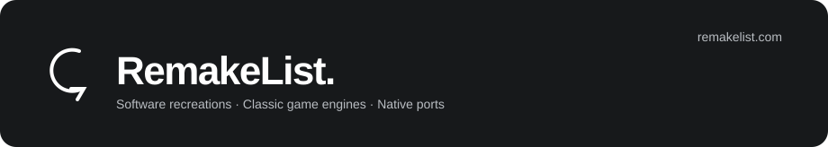

# Awesome RemakeList

ソフトウェアの再実装、ゲームエンジン、移植作品と、試す前に必要な準備をまとめたリストです。

[English](README.md) · [简体中文](README.zh-CN.md) · **日本語** · [한국어](README.ko.md) · [Español](README.es.md)

[RemakeList を見る](https://remakelist.com/ja/?utm_source=github&utm_medium=repository&utm_campaign=awesome-remakelist&utm_content=intro-ja) · [プロジェクトを推薦](https://github.com/CharlexH/awesome-remakelist/issues/new?template=project.yml)

 

プロジェクト名から作者の公開元へ移動できます。各項目を開くと、対応機器、ゲームデータ、ビルドの要件を確認できます。RemakeList にはスクリーンショットと導入の説明もあります。

## まずはこちら

| プロジェクト | 詳しく見る | 利用方法 |
| --- | --- | --- |
| [Graphite](https://remakelist.com/ja/remakes/graphite/?utm_source=github&utm_medium=repository&utm_campaign=awesome-remakelist&utm_content=graphite-featured-ja) | Adobe Illustrator | [ブラウザーで試す](https://editor.graphite.art/) |
| [Webamp](https://remakelist.com/ja/remakes/webamp/?utm_source=github&utm_medium=repository&utm_campaign=awesome-remakelist&utm_content=webamp-featured-ja) | Winamp 2 | [ブラウザーで試す](https://webamp.org/) |
| [OpenTTD](https://remakelist.com/ja/remakes/openttd/?utm_source=github&utm_medium=repository&utm_campaign=awesome-remakelist&utm_content=openttd-featured-ja) | Transport Tycoon Deluxe | [ダウンロード](https://www.openttd.org/) |
| [OpenRCT2](https://remakelist.com/ja/remakes/openrct2/?utm_source=github&utm_medium=repository&utm_campaign=awesome-remakelist&utm_content=openrct2-featured-ja) | RollerCoaster Tycoon 2 | [プログラムをダウンロード・ゲームデータは自分で用意](https://openrct2.io/download) |
| [D2R Mobile](https://remakelist.com/ja/remakes/d2r-mobile/?utm_source=github&utm_medium=repository&utm_campaign=awesome-remakelist&utm_content=d2r-mobile-featured-ja) | Diablo II: Resurrected | [自分でビルド・ゲームデータも用意](https://github.com/jhaizhou-ops/d2r-mobile/blob/main/README.md) |
| [nxnative](https://remakelist.com/ja/remakes/nxnative/?utm_source=github&utm_medium=repository&utm_campaign=awesome-remakelist&utm_content=nxnative-featured-ja) | Nintendo Switch ゲーム | [自分でビルド・ゲームデータも用意](https://github.com/seedds/nxnative#pack-an-ipa) |

## カテゴリを見る

- [デザイン・制作ツール](#creative) · 13
- [日常のツールとインターフェースの再現](#everyday) · 9
- [ゲームエンジンとゲームの再実装](#classic_games) · 24
- [移植・互換性プロジェクト](#ports) · 40

## デザイン・制作ツール

### [Compositor](https://github.com/robbietilton/Compositor)

Photoshop 型の作業手順を採用した、Apple silicon Mac 向けのレイヤー合成・ポスト処理エディター。

原作・参考元: **Adobe Photoshop** · 同様の機能を持つ独立した代替ツール  
[ダウンロード](https://github.com/robbietilton/Compositor/releases) · [RemakeList を見る](https://remakelist.com/ja/remakes/compositor/?utm_source=github&utm_medium=repository&utm_campaign=awesome-remakelist&utm_content=compositor-ja)

必要条件とスクリーンショット

**対応環境:** Apple silicon Mac · macOS 26 以降

**開発状況:** 開発中 · 配布版あり

**必要なもの:** Photoshop のインストールは不要です。Apple silicon Mac と macOS 26 以降が必要で、ソースのビルドには Xcode 26 以降を使います。編集するメディアの権利は利用者が確認してください。

**現在利用できるもの:** 配布版の利用には Apple silicon Mac と macOS 26 以降が必要で、画面は現在英語のみです。PSD/PSB の読み込みは 8 ビット RGB に対応し、CMYK には非対応。一部のベクターや縦書き文字はラスタライズされます。ソースからのビルドには Xcode 26 以降が必要です。

**コードのライセンス:** [MIT](https://github.com/robbietilton/Compositor/blob/main/LICENSE)  
**作者:** robbietilton  
[公式ドキュメント](https://github.com/robbietilton/Compositor/blob/main/README.md) · 資料確認日: 2026-10-12

### [PhotoCraft](https://github.com/storytold/photocraft)

ArtCraft チームが Rust で再実装する、Photoshop 型の画像編集ツール。現在はアルファ版です。

原作・参考元: **Adobe Photoshop** · ワークフローの再実装  
[ダウンロード](https://github.com/storytold/photocraft/releases) · [RemakeList を見る](https://remakelist.com/ja/remakes/photocraft/?utm_source=github&utm_medium=repository&utm_campaign=awesome-remakelist&utm_content=photocraft-ja)

必要条件とスクリーンショット

**対応環境:** Windows / macOS / Linux / FreeBSD / ウェブ

**開発状況:** アルファ · 作業手順を開発中

**必要なもの:** Photoshop のインストールは不要です。編集画像には適切な権利が必要で、同梱フォントやアイコンには個別のライセンスがあります。ArtCraft の商標はコードのライセンスに含まれません。

**現在利用できるもの:** Photoshop なしで使えるアルファ版が配布されています。Windows、macOS、Linux、FreeBSD、ウェブへの対応が記載されていますが、PSD の互換性、ツールの充実度、プラグイン互換性は未完成で、業務全体を置き換える段階ではありません。

**コードのライセンス:** [MIT OR Apache-2.0](https://github.com/storytold/photocraft/blob/main/LICENSE-MIT)  
**作者:** storytold  
[公式ドキュメント](https://github.com/storytold/photocraft/blob/main/README.md) · 資料確認日: 2026-10-12

### [Graphite](https://github.com/GraphiteEditor/Graphite)

レイヤーとノードを組み合わせ、ブラウザーで非破壊編集ができるオープンソースのベクターデザインツール。

原作・参考元: **Adobe Illustrator** · 同様の機能を持つ独立した代替ツール  
[ブラウザーで試す](https://editor.graphite.art/) · [RemakeList を見る](https://remakelist.com/ja/remakes/graphite/?utm_source=github&utm_medium=repository&utm_campaign=awesome-remakelist&utm_content=graphite-ja)

必要条件とスクリーンショット

**対応環境:** ウェブ

**開発状況:** アルファ · ブラウザー版あり

**必要なもの:** Illustrator のインストールや原ソフトのファイルは不要です。画像、フォント、制作素材は自分で用意してください。

**現在利用できるもの:** ブラウザー版で、Illustrator なしにベクターデザインを試せます。まだアルファ版で、幅広い写真編集、モーション、出版、VFX 機能は発展途上です。Adobe の作業環境全体を置き換えるものではありません。

**コードのライセンス:** [MIT OR Apache-2.0](https://graphite.art/license/)  
**作者:** Graphite community  
[公式ドキュメント](https://github.com/GraphiteEditor/Graphite/blob/master/README.md) · 資料確認日: 2026-10-12

### [Friction](https://github.com/friction2d/friction)

ベクターとラスターのアニメーション、タイムライン、式に対応した、オープンソースの 2D モーショングラフィックスツール。

原作・参考元: **Adobe After Effects** · 同様の機能を持つ独立した代替ツール  
[ダウンロード](https://friction.graphics/#download) · [RemakeList を見る](https://remakelist.com/ja/remakes/friction/?utm_source=github&utm_medium=repository&utm_campaign=awesome-remakelist&utm_content=friction-ja)

必要条件とスクリーンショット

**対応環境:** Windows / macOS / Linux

**開発状況:** デスクトップ版あり · 2D モーショングラフィックス

**必要なもの:** After Effects のインストールは不要です。画像、フォント、音声、動画素材は自分で用意してください。

**現在利用できるもの:** Windows、Linux、macOS 向けのダウンロードがあります。2D アニメーションとモーショングラフィックスを制作できますが、独自シェーダー効果は実験段階です。After Effects のプロジェクト、プラグイン、エフェクトチェーン全体の互換性は保証されていません。

**コードのライセンス:** [GPL-3.0-only](https://github.com/friction2d/friction/blob/main/LICENSE.md)  
**作者:** Ole-André Rodlie &amp; contributors  
[公式ドキュメント](https://friction.graphics/) · 資料確認日: 2026-10-12

### [OpenCut](https://github.com/OpenCut-app/OpenCut)

CapCut 型の編集を目指すオープンソース動画エディター。次期版を書き直している間、従来の初期ベータ版を公開しています。

原作・参考元: **CapCut** · 同様の機能を持つ独立した代替ツール  
[ブラウザーで試す](https://opencut.app/) · [RemakeList を見る](https://remakelist.com/ja/remakes/opencut/?utm_source=github&utm_medium=repository&utm_campaign=awesome-remakelist&utm_content=opencut-ja)

必要条件とスクリーンショット

**対応環境:** ウェブ

**開発状況:** 初期ベータ · 書き直し中

**必要なもの:** CapCut のインストールは不要です。利用する権利のある動画、画像、音声を取り込んでください。

**現在利用できるもの:** 公式サイトでは現在、従来の初期ベータ版を提供しています。そのソースはアーカイブされ、新版は書き直し中です。試す価値のある候補ですが、日常の CapCut の作業を全面的に引き継げると考える段階ではありません。

**コードのライセンス:** [MIT](https://github.com/OpenCut-app/OpenCut/blob/main/LICENSE)  
**作者:** OpenCut contributors  
[公式ドキュメント](https://github.com/OpenCut-app/OpenCut/blob/main/README.md) · 資料確認日: 2026-10-12

### [Penpot](https://github.com/penpot/penpot)

ホスト版でもセルフホストでも使える、オープンソースの共同デザイン・プロトタイピング基盤。

原作・参考元: **Figma** · 同様の機能を持つ独立した代替ツール  
[アカウント登録またはセルフホスト](https://design.penpot.app) · [RemakeList を見る](https://remakelist.com/ja/remakes/penpot/?utm_source=github&utm_medium=repository&utm_campaign=awesome-remakelist&utm_content=penpot-ja)

必要条件とスクリーンショット

**対応環境:** ブラウザー / セルフホスト

**開発状況:** 公式ドキュメントを参照

**必要なもの:** Figma のソフトや素材は不要です。移行には自分のデザインを書き出し、読み込む必要があります。

**現在利用できるもの:** ホスト版に登録するか、自分で設置して使えます。既存のデザインを移すには書き出しと読み込みが必要です。ホスト版のプランは料金ページを確認してください。

**コードのライセンス:** [MPL-2.0](https://github.com/penpot/penpot/blob/develop/LICENSE)  
**作者:** penpot  
[公式ドキュメント](https://penpot.app/penpot-vs-figma) · 資料確認日: 2026-10-11

### [VectorCraft](https://github.com/storytold/vectorcraft)

ArtCraft が Rust で再実装する Adobe Illustrator 型の制作環境。ペン描画、パスのブール演算、アピアランス効果、ベクターイラストを扱います。

原作・参考元: **Adobe Illustrator** · ワークフローの再実装  
[ダウンロード](https://getartcraft.com/apps/vectorcraft) · [RemakeList を見る](https://remakelist.com/ja/remakes/vectorcraft/?utm_source=github&utm_medium=repository&utm_campaign=awesome-remakelist&utm_content=vectorcraft-ja)

必要条件とスクリーンショット

**対応環境:** Windows / macOS / Linux / ウェブ

**開発状況:** アルファ

**必要なもの:** 市販の原ソフトは不要です。利用権限のある文書やメディアを用意してください。同梱のフォント、画像、ブランド商標には個別のライセンスがあります。

**現在利用できるもの:** アルファ版で、日常的なベクター描画を試せます。複雑なファイルの相互変換や効果の再現性は確認が必要です。デスクトップ用インストーラーがあり、対応環境とファイル互換性はプロジェクト資料で確認してください。

**コードのライセンス:** [MIT OR Apache-2.0](https://github.com/storytold/vectorcraft/blob/main/LICENSE-MIT)  
**作者:** ArtCraft  
[公式ドキュメント](https://github.com/storytold/vectorcraft/blob/main/README.md) · 資料確認日: 2026-10-12

### [FilmCraft](https://github.com/storytold/filmcraft)

ArtCraft が Rust で再実装する Adobe Premiere Pro 型の制作環境。ソース・プログラムモニター、複数トラックのタイムライン、トリム編集を備えます。

原作・参考元: **Adobe Premiere Pro** · ワークフローの再実装  
[ダウンロード](https://getartcraft.com/apps/filmcraft) · [RemakeList を見る](https://remakelist.com/ja/remakes/filmcraft/?utm_source=github&utm_medium=repository&utm_campaign=awesome-remakelist&utm_content=filmcraft-ja)

必要条件とスクリーンショット

**対応環境:** Windows / macOS / Linux

**開発状況:** アルファ

**必要なもの:** 市販の原ソフトは不要です。利用権限のある文書やメディアを用意してください。同梱のフォント、画像、ブランド商標には個別のライセンスがあります。

**現在利用できるもの:** アルファ版で、編集と書き出しの作業ができます。大容量メディアの性能、効果の描画、業務用プロジェクトの相互変換は未完成です。デスクトップ用インストーラーがあり、対応環境とファイル互換性はプロジェクト資料で確認してください。

**コードのライセンス:** [MIT OR Apache-2.0](https://github.com/storytold/filmcraft/blob/main/LICENSE-MIT)  
**作者:** ArtCraft  
[公式ドキュメント](https://github.com/storytold/filmcraft/blob/main/README.md) · 資料確認日: 2026-10-12

### [LightCraft](https://github.com/storytold/lightcraft)

ArtCraft が Rust で再実装する Adobe Lightroom 型の制作環境。写真ライブラリー管理、RAW 現像、非破壊の色調整を扱います。

原作・参考元: **Adobe Lightroom** · ワークフローの再実装  
[ダウンロード](https://getartcraft.com/apps/lightcraft) · [RemakeList を見る](https://remakelist.com/ja/remakes/lightcraft/?utm_source=github&utm_medium=repository&utm_campaign=awesome-remakelist&utm_content=lightcraft-ja)

必要条件とスクリーンショット

**対応環境:** Windows / macOS / Linux / ウェブ

**開発状況:** アルファ

**必要なもの:** 市販の原ソフトは不要です。利用権限のある文書やメディアを用意してください。同梱のフォント、画像、ブランド商標には個別のライセンスがあります。

**現在利用できるもの:** アルファ版で、JPEG、DNG、多くのカメラ RAW 形式を試せます。カメラの色校正と一部の圧縮 RAW 形式は未完成です。デスクトップ用インストーラーがあり、対応環境とファイル互換性はプロジェクト資料で確認してください。

**コードのライセンス:** [MIT OR Apache-2.0](https://github.com/storytold/lightcraft/blob/main/LICENSE-MIT)  
**作者:** ArtCraft  
[公式ドキュメント](https://github.com/storytold/lightcraft/blob/main/README.md) · 資料確認日: 2026-10-12

### [EffectCraft](https://github.com/storytold/effectcraft)

ArtCraft が Rust で再実装する Adobe After Effects 型の制作環境。レイヤー合成、キーフレームアニメーション、モーショングラフィックス、効果を扱います。

原作・参考元: **Adobe After Effects** · ワークフローの再実装  
[ダウンロード](https://getartcraft.com/apps/effectcraft) · [RemakeList を見る](https://remakelist.com/ja/remakes/effectcraft/?utm_source=github&utm_medium=repository&utm_campaign=awesome-remakelist&utm_content=effectcraft-ja)

必要条件とスクリーンショット

**対応環境:** Windows / macOS / Linux / ウェブ

**開発状況:** 開発初期

**必要なもの:** 市販の原ソフトは不要です。利用権限のある文書やメディアを用意してください。同梱のフォント、画像、ブランド商標には個別のライセンスがあります。

**現在利用できるもの:** 開発初期で、アニメーションと合成の実験向けです。顧客への納品向けではなく、AEP/AEPX プロジェクトと After Effects プラグインには非対応です。デスクトップ用インストーラーがあり、対応環境とファイル互換性はプロジェクト資料で確認してください。

**コードのライセンス:** [MIT OR Apache-2.0](https://github.com/storytold/effectcraft/blob/main/LICENSE-MIT)  
**作者:** ArtCraft  
[公式ドキュメント](https://github.com/storytold/effectcraft/blob/main/README.md) · 資料確認日: 2026-10-12

### [DesignCraft](https://github.com/storytold/designcraft)

ArtCraft が Rust で再実装する Adobe InDesign 型の制作環境。見開きレイアウト、連結テキストフレーム、親ページ、出版用文書を扱います。

原作・参考元: **Adobe InDesign** · ワークフローの再実装  
[ダウンロード](https://getartcraft.com/apps/designcraft) · [RemakeList を見る](https://remakelist.com/ja/remakes/designcraft/?utm_source=github&utm_medium=repository&utm_campaign=awesome-remakelist&utm_content=designcraft-ja)

必要条件とスクリーンショット

**対応環境:** Windows / macOS / Linux / ウェブ

**開発状況:** 開発中

**必要なもの:** 市販の原ソフトは不要です。利用権限のある文書やメディアを用意してください。同梱のフォント、画像、ブランド商標には個別のライセンスがあります。

**現在利用できるもの:** 開発中で、レイアウトと書き出しを試せるビルドがあります。複雑な出版ファイル、組版、印刷製版は個別の確認が必要です。デスクトップ用インストーラーがあり、対応環境とファイル互換性はプロジェクト資料で確認してください。

**コードのライセンス:** [MIT OR Apache-2.0](https://github.com/storytold/designcraft/blob/main/LICENSE-MIT)  
**作者:** ArtCraft  
[公式ドキュメント](https://github.com/storytold/designcraft/blob/main/README.md) · 資料確認日: 2026-10-12

### [SoundCraft](https://github.com/storytold/soundcraft)

ArtCraft が Rust で再実装する Avid Pro Tools 型の制作環境。トラック録音、編集ウィンドウ、ミキサー、MIDI 編曲を備えます。

原作・参考元: **Avid Pro Tools** · ワークフローの再実装  
[ダウンロード](https://getartcraft.com/apps/soundcraft) · [RemakeList を見る](https://remakelist.com/ja/remakes/soundcraft/?utm_source=github&utm_medium=repository&utm_campaign=awesome-remakelist&utm_content=soundcraft-ja)

必要条件とスクリーンショット

**対応環境:** Windows / macOS / Linux / ウェブ

**開発状況:** プレアルファ

**必要なもの:** 市販の原ソフトは不要です。利用権限のある文書やメディアを用意してください。同梱のフォント、画像、ブランド商標には個別のライセンスがあります。

**現在利用できるもの:** プレアルファ版で、録音、編集、ミキシング、バウンスの作業ができます。音声デバイス・バッファー選択、MIDI コントローラー録音、AAF/OMF の相互変換は未実装です。デスクトップ用インストーラーがあり、対応環境とファイル互換性はプロジェクト資料で確認してください。

**コードのライセンス:** [MIT OR Apache-2.0](https://github.com/storytold/soundcraft/blob/main/LICENSE-MIT)  
**作者:** ArtCraft  
[公式ドキュメント](https://github.com/storytold/soundcraft/blob/main/README.md) · 資料確認日: 2026-10-12

### [CADCraft](https://github.com/storytold/cadcraft)

ArtCraft が Rust で再実装する Autodesk AutoCAD 型の作業環境。コマンドライン製図、オブジェクトスナップ、レイヤー、寸法、図面レイアウトを扱います。

原作・参考元: **Autodesk AutoCAD** · ワークフローの再実装  
[ダウンロード](https://getartcraft.com/apps/cadcraft) · [RemakeList を見る](https://remakelist.com/ja/remakes/cadcraft/?utm_source=github&utm_medium=repository&utm_campaign=awesome-remakelist&utm_content=cadcraft-ja)

必要条件とスクリーンショット

**対応環境:** Windows / macOS / Linux / ウェブ

**開発状況:** 開発初期

**必要なもの:** 市販の原ソフトは不要です。利用権限のある文書やメディアを用意してください。同梱のフォント、画像、ブランド商標には個別のライセンスがあります。

**現在利用できるもの:** 開発初期で、2D 図面と PDF 出力を試す用途に向きます。AutoCAD の 3D、DWG、業界向けプラグインのすべてを代替するものではありません。デスクトップ用インストーラーがあり、対応環境とファイル互換性はプロジェクト資料で確認してください。

**コードのライセンス:** [MIT OR Apache-2.0](https://github.com/storytold/cadcraft/blob/main/LICENSE-MIT)  
**作者:** ArtCraft  
[公式ドキュメント](https://github.com/storytold/cadcraft/blob/main/README.md) · 資料確認日: 2026-10-12

## 日常のツールとインターフェースの再現

### [ONLYOFFICE Desktop Editors](https://github.com/ONLYOFFICE/DesktopEditors)

文書、表計算、プレゼンテーション、PDF を一つのデスクトップアプリでオフライン編集できる、オープンソースの Microsoft Office 代替。

原作・参考元: **Microsoft Office** · 同様の機能を持つ独立した代替ツール  
[ダウンロード](https://www.onlyoffice.com/download-desktop) · [RemakeList を見る](https://remakelist.com/ja/remakes/onlyoffice/?utm_source=github&utm_medium=repository&utm_campaign=awesome-remakelist&utm_content=onlyoffice-ja)

必要条件とスクリーンショット

**対応環境:** Windows / macOS / Linux

**開発状況:** 安定版あり

**必要なもの:** ローカル編集に Microsoft Office のインストールやアカウントは不要です。クラウドでの共同作業には対応サービスが必要で、有料の場合があります。

**現在利用できるもの:** Windows、macOS、Linux 向けのインストーラーがあり、ローカル保存とオフライン編集に対応します。デスクトップ版は無料ですが、クラウドサービスや企業向け版には別のプランがあります。移行前に複雑な文書のレイアウトを確認してください。

**コードのライセンス:** [AGPL-3.0](https://github.com/ONLYOFFICE/DesktopEditors/blob/master/LICENSE)  
**作者:** ONLYOFFICE  
[公式ドキュメント](https://github.com/ONLYOFFICE/DesktopEditors) · 資料確認日: 2026-10-12

### [Grist](https://github.com/gristlabs/grist-core)

リレーショナルデータと表計算型の編集を組み合わせた、Excel や Airtable の作業に使えるオープンソースの代替。

原作・参考元: **Microsoft Excel / Airtable** · 同様の機能を持つ独立した代替ツール  
[ダウンロード](https://github.com/gristlabs/grist-desktop/releases) · [RemakeList を見る](https://remakelist.com/ja/remakes/grist/?utm_source=github&utm_medium=repository&utm_campaign=awesome-remakelist&utm_content=grist-ja)

必要条件とスクリーンショット

**対応環境:** Windows / macOS / Linux

**開発状況:** 安定版あり

**必要なもの:** デスクトップ版はローカルファイルを編集します。セルフホストにはサーバー環境が必要です。ホスト版にはアカウントが必要で、使用量と機能に制限があります。

**現在利用できるもの:** Windows、macOS、Linux のデスクトップ版でローカルファイルを編集でき、Community 版はセルフホストも可能です。ホスト版の無料・有料プランは別で、企業向け機能のすべてがオープンソースの中核に含まれるわけではありません。

**コードのライセンス:** [Apache-2.0](https://github.com/gristlabs/grist-core/blob/main/LICENSE.txt)  
**作者:** Grist Labs  
[公式ドキュメント](https://github.com/gristlabs/grist-core) · 資料確認日: 2026-10-12

### [LibreOffice](https://github.com/LibreOffice/core)

文書の Writer、表計算の Calc、プレゼンテーションの Impress を備えた、無料・オープンソースの Microsoft Office 代替。

原作・参考元: **Microsoft Office** · 同様の機能を持つ独立した代替ツール  
[ダウンロード](https://www.libreoffice.org/download/download-libreoffice/) · [RemakeList を見る](https://remakelist.com/ja/remakes/libreoffice/?utm_source=github&utm_medium=repository&utm_campaign=awesome-remakelist&utm_content=libreoffice-ja)

必要条件とスクリーンショット

**対応環境:** Windows / macOS / Linux

**開発状況:** 安定版あり

**必要なもの:** Microsoft Office のインストール、契約、アカウントは不要です。環境に合うデスクトップ版を入れ、編集権限のあるファイルを使用してください。

**現在利用できるもの:** Windows、macOS、Linux 向けに配布され、日常のオフィス作業をひと通り行えます。VBA マクロ、複雑な Office テンプレート、厳密なレイアウト再現が必要なら、先に自分のファイルで試してください。

**コードのライセンス:** [MPL-2.0 (primarily)](https://www.libreoffice.org/licenses/)  
**作者:** The Document Foundation  
[公式ドキュメント](https://www.libreoffice.org/) · 資料確認日: 2026-10-12

### [Webamp](https://github.com/captbaritone/webamp)

クラシックなプレーヤー画面とスキン対応を備えた、Winamp 2 のブラウザー再実装。

原作・参考元: **Winamp 2** · Web での再実装  
[ブラウザーで試す](https://webamp.org/) · [RemakeList を見る](https://remakelist.com/ja/remakes/webamp/?utm_source=github&utm_medium=repository&utm_campaign=awesome-remakelist&utm_content=webamp-ja)

必要条件とスクリーンショット

**対応環境:** ブラウザー

**開発状況:** 公式ドキュメントを参照

**必要なもの:** Winamp のインストールは不要です。音声や第三者のスキンにはそれぞれの権利が適用されます。

**現在利用できるもの:** オンラインプレーヤーをブラウザーで直接開けます。原ソフトは不要で、再生したい音声を自分で用意します。

**コードのライセンス:** [MIT](https://github.com/captbaritone/webamp/blob/master/LICENSE.txt)  
**作者:** captbaritone  
[公式ドキュメント](https://github.com/captbaritone/webamp/blob/master/README.md) · 資料確認日: 2026-10-11

### [WinXP in React](https://github.com/ShizukuIchi/winXP)

Windows XP のデスクトップ、スタートメニュー、定番の小さなアプリをブラウザーで再現。

原作・参考元: **Windows XP のデスクトップ** · インターフェースの再現  
[ブラウザーで試す](https://winxp.vercel.app/) · [RemakeList を見る](https://remakelist.com/ja/remakes/winxp/?utm_source=github&utm_medium=repository&utm_campaign=awesome-remakelist&utm_content=winxp-ja)

必要条件とスクリーンショット

**対応環境:** ブラウザー

**開発状況:** 公式ドキュメントを参照

**必要なもの:** Windows XP のインストールファイルは不要です。

**現在利用できるもの:** Windows XP のインストールファイルなしでオンラインデモを使えます。再現されたデスクトップとアプリが対象で、任意の XP ソフトを動かすことはできません。

**コードのライセンス:** [MIT (project code)](https://github.com/ShizukuIchi/winXP/blob/master/LICENSE)  
**作者:** ShizukuIchi  
[公式ドキュメント](https://github.com/ShizukuIchi/winXP/blob/master/README.md) · 資料確認日: 2026-10-11

### [PdfCraft](https://github.com/storytold/pdfcraft)

ArtCraft が Rust で再実装する Adobe Acrobat 型の作業環境。PDF 閲覧、注釈、ページ整理、結合、分割を扱います。

原作・参考元: **Adobe Acrobat** · ワークフローの再実装  
[ダウンロード](https://getartcraft.com/apps/pdfcraft) · [RemakeList を見る](https://remakelist.com/ja/remakes/pdfcraft/?utm_source=github&utm_medium=repository&utm_campaign=awesome-remakelist&utm_content=pdfcraft-ja)

必要条件とスクリーンショット

**対応環境:** Windows / macOS / Linux / ウェブ

**開発状況:** 初期アルファ

**必要なもの:** 市販の原ソフトは不要です。利用権限のある文書やメディアを用意してください。同梱のフォント、画像、ブランド商標には個別のライセンスがあります。

**現在利用できるもの:** 初期アルファ版で、閲覧とページ管理を利用できます。Acrobat の編集、署名、印刷製版の作業全体を代替するものではありません。デスクトップ用インストーラーがあり、対応環境とファイル互換性はプロジェクト資料で確認してください。

**コードのライセンス:** [MIT OR Apache-2.0](https://github.com/storytold/pdfcraft/blob/main/LICENSE-MIT)  
**作者:** ArtCraft  
[公式ドキュメント](https://github.com/storytold/pdfcraft/blob/main/README.md) · 資料確認日: 2026-10-12

### [WordCraft](https://github.com/storytold/wordcraft)

ArtCraft が Rust で再実装する Microsoft Word 型の作業環境。文書作成、スタイル、表、変更履歴、文書レイアウトを扱います。

原作・参考元: **Microsoft Word** · ワークフローの再実装  
[ダウンロード](https://getartcraft.com/apps/wordcraft) · [RemakeList を見る](https://remakelist.com/ja/remakes/wordcraft/?utm_source=github&utm_medium=repository&utm_campaign=awesome-remakelist&utm_content=wordcraft-ja)

必要条件とスクリーンショット

**対応環境:** Windows / macOS / Linux / ウェブ

**開発状況:** アルファ

**必要なもの:** 市販の原ソフトは不要です。利用権限のある文書やメディアを用意してください。同梱のフォント、画像、ブランド商標には個別のライセンスがあります。

**現在利用できるもの:** アルファ版で、文書作成と DOCX の作業を試せます。ページ区切り、グラフ・SmartArt の往復変換の再現性、ネイティブ印刷には改善が必要です。デスクトップ用インストーラーがあり、対応環境とファイル互換性はプロジェクト資料で確認してください。

**コードのライセンス:** [MIT OR Apache-2.0](https://github.com/storytold/wordcraft/blob/main/LICENSE-MIT)  
**作者:** ArtCraft  
[公式ドキュメント](https://github.com/storytold/wordcraft/blob/main/README.md) · 資料確認日: 2026-10-13

### [DeckCraft](https://github.com/storytold/deckcraft)

ArtCraft が Rust で再実装する Microsoft PowerPoint 型の制作環境。スライドマスター、テーマ、図形、アニメーション、スライドショー再生を備えます。

原作・参考元: **Microsoft PowerPoint** · ワークフローの再実装  
[ダウンロード](https://getartcraft.com/apps/deckcraft) · [RemakeList を見る](https://remakelist.com/ja/remakes/deckcraft/?utm_source=github&utm_medium=repository&utm_campaign=awesome-remakelist&utm_content=deckcraft-ja)

必要条件とスクリーンショット

**対応環境:** Windows / macOS / Linux / ウェブ

**開発状況:** アルファ

**必要なもの:** 市販の原ソフトは不要です。利用権限のある文書やメディアを用意してください。同梱のフォント、画像、ブランド商標には個別のライセンスがあります。

**現在利用できるもの:** アルファ版で、資料の作成と発表ができます。複雑な PPTX ファイルやアニメーションが PowerPoint と同じように動くとは限りません。デスクトップ用インストーラーがあり、対応環境とファイル互換性はプロジェクト資料で確認してください。

**コードのライセンス:** [MIT OR Apache-2.0](https://github.com/storytold/deckcraft/blob/main/LICENSE-MIT)  
**作者:** ArtCraft  
[公式ドキュメント](https://github.com/storytold/deckcraft/blob/main/README.md) · 資料確認日: 2026-10-13

### [GridCraft](https://github.com/storytold/gridcraft)

ArtCraft が Rust で再実装する Microsoft Excel 型の作業環境。ワークシート、数式、テーブル、グラフ、ピボットテーブルを扱います。

原作・参考元: **Microsoft Excel** · ワークフローの再実装  
[ダウンロード](https://getartcraft.com/apps/gridcraft) · [RemakeList を見る](https://remakelist.com/ja/remakes/gridcraft/?utm_source=github&utm_medium=repository&utm_campaign=awesome-remakelist&utm_content=gridcraft-ja)

必要条件とスクリーンショット

**対応環境:** Windows / macOS / Linux / ウェブ

**開発状況:** アルファ

**必要なもの:** 市販の原ソフトは不要です。利用権限のある文書やメディアを用意してください。同梱のフォント、画像、ブランド商標には個別のライセンスがあります。

**現在利用できるもの:** アルファ版で、基本的な表計算を試せます。実際の XLSX ファイルの再現性、大きなブックの性能、グラフ機能、旧形式の読み込みには改善が必要です。デスクトップ用インストーラーがあり、対応環境とファイル互換性はプロジェクト資料で確認してください。

**コードのライセンス:** [MIT OR Apache-2.0](https://github.com/storytold/gridcraft/blob/main/LICENSE-MIT)  
**作者:** ArtCraft  
[公式ドキュメント](https://github.com/storytold/gridcraft/blob/main/README.md) · 資料確認日: 2026-10-13

## ゲームエンジンとゲームの再実装

### [Vanguard Engine](https://github.com/harshilmathur/openra2)

Red Alert 2 のデータ向けに作られた独立したブラウザー RTS エンジン。現在はソ連軍の一人用小規模戦に絞って開発されています。

原作・参考元: **Red Alert 2 / Yuri’s Revenge のデータ** · エンジンの再実装  
[ソースからビルド](https://github.com/harshilmathur/openra2/blob/master/README.md#quickstart) · [RemakeList を見る](https://remakelist.com/ja/remakes/vanguard/?utm_source=github&utm_medium=repository&utm_campaign=awesome-remakelist&utm_content=vanguard-ja)

必要条件とスクリーンショット

**対応環境:** ブラウザー · ローカル開発サーバー

**開発状況:** 開発版 · 正式リリースなし

**必要なもの:** Classic モードには正規に所有する RA2/YR のファイルが必要です。Original モードはリポジトリ独自の素材を使い、原作は不要です。両モードは別です。Node.js 20.19 以降とローカル開発サーバーが必要です。

**現在利用できるもの:** 正式リリース前の開発版で、Node.js 20.19 以降とローカル開発サーバーが必要です。Classic モードには適法に入手した RA2/YR のファイルが必要ですが、Original モードに原作は不要です。連合軍、ネット対戦、Yuri のゲーム内容は未完成で、Red Alert 2 全体を再現したものではありません。

**コードのライセンス:** [GPL-3.0-or-later](https://github.com/harshilmathur/openra2/blob/master/LICENSE)  
**作者:** harshilmathur  
[公式ドキュメント](https://github.com/harshilmathur/openra2/blob/master/README.md) · 資料確認日: 2026-10-12

### [OpenTTD](https://github.com/OpenTTD/OpenTTD)

Transport Tycoon の遊びを現代の環境向けに作り直し、マルチプレイを拡充。

原作・参考元: **Transport Tycoon Deluxe** · ゲームの再実装  
[ダウンロード](https://www.openttd.org/) · [RemakeList を見る](https://remakelist.com/ja/remakes/openttd/?utm_source=github&utm_medium=repository&utm_campaign=awesome-remakelist&utm_content=openttd-ja)

必要条件とスクリーンショット

**対応環境:** Windows / macOS / Linux

**開発状況:** 公式ドキュメントを参照

**必要なもの:** 基本グラフィックが必要です。無料の OpenGFX2 または OpenGFX を利用できます。OpenSFX の効果音と OpenMSX の音楽は任意です。この無料の始め方では原作のファイルは不要です。

**現在利用できるもの:** デスクトップ版が配布されています。必須の基本グラフィックには無料の OpenGFX2 または OpenGFX を用意してください。OpenSFX の効果音と OpenMSX の音楽は任意です。この方法では原作のファイルは不要です。

**コードのライセンス:** [GPL-2.0; third-party components have separate licenses](https://github.com/OpenTTD/OpenTTD/blob/master/COPYING.md)  
**作者:** OpenTTD  
[公式ドキュメント](https://github.com/OpenTTD/OpenTTD/blob/master/README.md) · 資料確認日: 2026-10-11

### [OpenRCT2](https://github.com/OpenRCT2/OpenRCT2)

共同マルチプレイなどの改善を加え、RollerCoaster Tycoon 2 を現代の環境で。

原作・参考元: **RollerCoaster Tycoon 2** · ゲームの再実装  
[プログラムをダウンロード・ゲームデータは自分で用意](https://openrct2.io/download) · [RemakeList を見る](https://remakelist.com/ja/remakes/openrct2/?utm_source=github&utm_medium=repository&utm_campaign=awesome-remakelist&utm_content=openrct2-ja)

必要条件とスクリーンショット

**対応環境:** Windows / macOS / Linux

**開発状況:** 公式ドキュメントを参照

**必要なもの:** RCT2 の原作データを自分で用意する必要があります。RCT1 のデータでシナリオを追加できます。

**現在利用できるもの:** 配布版はありますが、RCT2 の原作データを自分で用意する必要があります。RCT1 のデータを使うとそのシナリオも追加できます。無料のエンジンに市販の原作素材は含まれません。

**コードのライセンス:** [GPL-3.0-or-later](https://github.com/OpenRCT2/OpenRCT2/blob/develop/licence.txt)  
**作者:** OpenRCT2  
[公式ドキュメント](https://github.com/OpenRCT2/OpenRCT2/blob/develop/readme.md) · 資料確認日: 2026-10-11

### [OpenMW](https://github.com/OpenMW/openmw)

互換性と描画設定を改善した、Morrowind 向けの現代的なオープンソースエンジン。

原作・参考元: **The Elder Scrolls III: Morrowind** · エンジンの再実装  
[プログラムをダウンロード・ゲームデータは自分で用意](https://www.openmw.org) · [RemakeList を見る](https://remakelist.com/ja/remakes/openmw/?utm_source=github&utm_medium=repository&utm_campaign=awesome-remakelist&utm_content=openmw-ja)

必要条件とスクリーンショット

**対応環境:** Windows / macOS / Linux

**開発状況:** 公式ドキュメントを参照

**必要なもの:** Morrowind を遊ぶには原作を所有し、そのデータファイルを設定する必要があります。

**現在利用できるもの:** エンジンはダウンロードできますが、Morrowind を遊ぶには原作を所有し、データファイルを設定する必要があります。原作の MOD の一部は非対応のため、手持ちの構成を確認してください。

**コードのライセンス:** [GPLv3; some fonts separately licensed](https://github.com/OpenMW/openmw/blob/master/LICENSE)  
**作者:** OpenMW  
[公式ドキュメント](https://github.com/OpenMW/openmw/blob/master/README.md) · 資料確認日: 2026-10-11

### [OpenRA](https://github.com/OpenRA/OpenRA)

現代的な操作と三つの公式ゲーム MOD で、名作リアルタイム戦略ゲームを再構成。

原作・参考元: **Red Alert 1 / Command &amp; Conquer / Dune 2000** · ゲームの再構想  
[ダウンロード](https://www.openra.net/) · [RemakeList を見る](https://remakelist.com/ja/remakes/openra/?utm_source=github&utm_medium=repository&utm_campaign=awesome-remakelist&utm_content=openra-ja)

必要条件とスクリーンショット

**対応環境:** Windows / macOS / Linux

**開発状況:** 公式ドキュメントを参照

**必要なもの:** 原作のゲーム素材を使います。公式インストーラーは初回起動時に必要な素材を取得するか、原作ディスクから取り込めます。

**現在利用できるもの:** Windows、macOS、Linux 向けに配布されています。原作素材が必要ですが、プロジェクトによると初回設定で必要な素材を取得するか、原作ディスクから取り込めます。

**コードのライセンス:** [GPL-3.0-or-later (engine)](https://github.com/OpenRA/OpenRA/blob/bleed/COPYING)  
**作者:** OpenRA  
[公式ドキュメント](https://www.openra.net/about/) · 資料確認日: 2026-10-11

### [fheroes2](https://github.com/ihhub/fheroes2)

現代的な改善を加えた、デスクトップと Android 向けの Heroes of Might and Magic II エンジン再実装。

原作・参考元: **Heroes of Might and Magic II** · エンジンの再実装  
[プログラムをダウンロード・ゲームデータは自分で用意](https://github.com/ihhub/fheroes2/releases) · [RemakeList を見る](https://remakelist.com/ja/remakes/fheroes2/?utm_source=github&utm_medium=repository&utm_campaign=awesome-remakelist&utm_content=fheroes2-ja)

必要条件とスクリーンショット

**対応環境:** Windows / macOS / Linux / Android

**開発状況:** 配布版あり · 原作またはデモデータが必要

**必要なもの:** 原作全体のデータ、または公式英語デモのデータが必要です。INSTALL.md に同梱のデモダウンロード手順があります。デモ素材で使えるのは、その許諾範囲の限られた内容のみです。

**現在利用できるもの:** 配布版には原作全体のデータ、または公式英語デモのデータが必要で、導入手順にデモの入手方法があります。デモの内容は限定的で、全編を遊ぶには適法に所有する原作素材が必要です。設定方法は環境によって異なります。

**コードのライセンス:** [GPL-2.0-or-later](https://github.com/ihhub/fheroes2/blob/master/LICENSE)  
**作者:** ihhub  
[公式ドキュメント](https://github.com/ihhub/fheroes2/blob/master/README.md) · 資料確認日: 2026-10-12

### [OpenXcom](https://github.com/OpenXcom/OpenXcom)

追加 MOD に対応した、初期の X-COM 二作品のデスクトップ再実装。

原作・参考元: **UFO: Enemy Unknown / Terror from the Deep** · ゲームの再実装  
[プログラムをダウンロード・ゲームデータは自分で用意](https://github.com/OpenXcom/OpenXcom/releases) · [RemakeList を見る](https://remakelist.com/ja/remakes/openxcom/?utm_source=github&utm_medium=repository&utm_campaign=awesome-remakelist&utm_content=openxcom-ja)

必要条件とスクリーンショット

**対応環境:** Windows / macOS / Linux

**開発状況:** デスクトップエンジン · 原作データが必要

**必要なもの:** UFO: Enemy Unknown または Terror from the Deep の未改変の原作データが必要です。Windows のインストーラーで所有する Steam 版から素材を抽出できます。

**現在利用できるもの:** デスクトップ版には、どちらかの原作の未改変データが必要です。Windows のインストーラーは所有する Steam 版から素材を抽出できます。追加 MOD には別の素材要件がある場合があります。

**コードのライセンス:** [GPL-3.0-or-later](https://github.com/OpenXcom/OpenXcom/blob/master/LICENSE.txt)  
**作者:** OpenXcom  
[公式ドキュメント](https://github.com/OpenXcom/OpenXcom/blob/master/README.md) · 資料確認日: 2026-10-12

### [VCMI](https://github.com/vcmi/vcmi)

デスクトップとモバイルに対応し、MODとマルチプレイを備えたオープンソースのHeroes IIIエンジン。

原作・参考元: **Heroes of Might and Magic III** · エンジンの再実装  
[プログラムをダウンロード・ゲームデータは自分で用意](https://vcmi.eu/download/) · [RemakeList を見る](https://remakelist.com/ja/remakes/vcmi/?utm_source=github&utm_medium=repository&utm_campaign=awesome-remakelist&utm_content=vcmi-ja)

必要条件とスクリーンショット

**対応環境:** Windows / macOS / Linux / Android / iOS

**開発状況:** 公開版 · 原作データが必要

**必要なもの:** 全編には、所有するHeroes III CompleteまたはShadow of Deathのデータが必要です。ランチャーからGOGのオフラインインストーラーや既存インストールを取り込めます。HD Edition単体では不足し、追加要素として使う場合もComplete/SoDが必要です。公式MOD一覧では内容限定のデモにも別途対応しています。

**現在利用できるもの:** 1.7.5版を公開。Windows、macOS、Linux、Android向けパッケージがあり、iOSはTestFlightまたはサイドロードを使用します。完全な互換性は保証されません。RemakeListでは実行していません。

**コードのライセンス:** [GPL-2.0-or-later code; VCMI-created assets CC-BY-SA 4.0; original game assets separate](https://github.com/vcmi/vcmi/blob/66fa496c6328a276c4eb14c0011b3a9d751dfac3/license.txt)  
**作者:** VCMI Team  
[公式ドキュメント](https://github.com/vcmi/vcmi/blob/66fa496c6328a276c4eb14c0011b3a9d751dfac3/docs/Readme.md) · 資料確認日: 2026-10-18

### [Julius](https://github.com/bvschaik/julius)

Caesar IIIのロジックを忠実に再実装し、原作の都市建設ゲームを現代のデスクトップやAndroidなどへ移植。

原作・参考元: **Caesar III** · ゲームの再実装  
[プログラムをダウンロード・ゲームデータは自分で用意](https://github.com/bvschaik/julius/releases/tag/v1.8.0) · [RemakeList を見る](https://remakelist.com/ja/remakes/julius/?utm_source=github&utm_medium=repository&utm_campaign=awesome-remakelist&utm_content=julius-ja)

必要条件とスクリーンショット

**対応環境:** Windows · Linux · macOS · Android · Web（Emscripten）· PS Vita · Nintendo Switch

**開発状況:** 公開済み · 原作ゲームデータが必要

**必要なもの:** 所有するCD-ROM、GOG、Steam版Caesar IIIの完全なインストールデータを用意し、1.0.1.0へ更新してください。Juliusはそのデータフォルダーを使用し、セーブを書き込む権限を必要とします。コードのライセンスは原作素材を提供せず、その利用権も付与しません。

**現在利用できるもの:** 1.8.0版はWindows、Linux、macOS、Androidのほか、Vita、Switch、Emscripten向けパッケージを提供。ブラウザー版も設定と原作データが必要です。RemakeListでは実行していません。

**コードのライセンス:** [AGPL-3.0 · engine code; original Caesar III assets are separate](https://github.com/bvschaik/julius/blob/34d1ecd54befb845c0139b371fa8a0438210dac1/LICENSE.txt)  
**作者:** Bianca van Schaik and contributors  
[公式ドキュメント](https://github.com/bvschaik/julius/blob/34d1ecd54befb845c0139b371fa8a0438210dac1/README.md) · 資料確認日: 2026-10-18

### [CorsixTH](https://github.com/CorsixTH/CorsixTH)

現代のデスクトップ環境、高解像度、編集可能な病院経営キャンペーンに対応するTheme Hospitalのエンジン再実装。

原作・参考元: **Theme Hospital** · ゲームの再実装  
[プログラムをダウンロード・ゲームデータは自分で用意](https://github.com/CorsixTH/CorsixTH/releases/tag/v0.70.1) · [RemakeList を見る](https://remakelist.com/ja/remakes/corsixth/?utm_source=github&utm_medium=repository&utm_campaign=awesome-remakelist&utm_content=corsixth-ja)

必要条件とスクリーンショット

**対応環境:** Windows · macOS · Linux · BSD

**開発状況:** 公開済み · 原作またはデモのデータが必要

**必要なもの:** 合法的に所有するTheme HospitalのCDまたはデジタル版のインストールデータを用意し、初回起動時にデータフォルダーを選択します。公式デモも利用できますが、1ステージのみで管理画面の大半はありません。エンジンのライセンスは原作素材の利用権を付与しません。

**現在利用できるもの:** バージョン0.70.1はWindowsとmacOS向けに公開され、LinuxではAppImageや各ディストリビューションのパッケージを利用できます。BSDにも対応。Mac版ではRtMidiによるハードウェアMIDIを無効化しています。RemakeListでは未実行です。

**コードのライセンス:** [MIT · engine code; Theme Hospital assets are separate](https://github.com/CorsixTH/CorsixTH/blob/master/LICENSE.txt)  
**作者:** CorsixTH team and contributors  
[公式ドキュメント](https://github.com/CorsixTH/CorsixTH/blob/master/README.md) · 資料確認日: 2026-10-19

### [Warzone 2100](https://github.com/Warzone2100/warzone2100)

1999年の3D戦略ゲームをコミュニティが継続開発。完全なキャンペーン、カスタマイズ可能なユニット、デスクトップ版のマルチプレイを提供します。

原作・参考元: **Warzone 2100 (1999)** · オープンソースでの継続開発  
[ダウンロード](https://wz2100.net/) · [RemakeList を見る](https://remakelist.com/ja/remakes/warzone2100/?utm_source=github&utm_medium=repository&utm_campaign=awesome-remakelist&utm_content=warzone2100-ja)

必要条件とスクリーンショット

**対応環境:** Windows · macOS · Linux · Web

**開発状況:** 公開済み · デスクトップ版とブラウザー版

**必要なもの:** 原作の別途購入やディスクイメージは不要です。公式パッケージを使用してください。一部の環境ではキャンペーン動画を公式サイトから別途ダウンロードする必要があります。コード、ゲームデータ、各コンポーネントには、それぞれ明記されたライセンスが適用されます。

**現在利用できるもの:** 4.7.0はWindows、macOS、Linux向けに公開され、Mac版はIntelとApple siliconに対応。公式ブラウザー版ではキャンペーンとスカーミッシュを遊べますが、描画品質が低く、オンラインマルチプレイはありません。RemakeListでは未実行です。

**コードのライセンス:** [GPL-2.0-or-later and component licenses](https://github.com/Warzone2100/warzone2100/blob/master/COPYING)  
**作者:** Warzone 2100 Project  
[公式ドキュメント](https://github.com/Warzone2100/warzone2100/blob/master/README.md) · 資料確認日: 2026-10-19

### [ScummVM](https://github.com/scummvm/scummvm)

再実装されたゲームエンジンで、Monkey Island、Myst、Blade Runnerなどの名作アドベンチャーを現代のデバイスで動かせます。

原作・参考元: **名作アドベンチャーとRPG** · エンジンの再実装  
[プログラムをダウンロード・ゲームデータは自分で用意](https://www.scummvm.org/downloads/) · [RemakeList を見る](https://remakelist.com/ja/remakes/scummvm/?utm_source=github&utm_medium=repository&utm_campaign=awesome-remakelist&utm_content=scummvm-ja)

必要条件とスクリーンショット

**対応環境:** Windows / macOS / Linux / Android / iOS

**開発状況:** 公開済み · 互換性はゲームと対応環境により異なる

**必要なもの:** ScummVM自体にゲームは含まれません。商用作品の多くは、対応するゲームデータを自分で用意する必要があります。公式のFreeware GamesページではBeneath a Steel Skyなどの無料完全版を別途配布しており、Demosページの制限付き体験版とは異なります。選んだゲームをフォルダーに展開し、ランチャーでそのフォルダーを追加してください。各ゲームの配布条件はそれぞれに適用されます。

**現在利用できるもの:** 安定版2026.4.0はWindows、macOS、Linux向けに公開されています。2026年10月19日時点で、公式ダウンロードページではAndroidとiOSのビルドを旧版欄の2026.3.0として掲載しています。RemakeListではゲームを実行していません。

**コードのライセンス:** [GPL-3.0-or-later engine code; individual game data retains its own terms](https://github.com/scummvm/scummvm/blob/7d2709da5136866589f7602f5f5a7b17de03420e/COPYING)  
**作者:** ScummVM Team  
[公式ドキュメント](https://github.com/scummvm/scummvm/blob/7d2709da5136866589f7602f5f5a7b17de03420e/README.md) · 資料確認日: 2026-10-19

### [RigelEngine](https://github.com/lethal-guitar/RigelEngine)

ワイドスクリーン、滑らかな移動、クイックセーブ、改善されたゲームパッド対応を備えたDuke Nukem IIのネイティブエンジン。

原作・参考元: **Duke Nukem II** · エンジンの再実装  
[プログラムをダウンロード・ゲームデータは自分で用意](https://github.com/lethal-guitar/RigelEngine/releases/tag/v0.9.1) · [RemakeList を見る](https://remakelist.com/ja/remakes/rigelengine/?utm_source=github&utm_medium=repository&utm_campaign=awesome-remakelist&utm_content=rigelengine-ja)

必要条件とスクリーンショット

**対応環境:** Windows / macOS / Linux

**開発状況:** 公開済み · 保守段階

**必要なもの:** Duke Nukem IIのインストールデータからNUKEM2.CMPを用意してください。全4エピソードには登録版データが必要で、シェアウェアで遊べる内容は限定的です。NUKEM2.F1からNUKEM2.F5は任意のオープニング動画です。初回起動時にゲームデータのフォルダーを選択します。公式READMEにはシェアウェアのアーカイブと正規の完全版販売元へのリンクがあります。RemakeListは原作データを提供しません。

**現在利用できるもの:** 公式0.9.1パッケージにはWindows x64版ZIP、macOS x64版DMG、Linux x64版DEBがあります。Apple silicon向けには、リリースページから別の第三者製Macユニバーサルビルドを案内しています。READMEではWeb版を現在利用不可としています。RemakeListでは未実行です。

**コードのライセンス:** [GPL-2.0-or-later engine code; original Duke Nukem II data is separate](https://github.com/lethal-guitar/RigelEngine/blob/30afeff8f0b105eac77ee0a2fbd54b06e1a49b60/LICENSE.md)  
**作者:** Nikolai Wuttke and contributors  
[公式ドキュメント](https://github.com/lethal-guitar/RigelEngine/blob/30afeff8f0b105eac77ee0a2fbd54b06e1a49b60/README.md) · 資料確認日: 2026-10-19

### [OpenLoco](https://github.com/OpenLoco/OpenLoco)

Chris Sawyer’s Locomotionを現代のC++で再実装し、運輸会社の経営シミュレーションを現在のデスクトップ環境で楽しめるようにしたプロジェクト。

原作・参考元: **Chris Sawyer’s Locomotion** · ゲームの再実装  
[プログラムをダウンロード・ゲームデータは自分で用意](https://openloco.io/download/) · [RemakeList を見る](https://remakelist.com/ja/remakes/openloco/?utm_source=github&utm_medium=repository&utm_campaign=awesome-remakelist&utm_content=openloco-ja)

必要条件とスクリーンショット

**対応環境:** Windows x86/x64 · Linux x64 · macOS Apple silicon

**開発状況:** 公開済み · 原作ゲームのデータが必要

**必要なもの:** Steam版やGOG版など、合法的に所有するLocomotionのインストールデータを用意してください。原作ファイルはアプリと別に保管します。OpenGraphicsの追加後も、資料に記載された原作データの要件は変わりません。MITライセンスは商用ゲーム素材の利用権を付与しません。

**現在利用できるもの:** v26.09ではWindows 32/64ビット版ZIP、Linux x86-64版AppImage、macOS arm64ネイティブアプリを提供しています。Mac版はApple siliconが必要で、署名および公証はされていません。RemakeListではこれらのビルドを実行していません。

**コードのライセンス:** [MIT · engine code; original game assets are separate](https://github.com/OpenLoco/OpenLoco/blob/v26.09/LICENSE)  
**作者:** OpenLoco developers  
[公式ドキュメント](https://github.com/OpenLoco/OpenLoco/blob/v26.09/README.md) · 資料確認日: 2026-10-19

### [The Force Engine](https://github.com/TheForceEngine/TheForceEngine)

ワイドスクリーン、現代的なマウス操作、クイックセーブ、従来のコミュニティ製MODに対応した環境でDark Forcesを遊べます。

原作・参考元: **Star Wars: Dark Forces** · エンジンの再実装  
[プログラムをダウンロード・ゲームデータは自分で用意](https://github.com/TheForceEngine/TheForceEngine/releases/tag/v1.22.420) · [RemakeList を見る](https://remakelist.com/ja/remakes/the-force-engine/?utm_source=github&utm_medium=repository&utm_campaign=awesome-remakelist&utm_content=the-force-engine-ja)

必要条件とスクリーンショット

**対応環境:** Windows / Linux · macOSはソースからビルド

**開発状況:** リリース済み · Dark Forcesに対応

**必要なもの:** 購入済みDark Forcesのインストールデータが必要です。エンジンはSteamとGOGのインストール先の検出を試みます。見つからない場合はSettings &gt; Gameでゲームデータのディレクトリを選択します。エンジンのライセンスに商用ゲームのファイルは含まれません。

**現在利用できるもの:** 公式1.22.420のWindows用ZIPを配布しています。現在のREADMEはLinuxではFlathubを推奨し、macOS向けにはソースからのビルド手順を案内しています。そのままインストールできる公式Macパッケージは確認できていません。

**コードのライセンス:** [GPL-2.0 engine code; original Dark Forces assets are separate](https://github.com/TheForceEngine/TheForceEngine/blob/master/LICENSE)  
**作者:** Lucius and The Force Engine contributors  
[公式ドキュメント](https://github.com/TheForceEngine/TheForceEngine#readme) · 資料確認日: 2026-10-19

### [OpenJazz](https://github.com/AlisterT/openjazz)

所有するゲームファイルや原作のシェアウェアデータを使い、現代のデスクトップ環境で初代Jazz Jackrabbitを再び遊べます。

原作・参考元: **Jazz Jackrabbit** · エンジンの再実装  
[プログラムをダウンロード・ゲームデータは自分で用意](https://github.com/AlisterT/openjazz/releases/tag/20260301) · [RemakeList を見る](https://remakelist.com/ja/remakes/openjazz/?utm_source=github&utm_medium=repository&utm_campaign=awesome-remakelist&utm_content=openjazz-ja)

必要条件とスクリーンショット

**対応環境:** Windows / macOS / Linux

**開発状況:** リリース済み · 原作またはシェアウェアのデータが必要

**必要なもの:** 所有する初代Jazz Jackrabbitのインストールファイルか、原作のシェアウェアデータを用意してください。無料のエンジンに完全版のデータは含まれず、シェアウェアで遊べるエピソードは限られます。展開したゲームファイルを同じフォルダーに保管し、そのディレクトリをOpenJazzに指定します。

**現在利用できるもの:** 20260301リリースはWindows x86-64とLinux x86-64の実行ファイルを提供し、Linux版にはglibc 2.35が必要です。Mac Source Portsは別途、Apple siliconとIntelに対応する署名済みUniversal 2 Macアプリを配布しています。

**コードのライセンス:** [GPL-2.0-or-later engine code; Jazz Jackrabbit data is separate](https://github.com/AlisterT/openjazz/blob/master/doc/licenses.txt)  
**作者:** AJ Thomson, Carsten Teibes and contributors  
[公式ドキュメント](https://github.com/AlisterT/openjazz#readme) · 資料確認日: 2026-10-19

### [cnc-port](https://github.com/dk8827/cnc-port)

EAが公開したTiberian Dawnのコードを現代のシステムに移植します。

原作・参考元: **Command &amp; Conquer: Tiberian Dawn** · オープンソースでの継続開発  
[自分でビルド・ゲームデータも用意](https://github.com/dk8827/cnc-port#readme) · [RemakeList を見る](https://remakelist.com/ja/remakes/cnc-port/?utm_source=github&utm_medium=repository&utm_campaign=awesome-remakelist&utm_content=cnc-port-ja)

必要条件とスクリーンショット

**対応環境:** macOS · Android デバッグ · iOS Simulator

**開発状況:** ソース移植・モバイルは開発対象

**必要なもの:** C&amp;C Gold Windows 95版のGDI/Nodデータを自分で用意します。作者は過去の無料配布版のコミュニティミラーを案内しますが、データは同梱しません。 コードのライセンスは原作ゲーム、画像、商用データの権利を許諾しません。

**現在利用できるもの:** ソースビルドが必要です。Macのメニューと戦術プレイは作者が確認し、AndroidデバッグAPKとiOS Simulatorの手順も記載しています。 モバイルのビルドやSimulator起動は実機プレイの検証ではありません。ミラーはEA運営ではありません。

**コードのライセンス:** [GPLv3 with additional EA terms. The code license grants no rights to the original game, artwork or commercial data.](https://github.com/dk8827/cnc-port#license-and-notice)  
**作者:** dk8827  
[公式ドキュメント](https://github.com/dk8827/cnc-port#readme) · 資料確認日: 2026-10-19

### [Generals Zero Hour for Mac, iPhone &amp; iPad](https://github.com/ammaarreshi/Generals-Mac-iOS-iPad)

EA公開コードとGeneralsXに基づく、Apple向けGenerals: Zero Hourです。

原作・参考元: **Command &amp; Conquer: Generals — Zero Hour** · オープンソースでの継続開発  
[自分でビルド・ゲームデータも用意](https://github.com/ammaarreshi/Generals-Mac-iOS-iPad#readme) · [RemakeList を見る](https://remakelist.com/ja/remakes/generals-apple/?utm_source=github&utm_medium=repository&utm_campaign=awesome-remakelist&utm_content=generals-apple-ja)

必要条件とスクリーンショット

**対応環境:** Apple Silicon Mac / iPhone / iPad

**開発状況:** プレイ可能なソース移植・自己ビルド

**必要なもの:** 自分の製品版またはSteam版Zero Hourファイル、対応Apple Silicon Mac、指定されたビルドツールが必要です。 コードのライセンスは原作ゲーム、画像、商用データの権利を許諾しません。

**現在利用できるもの:** Macでソースビルドし、iPhone/iPadにはXcodeとApple署名も必要です。作者は戦役とスカーミッシュのプレイを報告しています。 EA公式モバイル版ではなくソースビルド方式です。ゲームデータと署名は別途必要です。

**コードのライセンス:** [GPLv3 with upstream terms. The code license grants no rights to the original game, artwork or commercial data.](https://github.com/ammaarreshi/Generals-Mac-iOS-iPad#readme)  
**作者:** ammaarreshi  
[公式ドキュメント](https://github.com/ammaarreshi/Generals-Mac-iOS-iPad#readme) · 資料確認日: 2026-10-19

### [geow2](https://github.com/techknight/geow2)

geow2 — 6種類のモードとローカルマルチプレイ。 「Geometry Wars: Retro Evolved 2」を記載の機器向けに移植する独立プロジェクトです。

原作・参考元: **Geometry Wars: Retro Evolved 2** · ゲームの再実装  
[プログラムをダウンロード・ゲームデータは自分で用意](https://github.com/techknight/geow2/releases) · [RemakeList を見る](https://remakelist.com/ja/remakes/geow2/?utm_source=github&utm_medium=repository&utm_campaign=awesome-remakelist&utm_content=geow2-ja)

必要条件とスクリーンショット

**対応環境:** Windows / macOS 11+ / Linux x64

**開発状況:** リリースパッケージがあります。

**必要なもの:** 自分が適法に取得したファイルを用意してください：Xbox Live Arcade · 584108FF · v0x102 · FFmpeg。プロジェクトは無料ですが原作は別途必要です。当サイトはゲームファイル、鍵、すぐ遊べるパッケージを提供しません。

**現在利用できるもの:** 公式の利用経路：Windows / macOS 11+ / Linux x64。リリースパッケージがあります。 使用するシステムに合う公式パッケージを選んでください。

**コードのライセンス:** [MIT applies to the project’s original code only; original game content and third-party components have separate rights.](https://github.com/techknight/geow2/blob/main/LICENSE)  
**作者:** techknight  
[公式ドキュメント](https://github.com/techknight/geow2#readme) · 資料確認日: 2026-10-19

### [NOVA Swift](https://github.com/SirStig/NovaSwift)

NOVA Swift — 宇宙戦闘、物語、コミュニティのプラグイン。 「Escape Velocity Nova」を記載の機器向けに移植する独立プロジェクトです。

原作・参考元: **Escape Velocity Nova** · エンジンの再実装  
[プログラムをダウンロード・ゲームデータは自分で用意](https://sirstig.github.io/NovaSwift/download.html) · [RemakeList を見る](https://remakelist.com/ja/remakes/nova-swift/?utm_source=github&utm_medium=repository&utm_campaign=awesome-remakelist&utm_content=nova-swift-ja)

必要条件とスクリーンショット

**対応環境:** macOS / iOS / iPadOS / tvOS / Linux / Windows / Steam Deck

**開発状況:** ベータ版で、不具合や未検証項目が残ります。

**必要なもの:** 自分が適法に取得したファイルを用意してください：EV Nova · 原作のゲームデータ。プロジェクトは無料ですが原作は別途必要です。当サイトはゲームファイル、鍵、すぐ遊べるパッケージを提供しません。

**現在利用できるもの:** 公式の利用経路：macOS / iOS / iPadOS / tvOS / Linux / Windows / Steam Deck。ベータ版で、不具合や未検証項目が残ります。 使用するシステムに合う公式パッケージを選んでください。

**コードのライセンス:** [MIT applies to the project’s original code only; original game content and third-party components have separate rights.](https://github.com/SirStig/NovaSwift/blob/main/LICENSE)  
**作者:** SirStig  
[公式ドキュメント](https://github.com/SirStig/NovaSwift#readme) · 資料確認日: 2026-10-19

### [PeonPad](https://github.com/chrissotraidis/peonpad)

PeonPad — タッチジェスチャーによるクラシックRTS操作。 「Warcraft II」を記載の機器向けに移植する独立プロジェクトです。

原作・参考元: **Warcraft II** · エンジンの再実装  
[プログラムをダウンロード・ゲームデータは自分で用意](https://github.com/chrissotraidis/peonpad/releases) · [RemakeList を見る](https://remakelist.com/ja/remakes/peonpad/?utm_source=github&utm_medium=repository&utm_campaign=awesome-remakelist&utm_content=peonpad-ja)

必要条件とスクリーンショット

**対応環境:** iPadOS 16+

**開発状況:** 開発者プレビュー · 未署名IPA · 自分で署名が必要

**必要なもの:** 所有するWarcraft IIのファイルと、Wargusの抽出ツールを使えるMacまたはPCが必要です。完全なdata.Wargusフォルダーを作成し、署名済みアプリの導入後にコピーします。無料IPAはゲームデータを含まず、Blizzardの内容に関する権利も与えません。

**現在利用できるもの:** iPadOS 16以降向けの開発者プレビューです。GitHubのプレリリースにはWarcraft IIのデータを含まない未署名IPAがあります。自分で署名してインストールでき、アプリのコンパイルは任意です。MacかPCでWargusを使って所有するゲームからデータを抽出し、data.Wargusフォルダー全体をOn My iPad/PeonPad/data.Wargusへコピーします。アプリ内の取り込み機能、App Store版、TestFlightはありません。

**コードのライセンス:** [GPL-2.0 applies to the project’s original code only; original game content and third-party components have separate rights.](https://github.com/chrissotraidis/peonpad/blob/main/LICENSE)  
**作者:** chrissotraidis  
[公式ドキュメント](https://github.com/chrissotraidis/peonpad#readme) · 資料確認日: 2026-10-19

### [Pocket Wormhole](https://github.com/adamkulik/pocket-wormhole)

Pocket Wormhole — タッチ操作とftl.datのローカル取り込み。 「FTL: Faster Than Light」を記載の機器向けに移植する独立プロジェクトです。

原作・参考元: **FTL: Faster Than Light** · エンジンの再実装  
[プログラムをダウンロード・ゲームデータは自分で用意](https://github.com/adamkulik/pocket-wormhole/releases) · [RemakeList を見る](https://remakelist.com/ja/remakes/pocket-wormhole/?utm_source=github&utm_medium=repository&utm_campaign=awesome-remakelist&utm_content=pocket-wormhole-ja)

必要条件とスクリーンショット

**対応環境:** Android 8+ · GLES 3.0

**開発状況:** プレイ可能または実験段階のプレビューです。

**必要なもの:** 自分が適法に取得したファイルを用意してください：Steam / GOG · ftl.dat · ~280 MB。プロジェクトは無料ですが原作は別途必要です。当サイトはゲームファイル、鍵、すぐ遊べるパッケージを提供しません。

**現在利用できるもの:** 公式の利用経路：Android 8+ · GLES 3.0。プレイ可能または実験段階のプレビューです。 異なるエンジン間のセーブ移行には制限があります。説明を読んでください。 使用するシステムに合う公式パッケージを選んでください。

**コードのライセンス:** [GPL-2.0-or-later applies to the project’s original code only; original game content and third-party components have separate rights.](https://github.com/adamkulik/pocket-wormhole/blob/main/LICENSE)  
**作者:** adamkulik  
[公式ドキュメント](https://github.com/adamkulik/pocket-wormhole#readme) · 資料確認日: 2026-10-19

### [ra-port](https://github.com/dk8827/ra-port)

初代Red Alertを現代のシステムに移植します。原作データとソースビルドが必要で、ネット対戦は未実装です。

原作・参考元: **Command &amp; Conquer: Red Alert** · オープンソースでの継続開発  
[自分でビルド・ゲームデータも用意](https://github.com/dk8827/ra-port#readme) · [RemakeList を見る](https://remakelist.com/ja/remakes/ra-port/?utm_source=github&utm_medium=repository&utm_campaign=awesome-remakelist&utm_content=ra-port-ja)

必要条件とスクリーンショット

**対応環境:** macOS / Linux / Android / iOS / iPadOS

**開発状況:** ソースビルド・原作が必要

**必要なもの:** 次の条件に合う合法的に取得した自分のファイルが必要です：Red Alert 1 · Allied + Soviet discs。商用ゲームの内容は別扱いで、RemakeListは提供しません。

**現在利用できるもの:** ソースビルドのみです。macOSとLinux、Android／iOSのローカルdebugビルドを文書化しています。Macアプリやモバイル製品版の配布、ネット対戦はありません。

**コードのライセンス:** [GPL-3.0 with EA additional terms](https://github.com/dk8827/ra-port#readme)  
**作者:** dk8827  
[公式ドキュメント](https://github.com/dk8827/ra-port#readme) · 資料確認日: 2026-10-19

### [Rugrats: Search for Reptar — Rust Port](https://github.com/toyz/rugrats)

PS1版Rugrats: Search for ReptarをRustで再実装するPC向けプロジェクトです。所有するディスクとソースビルドが必要です。

原作・参考元: **Rugrats: Search for Reptar** · ゲームの再実装  
[自分でビルド・ゲームデータも用意](https://github.com/toyz/rugrats#readme) · [RemakeList を見る](https://remakelist.com/ja/remakes/rugrats-rust-port/?utm_source=github&utm_medium=repository&utm_campaign=awesome-remakelist&utm_content=rugrats-rust-port-ja)

必要条件とスクリーンショット

**対応環境:** Windows

**開発状況:** ソースビルド・原作が必要

**必要なもの:** 次の条件に合う合法的に取得した自分のファイルが必要です：PlayStation USA · SLUS-00650 · owned disc。商用ゲームの内容は別扱いで、RemakeListは提供しません。

**現在利用できるもの:** 作者は全ステージからエンディングまでを記録しています。導入にはRustとソースビルドが必要で、すぐ使えるインストーラは確認していません。

**コードのライセンス:** [MIT OR Apache-2.0 authored code; original game data excluded](https://github.com/toyz/rugrats#readme)  
**作者:** toyz  
[公式ドキュメント](https://github.com/toyz/rugrats#readme) · 資料確認日: 2026-10-19

## 移植・互換性プロジェクト

### [D2R Mobile](https://github.com/jhaizhou-ops/d2r-mobile)

iPhone・iPad・Mac で D2R Mobile は使える？必要な Switch ゲームファイル、端末の対応状況、導入の順番を先に確認できます。

原作・参考元: **Diablo II: Resurrected** · プラットフォーム互換レイヤー  
[自分でビルド・ゲームデータも用意](https://github.com/jhaizhou-ops/d2r-mobile/blob/main/README.md) · [RemakeList を見る](https://remakelist.com/ja/remakes/d2r-mobile/?utm_source=github&utm_medium=repository&utm_campaign=awesome-remakelist&utm_content=d2r-mobile-ja)

必要条件とスクリーンショット

**対応環境:** iPhone / iPad / Mac · A14 / M1+

**開発状況:** 自分での作成と所有する Switch ゲームファイルが必要

**必要なもの:** 自分で購入した Switch 版 Diablo II: Resurrected と Reign of the Warlock。Switch 上のバージョンは 1.0.34.0、ツール上の表記は 3.3.94012 です。PC・PlayStation・Xbox 版のファイルでは代用できません。 自分のゲームから準備したプログラム部分（ExeFS）と、画像・音声などのリソース部分（RomFS）。購入やアカウントへのログインだけでは揃いません。RemakeList はゲームファイル、鍵、インストールパッケージを配布しません。 対応端末と準備用のパソコン。端末のリソースは約 5.6 GB、旧端末用テクスチャは追加で約 1 GB、さらにアプリ用の空き容量が必要です。無料 Apple ID は 7 日ごとの再署名が必要で、iCloud セーブ同期は使えません。

**現在利用できるもの:** OS に合うビルドを選びます。iOS/iPadOS 26 以降は標準、18〜25 は旧 API 版です。Apple シリコン Mac は macOS 26 以降が標準、15〜25 が旧 API 版です。最低条件 A14/M1 を満たしていても、その機種での動作確認済みとは限りません。 作者の署名手順に従います。基本は Mac/Xcode です。Windows で作成したパッケージを Mac で署名し、iPhone で遊ぶ手順は作者が検証済みですが、Sideloadly/AltStore による署名と Linux は未検証です。ゲーム由来の内容を含むパッケージは個人用とし、配布しないでください。

**コードのライセンス:** [MIT](https://github.com/jhaizhou-ops/d2r-mobile/blob/main/LICENSE)  
**作者:** joe jiang (@happyjoejiang)  
[公式ドキュメント](https://github.com/jhaizhou-ops/d2r-mobile/blob/main/README.md) · 資料確認日: 2026-10-20

### [MW2 Recompiled](https://github.com/PaulCombal/mw2-recompiled)

Xbox 360 版 Modern Warfare 2 (2009) を Windows と Linux 向けに静的再コンパイルするプロジェクト。

原作・参考元: **Modern Warfare 2 (2009)** · 静的再コンパイル  
[プログラムをダウンロード・ゲームデータは自分で用意](https://github.com/PaulCombal/mw2-recompiled/releases) · [RemakeList を見る](https://remakelist.com/ja/remakes/mw2-recompiled/?utm_source=github&utm_medium=repository&utm_campaign=awesome-remakelist&utm_content=mw2-recompiled-ja)

必要条件とスクリーンショット

**対応環境:** Windows / Linux

**開発状況:** 配布版あり · 原版素材が必要

**必要なもの:** 所有する Xbox 360 ディスクの米国／欧州版 1.0.557 ISO が必要。ランチャーがタイトル更新 6 を適用し、製品版のコードやデータは含みません。

**現在利用できるもの:** v0.4.1 公開済み。64 ビット Windows/Linux、Vulkan 1.2、空き容量 8 GB、コントローラーが必要。Special Ops は未検証で公開マッチングには非対応。当サイトでは未実行です。 オンラインは信頼できる友人とのみ。2009 年のネットワークコードには既知の脆弱性があります。

**コードのライセンス:** [GPL-3.0-only](https://github.com/PaulCombal/mw2-recompiled/blob/master/LICENSE)  
**作者:** PaulCombal  
[公式ドキュメント](https://github.com/PaulCombal/mw2-recompiled/blob/master/README.md) · 資料確認日: 2026-10-14

### [Zelda 64: Recompiled](https://github.com/Zelda64Recomp/Zelda64Recomp)

ムジュラの仮面を静的再コンパイルし、現代的な操作と描画設定を備えたネイティブ版にするプロジェクト。

原作・参考元: **Majora’s Mask** · 静的再コンパイル  
[プログラムをダウンロード・ゲームデータは自分で用意](https://github.com/Zelda64Recomp/Zelda64Recomp/releases) · [RemakeList を見る](https://remakelist.com/ja/remakes/zelda64-recompiled/?utm_source=github&utm_medium=repository&utm_campaign=awesome-remakelist&utm_content=zelda64-recompiled-ja)

必要条件とスクリーンショット

**対応環境:** Windows / Linux / macOS

**開発状況:** 配布版あり · 原版素材が必要

**必要なもの:** 自分で用意した北米 N64 版ムジュラの仮面の ROM が必要。リポジトリと配布版にゲーム素材は含まれません。

**現在利用できるもの:** Windows、Linux、macOS 向け v1.2.2 配布版あり。対応する描画 API が必要。当サイトでは未実行です。

**コードのライセンス:** [GPL-3.0](https://github.com/Zelda64Recomp/Zelda64Recomp/blob/dev/COPYING)  
**作者:** Zelda64Recomp team  
[公式ドキュメント](https://github.com/Zelda64Recomp/Zelda64Recomp/blob/dev/README.md) · 資料確認日: 2026-10-14

### [Dusklight](https://github.com/TwilitRealm/dusklight)

高解像度、フレームレート設定、内蔵MODブラウザーに対応した『トワイライトプリンセス』のネイティブ移植。

原作・参考元: **ゼルダの伝説 トワイライトプリンセス** · 逆コンパイルに基づくプロジェクト  
[プログラムをダウンロード・ゲームデータは自分で用意](https://twilitrealm.dev/install/) · [RemakeList を見る](https://remakelist.com/ja/remakes/dusklight/?utm_source=github&utm_medium=repository&utm_campaign=awesome-remakelist&utm_content=dusklight-ja)

必要条件とスクリーンショット

**対応環境:** Windows / Linux / macOS / iOS / Android

**開発状況:** リリース済み · 原作素材が必要

**必要なもの:** 所有するゲームキューブ版またはWii版のディスクを自分でダンプする必要があります。韓国版Wiiディスクは非対応。プロジェクトは著作権で保護されたゲーム素材を提供しません。

**現在利用できるもの:** プロジェクトがデスクトップ・モバイル向けビルドを公開。iOSはサイドロードが必要です。D3D12、Vulkan 1.1以降、Metalを推奨。旧描画バックエンドは再現性と性能に制限があります。RemakeListでは未実行です。

**コードのライセンス:** [CC0-1.0 · project code; original game assets excluded](https://github.com/TwilitRealm/dusklight/blob/main/LICENSE.md)  
**作者:** Twilit Realm  
[公式ドキュメント](https://github.com/TwilitRealm/dusklight/blob/main/README.md) · 資料確認日: 2026-10-18

### [Mega Man X4 Recompiled](https://github.com/mstan/MegaManX4Recomp)

『ロックマンX4』のネイティブ再コンパイル。Xとゼロの実験的な2人協力プレイをローカルやネット経由で楽しめます。

原作・参考元: **ロックマンX4** · 静的再コンパイル  
[プログラムをダウンロード・ゲームデータは自分で用意](https://github.com/mstan/MegaManX4Recomp/releases) · [RemakeList を見る](https://remakelist.com/ja/remakes/mega-man-x4-recompiled/?utm_source=github&utm_medium=repository&utm_campaign=awesome-remakelist&utm_content=mega-man-x4-recompiled-ja)

必要条件とスクリーンショット

**対応環境:** Windows / Linux

**開発状況:** 協力プレイはアルファ段階 · 原作ディスクが必要

**必要なもの:** 米国版Mega Man X4（SLUS-00561）の.cueと.binのディスクイメージを自分で用意します。OpenBIOSを同梱しており、別途BIOSをダンプするかは任意です。カプコンのゲーム内容はコードのライセンス対象外です。

**現在利用できるもの:** Windows ZIPとLinux AppImageの公開テスト版があります。協力プレイはアルファ段階でOpenGLが必要。接続する双方で同じリリースを使います。Linuxはx86_64とglibc 2.38以降が必要です。RemakeListでは未実行です。

**コードのライセンス:** [MIT · original project code; dependencies retain their licenses](https://github.com/mstan/MegaManX4Recomp/blob/master/LICENSE)  
**作者:** Matthew Stanley  
[公式ドキュメント](https://github.com/mstan/MegaManX4Recomp/blob/master/README.md) · 資料確認日: 2026-10-18

### [Galaxy Android](https://github.com/OpenPort-Labs/Galaxy-Android)

タッチ操作、ゲームパッド、ウルトラワイド表示に対応した『スーパーマリオギャラクシー』の初期 Android ネイティブ移植。

原作・参考元: **スーパーマリオギャラクシー** · 逆コンパイルに基づくプロジェクト  
[プログラムをダウンロード・ゲームデータは自分で用意](https://github.com/OpenPort-Labs/Galaxy-Android/blob/main/docs/INSTALLATION.md) · [RemakeList を見る](https://remakelist.com/ja/remakes/galaxy-android/?utm_source=github&utm_medium=repository&utm_campaign=awesome-remakelist&utm_content=galaxy-android-ja)

必要条件とスクリーンショット

**対応環境:** Android 11+ · ARM64

**開発状況:** 初期リリース · 元のゲーム素材が必要

**必要なもの:** 正当に所有する Wii 版『スーパーマリオギャラクシー』から自分で吸い出したディスクイメージが必要です。取り込みツールはローカルファイルを展開します。任意の Shield 由来素材は別の専有データであり、この掲載では提供しません。

**現在利用できるもの:** APK が公開されています。初期ビルドでは描画、性能、クラッシュの問題が報告されています。カバーは投稿者による v0.0.1 の画像で、RemakeList の実機テストではありません。RemakeList では未実行です。

**コードのライセンス:** [GPL-3.0 · port code; original game assets excluded](https://github.com/OpenPort-Labs/Galaxy-Android/blob/main/LICENSE)  
**作者:** OpenPort Labs  
[公式ドキュメント](https://github.com/OpenPort-Labs/Galaxy-Android/blob/main/README.md) · 資料確認日: 2026-10-18

### [Tekken 3 Recompiled](https://github.com/FishB0nes98/Tekken3Recompiled)

ワイドスクリーン、衣装のカスタマイズ、任意の風間準の取り込みに対応する『鉄拳3』の Windows 向けハイブリッド再コンパイル・プレビュー。

原作・参考元: **鉄拳3** · 静的再コンパイル  
[プログラムをダウンロード・ゲームデータは自分で用意](https://github.com/FishB0nes98/Tekken3Recompiled/releases/tag/v0.1.4) · [RemakeList を見る](https://remakelist.com/ja/remakes/tekken-3-recompiled/?utm_source=github&utm_medium=repository&utm_campaign=awesome-remakelist&utm_content=tekken-3-recompiled-ja)

必要条件とスクリーンショット

**対応環境:** Windows x64

**開発状況:** ハイブリッド再コンパイル・プレビュー · 自分のディスクが必要

**必要なもの:** 正当に所有する米国版『鉄拳3』SLUS-00402 の CUE/BIN が必要です。風間準の追加には、非結合形式の tektagt（World C1）と tekken3（World E1）のアーケード ZIP も必要です。なければ Include Jun Kazama を無効にできます。プロジェクトは製品版ゲームデータ、Sony BIOS、抽出済み素材を同梱せず、OpenBIOS を使用すると説明しています。コードのライセンスは元のゲーム素材の権利を付与しません。

**現在利用できるもの:** Windows x64 向け v0.1.4 Easy Setup プレビューを公開中。初回設定で固定バージョンのツールをダウンロードし、ローカルでビルドするため、インターネットと 4 GB 以上の作業領域が必要です。Linux と Steam Deck は未検証。RemakeList では未実行です。

**ソース公開・ライセンスによる制限あり:** [Source available under PolyForm Noncommercial 1.0.0; dependencies retain their licenses](https://github.com/FishB0nes98/Tekken3Recompiled/blob/main/LICENSE)  
**作者:** FishB0nes98  
[公式ドキュメント](https://github.com/FishB0nes98/Tekken3Recompiled/blob/main/README.md) · 資料確認日: 2026-10-18

### [DevilutionX](https://github.com/diasurgical/DevilutionX)

ワイドスクリーン、ゲームパッド、任意の操作改善を備え、現代のPCやスマートフォンでDiabloとHellfireを動かす移植版。

原作・参考元: **Diablo / Hellfire** · 逆コンパイルに基づくプロジェクト  
[プログラムをダウンロード・ゲームデータは自分で用意](https://github.com/diasurgical/DevilutionX/releases/tag/1.5.5) · [RemakeList を見る](https://remakelist.com/ja/remakes/devilutionx/?utm_source=github&utm_medium=repository&utm_campaign=awesome-remakelist&utm_content=devilutionx-ja)

必要条件とスクリーンショット

**対応環境:** Windows / macOS / Linux / Android / iOS

**開発状況:** 公開済み · 全編には原作データが必要

**必要なもの:** Diablo全編には、所有する原版CDまたは購入済みインストールから取得したDIABDAT.MPQが必要です。Hellfireにはhellfire.mpq、hfmonk.mpq、hfmusic.mpq、hfvoice.mpqも必要です。公式ガイドのspawn.mpqは内容を制限したシェアウェア版用で、全編を解放しません。中国語・日本語・韓国語の表示にはプロジェクトのfonts.mpqも必要です。

**現在利用できるもの:** 公式1.5.5版はWindows ZIP、ユニバーサルmacOS DMG、Linux版、Android APK、iOS IPAを提供。iOSはサイドロードが必要です。配布一覧と導入資料を確認しましたが、RemakeListではゲームを実行していません。

**ソース公開・ライセンスによる制限あり:** [Source available under Sustainable Use License 1.0; redistribution must be free of charge and non-commercial; original game assets excluded](https://github.com/diasurgical/DevilutionX/blob/0011dc9670c2093d5ab0084c1cdbeb086556563a/LICENSE.md)  
**作者:** diasurgical / DevilutionX contributors  
[公式ドキュメント](https://github.com/diasurgical/DevilutionX/blob/0011dc9670c2093d5ab0084c1cdbeb086556563a/README.md) · 資料確認日: 2026-10-18

### [ACFA-Port](https://github.com/sulphurs16/acfa-port)

手持ちのPS3データから作る、ARMORED CORE for Answerの非公式Windows移植です。

原作・参考元: **ARMORED CORE for Answer** · 静的再コンパイル  
[プログラムをダウンロード・ゲームデータは自分で用意](https://github.com/sulphurs16/acfa-port/releases) · [RemakeList を見る](https://remakelist.com/ja/remakes/acfa-port/?utm_source=github&utm_medium=repository&utm_campaign=awesome-remakelist&utm_content=acfa-port-ja)

必要条件とスクリーンショット

**対応環境:** Windows x64

**開発状況:** ランチャー公開済み・ローカルビルド

**必要なもの:** 米国版PS3 BLUS30187の自分のデータ、RPCS3、PS3システムソフトウェア4.93が必要です。更新01.35は任意です。 コードのライセンスは原作ゲーム、画像、商用データの権利を許諾しません。

**現在利用できるもの:** 作者のランチャーを取得し、手持ちのファイルを選ぶとローカルでゲームをビルドします。 ランチャー自体にゲームは含まれません。対応ファイルと初期設定が必要です。

**コードのライセンス:** [MIT. The code license grants no rights to the original game, artwork or commercial data.](https://github.com/SulphurS16/ACFA-Port/blob/main/LICENSE)  
**作者:** SulphurS16  
[公式ドキュメント](https://github.com/sulphurs16/acfa-port#readme) · 資料確認日: 2026-10-19

### [AgePad](https://github.com/chrissotraidis/agepad)

手持ちのSteam Mac版Age of Empires II: Definitive Editionを使うiPad開発プレビューです。

原作・参考元: **Age of Empires II: Definitive Edition** · プラットフォーム互換レイヤー  
[自分でビルド・ゲームデータも用意](https://github.com/chrissotraidis/agepad#readme) · [RemakeList を見る](https://remakelist.com/ja/remakes/agepad/?utm_source=github&utm_medium=repository&utm_campaign=awesome-remakelist&utm_content=agepad-ja)

必要条件とスクリーンショット

**対応環境:** iPad · 8 GB+ RAM

**開発状況:** 開発プレビュー・アカウントリスク未解決

**必要なもの:** Steam Mac版の所有、一致するゲームとSteamのバージョン、Mac、RAM 8GB以上・空き25GBのiPad、サイドロード署名が必要です。 コードのライセンスは原作ゲーム、画像、商用データの権利を許諾しません。

**現在利用できるもの:** 0.1.0プレビューではMacで作者の小さなパッケージに自分のゲームとSteamファイルを組み込み、署名してインストールします。 Steam互換性とアカウントの安全性は未確認です。オンライン対戦全体と作者のM2 iPad以外の端末は未検証です。

**コードのライセンス:** [MIT (AgePad code). The code license grants no rights to the original game, artwork or commercial data.](https://github.com/chrissotraidis/agepad#credits-and-license)  
**作者:** chrissotraidis  
[公式ドキュメント](https://github.com/chrissotraidis/agepad#readme) · 資料確認日: 2026-10-19

### [BearBirdPad](https://github.com/chrissotraidis/bearbirdpad)

BanjoRecompを使ったBanjo-KazooieのAppleモバイル向け統合です。

原作・参考元: **Banjo-Kazooie** · 静的再コンパイル  
[自分でビルド・ゲームデータも用意](https://github.com/chrissotraidis/bearbirdpad#readme) · [RemakeList を見る](https://remakelist.com/ja/remakes/bearbirdpad/?utm_source=github&utm_medium=repository&utm_campaign=awesome-remakelist&utm_content=bearbirdpad-ja)

必要条件とスクリーンショット

**対応環境:** iPhone / iPad · iOS 16+

**開発状況:** 自己ビルドの開発プレビュー

**必要なもの:** 自分のNTSC-U 1.0 ROM、XcodeのあるApple Silicon Mac、Appleの署名IDが必要です。 コードのライセンスは原作ゲーム、画像、商用データの権利を許諾しません。

**現在利用できるもの:** Apple Silicon MacでXcodeまたはPadMintを使い自分でビルド・署名します。リリースはレシピのみで、Appは含みません。 作者はiPhone 14とiPad Proで試験しています。実機コントローラーとライフサイクルの検証は未完了です。App Store/TestFlight配布はありません。

**コードのライセンス:** [GPL-3.0-or-later. The code license grants no rights to the original game, artwork or commercial data.](https://github.com/chrissotraidis/bearbirdpad#legal-and-acknowledgements)  
**作者:** chrissotraidis  
[公式ドキュメント](https://github.com/chrissotraidis/bearbirdpad#readme) · 資料確認日: 2026-10-19

### [Birdman64](https://github.com/noahvl/birdman64)

自分の米国版ROMから作る、デスクトップ向けのネイティブPilotwings 64です。

原作・参考元: **Pilotwings 64** · 逆コンパイルに基づくプロジェクト  
[プログラムをダウンロード・ゲームデータは自分で用意](https://github.com/noahvl/birdman64/releases) · [RemakeList を見る](https://remakelist.com/ja/remakes/birdman64/?utm_source=github&utm_medium=repository&utm_campaign=awesome-remakelist&utm_content=birdman64-ja)

必要条件とスクリーンショット

**対応環境:** Windows / Linux · Android 実験版 · iOS 自己ビルド

**開発状況:** デスクトップ公開済み・モバイル実験中

**必要なもの:** 自分の米国版ROMと初回ビルド時のネット接続が必要です。ROMはダウンロードしません。 コードのライセンスは原作ゲーム、画像、商用データの権利を許諾しません。

**現在利用できるもの:** デスクトップ版は初回にローカルで準備します。Androidは実験版、iPhone/iPadは自己ビルドです。 モバイルの検証範囲は限定的で、インストール済み形式のiOS配布はありません。

**コードのライセンス:** [MIT (project code). The code license grants no rights to the original game, artwork or commercial data.](https://github.com/NoahVl/Birdman64#license)  
**作者:** NoahVl  
[公式ドキュメント](https://github.com/noahvl/birdman64#readme) · 資料確認日: 2026-10-19

### [Chupathingy](https://github.com/ChupathingyCE/chupathingyce)

Halo CEのデコンパイル成果とOpenCEに基づく、複数OS向けネイティブ移植です。

原作・参考元: **Halo: Combat Evolved** · 逆コンパイルに基づくプロジェクト  
[プログラムをダウンロード・ゲームデータは自分で用意](https://github.com/ChupathingyCE/chupathingyce/releases) · [RemakeList を見る](https://remakelist.com/ja/remakes/chupathingy/?utm_source=github&utm_medium=repository&utm_campaign=awesome-remakelist&utm_content=chupathingy-ja)

必要条件とスクリーンショット

**対応環境:** Windows / macOS / Linux / Android

**開発状況:** 公開済み・Xbox版データが必要

**必要なもの:** 自分のXbox版ディスクイメージまたはマップが必要です。追加のPC版・Custom Editionマップは別フォルダーで管理します。 コードのライセンスは原作ゲーム、画像、商用データの権利を許諾しません。

**現在利用できるもの:** Windows、Mac、Linux、Android版を公開しています。初回設定で自分のXboxマップを読み込みます。 PC版マップは中核のXboxマップの代わりになりません。通信互換性は相手のバージョン次第で、Androidには追加のメモリー制限があります。

**コードのライセンス:** [GPL-3.0-or-later from 0.8.0; earlier releases through 0.7.5d CC0. The code license grants no rights to the original game, artwork or commercial data.](https://github.com/ChupathingyCE/chupathingyce#license)  
**作者:** Milenko (MrMilenko) and ChupathingyCE contributors; credits retain OpenCE and Halo decomp authors  
[公式ドキュメント](https://github.com/ChupathingyCE/chupathingyce#readme) · 資料確認日: 2026-10-19

### [CTRPad](https://github.com/chrissotraidis/ctrpad)

CTR NativeとCTR-ModSDKを使う、初代Crash Team RacingのApple向け統合です。

原作・参考元: **Crash Team Racing (1999)** · 逆コンパイルに基づくプロジェクト  
[自分でビルド・ゲームデータも用意](https://github.com/chrissotraidis/ctrpad#readme) · [RemakeList を見る](https://remakelist.com/ja/remakes/ctrpad/?utm_source=github&utm_medium=repository&utm_campaign=awesome-remakelist&utm_content=ctrpad-ja)

必要条件とスクリーンショット

**対応環境:** Apple Silicon Mac / iPhone / iPad

**開発状況:** 自己ビルド・Apple実機プレイ記録あり

**必要なもの:** 対応する北米NTSC-U版の単一トラックraw MODE2/2352 BIN、Apple Silicon Mac、Appleのビルド・署名ツールが必要です。 コードのライセンスは原作ゲーム、画像、商用データの権利を許諾しません。

**現在利用できるもの:** Apple Silicon MacのPadMintで自分のAppをビルドします。公開リリースはレシピで、インストール可能なAppではありません。 作者はMac、iPhone 14、iPad Proでプレイしていますが、実機コントローラー全体の検証は未完了です。App Store/TestFlight配布はありません。

**コードのライセンス:** [GPL-3.0. The code license grants no rights to the original game, artwork or commercial data.](https://github.com/chrissotraidis/ctrpad#legal-and-acknowledgements)  
**作者:** chrissotraidis  
[公式ドキュメント](https://github.com/chrissotraidis/ctrpad#readme) · 資料確認日: 2026-10-19

### [Def Jam: Fight for NY Recompiled](https://github.com/vyanhursky/defjamffny-recomp)

自分の米国Xbox版からローカルで再コンパイルするDef Jam: Fight for NYです。

原作・参考元: **Def Jam: Fight for NY** · 静的再コンパイル  
[プログラムをダウンロード・ゲームデータは自分で用意](https://github.com/vyanhursky/defjamffny-recomp/releases) · [RemakeList を見る](https://remakelist.com/ja/remakes/defjam-ffny-recompiled/?utm_source=github&utm_medium=repository&utm_campaign=awesome-remakelist&utm_content=defjam-ffny-recompiled-ja)

必要条件とスクリーンショット

**対応環境:** Windows / macOS (Apple Silicon) / Linux / Steam Deck

**開発状況:** プレイ可能・ワイド画面ベータ

**必要なもの:** 対応する初代Xbox米国版ディスクイメージまたは展開データが必要です。PS2/GameCube版は使えません。 コードのライセンスは原作ゲーム、画像、商用データの権利を許諾しません。

**現在利用できるもの:** 作者のWindows、Apple Silicon Mac、Linux/Steam Deck用セットアップを取得し、自分のデータを指定します。 対戦と一部のストーリー経路を検証済みです。16:9はベータ、超ワイドは実験機能です。ネット対戦はありません。

**コードのライセンス:** [MIT project code; separate toolkit licenses. The code license grants no rights to the original game, artwork or commercial data.](https://github.com/vyanhursky/defjamffny-recomp#credits-and-licensing)  
**作者:** vyanhursky  
[公式ドキュメント](https://github.com/vyanhursky/defjamffny-recomp#readme) · 資料確認日: 2026-10-19

### [DOAXVB Native PC Port](https://github.com/norain211/doaxvb-re)

自分のXbox版から作るDead or Alive Xtreme Beach VolleyballのネイティブPC移植です。

原作・参考元: **Dead or Alive Xtreme Beach Volleyball** · 静的再コンパイル  
[プログラムをダウンロード・ゲームデータは自分で用意](https://github.com/norain211/doaxvb-re/releases) · [RemakeList を見る](https://remakelist.com/ja/remakes/doaxvb-native/?utm_source=github&utm_medium=repository&utm_campaign=awesome-remakelist&utm_content=doaxvb-native-ja)

必要条件とスクリーンショット

**対応環境:** Windows / macOS / Linux

**開発状況:** プレイ可能なベータ・既知の描画問題

**必要なもの:** 自分の米国Xbox版ディスクイメージまたは展開データが必要です。生成したゲーム内容は自分のPCに保管します。 コードのライセンスは原作ゲーム、画像、商用データの権利を許諾しません。

**現在利用できるもの:** 作者のデスクトップ向けセットアップ手順に、自分の対応米国版ファイルを使います。 長時間プレイの記録がありますが、プールと描画の不具合が残ります。休暇終了後の継続は編集した14日目のセーブからの検証です。

**コードのライセンス:** [GPL-3.0-or-later. The code license grants no rights to the original game, artwork or commercial data.](https://github.com/norain211/doaxvb-re#license)  
**作者:** NoRain211  
[公式ドキュメント](https://github.com/norain211/doaxvb-re#readme) · 資料確認日: 2026-10-19

### [Forza Horizon 1: ReImagined](https://github.com/Dyotson/ForzaHorizon1-ReImagined)

Forza Horizon 1: ReImagined — コミュニティのオンライン機能と高フレームレート設定。 「Forza Horizon」を記載の機器向けに移植する独立プロジェクトです。

原作・参考元: **Forza Horizon** · 静的再コンパイル  
[プログラムをダウンロード・ゲームデータは自分で用意](https://github.com/dyotson/forzahorizon1-reimagined/releases) · [RemakeList を見る](https://remakelist.com/ja/remakes/forza-horizon-reimagined/?utm_source=github&utm_medium=repository&utm_campaign=awesome-remakelist&utm_content=forza-horizon-reimagined-ja)

必要条件とスクリーンショット

**対応環境:** Linux x64 / Windows 10–11 x64

**開発状況:** プレイ可能または実験段階のプレビューです。

**必要なもの:** 自分が適法に取得したファイルを用意してください：Xbox 360 · 4D5309C9 · Disc 1 / Games on Demand。プロジェクトは無料ですが原作は別途必要です。当サイトはゲームファイル、鍵、すぐ遊べるパッケージを提供しません。

**現在利用できるもの:** 公式の利用経路：Linux x64 / Windows 10–11 x64。プレイ可能または実験段階のプレビューです。 Linuxのプレイ記録があります。Windowsでのネイティブ実行は未検証です。 使用するシステムに合う公式パッケージを選んでください。

**コードのライセンス:** [MIT applies to the project’s original code only; original game content and third-party components have separate rights.](https://github.com/Dyotson/ForzaHorizon1-ReImagined/blob/main/LICENSE)  
**作者:** Dyotson  
[公式ドキュメント](https://github.com/Dyotson/ForzaHorizon1-ReImagined#readme) · 資料確認日: 2026-10-19

### [Gears of War 2 PC Port](https://github.com/santiquiroz/gears-of-war-2-pc-port)

Gears of War 2 PC Port — 高解像度描画と実験的な協力プレイ。 「Gears of War 2」を記載の機器向けに移植する独立プロジェクトです。

原作・参考元: **Gears of War 2** · 静的再コンパイル  
[プログラムをダウンロード・ゲームデータは自分で用意](https://github.com/santiquiroz/gears-of-war-2-pc-port/releases) · [RemakeList を見る](https://remakelist.com/ja/remakes/gears-of-war-2-native/?utm_source=github&utm_medium=repository&utm_campaign=awesome-remakelist&utm_content=gears-of-war-2-native-ja)

必要条件とスクリーンショット

**対応環境:** Windows 10–11 x64 / Android 10+ ARM64

**開発状況:** プレイ可能または実験段階のプレビューです。

**必要なもの:** 自分が適法に取得したファイルを用意してください：Xbox 360 · 4D53082D · default.xex + GearGame。プロジェクトは無料ですが原作は別途必要です。当サイトはゲームファイル、鍵、すぐ遊べるパッケージを提供しません。

**現在利用できるもの:** 公式の利用経路：Windows 10–11 x64 / Android 10+ ARM64。プレイ可能または実験段階のプレビューです。 ゲーム全編は検証されていません。 Androidは実験段階です。 使用するシステムに合う公式パッケージを選んでください。

**コードのライセンス:** [BSD-3-Clause applies to the project’s original code only; original game content and third-party components have separate rights.](https://github.com/santiquiroz/gears-of-war-2-pc-port/blob/master/LICENSE)  
**作者:** santiquiroz  
[公式ドキュメント](https://github.com/santiquiroz/gears-of-war-2-pc-port#readme) · 資料確認日: 2026-10-19

### [GoldenEye 007 PC Port](https://github.com/jkdansereau/goldeneye-pc-port)

GoldenEye 007 PC Port — ワイド画面、マウス操作、画面分割。 「GoldenEye 007」を記載の機器向けに移植する独立プロジェクトです。

原作・参考元: **GoldenEye 007** · 逆コンパイルに基づくプロジェクト  
[プログラムをダウンロード・ゲームデータは自分で用意](https://github.com/jkdansereau/goldeneye-pc-port/releases) · [RemakeList を見る](https://remakelist.com/ja/remakes/goldeneye-007-pc/?utm_source=github&utm_medium=repository&utm_campaign=awesome-remakelist&utm_content=goldeneye-007-pc-ja)

必要条件とスクリーンショット

**対応環境:** Windows / Linux / Steam Deck

**開発状況:** プレイ可能または実験段階のプレビューです。

**必要なもの:** 自分が適法に取得したファイルを用意してください：Nintendo 64 · GoldenEye 007 ROM · USA。プロジェクトは無料ですが原作は別途必要です。当サイトはゲームファイル、鍵、すぐ遊べるパッケージを提供しません。

**現在利用できるもの:** 公式の利用経路：Windows / Linux / Steam Deck。プレイ可能または実験段階のプレビューです。 PAL版と日本版ROMへの対応は未完成です。 使用するシステムに合う公式パッケージを選んでください。

**コードのライセンス:** [MIT applies to the project’s original code only; original game content and third-party components have separate rights.](https://github.com/jkdansereau/goldeneye-pc-port/blob/main/LICENSE)  
**作者:** jkdansereau  
[公式ドキュメント](https://github.com/jkdansereau/goldeneye-pc-port#readme) · 資料確認日: 2026-10-19

### [Gravity Rush 2 Native Port](https://github.com/HayatoG/gr2_pc)

Gravity Rush 2 Native Port — PS4のサービスをデスクトップのVulkan描画に対応。 「Gravity Rush 2」を記載の機器向けに移植する独立プロジェクトです。

原作・参考元: **Gravity Rush 2** · プラットフォーム互換レイヤー  
[プログラムをダウンロード・ゲームデータは自分で用意](https://github.com/hayatog/gr2_pc/releases) · [RemakeList を見る](https://remakelist.com/ja/remakes/gravity-rush-2-native/?utm_source=github&utm_medium=repository&utm_campaign=awesome-remakelist&utm_content=gravity-rush-2-native-ja)

必要条件とスクリーンショット

**対応環境:** Linux · Vulkan

**開発状況:** プレイ可能または実験段階のプレビューです。

**必要なもの:** 自分が適法に取得したファイルを用意してください：PS4 · CUSA03694 · 01.11 · libSceNgs2.sprx。プロジェクトは無料ですが原作は別途必要です。当サイトはゲームファイル、鍵、すぐ遊べるパッケージを提供しません。

**現在利用できるもの:** 公式の利用経路：Linux · Vulkan。プレイ可能または実験段階のプレビューです。 Linuxのプレイ記録があります。Windowsでのネイティブ実行は未検証です。 セーブとオープンワールドの検証が続いています。 使用するシステムに合う公式パッケージを選んでください。

**コードのライセンス:** [GPL-2.0 applies to the project’s original code only; original game content and third-party components have separate rights.](https://github.com/HayatoG/gr2_pc/blob/main/port/LICENSE)  
**作者:** HayatoG  
[公式ドキュメント](https://github.com/HayatoG/gr2_pc#readme) · 資料確認日: 2026-10-19

### [inFAMOUS Second Son Native Port](https://github.com/HayatoG/iss_pc)

inFAMOUS Second Son Native Port — PS4のサービスと描画をデスクトップ向けに適応。 「inFAMOUS Second Son」を記載の機器向けに移植する独立プロジェクトです。

原作・参考元: **inFAMOUS Second Son** · プラットフォーム互換レイヤー  
[プログラムをダウンロード・ゲームデータは自分で用意](https://github.com/hayatog/iss_pc/releases) · [RemakeList を見る](https://remakelist.com/ja/remakes/infamous-second-son-native/?utm_source=github&utm_medium=repository&utm_campaign=awesome-remakelist&utm_content=infamous-second-son-native-ja)

必要条件とスクリーンショット

**対応環境:** Linux · Vulkan

**開発状況:** プレイ可能または実験段階のプレビューです。

**必要なもの:** 自分が適法に取得したファイルを用意してください：PS4 · CUSA00223 · 1.00 + 1.07。プロジェクトは無料ですが原作は別途必要です。当サイトはゲームファイル、鍵、すぐ遊べるパッケージを提供しません。

**現在利用できるもの:** 公式の利用経路：Linux · Vulkan。プレイ可能または実験段階のプレビューです。 フレームレートと描画に問題が残ります。 使用するシステムに合う公式パッケージを選んでください。

**コードのライセンス:** [GPL-2.0 applies to the project’s original code only; original game content and third-party components have separate rights.](https://github.com/HayatoG/iss_pc/blob/main/port/LICENSE)  
**作者:** HayatoG  
[公式ドキュメント](https://github.com/HayatoG/iss_pc#readme) · 資料確認日: 2026-10-19

### [LAS Recomp](https://github.com/peiikai/LASRecomp)

LAS Recomp — 超ワイド画面と任意のランダマイザー。 「The Legend of Zelda: Link’s Awakening」を記載の機器向けに移植する独立プロジェクトです。

原作・参考元: **The Legend of Zelda: Link’s Awakening** · 静的再コンパイル  
[プログラムをダウンロード・ゲームデータは自分で用意](https://github.com/peiikai/lasrecomp/releases) · [RemakeList を見る](https://remakelist.com/ja/remakes/las-recomp/?utm_source=github&utm_medium=repository&utm_campaign=awesome-remakelist&utm_content=las-recomp-ja)

必要条件とスクリーンショット

**対応環境:** Windows x64 / macOS Apple silicon / Linux x64

**開発状況:** ベータ版で、不具合や未検証項目が残ります。

**必要なもの:** 自分が適法に取得したファイルを用意してください：Nintendo Switch · v1.0.0 · exefs + romfs。プロジェクトは無料ですが原作は別途必要です。当サイトはゲームファイル、鍵、すぐ遊べるパッケージを提供しません。

**現在利用できるもの:** 公式の利用経路：Windows x64 / macOS Apple silicon / Linux x64。ベータ版で、不具合や未検証項目が残ります。 Linux ARM64版は実機未検証です。 使用するシステムに合う公式パッケージを選んでください。

**コードのライセンス:** [MIT applies to the project’s original code only; original game content and third-party components have separate rights.](https://github.com/peiikai/LASRecomp/blob/main/LICENSE)  
**作者:** peiikai  
[公式ドキュメント](https://github.com/peiikai/LASRecomp#readme) · 資料確認日: 2026-10-19

### [Lets Go Recomp](https://github.com/raulzrrs/letsgo-recomp)

Lets Go Recomp — 探索、捕獲、トレーナー戦。 「Pokémon: Let’s Go, Eevee! / Pikachu!」を記載の機器向けに移植する独立プロジェクトです。

原作・参考元: **Pokémon: Let’s Go, Eevee! / Pikachu!** · 静的再コンパイル  
[プログラムをダウンロード・ゲームデータは自分で用意](https://github.com/raulzrrs/letsgo-recomp/releases) · [RemakeList を見る](https://remakelist.com/ja/remakes/lets-go-recomp/?utm_source=github&utm_medium=repository&utm_campaign=awesome-remakelist&utm_content=lets-go-recomp-ja)

必要条件とスクリーンショット

**対応環境:** Windows 10–11 x64 · Vulkan 1.3 · AVX2

**開発状況:** プレイ可能または実験段階のプレビューです。

**必要なもの:** 自分が適法に取得したファイルを用意してください：Nintendo Switch · exefs + romfs · Eevee 1.0.0。プロジェクトは無料ですが原作は別途必要です。当サイトはゲームファイル、鍵、すぐ遊べるパッケージを提供しません。

**現在利用できるもの:** 公式の利用経路：Windows 10–11 x64 · Vulkan 1.3 · AVX2。プレイ可能または実験段階のプレビューです。 ゲーム全編は検証されていません。 主な検証対象はEevee 1.0.0です。Pikachuや更新版の検証範囲は限定的です。 使用するシステムに合う公式パッケージを選んでください。

**コードのライセンス:** [MIT applies to the project’s original code only; original game content and third-party components have separate rights.](https://github.com/raulzrrs/letsgo-recomp/blob/main/LICENSE)  
**作者:** raulzrrs  
[公式ドキュメント](https://github.com/raulzrrs/letsgo-recomp#readme) · 資料確認日: 2026-10-19

### [Muscle March Recomp](https://github.com/tmcleroy/muscle-march-recomp)

Muscle March Recomp — スティック、タッチ、キーボード操作。 「Muscle March」を記載の機器向けに移植する独立プロジェクトです。

原作・参考元: **Muscle March** · 静的再コンパイル  
[プログラムをダウンロード・ゲームデータは自分で用意](https://github.com/tmcleroy/muscle-march-recomp/releases) · [RemakeList を見る](https://remakelist.com/ja/remakes/muscle-march-recomp/?utm_source=github&utm_medium=repository&utm_campaign=awesome-remakelist&utm_content=muscle-march-recomp-ja)

必要条件とスクリーンショット

**対応環境:** Windows 10–11 / macOS 13+ Apple silicon / Linux / Android 8+ ARM64

**開発状況:** ベータ版で、不具合や未検証項目が残ります。

**必要なもの:** 自分が適法に取得したファイルを用意してください：WiiWare · USA WAD + 自分のWiiの共通鍵。プロジェクトは無料ですが原作は別途必要です。当サイトはゲームファイル、鍵、すぐ遊べるパッケージを提供しません。

**現在利用できるもの:** 公式の利用経路：Windows 10–11 / macOS 13+ Apple silicon / Linux / Android 8+ ARM64。ベータ版で、不具合や未検証項目が残ります。 公開された性能は限られた機器の結果です。 作者によると、配布物はデータを含まなくても変換後のゲームコードを含みます。 使用するシステムに合う公式パッケージを選んでください。

**コードのライセンス:** [GPL-3.0 applies to the project’s original code only; original game content and third-party components have separate rights.](https://github.com/tmcleroy/muscle-march-recomp/blob/main/LICENSE)  
**作者:** tmcleroy  
[公式ドキュメント](https://github.com/tmcleroy/muscle-march-recomp#readme) · 資料確認日: 2026-10-19

### [NSMB Wii Multiplayer Recompilation](https://github.com/WitherBlitz/NSMB-Wii-Multiplayer-Recompilation)

NSMB Wii Multiplayer Recompilation — タッチ操作とスマートフォン・PC間のLANマルチプレイ。 「New Super Mario Bros. Wii」を記載の機器向けに移植する独立プロジェクトです。

原作・参考元: **New Super Mario Bros. Wii** · 静的再コンパイル  
[プログラムをダウンロード・ゲームデータは自分で用意](https://github.com/WitherBlitz/NSMB-Wii-Multiplayer-Recompilation/releases) · [RemakeList を見る](https://remakelist.com/ja/remakes/nsmb-wii-recomp/?utm_source=github&utm_medium=repository&utm_campaign=awesome-remakelist&utm_content=nsmb-wii-recomp-ja)

必要条件とスクリーンショット

**対応環境:** Android 11+ ARM64 / Windows 10–11 x64

**開発状況:** プレイ可能または実験段階のプレビューです。

**必要なもの:** 自分が適法に取得したファイルを用意してください：Wii · USA SMNE01 · リビジョン1。プロジェクトは無料ですが原作は別途必要です。当サイトはゲームファイル、鍵、すぐ遊べるパッケージを提供しません。

**現在利用できるもの:** 公式の利用経路：Android 11+ ARM64 / Windows 10–11 x64。プレイ可能または実験段階のプレビューです。 作者によると、配布物はデータを含まなくても変換後のゲームコードを含みます。 使用するシステムに合う公式パッケージを選んでください。

**コードのライセンス:** [GPL-3.0 applies to the project’s original code only; original game content and third-party components have separate rights.](https://github.com/WitherBlitz/NSMB-Wii-Multiplayer-Recompilation/blob/main/LICENSE)  
**作者:** WitherBlitz  
[公式ドキュメント](https://github.com/WitherBlitz/NSMB-Wii-Multiplayer-Recompilation#readme) · 資料確認日: 2026-10-19

### [OpenSA2](https://github.com/kittycache9/OpenSA2)

OpenSA2 — ネイティブ実行環境、Androidタッチ操作、任意の調整。 「Sonic Adventure 2」を記載の機器向けに移植する独立プロジェクトです。

原作・参考元: **Sonic Adventure 2** · 静的再コンパイル  
[プログラムをダウンロード・ゲームデータは自分で用意](https://github.com/kittycache9/OpenSA2/releases) · [RemakeList を見る](https://remakelist.com/ja/remakes/opensa2/?utm_source=github&utm_medium=repository&utm_campaign=awesome-remakelist&utm_content=opensa2-ja)

必要条件とスクリーンショット

**対応環境:** Windows / Linux / Android

**開発状況:** プレイ可能または実験段階のプレビューです。

**必要なもの:** 自分が適法に取得したファイルを用意してください：PC · Sonic Adventure 2 (2012) · 実行ファイルと素材。プロジェクトは無料ですが原作は別途必要です。当サイトはゲームファイル、鍵、すぐ遊べるパッケージを提供しません。

**現在利用できるもの:** 公式の利用経路：Windows / Linux / Android。プレイ可能または実験段階のプレビューです。 ゲーム全編は検証されていません。 使用するシステムに合う公式パッケージを選んでください。 公式パッケージは再コンパイルしたゲームロジックと移植の実行環境を含みます。対応する2012年PC版の実行ファイルと素材は引き続きインストーラーに自分で渡す必要があり、単なる空のアプリではありません。

**コードのライセンス:** [GPL-3.0-only applies to the project’s original code only; original game content and third-party components have separate rights.](https://github.com/kittycache9/OpenSA2/blob/main/LICENSE)  
**作者:** kittycache9  
[公式ドキュメント](https://github.com/kittycache9/OpenSA2#readme) · 資料確認日: 2026-10-19

### [Ottsel](https://github.com/chrissotraidis/ottsel)

Ottsel — タッチ、コントローラー、外部画面に対応。 「Jak and Daxter: The Precursor Legacy」を記載の機器向けに移植する独立プロジェクトです。

原作・参考元: **Jak and Daxter: The Precursor Legacy** · 逆コンパイルに基づくプロジェクト  
[自分でビルド・ゲームデータも用意](https://github.com/chrissotraidis/ottsel#readme) · [RemakeList を見る](https://remakelist.com/ja/remakes/ottsel/?utm_source=github&utm_medium=repository&utm_campaign=awesome-remakelist&utm_content=ottsel-ja)

必要条件とスクリーンショット

**対応環境:** iPadOS 18.5+ / macOS Apple silicon

**開発状況:** 開発者向けプレビューで、ビルドや署名が必要です。

**必要なもの:** 自分が適法に取得したファイルを用意してください：PS2 · USA SCUS-97124 · Black Label。プロジェクトは無料ですが原作は別途必要です。当サイトはゲームファイル、鍵、すぐ遊べるパッケージを提供しません。

**現在利用できるもの:** 公式の利用経路：iPadOS 18.5+ / macOS Apple silicon。開発者向けプレビューで、ビルドや署名が必要です。 iPadとMacでの実行記録がありますが、実機iPhoneのプレイは未検証です。 公式手順でローカルビルドしてください。

**コードのライセンス:** [ISC applies to the project’s original code only; original game content and third-party components have separate rights.](https://github.com/chrissotraidis/ottsel/blob/main/LICENSE)  
**作者:** chrissotraidis  
[公式ドキュメント](https://github.com/chrissotraidis/ottsel#readme) · 資料確認日: 2026-10-19

### [Phantom Hourglass Recomp](https://github.com/dguillot-gh/phantom-hourglass-recomp)

Phantom Hourglass Recomp — 再コンパイルしたARM9とmelonDSハードウェアコアによる柔軟な画面配置。 「The Legend of Zelda: Phantom Hourglass」を記載の機器向けに移植する独立プロジェクトです。

原作・参考元: **The Legend of Zelda: Phantom Hourglass** · 静的再コンパイル  
[自分でビルド・ゲームデータも用意](https://github.com/dguillot-gh/phantom-hourglass-recomp#readme) · [RemakeList を見る](https://remakelist.com/ja/remakes/phantom-hourglass-recomp/?utm_source=github&utm_medium=repository&utm_campaign=awesome-remakelist&utm_content=phantom-hourglass-recomp-ja)

必要条件とスクリーンショット

**対応環境:** Windows / Android

**開発状況:** プレイ可能または実験段階のプレビューです。

**必要なもの:** 自分が適法に取得したファイルを用意してください：Nintendo DS · USA · ROM SHA-1: 4c8f52dd719918bbcd46e73a8bae8628139c1b85 / 7e0d26d143992f1eee182b24f1abb9e7f038eacf。プロジェクトは無料ですが原作は別途必要です。当サイトはゲームファイル、鍵、すぐ遊べるパッケージを提供しません。

**現在利用できるもの:** 公式の利用経路：Windows / Android。プレイ可能または実験段階のプレビューです。 生成されたアプリやゲーム由来のビルドは個人用です。再配布しないでください。 公式手順でローカルビルドしてください。

**コードのライセンス:** [GPL-3.0 applies to the project’s original code only; original game content and third-party components have separate rights.](https://github.com/dguillot-gh/phantom-hourglass-recomp/blob/main/LICENSE)  
**作者:** dguillot-gh  
[公式ドキュメント](https://github.com/dguillot-gh/phantom-hourglass-recomp#readme) · 資料確認日: 2026-10-19

### [Pinyon Shift](https://github.com/arcanite24/pinyon-shift)

Pinyon Shift — 設定ランチャー、描画設定、Steam Deckの導入経路。 「Forza Horizon」を記載の機器向けに移植する独立プロジェクトです。

原作・参考元: **Forza Horizon** · 静的再コンパイル  
[自分でビルド・ゲームデータも用意](https://github.com/arcanite24/pinyon-shift#readme) · [RemakeList を見る](https://remakelist.com/ja/remakes/pinyon-shift/?utm_source=github&utm_medium=repository&utm_campaign=awesome-remakelist&utm_content=pinyon-shift-ja)

必要条件とスクリーンショット

**対応環境:** Windows / Linux / macOS Apple silicon / Android

**開発状況:** プレイ可能または実験段階のプレビューです。

**必要なもの:** 自分が適法に取得したファイルを用意してください：Xbox 360 · Forza Horizon ディスク · 任意の所有済みTU4/DLC。プロジェクトは無料ですが原作は別途必要です。当サイトはゲームファイル、鍵、すぐ遊べるパッケージを提供しません。

**現在利用できるもの:** 公式の利用経路：Windows / Linux / macOS Apple silicon / Android。プレイ可能または実験段階のプレビューです。 Androidは実験段階です。 公式手順でローカルビルドしてください。

**コードのライセンス:** [BSD-3-Clause applies to the project’s original code only; original game content and third-party components have separate rights.](https://github.com/arcanite24/pinyon-shift/blob/main/LICENSE)  
**作者:** arcanite24  
[公式ドキュメント](https://github.com/arcanite24/pinyon-shift#readme) · 資料確認日: 2026-10-19

### [Road Trip Recomp](https://github.com/silentsudin/RoadTripAdventure-recomp)

Road Trip／Choro Q HG2をPCとAndroidで遊ぶ移植で、ワイド画面とステート保存に対応します。初回に所有する米国版ディスクイメージを処理します。

原作・参考元: **Road Trip / Choro Q HG2** · 静的再コンパイル  
[プログラムをダウンロード・ゲームデータは自分で用意](https://github.com/silentsudin/RoadTripAdventure-recomp/releases) · [RemakeList を見る](https://remakelist.com/ja/remakes/road-trip-recomp/?utm_source=github&utm_medium=repository&utm_campaign=awesome-remakelist&utm_content=road-trip-recomp-ja)

必要条件とスクリーンショット

**対応環境:** Windows / macOS / Android

**開発状況:** プレビュー・原作が必要

**必要なもの:** 次の条件に合う合法的に取得した自分のファイルが必要です：Road Trip USA · SLUS-20398 · CUE/BIN/ISO/CHD。商用ゲームの内容は別扱いで、RemakeListは提供しません。

**現在利用できるもの:** Windows ZIP、Mac DMG、Android APKへのリンクがあります。作者は冒険とクイックレースの動作を記録しています。MacはApple Silicon、macOS 13以降とCommand Line Tools、Androidは12以降とVulkanが必要です。

**コードのライセンス:** [GPL-3.0; third-party notices separate](https://github.com/silentsudin/RoadTripAdventure-recomp#readme)  
**作者:** silentsudin  
[公式ドキュメント](https://github.com/silentsudin/RoadTripAdventure-recomp#readme) · 資料確認日: 2026-10-19

### [Silent Hill — Native PC Port](https://github.com/SlickAmogus/silent-hill-decomp)

PS1版の逆コンパイル成果を使うSilent Hillのネイティブ移植で、任意の画面改善を備えます。Windowsが中心で、所有するディスクデータが必要です。

原作・参考元: **Silent Hill** · 逆コンパイルに基づくプロジェクト  
[プログラムをダウンロード・ゲームデータは自分で用意](https://github.com/SlickAmogus/silent-hill-decomp/releases) · [RemakeList を見る](https://remakelist.com/ja/remakes/silent-hill-native/?utm_source=github&utm_medium=repository&utm_campaign=awesome-remakelist&utm_content=silent-hill-native-ja)

必要条件とスクリーンショット

**対応環境:** Windows

**開発状況:** プレビュー・原作が必要

**必要なもの:** 次の条件に合う合法的に取得した自分のファイルが必要です：PlayStation · Silent Hill disc image · SLUS-00707 USA。商用ゲームの内容は別扱いで、RemakeListは提供しません。

**現在利用できるもの:** Windowsが中心で、作者は全編をプレイ可能としています。LinuxとMacは不安定な開発中、Android／iOSは初期ビルドです。GPLは移植層だけに適用されます。

**コードのライセンス:** [GPL-3.0 for port layer only; decompilation and Konami material not relicensed](https://github.com/SlickAmogus/silent-hill-decomp#readme)  
**作者:** Chris Hardin / KushAstronaut / SlickAmogus  
[公式ドキュメント](https://github.com/SlickAmogus/silent-hill-decomp#readme) · 資料確認日: 2026-10-19

### [SpeedBreaker](https://github.com/speedbreakerproject/speedbreaker)

Xbox 360版Need for Speed: Most Wantedをワイド画面で現代の機器に移植します。所有するディスクイメージが必要で、iOSは実験段階です。

原作・参考元: **Need for Speed: Most Wanted (2005)** · 静的再コンパイル  
[プログラムをダウンロード・ゲームデータは自分で用意](https://github.com/speedbreakerproject/speedbreaker/releases) · [RemakeList を見る](https://remakelist.com/ja/remakes/speedbreaker/?utm_source=github&utm_medium=repository&utm_campaign=awesome-remakelist&utm_content=speedbreaker-ja)

必要条件とスクリーンショット

**対応環境:** Linux / macOS / iOS / iPadOS

**開発状況:** プレビュー・原作が必要

**必要なもの:** 次の条件に合う合法的に取得した自分のファイルが必要です：Xbox 360 · Need for Speed: Most Wanted 2005 · owned disc image。商用ゲームの内容は別扱いで、RemakeListは提供しません。

**現在利用できるもの:** Linux／SteamOSとMacのデスクトップ配布を文書化しています。iPhone／iPadは実験的なサイドロード手順で、各リリースの条件を確認してください。

**コードのライセンス:** [GPL-3.0-or-later authored code; original game content excluded](https://github.com/speedbreakerproject/speedbreaker#readme)  
**作者:** project(u) / SpeedBreakerProject  
[公式ドキュメント](https://github.com/speedbreakerproject/speedbreaker#readme) · 資料確認日: 2026-10-19

### [Renegade Squadron — PC](https://github.com/gtteancum/starwars-renegadesquadron-pc)

PSP版Renegade Squadronを現代的な操作でWindowsに移植します。米国版の自分のファイルが必要で、フレーム間隔に既知の問題があります。

原作・参考元: **Star Wars Battlefront: Renegade Squadron** · 静的再コンパイル  
[プログラムをダウンロード・ゲームデータは自分で用意](https://github.com/gtteancum/starwars-renegadesquadron-pc/releases) · [RemakeList を見る](https://remakelist.com/ja/remakes/renegade-squadron-pc/?utm_source=github&utm_medium=repository&utm_campaign=awesome-remakelist&utm_content=renegade-squadron-pc-ja)

必要条件とスクリーンショット

**対応環境:** Windows

**開発状況:** プレビュー・原作が必要

**必要なもの:** 次の条件に合う合法的に取得した自分のファイルが必要です：PSP USA · ULUS10292 · PSP_GAME folder。商用ゲームの内容は別扱いで、RemakeListは提供しません。

**現在利用できるもの:** Windows配布へのリンクがあり、作者は11マップの戦闘を記録しています。フレーム間隔のばらつきは既知の問題です。

**コードのライセンス:** [MIT for framework/port, third-party notices separate](https://github.com/gtteancum/starwars-renegadesquadron-pc#readme)  
**作者:** gtteancum  
[公式ドキュメント](https://github.com/gtteancum/starwars-renegadesquadron-pc#readme) · 資料確認日: 2026-10-19

### [Super Mario Bros. Wonder Recomp](https://github.com/BelmanteGu/SuperMarioWonderRecomp)

Super Mario Bros. WonderをPCとAndroid向けに静的再コンパイルします。ソースビルドと自分のゲーム、鍵、ファームウェアが必要です。

原作・参考元: **Super Mario Bros. Wonder** · 静的再コンパイル  
[自分でビルド・ゲームデータも用意](https://github.com/BelmanteGu/SuperMarioWonderRecomp#readme) · [RemakeList を見る](https://remakelist.com/ja/remakes/super-mario-wonder-recomp/?utm_source=github&utm_medium=repository&utm_campaign=awesome-remakelist&utm_content=super-mario-wonder-recomp-ja)

必要条件とスクリーンショット

**対応環境:** Windows / macOS / Linux / Android

**開発状況:** ソースビルド・原作が必要

**必要なもの:** 次の条件に合う合法的に取得した自分のファイルが必要です：Switch · Wonder 1.0.0 · 010015100B514000 · own keys + firmware。商用ゲームの内容は別扱いで、RemakeListは提供しません。

**現在利用できるもの:** 自分のゲーム、鍵とファームウェアからソースビルドします。作者はMac、Windows、LinuxとGalaxy S23を記録していますが、GPUの問題やWindowsのキャラクター選択後のクラッシュが残ります。

**コードのライセンス:** [MIT authored code; Nintendo game and derivatives excluded](https://github.com/BelmanteGu/SuperMarioWonderRecomp#readme)  
**作者:** Projeto Belmante / BelmanteGu  
[公式ドキュメント](https://github.com/BelmanteGu/SuperMarioWonderRecomp#readme) · 資料確認日: 2026-10-19

### [Super Street Fighter II Turbo HD Remix — PC Port](https://github.com/saulob/ssf2t-hd-remix-recompiled)

Xbox Live Arcade版Super Street Fighter II Turbo HD RemixのWindows向け移植です。指定バージョンの所有パッケージが必要で、オンライン対戦はありません。

原作・参考元: **Super Street Fighter II Turbo HD Remix** · 静的再コンパイル  
[プログラムをダウンロード・ゲームデータは自分で用意](https://github.com/saulob/ssf2t-hd-remix-recompiled/releases) · [RemakeList を見る](https://remakelist.com/ja/remakes/ssf2t-hd-remix-recomp/?utm_source=github&utm_medium=repository&utm_campaign=awesome-remakelist&utm_content=ssf2t-hd-remix-recomp-ja)

必要条件とスクリーンショット

**対応環境:** Windows

**開発状況:** プレビュー・原作が必要

**必要なもの:** 次の条件に合う合法的に取得した自分のファイルが必要です：Xbox Live Arcade · 584108A4 · 0.0.1.3 · STFS LIVE。商用ゲームの内容は別扱いで、RemakeListは提供しません。

**現在利用できるもの:** Windows ZIPが文書化されています。Linux／Steam Deckは実験的で実機未検証、オンライン対戦はありません。同梱ランチャーの指定版には明確なライセンスがありません。

**コードのライセンス:** [GPL-2.0-only authored code; TRG launcher explicit license absent at pinned revision](https://github.com/saulob/ssf2t-hd-remix-recompiled#readme)  
**作者:** saulob  
[公式ドキュメント](https://github.com/saulob/ssf2t-hd-remix-recompiled#readme) · 資料確認日: 2026-10-19

### [The Last Guardian — PC](https://github.com/hayatog/tlg_pc)

The Last GuardianのPC向け互換移植です。作者はLinuxを検証していますが、Windowsのゲーム内動作は未検証です。自分のPS4ファイルが必要です。

原作・参考元: **The Last Guardian** · プラットフォーム互換レイヤー  
[プログラムをダウンロード・ゲームデータは自分で用意](https://github.com/hayatog/tlg_pc/releases) · [RemakeList を見る](https://remakelist.com/ja/remakes/last-guardian-pc/?utm_source=github&utm_medium=repository&utm_campaign=awesome-remakelist&utm_content=last-guardian-pc-ja)

必要条件とスクリーンショット

**対応環境:** Linux / Windows

**開発状況:** プレビュー・原作が必要

**必要なもの:** 次の条件に合う合法的に取得した自分のファイルが必要です：PS4 · CUSA03627 / CUSA03745 · update 01.03 · own libSceNgs2.sprx。商用ゲームの内容は別扱いで、RemakeListは提供しません。

**現在利用できるもの:** 作者はLinuxで10分超のセッションを検証しています。Windowsは自動ビルドのみでゲーム内未確認、Macは計画中です。ゲームと必要なPS4システムファイルは自分で用意します。

**コードのライセンス:** [GPL-2.0 per port/LICENSE and README; game/firmware excluded](https://github.com/hayatog/tlg_pc#readme)  
**作者:** HayatoG  
[公式ドキュメント](https://github.com/hayatog/tlg_pc#readme) · 資料確認日: 2026-10-19

### [Tiberian Sun Recomp](https://github.com/sp00nznet/tiberiansun-recomp)

所有するTiberian SunとFirestormのインストールからネイティブ版を生成します。小規模戦と戦役の冒頭を確認した初期段階で、全編は未検証です。

原作・参考元: **Tiberian Sun / Firestorm** · 静的再コンパイル  
[自分でビルド・ゲームデータも用意](https://github.com/sp00nznet/tiberiansun-recomp#readme) · [RemakeList を見る](https://remakelist.com/ja/remakes/tiberian-sun-recomp/?utm_source=github&utm_medium=repository&utm_campaign=awesome-remakelist&utm_content=tiberian-sun-recomp-ja)

必要条件とスクリーンショット

**対応環境:** Windows / Linux

**開発状況:** ソースビルド・原作が必要

**必要なもの:** 次の条件に合う合法的に取得した自分のファイルが必要です：Steam · Tiberian Sun + Firestorm · Game.exe / Language.dll / MIX。商用ゲームの内容は別扱いで、RemakeListは提供しません。

**現在利用できるもの:** 初期のプレイ可能なソースビルドです。作者は小規模戦と四つの戦役の最初の任務を確認していますが、全編は未確認です。MacはWineを使います。

**コードのライセンス:** [MIT authored tooling; EA game and generated C excluded](https://github.com/sp00nznet/tiberiansun-recomp#readme)  
**作者:** sp00nznet  
[公式ドキュメント](https://github.com/sp00nznet/tiberiansun-recomp#readme) · 資料確認日: 2026-10-19

### [Wind Waker HD Android — Plus](https://github.com/Nycolazs/WindWakerHD-Android-Plus)

Wind Waker HDのAndroid向けフォークで、ポルトガル語とタッチ操作の調整を追加します。所有するWii U版が必要です。

原作・参考元: **The Legend of Zelda: The Wind Waker HD** · 静的再コンパイル  
[プログラムをダウンロード・ゲームデータは自分で用意](https://github.com/Nycolazs/WindWakerHD-Android-Plus/releases) · [RemakeList を見る](https://remakelist.com/ja/remakes/wind-waker-hd-android-plus/?utm_source=github&utm_medium=repository&utm_campaign=awesome-remakelist&utm_content=wind-waker-hd-android-plus-ja)

必要条件とスクリーンショット

**対応環境:** Android

**開発状況:** プレビュー・原作が必要

**必要なもの:** 次の条件に合う合法的に取得した自分のファイルが必要です：Wii U · Wind Waker HD · WUD/WUX + own keys / own WUA。商用ゲームの内容は別扱いで、RemakeListは提供しません。

**現在利用できるもの:** Android APKへのリンクがあり、Android 11以降、ARM64とVulkanが必要です。公開されたゲーム画像はSnapdragon 865搭載Galaxy S20 FE 5Gで撮影されています。

**コードのライセンス:** [MPL-2.0 code; translation/third-party notices separate](https://github.com/Nycolazs/WindWakerHD-Android-Plus#readme)  
**作者:** Nycolazs  
[公式ドキュメント](https://github.com/Nycolazs/WindWakerHD-Android-Plus#readme) · 資料確認日: 2026-10-19

### [Wind Waker HD — Mods Fork](https://github.com/asadsi/wwhd-recomp-mods)

Wind Waker HDの非公式フォークで、任意の海上イベントや操縦できる海賊船を追加します。自分のゲームが必要で、協力プレイは実験段階です。

原作・参考元: **The Legend of Zelda: The Wind Waker HD** · 静的再コンパイル  
[プログラムをダウンロード・ゲームデータは自分で用意](https://github.com/asadsi/wwhd-recomp-mods/releases) · [RemakeList を見る](https://remakelist.com/ja/remakes/wind-waker-hd-mods/?utm_source=github&utm_medium=repository&utm_campaign=awesome-remakelist&utm_content=wind-waker-hd-mods-ja)

必要条件とスクリーンショット

**対応環境:** Windows / macOS / Linux

**開発状況:** プレビュー・原作が必要

**必要なもの:** 次の条件に合う合法的に取得した自分のファイルが必要です：Wii U USA/EUR · Wind Waker HD · own disc dump + keys / WUA。商用ゲームの内容は別扱いで、RemakeListは提供しません。

**現在利用できるもの:** デスクトップ配布を文書化し、Androidは自分でビルドします。Modは選択式で協力機能は実験段階、所有するWii Uゲームのデータが必要です。

**コードのライセンス:** [MPL-2.0 code; Nintendo assets excluded](https://github.com/asadsi/wwhd-recomp-mods#readme)  
**作者:** AsadSi / asadsi  
[公式ドキュメント](https://github.com/asadsi/wwhd-recomp-mods#readme) · 資料確認日: 2026-10-19

### [nxnative](https://github.com/seedds/nxnative)

所有する対応 Switch ゲームから、Mac でのローカルビルドにより iPhone・iPad アプリを作成。タッチ操作と Metal 描画を提供します。

原作・参考元: **Nintendo Switch ゲーム** · プラットフォーム互換レイヤー  
[自分でビルド・ゲームデータも用意](https://github.com/seedds/nxnative#pack-an-ipa) · [RemakeList を見る](https://remakelist.com/ja/remakes/nxnative/?utm_source=github&utm_medium=repository&utm_campaign=awesome-remakelist&utm_content=nxnative-ja)

必要条件とスクリーンショット

**対応環境:** iPhone / iPad · iOS / iPadOS 26+；Mac · 開発用ビルド

**開発状況:** ソースからのビルドが必要 · iPhone 試験は作者報告

**必要なもの:** 自分が所有するゲームの NSP、必要な更新・DLC、自分の prod.keys を用意します。Xcode と Homebrew のある Mac で作者のスクリプトを実行すると未署名 IPA をローカル生成し、署名とサイドロードは別に行います。当ページもリポジトリも商用ゲーム、鍵、すぐ入れられるゲームパッケージを提供しません。 生成した IPA には原作の書き換え後のプログラムとリソースが含まれます。個人用であり、空のシェルや無料ゲームとして再配布するものではありません。適法性を保証する説明ではなく、持ち込むファイルの権利は自分で確認する必要があります。

**現在利用できるもの:** 作者は iPhone で試した 12 作品をプレイ可能としており、Super Mario Bros. Wonder、Metroid Dread、Breath of the Wild、Hades などを挙げています。Tears of the Kingdom は別途開発中で、冒頭の洞窟までの動作報告にとどまり、フレームレートは改善中です。他作品のパッケージを作れても起動するとは限りません。 Mac 向けはソースから作成する開発用ホストで、完成した Mac ゲームパッケージではありません。マリオのメニュー・会話の文字が空白になる不具合があり、iPhone の 12 作品報告は Mac での検証を意味しません。

**コードのライセンス:** [MIT project code · game rights and third-party licenses separate](https://github.com/seedds/nxnative/blob/main/LICENSE)  
**作者:** seedds and contributors  
[公式ドキュメント](https://github.com/seedds/nxnative/blob/main/README.md) · 資料確認日: 2026-10-20

## このリストについて

このリストは、RemakeList で公開済みの情報から生成しています。追加、変更、削除は、まずサイト側で確認し、その後 GitHub へ自動同期します。プロジェクトの説明を別々に管理することはありません。 [データと同期について](docs/data.md)

代替ツール、再実装、移植は、それぞれ異なる関係を表します。コードのライセンスは原作の素材を利用する許可ではありません。互換性や性能の説明は引用元の資料に基づいており、RemakeList による動作確認を意味しません。このリポジトリではゲームデータ、鍵、インストールパッケージを配布していません。ソースが公開されていても、ライセンスに制限があり、オープンソースではないプロジェクトも含みます。

プロジェクトの推薦や情報の訂正は Issue からお知らせください。必要な出典については投稿ガイドをご覧ください。自動生成されるプロジェクトデータと README の項目は、RemakeList を通じて更新します。 [プロジェクトを推薦](CONTRIBUTING.md)

リストの独自文章は CC BY 4.0、生成スクリプトは MIT ライセンスです。各プロジェクトと第三者のコンテンツには、それぞれのライセンスが適用されます。LICENSE と NOTICE.md をご覧ください。

[CC BY 4.0](LICENSE) · [MIT](scripts/LICENSE) · [NOTICE](NOTICE.md)
