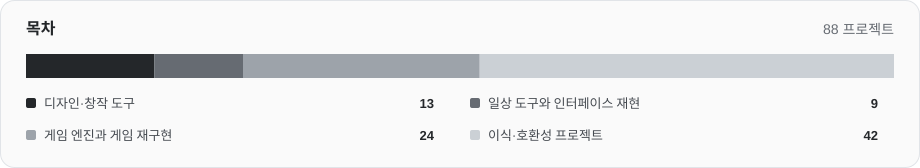

# Awesome RemakeList

소프트웨어 재구현, 게임 엔진, 이식 프로젝트와 사용 전에 준비할 것을 정리한 목록입니다.

[English](README.md) · [简体中文](README.zh-CN.md) · [日本語](README.ja.md) · **한국어** · [Español](README.es.md)

[RemakeList 둘러보기](https://remakelist.com/ko/?utm_source=github&utm_medium=repository&utm_campaign=awesome-remakelist&utm_content=intro-ko) · [프로젝트 추천](https://github.com/CharlexH/awesome-remakelist/issues/new?template=project.yml)

 

프로젝트 이름을 누르면 제작자의 원본 페이지로 이동합니다. 각 항목을 펼치면 기기, 게임 파일, 빌드 요구 사항을 볼 수 있으며, RemakeList에서는 스크린샷과 설치 설명도 확인할 수 있습니다.

## 여기서 시작하기

| 프로젝트 | 자세히 보기 | 시작 방법 |
| --- | --- | --- |
| [Graphite](https://remakelist.com/ko/remakes/graphite/?utm_source=github&utm_medium=repository&utm_campaign=awesome-remakelist&utm_content=graphite-featured-ko) | Adobe Illustrator | [브라우저에서 체험](https://editor.graphite.art/) |
| [Webamp](https://remakelist.com/ko/remakes/webamp/?utm_source=github&utm_medium=repository&utm_campaign=awesome-remakelist&utm_content=webamp-featured-ko) | Winamp 2 | [브라우저에서 체험](https://webamp.org/) |
| [OpenTTD](https://remakelist.com/ko/remakes/openttd/?utm_source=github&utm_medium=repository&utm_campaign=awesome-remakelist&utm_content=openttd-featured-ko) | Transport Tycoon Deluxe | [다운로드](https://www.openttd.org/) |
| [OpenRCT2](https://remakelist.com/ko/remakes/openrct2/?utm_source=github&utm_medium=repository&utm_campaign=awesome-remakelist&utm_content=openrct2-featured-ko) | RollerCoaster Tycoon 2 | [프로그램 다운로드 · 게임 파일 직접 준비](https://openrct2.io/download) |
| [D2R Mobile](https://remakelist.com/ko/remakes/d2r-mobile/?utm_source=github&utm_medium=repository&utm_campaign=awesome-remakelist&utm_content=d2r-mobile-featured-ko) | Diablo II: Resurrected | [직접 빌드 · 게임 파일 직접 준비](https://github.com/jhaizhou-ops/d2r-mobile/blob/main/README.md) |
| [nxnative](https://remakelist.com/ko/remakes/nxnative/?utm_source=github&utm_medium=repository&utm_campaign=awesome-remakelist&utm_content=nxnative-featured-ko) | Nintendo Switch 게임 | [직접 빌드 · 게임 파일 직접 준비](https://github.com/seedds/nxnative#pack-an-ipa) |

## 분류 둘러보기

- [디자인·창작 도구](#creative) · 13
- [일상 도구와 인터페이스 재현](#everyday) · 9
- [게임 엔진과 게임 재구현](#classic_games) · 30
- [이식·호환성 프로젝트](#ports) · 90

## 디자인·창작 도구

### [Compositor](https://github.com/robbietilton/Compositor)

Photoshop 방식의 작업 흐름을 바탕으로 만든 Apple silicon Mac용 레이어 합성 및 후처리 편집기입니다.

원작 또는 참고 대상: **Adobe Photoshop** · 독립적인 기능 대체 도구  
[다운로드](https://github.com/robbietilton/Compositor/releases/tag/v1.5.12) · [RemakeList 둘러보기](https://remakelist.com/ko/remakes/compositor/?utm_source=github&utm_medium=repository&utm_campaign=awesome-remakelist&utm_content=compositor-ko)

요구 사항과 스크린샷

**지원 환경:** Apple silicon Mac · macOS 26 이상

**개발 상태:** v1.5.12 · Apple Silicon · macOS 26 이상

**준비할 것:** Photoshop을 설치할 필요는 없습니다. Apple silicon Mac과 macOS 26 이상이 필요하며 소스 빌드에는 Xcode 26 이상이 필요합니다. 편집하는 미디어의 권리는 사용자가 확인해야 합니다.

**현재 이용할 수 있는 것:** v1.5.12는 macOS 26 이상을 사용하는 Apple Silicon Mac용 DMG를 제공합니다. 소스 빌드는 Xcode 26 이상이 필요합니다. 인터페이스는 영어만 지원합니다. PSD·PSB 가져오기는 8비트 RGB만 지원하며 CMYK는 지원하지 않습니다. 일부 벡터와 세로쓰기는 래스터화됩니다. RemakeList는 설치하거나 테스트하지 않았습니다.

**코드 라이선스:** [MIT](https://github.com/robbietilton/Compositor/blob/main/LICENSE)  
**제작자:** robbietilton  
[공식 문서](https://github.com/robbietilton/Compositor/blob/main/README.md) · 자료 확인일: 2026-10-28

### [PhotoCraft](https://github.com/storytold/photocraft)

ArtCraft 팀이 Rust로 재구현하는 Photoshop 방식의 이미지 편집 도구로, 현재 알파 단계입니다.

원작 또는 참고 대상: **Adobe Photoshop** · 작업 흐름 재구현  
[다운로드](https://github.com/storytold/photocraft/releases) · [RemakeList 둘러보기](https://remakelist.com/ko/remakes/photocraft/?utm_source=github&utm_medium=repository&utm_campaign=awesome-remakelist&utm_content=photocraft-ko)

요구 사항과 스크린샷

**지원 환경:** Windows / macOS / Linux / FreeBSD / 웹

**개발 상태:** 알파 · 작업 흐름 개발 중

**준비할 것:** Photoshop 설치는 필요하지 않습니다. 편집 이미지에 적절한 이용 권한이 있어야 하며, 포함된 글꼴과 아이콘에는 별도 라이선스가 있습니다. ArtCraft 상표는 코드 라이선스에서 제외됩니다.

**현재 이용할 수 있는 것:** Photoshop 설치 없이 사용할 수 있는 알파 배포판이 있습니다. Windows, macOS, Linux, FreeBSD, 웹 지원이 명시되어 있지만 PSD 상호 운용성, 도구의 깊이, 플러그인 호환성이 아직 부족해 전문 작업을 완전히 대체하는 단계는 아닙니다.

**코드 라이선스:** [MIT OR Apache-2.0](https://github.com/storytold/photocraft/blob/main/LICENSE-MIT)  
**제작자:** storytold  
[공식 문서](https://github.com/storytold/photocraft/blob/main/README.md) · 자료 확인일: 2026-10-12

### [Graphite](https://github.com/GraphiteEditor/Graphite)

레이어와 노드를 결합해 브라우저에서 비파괴 작업을 할 수 있는 오픈소스 벡터 디자인 도구입니다.

원작 또는 참고 대상: **Adobe Illustrator** · 독립적인 기능 대체 도구  
[브라우저에서 체험](https://editor.graphite.art/) · [RemakeList 둘러보기](https://remakelist.com/ko/remakes/graphite/?utm_source=github&utm_medium=repository&utm_campaign=awesome-remakelist&utm_content=graphite-ko)

요구 사항과 스크린샷

**지원 환경:** 웹

**개발 상태:** 알파 · 브라우저 편집기 제공

**준비할 것:** Illustrator 설치나 원본 프로그램 파일은 필요하지 않습니다. 이미지, 글꼴, 창작 에셋은 직접 준비하세요.

**현재 이용할 수 있는 것:** 브라우저 편집기에서 Illustrator 없이 벡터 디자인을 시도할 수 있습니다. 아직 알파 단계이며 사진 편집, 모션, 출판, VFX 전반의 기능은 발전 중이므로 Adobe 작업 환경 전체를 대체한다고 보기는 어렵습니다.

**코드 라이선스:** [MIT OR Apache-2.0](https://graphite.art/license/)  
**제작자:** Graphite community  
[공식 문서](https://github.com/GraphiteEditor/Graphite/blob/master/README.md) · 자료 확인일: 2026-10-12

### [Friction](https://github.com/friction2d/friction)

벡터·래스터 애니메이션, 타임라인, 표현식을 갖춘 오픈소스 2D 모션 그래픽 도구입니다.

원작 또는 참고 대상: **Adobe After Effects** · 독립적인 기능 대체 도구  
[다운로드](https://friction.graphics/#download) · [RemakeList 둘러보기](https://remakelist.com/ko/remakes/friction/?utm_source=github&utm_medium=repository&utm_campaign=awesome-remakelist&utm_content=friction-ko)

요구 사항과 스크린샷

**지원 환경:** Windows / macOS / Linux

**개발 상태:** 데스크톱 다운로드 · 2D 모션 그래픽

**준비할 것:** After Effects 설치는 필요하지 않습니다. 이미지, 글꼴, 오디오, 영상 에셋은 직접 준비하세요.

**현재 이용할 수 있는 것:** Windows, Linux, macOS 다운로드가 제공됩니다. 2D 애니메이션과 모션 그래픽을 제작할 수 있지만 사용자 정의 셰이더 효과는 실험 단계입니다. After Effects 프로젝트, 플러그인, 전체 효과 연결의 호환성을 약속하지는 않습니다.

**코드 라이선스:** [GPL-3.0-only](https://github.com/friction2d/friction/blob/main/LICENSE.md)  
**제작자:** Ole-André Rodlie &amp; contributors  
[공식 문서](https://friction.graphics/) · 자료 확인일: 2026-10-12

### [OpenCut](https://github.com/OpenCut-app/OpenCut)

CapCut 방식의 편집을 목표로 하는 오픈소스 영상 편집기입니다. 다음 버전을 새로 만드는 동안 기존 초기 베타를 온라인으로 제공합니다.

원작 또는 참고 대상: **CapCut** · 독립적인 기능 대체 도구  
[브라우저에서 체험](https://opencut.app/) · [RemakeList 둘러보기](https://remakelist.com/ko/remakes/opencut/?utm_source=github&utm_medium=repository&utm_campaign=awesome-remakelist&utm_content=opencut-ko)

요구 사항과 스크린샷

**지원 환경:** 웹

**개발 상태:** 초기 베타 · 재작성 중

**준비할 것:** CapCut 설치는 필요하지 않습니다. 이용 권한이 있는 영상, 이미지, 오디오를 가져오세요.

**현재 이용할 수 있는 것:** 공식 사이트는 현재 기존 초기 베타를 제공합니다. 기존 소스는 보관 상태이고 새 버전은 다시 작성 중입니다. 살펴볼 만한 후보지만 일상적인 CapCut 작업을 완전히 대신할 수 있다고 가정해서는 안 됩니다.

**코드 라이선스:** [MIT](https://github.com/OpenCut-app/OpenCut/blob/main/LICENSE)  
**제작자:** OpenCut contributors  
[공식 문서](https://github.com/OpenCut-app/OpenCut/blob/main/README.md) · 자료 확인일: 2026-10-12

### [Penpot](https://github.com/penpot/penpot)

호스팅 서비스 또는 자체 호스팅으로 사용하는 오픈소스 협업 디자인 및 프로토타이핑 플랫폼입니다.

원작 또는 참고 대상: **Figma** · 독립적인 기능 대체 도구  
[가입 또는 직접 호스팅](https://design.penpot.app) · [RemakeList 둘러보기](https://remakelist.com/ko/remakes/penpot/?utm_source=github&utm_medium=repository&utm_campaign=awesome-remakelist&utm_content=penpot-ko)

요구 사항과 스크린샷

**지원 환경:** 브라우저 / 자체 호스팅

**개발 상태:** 공식 문서 참고

**준비할 것:** Figma 소프트웨어나 에셋은 필요하지 않습니다. 이전하려면 자신의 디자인을 내보내고 가져와야 합니다.

**현재 이용할 수 있는 것:** 호스팅 서비스에 가입하거나 직접 설치해 사용하세요. 기존 디자인을 옮기려면 내보내기와 가져오기가 필요하며, 호스팅 요금제는 가격 페이지를 확인하세요.

**코드 라이선스:** [MPL-2.0](https://github.com/penpot/penpot/blob/develop/LICENSE)  
**제작자:** penpot  
[공식 문서](https://penpot.app/penpot-vs-figma) · 자료 확인일: 2026-10-11

### [VectorCraft](https://github.com/storytold/vectorcraft)

ArtCraft가 Rust로 재구현하는 Adobe Illustrator 방식의 도구입니다. 펜 드로잉, 패스 불리언 연산, 외형 효과, 벡터 일러스트를 다룹니다.

원작 또는 참고 대상: **Adobe Illustrator** · 작업 흐름 재구현  
[다운로드](https://getartcraft.com/apps/vectorcraft) · [RemakeList 둘러보기](https://remakelist.com/ko/remakes/vectorcraft/?utm_source=github&utm_medium=repository&utm_campaign=awesome-remakelist&utm_content=vectorcraft-ko)

요구 사항과 스크린샷

**지원 환경:** Windows / macOS / Linux / 웹

**개발 상태:** 알파

**준비할 것:** 원래의 상용 앱은 필요하지 않습니다. 이용 권한이 있는 문서와 미디어를 준비하세요. 포함된 글꼴, 이미지, 브랜드 상표에는 별도 라이선스가 적용됩니다.

**현재 이용할 수 있는 것:** 알파 단계로 일상적인 벡터 그리기를 시험해 볼 수 있습니다. 복잡한 파일 교환과 효과 재현성은 확인이 필요합니다. 데스크톱 설치 프로그램이 제공되며 플랫폼과 파일 호환성은 프로젝트 문서를 확인하세요.

**코드 라이선스:** [MIT OR Apache-2.0](https://github.com/storytold/vectorcraft/blob/main/LICENSE-MIT)  
**제작자:** ArtCraft  
[공식 문서](https://github.com/storytold/vectorcraft/blob/main/README.md) · 자료 확인일: 2026-10-12

### [FilmCraft](https://github.com/storytold/filmcraft)

ArtCraft가 Rust로 재구현하는 Adobe Premiere Pro 방식의 도구입니다. 소스·프로그램 모니터, 멀티트랙 타임라인, 트리밍 편집을 다룹니다.

원작 또는 참고 대상: **Adobe Premiere Pro** · 작업 흐름 재구현  
[다운로드](https://getartcraft.com/apps/filmcraft) · [RemakeList 둘러보기](https://remakelist.com/ko/remakes/filmcraft/?utm_source=github&utm_medium=repository&utm_campaign=awesome-remakelist&utm_content=filmcraft-ko)

요구 사항과 스크린샷

**지원 환경:** Windows / macOS / Linux

**개발 상태:** 알파

**준비할 것:** 원래의 상용 앱은 필요하지 않습니다. 이용 권한이 있는 문서와 미디어를 준비하세요. 포함된 글꼴, 이미지, 브랜드 상표에는 별도 라이선스가 적용됩니다.

**현재 이용할 수 있는 것:** 알파 단계로 편집과 내보내기 작업을 할 수 있습니다. 대용량 미디어 성능, 효과 렌더링, 전문 프로젝트 교환은 아직 미완성입니다. 데스크톱 설치 프로그램이 제공되며 플랫폼과 파일 호환성은 프로젝트 문서를 확인하세요.

**코드 라이선스:** [MIT OR Apache-2.0](https://github.com/storytold/filmcraft/blob/main/LICENSE-MIT)  
**제작자:** ArtCraft  
[공식 문서](https://github.com/storytold/filmcraft/blob/main/README.md) · 자료 확인일: 2026-10-12

### [LightCraft](https://github.com/storytold/lightcraft)

ArtCraft가 Rust로 재구현하는 Adobe Lightroom 방식의 도구입니다. 사진 라이브러리 관리, RAW 현상, 비파괴 색 조정을 다룹니다.

원작 또는 참고 대상: **Adobe Lightroom** · 작업 흐름 재구현  
[다운로드](https://getartcraft.com/apps/lightcraft) · [RemakeList 둘러보기](https://remakelist.com/ko/remakes/lightcraft/?utm_source=github&utm_medium=repository&utm_campaign=awesome-remakelist&utm_content=lightcraft-ko)

요구 사항과 스크린샷

**지원 환경:** Windows / macOS / Linux / 웹

**개발 상태:** 알파

**준비할 것:** 원래의 상용 앱은 필요하지 않습니다. 이용 권한이 있는 문서와 미디어를 준비하세요. 포함된 글꼴, 이미지, 브랜드 상표에는 별도 라이선스가 적용됩니다.

**현재 이용할 수 있는 것:** 알파 단계로 JPEG, DNG, 여러 카메라 RAW 형식을 시험할 수 있습니다. 카메라 색상 보정과 일부 압축 RAW 형식은 아직 미완성입니다. 데스크톱 설치 프로그램이 제공되며 플랫폼과 파일 호환성은 프로젝트 문서를 확인하세요.

**코드 라이선스:** [MIT OR Apache-2.0](https://github.com/storytold/lightcraft/blob/main/LICENSE-MIT)  
**제작자:** ArtCraft  
[공식 문서](https://github.com/storytold/lightcraft/blob/main/README.md) · 자료 확인일: 2026-10-12

### [EffectCraft](https://github.com/storytold/effectcraft)

ArtCraft가 Rust로 재구현하는 Adobe After Effects 방식의 도구입니다. 레이어 합성, 키프레임 애니메이션, 모션 그래픽, 효과를 다룹니다.

원작 또는 참고 대상: **Adobe After Effects** · 작업 흐름 재구현  
[다운로드](https://getartcraft.com/apps/effectcraft) · [RemakeList 둘러보기](https://remakelist.com/ko/remakes/effectcraft/?utm_source=github&utm_medium=repository&utm_campaign=awesome-remakelist&utm_content=effectcraft-ko)

요구 사항과 스크린샷

**지원 환경:** Windows / macOS / Linux / 웹

**개발 상태:** 초기 개발

**준비할 것:** 원래의 상용 앱은 필요하지 않습니다. 이용 권한이 있는 문서와 미디어를 준비하세요. 포함된 글꼴, 이미지, 브랜드 상표에는 별도 라이선스가 적용됩니다.

**현재 이용할 수 있는 것:** 초기 개발 단계로 애니메이션과 합성 실험에 적합하며 고객 납품용은 아닙니다. AEP/AEPX 프로젝트와 After Effects 플러그인은 지원하지 않습니다. 데스크톱 설치 프로그램이 제공되며 플랫폼과 파일 호환성은 프로젝트 문서를 확인하세요.

**코드 라이선스:** [MIT OR Apache-2.0](https://github.com/storytold/effectcraft/blob/main/LICENSE-MIT)  
**제작자:** ArtCraft  
[공식 문서](https://github.com/storytold/effectcraft/blob/main/README.md) · 자료 확인일: 2026-10-12

### [DesignCraft](https://github.com/storytold/designcraft)

ArtCraft가 Rust로 재구현하는 Adobe InDesign 방식의 도구입니다. 펼침면 레이아웃, 연결된 텍스트 프레임, 상위 페이지, 출판 문서를 다룹니다.

원작 또는 참고 대상: **Adobe InDesign** · 작업 흐름 재구현  
[다운로드](https://getartcraft.com/apps/designcraft) · [RemakeList 둘러보기](https://remakelist.com/ko/remakes/designcraft/?utm_source=github&utm_medium=repository&utm_campaign=awesome-remakelist&utm_content=designcraft-ko)

요구 사항과 스크린샷

**지원 환경:** Windows / macOS / Linux / 웹

**개발 상태:** 개발 중

**준비할 것:** 원래의 상용 앱은 필요하지 않습니다. 이용 권한이 있는 문서와 미디어를 준비하세요. 포함된 글꼴, 이미지, 브랜드 상표에는 별도 라이선스가 적용됩니다.

**현재 이용할 수 있는 것:** 개발 중이며 레이아웃과 내보내기를 시험할 빌드가 있습니다. 복잡한 출판 파일, 조판, 인쇄 전 처리에는 개별 확인이 필요합니다. 데스크톱 설치 프로그램이 제공되며 플랫폼과 파일 호환성은 프로젝트 문서를 확인하세요.

**코드 라이선스:** [MIT OR Apache-2.0](https://github.com/storytold/designcraft/blob/main/LICENSE-MIT)  
**제작자:** ArtCraft  
[공식 문서](https://github.com/storytold/designcraft/blob/main/README.md) · 자료 확인일: 2026-10-12

### [SoundCraft](https://github.com/storytold/soundcraft)

ArtCraft가 Rust로 재구현하는 Avid Pro Tools 방식의 도구입니다. 트랙 녹음, 편집 창, 믹서, MIDI 편곡을 다룹니다.

원작 또는 참고 대상: **Avid Pro Tools** · 작업 흐름 재구현  
[다운로드](https://getartcraft.com/apps/soundcraft) · [RemakeList 둘러보기](https://remakelist.com/ko/remakes/soundcraft/?utm_source=github&utm_medium=repository&utm_campaign=awesome-remakelist&utm_content=soundcraft-ko)

요구 사항과 스크린샷

**지원 환경:** Windows / macOS / Linux / 웹

**개발 상태:** 프리알파

**준비할 것:** 원래의 상용 앱은 필요하지 않습니다. 이용 권한이 있는 문서와 미디어를 준비하세요. 포함된 글꼴, 이미지, 브랜드 상표에는 별도 라이선스가 적용됩니다.

**현재 이용할 수 있는 것:** 프리알파 단계로 녹음, 편집, 믹싱, 바운스 작업을 할 수 있습니다. 오디오 장치·버퍼 선택, MIDI 컨트롤러 녹음, AAF/OMF 교환은 아직 없습니다. 데스크톱 설치 프로그램이 제공되며 플랫폼과 파일 호환성은 프로젝트 문서를 확인하세요.

**코드 라이선스:** [MIT OR Apache-2.0](https://github.com/storytold/soundcraft/blob/main/LICENSE-MIT)  
**제작자:** ArtCraft  
[공식 문서](https://github.com/storytold/soundcraft/blob/main/README.md) · 자료 확인일: 2026-10-12

### [CADCraft](https://github.com/storytold/cadcraft)

ArtCraft가 Rust로 재구현하는 Autodesk AutoCAD 방식의 도구입니다. 명령줄 제도, 객체 스냅, 레이어, 치수, 도면 레이아웃을 다룹니다.

원작 또는 참고 대상: **Autodesk AutoCAD** · 작업 흐름 재구현  
[다운로드](https://getartcraft.com/apps/cadcraft) · [RemakeList 둘러보기](https://remakelist.com/ko/remakes/cadcraft/?utm_source=github&utm_medium=repository&utm_campaign=awesome-remakelist&utm_content=cadcraft-ko)

요구 사항과 스크린샷

**지원 환경:** Windows / macOS / Linux / 웹

**개발 상태:** 초기 개발

**준비할 것:** 원래의 상용 앱은 필요하지 않습니다. 이용 권한이 있는 문서와 미디어를 준비하세요. 포함된 글꼴, 이미지, 브랜드 상표에는 별도 라이선스가 적용됩니다.

**현재 이용할 수 있는 것:** 초기 개발 단계로 2D 도면과 PDF 출력을 시험하는 데 적합합니다. AutoCAD의 모든 3D, DWG, 산업용 플러그인 작업을 대체하지는 않습니다. 데스크톱 설치 프로그램이 제공되며 플랫폼과 파일 호환성은 프로젝트 문서를 확인하세요.

**코드 라이선스:** [MIT OR Apache-2.0](https://github.com/storytold/cadcraft/blob/main/LICENSE-MIT)  
**제작자:** ArtCraft  
[공식 문서](https://github.com/storytold/cadcraft/blob/main/README.md) · 자료 확인일: 2026-10-12

## 일상 도구와 인터페이스 재현

### [ONLYOFFICE Desktop Editors](https://github.com/ONLYOFFICE/DesktopEditors)

문서, 스프레드시트, 프레젠테이션, PDF 오프라인 편집을 하나의 데스크톱 앱에 담은 오픈소스 Microsoft Office 대안입니다.

원작 또는 참고 대상: **Microsoft Office** · 독립적인 기능 대체 도구  
[다운로드](https://www.onlyoffice.com/download-desktop) · [RemakeList 둘러보기](https://remakelist.com/ko/remakes/onlyoffice/?utm_source=github&utm_medium=repository&utm_campaign=awesome-remakelist&utm_content=onlyoffice-ko)

요구 사항과 스크린샷

**지원 환경:** Windows / macOS / Linux

**개발 상태:** 안정 배포판 제공

**준비할 것:** 로컬 편집에 Microsoft Office 설치나 계정은 필요하지 않습니다. 클라우드 협업에는 호환 서비스가 필요하며 요금이 부과될 수 있습니다.

**현재 이용할 수 있는 것:** Windows, macOS, Linux 설치 프로그램이 제공되며 로컬 저장과 오프라인 편집이 가능합니다. 데스크톱 이용은 무료지만 클라우드 서비스와 기업용 버전은 별도 요금제를 사용합니다. 전환 전에 복잡한 문서 레이아웃을 확인하세요.

**코드 라이선스:** [AGPL-3.0](https://github.com/ONLYOFFICE/DesktopEditors/blob/master/LICENSE)  
**제작자:** ONLYOFFICE  
[공식 문서](https://github.com/ONLYOFFICE/DesktopEditors) · 자료 확인일: 2026-10-12

### [Grist](https://github.com/gristlabs/grist-core)

관계형 데이터와 스프레드시트 방식의 편집을 결합한 Excel 및 Airtable 작업 흐름의 오픈소스 대안입니다.

원작 또는 참고 대상: **Microsoft Excel / Airtable** · 독립적인 기능 대체 도구  
[다운로드](https://github.com/gristlabs/grist-desktop/releases) · [RemakeList 둘러보기](https://remakelist.com/ko/remakes/grist/?utm_source=github&utm_medium=repository&utm_campaign=awesome-remakelist&utm_content=grist-ko)

요구 사항과 스크린샷

**지원 환경:** Windows / macOS / Linux

**개발 상태:** 안정 배포판 제공

**준비할 것:** 데스크톱 앱은 로컬 파일을 편집합니다. 자체 호스팅에는 서버 환경이 필요하며, 호스팅 요금제에는 계정과 사용량·기능 제한이 적용됩니다.

**현재 이용할 수 있는 것:** Windows, macOS, Linux 데스크톱 배포판에서 로컬 파일을 편집할 수 있고 Community 버전은 자체 호스팅할 수도 있습니다. 호스팅 무료·유료 요금제는 별도이며 기업용 기능 모두가 오픈소스 코어에 포함되는 것은 아닙니다.

**코드 라이선스:** [Apache-2.0](https://github.com/gristlabs/grist-core/blob/main/LICENSE.txt)  
**제작자:** Grist Labs  
[공식 문서](https://github.com/gristlabs/grist-core) · 자료 확인일: 2026-10-12

### [LibreOffice](https://github.com/LibreOffice/core)

문서용 Writer, 스프레드시트용 Calc, 프레젠테이션용 Impress를 갖춘 무료 오픈소스 Microsoft Office 대안입니다.

원작 또는 참고 대상: **Microsoft Office** · 독립적인 기능 대체 도구  
[다운로드](https://www.libreoffice.org/download/download-libreoffice/) · [RemakeList 둘러보기](https://remakelist.com/ko/remakes/libreoffice/?utm_source=github&utm_medium=repository&utm_campaign=awesome-remakelist&utm_content=libreoffice-ko)

요구 사항과 스크린샷

**지원 환경:** Windows / macOS / Linux

**개발 상태:** 안정 배포판 제공

**준비할 것:** Microsoft Office 설치, 구독, 계정은 필요하지 않습니다. 시스템에 맞는 데스크톱 배포판을 설치하고 편집 권한이 있는 파일을 사용하세요.

**현재 이용할 수 있는 것:** Windows, macOS, Linux 다운로드가 제공되며 일상적인 사무 도구 전반을 갖추고 있습니다. VBA 매크로, 복잡한 Office 서식, 정확한 레이아웃 일치가 중요하다면 먼저 자신의 파일로 시험해 보세요.

**코드 라이선스:** [MPL-2.0 (primarily)](https://www.libreoffice.org/licenses/)  
**제작자:** The Document Foundation  
[공식 문서](https://www.libreoffice.org/) · 자료 확인일: 2026-10-12

### [Webamp](https://github.com/captbaritone/webamp)

클래식 플레이어 화면과 스킨을 지원하는 Winamp 2의 브라우저 재구현입니다.

원작 또는 참고 대상: **Winamp 2** · 웹 재구현  
[브라우저에서 체험](https://webamp.org/) · [RemakeList 둘러보기](https://remakelist.com/ko/remakes/webamp/?utm_source=github&utm_medium=repository&utm_campaign=awesome-remakelist&utm_content=webamp-ko)

요구 사항과 스크린샷

**지원 환경:** 브라우저

**개발 상태:** 공식 문서 참고

**준비할 것:** Winamp 설치는 필요하지 않습니다. 오디오와 외부 스킨에는 각각의 권리가 적용됩니다.

**현재 이용할 수 있는 것:** 브라우저에서 바로 열 수 있는 온라인 플레이어가 제공됩니다. 원본 프로그램은 필요하지 않으며 재생할 오디오를 직접 준비하면 됩니다.

**코드 라이선스:** [MIT](https://github.com/captbaritone/webamp/blob/master/LICENSE.txt)  
**제작자:** captbaritone  
[공식 문서](https://github.com/captbaritone/webamp/blob/master/README.md) · 자료 확인일: 2026-10-11

### [WinXP in React](https://github.com/ShizukuIchi/winXP)

Windows XP 바탕 화면, 시작 메뉴, 익숙한 작은 앱들을 브라우저로 재현합니다.

원작 또는 참고 대상: **Windows XP 바탕 화면** · 인터페이스 재현  
[브라우저에서 체험](https://winxp.vercel.app/) · [RemakeList 둘러보기](https://remakelist.com/ko/remakes/winxp/?utm_source=github&utm_medium=repository&utm_campaign=awesome-remakelist&utm_content=winxp-ko)

요구 사항과 스크린샷

**지원 환경:** 브라우저

**개발 상태:** 공식 문서 참고

**준비할 것:** Windows XP 설치 파일은 필요하지 않습니다.

**현재 이용할 수 있는 것:** Windows XP 설치 파일 없이 온라인 데모를 이용할 수 있습니다. 재현된 바탕 화면과 앱이 대상이며 임의의 XP 소프트웨어를 실행할 수는 없습니다.

**코드 라이선스:** [MIT (project code)](https://github.com/ShizukuIchi/winXP/blob/master/LICENSE)  
**제작자:** ShizukuIchi  
[공식 문서](https://github.com/ShizukuIchi/winXP/blob/master/README.md) · 자료 확인일: 2026-10-11

### [PdfCraft](https://github.com/storytold/pdfcraft)

ArtCraft가 Rust로 재구현하는 Adobe Acrobat 방식의 도구입니다. PDF 읽기, 주석, 페이지 정리, 합치기, 나누기를 다룹니다.

원작 또는 참고 대상: **Adobe Acrobat** · 작업 흐름 재구현  
[다운로드](https://getartcraft.com/apps/pdfcraft) · [RemakeList 둘러보기](https://remakelist.com/ko/remakes/pdfcraft/?utm_source=github&utm_medium=repository&utm_campaign=awesome-remakelist&utm_content=pdfcraft-ko)

요구 사항과 스크린샷

**지원 환경:** Windows / macOS / Linux / 웹

**개발 상태:** 초기 알파

**준비할 것:** 원래의 상용 앱은 필요하지 않습니다. 이용 권한이 있는 문서와 미디어를 준비하세요. 포함된 글꼴, 이미지, 브랜드 상표에는 별도 라이선스가 적용됩니다.

**현재 이용할 수 있는 것:** 초기 알파로 읽기와 페이지 관리 작업을 할 수 있습니다. Acrobat의 편집, 서명, 인쇄 전 처리 작업을 완전히 대체하지는 않습니다. 데스크톱 설치 프로그램이 제공되며 플랫폼과 파일 호환성은 프로젝트 문서를 확인하세요.

**코드 라이선스:** [MIT OR Apache-2.0](https://github.com/storytold/pdfcraft/blob/main/LICENSE-MIT)  
**제작자:** ArtCraft  
[공식 문서](https://github.com/storytold/pdfcraft/blob/main/README.md) · 자료 확인일: 2026-10-12

### [WordCraft](https://github.com/storytold/wordcraft)

ArtCraft가 Rust로 재구현하는 Microsoft Word 방식의 도구입니다. 문서 작성, 스타일, 표, 변경 내용 추적, 문서 레이아웃을 다룹니다.

원작 또는 참고 대상: **Microsoft Word** · 작업 흐름 재구현  
[다운로드](https://getartcraft.com/apps/wordcraft) · [RemakeList 둘러보기](https://remakelist.com/ko/remakes/wordcraft/?utm_source=github&utm_medium=repository&utm_campaign=awesome-remakelist&utm_content=wordcraft-ko)

요구 사항과 스크린샷

**지원 환경:** Windows / macOS / Linux / 웹

**개발 상태:** 알파

**준비할 것:** 원래의 상용 앱은 필요하지 않습니다. 이용 권한이 있는 문서와 미디어를 준비하세요. 포함된 글꼴, 이미지, 브랜드 상표에는 별도 라이선스가 적용됩니다.

**현재 이용할 수 있는 것:** 알파 단계로 글쓰기와 DOCX 작업을 시험할 수 있습니다. 페이지 나누기, 차트·SmartArt 왕복 변환 재현성, 네이티브 인쇄는 개선이 필요합니다. 데스크톱 설치 프로그램이 제공되며 플랫폼과 파일 호환성은 프로젝트 문서를 확인하세요.

**코드 라이선스:** [MIT OR Apache-2.0](https://github.com/storytold/wordcraft/blob/main/LICENSE-MIT)  
**제작자:** ArtCraft  
[공식 문서](https://github.com/storytold/wordcraft/blob/main/README.md) · 자료 확인일: 2026-10-13

### [DeckCraft](https://github.com/storytold/deckcraft)

ArtCraft가 Rust로 재구현하는 Microsoft PowerPoint 방식의 도구입니다. 슬라이드 마스터, 테마, 도형, 애니메이션, 슬라이드 쇼 재생을 다룹니다.

원작 또는 참고 대상: **Microsoft PowerPoint** · 작업 흐름 재구현  
[다운로드](https://getartcraft.com/apps/deckcraft) · [RemakeList 둘러보기](https://remakelist.com/ko/remakes/deckcraft/?utm_source=github&utm_medium=repository&utm_campaign=awesome-remakelist&utm_content=deckcraft-ko)

요구 사항과 스크린샷

**지원 환경:** Windows / macOS / Linux / 웹

**개발 상태:** 알파

**준비할 것:** 원래의 상용 앱은 필요하지 않습니다. 이용 권한이 있는 문서와 미디어를 준비하세요. 포함된 글꼴, 이미지, 브랜드 상표에는 별도 라이선스가 적용됩니다.

**현재 이용할 수 있는 것:** 알파 단계로 슬라이드를 만들고 발표할 수 있습니다. 복잡한 PPTX 파일이나 애니메이션이 PowerPoint와 똑같이 동작한다고 가정해서는 안 됩니다. 데스크톱 설치 프로그램이 제공되며 플랫폼과 파일 호환성은 프로젝트 문서를 확인하세요.

**코드 라이선스:** [MIT OR Apache-2.0](https://github.com/storytold/deckcraft/blob/main/LICENSE-MIT)  
**제작자:** ArtCraft  
[공식 문서](https://github.com/storytold/deckcraft/blob/main/README.md) · 자료 확인일: 2026-10-13

### [GridCraft](https://github.com/storytold/gridcraft)

ArtCraft가 Rust로 재구현하는 Microsoft Excel 방식의 도구입니다. 워크시트, 수식, 표, 차트, 피벗 테이블 작업을 다룹니다.

원작 또는 참고 대상: **Microsoft Excel** · 작업 흐름 재구현  
[다운로드](https://getartcraft.com/apps/gridcraft) · [RemakeList 둘러보기](https://remakelist.com/ko/remakes/gridcraft/?utm_source=github&utm_medium=repository&utm_campaign=awesome-remakelist&utm_content=gridcraft-ko)

요구 사항과 스크린샷

**지원 환경:** Windows / macOS / Linux / 웹

**개발 상태:** 알파

**준비할 것:** 원래의 상용 앱은 필요하지 않습니다. 이용 권한이 있는 문서와 미디어를 준비하세요. 포함된 글꼴, 이미지, 브랜드 상표에는 별도 라이선스가 적용됩니다.

**현재 이용할 수 있는 것:** 알파 단계로 핵심 스프레드시트 작업을 시험할 수 있습니다. 실제 XLSX 파일의 재현성, 대형 통합 문서 성능, 차트 기능, 구형 형식 가져오기는 개선이 필요합니다. 데스크톱 설치 프로그램이 제공되며 플랫폼과 파일 호환성은 프로젝트 문서를 확인하세요.

**코드 라이선스:** [MIT OR Apache-2.0](https://github.com/storytold/gridcraft/blob/main/LICENSE-MIT)  
**제작자:** ArtCraft  
[공식 문서](https://github.com/storytold/gridcraft/blob/main/README.md) · 자료 확인일: 2026-10-13

## 게임 엔진과 게임 재구현

### [Vanguard Engine](https://github.com/harshilmathur/openra2)

Red Alert 2 데이터용 독립 브라우저 RTS 엔진으로, 현재 소련군 싱글플레이 소규모 전투에 집중한 개발 버전입니다.

원작 또는 참고 대상: **Red Alert 2 / Yuri’s Revenge 데이터** · 엔진 재구현  
[소스에서 빌드](https://github.com/harshilmathur/openra2/blob/master/README.md#quickstart) · [RemakeList 둘러보기](https://remakelist.com/ko/remakes/vanguard/?utm_source=github&utm_medium=repository&utm_campaign=awesome-remakelist&utm_content=vanguard-ko)

요구 사항과 스크린샷

**지원 환경:** 브라우저 · 로컬 개발 서버

**개발 상태:** 개발 버전 · 정식 릴리스 없음

**준비할 것:** Classic 모드에는 합법적으로 소유한 RA2/YR 파일이 필요합니다. Original 모드는 저장소 자체 에셋을 쓰며 원작은 필요 없습니다. 두 모드는 구분됩니다. Node.js 20.19 이상과 로컬 개발 서버가 필요합니다.

**현재 이용할 수 있는 것:** 정식 릴리스 전의 개발 버전으로 Node.js 20.19 이상과 로컬 개발 서버가 필요합니다. Classic 모드에는 합법적으로 구한 RA2/YR 파일이 필요하지만 Original 모드에는 원작이 필요 없습니다. 연합군, 네트워크 대전, Yuri 게임플레이는 미완성이므로 Red Alert 2 전체를 재현한 것은 아닙니다.

**코드 라이선스:** [GPL-3.0-or-later](https://github.com/harshilmathur/openra2/blob/master/LICENSE)  
**제작자:** harshilmathur  
[공식 문서](https://github.com/harshilmathur/openra2/blob/master/README.md) · 자료 확인일: 2026-10-12

### [OpenTTD](https://github.com/OpenTTD/OpenTTD)

Transport Tycoon의 게임플레이를 현대 플랫폼에 맞춰 다시 만들고 멀티플레이 지원을 확장했습니다.

원작 또는 참고 대상: **Transport Tycoon Deluxe** · 게임 재구현  
[다운로드](https://www.openttd.org/) · [RemakeList 둘러보기](https://remakelist.com/ko/remakes/openttd/?utm_source=github&utm_medium=repository&utm_campaign=awesome-remakelist&utm_content=openttd-ko)

요구 사항과 스크린샷

**지원 환경:** Windows / macOS / Linux

**개발 상태:** 공식 문서 참고

**준비할 것:** 기본 그래픽이 필요하며 무료 OpenGFX2 또는 OpenGFX를 사용할 수 있습니다. OpenSFX 효과음과 OpenMSX 음악은 선택 사항입니다. 이 무료 시작 방법에는 원작 게임 파일이 필요하지 않습니다.

**현재 이용할 수 있는 것:** 데스크톱 배포판을 사용할 수 있습니다. 필수 기본 그래픽으로 무료 OpenGFX2 또는 OpenGFX를 준비하세요. OpenSFX 효과음과 OpenMSX 음악은 선택 사항이며, 이 방법에는 원작 게임 파일이 필요하지 않습니다.

**코드 라이선스:** [GPL-2.0; third-party components have separate licenses](https://github.com/OpenTTD/OpenTTD/blob/master/COPYING.md)  
**제작자:** OpenTTD  
[공식 문서](https://github.com/OpenTTD/OpenTTD/blob/master/README.md) · 자료 확인일: 2026-10-11

### [OpenRCT2](https://github.com/OpenRCT2/OpenRCT2)

협동 멀티플레이 등의 개선을 더해 현대 플랫폼에서 즐기는 RollerCoaster Tycoon 2입니다.

원작 또는 참고 대상: **RollerCoaster Tycoon 2** · 게임 재구현  
[프로그램 다운로드 · 게임 파일 직접 준비](https://openrct2.io/download) · [RemakeList 둘러보기](https://remakelist.com/ko/remakes/openrct2/?utm_source=github&utm_medium=repository&utm_campaign=awesome-remakelist&utm_content=openrct2-ko)

요구 사항과 스크린샷

**지원 환경:** Windows / macOS / Linux

**개발 상태:** 공식 문서 참고

**준비할 것:** 원작 RCT2 데이터 파일을 직접 준비해야 합니다. RCT1 데이터로 시나리오를 추가할 수 있습니다.

**현재 이용할 수 있는 것:** 배포판은 제공되지만 원작 RCT2 데이터 파일을 직접 준비해야 합니다. RCT1 데이터로 해당 시나리오를 추가할 수 있으며 무료 엔진에 원작의 상용 에셋은 포함되지 않습니다.

**코드 라이선스:** [GPL-3.0-or-later](https://github.com/OpenRCT2/OpenRCT2/blob/develop/licence.txt)  
**제작자:** OpenRCT2  
[공식 문서](https://github.com/OpenRCT2/OpenRCT2/blob/develop/readme.md) · 자료 확인일: 2026-10-11

### [OpenMW](https://github.com/OpenMW/openmw)

호환성과 그래픽 옵션을 개선한 Morrowind용 현대적인 오픈소스 엔진입니다.

원작 또는 참고 대상: **The Elder Scrolls III: Morrowind** · 엔진 재구현  
[프로그램 다운로드 · 게임 파일 직접 준비](https://www.openmw.org) · [RemakeList 둘러보기](https://remakelist.com/ko/remakes/openmw/?utm_source=github&utm_medium=repository&utm_campaign=awesome-remakelist&utm_content=openmw-ko)

요구 사항과 스크린샷

**지원 환경:** Windows / macOS / Linux

**개발 상태:** 공식 문서 참고

**준비할 것:** Morrowind를 플레이하려면 원작을 소유하고 데이터 파일을 설정해야 합니다.

**현재 이용할 수 있는 것:** 엔진은 다운로드할 수 있지만 Morrowind를 플레이하려면 원작을 소유하고 데이터 파일을 설정해야 합니다. 일부 원작 모드는 호환되지 않으므로 기존 모드 구성의 지원 여부를 확인하세요.

**코드 라이선스:** [GPLv3; some fonts separately licensed](https://github.com/OpenMW/openmw/blob/master/LICENSE)  
**제작자:** OpenMW  
[공식 문서](https://github.com/OpenMW/openmw/blob/master/README.md) · 자료 확인일: 2026-10-11

### [OpenRA](https://github.com/OpenRA/OpenRA)

현대적인 조작과 세 가지 공식 게임 모드로 고전 실시간 전략 게임을 새롭게 해석합니다.

원작 또는 참고 대상: **Red Alert 1 / Command &amp; Conquer / Dune 2000** · 게임 재해석  
[다운로드](https://www.openra.net/) · [RemakeList 둘러보기](https://remakelist.com/ko/remakes/openra/?utm_source=github&utm_medium=repository&utm_campaign=awesome-remakelist&utm_content=openra-ko)

요구 사항과 스크린샷

**지원 환경:** Windows / macOS / Linux

**개발 상태:** 공식 문서 참고

**준비할 것:** 원작 게임 에셋을 사용합니다. 공식 설치 프로그램은 첫 실행 시 필요한 에셋을 내려받거나 원작 디스크에서 가져올 수 있습니다.

**현재 이용할 수 있는 것:** Windows, macOS, Linux 다운로드가 제공됩니다. 원작 게임 에셋이 필요하며 프로젝트에 따르면 최초 설정 시 필요한 에셋을 내려받거나 원작 디스크에서 가져올 수 있습니다.

**코드 라이선스:** [GPL-3.0-or-later (engine)](https://github.com/OpenRA/OpenRA/blob/bleed/COPYING)  
**제작자:** OpenRA  
[공식 문서](https://www.openra.net/about/) · 자료 확인일: 2026-10-11

### [fheroes2](https://github.com/ihhub/fheroes2)

현대적 개선을 더한 데스크톱·Android용 Heroes of Might and Magic II 엔진 재구현입니다.

원작 또는 참고 대상: **Heroes of Might and Magic II** · 엔진 재구현  
[프로그램 다운로드 · 게임 파일 직접 준비](https://github.com/ihhub/fheroes2/releases) · [RemakeList 둘러보기](https://remakelist.com/ko/remakes/fheroes2/?utm_source=github&utm_medium=repository&utm_campaign=awesome-remakelist&utm_content=fheroes2-ko)

요구 사항과 스크린샷

**지원 환경:** Windows / macOS / Linux / Android

**개발 상태:** 배포판 제공 · 원작/데모 데이터 필요

**준비할 것:** 전체 원작 데이터 또는 공식 영어 데모 데이터가 필요합니다. INSTALL.md에 포함된 데모 다운로드 절차가 설명되어 있습니다. 데모 에셋은 허가된 제한 콘텐츠만 제공합니다.

**현재 이용할 수 있는 것:** 배포판에는 전체 원작 데이터 또는 공식 영어 데모 데이터가 필요하며 설치 안내에서 데모를 구하는 방법을 설명합니다. 데모 콘텐츠는 제한적이고 전체 게임에는 합법적으로 소유한 원작 에셋이 필요합니다. 설정 절차는 플랫폼마다 다릅니다.

**코드 라이선스:** [GPL-2.0-or-later](https://github.com/ihhub/fheroes2/blob/master/LICENSE)  
**제작자:** ihhub  
[공식 문서](https://github.com/ihhub/fheroes2/blob/master/README.md) · 자료 확인일: 2026-10-12

### [OpenXcom](https://github.com/OpenXcom/OpenXcom)

추가 모드를 지원하는 고전 X-COM 두 작품의 데스크톱 재구현입니다.

원작 또는 참고 대상: **UFO: Enemy Unknown / Terror from the Deep** · 게임 재구현  
[프로그램 다운로드 · 게임 파일 직접 준비](https://github.com/OpenXcom/OpenXcom/releases) · [RemakeList 둘러보기](https://remakelist.com/ko/remakes/openxcom/?utm_source=github&utm_medium=repository&utm_campaign=awesome-remakelist&utm_content=openxcom-ko)

요구 사항과 스크린샷

**지원 환경:** Windows / macOS / Linux

**개발 상태:** 데스크톱 엔진 · 원작 데이터 필요

**준비할 것:** UFO: Enemy Unknown 또는 Terror from the Deep의 수정되지 않은 원작 데이터가 필요합니다. Windows 설치 프로그램은 소유한 Steam 버전에서 리소스를 추출할 수 있습니다.

**현재 이용할 수 있는 것:** 데스크톱 배포판에는 두 게임 중 하나의 수정되지 않은 원작 데이터가 필요합니다. Windows 설치 프로그램은 소유한 Steam 버전에서 에셋을 추출할 수 있으며, 추가 모드에는 별도 에셋 요구 사항이 있을 수 있습니다.

**코드 라이선스:** [GPL-3.0-or-later](https://github.com/OpenXcom/OpenXcom/blob/master/LICENSE.txt)  
**제작자:** OpenXcom  
[공식 문서](https://github.com/OpenXcom/OpenXcom/blob/master/README.md) · 자료 확인일: 2026-10-12

### [VCMI](https://github.com/vcmi/vcmi)

데스크톱과 모바일 빌드, 모드, 멀티플레이를 지원하는 오픈소스 Heroes III 엔진입니다.

원작 또는 참고 대상: **Heroes of Might and Magic III** · 엔진 재구현  
[프로그램 다운로드 · 게임 파일 직접 준비](https://vcmi.eu/download/) · [RemakeList 둘러보기](https://remakelist.com/ko/remakes/vcmi/?utm_source=github&utm_medium=repository&utm_campaign=awesome-remakelist&utm_content=vcmi-ko)

요구 사항과 스크린샷

**지원 환경:** Windows / macOS / Linux / Android / iOS

**개발 상태:** 공개 릴리스 · 원본 데이터 필요

**준비할 것:** 전체 게임에는 소유한 Heroes III Complete 또는 Shadow of Death 데이터가 필요합니다. 런처에서 GOG 오프라인 설치 파일이나 기존 설치본을 가져올 수 있습니다. HD Edition만으로는 부족하며, 추가 확장으로 사용할 때도 Complete/SoD가 필요합니다. 공식 모드 목록은 내용이 제한된 데모 지원을 별도로 안내합니다.

**현재 이용할 수 있는 것:** 1.7.5가 공개되었습니다. Windows, macOS, Linux, Android 패키지가 있으며 iOS는 TestFlight나 사이드로딩을 사용합니다. 완전한 호환성을 보장하지 않습니다. RemakeList에서 실행하지 않았습니다.

**코드 라이선스:** [GPL-2.0-or-later code; VCMI-created assets CC-BY-SA 4.0; original game assets separate](https://github.com/vcmi/vcmi/blob/66fa496c6328a276c4eb14c0011b3a9d751dfac3/license.txt)  
**제작자:** VCMI Team  
[공식 문서](https://github.com/vcmi/vcmi/blob/66fa496c6328a276c4eb14c0011b3a9d751dfac3/docs/Readme.md) · 자료 확인일: 2026-10-18

### [Julius](https://github.com/bvschaik/julius)

Caesar III를 충실히 재구현해 원작 도시 건설 게임을 최신 데스크톱과 Android 등에서 실행합니다.

원작 또는 참고 대상: **Caesar III** · 게임 재구현  
[프로그램 다운로드 · 게임 파일 직접 준비](https://github.com/bvschaik/julius/releases/tag/v1.8.0) · [RemakeList 둘러보기](https://remakelist.com/ko/remakes/julius/?utm_source=github&utm_medium=repository&utm_campaign=awesome-remakelist&utm_content=julius-ko)

요구 사항과 스크린샷

**지원 환경:** Windows · Linux · macOS · Android · 웹(Emscripten) · PS Vita · Nintendo Switch

**개발 상태:** 출시됨 · 원본 게임 데이터 필요

**준비할 것:** 소유한 CD-ROM, GOG 또는 Steam판 Caesar III의 전체 설치 데이터를 준비하고 1.0.1.0으로 업데이트하세요. Julius는 해당 데이터 폴더를 사용하며 저장 파일을 쓸 권한이 필요합니다. 코드 라이선스는 원본 게임 리소스를 제공하거나 그 사용 권한을 부여하지 않습니다.

**현재 이용할 수 있는 것:** 1.8.0은 Windows, Linux, macOS, Android 다운로드와 Vita, Switch, Emscripten 패키지를 제공합니다. 브라우저 패키지도 설정과 원본 게임 파일이 필요합니다. RemakeList에서 실행하지 않았습니다.

**코드 라이선스:** [AGPL-3.0 · engine code; original Caesar III assets are separate](https://github.com/bvschaik/julius/blob/34d1ecd54befb845c0139b371fa8a0438210dac1/LICENSE.txt)  
**제작자:** Bianca van Schaik and contributors  
[공식 문서](https://github.com/bvschaik/julius/blob/34d1ecd54befb845c0139b371fa8a0438210dac1/README.md) · 자료 확인일: 2026-10-18

### [CorsixTH](https://github.com/CorsixTH/CorsixTH)

최신 데스크톱 환경, 고해상도, 편집 가능한 병원 경영 캠페인을 지원하는 Theme Hospital 엔진 재구현입니다.

원작 또는 참고 대상: **Theme Hospital** · 게임 재구현  
[프로그램 다운로드 · 게임 파일 직접 준비](https://github.com/CorsixTH/CorsixTH/releases/tag/v0.70.1) · [RemakeList 둘러보기](https://remakelist.com/ko/remakes/corsixth/?utm_source=github&utm_medium=repository&utm_campaign=awesome-remakelist&utm_content=corsixth-ko)

요구 사항과 스크린샷

**지원 환경:** Windows · macOS · Linux · BSD

**개발 상태:** 출시됨 · 원본 또는 데모 데이터 필요

**준비할 것:** 합법적으로 소유한 Theme Hospital CD 또는 디지털 설치 데이터를 준비하고 첫 실행 시 데이터 폴더를 선택해야 합니다. 공식 데모도 사용할 수 있지만 레벨이 하나뿐이며 대부분의 관리 화면이 없습니다. 엔진 라이선스는 원본 리소스에 대한 이용 권한을 부여하지 않습니다.

**현재 이용할 수 있는 것:** 0.70.1은 Windows와 macOS용으로 제공되며, Linux에서는 AppImage와 배포판 패키지를 이용할 수 있습니다. BSD도 지원합니다. Mac 릴리스는 RtMidi 하드웨어 MIDI를 비활성화했습니다. RemakeList는 실행하지 않았습니다.

**코드 라이선스:** [MIT · engine code; Theme Hospital assets are separate](https://github.com/CorsixTH/CorsixTH/blob/master/LICENSE.txt)  
**제작자:** CorsixTH team and contributors  
[공식 문서](https://github.com/CorsixTH/CorsixTH/blob/master/README.md) · 자료 확인일: 2026-10-19

### [Warzone 2100](https://github.com/Warzone2100/warzone2100)

1999년 3D 전략 게임을 커뮤니티가 이어 개발한 작품으로, 전체 캠페인과 사용자 지정 유닛, 데스크톱 멀티플레이를 제공합니다.

원작 또는 참고 대상: **Warzone 2100 (1999)** · 오픈 소스로 이어 가는 프로젝트  
[다운로드](https://wz2100.net/) · [RemakeList 둘러보기](https://remakelist.com/ko/remakes/warzone2100/?utm_source=github&utm_medium=repository&utm_campaign=awesome-remakelist&utm_content=warzone2100-ko)

요구 사항과 스크린샷

**지원 환경:** Windows · macOS · Linux · 웹

**개발 상태:** 출시됨 · 데스크톱 및 브라우저판

**준비할 것:** 원작을 별도 구매하거나 디스크 이미지를 준비할 필요가 없습니다. 공식 패키지를 사용하세요. 일부 플랫폼에서는 캠페인 영상을 공식 경로로 별도 다운로드해야 할 수 있습니다. 코드, 게임 데이터, 개별 구성 요소에는 각각 명시된 라이선스가 적용됩니다.

**현재 이용할 수 있는 것:** 4.7.0은 Windows, macOS, Linux용으로 제공되며 Mac 패키지는 Intel과 Apple silicon을 지원합니다. 공식 브라우저판은 캠페인과 스커미시를 제공하지만 그래픽 품질이 낮고 온라인 멀티플레이는 없습니다. RemakeList는 실행하지 않았습니다.

**코드 라이선스:** [GPL-2.0-or-later and component licenses](https://github.com/Warzone2100/warzone2100/blob/master/COPYING)  
**제작자:** Warzone 2100 Project  
[공식 문서](https://github.com/Warzone2100/warzone2100/blob/master/README.md) · 자료 확인일: 2026-10-19

### [ScummVM](https://github.com/scummvm/scummvm)

재구현한 게임 엔진으로 Monkey Island, Myst, Blade Runner 같은 고전 어드벤처를 최신 기기에서 실행합니다.

원작 또는 참고 대상: **고전 어드벤처와 RPG** · 엔진 재구현  
[프로그램 다운로드 · 게임 파일 직접 준비](https://www.scummvm.org/downloads/) · [RemakeList 둘러보기](https://remakelist.com/ko/remakes/scummvm/?utm_source=github&utm_medium=repository&utm_campaign=awesome-remakelist&utm_content=scummvm-ko)

요구 사항과 스크린샷

**지원 환경:** Windows / macOS / Linux / Android / iOS

**개발 상태:** 출시됨 · 게임과 플랫폼별로 호환성 상이

**준비할 것:** ScummVM 자체에는 게임이 포함되지 않습니다. 대부분의 상용 게임은 지원되는 게임 데이터를 직접 준비해야 합니다. 공식 Freeware Games 페이지는 Beneath a Steel Sky 등의 무료 완전판을 별도로 제공하며, 이는 Demos 페이지의 제한된 체험판과 다릅니다. 선택한 게임을 폴더에 압축 해제한 뒤 런처에 해당 폴더를 추가하세요. 각 게임에는 고유한 배포 조건이 적용됩니다.

**현재 이용할 수 있는 것:** 안정 버전 2026.4.0은 Windows, macOS, Linux용으로 제공됩니다. 2026년 10월 19일 기준 공식 페이지는 Android와 iOS 빌드를 이전 버전 항목의 2026.3.0으로 표시합니다. RemakeList는 게임을 실행하지 않았습니다.

**코드 라이선스:** [GPL-3.0-or-later engine code; individual game data retains its own terms](https://github.com/scummvm/scummvm/blob/7d2709da5136866589f7602f5f5a7b17de03420e/COPYING)  
**제작자:** ScummVM Team  
[공식 문서](https://github.com/scummvm/scummvm/blob/7d2709da5136866589f7602f5f5a7b17de03420e/README.md) · 자료 확인일: 2026-10-19

### [RigelEngine](https://github.com/lethal-guitar/RigelEngine)

와이드스크린, 부드러운 움직임, 빠른 저장, 개선된 컨트롤러 지원을 제공하는 Duke Nukem II 네이티브 엔진입니다.

원작 또는 참고 대상: **Duke Nukem II** · 엔진 재구현  
[프로그램 다운로드 · 게임 파일 직접 준비](https://github.com/lethal-guitar/RigelEngine/releases/tag/v0.9.1) · [RemakeList 둘러보기](https://remakelist.com/ko/remakes/rigelengine/?utm_source=github&utm_medium=repository&utm_campaign=awesome-remakelist&utm_content=rigelengine-ko)

요구 사항과 스크린샷

**지원 환경:** Windows / macOS / Linux

**개발 상태:** 출시됨 · 유지보수 단계

**준비할 것:** Duke Nukem II 설치 데이터의 NUKEM2.CMP를 준비하세요. 전체 4개 에피소드를 플레이하려면 정식 등록판 데이터가 필요하며 셰어웨어는 제한된 콘텐츠만 제공합니다. NUKEM2.F1부터 NUKEM2.F5는 선택 사항인 인트로 영상입니다. 첫 실행 시 게임 데이터 폴더를 선택하세요. 공식 README는 셰어웨어 압축 파일과 정식 라이선스를 보유한 전체 게임 판매처로 연결됩니다. RemakeList는 원본 데이터를 제공하지 않습니다.

**현재 이용할 수 있는 것:** 공식 0.9.1 패키지는 Windows x64 ZIP, macOS x64 DMG, Linux x64 DEB를 제공합니다. 릴리스는 Apple silicon 사용자에게 별도의 서드파티 Mac 유니버설 빌드를 안내합니다. README는 웹 빌드를 현재 사용할 수 없다고 명시합니다. RemakeList는 실행하지 않았습니다.

**코드 라이선스:** [GPL-2.0-or-later engine code; original Duke Nukem II data is separate](https://github.com/lethal-guitar/RigelEngine/blob/30afeff8f0b105eac77ee0a2fbd54b06e1a49b60/LICENSE.md)  
**제작자:** Nikolai Wuttke and contributors  
[공식 문서](https://github.com/lethal-guitar/RigelEngine/blob/30afeff8f0b105eac77ee0a2fbd54b06e1a49b60/README.md) · 자료 확인일: 2026-10-19

### [OpenLoco](https://github.com/OpenLoco/OpenLoco)

Chris Sawyer’s Locomotion을 최신 C++로 재구현하여 운송 회사 경영 시뮬레이션을 현재의 데스크톱 환경에서 실행하는 프로젝트입니다.

원작 또는 참고 대상: **Chris Sawyer’s Locomotion** · 게임 재구현  
[프로그램 다운로드 · 게임 파일 직접 준비](https://openloco.io/download/) · [RemakeList 둘러보기](https://remakelist.com/ko/remakes/openloco/?utm_source=github&utm_medium=repository&utm_campaign=awesome-remakelist&utm_content=openloco-ko)

요구 사항과 스크린샷

**지원 환경:** Windows x86/x64 · Linux x64 · macOS Apple silicon

**개발 상태:** 출시됨 · 원본 게임 데이터 필요

**준비할 것:** Steam 또는 GOG 설치본 등 합법적으로 소유한 Locomotion의 데이터를 준비하세요. 원본 파일은 앱과 별도로 보관해야 합니다. OpenGraphics가 추가되어도 문서에 명시된 원본 데이터 요구 사항은 사라지지 않습니다. MIT 라이선스는 상용 게임 리소스에 대한 이용 권한을 부여하지 않습니다.

**현재 이용할 수 있는 것:** v26.09는 Windows 32/64비트 ZIP, Linux x86-64 AppImage, 네이티브 macOS arm64 앱을 제공합니다. Mac 다운로드는 Apple silicon이 필요하며 서명과 공증을 받지 않았습니다. RemakeList는 이 빌드들을 실행하지 않았습니다.

**코드 라이선스:** [MIT · engine code; original game assets are separate](https://github.com/OpenLoco/OpenLoco/blob/v26.09/LICENSE)  
**제작자:** OpenLoco developers  
[공식 문서](https://github.com/OpenLoco/OpenLoco/blob/v26.09/README.md) · 자료 확인일: 2026-10-19

### [The Force Engine](https://github.com/TheForceEngine/TheForceEngine)

와이드스크린, 현대적인 마우스 조작, 빠른 저장, 기존 커뮤니티 모드 지원으로 Dark Forces를 다시 즐길 수 있습니다.

원작 또는 참고 대상: **Star Wars: Dark Forces** · 엔진 재구현  
[프로그램 다운로드 · 게임 파일 직접 준비](https://github.com/TheForceEngine/TheForceEngine/releases/tag/v1.22.420) · [RemakeList 둘러보기](https://remakelist.com/ko/remakes/the-force-engine/?utm_source=github&utm_medium=repository&utm_campaign=awesome-remakelist&utm_content=the-force-engine-ko)

요구 사항과 스크린샷

**지원 환경:** Windows / Linux · macOS는 소스 빌드 필요

**개발 상태:** 출시됨 · Dark Forces 지원

**준비할 것:** 구매한 Dark Forces 설치 데이터가 필요합니다. 엔진은 Steam과 GOG 설치 위치를 자동으로 찾으려 시도하며, 찾지 못하면 Settings &gt; Game에서 게임 데이터 디렉터리를 선택할 수 있습니다. 엔진 라이선스에는 상용 게임 파일이 포함되지 않습니다.

**현재 이용할 수 있는 것:** 공식 1.22.420 Windows ZIP을 제공합니다. 현재 README는 Linux에서 Flathub를 권장하며 macOS 소스 빌드 방법을 안내합니다. 바로 설치할 수 있는 공식 Mac 패키지는 확인되지 않았습니다.

**코드 라이선스:** [GPL-2.0 engine code; original Dark Forces assets are separate](https://github.com/TheForceEngine/TheForceEngine/blob/master/LICENSE)  
**제작자:** Lucius and The Force Engine contributors  
[공식 문서](https://github.com/TheForceEngine/TheForceEngine#readme) · 자료 확인일: 2026-10-19

### [OpenJazz](https://github.com/AlisterT/openjazz)

보유한 게임 파일이나 원본 셰어웨어 데이터를 사용해 현대적인 데스크톱에서 초대 Jazz Jackrabbit 플랫폼 게임을 다시 즐길 수 있습니다.

원작 또는 참고 대상: **Jazz Jackrabbit** · 엔진 재구현  
[프로그램 다운로드 · 게임 파일 직접 준비](https://github.com/AlisterT/openjazz/releases/tag/20260301) · [RemakeList 둘러보기](https://remakelist.com/ko/remakes/openjazz/?utm_source=github&utm_medium=repository&utm_campaign=awesome-remakelist&utm_content=openjazz-ko)

요구 사항과 스크린샷

**지원 환경:** Windows / macOS / Linux

**개발 상태:** 출시됨 · 원본 게임 또는 셰어웨어 데이터 필요

**준비할 것:** 보유한 초대 Jazz Jackrabbit 설치 파일 또는 원본 셰어웨어 데이터를 제공해야 합니다. 전체 게임 데이터는 무료 엔진에 포함되지 않으며 셰어웨어는 일부 에피소드만 제공합니다. 압축을 푼 게임 파일을 한 폴더에 보관하고 OpenJazz에 해당 디렉터리를 지정하세요.

**현재 이용할 수 있는 것:** 20260301 릴리스는 Windows x86-64와 Linux x86-64 실행 파일을 제공하며 Linux 빌드에는 glibc 2.35가 필요합니다. Mac Source Ports는 Apple silicon과 Intel을 지원하는 서명된 Universal 2 Mac 앱을 별도로 배포합니다.

**코드 라이선스:** [GPL-2.0-or-later engine code; Jazz Jackrabbit data is separate](https://github.com/AlisterT/openjazz/blob/master/doc/licenses.txt)  
**제작자:** AJ Thomson, Carsten Teibes and contributors  
[공식 문서](https://github.com/AlisterT/openjazz#readme) · 자료 확인일: 2026-10-19

### [cnc-port](https://github.com/dk8827/cnc-port)

EA가 공개한 Tiberian Dawn 코드를 현대 시스템으로 이식합니다.

원작 또는 참고 대상: **Command &amp; Conquer: Tiberian Dawn** · 오픈 소스로 이어 가는 프로젝트  
[직접 빌드 · 게임 파일 직접 준비](https://github.com/dk8827/cnc-port#readme) · [RemakeList 둘러보기](https://remakelist.com/ko/remakes/cnc-port/?utm_source=github&utm_medium=repository&utm_campaign=awesome-remakelist&utm_content=cnc-port-ko)

요구 사항과 스크린샷

**지원 환경:** macOS · Android 디버그 · iOS 시뮬레이터

**개발 상태:** 소스 포트 · 모바일 개발 대상

**준비할 것:** C&amp;C Gold Windows 95의 GDI·Nod 데이터를 직접 준비합니다. 제작자는 과거 무료 배포판의 커뮤니티 미러를 안내하며 데이터를 포함하지 않습니다. 코드 라이선스는 원작 게임, 이미지, 상용 데이터의 권한을 부여하지 않습니다.

**현재 이용할 수 있는 것:** 소스 빌드가 필요합니다. Mac 메뉴와 전술 플레이는 시험했으며 Android 디버그 APK 및 iOS 시뮬레이터 경로를 문서화했습니다. 빌드나 시뮬레이터 실행은 실제 모바일 플레이 검증이 아닙니다. 미러는 EA가 운영하지 않습니다.

**코드 라이선스:** [GPLv3 with additional EA terms. The code license grants no rights to the original game, artwork or commercial data.](https://github.com/dk8827/cnc-port#license-and-notice)  
**제작자:** dk8827  
[공식 문서](https://github.com/dk8827/cnc-port#readme) · 자료 확인일: 2026-10-19

### [Generals Zero Hour for Mac, iPhone &amp; iPad](https://github.com/ammaarreshi/Generals-Mac-iOS-iPad)

EA 공개 코드와 GeneralsX에 기반한 Apple용 Generals: Zero Hour입니다.

원작 또는 참고 대상: **Command &amp; Conquer: Generals — Zero Hour** · 오픈 소스로 이어 가는 프로젝트  
[직접 빌드 · 게임 파일 직접 준비](https://github.com/ammaarreshi/Generals-Mac-iOS-iPad#readme) · [RemakeList 둘러보기](https://remakelist.com/ko/remakes/generals-apple/?utm_source=github&utm_medium=repository&utm_campaign=awesome-remakelist&utm_content=generals-apple-ko)

요구 사항과 스크린샷

**지원 환경:** Apple Silicon Mac / iPhone / iPad

**개발 상태:** 플레이 가능한 소스 포트 · 직접 빌드

**준비할 것:** 본인 소유 소매판 또는 Steam Zero Hour 파일, 호환 Apple Silicon Mac, 문서의 빌드 도구가 필요합니다. 코드 라이선스는 원작 게임, 이미지, 상용 데이터의 권한을 부여하지 않습니다.

**현재 이용할 수 있는 것:** Mac에서 소스를 빌드하며 iPhone/iPad에는 Xcode와 Apple 서명이 추가로 필요합니다. 제작자는 캠페인과 교전 플레이를 보고했습니다. EA 공식 모바일판이 아닌 소스 빌드 방식입니다. 게임 데이터와 서명은 별도 조건입니다.

**코드 라이선스:** [GPLv3 with upstream terms. The code license grants no rights to the original game, artwork or commercial data.](https://github.com/ammaarreshi/Generals-Mac-iOS-iPad#readme)  
**제작자:** ammaarreshi  
[공식 문서](https://github.com/ammaarreshi/Generals-Mac-iOS-iPad#readme) · 자료 확인일: 2026-10-19

### [geow2](https://github.com/techknight/geow2)

geow2 — 여섯 모드와 로컬 멀티플레이. 표시된 기기를 위한 Geometry Wars: Retro Evolved 2의 독립 이식 프로젝트입니다.

원작 또는 참고 대상: **Geometry Wars: Retro Evolved 2** · 게임 재구현  
[프로그램 다운로드 · 게임 파일 직접 준비](https://github.com/techknight/geow2/releases) · [RemakeList 둘러보기](https://remakelist.com/ko/remakes/geow2/?utm_source=github&utm_medium=repository&utm_campaign=awesome-remakelist&utm_content=geow2-ko)

요구 사항과 스크린샷

**지원 환경:** Windows / macOS 11+ / Linux x64

**개발 상태:** 공개 배포 패키지가 있습니다.

**준비할 것:** 직접 적법하게 구한 파일을 준비하세요: Xbox Live Arcade · 584108FF · v0x102 · FFmpeg. 프로젝트는 무료지만 원작 게임은 별도입니다. 이 사이트는 게임 파일, 키 또는 바로 플레이할 패키지를 제공하지 않습니다.

**현재 이용할 수 있는 것:** 공식 이용 경로: Windows / macOS 11+ / Linux x64. 공개 배포 패키지가 있습니다. 시스템에 맞는 공식 패키지를 선택하세요.

**코드 라이선스:** [MIT applies to the project’s original code only; original game content and third-party components have separate rights.](https://github.com/techknight/geow2/blob/main/LICENSE)  
**제작자:** techknight  
[공식 문서](https://github.com/techknight/geow2#readme) · 자료 확인일: 2026-10-19

### [NOVA Swift](https://github.com/SirStig/NovaSwift)

NOVA Swift — 우주 전투, 이야기와 커뮤니티 플러그인. 표시된 기기를 위한 Escape Velocity Nova의 독립 이식 프로젝트입니다.

원작 또는 참고 대상: **Escape Velocity Nova** · 엔진 재구현  
[프로그램 다운로드 · 게임 파일 직접 준비](https://sirstig.github.io/NovaSwift/download.html) · [RemakeList 둘러보기](https://remakelist.com/ko/remakes/nova-swift/?utm_source=github&utm_medium=repository&utm_campaign=awesome-remakelist&utm_content=nova-swift-ko)

요구 사항과 스크린샷

**지원 환경:** macOS / iOS / iPadOS / tvOS / Linux / Windows / Steam Deck

**개발 상태:** 베타로 오류와 미완료 검증이 남아 있습니다.

**준비할 것:** 직접 적법하게 구한 파일을 준비하세요: EV Nova · 원작 게임 데이터. 프로젝트는 무료지만 원작 게임은 별도입니다. 이 사이트는 게임 파일, 키 또는 바로 플레이할 패키지를 제공하지 않습니다.

**현재 이용할 수 있는 것:** 공식 이용 경로: macOS / iOS / iPadOS / tvOS / Linux / Windows / Steam Deck. 베타로 오류와 미완료 검증이 남아 있습니다. 시스템에 맞는 공식 패키지를 선택하세요.

**코드 라이선스:** [MIT applies to the project’s original code only; original game content and third-party components have separate rights.](https://github.com/SirStig/NovaSwift/blob/main/LICENSE)  
**제작자:** SirStig  
[공식 문서](https://github.com/SirStig/NovaSwift#readme) · 자료 확인일: 2026-10-19

### [PeonPad](https://github.com/chrissotraidis/peonpad)

PeonPad — 터치 제스처로 고전 실시간 전략 조작. 표시된 기기를 위한 Warcraft II의 독립 이식 프로젝트입니다.

원작 또는 참고 대상: **Warcraft II** · 엔진 재구현  
[프로그램 다운로드 · 게임 파일 직접 준비](https://github.com/chrissotraidis/peonpad/releases) · [RemakeList 둘러보기](https://remakelist.com/ko/remakes/peonpad/?utm_source=github&utm_medium=repository&utm_campaign=awesome-remakelist&utm_content=peonpad-ko)

요구 사항과 스크린샷

**지원 환경:** iPadOS 16+

**개발 상태:** 개발자 미리보기 · 미서명 IPA · 직접 서명 필요

**준비할 것:** 소유한 Warcraft II 파일과 Wargus 추출 도구를 실행할 Mac 또는 PC가 필요합니다. 완전한 data.Wargus 폴더를 만들어 서명된 앱 설치 후 복사하세요. 무료 IPA에는 게임 데이터가 없으며 Blizzard 콘텐츠에 대한 권리도 주어지지 않습니다.

**현재 이용할 수 있는 것:** iPadOS 16 이상용 개발자 미리보기입니다. GitHub 사전 배포에는 Warcraft II 데이터가 없는 미서명 IPA가 있습니다. 직접 서명해 설치할 수 있으며 앱 컴파일은 선택 사항입니다. Mac이나 PC의 Wargus로 소유한 게임 데이터를 추출한 뒤 전체 data.Wargus 폴더를 On My iPad/PeonPad/data.Wargus에 복사하세요. 앱 내 가져오기, App Store 또는 TestFlight 버전은 없습니다.

**코드 라이선스:** [GPL-2.0 applies to the project’s original code only; original game content and third-party components have separate rights.](https://github.com/chrissotraidis/peonpad/blob/main/LICENSE)  
**제작자:** chrissotraidis  
[공식 문서](https://github.com/chrissotraidis/peonpad#readme) · 자료 확인일: 2026-10-19

### [Pocket Wormhole](https://github.com/adamkulik/pocket-wormhole)

Pocket Wormhole — 터치 조작과 ftl.dat 로컬 가져오기. 표시된 기기를 위한 FTL: Faster Than Light의 독립 이식 프로젝트입니다.

원작 또는 참고 대상: **FTL: Faster Than Light** · 엔진 재구현  
[프로그램 다운로드 · 게임 파일 직접 준비](https://github.com/adamkulik/pocket-wormhole/releases) · [RemakeList 둘러보기](https://remakelist.com/ko/remakes/pocket-wormhole/?utm_source=github&utm_medium=repository&utm_campaign=awesome-remakelist&utm_content=pocket-wormhole-ko)

요구 사항과 스크린샷

**지원 환경:** Android 8+ · GLES 3.0

**개발 상태:** 플레이 가능 또는 실험 단계 미리보기입니다.

**준비할 것:** 직접 적법하게 구한 파일을 준비하세요: Steam / GOG · ftl.dat · ~280 MB. 프로젝트는 무료지만 원작 게임은 별도입니다. 이 사이트는 게임 파일, 키 또는 바로 플레이할 패키지를 제공하지 않습니다.

**현재 이용할 수 있는 것:** 공식 이용 경로: Android 8+ · GLES 3.0. 플레이 가능 또는 실험 단계 미리보기입니다. 엔진 간 저장 이전에는 제한이 있으니 안내를 읽으세요. 시스템에 맞는 공식 패키지를 선택하세요.

**코드 라이선스:** [GPL-2.0-or-later applies to the project’s original code only; original game content and third-party components have separate rights.](https://github.com/adamkulik/pocket-wormhole/blob/main/LICENSE)  
**제작자:** adamkulik  
[공식 문서](https://github.com/adamkulik/pocket-wormhole#readme) · 자료 확인일: 2026-10-19

### [ra-port](https://github.com/dk8827/ra-port)

초대 Red Alert를 현대 시스템으로 이식합니다. 원본 데이터와 소스 빌드가 필요하며 네트워크 대전은 아직 없습니다.

원작 또는 참고 대상: **Command &amp; Conquer: Red Alert** · 오픈 소스로 이어 가는 프로젝트  
[직접 빌드 · 게임 파일 직접 준비](https://github.com/dk8827/ra-port#readme) · [RemakeList 둘러보기](https://remakelist.com/ko/remakes/ra-port/?utm_source=github&utm_medium=repository&utm_campaign=awesome-remakelist&utm_content=ra-port-ko)

요구 사항과 스크린샷

**지원 환경:** macOS / Linux / Android / iOS / iPadOS

**개발 상태:** 소스 빌드 · 원본 게임 필요

**준비할 것:** 다음 조건에 맞는 합법적으로 확보한 자신의 파일을 준비하세요: Red Alert 1 · Allied + Soviet discs. 상용 게임 콘텐츠는 별도이며 RemakeList에서 제공하지 않습니다.

**현재 이용할 수 있는 것:** 소스 빌드만 문서화했습니다. macOS·Linux 및 Android/iOS 로컬 debug 빌드가 대상이며 완성된 Mac 앱이나 모바일 릴리스, 네트워크 대전은 없습니다.

**코드 라이선스:** [GPL-3.0 with EA additional terms](https://github.com/dk8827/ra-port#readme)  
**제작자:** dk8827  
[공식 문서](https://github.com/dk8827/ra-port#readme) · 자료 확인일: 2026-10-19

### [Rugrats: Search for Reptar — Rust Port](https://github.com/toyz/rugrats)

PS1 Rugrats: Search for Reptar를 Rust로 다시 구현한 PC 프로젝트입니다. 소유한 디스크와 소스 빌드가 필요합니다.

원작 또는 참고 대상: **Rugrats: Search for Reptar** · 게임 재구현  
[직접 빌드 · 게임 파일 직접 준비](https://github.com/toyz/rugrats#readme) · [RemakeList 둘러보기](https://remakelist.com/ko/remakes/rugrats-rust-port/?utm_source=github&utm_medium=repository&utm_campaign=awesome-remakelist&utm_content=rugrats-rust-port-ko)

요구 사항과 스크린샷

**지원 환경:** Windows

**개발 상태:** 소스 빌드 · 원본 게임 필요

**준비할 것:** 다음 조건에 맞는 합법적으로 확보한 자신의 파일을 준비하세요: PlayStation USA · SLUS-00650 · owned disc. 상용 게임 콘텐츠는 별도이며 RemakeList에서 제공하지 않습니다.

**현재 이용할 수 있는 것:** 제작자는 모든 스테이지에서 엔딩까지의 진행을 기록했습니다. 설치에는 Rust와 소스 빌드가 필요하며 즉시 사용할 설치 프로그램은 확인되지 않았습니다.

**코드 라이선스:** [MIT OR Apache-2.0 authored code; original game data excluded](https://github.com/toyz/rugrats#readme)  
**제작자:** toyz  
[공식 문서](https://github.com/toyz/rugrats#readme) · 자료 확인일: 2026-10-19

### [Rich4 Renew](https://github.com/iam567/rich4-renew-app)

PC와 스마트폰용 비공식 『Richman 4（大富翁4）』 리메이크. 고해상도로 다시 그린 그래픽과 함께 부동산 거래, 주식, 카드, 온라인 파티 플레이를 제공합니다.

원작 또는 참고 대상: **Richman 4（大富翁4）** · 게임 재구현  
[다운로드](https://github.com/iam567/rich4-renew-app/blob/main/README.md) · [RemakeList 둘러보기](https://remakelist.com/ko/remakes/rich4-renew/?utm_source=github&utm_medium=repository&utm_campaign=awesome-remakelist&utm_content=rich4-renew-ko)

요구 사항과 스크린샷

**지원 환경:** Windows / macOS / Android / iOS

**개발 상태:** v0.8.0 · 폴더블 화면 대응 · 자료 사용 제한 유지

**준비할 것:** 소스에서 실행하려면 개발자가 별도로 제공하는 rich4-assets.tar가 필요합니다. 원작 게임에서 파생된 자료, 고해상도로 다시 그린 그래픽, 지도, 사운드가 포함됩니다. 이 에셋은 GPL 적용 대상이 아니며 개발자가 사적 이용으로 제한합니다. 패키징 스크립트는 에셋을 앱에 포함하지만, 배포 패키지의 내용은 독립적으로 검사하지 않았습니다. 무료 다운로드가 아트워크나 원작 게임 자료의 재배포를 허용한다는 뜻은 아닙니다.

**현재 이용할 수 있는 것:** v0.8.0은 Windows ZIP, Intel·Apple Silicon Mac DMG, Android APK와 미서명 iOS IPA를 제공합니다. 펼쳤을 때 거의 정사각형인 화면에 보드·사이드바 배치를 맞추고 접을 때 다시 배치하며, 일부 와이드 화면에서 사이드바가 잘리는 문제를 수정합니다. 화면 확인은 제작자 보고입니다. iOS는 직접 서명해야 합니다. 데스크톱 문서에는 Windows 미서명과 Mac 미공증이 명시되어 있습니다. 패키지 내용과 서명을 독립적으로 검사하지 않았습니다. 원작 자료와 다시 그린 이미지는 GPL 대상이 아니며, 제작자의 개인 사용 설명이 원권리자의 허락을 증명하지 않습니다. RemakeList는 설치하거나 플레이하지 않았습니다.

**코드 라이선스:** [GPL-3.0-or-later · code only](https://github.com/iam567/rich4-renew-app/blob/main/LICENSE)  
**제작자:** iam567 (Liang)  
[공식 문서](https://github.com/iam567/rich4-renew-app/blob/main/README.md) · 자료 확인일: 2026-10-28

### [Supermodel-VK](https://github.com/Igloo-Garage/Supermodel-VK)

Sega Model 3 아케이드 에뮬레이터 Supermodel의 Vulkan 강화 포크. 무료 오픈 소스이며, 게임 ROM은 합법적으로 별도 준비해야 한다.

원작 또는 참고 대상: **Sega Model 3 아케이드 / Supermodel** · emulator-enhancement-fork  
[프로그램 다운로드 · 게임 파일 직접 준비](https://github.com/Igloo-Garage/Supermodel-VK/releases/latest) · [RemakeList 둘러보기](https://remakelist.com/ko/remakes/supermodel-vk/?utm_source=github&utm_medium=repository&utm_campaign=awesome-remakelist&utm_content=supermodel-vk-ko)

요구 사항과 스크린샷

**지원 환경:** Windows 10/11 x64, Linux x86-64, macOS 11 이상(Intel / Apple Silicon)

**개발 상태:** 공개 릴리스가 있다. v0.9.2는 차기 버전 미리보기 단계이며, Linux와 macOS는 실사용 검증이 상대적으로 적다.

**준비할 것:** 게임 ROM은 포함하지 않는다. Model 3 ROM ZIP 파일을 합법적으로 별도 준비해야 한다. 코드의 GPL 라이선스는 게임 데이터, 미술 리소스, 상표에 적용되지 않는다.

**현재 이용할 수 있는 것:** Windows, Linux, macOS용 공개 릴리스는 v0.9.0.3a-20261017이다. 제작자에 따르면 Linux / macOS는 검증이 적다. macOS 빌드는 서명·공증되지 않았으며 명령줄에서 ./supermodel로 실행해야 하고, MoltenVK 사용 시 성능이 낮아질 수 있다. 본 사이트에서는 설치하거나 실행하지 않았다. 표지는 제작자의 차기 v0.9.2 게임 내 설정 오버레이 미리보기다. v0.9.2는 아직 출시되지 않았으며 이미지의 모든 기능이 현재 배포본에 포함된다는 뜻은 아니다.

**코드 라이선스:** [GPL-3.0-or-later · emulator code](https://github.com/Igloo-Garage/Supermodel-VK/blob/master/Docs/LICENSE.txt)  
**제작자:** Igloo-Garage · upstream: The Supermodel Team  
[공식 문서](https://github.com/Igloo-Garage/Supermodel-VK/blob/master/README.md) · 자료 확인일: 2026-10-20

### [pokerecomp](https://github.com/Decryptu/pokerecomp)

현대적인 화면·조작 설정을 갖춘 포켓몬 1·2세대의 Godot 재구현입니다. 지원되는 본인의 GB/GBC ROM에서 콘텐츠를 읽습니다.

원작 또는 참고 대상: **Pokémon Red/Blue/Yellow and Gold/Silver/Crystal** · 게임 재구현  
[프로그램 다운로드 · 게임 파일 직접 준비](https://github.com/Decryptu/pokerecomp/releases/tag/v0.1.86) · [RemakeList 둘러보기](https://remakelist.com/ko/remakes/pokerecomp/?utm_source=github&utm_medium=repository&utm_campaign=awesome-remakelist&utm_content=pokerecomp-ko)

요구 사항과 스크린샷

**지원 환경:** Windows x64/ARM64 · Linux x64/ARM64 · macOS · Android · iOS · Switch 홈브루

**개발 상태:** v0.1.86 · 1~2세대 · 본인 ROM 필요

**준비할 것:** 지원 해시와 일치하는 본인의 Red, Blue, Yellow, Gold, Silver 또는 Crystal ROM 리비전을 사용해야 합니다. 엔진 패키지에는 원작 게임이 없습니다.

**현재 이용할 수 있는 것:** v0.1.86은 데스크톱 빌드, Android APK, 서명되지 않은 iOS IPA와 Switch 홈브루 패키지를 제공합니다. iOS는 개인 서명·사이드로딩, Switch는 기존 홈브루 환경이 필요합니다. 3세대는 실험 단계로 플레이할 수 없습니다. 지원하지 않는 ROM 리비전은 거부됩니다. Apple 패키지는 일반 App Store 배포가 아니며 macOS는 임시 서명이고 무료 Apple 계정의 iOS 서명은 보통 갱신이 필요합니다.

**코드 라이선스:** [The rewritten engine code is MIT. Original Pokémon code, ROM content, artwork and music remain outside that license.](https://github.com/Decryptu/pokerecomp/blob/main/LICENSE)  
**제작자:** Decryptu  
[공식 문서](https://github.com/Decryptu/pokerecomp/blob/main/README.md) · 자료 확인일: 2026-10-28

### [Streetball Revival](https://github.com/luckvj/streetball-revival)

데스크톱 조작과 실험적인 온라인 플레이를 갖춘 NBA Street Vol. 2의 Rust 재구현입니다. 본인의 지원 미국판 PS2 디스크에서 콘텐츠를 읽습니다.

원작 또는 참고 대상: **NBA Street Vol. 2 (PS2)** · 게임 재구현  
[프로그램 다운로드 · 게임 파일 직접 준비](https://github.com/luckvj/streetball-revival/releases/tag/v0.1.4-beta) · [RemakeList 둘러보기](https://remakelist.com/ko/remakes/streetball-revival/?utm_source=github&utm_medium=repository&utm_campaign=awesome-remakelist&utm_content=streetball-revival-ko)

요구 사항과 스크린샷

**지원 환경:** Windows / Linux

**개발 상태:** v0.1.4-beta · Windows/Linux · 온라인 실험 단계

**준비할 것:** 프로젝트 지정 해시에 맞는 본인의 미국판 PS2 NBA Street Vol. 2 ISO(SLUS-20651)가 필요합니다. 엔진 다운로드에는 원작 데이터가 없습니다.

**현재 이용할 수 있는 것:** v0.1.4-beta는 Windows 설치 프로그램·아카이브와 Linux 아카이브를 제공합니다. 온라인은 개발 중이며 추가 플레이어 테스트가 필요합니다. 원작과의 동작 일치는 불완전해 CPU 팀 행동, 렌더링과 Gamebreaker 카메라 세부가 다를 수 있습니다. 제작자의 일치도 표는 일부 행동을 측정한 것이며 전체 게임 충실도 비율이 아닙니다.

**코드 라이선스:** [The rewritten engine is MIT. The license does not include EA’s original game data, artwork or music.](https://github.com/luckvj/streetball-revival/blob/main/LICENSE)  
**제작자:** luckvj  
[공식 문서](https://github.com/luckvj/streetball-revival/blob/main/README.md) · 자료 확인일: 2026-10-28

### [Torchlight Rekindled](https://github.com/GreenSwampDweller/torchlight-rekindled)

Xbox 360판의 컨트롤러 중심 게임 로직을 따르는 휴대기기·데스크톱용 Torchlight 엔진입니다. 본인의 PC·Xbox 360판 데이터를 사용합니다.

원작 또는 참고 대상: **Torchlight** · 엔진 재구현  
[프로그램 다운로드 · 게임 파일 직접 준비](https://github.com/GreenSwampDweller/torchlight-rekindled/releases/tag/1.0.2) · [RemakeList 둘러보기](https://remakelist.com/ko/remakes/torchlight-rekindled/?utm_source=github&utm_medium=repository&utm_campaign=awesome-remakelist&utm_content=torchlight-rekindled-ko)

요구 사항과 스크린샷

**지원 환경:** Switch 홈브루 / Android 12 이상 arm64 / iOS / Windows / Linux

**개발 상태:** 다운로드 제공 · 원작 게임 필요

**준비할 것:** 본인이 구매한 정식 PC·Xbox 360판의 pak.zip/Pak.zip과 music 폴더가 필요합니다. PC 데이터는 프로젝트의 대체 콘솔 인터페이스를 사용합니다. 게임 데이터는 배포하지 않습니다.

**현재 이용할 수 있는 것:** 1.0.2는 Switch NRO, Android APK, Windows·Linux x64 아카이브와 서명되지 않은 iOS IPA를 포함합니다. Switch는 홈브루, Android는 arm64·Android 12 이상과 선택 게임 폴더에 대한 전체 파일 접근이 필요합니다. iOS는 개인 서명이 필요합니다. 데스크톱 테스트는 제작자 노트북·컨트롤러에 한정되며 Steam Deck 지원은 확인되지 않았습니다. 1.0.2 배포에는 오래된 1.0.1 IPA도 있으므로 이름이 명확히 1.0.2인 파일을 선택하세요. RemakeList는 설치하거나 플레이하지 않았습니다.

**코드 라이선스:** [GPL-3.0 for the engine; game data and third-party components retain separate rights](https://github.com/GreenSwampDweller/torchlight-rekindled/blob/main/LICENSE)  
**제작자:** GreenSwampDweller  
[공식 문서](https://github.com/GreenSwampDweller/torchlight-rekindled/blob/main/README.md) · 자료 확인일: 2026-10-28

### [ZQuest Classic](https://github.com/ZQuestClassic/ZQuestClassic)

NES 원작 Zelda 스타일의 모험을 위한 무료 엔진·퀘스트 플레이어·편집기입니다. 커뮤니티 퀘스트를 플레이하거나 직접 만들 수 있습니다.

원작 또는 참고 대상: **The Legend of Zelda / Zelda-style adventures** · 엔진 재구현  
[다운로드](https://zquestclassic.com/releases/) · [RemakeList 둘러보기](https://remakelist.com/ko/remakes/zquest-classic/?utm_source=github&utm_medium=repository&utm_campaign=awesome-remakelist&utm_content=zquest-classic-ko)

요구 사항과 스크린샷

**지원 환경:** Windows / macOS / Linux / 웹(실험 단계)

**개발 상태:** 안정 데스크톱 배포판 · 실험적인 웹 플레이어

**준비할 것:** 엔진·플레이어는 퀘스트 파일을 사용합니다. 제작자에게서 받거나 직접 만드세요. 엔진 GPL은 Nintendo 이름·이미지나 타사 퀘스트 에셋의 권리를 부여하지 않으므로 각 퀘스트의 별도 조건을 확인해야 합니다.

**현재 이용할 수 있는 것:** 안정판 2.55.17은 Windows x64/x86, macOS·Linux 다운로드를 제공하며 공식 사이트에는 실험적인 웹 플레이어도 있습니다. 선택한 안정판은 2.55.17이며 3.0 사전 배포판은 별도 계열입니다. 모바일을 포함한 웹 버전은 실험 단계입니다. 퀘스트 호환성과 에셋 조건은 제작자·엔진 버전에 따라 다릅니다. RemakeList는 문서·배포 메타데이터만 확인했고 설치하거나 퀘스트를 플레이하지 않았습니다.

**코드 라이선스:** [GPL-3.0 for the engine; individual quests and their media have separate rights](https://github.com/ZQuestClassic/ZQuestClassic/blob/main/LICENSE)  
**제작자:** ZQuestClassic  
[공식 문서](https://github.com/ZQuestClassic/ZQuestClassic/blob/main/README.md) · 자료 확인일: 2026-10-28

## 이식·호환성 프로젝트

### [D2R Mobile](https://github.com/jhaizhou-ops/d2r-mobile)

직접 보유한 Switch Diablo II: Resurrected와 Reign of the Warlock 파일을 Apple 기기, Android 및 HarmonyOS에서 사용하기 위한 호환 계층입니다. 플랫폼별 준비가 필요합니다.

원작 또는 참고 대상: **Diablo II: Resurrected** · 플랫폼 호환 계층  
[직접 빌드 · 게임 파일 직접 준비](https://github.com/jhaizhou-ops/d2r-mobile/blob/main/README.md) · [RemakeList 둘러보기](https://remakelist.com/ko/remakes/d2r-mobile/?utm_source=github&utm_medium=repository&utm_campaign=awesome-remakelist&utm_content=d2r-mobile-ko)

요구 사항과 스크린샷

**지원 환경:** iPhone / iPad / Apple silicon Mac / Android ARM64 / HarmonyOS NEXT

**개발 상태:** v2.1.0 · 직접 보유한 Switch 파일 필요 · 실험적 카메라 선택 가능

**준비할 것:** 합법적으로 구매한 Switch 기본 게임과 Reign of the Warlock을 콘솔 버전 1.0.34.0으로 업데이트한 ExeFS·RomFS 파일을 직접 준비해야 합니다. 도구에서는 이 버전을 3.3.94012로 표시합니다. PC나 다른 콘솔의 파일로 대체할 수 없습니다. 리소스는 약 5.6 GB이며 구형 Apple 칩에는 직접 보유한 파일에서 생성한 약 1 GB의 추가 텍스처 팩이 필요합니다. Apple은 최소 A14·M1이 필요합니다. iOS 26 이상과 18–25, macOS 26 이상과 15–25에 맞춰 표준 빌드 또는 구형 API 빌드를 선택하세요. Android에는 ARM64, Android 12 이상과 Vulkan 1.1이 필요합니다. HarmonyOS NEXT에는 개발자 계정, 서명 도구와 직접 준비한 런타임 팩이 필요합니다.

**현재 이용할 수 있는 것:** v2.1.0은 Android APK와 두 iOS 빌드 입력용 ZIP을 업데이트합니다. Android는 기존 가져오기 팩과 저장을 유지할 수 있으며, iOS는 새 입력 파일과 v2.1.0 소스로 앱을 다시 만들어 서명해야 합니다. 미서명 HarmonyOS HAP는 v2.0.0 파일 그대로이며 개발자 인증서 재서명과 런타임 팩이 필요합니다. Mac은 소스 빌드만 가능합니다. 오프라인 전용입니다. Android에는 미완성 터치 기능과 기기별 그래픽 문제가 남아 있습니다. RAM 4 GB Apple 기기는 메모리가 부족할 수 있으며, 사이드로딩 도구 서명과 Linux 패키징은 미검증입니다. 무료 Apple ID는 7일마다 다시 서명해야 하고 iCloud 동기화가 없습니다. Apple TV는 캐릭터 선택 미리보기뿐입니다. 게임 내용이 들어간 패키지는 재배포하지 마세요. RemakeList는 빌드·설치·플레이하지 않았습니다.

**코드 라이선스:** [MIT covers project code; original game files and third-party components retain separate rights and licenses.](https://github.com/jhaizhou-ops/d2r-mobile/blob/main/LICENSE)  
**제작자:** joe jiang (@happyjoejiang)  
[공식 문서](https://github.com/jhaizhou-ops/d2r-mobile/blob/main/README.md) · 자료 확인일: 2026-10-28

### [MW2 Recompiled](https://github.com/PaulCombal/mw2-recompiled)

Xbox 360판 Modern Warfare 2 (2009)를 Windows와 Linux 네이티브 프로그램으로 정적 재컴파일합니다.

원작 또는 참고 대상: **Modern Warfare 2 (2009)** · 정적 재컴파일  
[프로그램 다운로드 · 게임 파일 직접 준비](https://github.com/PaulCombal/mw2-recompiled/releases/tag/v0.8.1) · [RemakeList 둘러보기](https://remakelist.com/ko/remakes/mw2-recompiled/?utm_source=github&utm_medium=repository&utm_campaign=awesome-remakelist&utm_content=mw2-recompiled-ko)

요구 사항과 스크린샷

**지원 환경:** Windows / Linux x64 · SSE4.2 · Vulkan 1.2

**개발 상태:** 안정판 v0.8.1 · v0.8.2 사전 출시 제공

**준비할 것:** 합법적으로 확보한 Xbox 360 USA/Europe 버전 1.0.557 디스크 ISO를 직접 준비해야 합니다. 런처가 이를 확인한 뒤 Title Update 6을 다운로드하여 적용합니다. x64 SSE4.2 프로세서, Vulkan 1.2, 디스크 공간 약 8 GB와 컨트롤러가 필요합니다. 키보드는 메뉴 조작만 지원합니다. 실험적인 PC 커스텀 맵 가져오기에는 직접 보유한 PC판의 에셋도 필요합니다.

**현재 이용할 수 있는 것:** 기본 다운로드는 Windows·Linux 안정판 v0.8.1을 유지하며 v0.8.2는 별도 사전 출시입니다. 지원되는 본인 ISO로 mw2-launcher를 실행하고 일반 플랫폼 패키지를 사용하세요. 같은 버전의 -steam·-lan은 구형 런처 호환용 중복 파일입니다. 공개 매칭·랭크 플레이는 지원하지 않으며 커스텀 맵은 베타입니다. 다른 Steam 사용자가 SYSTEM LINK를 발견할 수 있고 같은 중계 서버·LAN 사용자도 게임에 접근할 수 있습니다. 동일한 버전으로 신뢰하는 친구와 이용하세요. 제작자는 네트워크 수정을 보고했지만 RemakeList는 보안 감사·설치·플레이를 하지 않았습니다.

**코드 라이선스:** [GPL-3.0-only](https://github.com/PaulCombal/mw2-recompiled/blob/master/LICENSE)  
**제작자:** PaulCombal  
[공식 문서](https://github.com/PaulCombal/mw2-recompiled/blob/master/README.md) · 자료 확인일: 2026-10-28

### [Zelda 64: Recompiled](https://github.com/Zelda64Recomp/Zelda64Recomp)

Majora’s Mask를 정적 재컴파일해 현대적 조작과 그래픽 옵션을 제공하는 네이티브 데스크톱 이식판입니다.

원작 또는 참고 대상: **Majora’s Mask** · 정적 재컴파일  
[프로그램 다운로드 · 게임 파일 직접 준비](https://github.com/Zelda64Recomp/Zelda64Recomp/releases) · [RemakeList 둘러보기](https://remakelist.com/ko/remakes/zelda64-recompiled/?utm_source=github&utm_medium=repository&utm_campaign=awesome-remakelist&utm_content=zelda64-recompiled-ko)

요구 사항과 스크린샷

**지원 환경:** Windows / Linux / macOS

**개발 상태:** 출시 · 원본 에셋 필요

**준비할 것:** 본인의 북미 N64판 Majora’s Mask ROM이 필요합니다. 저장소와 배포판 모두 게임 에셋을 포함하지 않습니다.

**현재 이용할 수 있는 것:** Windows, Linux, macOS용 v1.2.2 배포판이 있습니다. 호환 그래픽 API가 필요하며 여기서는 실행하지 않았습니다.

**코드 라이선스:** [GPL-3.0](https://github.com/Zelda64Recomp/Zelda64Recomp/blob/dev/COPYING)  
**제작자:** Zelda64Recomp team  
[공식 문서](https://github.com/Zelda64Recomp/Zelda64Recomp/blob/dev/README.md) · 자료 확인일: 2026-10-14

### [MacNativeGames · Tears of the Kingdom](https://github.com/ly05010419/MacNativeGames)

본인의 Switch 파일로 Apple Silicon Mac 또는 iPhone/iPad용 Tears of the Kingdom 앱을 빌드합니다. 실험 단계이며 로컬 빌드와 기기 서명이 필요합니다.

원작 또는 참고 대상: **젤다의 전설 티어스 오브 더 킹덤** · 플랫폼 호환 계층  
[직접 빌드 · 게임 파일 직접 준비](https://github.com/ly05010419/MacNativeGames#build-the-app) · [RemakeList 둘러보기](https://remakelist.com/ko/remakes/zelda-totk-mac-research/?utm_source=github&utm_medium=repository&utm_campaign=awesome-remakelist&utm_content=zelda-totk-mac-research-ko)

요구 사항과 스크린샷

**지원 환경:** Apple Silicon Mac · macOS 26+; iPhone 14+ / iPad · iOS/iPadOS 26+

**개발 상태:** 실험 단계 · 로컬 빌드 및 서명 · 정식 출시 없음

**준비할 것:** 본인 콘솔에서 추출한 Switch v1.0.0 본편(XCI/NSP), 키, 시스템 파일이 필요합니다. Mac은 별도 v1.1.2·v1.2.1·v1.4.3 업데이트(NSP/NSZ)도 지원하며 iOS는 v1.4.3만 시험했습니다. Mac은 Apple Silicon, macOS 26+, Metal 4가 필요하고 RAM 16 GB를 권장합니다. 입력 게임 외에 본편 Mac 빌드 약 25 GB, APFS 복제를 못 하면 약 17 GB 추가, 새 업데이트 빌드는 약 40 GB가 필요합니다. iOS 빌드는 전체 Xcode 26+, iOS/iPadOS 26+, 휴대전화는 iPhone 14 이상과 메모리 상한 확장 권한을 유지한 서명이 필요합니다. 새 본편은 45 GB, 업데이트 포함은 60 GB를 확보하세요. 완성 앱은 게임 내용을 포함하며 개인용입니다. 본 사이트는 게임·키·펌웨어·서명 앱·파생 셰이더를 제공하지 않습니다.

**현재 이용할 수 있는 것:** 소스 빌드가 필요하며 정식 Releases는 없습니다. 제작자가 M4 Mac 테스트 및 iPhone 14·A16 iPad에서 v1.4.3 플레이를 보고했으며 본 사이트 실측이 아닙니다. 이전 Mac의 캐시 준비 후 약 90 FPS는 관찰치로 전체 완료나 안정 성능을 보장하지 않습니다. iPhone 14는 약 4 GB를 사용하고 복잡한 구역에서 약 8분 후 iOS가 종료한 사례가 두 번 있습니다. iOS는 없는 셰이더로 인해 물체가 누락될 수 있고 Mac 새 장면에서도 끊길 수 있습니다. 온라인·amiibo는 미지원입니다.

**코드 라이선스:** [Project code MIT · game rights and third-party licenses separate](https://github.com/ly05010419/MacNativeGames/blob/main/LICENSE)  
**제작자:** Yong Li / liyong (@liyong2077)  
[공식 문서](https://github.com/ly05010419/MacNativeGames/blob/b75be8cfa704df3701e86130c8ced268e79d6b11/README.md) · 자료 확인일: 2026-10-20

### [Dusklight](https://github.com/TwilitRealm/dusklight)

고해상도, 프레임 속도 설정, 내장 모드 탐색기를 지원하는 『황혼의 공주』 네이티브 이식판입니다.

원작 또는 참고 대상: **젤다의 전설 황혼의 공주** · 디컴파일 기반 프로젝트  
[프로그램 다운로드 · 게임 파일 직접 준비](https://twilitrealm.dev/install/) · [RemakeList 둘러보기](https://remakelist.com/ko/remakes/dusklight/?utm_source=github&utm_medium=repository&utm_campaign=awesome-remakelist&utm_content=dusklight-ko)

요구 사항과 스크린샷

**지원 환경:** Windows / Linux / macOS / iOS / Android

**개발 상태:** 출시됨 · 원작 리소스 필요

**준비할 것:** 소유한 게임큐브 또는 Wii판 디스크를 직접 덤프해야 합니다. 한국 Wii판은 지원하지 않습니다. 프로젝트는 저작권으로 보호되는 게임 리소스를 제공하지 않습니다.

**현재 이용할 수 있는 것:** 프로젝트에서 데스크톱·모바일 빌드를 공개했습니다. iOS는 사이드로딩이 필요합니다. D3D12, Vulkan 1.1 이상 또는 Metal을 권장하며, 구형 그래픽 백엔드는 재현 정확도와 성능에 제약이 있습니다. RemakeList에서는 실행하지 않았습니다.

**코드 라이선스:** [CC0-1.0 · project code; original game assets excluded](https://github.com/TwilitRealm/dusklight/blob/main/LICENSE.md)  
**제작자:** Twilit Realm  
[공식 문서](https://github.com/TwilitRealm/dusklight/blob/main/README.md) · 자료 확인일: 2026-10-18

### [Mega Man X4 Recompiled](https://github.com/mstan/MegaManX4Recomp)

X와 Zero가 로컬 또는 네트워크로 2인 협동 플레이를 할 수 있는 Mega Man X4 네이티브 재컴파일 프로젝트입니다. 현재 릴리스는 공개 베타입니다.

원작 또는 참고 대상: **록맨 X4** · 정적 재컴파일  
[프로그램 다운로드 · 게임 파일 직접 준비](https://github.com/mstan/MegaManX4Recomp/releases/tag/v1.0.14) · [RemakeList 둘러보기](https://remakelist.com/ko/remakes/mega-man-x4-recompiled/?utm_source=github&utm_medium=repository&utm_campaign=awesome-remakelist&utm_content=mega-man-x4-recompiled-ko)

요구 사항과 스크린샷

**지원 환경:** Windows x64 / Linux x86-64 (glibc 2.38 이상)

**개발 상태:** 공개 베타 · 2인 협동 플레이 · 원본 디스크 필요

**준비할 것:** 모든 모드를 꺼도 직접 보유한 수정되지 않은 Mega Man X4 USA (SLUS-00561) 원본 .cue 및 .bin 디스크 이미지가 필요합니다. 패치된 디스크, 언더빙 또는 재번역 이미지는 지원하지 않습니다. OpenBIOS가 포함되어 있으며, 별도 BIOS 덤프는 선택 사항입니다. 원작 게임 콘텐츠는 MIT 라이선스에 포함되지 않습니다.

**현재 이용할 수 있는 것:** v1.0.14는 Windows x64 ZIP과 Linux x86-64 AppImage를 제공합니다. 협동 플레이 렌더링 성능을 개선하지만 속도 향상 수치는 특정 보스 장면 기준이며 전체 게임 보장이 아닙니다. 협동에는 OpenGL이 필요하고 모든 넷플레이 참가자가 같은 버전으로 업데이트해야 합니다. 기존 네이티브 메모리 카드 저장은 유지됩니다. 공개 베타로 독립 카메라가 여전히 느려질 수 있고 온라인 로그인·시작 보고는 조사 중입니다. Linux는 glibc 2.38 이상이 필요하며 4인 실험은 별도 버전입니다. RemakeList는 설치하거나 플레이하지 않았습니다.

**코드 라이선스:** [MIT · original project code; dependencies retain their licenses](https://github.com/mstan/MegaManX4Recomp/blob/master/LICENSE)  
**제작자:** Matthew Stanley  
[공식 문서](https://github.com/mstan/MegaManX4Recomp/blob/master/README.md) · 자료 확인일: 2026-10-28

### [Galaxy Android](https://github.com/OpenPort-Labs/Galaxy-Android)

터치 조작, 게임패드, 울트라와이드 화면을 지원하는 슈퍼 마리오 갤럭시의 초기 Android 네이티브 이식판입니다.

원작 또는 참고 대상: **슈퍼 마리오 갤럭시** · 디컴파일 기반 프로젝트  
[프로그램 다운로드 · 게임 파일 직접 준비](https://github.com/OpenPort-Labs/Galaxy-Android/releases/tag/v0.0.4b) · [RemakeList 둘러보기](https://remakelist.com/ko/remakes/galaxy-android/?utm_source=github&utm_medium=repository&utm_campaign=awesome-remakelist&utm_content=galaxy-android-ko)

요구 사항과 스크린샷

**지원 환경:** Android 11 이상 · ARM64 · Vulkan 1.0

**개발 상태:** v0.0.4b · 테스터 사이드로드 빌드 · 업데이트 전 저장 백업

**준비할 것:** 합법적으로 직접 덤프한 Wii Super Mario Galaxy 디스크 이미지(.rvz, .wbfs, .iso 또는 .wia)를 준비하여 로컬로 추출·변환해야 합니다. 동영상 제외 시 약 2.5 GB, 포함 시 약 5 GB를 확보하세요. 선택 사항인 Shield 유래 자료는 별도의 독점 데이터이며 이 목록에서는 제공하지 않습니다.

**현재 이용할 수 있는 것:** v0.0.4b는 Android 11 이상 ARM64용 GalaxyAndroid.apk를 제공하며 Vulkan 1.0과 RAM 3 GB 이상이 필요합니다. OpenGL 대체 경로는 없습니다. 디버깅 가능한 테스터용 사이드로드 빌드이며 스토어 패키지가 아닙니다. 서명 인증서가 바뀌어 GitHub v0.0.4·4a 설치 위에 업데이트할 수 없습니다. 제거하면 앱 전용 데이터가 삭제되므로 먼저 저장을 백업하세요. 공유 GalaxyData 저장소는 별개입니다. 제작자는 이번 릴리스 검증에 휴대폰이나 헤드셋을 연결하지 않았습니다. 넷플레이 인증과 정식 서명 키 교체도 미완료입니다. RemakeList는 설치하거나 테스트하지 않았습니다.

**코드 라이선스:** [GPL-3.0 · port code; original game assets excluded](https://github.com/OpenPort-Labs/Galaxy-Android/blob/main/LICENSE)  
**제작자:** OpenPort Labs  
[공식 문서](https://github.com/OpenPort-Labs/Galaxy-Android/blob/main/README.md) · 자료 확인일: 2026-10-28

### [Tekken 3 Recompiled](https://github.com/FishB0nes98/Tekken3Recompiled)

와이드스크린, 사용자 지정 의상, 선택적인 카자마 준 가져오기를 지원하는 철권 3의 Windows 하이브리드 재컴파일 미리보기입니다.

원작 또는 참고 대상: **철권 3** · 정적 재컴파일  
[프로그램 다운로드 · 게임 파일 직접 준비](https://github.com/FishB0nes98/Tekken3Recompiled/releases/tag/v0.1.4) · [RemakeList 둘러보기](https://remakelist.com/ko/remakes/tekken-3-recompiled/?utm_source=github&utm_medium=repository&utm_campaign=awesome-remakelist&utm_content=tekken-3-recompiled-ko)

요구 사항과 스크린샷

**지원 환경:** Windows x64

**개발 상태:** 하이브리드 재컴파일 미리보기 · 원본 디스크 필요

**준비할 것:** 합법적으로 소유한 미국판 철권 3 SLUS-00402 CUE/BIN이 필요합니다. 선택 캐릭터 준은 비병합 tektagt(World C1) 및 tekken3(World E1) 아케이드 ZIP도 필요합니다. 파일이 없으면 Include Jun Kazama를 끌 수 있습니다. 프로젝트는 상용 게임 데이터, Sony BIOS, 추출된 캐릭터 자료를 포함하지 않고 OpenBIOS를 사용한다고 설명합니다. 코드 라이선스는 원본 게임 에셋에 대한 권리를 부여하지 않습니다.

**현재 이용할 수 있는 것:** Windows x64용 v0.1.4 Easy Setup 미리보기가 공개되어 있습니다. 최초 설정에서 고정 버전 도구를 다운로드하고 로컬 빌드를 수행하므로 인터넷과 4 GB 이상의 작업 공간이 필요합니다. Linux와 Steam Deck은 검증되지 않았으며 RemakeList에서도 실행하지 않았습니다.

**소스 공개 · 라이선스 제한 있음:** [Source available under PolyForm Noncommercial 1.0.0; dependencies retain their licenses](https://github.com/FishB0nes98/Tekken3Recompiled/blob/main/LICENSE)  
**제작자:** FishB0nes98  
[공식 문서](https://github.com/FishB0nes98/Tekken3Recompiled/blob/main/README.md) · 자료 확인일: 2026-10-18

### [DevilutionX](https://github.com/diasurgical/DevilutionX)

와이드스크린, 게임패드, 선택적 편의 기능을 더해 최신 컴퓨터와 스마트폰에서 Diablo와 Hellfire를 실행하는 이식판입니다.

원작 또는 참고 대상: **Diablo / Hellfire** · 디컴파일 기반 프로젝트  
[프로그램 다운로드 · 게임 파일 직접 준비](https://github.com/diasurgical/DevilutionX/releases/tag/1.5.5) · [RemakeList 둘러보기](https://remakelist.com/ko/remakes/devilutionx/?utm_source=github&utm_medium=repository&utm_campaign=awesome-remakelist&utm_content=devilutionx-ko)

요구 사항과 스크린샷

**지원 환경:** Windows / macOS / Linux / Android / iOS

**개발 상태:** 출시됨 · 전체 게임에는 원본 데이터 필요

**준비할 것:** Diablo 전체 게임에는 소유한 원본 CD나 구매한 설치본의 DIABDAT.MPQ가 필요합니다. Hellfire에는 hellfire.mpq, hfmonk.mpq, hfmusic.mpq, hfvoice.mpq도 필요합니다. 공식 가이드의 spawn.mpq는 내용이 제한된 셰어웨어용이며 전체 게임을 해제하지 않습니다. 중국어·일본어·한국어 표시에는 프로젝트의 fonts.mpq도 필요합니다.

**현재 이용할 수 있는 것:** 공식 1.5.5 배포에는 Windows ZIP, 유니버설 macOS DMG, Linux 빌드, Android APK, iOS IPA가 있습니다. iOS는 사이드로딩이 필요합니다. 배포 목록과 설치 문서를 확인했으며, RemakeList가 게임을 실행한 것은 아닙니다.

**소스 공개 · 라이선스 제한 있음:** [Source available under Sustainable Use License 1.0; redistribution must be free of charge and non-commercial; original game assets excluded](https://github.com/diasurgical/DevilutionX/blob/0011dc9670c2093d5ab0084c1cdbeb086556563a/LICENSE.md)  
**제작자:** diasurgical / DevilutionX contributors  
[공식 문서](https://github.com/diasurgical/DevilutionX/blob/0011dc9670c2093d5ab0084c1cdbeb086556563a/README.md) · 자료 확인일: 2026-10-18

### [ACFA-Port](https://github.com/sulphurs16/acfa-port)

직접 보유한 PS3 파일로 만드는 ARMORED CORE for Answer의 비공식 Windows 포트입니다.

원작 또는 참고 대상: **ARMORED CORE for Answer** · 정적 재컴파일  
[프로그램 다운로드 · 게임 파일 직접 준비](https://github.com/sulphurs16/acfa-port/releases) · [RemakeList 둘러보기](https://remakelist.com/ko/remakes/acfa-port/?utm_source=github&utm_medium=repository&utm_campaign=awesome-remakelist&utm_content=acfa-port-ko)

요구 사항과 스크린샷

**지원 환경:** Windows x64

**개발 상태:** 실행 도구 공개 · 로컬 빌드

**준비할 것:** 본인 소유 미국 PS3 BLUS30187 파일, RPCS3, PS3 시스템 소프트웨어 4.93이 필요합니다. 01.35 업데이트는 선택입니다. 코드 라이선스는 원작 게임, 이미지, 상용 데이터의 권한을 부여하지 않습니다.

**현재 이용할 수 있는 것:** 제작자의 실행 도구를 받고 파일을 선택하면 컴퓨터에서 게임을 빌드합니다. 실행 도구 자체에는 게임이 없습니다. 호환 파일과 초기 설정이 필요합니다.

**코드 라이선스:** [MIT. The code license grants no rights to the original game, artwork or commercial data.](https://github.com/SulphurS16/ACFA-Port/blob/main/LICENSE)  
**제작자:** SulphurS16  
[공식 문서](https://github.com/sulphurs16/acfa-port#readme) · 자료 확인일: 2026-10-19

### [AgePad](https://github.com/chrissotraidis/agepad)

보유한 Steam Mac판 Age of Empires II: Definitive Edition을 사용하는 iPad 개발 미리 보기입니다.

원작 또는 참고 대상: **Age of Empires II: Definitive Edition** · 플랫폼 호환 계층  
[직접 빌드 · 게임 파일 직접 준비](https://github.com/chrissotraidis/agepad#readme) · [RemakeList 둘러보기](https://remakelist.com/ko/remakes/agepad/?utm_source=github&utm_medium=repository&utm_campaign=awesome-remakelist&utm_content=agepad-ko)

요구 사항과 스크린샷

**지원 환경:** iPad · 8 GB+ RAM

**개발 상태:** 개발 미리 보기 · 계정 위험 미해결

**준비할 것:** Steam Mac판, 일치하는 게임·Steam 버전, Mac, RAM 8GB 이상 및 여유 공간 25GB의 iPad, 사이드로드 서명이 필요합니다. 코드 라이선스는 원작 게임, 이미지, 상용 데이터의 권한을 부여하지 않습니다.

**현재 이용할 수 있는 것:** 0.1.0은 Mac에서 제작자의 작은 패키지와 본인의 게임·Steam 파일을 합친 뒤 서명하여 설치합니다. Steam 호환성과 계정 안전은 확인되지 않았습니다. 전체 온라인 대전과 제작자의 M2 iPad 외 기기는 검증되지 않았습니다.

**코드 라이선스:** [MIT (AgePad code). The code license grants no rights to the original game, artwork or commercial data.](https://github.com/chrissotraidis/agepad#credits-and-license)  
**제작자:** chrissotraidis  
[공식 문서](https://github.com/chrissotraidis/agepad#readme) · 자료 확인일: 2026-10-19

### [BearBirdPad](https://github.com/chrissotraidis/bearbirdpad)

BanjoRecomp를 사용하는 Banjo-Kazooie의 Apple 모바일 통합입니다.

원작 또는 참고 대상: **Banjo-Kazooie** · 정적 재컴파일  
[직접 빌드 · 게임 파일 직접 준비](https://github.com/chrissotraidis/bearbirdpad#readme) · [RemakeList 둘러보기](https://remakelist.com/ko/remakes/bearbirdpad/?utm_source=github&utm_medium=repository&utm_campaign=awesome-remakelist&utm_content=bearbirdpad-ko)

요구 사항과 스크린샷

**지원 환경:** iPhone / iPad · iOS 16+

**개발 상태:** 직접 빌드하는 개발 미리 보기

**준비할 것:** 본인 소유 NTSC-U 1.0 ROM, Xcode가 있는 Apple Silicon Mac, Apple 서명 정보가 필요합니다. 코드 라이선스는 원작 게임, 이미지, 상용 데이터의 권한을 부여하지 않습니다.

**현재 이용할 수 있는 것:** Apple Silicon Mac의 Xcode 또는 PadMint로 직접 빌드하고 서명합니다. 릴리스는 앱이 아닌 빌드 레시피입니다. 제작자가 iPhone 14와 iPad Pro에서 시험했습니다. 실제 컨트롤러와 앱 생명주기 검증은 미완료이며 App Store/TestFlight 배포는 없습니다.

**코드 라이선스:** [GPL-3.0-or-later. The code license grants no rights to the original game, artwork or commercial data.](https://github.com/chrissotraidis/bearbirdpad#legal-and-acknowledgements)  
**제작자:** chrissotraidis  
[공식 문서](https://github.com/chrissotraidis/bearbirdpad#readme) · 자료 확인일: 2026-10-19

### [Birdman64](https://github.com/noahvl/birdman64)

본인 소유 미국판 ROM으로 만드는 데스크톱용 네이티브 Pilotwings 64입니다.

원작 또는 참고 대상: **Pilotwings 64** · 디컴파일 기반 프로젝트  
[프로그램 다운로드 · 게임 파일 직접 준비](https://github.com/noahvl/birdman64/releases) · [RemakeList 둘러보기](https://remakelist.com/ko/remakes/birdman64/?utm_source=github&utm_medium=repository&utm_campaign=awesome-remakelist&utm_content=birdman64-ko)

요구 사항과 스크린샷

**지원 환경:** Windows / Linux · Android 실험판 · iOS 직접 빌드

**개발 상태:** 데스크톱 공개 · 모바일 실험 중

**준비할 것:** 본인 소유 미국판 ROM과 첫 빌드용 인터넷이 필요합니다. ROM은 다운로드하지 않습니다. 코드 라이선스는 원작 게임, 이미지, 상용 데이터의 권한을 부여하지 않습니다.

**현재 이용할 수 있는 것:** 데스크톱 릴리스는 처음에 로컬 설정을 합니다. Android는 실험판이며 iPhone/iPad는 직접 빌드합니다. 모바일 검증은 제한적이며 바로 설치하는 iOS 앱은 제공하지 않습니다.

**코드 라이선스:** [MIT (project code). The code license grants no rights to the original game, artwork or commercial data.](https://github.com/NoahVl/Birdman64#license)  
**제작자:** NoahVl  
[공식 문서](https://github.com/noahvl/birdman64#readme) · 자료 확인일: 2026-10-19

### [Chupathingy](https://github.com/ChupathingyCE/chupathingyce)

Halo CE 디컴파일과 OpenCE에 기반한 여러 플랫폼용 네이티브 포트입니다.

원작 또는 참고 대상: **Halo: Combat Evolved** · 디컴파일 기반 프로젝트  
[프로그램 다운로드 · 게임 파일 직접 준비](https://github.com/ChupathingyCE/chupathingyce/releases) · [RemakeList 둘러보기](https://remakelist.com/ko/remakes/chupathingy/?utm_source=github&utm_medium=repository&utm_campaign=awesome-remakelist&utm_content=chupathingy-ko)

요구 사항과 스크린샷

**지원 환경:** Windows / macOS / Linux / Android

**개발 상태:** 릴리스 제공 · Xbox 데이터 필요

**준비할 것:** 본인 소유 Xbox 디스크 이미지나 맵이 필요합니다. 선택적인 PC·Custom Edition 맵은 별도 폴더에 둡니다. 코드 라이선스는 원작 게임, 이미지, 상용 데이터의 권한을 부여하지 않습니다.

**현재 이용할 수 있는 것:** Windows, Mac, Linux, Android 릴리스를 제공하며 첫 설정에서 본인의 Xbox 맵을 가져옵니다. PC 맵은 핵심 Xbox 맵을 대체하지 못합니다. 네트워크 호환성은 버전에 따라 다르며 Android는 추가 메모리 제한이 있습니다.

**코드 라이선스:** [GPL-3.0-or-later from 0.8.0; earlier releases through 0.7.5d CC0. The code license grants no rights to the original game, artwork or commercial data.](https://github.com/ChupathingyCE/chupathingyce#license)  
**제작자:** Milenko (MrMilenko) and ChupathingyCE contributors; credits retain OpenCE and Halo decomp authors  
[공식 문서](https://github.com/ChupathingyCE/chupathingyce#readme) · 자료 확인일: 2026-10-19

### [CTRPad](https://github.com/chrissotraidis/ctrpad)

원작 Crash Team Racing용 CTR Native와 CTR-ModSDK를 Apple 플랫폼에 통합해 터치 조작과 로컬 디스크 가져오기를 제공합니다. Mac의 PadMint로 개인용 앱을 빌드하거나 iPhone·iPad용 GitHub Cloud Build를 이용합니다.

원작 또는 참고 대상: **Crash Team Racing (1999)** · 디컴파일 기반 프로젝트  
[직접 빌드 · 게임 파일 직접 준비](https://github.com/chrissotraidis/ctrpad#readme) · [RemakeList 둘러보기](https://remakelist.com/ko/remakes/ctrpad/?utm_source=github&utm_medium=repository&utm_campaign=awesome-remakelist&utm_content=ctrpad-ko)

요구 사항과 스크린샷

**지원 환경:** Apple Silicon Mac(macOS 11 이상) / iPhone / iPad(iOS·iPadOS 15 이상)

**개발 상태:** v0.2.4 · 개인용 빌드 · 레시피만 제공

**준비할 것:** 직접 보유한 호환 NTSC-U SCUS944.26 단일 트랙 raw MODE2/2352 BIN을 0바이트에서 시작하는 형태로 가져오세요. CUE가 아닌 BIN을 선택해야 하며 가공된 ISO, CHD와 압축 파일은 지원하지 않습니다. Apple 로컬 빌드에는 안내된 빌드·서명 도구가 필요하고 iPhone·iPad 클라우드 빌드는 지정 서명 절차를 사용합니다. 코드 라이선스는 원본 게임 데이터나 미술 권리를 포함하지 않습니다.

**현재 이용할 수 있는 것:** v0.2.4는 iPad 가로 방향 시작과 터치 조작 배치를 수정합니다. 릴리스에는 앱이 아닌 PadMint 레시피와 체크섬만 있습니다. Apple Silicon Mac에서 빌드하거나 Mac 없이 iPhone·iPad용 PadMint GitHub Cloud Build를 이용한 뒤, 설치한 앱에 본인의 지원 BIN을 가져오세요. 개인 빌드는 비공개로 유지해야 하며 App Store·TestFlight 배포는 없습니다. 제작자는 Mac·iPhone·iPad 플레이와 실제 iPad 수정 확인을 보고하지만 더 넓은 게임 범위, 컨트롤러와 로컬 멀티플레이 검증은 불완전합니다. RemakeList는 설치하거나 플레이하지 않았습니다.

**코드 라이선스:** [GPL-3.0. The code license grants no rights to the original game, artwork or commercial data.](https://github.com/chrissotraidis/ctrpad/blob/main/LICENSE)  
**제작자:** chrissotraidis  
[공식 문서](https://github.com/chrissotraidis/ctrpad#readme) · 자료 확인일: 2026-10-28

### [Def Jam: Fight for NY Recompiled](https://github.com/vyanhursky/DefJamFFNY-recomp)

지원되는 USA 초대 Xbox판 덤프를 직접 준비하여 Def Jam: Fight for NY의 Windows·Mac·Linux 네이티브 버전을 빌드합니다. 더 높은 해상도와 최대 4인 로컬 플레이를 제공하며 와이드스크린은 베타입니다.

원작 또는 참고 대상: **Def Jam: Fight for NY** · 정적 재컴파일  
[직접 빌드 · 게임 파일 직접 준비](https://github.com/vyanhursky/DefJamFFNY-recomp/releases/tag/v0.12.2) · [RemakeList 둘러보기](https://remakelist.com/ko/remakes/defjam-ffny-recompiled/?utm_source=github&utm_medium=repository&utm_campaign=awesome-remakelist&utm_content=defjam-ffny-recompiled-ko)

요구 사항과 스크린샷

**지원 환경:** Windows x64 (Direct3D 11) / Apple silicon macOS / Linux x86-64 / Steam Deck

**개발 상태:** 공개 버전 v0.12.2 · 로컬 빌드 · 와이드 화면 베타

**준비할 것:** 제작자의 지원 매니페스트와 일치하는 USA 초대 Xbox 디스크 이미지 또는 추출한 덤프를 직접 준비해야 합니다. PS2·GameCube판으로 대체할 수 없습니다. 설정 도구가 로컬에서 검증·재컴파일·빌드를 수행하며, HD 텍스처 생성에는 시간과 디스크 공간이 더 필요합니다. 코드 라이선스는 원작 게임이나 아트워크에 대한 권리를 부여하지 않습니다.

**현재 이용할 수 있는 것:** v0.12.2는 Windows x64, Apple Silicon macOS, Linux x86-64 설정 도구를 제공합니다. 스토리 Power Plant의 프레임 간격을 개선하고 타이틀 메뉴 그래픽 오류를 수정합니다. 본인 덤프를 검증해 로컬 빌드하며, 기존 설치는 Clean Update와 재빌드가 필요하지만 저장·설정·모드·텍스처는 유지합니다. 16:9·16:10 와이드 화면은 베타, 더 넓은 비율은 실험적이며 멀티플레이는 로컬만 가능합니다. 상점 정지, 일부 프레임 간격·와이드 화면 문제와 Steam Deck 오디오·튜토리얼 성능은 미해결입니다. macOS는 미서명이고 Proton은 미검증입니다. RemakeList는 설치하거나 플레이하지 않았습니다.

**코드 라이선스:** [MIT project code; separate toolkit licenses. The code license grants no rights to the original game, artwork or commercial data.](https://github.com/vyanhursky/DefJamFFNY-recomp#credits-and-licensing)  
**제작자:** vyanhursky  
[공식 문서](https://github.com/vyanhursky/DefJamFFNY-recomp#readme) · 자료 확인일: 2026-10-28

### [DOAXVB Native PC Port](https://github.com/norain211/doaxvb-re)

직접 보유한 미국판 Xbox 디스크로 로컬에서 빌드하는 Dead or Alive Xtreme Beach Volleyball의 비공식 네이티브 포트입니다. 권장 v0.6.0 베타에는 새 런처와 데스크톱 패키지가 있으며 렌더링 문제는 남아 있습니다.

원작 또는 참고 대상: **Dead or Alive Xtreme Beach Volleyball** · 정적 재컴파일  
[직접 빌드 · 게임 파일 직접 준비](https://github.com/NoRain211/doaxvb-re/releases/tag/v0.6.0) · [RemakeList 둘러보기](https://remakelist.com/ko/remakes/doaxvb-native/?utm_source=github&utm_medium=repository&utm_campaign=awesome-remakelist&utm_content=doaxvb-native-ko)

요구 사항과 스크린샷

**지원 환경:** Windows 10/11 x64 / macOS Apple Silicon·Intel / Linux x86-64·Steam Deck

**개발 상태:** 권장 v0.6.0 베타 · 로컬 빌드 · 테스트 미완료

**준비할 것:** 직접 보유한 지원 미국판 Xbox 디스크 이미지가 필요하며 설정 도구가 로컬에서 검증하고 게임 코드를 생성합니다. Mac·Linux는 안내된 빌드 도구도 필요하고, Steam Deck 빌드는 컴파일러가 있는 컨테이너를 사용합니다. 생성된 게임 내용과 원작 미술은 프로젝트의 GPL-3.0-or-later 허용 범위 밖입니다.

**현재 이용할 수 있는 것:** v0.6.0은 제작자의 권장 베타로 v0.5.3을 대체하며 Windows·Mac·Linux ZIP을 제공합니다. 모두 본인 디스크로 빌드해야 합니다. 생성 방식이 바뀌었으므로 새 폴더에 풀고 다시 빌드한 뒤 이전 private 저장을 복사하세요. Windows 설정은 Visual Studio 대신 llvm-mingw를 다운로드합니다. 제작자는 v0.6.0 자체의 전체 플레이 세션을 아직 진행하지 않았습니다. Windows·Linux ZIP 빌드 확인은 있지만 Mac ZIP은 Mac에서 빌드하지 않았고, 런처 컨트롤러 확인은 가상 게임패드만 사용했습니다. 해안 깜박임과 수영장 전환 문제는 남아 있습니다. Mac·Linux에는 일부 안개·조명·그림자가 없으며 릴리스의 레이 트레이싱 GI 옵션은 효과가 없습니다. RemakeList는 빌드하거나 플레이하지 않았습니다.

**코드 라이선스:** [GPL-3.0-or-later. The code license grants no rights to the original game, artwork or commercial data.](https://github.com/norain211/doaxvb-re#license)  
**제작자:** NoRain211  
[공식 문서](https://github.com/norain211/doaxvb-re#readme) · 자료 확인일: 2026-10-28

### [Forza Horizon 1: ReImagined](https://github.com/FH1-ReImagined/ForzaHorizon1-ReImagined)

직접 보유한 Xbox 360 Forza Horizon 파일로 Windows와 Linux 네이티브 포트를 로컬에서 빌드합니다. 커뮤니티 온라인 서비스, 차량 튜닝과 화면 설정을 제공합니다.

원작 또는 참고 대상: **Forza Horizon** · 정적 재컴파일  
[프로그램 다운로드 · 게임 파일 직접 준비](https://github.com/FH1-ReImagined/ForzaHorizon1-ReImagined/releases/tag/v0.2.0) · [RemakeList 둘러보기](https://remakelist.com/ko/remakes/forza-horizon-reimagined/?utm_source=github&utm_medium=repository&utm_campaign=awesome-remakelist&utm_content=forza-horizon-reimagined-ko)

요구 사항과 스크린샷

**지원 환경:** Windows 10/11 x64 / Linux x86-64 · macOS는 소스 빌드 실험 단계

**개발 상태:** v0.2.0 출시 · 로컬 빌드 · 실험적인 VR

**준비할 것:** 합법적으로 확보한 Xbox 360 Forza Horizon 디스크 이미지, Games on Demand 패키지 또는 추출한 폴더를 직접 준비해야 합니다. Title Update 4와 DLC도 별도로 준비해야 하며, Horizon Rally와 1000 Club에는 TU4가 필요합니다. 여유 RAM 약 4 GB와 디스크 공간 15 GB를 확보하세요. Vulkan 방식은 Vulkan 1.3이 필요하며, Windows에서는 Direct3D 12도 사용할 수 있습니다. 최초 설정 시 컴파일러 도구를 다운로드하거나 설치해야 합니다.

**현재 이용할 수 있는 것:** v0.2.0은 Windows 설치 프로그램, Linux x86-64 압축 파일과 Flatpak을 제공합니다. 런처가 직접 보유한 파일로 게임을 로컬에서 생성·컴파일하며, 업데이트 후 한 번 다시 빌드해야 합니다. macOS는 다운로드 가능한 Mac 앱 없이 소스 빌드를 실험하는 단계입니다. Steam Deck과 저사양 기기의 성능에는 여전히 한계가 있으며 일부 GPU에서 그래픽 오류나 충돌이 발생합니다. 제작자는 Linux WiVRn과 Quest 3로 VR을 테스트했으며, Windows VR은 테스트하지 않았습니다. macOS에서는 전체 레이스, 저장 파일 다시 불러오기와 물리 컨트롤러 검증이 더 필요합니다. TU4 사용자와 기본 게임 사용자는 서로 다른 온라인 방을 사용하며, TU4 저장 파일을 기본 게임으로 바로 되돌릴 수 없습니다. RemakeList는 빌드하거나 플레이하지 않았습니다.

**코드 라이선스:** [MIT applies to the project’s original code only; original game content and third-party components have separate rights.](https://github.com/FH1-ReImagined/ForzaHorizon1-ReImagined/blob/main/LICENSE)  
**제작자:** Dyotson  
[공식 문서](https://github.com/FH1-ReImagined/ForzaHorizon1-ReImagined#readme) · 자료 확인일: 2026-10-27

### [Gears of War 2 PC Port](https://github.com/santiquiroz/gears-of-war-2-pc-port)

직접 보유한 Xbox 360 Gears of War 2 파일을 사용하는 비공식 네이티브 포트로, 고해상도 렌더링, 분할 화면과 System Link 협동 플레이를 제공합니다. Android는 실험 단계이며 캠페인 전체의 동작은 검증되지 않았습니다.

원작 또는 참고 대상: **Gears of War 2** · 정적 재컴파일  
[프로그램 다운로드 · 게임 파일 직접 준비](https://github.com/santiquiroz/gears-of-war-2-pc-port/releases/tag/v0.3.7) · [RemakeList 둘러보기](https://remakelist.com/ko/remakes/gears-of-war-2-native/?utm_source=github&utm_medium=repository&utm_campaign=awesome-remakelist&utm_content=gears-of-war-2-native-ko)

요구 사항과 스크린샷

**지원 환경:** Windows 10/11 x64 (DirectX 12) / Android 10 이상 ARM64 (Vulkan, 실험 단계)

**개발 상태:** 공개 릴리스 · 캠페인 전체 검증 미완료 · 실험적인 Android 지원

**준비할 것:** 합법적으로 확보한 Xbox 360 Gears of War 2 정식 판매판(타이틀 ID 4D53082D)의 ISO 또는 default.xex와 GearGame을 포함한 전체 폴더를 직접 준비해야 합니다. Windows에서 처음 ISO를 추출할 때 약 8 GB가 필요합니다. Android는 데이터를 앱 저장소로 복사하므로 전체 데이터 한 벌을 더 저장할 공간이 필요합니다. RemakeList는 게임 데이터를 제공하지 않습니다.

**현재 이용할 수 있는 것:** v0.3.7은 Windows 10/11 x64 ZIP과 실험적인 Android 10 이상 ARM64 APK를 제공합니다. Windows에는 DirectX 12 GPU가, Android에는 Vulkan이 필요합니다. 이번 업데이트는 음성과 자막 언어를 따로 선택하는 기능을 추가합니다. 제작자가 직접 끝까지 플레이한 범위는 Act 1뿐이며, 짧은 챕터 점검만으로 Act 2–5의 전체 진행이 검증되지는 않습니다. Android의 지속 성능은 발열의 영향을 받습니다. 3·4인 협동 플레이와 인터넷 플레이에는 테스트되지 않은 상황이 남아 있으며, 모든 참여자가 같은 릴리스를 사용해야 합니다. Windows 파일은 서명되지 않아 차단될 수 있으며, 제작자의 검사 결과 설명은 RemakeList의 보안 인증이 아닙니다. RemakeList는 빌드·설치·실행하지 않았습니다.

**코드 라이선스:** [BSD-3-Clause applies to the project’s original code only; original game content and third-party components have separate rights.](https://github.com/santiquiroz/gears-of-war-2-pc-port/blob/master/LICENSE)  
**제작자:** santiquiroz  
[공식 문서](https://github.com/santiquiroz/gears-of-war-2-pc-port#readme) · 자료 확인일: 2026-10-27

### [GoldenEye 007 PC Port](https://github.com/jkdansereau/goldeneye-pc-port)

GoldenEye 007 PC Port — 와이드 화면, 마우스 조작과 화면 분할. 표시된 기기를 위한 GoldenEye 007의 독립 이식 프로젝트입니다.

원작 또는 참고 대상: **GoldenEye 007** · 디컴파일 기반 프로젝트  
[프로그램 다운로드 · 게임 파일 직접 준비](https://github.com/jkdansereau/goldeneye-pc-port/releases) · [RemakeList 둘러보기](https://remakelist.com/ko/remakes/goldeneye-007-pc/?utm_source=github&utm_medium=repository&utm_campaign=awesome-remakelist&utm_content=goldeneye-007-pc-ko)

요구 사항과 스크린샷

**지원 환경:** Windows / Linux / Steam Deck

**개발 상태:** 플레이 가능 또는 실험 단계 미리보기입니다.

**준비할 것:** 직접 적법하게 구한 파일을 준비하세요: Nintendo 64 · GoldenEye 007 ROM · USA. 프로젝트는 무료지만 원작 게임은 별도입니다. 이 사이트는 게임 파일, 키 또는 바로 플레이할 패키지를 제공하지 않습니다.

**현재 이용할 수 있는 것:** 공식 이용 경로: Windows / Linux / Steam Deck. 플레이 가능 또는 실험 단계 미리보기입니다. PAL 및 일본판 ROM 지원은 미완료입니다. 시스템에 맞는 공식 패키지를 선택하세요.

**코드 라이선스:** [MIT applies to the project’s original code only; original game content and third-party components have separate rights.](https://github.com/jkdansereau/goldeneye-pc-port/blob/main/LICENSE)  
**제작자:** jkdansereau  
[공식 문서](https://github.com/jkdansereau/goldeneye-pc-port#readme) · 자료 확인일: 2026-10-19

### [Gravity Rush 2 Native Port](https://github.com/HayatoG/gr2_pc)

Gravity Rush 2 Native Port — PS4 서비스를 데스크톱 Vulkan 그래픽에 맞게 구현. 표시된 기기를 위한 Gravity Rush 2의 독립 이식 프로젝트입니다.

원작 또는 참고 대상: **Gravity Rush 2** · 플랫폼 호환 계층  
[프로그램 다운로드 · 게임 파일 직접 준비](https://github.com/hayatog/gr2_pc/releases) · [RemakeList 둘러보기](https://remakelist.com/ko/remakes/gravity-rush-2-native/?utm_source=github&utm_medium=repository&utm_campaign=awesome-remakelist&utm_content=gravity-rush-2-native-ko)

요구 사항과 스크린샷

**지원 환경:** Linux · Vulkan

**개발 상태:** 플레이 가능 또는 실험 단계 미리보기입니다.

**준비할 것:** 직접 적법하게 구한 파일을 준비하세요: PS4 · CUSA03694 · 01.11 · libSceNgs2.sprx. 프로젝트는 무료지만 원작 게임은 별도입니다. 이 사이트는 게임 파일, 키 또는 바로 플레이할 패키지를 제공하지 않습니다.

**현재 이용할 수 있는 것:** 공식 이용 경로: Linux · Vulkan. 플레이 가능 또는 실험 단계 미리보기입니다. Linux 플레이 기록이 있으며 Windows 네이티브 플레이는 미검증입니다. 저장과 오픈 월드 범위는 아직 테스트 중입니다. 시스템에 맞는 공식 패키지를 선택하세요.

**코드 라이선스:** [GPL-2.0 applies to the project’s original code only; original game content and third-party components have separate rights.](https://github.com/HayatoG/gr2_pc/blob/main/port/LICENSE)  
**제작자:** HayatoG  
[공식 문서](https://github.com/HayatoG/gr2_pc#readme) · 자료 확인일: 2026-10-19

### [inFAMOUS Second Son Native Port](https://github.com/HayatoG/iss_pc)

직접 보유한 PS4 파일을 사용하는 inFAMOUS Second Son의 비공식 PC 호환 포트로, Linux와 Windows 패키지를 제공합니다. 초반 챕터 플레이가 기록되어 있지만 성능과 그래픽 문제는 남아 있습니다.

원작 또는 참고 대상: **inFAMOUS Second Son** · 플랫폼 호환 계층  
[프로그램 다운로드 · 게임 파일 직접 준비](https://github.com/HayatoG/iss_pc/releases/tag/v1.0) · [RemakeList 둘러보기](https://remakelist.com/ko/remakes/infamous-second-son-native/?utm_source=github&utm_medium=repository&utm_campaign=awesome-remakelist&utm_content=infamous-second-son-native-ko)

요구 사항과 스크린샷

**지원 환경:** Linux x86-64 / Windows 10(1903 이상)–11 x64 · Vulkan 1.3

**개발 상태:** 안정판 v1.0 · 선택 가능한 beta-rc1 · 직접 보유한 PS4 파일 필요

**준비할 것:** 직접 보유한 PS4 미국판 CUSA00223의 복호화된 본편 1.00과 업데이트 1.07을 합친 파일 약 33 GB가 필요합니다. AVX와 Vulkan 1.3이 필요하며 VRAM 6 GB를 권장합니다. 오디오용 콘솔 펌웨어 파일은 필요 없고 게임 파일은 포함되지 않습니다.

**현재 이용할 수 있는 것:** 권장 안정판은 Linux x86-64(glibc 2.39 이상)와 Windows 10·11 x64용 v1.0입니다. beta-rc1은 같은 플랫폼의 별도 사전 출시이며 안정판을 대체하지 않습니다. 프레임 속도와 그래픽이 아직 불안정합니다. Windows RX 580·Polaris 호환성은 실험적입니다. beta-rc1은 업스케일링 시 검은 지면, 3배 FSR의 흐림, Linux 업스케일링 미검증을 명시합니다. 런처는 베타를 일반 업데이트로 제공하지 않습니다. RemakeList는 두 빌드 모두 설치하거나 플레이하지 않았습니다.

**코드 라이선스:** [GPL-2.0 applies to the project’s original code only; original game content and third-party components have separate rights.](https://github.com/HayatoG/iss_pc/blob/main/port/LICENSE)  
**제작자:** HayatoG  
[공식 문서](https://github.com/HayatoG/iss_pc#readme) · 자료 확인일: 2026-10-28

### [LAS Recomp](https://github.com/peiikai/LASRecomp)

직접 보유한 Switch Link’s Awakening 1.0.0, 1.0.1 또는 1.1.0 파일로 데스크톱 네이티브 포트를 로컬에서 빌드합니다. 와이드스크린과 랜더마이저 옵션을 제공하며 아직 베타입니다.

원작 또는 참고 대상: **The Legend of Zelda: Link’s Awakening** · 정적 재컴파일  
[직접 빌드 · 게임 파일 직접 준비](https://github.com/peiikai/LASRecomp/releases/tag/beta_5.3) · [RemakeList 둘러보기](https://remakelist.com/ko/remakes/las-recomp/?utm_source=github&utm_medium=repository&utm_campaign=awesome-remakelist&utm_content=las-recomp-ko)

요구 사항과 스크린샷

**지원 환경:** Windows x64 / Apple silicon macOS / Linux x64 · Linux ARM64는 실험 단계

**개발 상태:** beta_5.3 · 버그와 검증되지 않은 부분이 남아 있음

**준비할 것:** 합법적으로 확보한 Switch Link’s Awakening 1.0.0, 1.0.1 또는 1.1.0의 exefs·romfs 파일을 직접 준비하고 해당 폴더를 선택하여 로컬 컴파일해야 합니다. Mac에는 Apple silicon과 macOS 15 이상이 필요합니다. Windows 10/11과 Linux x64에는 AVX2, FMA, Vulkan 1.3, 최소 8 GB RAM과 설정용 공간 약 12 GB가 필요합니다. 게임 파일이나 키는 제공하지 않습니다.

**현재 이용할 수 있는 것:** 일반 다운로드는 여전히 Windows, Apple Silicon Mac, Linux용 beta_5.3입니다. 더 최근의 test-413-deck, test-452-owl, test-356-haze-2 사전 출시는 특정 문제 보고를 위한 것이며 새 일반 버전이 아닙니다. test-413-deck은 Steam Deck의 그림자 줄무늬·깜박임을 다루며 일반 설치와 데이터 폴더를 공유합니다. 해당 테스트에 참여할 때만 선택하세요. 충돌, 완료할 수 없는 랜더마이저 시드와 와이드 화면 오류가 발생할 수 있으며, 던전 방 섞기는 특히 실험적입니다. Linux ARM64는 실기 테스트가 없고 Intel Mac과 구형 Intel 내장 GPU는 지원하지 않습니다. Beta 5 이전 시드 ID는 다른 결과를 만듭니다. RemakeList는 빌드하거나 플레이하지 않았습니다.

**코드 라이선스:** [MIT applies to the project’s original code only; original game content and third-party components have separate rights.](https://github.com/peiikai/LASRecomp/blob/main/LICENSE)  
**제작자:** peiikai  
[공식 문서](https://github.com/peiikai/LASRecomp#readme) · 자료 확인일: 2026-10-28

### [Lets Go Recomp](https://github.com/raulzrrs/letsgo-recomp)

Lets Go Recomp — 탐험, 포획과 트레이너 전투. 표시된 기기를 위한 Pokémon: Let’s Go, Eevee! / Pikachu!의 독립 이식 프로젝트입니다.

원작 또는 참고 대상: **Pokémon: Let’s Go, Eevee! / Pikachu!** · 정적 재컴파일  
[프로그램 다운로드 · 게임 파일 직접 준비](https://github.com/raulzrrs/letsgo-recomp/releases) · [RemakeList 둘러보기](https://remakelist.com/ko/remakes/lets-go-recomp/?utm_source=github&utm_medium=repository&utm_campaign=awesome-remakelist&utm_content=lets-go-recomp-ko)

요구 사항과 스크린샷

**지원 환경:** Windows 10–11 x64 · Vulkan 1.3 · AVX2

**개발 상태:** 플레이 가능 또는 실험 단계 미리보기입니다.

**준비할 것:** 직접 적법하게 구한 파일을 준비하세요: Nintendo Switch · exefs + romfs · Eevee 1.0.0. 프로젝트는 무료지만 원작 게임은 별도입니다. 이 사이트는 게임 파일, 키 또는 바로 플레이할 패키지를 제공하지 않습니다.

**현재 이용할 수 있는 것:** 공식 이용 경로: Windows 10–11 x64 · Vulkan 1.3 · AVX2. 플레이 가능 또는 실험 단계 미리보기입니다. 게임 전체 진행은 검증되지 않았습니다. 주요 테스트 버전은 Eevee 1.0.0이며 Pikachu와 업데이트는 검증 범위가 좁습니다. 시스템에 맞는 공식 패키지를 선택하세요.

**코드 라이선스:** [MIT applies to the project’s original code only; original game content and third-party components have separate rights.](https://github.com/raulzrrs/letsgo-recomp/blob/main/LICENSE)  
**제작자:** raulzrrs  
[공식 문서](https://github.com/raulzrrs/letsgo-recomp#readme) · 자료 확인일: 2026-10-19

### [Muscle March Recomp](https://github.com/tmcleroy/muscle-march-recomp)

Muscle March Recomp — 스틱, 터치와 키보드 조작. 표시된 기기를 위한 Muscle March의 독립 이식 프로젝트입니다.

원작 또는 참고 대상: **Muscle March** · 정적 재컴파일  
[프로그램 다운로드 · 게임 파일 직접 준비](https://github.com/tmcleroy/muscle-march-recomp/releases) · [RemakeList 둘러보기](https://remakelist.com/ko/remakes/muscle-march-recomp/?utm_source=github&utm_medium=repository&utm_campaign=awesome-remakelist&utm_content=muscle-march-recomp-ko)

요구 사항과 스크린샷

**지원 환경:** Windows 10–11 / macOS 13+ Apple silicon / Linux / Android 8+ ARM64

**개발 상태:** 베타로 오류와 미완료 검증이 남아 있습니다.

**준비할 것:** 직접 적법하게 구한 파일을 준비하세요: WiiWare · USA WAD + 자기 Wii의 공통 키. 프로젝트는 무료지만 원작 게임은 별도입니다. 이 사이트는 게임 파일, 키 또는 바로 플레이할 패키지를 제공하지 않습니다.

**현재 이용할 수 있는 것:** 공식 이용 경로: Windows 10–11 / macOS 13+ Apple silicon / Linux / Android 8+ ARM64. 베타로 오류와 미완료 검증이 남아 있습니다. 공개된 성능은 한정된 기기의 결과입니다. 작성자에 따르면 배포본은 데이터 파일이 없어도 변환된 게임 코드를 포함합니다. 시스템에 맞는 공식 패키지를 선택하세요.

**코드 라이선스:** [GPL-3.0 applies to the project’s original code only; original game content and third-party components have separate rights.](https://github.com/tmcleroy/muscle-march-recomp/blob/main/LICENSE)  
**제작자:** tmcleroy  
[공식 문서](https://github.com/tmcleroy/muscle-march-recomp#readme) · 자료 확인일: 2026-10-19

### [NSMB Wii Multiplayer Recompilation](https://github.com/WitherBlitz/NSMB-Wii-Multiplayer-Recompilation)

NSMB Wii Multiplayer Recompilation — 터치와 휴대폰·PC 간 LAN 멀티플레이. 표시된 기기를 위한 New Super Mario Bros. Wii의 독립 이식 프로젝트입니다.

원작 또는 참고 대상: **New Super Mario Bros. Wii** · 정적 재컴파일  
[프로그램 다운로드 · 게임 파일 직접 준비](https://github.com/WitherBlitz/NSMB-Wii-Multiplayer-Recompilation/releases) · [RemakeList 둘러보기](https://remakelist.com/ko/remakes/nsmb-wii-recomp/?utm_source=github&utm_medium=repository&utm_campaign=awesome-remakelist&utm_content=nsmb-wii-recomp-ko)

요구 사항과 스크린샷

**지원 환경:** Android 11+ ARM64 / Windows 10–11 x64

**개발 상태:** 플레이 가능 또는 실험 단계 미리보기입니다.

**준비할 것:** 직접 적법하게 구한 파일을 준비하세요: Wii · USA SMNE01 · 리비전 1. 프로젝트는 무료지만 원작 게임은 별도입니다. 이 사이트는 게임 파일, 키 또는 바로 플레이할 패키지를 제공하지 않습니다.

**현재 이용할 수 있는 것:** 공식 이용 경로: Android 11+ ARM64 / Windows 10–11 x64. 플레이 가능 또는 실험 단계 미리보기입니다. 작성자에 따르면 배포본은 데이터 파일이 없어도 변환된 게임 코드를 포함합니다. 시스템에 맞는 공식 패키지를 선택하세요.

**코드 라이선스:** [GPL-3.0 applies to the project’s original code only; original game content and third-party components have separate rights.](https://github.com/WitherBlitz/NSMB-Wii-Multiplayer-Recompilation/blob/main/LICENSE)  
**제작자:** WitherBlitz  
[공식 문서](https://github.com/WitherBlitz/NSMB-Wii-Multiplayer-Recompilation#readme) · 자료 확인일: 2026-10-19

### [OpenSA2](https://github.com/kittycache9/OpenSA2)

OpenSA2 — 네이티브 실행 환경, Android 터치와 선택적 조정. 표시된 기기를 위한 Sonic Adventure 2의 독립 이식 프로젝트입니다.

원작 또는 참고 대상: **Sonic Adventure 2** · 정적 재컴파일  
[프로그램 다운로드 · 게임 파일 직접 준비](https://github.com/kittycache9/OpenSA2/releases) · [RemakeList 둘러보기](https://remakelist.com/ko/remakes/opensa2/?utm_source=github&utm_medium=repository&utm_campaign=awesome-remakelist&utm_content=opensa2-ko)

요구 사항과 스크린샷

**지원 환경:** Windows / Linux / Android

**개발 상태:** 플레이 가능 또는 실험 단계 미리보기입니다.

**준비할 것:** 직접 적법하게 구한 파일을 준비하세요: PC · Sonic Adventure 2 (2012) · 실행 파일과 리소스. 프로젝트는 무료지만 원작 게임은 별도입니다. 이 사이트는 게임 파일, 키 또는 바로 플레이할 패키지를 제공하지 않습니다.

**현재 이용할 수 있는 것:** 공식 이용 경로: Windows / Linux / Android. 플레이 가능 또는 실험 단계 미리보기입니다. 게임 전체 진행은 검증되지 않았습니다. 시스템에 맞는 공식 패키지를 선택하세요. 공식 패키지에는 재컴파일된 게임 로직과 이식 실행 환경이 포함됩니다. 지원되는 2012 PC 버전의 실행 파일과 리소스를 설치 프로그램에 직접 제공해야 하므로 단순한 빈 껍데기는 아닙니다.

**코드 라이선스:** [GPL-3.0-only applies to the project’s original code only; original game content and third-party components have separate rights.](https://github.com/kittycache9/OpenSA2/blob/main/LICENSE)  
**제작자:** kittycache9  
[공식 문서](https://github.com/kittycache9/OpenSA2#readme) · 자료 확인일: 2026-10-19

### [Ottsel](https://github.com/chrissotraidis/ottsel)

Ottsel — 터치, 컨트롤러와 외부 화면 지원. 표시된 기기를 위한 Jak and Daxter: The Precursor Legacy의 독립 이식 프로젝트입니다.

원작 또는 참고 대상: **Jak and Daxter: The Precursor Legacy** · 디컴파일 기반 프로젝트  
[직접 빌드 · 게임 파일 직접 준비](https://github.com/chrissotraidis/ottsel#readme) · [RemakeList 둘러보기](https://remakelist.com/ko/remakes/ottsel/?utm_source=github&utm_medium=repository&utm_campaign=awesome-remakelist&utm_content=ottsel-ko)

요구 사항과 스크린샷

**지원 환경:** iPadOS 18.5+ / macOS Apple silicon

**개발 상태:** 개발자 미리보기로 직접 빌드하거나 서명해야 합니다.

**준비할 것:** 직접 적법하게 구한 파일을 준비하세요: PS2 · USA SCUS-97124 · Black Label. 프로젝트는 무료지만 원작 게임은 별도입니다. 이 사이트는 게임 파일, 키 또는 바로 플레이할 패키지를 제공하지 않습니다.

**현재 이용할 수 있는 것:** 공식 이용 경로: iPadOS 18.5+ / macOS Apple silicon. 개발자 미리보기로 직접 빌드하거나 서명해야 합니다. iPad와 Mac 실행 기록은 있지만 실제 iPhone 플레이는 미검증입니다. 공식 안내에 따라 로컬에서 빌드하세요.

**코드 라이선스:** [ISC applies to the project’s original code only; original game content and third-party components have separate rights.](https://github.com/chrissotraidis/ottsel/blob/main/LICENSE)  
**제작자:** chrissotraidis  
[공식 문서](https://github.com/chrissotraidis/ottsel#readme) · 자료 확인일: 2026-10-19

### [Phantom Hourglass Recomp](https://github.com/dguillot-gh/phantom-hourglass-recomp)

Phantom Hourglass Recomp — 재컴파일한 ARM9와 melonDS 하드웨어 코어를 통한 유연한 화면 배치. 표시된 기기를 위한 The Legend of Zelda: Phantom Hourglass의 독립 이식 프로젝트입니다.

원작 또는 참고 대상: **The Legend of Zelda: Phantom Hourglass** · 정적 재컴파일  
[직접 빌드 · 게임 파일 직접 준비](https://github.com/dguillot-gh/phantom-hourglass-recomp#readme) · [RemakeList 둘러보기](https://remakelist.com/ko/remakes/phantom-hourglass-recomp/?utm_source=github&utm_medium=repository&utm_campaign=awesome-remakelist&utm_content=phantom-hourglass-recomp-ko)

요구 사항과 스크린샷

**지원 환경:** Windows / Android

**개발 상태:** 플레이 가능 또는 실험 단계 미리보기입니다.

**준비할 것:** 직접 적법하게 구한 파일을 준비하세요: Nintendo DS · USA · ROM SHA-1: 4c8f52dd719918bbcd46e73a8bae8628139c1b85 / 7e0d26d143992f1eee182b24f1abb9e7f038eacf. 프로젝트는 무료지만 원작 게임은 별도입니다. 이 사이트는 게임 파일, 키 또는 바로 플레이할 패키지를 제공하지 않습니다.

**현재 이용할 수 있는 것:** 공식 이용 경로: Windows / Android. 플레이 가능 또는 실험 단계 미리보기입니다. 생성된 앱과 게임 파생 빌드 파일은 개인용입니다. 재배포하지 마세요. 공식 안내에 따라 로컬에서 빌드하세요.

**코드 라이선스:** [GPL-3.0 applies to the project’s original code only; original game content and third-party components have separate rights.](https://github.com/dguillot-gh/phantom-hourglass-recomp/blob/main/LICENSE)  
**제작자:** dguillot-gh  
[공식 문서](https://github.com/dguillot-gh/phantom-hourglass-recomp#readme) · 자료 확인일: 2026-10-19

### [Pinyon Shift](https://github.com/arcanite24/pinyon-shift)

Pinyon Shift — 설정 런처, 그래픽 옵션과 Steam Deck 이용 경로. 표시된 기기를 위한 Forza Horizon의 독립 이식 프로젝트입니다.

원작 또는 참고 대상: **Forza Horizon** · 정적 재컴파일  
[직접 빌드 · 게임 파일 직접 준비](https://github.com/arcanite24/pinyon-shift/releases/tag/v0.7.1) · [RemakeList 둘러보기](https://remakelist.com/ko/remakes/pinyon-shift/?utm_source=github&utm_medium=repository&utm_campaign=awesome-remakelist&utm_content=pinyon-shift-ko)

요구 사항과 스크린샷

**지원 환경:** Windows x64 / Linux x86-64·SteamOS / macOS 13 이상 Apple Silicon / Android 13 이상 알파

**개발 상태:** v0.7.1 · 로컬 빌드 · Android 알파

**준비할 것:** 직접 보유한 미국 소매판 Xbox 360 Forza Horizon 디스크(MS-2505, 타이틀 ID 4D5309C9) 또는 지원되는 미수정 추출 폴더가 필요하며, 보유한 TU4·DLC는 별도로 준비해야 합니다. 제작자 추정으로 첫 빌드는 20–60분과 여유 공간 약 30 GB가 필요합니다. 데스크톱 그래픽은 Vulkan 1.3이 필요합니다. Android 알파는 Android 13 이상과 Vulkan 1.3이 필요하며 Snapdragon 8 Gen 2 이상, RAM 8 GB 기기를 중심으로 조정되었습니다.

**현재 이용할 수 있는 것:** v0.7.1은 Windows, Linux x86-64, Apple Silicon Mac 런처를 제공합니다. 각 런처는 직접 보유한 파일로 게임을 컴파일하며, 업데이트 시 저장·설정·DLC를 유지하고 다시 빌드합니다. Android용 완성 APK는 배포하지 않습니다. PC 런처에서 만든 뒤 기기로 전송해야 합니다. 렌더링 오류와 속도 저하가 남아 있습니다. AMD·Intel PC GPU는 적합성 검증이 미완료이고 Linux·Mac의 v4는 스크립트 경로 테스트만 거쳤습니다. Android는 알파이며 비 Qualcomm GPU는 실험 옵션을 직접 켜야 합니다. DLSS는 Windows 전용이고 Bluetooth 또는 Windows 외 환경의 DualSense는 미검증입니다. 커뮤니티 UDLC는 확인된 차량이 제한적이며 콘텐츠 권리도 별개입니다. RemakeList는 빌드하거나 플레이하지 않았습니다.

**코드 라이선스:** [BSD-3-Clause applies to the project’s original code only; original game content and third-party components have separate rights.](https://github.com/arcanite24/pinyon-shift/blob/main/LICENSE)  
**제작자:** arcanite24  
[공식 문서](https://github.com/arcanite24/pinyon-shift#readme) · 자료 확인일: 2026-10-28

### [Red Alert 2 Recomp](https://github.com/sp00nznet/redalert2-recomp)

설치 프로그램으로 직접 보유한 Red Alert 2 / Yuri’s Revenge 파일에서 네이티브 버전을 로컬로 빌드하며, 와이드스크린과 최신 화면 옵션을 추가합니다. OpenRA, RA2WEB 및 Vanguard와는 별개입니다.

원작 또는 참고 대상: **Red Alert 2 / Yuri’s Revenge** · 정적 재컴파일  
[직접 빌드 · 게임 파일 직접 준비](https://github.com/sp00nznet/redalert2-recomp/releases/tag/v0.1.3) · [RemakeList 둘러보기](https://remakelist.com/ko/remakes/redalert2-recomp/?utm_source=github&utm_medium=repository&utm_campaign=awesome-remakelist&utm_content=redalert2-recomp-ko)

요구 사항과 스크린샷

**지원 환경:** Windows x64 / Linux x64 / macOS ARM64

**개발 상태:** 설치 프로그램 제공 · 로컬 빌드 · 원작 게임 필요

**준비할 것:** game.exe 1.006과 gamemd.exe 1.001을 포함하는 Steam·EA App (Origin) 설치본을 직접 준비해야 합니다. 설치 프로그램이 파일을 감지하고 필요한 빌드 도구를 설치하여 로컬에서 생성·빌드합니다. 생성된 원작 게임 코드와 데이터는 로컬에 남습니다.

**현재 이용할 수 있는 것:** v0.1.3은 직접 보유한 원본 파일에서 로컬로 생성·빌드하는 Windows x64, Linux x64와 macOS ARM64 설치 프로그램을 제공합니다. 일부 Windows 실행 실패와 Linux·macOS 종료 후 남는 프로세스 문제를 수정합니다. 제작자는 첫 빌드에 30–60분과 약 6 GB가 필요하다고 안내합니다. 설치 프로그램은 서명되지 않아 운영체제에 의해 차단될 수 있습니다. 로컬 빌드가 필요하며 원작 게임 파일은 포함되지 않습니다. 제작자의 스크립트 점검 범위는 메뉴, 스커미시와 캠페인 진입이며, RemakeList가 전체 게임 진행을 검증한 것은 아닙니다. MIT는 프로젝트 자체 코드에 적용되며 EA 게임 코드와 에셋의 권리는 별개입니다. RemakeList는 빌드·설치·실행하지 않았습니다.

**코드 라이선스:** [MIT for project-authored tooling only; EA game code and assets retain separate rights.](https://github.com/sp00nznet/redalert2-recomp/blob/main/LICENSE)  
**제작자:** sp00nznet  
[공식 문서](https://github.com/sp00nznet/redalert2-recomp#readme) · 자료 확인일: 2026-10-27

### [Road Trip Recomp](https://github.com/silentsudin/RoadTripAdventure-recomp)

Road Trip / Choro Q HG2를 PC와 Android에서 즐기며 와이드 화면과 상태 저장을 지원합니다. 첫 실행 시 자신의 미국판 디스크 이미지를 준비합니다.

원작 또는 참고 대상: **Road Trip / Choro Q HG2** · 정적 재컴파일  
[프로그램 다운로드 · 게임 파일 직접 준비](https://github.com/silentsudin/RoadTripAdventure-recomp/releases) · [RemakeList 둘러보기](https://remakelist.com/ko/remakes/road-trip-recomp/?utm_source=github&utm_medium=repository&utm_campaign=awesome-remakelist&utm_content=road-trip-recomp-ko)

요구 사항과 스크린샷

**지원 환경:** Windows / macOS / Android

**개발 상태:** 미리보기 · 원본 게임 필요

**준비할 것:** 다음 조건에 맞는 합법적으로 확보한 자신의 파일을 준비하세요: Road Trip USA · SLUS-20398 · CUE/BIN/ISO/CHD. 상용 게임 콘텐츠는 별도이며 RemakeList에서 제공하지 않습니다.

**현재 이용할 수 있는 것:** Windows ZIP·Mac DMG·Android APK 링크가 있습니다. 제작자는 모험과 빠른 경주 동작을 기록했습니다. Mac은 Apple Silicon·macOS 13 이상·Command Line Tools, Android는 12 이상과 Vulkan이 필요합니다.

**코드 라이선스:** [GPL-3.0; third-party notices separate](https://github.com/silentsudin/RoadTripAdventure-recomp#readme)  
**제작자:** silentsudin  
[공식 문서](https://github.com/silentsudin/RoadTripAdventure-recomp#readme) · 자료 확인일: 2026-10-19

### [Rogue Squadron 64 Recomp](https://github.com/MikeSemicolonD/RogueSquadron64Recomp)

와이드스크린, 현대적인 마우스·컨트롤러·비행 스틱 입력을 더한 N64 Star Wars: Rogue Squadron 정적 리컴파일입니다. 지정 미국판 ROM이 필요하며 Mac은 컴파일만 확인되었습니다.

원작 또는 참고 대상: **Star Wars: Rogue Squadron** · 정적 재컴파일  
[직접 빌드 · 게임 파일 직접 준비](https://github.com/MikeSemicolonD/RogueSquadron64Recomp#readme) · [RemakeList 둘러보기](https://remakelist.com/ko/remakes/rogue-squadron64-recomp/?utm_source=github&utm_medium=repository&utm_campaign=awesome-remakelist&utm_content=rogue-squadron64-recomp-ko)

요구 사항과 스크린샷

**지원 환경:** Windows / Linux / Android

**개발 상태:** 소스 빌드 · 원작 게임 필요

**준비할 것:** 본인의 Star Wars Rogue Squadron N64 USA v1.0 16 MB ROM이 필요합니다. ROM 데이터는 배포하지 않습니다.

**현재 이용할 수 있는 것:** Windows·Linux·Android 소스 빌드가 문서화되어 있고 제작자는 완주 가능하다고 보고합니다. 배포 첨부 파일은 없으므로 본인의 USA v1.0 ROM으로 문서의 빌드 절차를 사용해야 합니다. 제작자의 완주 가능 주장과 별개로 실험적인 레이 트레이싱·보간·멀티플레이에는 제한이 남아 있습니다. macOS는 컴파일만 했고 Mac에서 실행하지 않았으며 Linux x86은 64비트 PC의 소프트웨어 Vulkan에서만 테스트했습니다. GPL-3.0은 프로젝트 자체 호스트·모드·도구 코드에 적용되며 원작 권리는 포함하지 않습니다. RemakeList는 빌드하거나 플레이하지 않았습니다.

**코드 라이선스:** [GPL-3.0 for host runtime, patches, hooks, mods, tools and docs; ROM-derived code and game assets are separate](https://github.com/MikeSemicolonD/RogueSquadron64Recomp/blob/main/LICENSE)  
**제작자:** MikeSemicolonD  
[공식 문서](https://github.com/MikeSemicolonD/RogueSquadron64Recomp#readme) · 자료 확인일: 2026-10-28

### [Silent Hill — Native PC Port](https://github.com/SlickAmogus/silent-hill-decomp)

PS1 디컴파일 결과를 바탕으로 선택형 개선 기능을 더한 Silent Hill 네이티브 이식입니다. Windows가 중심이며 자신의 디스크 데이터가 필요합니다.

원작 또는 참고 대상: **Silent Hill** · 디컴파일 기반 프로젝트  
[프로그램 다운로드 · 게임 파일 직접 준비](https://github.com/SlickAmogus/silent-hill-decomp/releases) · [RemakeList 둘러보기](https://remakelist.com/ko/remakes/silent-hill-native/?utm_source=github&utm_medium=repository&utm_campaign=awesome-remakelist&utm_content=silent-hill-native-ko)

요구 사항과 스크린샷

**지원 환경:** Windows

**개발 상태:** 미리보기 · 원본 게임 필요

**준비할 것:** 다음 조건에 맞는 합법적으로 확보한 자신의 파일을 준비하세요: PlayStation · Silent Hill disc image · SLUS-00707 USA. 상용 게임 콘텐츠는 별도이며 RemakeList에서 제공하지 않습니다.

**현재 이용할 수 있는 것:** Windows가 주력이며 제작자는 전체 플레이가 가능하다고 설명합니다. Linux·Mac은 불안정한 개발 중이고 Android/iOS는 초기 빌드입니다. GPL은 이식 계층만 대상으로 합니다.

**코드 라이선스:** [GPL-3.0 for port layer only; decompilation and Konami material not relicensed](https://github.com/SlickAmogus/silent-hill-decomp#readme)  
**제작자:** Chris Hardin / KushAstronaut / SlickAmogus  
[공식 문서](https://github.com/SlickAmogus/silent-hill-decomp#readme) · 자료 확인일: 2026-10-19

### [SpeedBreaker](https://github.com/speedbreakerproject/speedbreaker)

직접 보유한 Xbox 360 Need for Speed: Most Wanted를 최신 기기에서 실행하며, 와이드스크린, 분할 화면과 화면 설정을 제공합니다. iPhone·iPad 사이드로딩은 실험 단계이며 Windows는 베타입니다.

원작 또는 참고 대상: **Need for Speed: Most Wanted (2005)** · 정적 재컴파일  
[프로그램 다운로드 · 게임 파일 직접 준비](https://github.com/speedbreakerproject/speedbreaker/releases) · [RemakeList 둘러보기](https://remakelist.com/ko/remakes/speedbreaker/?utm_source=github&utm_medium=repository&utm_campaign=awesome-remakelist&utm_content=speedbreaker-ko)

요구 사항과 스크린샷

**지원 환경:** Linux / SteamOS / Apple silicon macOS / 실험적인 iOS·iPadOS / Windows 베타

**개발 상태:** v0.2.0 출시 · Windows 베타 · 실험적인 iOS 사이드로딩

**준비할 것:** 합법적으로 확보한 USA NTSC-U 또는 유럽 PAL 스페인어 Xbox 360 Most Wanted의 ISO, XISO 또는 추출한 폴더를 직접 준비해야 합니다. Title Update는 사용하지 않으며 다른 지역판, Games on Demand와 PC판은 지원하지 않습니다. 약 7.2 GB를 확보하세요. Windows·Linux x64에는 AVX2와 Vulkan 1.2가, Mac에는 Apple silicon과 macOS 15 이상이 필요합니다. iOS·iPadOS에는 17 이상, A15급 이상의 칩, 컨트롤러 또는 키보드와 직접 처리하는 사이드로딩 서명이 필요합니다.

**현재 이용할 수 있는 것:** 주 릴리스 v0.2.0은 SteamOS·Linux x86-64, Steam Frame ARM64, Apple silicon Mac과 실험적인 iOS IPA를 제공합니다. Windows는 별도의 v0.2.0-windows-beta.2 사전 릴리스를 사용하며 Android 빌드는 없습니다. SteamOS의 두 아키텍처 패키지는 서로 바꿔 사용할 수 없습니다. 제작자는 Windows 베타를 제한된 Intel 내장 그래픽 환경에서 테스트했습니다. 첨부된 iOS IPA 자체는 기기에 설치해 보지 않았습니다. 제작자의 테스트는 Xcode로 서명한 빌드를 사용했으며, 사이드로딩 권한이나 메모리 제한으로 실행되지 않을 수 있습니다. Mac 앱은 공증되지 않았으며 macOS 15는 가상 머신에서만 테스트했습니다. Steam Frame은 VR이 아닌 평면 화면을 표시하며, ARM64 패키지는 다른 Linux 기기에서 테스트되지 않았습니다. Steam Deck OLED는 60 Hz로 설정해야 하며 LCD 모델은 테스트되지 않았습니다. 모든 기기에서 일정한 프레임 속도를 보장하지 않습니다. RemakeList는 실행하지 않았습니다.

**코드 라이선스:** [Project-authored code is GPL-3.0-or-later; bundled libraries retain their own licenses, and original game content is excluded.](https://github.com/speedbreakerproject/speedbreaker#readme)  
**제작자:** project(u) / SpeedBreakerProject  
[공식 문서](https://github.com/speedbreakerproject/speedbreaker#readme) · 자료 확인일: 2026-10-27

### [Renegade Squadron — PC](https://github.com/gtteancum/starwars-renegadesquadron-pc)

현대적인 듀얼 스틱 조작과 고해상도 렌더링을 제공하는 PSP Star Wars Battlefront: Renegade Squadron Windows 이식판입니다. 본인의 미국판 파일이 필요하며 불균일한 프레임 간격 문제가 남아 있습니다.

원작 또는 참고 대상: **Star Wars Battlefront: Renegade Squadron** · 정적 재컴파일  
[프로그램 다운로드 · 게임 파일 직접 준비](https://github.com/GTTeancum/StarWars-RenegadeSquadron-PC/releases/tag/v0.9b) · [RemakeList 둘러보기](https://remakelist.com/ko/remakes/renegade-squadron-pc/?utm_source=github&utm_medium=repository&utm_campaign=awesome-remakelist&utm_content=renegade-squadron-pc-ko)

요구 사항과 스크린샷

**지원 환경:** Windows 10/11 x64 · DirectX 12

**개발 상태:** 미리보기 v0.9b · Windows 다운로드

**준비할 것:** 본인의 PSP Star Wars Battlefront Renegade Squadron USA ULUS10292가 필요하며 추출 PSP_GAME 폴더를 data/에 둡니다.

**현재 이용할 수 있는 것:** v0.9b는 DirectX 12, 키보드·마우스와 Xbox 컨트롤러를 지원하는 Windows x64용 RenegadeSquadronPC-0.9b.zip을 제공합니다. 본인의 USA ULUS10292 PSP_GAME 폴더가 필요합니다. 불균일한 프레임 간격과 근사 구현 PC 메뉴 오버레이가 남아 있습니다. 선택형 HD 텍스처는 별도이며 업스케일러 모델 고지에는 CC BY·비상업적 CC BY-NC-SA 조건이 포함되고 원작 이미지 권리를 부여하지 않습니다. 기본 이식판에는 이 팩이 필요하지 않습니다. RemakeList는 설치하거나 플레이하지 않았습니다.

**코드 라이선스:** [MIT for framework/port, third-party notices separate](https://github.com/GTTeancum/StarWars-RenegadeSquadron-PC/blob/main/work/project/source/LICENSE)  
**제작자:** gtteancum  
[공식 문서](https://github.com/gtteancum/starwars-renegadesquadron-pc#readme) · 자료 확인일: 2026-10-28

### [Super Mario Bros. Wonder Recomp](https://github.com/BelmanteGu/SuperMarioWonderRecomp)

Super Mario Bros. Wonder를 PC와 Android용으로 정적 재컴파일합니다. 소스 빌드와 자신의 게임, 키, 펌웨어가 필요합니다.

원작 또는 참고 대상: **Super Mario Bros. Wonder** · 정적 재컴파일  
[직접 빌드 · 게임 파일 직접 준비](https://github.com/BelmanteGu/SuperMarioWonderRecomp#readme) · [RemakeList 둘러보기](https://remakelist.com/ko/remakes/super-mario-wonder-recomp/?utm_source=github&utm_medium=repository&utm_campaign=awesome-remakelist&utm_content=super-mario-wonder-recomp-ko)

요구 사항과 스크린샷

**지원 환경:** Windows / macOS / Linux / Android

**개발 상태:** 소스 빌드 · 원본 게임 필요

**준비할 것:** 다음 조건에 맞는 합법적으로 확보한 자신의 파일을 준비하세요: Switch · Wonder 1.0.0 · 010015100B514000 · own keys + firmware. 상용 게임 콘텐츠는 별도이며 RemakeList에서 제공하지 않습니다.

**현재 이용할 수 있는 것:** 자신의 게임·키·펌웨어로 소스를 빌드합니다. 제작자는 Mac·Windows·Linux·Galaxy S23을 기록했으나 GPU 문제와 Windows 캐릭터 선택 후 충돌이 남아 있습니다.

**코드 라이선스:** [MIT authored code; Nintendo game and derivatives excluded](https://github.com/BelmanteGu/SuperMarioWonderRecomp#readme)  
**제작자:** Projeto Belmante / BelmanteGu  
[공식 문서](https://github.com/BelmanteGu/SuperMarioWonderRecomp#readme) · 자료 확인일: 2026-10-19

### [Super Street Fighter II Turbo HD Remix — PC Port](https://github.com/saulob/ssf2t-hd-remix-recompiled)

Xbox Live Arcade Super Street Fighter II Turbo HD Remix의 Windows 네이티브 이식입니다. 정확한 버전의 소유 패키지가 필요하며 온라인 대전은 없습니다.

원작 또는 참고 대상: **Super Street Fighter II Turbo HD Remix** · 정적 재컴파일  
[프로그램 다운로드 · 게임 파일 직접 준비](https://github.com/saulob/ssf2t-hd-remix-recompiled/releases) · [RemakeList 둘러보기](https://remakelist.com/ko/remakes/ssf2t-hd-remix-recomp/?utm_source=github&utm_medium=repository&utm_campaign=awesome-remakelist&utm_content=ssf2t-hd-remix-recomp-ko)

요구 사항과 스크린샷

**지원 환경:** Windows

**개발 상태:** 미리보기 · 원본 게임 필요

**준비할 것:** 다음 조건에 맞는 합법적으로 확보한 자신의 파일을 준비하세요: Xbox Live Arcade · 584108A4 · 0.0.1.3 · STFS LIVE. 상용 게임 콘텐츠는 별도이며 RemakeList에서 제공하지 않습니다.

**현재 이용할 수 있는 것:** Windows ZIP이 문서화되어 있습니다. Linux·Steam Deck은 실험적이며 실기기 미검증이고 온라인 대전은 없습니다. 포함된 런처 리비전에는 명시적 라이선스가 없습니다.

**코드 라이선스:** [GPL-2.0-only authored code; TRG launcher explicit license absent at pinned revision](https://github.com/saulob/ssf2t-hd-remix-recompiled#readme)  
**제작자:** saulob  
[공식 문서](https://github.com/saulob/ssf2t-hd-remix-recompiled#readme) · 자료 확인일: 2026-10-19

### [The Last Guardian — PC](https://github.com/hayatog/tlg_pc)

The Last Guardian의 PC 호환 이식입니다. 제작자는 Linux를 테스트했으나 Windows 게임 내 실행은 미검증입니다. 자신의 PS4 파일이 필요합니다.

원작 또는 참고 대상: **The Last Guardian** · 플랫폼 호환 계층  
[프로그램 다운로드 · 게임 파일 직접 준비](https://github.com/HayatoG/tlg_pc/releases/tag/v2026.10.27-4825a99) · [RemakeList 둘러보기](https://remakelist.com/ko/remakes/last-guardian-pc/?utm_source=github&utm_medium=repository&utm_campaign=awesome-remakelist&utm_content=last-guardian-pc-ko)

요구 사항과 스크린샷

**지원 환경:** Linux x86-64(glibc 2.39 이상) / Windows 10–11 x64(플레이 미검증)

**개발 상태:** v2026.10.27-4825a99 · 미리보기 · 직접 보유한 PS4 파일 필요

**준비할 것:** 다음 조건에 맞는 합법적으로 확보한 자신의 파일을 준비하세요: PS4 · CUSA03627 / CUSA03745 · update 01.03 · own libSceNgs2.sprx. 상용 게임 콘텐츠는 별도이며 RemakeList에서 제공하지 않습니다.

**현재 이용할 수 있는 것:** v2026.10.27-4825a99는 게임 파일 없는 Linux·Windows 압축 파일을 제공합니다. Linux 플레이는 제작자 보고를 기준으로 하며 기본은 30 FPS, 60 FPS·제한 해제는 선택형 실험 설정입니다. Windows는 자동 빌드가 있지만 제작자의 플레이 검증은 없습니다. 높은 프레임 속도는 여전히 실험적이며 전체 게임 범위도 검증되지 않았습니다. macOS는 계획 단계로 다운로드가 없습니다. RemakeList는 빌드·설치·플레이하지 않았습니다.

**코드 라이선스:** [GPL-2.0 per port/LICENSE and README; game/firmware excluded](https://github.com/HayatoG/tlg_pc/blob/main/port/LICENSE)  
**제작자:** HayatoG  
[공식 문서](https://github.com/hayatog/tlg_pc#readme) · 자료 확인일: 2026-10-28

### [Tiberian Sun Recomp](https://github.com/sp00nznet/tiberiansun-recomp)

본인의 Tiberian Sun·Firestorm 설치에서 와이드스크린·화면 설정을 갖춘 네이티브 버전을 빌드합니다. 교전·캠페인 도입부가 확인된 초기 실행판이며 완주는 미검증입니다.

원작 또는 참고 대상: **Tiberian Sun / Firestorm** · 정적 재컴파일  
[직접 빌드 · 게임 파일 직접 준비](https://github.com/sp00nznet/tiberiansun-recomp/releases/tag/v0.1.0-alpha.2) · [RemakeList 둘러보기](https://remakelist.com/ko/remakes/tiberian-sun-recomp/?utm_source=github&utm_medium=repository&utm_campaign=awesome-remakelist&utm_content=tiberian-sun-recomp-ko)

요구 사항과 스크린샷

**지원 환경:** Windows / Linux · macOS는 CrossOver 사용(미테스트)

**개발 상태:** 알파 설치 프로그램 · 본인 게임에서 빌드

**준비할 것:** Game.exe, Language.dll과 MIX 파일을 포함한 본인의 Steam Tiberian Sun + Firestorm 설치가 필요합니다.

**현재 이용할 수 있는 것:** v0.1.0-alpha.2는 도구를 내려받아 로컬 빌드하는 플랫폼 설치 프로그램을 제공합니다. Linux에는 F10 설정·추가 해상도가 도입되었습니다. 설치 프로그램은 본인의 Steam Tiberian Sun + Firestorm 파일에서 빌드하며 게임을 포함하지 않습니다. 최초 설정은 약 30~60분·6 GB가 필요하고 허락을 받아 빌드 도구를 설치할 수 있습니다. 설치 프로그램은 서명되지 않았습니다. Windows·Linux는 테스트 기록이 있으나 macOS는 CrossOver를 사용하며 제작자가 테스트하지 않았습니다. 캠페인 완주는 미확인입니다. RemakeList는 빌드·설치·플레이하지 않았습니다.

**코드 라이선스:** [MIT authored tooling; EA game and generated C excluded](https://github.com/sp00nznet/tiberiansun-recomp/blob/main/LICENSE)  
**제작자:** sp00nznet  
[공식 문서](https://github.com/sp00nznet/tiberiansun-recomp#readme) · 자료 확인일: 2026-10-28

### [Wind Waker HD Android — Plus](https://github.com/Nycolazs/WindWakerHD-Android-Plus)

Wind Waker HD의 Android 포크로 포르투갈어 번역과 터치 설정을 추가합니다. 소유한 Wii U 게임이 필요합니다.

원작 또는 참고 대상: **The Legend of Zelda: The Wind Waker HD** · 정적 재컴파일  
[프로그램 다운로드 · 게임 파일 직접 준비](https://github.com/Nycolazs/WindWakerHD-Android-Plus/releases) · [RemakeList 둘러보기](https://remakelist.com/ko/remakes/wind-waker-hd-android-plus/?utm_source=github&utm_medium=repository&utm_campaign=awesome-remakelist&utm_content=wind-waker-hd-android-plus-ko)

요구 사항과 스크린샷

**지원 환경:** Android

**개발 상태:** 미리보기 · 원본 게임 필요

**준비할 것:** 다음 조건에 맞는 합법적으로 확보한 자신의 파일을 준비하세요: Wii U · Wind Waker HD · WUD/WUX + own keys / own WUA. 상용 게임 콘텐츠는 별도이며 RemakeList에서 제공하지 않습니다.

**현재 이용할 수 있는 것:** Android APK 링크가 있으며 Android 11 이상·ARM64·Vulkan이 필요합니다. 공개 화면은 Snapdragon 865의 Galaxy S20 FE 5G에서 촬영했습니다.

**코드 라이선스:** [MPL-2.0 code; translation/third-party notices separate](https://github.com/Nycolazs/WindWakerHD-Android-Plus#readme)  
**제작자:** Nycolazs  
[공식 문서](https://github.com/Nycolazs/WindWakerHD-Android-Plus#readme) · 자료 확인일: 2026-10-19

### [Wind Waker HD — Mods Fork](https://github.com/asadsi/wwhd-recomp-mods)

선택형 바다 이벤트와 항해 가능한 해적선을 추가한 비공식 Wind Waker HD 포크입니다. 자신의 게임이 필요하며 협동 플레이는 실험 단계입니다.

원작 또는 참고 대상: **The Legend of Zelda: The Wind Waker HD** · 정적 재컴파일  
[프로그램 다운로드 · 게임 파일 직접 준비](https://github.com/asadsi/wwhd-recomp-mods/releases) · [RemakeList 둘러보기](https://remakelist.com/ko/remakes/wind-waker-hd-mods/?utm_source=github&utm_medium=repository&utm_campaign=awesome-remakelist&utm_content=wind-waker-hd-mods-ko)

요구 사항과 스크린샷

**지원 환경:** Windows / macOS / Linux

**개발 상태:** 미리보기 · 원본 게임 필요

**준비할 것:** 다음 조건에 맞는 합법적으로 확보한 자신의 파일을 준비하세요: Wii U USA/EUR · Wind Waker HD · own disc dump + keys / WUA. 상용 게임 콘텐츠는 별도이며 RemakeList에서 제공하지 않습니다.

**현재 이용할 수 있는 것:** 데스크톱 배포가 문서화되어 있고 Android는 직접 빌드합니다. 모드는 선택 사항, 협동은 실험 단계이며 자신의 Wii U 게임 데이터가 필요합니다.

**코드 라이선스:** [MPL-2.0 code; Nintendo assets excluded](https://github.com/asadsi/wwhd-recomp-mods#readme)  
**제작자:** AsadSi / asadsi  
[공식 문서](https://github.com/asadsi/wwhd-recomp-mods#readme) · 자료 확인일: 2026-10-19

### [nxnative](https://github.com/seedds/nxnative)

본인이 보유한 지원 Switch 게임 파일로 Mac에서 iPhone, iPad 또는 Apple Silicon Mac용 앱을 빌드합니다. 호환성은 게임 프로필과 빌드에 따라 달라집니다.

원작 또는 참고 대상: **Nintendo Switch 게임** · 플랫폼 호환 계층  
[직접 빌드 · 게임 파일 직접 준비](https://github.com/seedds/nxnative#pack-an-ipa) · [RemakeList 둘러보기](https://remakelist.com/ko/remakes/nxnative/?utm_source=github&utm_medium=repository&utm_campaign=awesome-remakelist&utm_content=nxnative-ko)

요구 사항과 스크린샷

**지원 환경:** iPhone / iPad · iOS / iPadOS 26 이상; Apple Silicon Mac · 로컬 빌드

**개발 상태:** 로컬 빌드 필요 · 호환성은 제작자 보고

**준비할 것:** 본인 게임의 NSP, 필요한 업데이트/DLC와 자신의 prod.keys를 준비하세요. Xcode와 Homebrew가 설치된 Mac에서 로컬로 빌드합니다. iPhone/iPad 경로는 서명되지 않은 IPA를 생성하며, 서명과 사이드로딩은 별도로 진행합니다. Apple Silicon Mac에서는 Mac 앱 경로를 사용합니다. 생성된 패키지에는 게임에서 파생된 코드와 리소스가 포함되며, 개인용으로 사용하고 재배포하지 않아야 합니다. 이 사이트는 상용 게임, 키 또는 바로 설치할 게임 패키지를 제공하지 않습니다. 파일 사용 권한은 직접 확인하세요.

**현재 이용할 수 있는 것:** 빌드 전에 제작자의 최신 게임 상태표와 각 게임 프로필을 확인하세요. 현재 Tears of the Kingdom은 iPhone에서 플레이 가능하다고 보고되어 있습니다. 60 fps 옵션에는 1.4.3 업데이트가 필요하며, 모든 기기에서 해당 프레임 속도를 보장하지는 않습니다. Mac 앱 경로는 --platform mac-app을 사용하며 Apple Silicon Mac의 Finder에서 실행합니다. iPhone에서의 보고가 Mac 호환성을 입증하지는 않습니다.

**코드 라이선스:** [MIT project code · game rights and third-party licenses separate](https://github.com/seedds/nxnative/blob/main/LICENSE)  
**제작자:** seedds and contributors  
[공식 문서](https://github.com/seedds/nxnative/blob/main/README.md) · 자료 확인일: 2026-10-25

### [Zelda-Mobile · Tears of the Kingdom](https://github.com/OJZen/totk-mobile)

Tears of the Kingdom v1.4.3을 Apple Silicon에서 네이티브 실행하는 실험적 이식입니다. 본인 게임과 소스 빌드가 필요하며 iPhone 실제 플레이는 검증되지 않았습니다.

원작 또는 참고 대상: **젤다의 전설 티어스 오브 더 킹덤** · 플랫폼 호환 계층  
[직접 빌드 · 게임 파일 직접 준비](https://github.com/OJZen/totk-mobile/blob/main/docs/getting-started.md) · [RemakeList 둘러보기](https://remakelist.com/ko/remakes/totk-mobile/?utm_source=github&utm_medium=repository&utm_campaign=awesome-remakelist&utm_content=totk-mobile-ko)

요구 사항과 스크린샷

**지원 환경:** Apple Silicon Mac; M1+ iPad; iPhone 15 Pro · 실험 단계

**개발 상태:** 실험 단계 · 소스 빌드 · 정식 출시 없음

**준비할 것:** 본인 콘솔에서 추출한 Switch 본편, v1.4.3 업데이트(.nsz), 해당 prod.keys가 필요합니다. 이 버전만 지원합니다. Apple Silicon Mac에 전체 Xcode, 명령줄 도구, Homebrew 및 약 60 GB 여유 공간을 준비해야 합니다. iPhone/iPad는 iOS/iPadOS 26 이상, 개발 서명, 개발자 모드, USB 및 기기 약 25 GB 여유 공간이 추가로 필요합니다. 저장소와 본 사이트는 게임 파일, 키, 서명 앱, 파생 셰이더 패키지를 제공하지 않습니다. 코드 라이선스는 Nintendo 게임 콘텐츠 권리를 포함하지 않습니다.

**현재 이용할 수 있는 것:** 실험적 소스 빌드이며 정식 Releases는 없습니다. 제작자는 Apple Silicon Mac에서 저장 파일을 불러와 장면을 플레이했다고 보고했지만 전체 게임 완료는 검증하지 않았습니다. M1 이상 iPad는 원래 해상도에서 60 FPS보다 크게 낮고 외부 컨트롤러도 검증 중입니다. iPhone 15 Pro는 개발 서명 설치, 리소스 전송, 캐시가 있는 상태에서 타이틀 화면까지 실행만 확인했습니다. 플레이·프레임률·메모리·발열은 측정하지 않았으며 iPhone 13 Pro 등 다른 iPhone도 미시험입니다. 새 장면에서 셰이더 컴파일로 끊길 수 있습니다.

**코드 라이선스:** [Original code: Apache-2.0 · reused components retain their own licenses](https://github.com/OJZen/totk-mobile/blob/main/LICENSE)  
**제작자:** JZen (@JZennm)  
[공식 문서](https://github.com/OJZen/totk-mobile/blob/510d95b8da159c0a7da467ad51b10a5a7c7ac133/README.md) · 자료 확인일: 2026-10-20

### [Melee Unlocked](https://github.com/Hero88go/melee-unlocked)

Slippi 온라인 대전과 고주사율 화면을 지원하는 Super Smash Bros. Melee의 네이티브 PC 포트입니다. NTSC 1.02 ISO를 직접 준비해야 합니다.

원작 또는 참고 대상: **Super Smash Bros. Melee (NTSC 1.02)** · 플랫폼 호환 계층  
[프로그램 다운로드 · 게임 파일 직접 준비](https://github.com/Hero88go/melee-unlocked/releases/tag/v0.9.63) · [RemakeList 둘러보기](https://remakelist.com/ko/remakes/melee-unlocked/?utm_source=github&utm_medium=repository&utm_campaign=awesome-remakelist&utm_content=melee-unlocked-ko)

요구 사항과 스크린샷

**지원 환경:** Windows 10/11 x64 / Linux x86-64 (AVX2, OpenGL 4.5)

**개발 상태:** 베타 v0.9.63 · Linux 실험 지원 · 본인 ISO 필요

**준비할 것:** 합법적으로 취득한 원본 상태의 압축되지 않은 Super Smash Bros. Melee NTSC 1.02 ISO가 필요합니다. 원작 게임 데이터는 포함되지 않으며, 코드 라이선스는 게임 에셋에 적용되지 않습니다.

**현재 이용할 수 있는 것:** v0.9.63은 Windows x64와 Linux x86-64 패키지를 제공하며 온라인 프레임 저하, 스테이지 스킨, 음악 지연과 메모리 부족 충돌을 수정합니다. 베타 소프트웨어입니다. Linux는 실험적이며 AVX2와 OpenGL 4.5가 필요합니다. Static Recomp는 Windows 전용이고 모드 호환성은 엔진에 따라 다릅니다. 본인 NTSC 1.02 ISO가 필요합니다. RemakeList는 설치하거나 플레이하지 않았습니다.

**코드 라이선스:** [GPL-3.0-or-later · port code; third-party components keep their own terms.](https://github.com/Hero88go/melee-unlocked/blob/main/LICENSE)  
**제작자:** Hero88go / Melee Unlocked contributors  
[공식 문서](https://github.com/Hero88go/melee-unlocked#readme) · 자료 확인일: 2026-10-28

### [Brawl Recompiled](https://github.com/josiahg2502-glitch/BrawlRecompiled)

정적 재컴파일로 만든 Super Smash Bros. Brawl의 Windows 및 Linux용 네이티브 PC 포트입니다. USA RSBE01 revision 1 디스크 이미지를 직접 준비해야 합니다.

원작 또는 참고 대상: **Super Smash Bros. Brawl (Wii, USA RSBE01 revision 1)** · 정적 재컴파일  
[프로그램 다운로드 · 게임 파일 직접 준비](https://github.com/josiahg2502-glitch/BrawlRecompiled/releases/tag/v0.4.0) · [RemakeList 둘러보기](https://remakelist.com/ko/remakes/brawl-recompiled/?utm_source=github&utm_medium=repository&utm_campaign=awesome-remakelist&utm_content=brawl-recompiled-ko)

요구 사항과 스크린샷

**지원 환경:** Windows / Linux 64비트 (glibc 2.35+, Vulkan)

**개발 상태:** 개발 중 · v0.4.0 · 원본 디스크 이미지 필요

**준비할 것:** 합법적으로 취득한 Brawl 디스크 이미지를 직접 준비해야 합니다. 지원 버전은 USA, RSBE01, revision 1이며 형식은 ISO, CISO 또는 WBFS입니다. 추출에 약 7 GB가 필요합니다. RVZ, WIA, GCZ, NKit 이미지는 먼저 일반 ISO로 변환하세요. RemakeList는 디스크 이미지를 제공하지 않습니다.

**현재 이용할 수 있는 것:** v0.4.0은 Windows와 Linux 패키지를 제공합니다. Linux는 64비트 시스템, glibc 2.35 이상, Vulkan 드라이버가 필요합니다. 제작자는 VS 대전이 작동한다고 보고했지만, Classic과 Subspace는 초반만 테스트했습니다. RemakeList는 이 빌드를 설치하거나 플레이하지 않았습니다.

**코드 라이선스:** [GPLv3 · project code only; original game artwork and third-party components have separate rights and terms.](https://github.com/josiahg2502-glitch/BrawlRecompiled/blob/v0.4.0/wiicompiled/LICENSE)  
**제작자:** JosiahG  
[공식 문서](https://github.com/josiahg2502-glitch/BrawlRecompiled/blob/v0.4.0/README.md) · 자료 확인일: 2026-10-25

### [Splinter Cell: Double Agent — Xbox Recomp](https://github.com/TGP482/SCDA-XBERecomp)

초대 Xbox용 Splinter Cell: Double Agent를 Windows로 옮긴 네이티브 이식판입니다. 키보드·마우스, 해상도와 프레임 조절, 협동 플레이를 지원하며 자신의 Xbox 게임 파일이 필요합니다.

원작 또는 참고 대상: **Splinter Cell: Double Agent (original Xbox, 2006)** · 정적 재컴파일  
[프로그램 다운로드 · 게임 파일 직접 준비](https://github.com/TGP482/SCDA-XBERecomp/releases/tag/V2) · [RemakeList 둘러보기](https://remakelist.com/ko/remakes/scda-xbe-recomp/?utm_source=github&utm_medium=repository&utm_campaign=awesome-remakelist&utm_content=scda-xbe-recomp-ko)

요구 사항과 스크린샷

**지원 환경:** Windows 10+ x64 · Direct3D 12

**개발 상태:** V2 릴리스 · 초대 Xbox 파일 필요

**준비할 것:** 직접 적법하게 구한 초대 Xbox용 Double Agent가 필요합니다. 배포판은 ISO 또는 추출한 파일을 받으며 default.xbe, sc4_adv.xbe와 Default, Media, adv 폴더를 함께 두세요. 소스 빌드에는 추출한 파일이 필요합니다. PC 및 Xbox 360 파일로 대체할 수 없으며 게임 리소스는 포함되지 않습니다.

**현재 이용할 수 있는 것:** V2의 SCDA-XBERecomp.zip을 풀고 자신의 ISO 또는 추출한 게임 파일을 assets에 넣은 다음 SCDA.exe를 실행하세요. 첫 실행 시 게임 코드를 로컬에서 컴파일합니다. Windows 10+ x64, Direct3D 12 GPU, SSE4.2와 POPCNT를 지원하는 2코어 CPU, 4 GB RAM 및 약 6 GB 공간이 필요합니다.

**코드 라이선스:** [MIT for the project code; original game content and third-party components retain their own rights.](https://github.com/TGP482/SCDA-XBERecomp/blob/main/LICENSE)  
**제작자:** TGP482  
[공식 문서](https://github.com/TGP482/SCDA-XBERecomp#readme) · 자료 확인일: 2026-10-25

### [P.T. for PC](https://github.com/LoreanXavier/pt-pc)

PS4 P.T. 체험판을 데스크톱으로 옮기고 키보드, 컨트롤러, 사진 모드 조작을 추가한 포트입니다. 직접 준비한 PS4 게임 데이터가 필요합니다.

원작 또는 참고 대상: **P.T. (PS4, 2014)** · 플랫폼 호환 계층  
[프로그램 다운로드 · 게임 파일 직접 준비](https://github.com/LoreanXavier/pt-pc/releases/tag/v1.0.8) · [RemakeList 둘러보기](https://remakelist.com/ko/remakes/pt-pc/?utm_source=github&utm_medium=repository&utm_campaign=awesome-remakelist&utm_content=pt-pc-ko)

요구 사항과 스크린샷

**지원 환경:** Windows 10/11 x64 / Linux x86-64 / macOS 14+

**개발 상태:** v1.0.8 · 초기 포트 · 원작 파일 필요

**준비할 것:** 합법적으로 취득한 PS4 P.T. 데이터를 준비해야 합니다. 제작자의 테스트 대상은 미국판 CUSA01127이며 암호화된 스토어 PKG는 사용할 수 없습니다. 포트와 설치 프로그램에는 원작 게임 파일이 포함되지 않습니다.

**현재 이용할 수 있는 것:** v1.0.8은 Windows/Linux 설치 프로그램과 포터블 패키지, Apple silicon 및 Intel Mac 빌드를 제공합니다. Linux는 glibc 2.38+, 그래픽은 Vulkan 1.3이 필요하며 macOS는 포함된 MoltenVK를 사용합니다. RemakeList에서는 빌드를 실행하지 않았습니다. Intel Mac 빌드는 실제 Intel Mac에서 테스트되지 않았습니다. VR은 시뮬레이션 런타임에서만 확인했습니다. macOS에서는 일부 효과와 업스케일러를 사용할 수 없으며 하드웨어 지원 범위도 다릅니다.

**코드 라이선스:** [MIT for project code; original game content and third-party components retain their own rights and terms.](https://github.com/LoreanXavier/pt-pc/blob/main/LICENSE)  
**제작자:** LoreanXavier  
[공식 문서](https://github.com/LoreanXavier/pt-pc/blob/main/README.md) · 자료 확인일: 2026-10-26

### [GT4Recomp](https://github.com/moesuito/gt4-staticrecomp)

해상도, 컨트롤러, 텍스처 팩을 설정할 수 있는 Gran Turismo 4의 Windows 포트입니다. 지원되는 PS2 디스크 이미지를 직접 준비해야 합니다.

원작 또는 참고 대상: **Gran Turismo 4 (PS2)** · 정적 재컴파일  
[프로그램 다운로드 · 게임 파일 직접 준비](https://github.com/moesuito/gt4-staticrecomp/releases/tag/v1.3.0-rc6) · [RemakeList 둘러보기](https://remakelist.com/ko/remakes/gt4-staticrecomp/?utm_source=github&utm_medium=repository&utm_campaign=awesome-remakelist&utm_content=gt4-staticrecomp-ko)

요구 사항과 스크린샷

**지원 환경:** Windows 10/11 x64 · Vulkan / Direct3D 12 / Direct3D 11

**개발 상태:** v1.3.0-rc6 · 사전 출시 · 원작 파일 필요

**준비할 것:** 합법적으로 취득한 Gran Turismo 4 미국판 v2.00(SCUS-97328)의 일반 ISO가 필요합니다. Spec II에는 직접 준비한 Spec II 1.10 이미지가 별도로 필요합니다. 프로젝트는 게임이나 모드 파일을 제공하지 않습니다.

**현재 이용할 수 있는 것:** v1.3.0-rc6은 Windows 설치 프로그램과 포터블 ZIP을 제공하는 공개 테스트 빌드이며 정식 1.3.0이 아닙니다. Vulkan은 테스트된 기본 방식이고 Direct3D 12와 11은 새로 추가된 대안입니다. Linux와 Android는 계획 단계입니다. 릴리스 후보 버전으로 일부 라이선스 시범 영상과 메뉴 배경이 재생되지 않습니다. 레이싱 휠은 지원하지 않으며 장시간 플레이는 충분히 테스트되지 않았습니다. Performance Mode는 조명 플레어와 햇빛 눈부심 효과를 제거합니다. Spec II 울트라와이드 HUD 문제가 남아 있으며 성능은 하드웨어에 따라 다릅니다.

**코드 라이선스:** [MIT for original project code; the separate PCSX2 GS process is GPL-3.0-or-later. Original game and mod content have separate rights.](https://github.com/moesuito/gt4-staticrecomp/blob/main/LICENSE)  
**제작자:** moesuito  
[공식 문서](https://github.com/moesuito/gt4-staticrecomp/blob/main/README.md) · 자료 확인일: 2026-10-26

### [God of War PSP Recomp](https://github.com/DrummingBird1/gow-psp-recomp)

직접 준비한 미국판 디스크 이미지로 PSP God of War 두 작품을 로컬에서 다시 빌드하는 Windows 런처입니다. 현대적인 화면 및 입력 설정을 제공합니다.

원작 또는 참고 대상: **God of War: Chains of Olympus / Ghost of Sparta (PSP)** · 정적 재컴파일  
[프로그램 다운로드 · 게임 파일 직접 준비](https://github.com/DrummingBird1/gow-psp-recomp/releases/tag/v1.3.1) · [RemakeList 둘러보기](https://remakelist.com/ko/remakes/gow-psp-recomp/?utm_source=github&utm_medium=repository&utm_campaign=awesome-remakelist&utm_content=gow-psp-recomp-ko)

요구 사항과 스크린샷

**지원 환경:** Windows · Linux/Steam Deck은 계획 단계

**개발 상태:** v1.3.1 · 초기 포트 · 원작 파일 필요

**준비할 것:** 합법적으로 취득한 미국판 PSP CHD 또는 ISO를 준비해야 합니다. 대상은 Chains of Olympus UCUS98653 및/또는 Ghost of Sparta UCUS98737입니다. 프로젝트는 원작 게임 데이터를 제공하지 않습니다.

**현재 이용할 수 있는 것:** v1.3.1은 Windows 런처 ZIP을 제공합니다. 첫 Build는 사용자에게 확인한 뒤 포터블 도구를 다운로드하고 선택한 게임을 로컬에서 컴파일합니다. 현재 출시 플랫폼은 Windows이며 두 작품 모두 전체 플레이 완료 검증은 이루어지지 않았습니다. 프리뷰 소프트웨어로 후반 스테이지, 보스, 엔딩에 문제가 있을 수 있습니다. Linux와 Steam Deck은 계획 단계입니다. 런처는 서명되지 않았고 빌드 도구는 처음에 다운로드해야 합니다. 자동 스테이지 순회는 전체 게임 완료 검증이 아닙니다.

**코드 라이선스:** [GPL-3.0-or-later for project code; original game content and third-party components retain their own rights and terms.](https://github.com/DrummingBird1/gow-psp-recomp/blob/main/LICENSE)  
**제작자:** DrummingBird1  
[공식 문서](https://github.com/DrummingBird1/gow-psp-recomp/blob/main/README.md) · 자료 확인일: 2026-10-26

### [PrimeRecomp](https://github.com/gminustwo/primerecomp)

마우스 조작을 지원하는 Metroid Prime Remastered의 초기 데스크톱 포트입니다. 설치에는 직접 추출한 Switch v1.0.0 파일이 필요합니다.

원작 또는 참고 대상: **Metroid Prime Remastered (Switch)** · 정적 재컴파일  
[직접 빌드 · 게임 파일 직접 준비](https://github.com/gminustwo/primerecomp/releases/tag/v0.0.3) · [RemakeList 둘러보기](https://remakelist.com/ko/remakes/primerecomp/?utm_source=github&utm_medium=repository&utm_campaign=awesome-remakelist&utm_content=primerecomp-ko)

요구 사항과 스크린샷

**지원 환경:** Windows x64 / Linux x86-64 / macOS 15 이상 Apple Silicon

**개발 상태:** v0.0.3 · 초기 베타 · 원본 파일 필요

**준비할 것:** 합법적으로 취득한 Switch Metroid Prime Remastered v1.0.0의 업데이트 없는 파일을 exefs 및 romfs 폴더로 추출해 준비하세요. 원작 게임 데이터는 포함되지 않습니다.

**현재 이용할 수 있는 것:** v0.0.3은 Windows ZIP, Linux AppImage와 새 Apple Silicon macOS DMG를 공개했습니다. Windows·Linux는 AVX2와 Vulkan 1.3, Linux는 glibc 2.35 이상이 필요합니다. Mac은 M1 이상과 macOS 15 이상이 필요합니다. 직접 추출한 Switch v1.0.0 파일에서 로컬 재컴파일합니다. 이번 릴리스는 Steam Deck 성능 개선과 30·60 fps 프리셋을 추가합니다. 초기 베타로 문을 통과할 때 크게 느려질 수 있고 그래픽 문제가 남아 있습니다. Magmoor Caverns 이후는 미검증이며 충돌하거나 멈출 수 있습니다. Deck 성능 보고는 특정 구간만 다룹니다. macOS는 미공증이며 첫 셰이더 사용 시 끊김이 예상됩니다. RemakeList는 플레이하지 않았습니다.

**코드 라이선스:** [MIT for project code; original game content and third-party components retain their own rights and terms.](https://github.com/gminustwo/primerecomp/blob/main/LICENSE)  
**제작자:** gminustwo  
[공식 문서](https://github.com/gminustwo/primerecomp/blob/main/README.md) · 자료 확인일: 2026-10-28

### [Wario Land: Shake It! Native PC](https://github.com/santiagovalencia109/Wario-Land-Shake-It-Native-PC)

키보드/컨트롤러 입력과 그래픽 설정을 제공하는 Wii Wario Land의 Windows 포트입니다. 지원되는 미국판 게임 이미지를 직접 준비해야 합니다.

원작 또는 참고 대상: **Wario Land: Shake It! (Wii)** · 정적 재컴파일  
[직접 빌드 · 게임 파일 직접 준비](https://github.com/santiagovalencia109/Wario-Land-Shake-It-Native-PC/releases/tag/v0.2.0) · [RemakeList 둘러보기](https://remakelist.com/ko/remakes/wario-land-shake-it-pc/?utm_source=github&utm_medium=repository&utm_campaign=awesome-remakelist&utm_content=wario-land-shake-it-pc-ko)

요구 사항과 스크린샷

**지원 환경:** Windows 10/11 x64 · Direct3D 12 / Vulkan

**개발 상태:** v0.2.0 · 테스트 빌드 · 로컬 컴파일 필요

**준비할 것:** 합법적으로 확보한 미수정 미국판 Wii Wario Land: Shake It!(RWLE01) 이미지 또는 추출된 sys·files 폴더를 준비하세요. 런처는 원본 main.dol을 검증합니다. 빌드에 약 3 GB, 이미지 추출에 추가 약 4.4 GB가 필요합니다. 원본 게임 데이터·실행 파일·변환된 게임 코드는 제공하지 않습니다.

**현재 이용할 수 있는 것:** v0.2.0은 Windows 런처와 빌드 도구 ZIP을 제공하며 완성된 게임 실행 파일이 아닙니다. 본인의 지원 미국판 Wii 이미지를 가져오면 약 15–45분 동안 로컬 빌드합니다. RAM 16 GB를 권장하며 Windows 10·11 x64와 D3D12 또는 Vulkan이 필요합니다. GitHub 사전 출시 표시가 꺼져 있어도 테스트 빌드입니다. 전체 게임, 보스, 동영상과 DualSense 모션 검증은 불완전하며 렌더링 문제나 충돌이 남아 있을 수 있습니다. 와이드 화면과 보간은 실험적입니다. RemakeList는 설치하거나 플레이하지 않았습니다.

**코드 라이선스:** [GPL-3.0 for project code; original game content and third-party components retain their own rights and terms.](https://github.com/santiagovalencia109/Wario-Land-Shake-It-Native-PC/blob/main/LICENSE)  
**제작자:** santiagovalencia109  
[공식 문서](https://github.com/santiagovalencia109/Wario-Land-Shake-It-Native-PC/blob/main/README.md) · 자료 확인일: 2026-10-28

### [PGR4 Native](https://github.com/shaunsingh/pgr4-native)

네이티브 Direct3D 12 렌더러를 갖춘 Project Gotham Racing 4 재컴파일 버전입니다. 직접 준비한 게임과 Title Update #2를 사용해 Windows 또는 Proton으로 실행합니다.

원작 또는 참고 대상: **Project Gotham Racing 4 (Xbox 360)** · 정적 재컴파일  
[프로그램 다운로드 · 게임 파일 직접 준비](https://github.com/shaunsingh/pgr4-native/releases/tag/v0.2.1) · [RemakeList 둘러보기](https://remakelist.com/ko/remakes/pgr4-native/?utm_source=github&utm_medium=repository&utm_campaign=awesome-remakelist&utm_content=pgr4-native-ko)

요구 사항과 스크린샷

**지원 환경:** Windows x64 / Linux 및 Steam Deck은 Proton 사용

**개발 상태:** v0.2.1 · 초기 포트 · 원본 파일 필요

**준비할 것:** 합법적으로 취득하고 추출한 PGR4 디스크와 Title Update #2 패키지 또는 파일을 준비해야 합니다. 제작자는 PAL과 NTSC 디스크 내용이 같다고 설명합니다. 원작 게임 데이터는 포함되지 않습니다.

**현재 이용할 수 있는 것:** v0.2.1은 Windows x64 ZIP을 제공합니다. Linux와 Steam Deck에서는 Proton을 사용하며, 이 릴리스는 Linux 네이티브 실행 파일이 아닙니다. RemakeList는 게임 플레이나 성능을 테스트하지 않았습니다. 지원되는 게임·업데이트 조합과 그래픽 설정이 필요합니다. 호환성과 프레임 속도는 하드웨어 및 Proton 사용 환경에 따라 달라지며, 모든 Steam Deck에서 일정한 프레임 속도를 보장하지 않습니다.

**코드 라이선스:** [MIT for project code; original game content and third-party components retain their own rights and terms.](https://github.com/shaunsingh/pgr4-native/blob/main/LICENSE)  
**제작자:** shaunsingh  
[공식 문서](https://github.com/shaunsingh/pgr4-native/blob/main/README.md) · 자료 확인일: 2026-10-27

### [Sky Recomp](https://github.com/Apolinario-coder/SkyRecomp)

키보드/마우스 조작과 그래픽 설정을 제공하는 Skyward Sword HD의 실험적 데스크톱 포트입니다. 직접 준비한 Switch v1.0.0 게임 파일이 필요합니다.

원작 또는 참고 대상: **The Legend of Zelda: Skyward Sword HD (Switch)** · 정적 재컴파일  
[프로그램 다운로드 · 게임 파일 직접 준비](https://github.com/Apolinario-coder/SkyRecomp/releases/tag/v2.0.2) · [RemakeList 둘러보기](https://remakelist.com/ko/remakes/skyrecomp/?utm_source=github&utm_medium=repository&utm_campaign=awesome-remakelist&utm_content=skyrecomp-ko)

요구 사항과 스크린샷

**지원 환경:** Windows / Linux / macOS

**개발 상태:** v2.0.2 · 초기 포트 · 원작 파일 필요

**준비할 것:** 합법적으로 취득한 Switch Skyward Sword HD v1.0.0의 업데이트 없는 파일을 준비해야 합니다. 원작 게임 파일은 제공되지 않습니다. 선택적 비주얼 팩에는 각 제작자의 별도 조건이 적용됩니다.

**현재 이용할 수 있는 것:** v2.0.2는 Windows, Linux, macOS 패키지를 제공합니다. Windows/Linux에는 호환 Vulkan 1.3 하드웨어가, x86 빌드에는 AVX2가 필요합니다. macOS는 프로젝트의 Metal 백엔드를 사용합니다. 게임 전체의 안정성은 확인되지 않았습니다. 실험 단계로 충돌, 메뉴 멈춤과 렌더링 차이를 조사 중입니다. 높은 프레임 속도 모드는 실험적이며 하드웨어에 따라 다릅니다. RemakeList에서는 이 패키지들을 설치하거나 플레이하지 않았습니다.

**코드 라이선스:** [MIT for original code; LAS Recomp and third-party components retain their notices. Texture packs and presets have separate authors and terms.](https://github.com/Apolinario-coder/SkyRecomp/blob/main/LICENSE)  
**제작자:** Apolinario-coder  
[공식 문서](https://github.com/Apolinario-coder/SkyRecomp/blob/main/README.md) · 자료 확인일: 2026-10-26

### [Madden NFL 08 Recompiled](https://github.com/anishchandra24/MaddenNFL08-Recompiled)

Xbox 360 Madden NFL 08의 초기 Windows 포트입니다. 설치 과정에서 도구 모음을 다운로드하고 직접 추출한 게임 파일로 로컬 빌드합니다.

원작 또는 참고 대상: **Madden NFL 08 (Xbox 360)** · 정적 재컴파일  
[프로그램 다운로드 · 게임 파일 직접 준비](https://github.com/anishchandra24/MaddenNFL08-Recompiled/releases/tag/v0.1.0) · [RemakeList 둘러보기](https://remakelist.com/ko/remakes/madden-nfl08-recompiled/?utm_source=github&utm_medium=repository&utm_campaign=awesome-remakelist&utm_content=madden-nfl08-recompiled-ko)

요구 사항과 스크린샷

**지원 환경:** Windows 10/11 x64 · ROV 지원 Direct3D 12

**개발 상태:** v0.1.0 · 사전 출시 · 원작 파일 필요

**준비할 것:** 합법적으로 취득한 Xbox 360 Madden NFL 08(Title ID 4541081D)을 추출해 default.xex와 나머지 게임 파일을 함께 두어야 합니다. README가 지정한 실행 파일 리비전만 지원합니다.

**현재 이용할 수 있는 것:** v0.1.0은 바로 플레이할 수 있는 게임 바이너리가 아닌 사전 출시 설치 실행 파일입니다. 지원 게임 파일, 인터넷, Git, C++ 도구가 포함된 Visual Studio 2022 Community, 약 10 GB의 빌드 공간이 필요합니다. 빠른 CPU와 Direct3D 12의 Rasterizer Ordered Views(ROV) 지원이 필요합니다. 제작자의 저사양 PC에서는 경기를 원활하게 플레이할 수 없었고 테스트한 PC는 두 대뿐입니다. 셰이더 끊김, 일부 영상/음향 문제와 온라인 서비스 미지원이 남아 있습니다.

**코드 라이선스:** [GPL-3.0 for project code; original game content and third-party components retain their own rights and terms.](https://github.com/anishchandra24/MaddenNFL08-Recompiled/blob/main/LICENSE)  
**제작자:** anishchandra24  
[공식 문서](https://github.com/anishchandra24/MaddenNFL08-Recompiled/blob/main/README.md) · 자료 확인일: 2026-10-26

### [CPS-2 Recomp](https://github.com/tmcleroy/cps2recomp)

여러 CPS-2·CPS-1 아케이드 게임을 데스크톱으로 옮긴 비공식 프로젝트입니다. 통합 런처, 격투 게임 연습 도구와 3인용 벨트스크롤 액션을 제공하며, 소유한 아케이드 기판에서 얻은 지정 버전의 ROM 세트가 필요합니다.

원작 또는 참고 대상: **Capcom CPS-2 / CPS-1 아케이드 게임** · 정적 재컴파일  
[프로그램 다운로드 · 게임 파일 직접 준비](https://github.com/tmcleroy/cps2recomp/releases/tag/v0.4.0-beta.7) · [RemakeList 둘러보기](https://remakelist.com/ko/remakes/cps2-recomp/?utm_source=github&utm_medium=repository&utm_campaign=awesome-remakelist&utm_content=cps2-recomp-ko)

요구 사항과 스크린샷

**지원 환경:** Windows 10/11 x64 · macOS 13 이상(Apple Silicon / Intel) · Linux x86_64 / ARM64 / SteamOS

**개발 상태:** v0.4.0-beta.7 · 베타 · 지정 원본 ROM 세트 필요

**준비할 것:** 소유한 아케이드 기판에서 얻은 정확한 지원 버전의 ROM 세트를 준비해야 하며, CPS-2 게임에는 해당 키 파일도 필요합니다. 런처가 체크섬을 확인하므로 다른 지역판이나 수정 버전은 사용할 수 없습니다. 일부 세트는 부모 ROM 세트도 필요합니다. 게임 파일과 키는 제공하지 않습니다.

**현재 이용할 수 있는 것:** v0.4.0-beta.7은 Windows x64, macOS, Linux x86_64와 새 Linux ARM64 압축 파일을 제공합니다. macOS는 Apple Silicon·Intel을 지원하고 Linux x86_64는 SteamOS·Steam Deck에서도 사용합니다. GitHub 사전 출시 표시가 꺼져 있어도 베타입니다. 기기·컨트롤러 확인 범위는 제한적입니다. 제작자는 격투 게임을 시작부터 엔딩까지 확인했다고 보고하지만 새 벨트스크롤 액션은 초반 스크립트 테스트만 거쳤습니다. macOS는 미공증, Windows는 미서명입니다. 지정 원본 ROM 세트가 필요하며 RemakeList는 설치하거나 플레이하지 않았습니다.

**코드 라이선스:** [Project code is GPL-3.0-only; third-party components retain their own notices. This license does not grant rights to Capcom or other rights holders’ game code, ROMs, keys, music or artwork.](https://github.com/tmcleroy/cps2recomp/blob/main/LICENSE)  
**제작자:** tmcleroy  
[공식 문서](https://github.com/tmcleroy/cps2recomp/blob/main/README.md) · 자료 확인일: 2026-10-28

### [Free Riders Recompiled](https://github.com/YuutaTsubasa/Free-Riders-Recompiled)

Xbox 360용 Sonic Free Riders의 비공식 이식 프로젝트입니다. Kinect 없이 컨트롤러나 키보드로 플레이할 수 있으며, 직접 준비한 미국·유럽판 디스크 이미지에서 게임 데이터를 가져옵니다. 아직 개발 중입니다.

원작 또는 참고 대상: **Sonic Free Riders (Xbox 360)** · 정적 재컴파일  
[프로그램 다운로드 · 게임 파일 직접 준비](https://github.com/YuutaTsubasa/Free-Riders-Recompiled/releases/tag/v0.10.36) · [RemakeList 둘러보기](https://remakelist.com/ko/remakes/free-riders-recompiled/?utm_source=github&utm_medium=repository&utm_campaign=awesome-remakelist&utm_content=free-riders-recompiled-ko)

요구 사항과 스크린샷

**지원 환경:** Windows / Linux x64 · Android arm64 · 실험적 macOS Apple Silicon / iOS

**개발 상태:** v0.10.36 · 개발 중 · 원본 디스크 필요

**준비할 것:** 합법적으로 취득한 미국·유럽판 Xbox 360 Sonic Free Riders 디스크 이미지(.iso)를 직접 준비해야 합니다. 런처가 모델, 텍스처, 오디오와 영상을 가져옵니다. 제작자에 따르면 릴리스에는 재컴파일한 프로그램이 포함되지만 이러한 원작 게임 데이터 파일은 포함되지 않습니다. 프로젝트의 GPL 라이선스는 SEGA 콘텐츠에 대한 권한을 부여하지 않습니다.

**현재 이용할 수 있는 것:** v0.10.36은 Windows·Linux x64, Android arm64, macOS arm64와 iOS 패키지를 제공합니다. 이번 업데이트는 Android 레이스 성능을 개선하며 다른 플랫폼 코드는 그대로입니다. Windows·Linux는 AVX가 필요하고, 그래픽은 Windows에서 D3D12 또는 Vulkan 1.2, Linux에서 Vulkan 1.2가 필요합니다. Android는 9 이상과 Vulkan 1.1이 필요하며 별도 10 이상 APK도 있습니다. Apple 빌드는 macOS 13.3 이상 또는 사이드로드한 iOS 16.3 이상이 필요합니다. 많은 모드가 미검증입니다. 제작자는 Windows와 M1 Mac에서 Dolphin Resort 한 경기를 완주하고 AYN Thor를 테스트했지만 다른 휴대폰이나 iOS까지 포함하지는 않습니다. Apple 지원은 실험적이며 macOS는 미공증이고 Kinect v2·온라인 플레이는 더 넓은 검증이 필요합니다. RemakeList는 설치하거나 플레이하지 않았습니다.

**코드 라이선스:** [Project code is GPL-3.0-or-later. The original game’s code and data remain SEGA’s and are outside that grant; third-party components and models retain their separate licenses.](https://github.com/YuutaTsubasa/Free-Riders-Recompiled/blob/main/COPYING)  
**제작자:** YuutaTsubasa  
[공식 문서](https://github.com/YuutaTsubasa/Free-Riders-Recompiled/blob/main/README.md) · 자료 확인일: 2026-10-28

### [James Pond 2 Recompiled](https://github.com/griches/JamesPond2RobocodRecomp)

Amiga용 James Pond 2를 옮긴 커뮤니티 프로젝트로, 와이드스크린, 저장 슬롯과 더 부드러운 화면 움직임을 제공합니다. 지원하는 Kixx판 디스크 이미지나 WHDLoad 설치 파일을 직접 준비해야 합니다.

원작 또는 참고 대상: **James Pond 2: Codename RoboCod (Amiga)** · 정적 재컴파일  
[프로그램 다운로드 · 게임 파일 직접 준비](https://github.com/griches/JamesPond2RobocodRecomp/releases/tag/v1.0.0) · [RemakeList 둘러보기](https://remakelist.com/ko/remakes/james-pond-2-recomp/?utm_source=github&utm_medium=repository&utm_campaign=awesome-remakelist&utm_content=james-pond-2-recomp-ko)

요구 사항과 스크린샷

**지원 환경:** Windows 10/11 x64 · macOS 13+ (Apple Silicon / Intel) · Linux x86_64 / Steam Deck · PS5 홈브루 환경

**개발 상태:** 데스크톱 v1.0.0 · PS5 v1.0.2 · 원작 디스크 필요

**준비할 것:** 합법적으로 취득한 Amiga Kixx 재발매판의 표준 .adf 디스크 이미지 또는 지원하는 WHDLoad 설치 파일을 직접 준비해야 합니다. 이미지는 gzip 압축 .adz나 .zip 형태로도 사용할 수 있습니다. 복사 방지가 적용된 원본 Millennium판, 확장 ADF, .dms와 .ipf는 지원하지 않습니다. 이 사이트는 원본 디스크 다운로드를 제공하지 않습니다.

**현재 이용할 수 있는 것:** 데스크톱용 다운로드는 Windows, macOS, Linux 모두 v1.0.0이며 Steam Deck은 Linux 압축 파일을 사용합니다. PS5에는 별도의 v1.0.2 릴리스가 있으며 이미 홈브루를 실행할 수 있는 콘솔이 필요합니다. v1.0.2 릴리스 노트는 다른 플랫폼이 v1.0.0을 유지한다고 명시하므로 데스크톱 업데이트로 볼 수 없습니다. 초기 공개 버전이며 다른 판본을 소유했다고 해서 그 디스크 형식이 호환되는 것은 아닙니다. PS5는 일반 콘솔 스토어 버전이 아닌 별도의 홈브루 대상입니다. RemakeList는 설치·플레이 또는 전체 게임 호환성의 독립 검증을 수행하지 않았습니다.

**코드 라이선스:** [The project’s own code is GPL-3.0. SDL3, Musashi, fonts and other dependencies retain their separate licenses; the original game’s code, artwork and music are not granted under the project license.](https://github.com/griches/JamesPond2RobocodRecomp/blob/main/LICENSE)  
**제작자:** griches  
[공식 문서](https://github.com/griches/JamesPond2RobocodRecomp/blob/main/README.md) · 자료 확인일: 2026-10-27

### [recvx-enhanced-port](https://github.com/aikatore/recvx-enhanced-port)

2인 협동, 선택형 3인칭 조준과 와이드스크린을 더한 Code: Veronica X 확장 이식판입니다. 사용자가 준비한 PS2 디스크 이미지를 읽습니다.

원작 또는 참고 대상: **Resident Evil Code: Veronica X (PS2)** · 커뮤니티 이식  
[프로그램 다운로드 · 게임 파일 직접 준비](https://github.com/aikatore/recvx-enhanced-port/releases/tag/v0.6.10) · [RemakeList 둘러보기](https://remakelist.com/ko/remakes/recvx-enhanced-port/?utm_source=github&utm_medium=repository&utm_campaign=awesome-remakelist&utm_content=recvx-enhanced-port-ko)

요구 사항과 스크린샷

**지원 환경:** Windows 10 이상 x86 · Linux i686 · OpenGL 3.3

**개발 상태:** v0.6.10 · 사전 배포판 · 2인 협동

**준비할 것:** 합법적으로 취득한 PS2 NTSC-U Code: Veronica X ISO(SLUS-20184)를 직접 준비해야 합니다. 게임 데이터와 선택형 HD 텍스처 팩은 포함되지 않습니다.

**현재 이용할 수 있는 것:** v0.6.10은 사전 배포판으로 Windows x86·Linux i686 게임 패키지와 별도의 Linux x86_64 협동 서버를 제공합니다. Linux는 glibc 2.34 이상과 32비트 그래픽·오디오 라이브러리가 필요하며 두 클라이언트 모두 OpenGL 3.3이 필요합니다. 컷신 모델 교체는 초기 구현이며 협동·모드 조합에 문제가 있을 수 있습니다.

**코드 라이선스:** [MIT for the port and credited decompilation code; third-party components and Capcom game content have separate terms.](https://github.com/aikatore/recvx-enhanced-port/blob/main/LICENSE)  
**제작자:** aikatore  
[공식 문서](https://github.com/aikatore/recvx-enhanced-port/blob/main/README.md) · 자료 확인일: 2026-10-28

### [Code Veronica PS3 HD Recomp](https://github.com/kastieloficial/RE-Code-Veronica-PS3-HD-Recomp-PC)

프레임 보간, 스피드런 도구와 현대적인 전투 HUD를 갖춘 PS3 Code: Veronica X HD 이식판입니다. 지원되는 PSN판을 직접 준비해야 합니다.

원작 또는 참고 대상: **Resident Evil Code: Veronica X HD (PS3)** · 정적 재컴파일  
[프로그램 다운로드 · 게임 파일 직접 준비](https://github.com/kastieloficial/RE-Code-Veronica-PS3-HD-Recomp-PC/releases/tag/v1.1.9) · [RemakeList 둘러보기](https://remakelist.com/ko/remakes/code-veronica-ps3-hd-recomp/?utm_source=github&utm_medium=repository&utm_campaign=awesome-remakelist&utm_content=code-veronica-ps3-hd-recomp-ko)

요구 사항과 스크린샷

**지원 환경:** Windows 10/11 x64 · Direct3D 12

**개발 상태:** v1.1.9 · Windows 이식판 · 지원 PSN 파일 필요

**준비할 것:** PS3 PSN 기본판 01.00인 NPEB00553(EU), NPUB30467(US), NPJB00135(일본) 중 하나를 PARAM.SFO와 USRDIR/EBOOT.BIN을 포함해 직접 준비해야 합니다. EU/US판에는 구매 계정의 .rap 라이선스도 필요합니다. 업데이트와 디스크판은 지원하지 않으며 런처는 PKG를 직접 열지 못합니다.

**현재 이용할 수 있는 것:** v1.1.9는 Windows 이식판과 별도의 선택형 PKG 추출기를 제공합니다. Windows 10/11, Direct3D 12와 x64 Visual C++ 런타임이 필요합니다. 60 fps 보간 모드에서도 게임 로직은 30 Hz이며 60 fps를 유지하지 못하면 게임이 느려질 수 있습니다. GPU 보간과 텍스처 모드는 실험 단계이며 셰이더 컴파일 중 끊김이 발생할 수 있습니다.

**코드 라이선스:** [MIT for port/ps3recomp code; third-party terms and Capcom’s original game rights are separate.](https://github.com/kastieloficial/RE-Code-Veronica-PS3-HD-Recomp-PC/blob/code-veronica/LICENSE)  
**제작자:** kastieloficial  
[공식 문서](https://github.com/kastieloficial/RE-Code-Veronica-PS3-HD-Recomp-PC/blob/code-veronica/README.md) · 자료 확인일: 2026-10-28

### [OpenRAC](https://github.com/OpenRAC/OpenRAC)

공통 런처, 향상된 그래픽과 모드 도구를 갖춘 Ratchet &amp; Clank 네이티브 이식판입니다. 첫 작품은 플레이 가능하며 후속작은 개발 중입니다.

원작 또는 참고 대상: **Ratchet &amp; Clank (PS2)** · 커뮤니티 이식  
[프로그램 다운로드 · 게임 파일 직접 준비](https://github.com/OpenRAC/OpenRAC/releases/tag/launcher-v0.9.0) · [RemakeList 둘러보기](https://remakelist.com/ko/remakes/openrac/?utm_source=github&utm_medium=repository&utm_campaign=awesome-remakelist&utm_content=openrac-ko)

요구 사항과 스크린샷

**지원 환경:** Windows x64 · Linux x64 / ARM64 · macOS 유니버설 · Android ARM64

**개발 상태:** launcher-v0.9.0 · 첫 작품 플레이 가능 · 후속작 개발 중

**준비할 것:** 첫 작품의 PS2 디스크를 ISO 또는 CHD로 직접 준비해야 합니다. 지원판은 PAL SCES_509.16 디스크 v2.00 또는 NTSC-U SCUS_971.99 디스크 v1.00입니다. 런처가 디스크를 확인하며 다른 지역·판본은 맞지 않을 수 있습니다. 게임 데이터는 다운로드하지 않습니다.

**현재 이용할 수 있는 것:** launcher-v0.9.0은 Windows 설치 프로그램, Linux 패키지, Mac 유니버설 DMG와 Android ARM64 디버그 APK를 제공합니다. 플레이 가능으로 표시된 것은 Ratchet &amp; Clank PAL/NTSC뿐입니다. Going Commando는 메인 메뉴까지 진입하며 다른 후속작은 개발 중입니다. 향상된 그래픽은 실험 단계이며 레벨별 조명 베이크가 필요할 수 있습니다.

**코드 라이선스:** [Top-level launcher/tools use GPL-3.0-or-later; game modules and the MIT SDK/editor retain their own notices. None of these licenses grant original game-content rights.](https://github.com/OpenRAC/OpenRAC/blob/master/LICENSE.md)  
**제작자:** OpenRAC  
[공식 문서](https://github.com/OpenRAC/OpenRAC/blob/master/README.md) · 자료 확인일: 2026-10-28

### [The Umbrella Chronicles Recompiled](https://github.com/solleo95/reuc-recomp)

마우스 조준, 현대적인 렌더링 설정과 초기 온라인 2인 협동을 갖춘 The Umbrella Chronicles Windows 이식판입니다.

원작 또는 참고 대상: **Resident Evil: The Umbrella Chronicles (Wii)** · 정적 재컴파일  
[프로그램 다운로드 · 게임 파일 직접 준비](https://github.com/solleo95/reuc-recomp/releases/tag/0.0.6) · [RemakeList 둘러보기](https://remakelist.com/ko/remakes/reuc-recomp/?utm_source=github&utm_medium=repository&utm_campaign=awesome-remakelist&utm_content=reuc-recomp-ko)

요구 사항과 스크린샷

**지원 환경:** Windows 10/11 x64 · AVX2 · Vulkan 1.3

**개발 상태:** 0.0.6 · 초기 빌드 · 협동 실험 단계

**준비할 것:** Wii NTSC-U 디스크 이미지 RBUE08을 직접 준비하세요. 런처에 포함된 Wit로 추출하거나 추출된 DATA 폴더를 제공할 수 있습니다. PAL RBUP08과 일본 RBUJ08은 지원하지 않습니다. 선택형 독점 런타임과 텍스처 팩에는 별도 조건이 적용됩니다.

**현재 이용할 수 있는 것:** 0.0.6은 AVX2와 Vulkan 1.3이 필요한 Windows ZIP입니다. 주로 제작자의 RTX 4080·Windows 11 PC에서 테스트한 초기 빌드로 최소 성능 요구 사항은 확정되지 않았습니다. 온라인 협동은 연결 실패, 동기화 오류나 멈춤이 발생할 수 있으며 레이 트레이싱은 현재 그림자만 지원합니다. 이 버전은 무거운 장면에서 RAM을 최대 1 GiB 더 사용할 수 있습니다.

**코드 라이선스:** [GPL-3.0 for project code; vendor DLSS/FidelityFX runtimes and other dependencies keep their own licenses. Capcom game code and assets are excluded.](https://github.com/solleo95/reuc-recomp/blob/main/LICENSE)  
**제작자:** solleo95  
[공식 문서](https://github.com/solleo95/reuc-recomp/blob/main/README.md) · 자료 확인일: 2026-10-28

### [G-Diffuser 3DS](https://github.com/cruxxxxxx/gdx-3ds)

입체 3D, 하단 화면 대시보드와 2~4인 경주를 제공하는 3DS 계열용 F-Zero X 네이티브 이식판입니다. 지원 카트리지를 직접 덤프하고 홈브루 실행이 가능한 기기를 준비해야 합니다.

원작 또는 참고 대상: **F-Zero X (Nintendo 64)** · 디컴파일 기반 프로젝트  
[프로그램 다운로드 · 게임 파일 직접 준비](https://github.com/cruxxxxxx/gdx-3ds/releases/tag/v1.1.0) · [RemakeList 둘러보기](https://remakelist.com/ko/remakes/g-diffuser-3ds/?utm_source=github&utm_medium=repository&utm_campaign=awesome-remakelist&utm_content=g-diffuser-3ds-ko)

요구 사항과 스크린샷

**지원 환경:** 구형·New Nintendo 3DS 및 2DS 계열 · 홈브루

**개발 상태:** v1.1.0 · 홈브루 콘솔 · 원본 카트리지 필요

**준비할 것:** 본인의 F-Zero X USA revision 0 카트리지 덤프를 컴퓨터에서 두 .o2r 아카이브로 변환해야 합니다. 오디오에는 본인 콘솔의 DSP 펌웨어 덤프가 필요합니다. EK는 지원되는 일본 정식 64DD 덤프가 필요하며 팬 번역 디스크는 지원하지 않습니다. ROM, 디스크나 사전 변환 에셋은 제공하지 않습니다.

**현재 이용할 수 있는 것:** v1.1.0은 구형·New 3DS별 ZIP, .3dsx·.cia 파일과 선택형 EK 빌드, 데스크톱 에셋 추출기를 제공합니다. 먼저 컴퓨터에서 에셋을 준비해야 하며 추출 스크립트에는 decomp 하위 모듈을 포함한 git 체크아웃이 필요합니다. v1.0.0 다운로드는 철회되었습니다. 기기에 맞는 빌드를 사용하세요. 와이드스크린과 새 트랙 버퍼는 에뮬레이터에서만 테스트했으며 모든 기기 조합의 멀티플레이를 검증하지는 않았습니다. 구형 3DS의 3D 멀티플레이는 30 fps 제한이며 EK 빌드는 끊김, 음악 단절과 느린 편집기가 남아 있습니다. 메모리·오디오 문제가 있고 60 fps는 보장되지 않습니다. 호스팅 온라인 서버는 임시 서비스입니다.

**코드 라이선스:** [MIT covers original G-Diffuser and 3DS-port additions, unless a file says otherwise. Dependencies, decompiled Nintendo/N64 SDK code and game content have separate rights; the MIT license does not grant rights to those materials.](https://github.com/cruxxxxxx/gdx-3ds/blob/main/LICENSE)  
**제작자:** cruxxxxxx  
[공식 문서](https://github.com/cruxxxxxx/gdx-3ds/blob/main/README.md) · 자료 확인일: 2026-10-28

### [Metroid Dread Recomp — Linux fork](https://github.com/DaniSald/Metroid-Dread-Recomp)

본인의 Switch 2.1.0 파일에서 PC 네이티브 버전을 빌드하는 Metroid Dread Recomp의 Linux 중심 포크입니다. Linux AppImage와 Windows 패키지를 제공합니다.

원작 또는 참고 대상: **Metroid Dread (Nintendo Switch)** · 정적 재컴파일  
[직접 빌드 · 게임 파일 직접 준비](https://github.com/DaniSald/Metroid-Dread-Recomp/releases/tag/v0.4.0-linux.2) · [RemakeList 둘러보기](https://remakelist.com/ko/remakes/metroid-dread-recomp-linux/?utm_source=github&utm_medium=repository&utm_campaign=awesome-remakelist&utm_content=metroid-dread-recomp-linux-ko)

요구 사항과 스크린샷

**지원 환경:** Windows x64 / Linux x86-64(glibc 2.38 이상, OpenGL 4.3) / Steam Deck

**개발 상태:** v0.4.0-linux.2 · 초기 미리보기 · 로컬 컴파일

**준비할 것:** 합법적으로 취득한 Metroid Dread 2.1.0에서 ExeFS와 RomFS를 모두 준비해야 합니다. 업데이트를 병합하거나 별도로 제공할 수 있으며 RomFS만으로는 부족합니다. 게임 코드·데이터·키는 배포하지 않습니다.

**현재 이용할 수 있는 것:** v0.4.0-linux.2는 Linux x86-64 AppImage와 Windows ZIP을 제공합니다. 첫 실행에서 파일을 확인하고 로컬 컴파일합니다. Linux는 여유 공간 약 7 GB, glibc 2.38 이상, OpenGL 4.3, SDL2와 폴더 선택 도구가 필요합니다. Windows EXE는 recompiler 폴더 옆에 두세요. 사전 배포 표시가 꺼져 있어도 제작자는 모든 0.x 버전을 초기 미리보기로 규정하고 충돌·설정 문제를 경고합니다. Linux에는 네이티브 Vulkan, 내장 배포판 업데이트, 마우스 자유 조준과 F7 녹화가 없습니다. 보고된 Steam Deck OLED 테스트는 9분 세션으로 전체 게임이나 모든 환경의 60 fps를 보장하지 않습니다.

**코드 라이선스:** [SwitchRecomp code is Apache-2.0; the README identifies the combined Windows executable with the ScarletNX renderer as GPL-3.0. Linux and bundled toolchain/libraries have their own notices. Nintendo game files and keys are excluded.](https://github.com/DaniSald/Metroid-Dread-Recomp/blob/main/README.md#licences)  
**제작자:** DaniSald  
[공식 문서](https://github.com/DaniSald/Metroid-Dread-Recomp/blob/main/README.md) · 자료 확인일: 2026-10-28

### [Odin Sphere Leifthrasir PC](https://github.com/saulob/odin-sphere-leifthrasir-pc)

본인의 지원 PS4 Odin Sphere Leifthrasir 패키지를 Windows에서 실행하며 런처, 렌더링 설정과 로컬 트로피를 제공합니다. Linux·Steam Deck 다운로드는 실험 단계입니다.

원작 또는 참고 대상: **Odin Sphere Leifthrasir (PlayStation 4)** · 플랫폼 호환 계층  
[프로그램 다운로드 · 게임 파일 직접 준비](https://github.com/saulob/odin-sphere-leifthrasir-pc/releases/tag/v0.1.0) · [RemakeList 둘러보기](https://remakelist.com/ko/remakes/odin-sphere-leifthrasir-pc/?utm_source=github&utm_medium=repository&utm_campaign=awesome-remakelist&utm_content=odin-sphere-leifthrasir-pc-ko)

요구 사항과 스크린샷

**지원 환경:** Windows 10 1903 이상/11 x64 / 실험적인 Linux x86-64·Steam Deck

**개발 상태:** v0.1.0 · Windows 배포판 · Linux 실험 단계

**준비할 것:** 합법적으로 취득한 복호화 PS4 패키지를 준비해야 합니다. 지원판은 미국 CUSA05083 기본 1.00, 일본 CUSA01290 기본 1.00 또는 업데이트 1.02, 유럽 CUSA05262 기본 1.00 또는 업데이트 1.01입니다. 업데이트는 같은 지역 기본판이 필요합니다. 콘솔 암호화 패키지와 다른 빌드는 거부되며 게임 파일·키는 제공하지 않습니다.

**현재 이용할 수 있는 것:** 첫 공개판 v0.1.0은 Windows x64 ZIP과 실험적인 Linux x86-64 AppImage를 제공합니다. 런처의 Play에서 본인의 복호화된 지원 PS4 .pkg를 가져옵니다. 양쪽 모두 Vulkan 1.3과 지정 확장, 약 4 GB 공간이 필요하며 Linux는 glibc 2.31 이상과 X11/Wayland가 필요합니다. 원래 비율을 유지하는 것은 16:9 Original뿐입니다. 울트라와이드는 시야를 넓히지 않고 게임 화면을 늘리며 다른 비율은 압축합니다. HUD·메뉴·영상도 보정하지 않습니다. Linux·Steam Deck은 스크립트 검사를 통과했지만 실제 기기 테스트는 하지 않았습니다. 다운로드는 서명되지 않았으며 트로피는 로컬 전용이고 PSN·온라인 플레이는 없습니다.

**코드 라이선스:** [GPL-2.0-or-later covers original project code. The shadPS4-derived renderer and other third-party components retain their notices; the original game and its assets are excluded.](https://github.com/saulob/odin-sphere-leifthrasir-pc/blob/main/LICENSE)  
**제작자:** saulob  
[공식 문서](https://github.com/saulob/odin-sphere-leifthrasir-pc/blob/main/README.md) · 자료 확인일: 2026-10-28

### [Rogue Galaxy Recompiled](https://github.com/victor-takai/rogue-galaxy-recomp)

본인의 미국판 PS2 Rogue Galaxy 디스크에서 Windows 네이티브 버전을 빌드하며 와이드스크린, 해상도 배율과 게임플레이 설정을 추가합니다.

원작 또는 참고 대상: **Rogue Galaxy (PlayStation 2)** · 정적 재컴파일  
[직접 빌드 · 게임 파일 직접 준비](https://github.com/victor-takai/rogue-galaxy-recomp/releases/tag/v0.1.0) · [RemakeList 둘러보기](https://remakelist.com/ko/remakes/rogue-galaxy-recompiled/?utm_source=github&utm_medium=repository&utm_campaign=awesome-remakelist&utm_content=rogue-galaxy-recompiled-ko)

요구 사항과 스크린샷

**지원 환경:** Windows 10/11 x64

**개발 상태:** v0.1.0 사전 배포판 · Windows 로컬 빌드 · 미국판 디스크 전용

**준비할 것:** 합법적으로 취득한 Rogue Galaxy 미국판 PS2 디스크 이미지 SCUS-97490을 준비해야 합니다. 다른 지역판은 지원하지 않습니다. 게임 데이터·BIOS·디스크 파생 파일은 배포하지 않으며 생성한 게임은 로컬에 보관하세요.

**현재 이용할 수 있는 것:** v0.1.0은 사전 배포 Windows 설치 ZIP입니다. 본인의 미국판 디스크로 Install.bat를 실행하면 약 300 MB의 빌드 도구를 내려받아 로컬 컴파일합니다. PC에 따라 약 16 GB 공간과 20~60분이 필요합니다. 미리 빌드된 완성 게임이 아닙니다. 제작자는 타이틀·도입부, Salgin 장면과 전투를 보고했으며 완주하지는 않았습니다. Story 로딩 후 드물게 멈춤이 발생하고 무거운 장면은 약 50 fps로 떨어질 수 있으며 와이드스크린은 메뉴·글자를 늘립니다. 백신이 로컬 컴파일러를 차단할 수 있으며 안전성을 보장하는 것은 아닙니다.

**코드 라이선스:** [GPL-3.0 covers the project, matching the linked PS2Recomp framework. Dependencies retain their own notices; original game data, BIOS and disc-derived files are not included or relicensed.](https://github.com/victor-takai/rogue-galaxy-recomp/blob/main/LICENSE)  
**제작자:** victor-takai  
[공식 문서](https://github.com/victor-takai/rogue-galaxy-recomp/blob/main/README.md) · 자료 확인일: 2026-10-28

### [PaxDino](https://github.com/wootbeer/PaxDino)

마우스 조준, 와이드스크린과 로컬 최대 4인을 지원하는 Turok: Rage Wars PC 이식판입니다.

원작 또는 참고 대상: **Turok: Rage Wars (Nintendo 64)** · 정적 재컴파일  
[프로그램 다운로드 · 게임 파일 직접 준비](https://github.com/wootbeer/PaxDino/releases/tag/v0.1.6) · [RemakeList 둘러보기](https://remakelist.com/ko/remakes/paxdino/?utm_source=github&utm_medium=repository&utm_campaign=awesome-remakelist&utm_content=paxdino-ko)

요구 사항과 스크린샷

**지원 환경:** Windows x64 / 실험적인 Linux x86_64·Steam Deck

**개발 상태:** v0.1.6 · 베타 · 원본 ROM 필요

**준비할 것:** 지원되는 Turok: Rage Wars USA ROM을 직접 준비해야 합니다. README에는 .n64·.z64 해시가 있으며 .v64도 허용합니다. 협동 시험 수정에는 USA 1.0을 사용합니다. 게임 데이터는 제공하지 않습니다.

**현재 이용할 수 있는 것:** v0.1.6은 Windows·Linux 아카이브를 제공합니다. 프로젝트는 베타이며 Linux·Steam Deck은 실험 단계입니다. 런처에서 본인의 ROM을 가져옵니다. RemakeList는 설치하거나 플레이하지 않았습니다.

**코드 라이선스:** [GPL-3.0 applies to project code; original game content and third-party components retain separate rights and terms.](https://github.com/wootbeer/PaxDino/blob/main/COPYING)  
**제작자:** wootbeer  
[공식 문서](https://github.com/wootbeer/PaxDino/blob/main/README.md) · 자료 확인일: 2026-10-28

### [KirbyRecomp](https://github.com/xtamqispeak/KirbyRecomp)

본인의 Switch 파일에서 로컬 빌드하는 실험적인 Super Kirby Clash 이식판입니다.

원작 또는 참고 대상: **Super Kirby Clash (Switch)** · 정적 재컴파일  
[직접 빌드 · 게임 파일 직접 준비](https://github.com/xtamqispeak/KirbyRecomp/releases/tag/v0.2.0-alpha) · [RemakeList 둘러보기](https://remakelist.com/ko/remakes/kirby-recomp/?utm_source=github&utm_medium=repository&utm_campaign=awesome-remakelist&utm_content=kirby-recomp-ko)

요구 사항과 스크린샷

**지원 환경:** Windows 10/11 x64 · AVX2/FMA · Vulkan 1.3

**개발 상태:** v0.2.0-alpha · 로컬 빌드 · 전투 미검증

**준비할 것:** 타이틀 01003FB00C5A8000의 일치하는 Super Kirby Clash ExeFS·RomFS를 준비해야 합니다. 테스트한 main 빌드 ID는 c9649e053bd7be2751ef0b00e7c03f5d59695b94로 시작하며 다른 리비전은 확인되지 않았습니다. NSP/XCI 가져오기와 복호화는 제공하지 않습니다.

**현재 이용할 수 있는 것:** v0.2.0-alpha는 미리 완성된 게임 바이너리가 아니라 서명되지 않은 설정 EXE와 소스 키트를 제공합니다. 최초 설정은 빌드 도구를 다운로드하며 수 GB 공간이 필요합니다. 제작자는 RTX 4070 SUPER에서만 테스트했고 타이틀·마을·메뉴·저장이 동작했다고 보고했습니다. 전체 전투와 후반 스테이지는 검증하지 않았습니다. 온라인 서비스, 구매, 멀티플레이와 다운로드 콘텐츠는 사용할 수 없습니다. RemakeList는 빌드하거나 플레이하지 않았습니다.

**코드 라이선스:** [MIT applies to project code; original game content and third-party components retain separate rights and terms.](https://github.com/xtamqispeak/KirbyRecomp/blob/main/LICENSE)  
**제작자:** xtamqispeak  
[공식 문서](https://github.com/xtamqispeak/KirbyRecomp/blob/main/README.md) · 자료 확인일: 2026-10-28

### [1080° Snowboarding: Recompiled](https://github.com/thebradshaw/1080-Snowboarding-decomp)

와이드스크린, 선택형 고프레임률과 늘어난 표시 거리를 갖춘 1080° Snowboarding PC 이식판입니다.

원작 또는 참고 대상: **1080° Snowboarding (Nintendo 64)** · 정적 재컴파일  
[프로그램 다운로드 · 게임 파일 직접 준비](https://github.com/thebradshaw/1080-Snowboarding-decomp/releases/tag/1.0) · [RemakeList 둘러보기](https://remakelist.com/ko/remakes/1080-snowboarding-recompiled/?utm_source=github&utm_medium=repository&utm_campaign=awesome-remakelist&utm_content=1080-snowboarding-recompiled-ko)

요구 사항과 스크린샷

**지원 환경:** Windows 10/11 x64 / 실험적인 Linux x64

**개발 상태:** 1.0 · Windows 배포판 · Linux 실험 단계

**준비할 것:** MD5가 fa27089c425dbab99f19245c5c997613인 수정하지 않은 USA .z64 ROM을 준비해야 합니다. ROM은 제공하지 않습니다. 선택형 보드 재작화와 런처 이미지는 원작에서 파생되었으며 코드 라이선스에 포함되지 않습니다.

**현재 이용할 수 있는 것:** 1.0은 Windows x64와 실험적인 Linux x64 패키지를 제공합니다. Windows에는 Vulkan 또는 Direct3D 12가 필요합니다. Linux는 실제 기기에서 테스트하지 않았으며 Ubuntu 24.04 수준의 시스템, Vulkan, SDL2와 GTK 3이 필요합니다. 프레임률 선택지는 성능 보장이 아닙니다. RemakeList는 설치하거나 플레이하지 않았으며 RetroAchievements 해금은 승인 전까지 로컬 전용입니다.

**코드 라이선스:** [GPL-3.0 applies to project code; original game content and third-party components retain separate rights and terms.](https://github.com/thebradshaw/1080-Snowboarding-decomp/blob/main/LICENSE)  
**제작자:** thebradshaw  
[공식 문서](https://github.com/thebradshaw/1080-Snowboarding-decomp/blob/main/README.md) · 자료 확인일: 2026-10-28

### [Mission: Impossible — PC Recomp](https://github.com/nickallevato/mi_n64_exe)

마우스 조준, 와이드스크린과 현대적인 아날로그 카메라를 갖춘 N64 Mission: Impossible의 Linux 이식판입니다.

원작 또는 참고 대상: **Mission: Impossible (Nintendo 64)** · 정적 재컴파일  
[프로그램 다운로드 · 게임 파일 직접 준비](https://github.com/nickallevato/mi_n64_exe/releases/tag/v0.1.0) · [RemakeList 둘러보기](https://remakelist.com/ko/remakes/mi-recompiled/?utm_source=github&utm_medium=repository&utm_campaign=awesome-remakelist&utm_content=mi-recompiled-ko)

요구 사항과 스크린샷

**지원 환경:** Linux x86_64 · glibc 2.35 이상 · Vulkan

**개발 상태:** v0.1.0 · Linux 배포판 · 완주 미검증

**준비할 것:** SHA-1이 7546d5df1fc93fed8205a066f1333fd7dd50c1e1인 본인의 USA .z64 ROM을 준비해야 합니다. ROM이나 원작 에셋은 제공하지 않습니다.

**현재 이용할 수 있는 것:** v0.1.0은 Ubuntu 22.04 기반 Linux x64 AppImage와 tar.gz를 제공합니다. Vulkan과 glibc 2.35 이상이 필요합니다. 제작자는 20개 레벨 모두 로드·플레이된다고 보고했지만 완주 검증은 하지 않았습니다. Windows·macOS 패키지는 없습니다. RemakeList는 설치하거나 플레이하지 않았으며 60 FPS 설정이 모든 기기의 성능을 보장하지는 않습니다.

**코드 라이선스:** [GPL-3.0 applies to project code; original game content and third-party components retain separate rights and terms.](https://github.com/nickallevato/mi_n64_exe/blob/main/COPYING)  
**제작자:** nickallevato  
[공식 문서](https://github.com/nickallevato/mi_n64_exe/blob/main/README.md) · 자료 확인일: 2026-10-28

### [Ascension](https://github.com/arnaldolima1/gow-ascension-pc)

본인의 유럽판 PS3 God of War: Ascension 디스크에서 빌드하는 실험적인 Windows 이식판입니다. 제작자는 첫 레벨·첫 보스 도달을 보고했으며 완주하지는 않았습니다.

원작 또는 참고 대상: **God of War: Ascension (PS3)** · 정적 재컴파일  
[직접 빌드 · 게임 파일 직접 준비](https://github.com/arnaldolima1/gow-ascension-pc/blob/main/docs/README.en.md#building) · [RemakeList 둘러보기](https://remakelist.com/ko/remakes/god-of-war-ascension-recomp/?utm_source=github&utm_medium=repository&utm_campaign=awesome-remakelist&utm_content=god-of-war-ascension-recomp-ko)

요구 사항과 스크린샷

**지원 환경:** Windows 10/11 x64 · 수동 소스 빌드

**개발 상태:** 소스 빌드 · 초기 게임플레이 실험

**준비할 것:** 합법적으로 취득한 유럽판 BCES-01741 버전 1.00 디스크 데이터와 로컬에서 준비한 EBOOT.ELF, 필요한 본인 키를 제공해야 합니다. 선택형 브라질 포르투갈어 콘텐츠는 본인의 미국판 디스크에서 만듭니다. 게임 파일·키는 제공하지 않습니다.

**현재 이용할 수 있는 것:** 공개된 배포 패키지는 없습니다. Visual Studio 2022, CMake, Ninja, Vulkan SDK, 수정된 ps3recomp와 로컬 .env로 수동 빌드해야 하며 제작자는 20~40분·RAM 16 GB를 예상합니다. 문서상 테스트 경로는 Windows이며 macOS는 중단 상태입니다. 낮은 성능, 중복 렌더링과 SPU 작업 정지가 남아 있고 후반 레벨 플레이 가능 여부는 확립되지 않았습니다. RemakeList는 빌드하거나 플레이하지 않았습니다.

**코드 라이선스:** [MIT covers this repository’s code. The author states that builds using RPCS3’s RSX renderer are GPL-2.0; original game code and assets retain their owners’ rights.](https://github.com/arnaldolima1/gow-ascension-pc/blob/main/LICENSE)  
**제작자:** arnaldolima1  
[공식 문서](https://github.com/arnaldolima1/gow-ascension-pc/blob/main/README.md) · 자료 확인일: 2026-10-28

### [LostWorldNative](https://github.com/snicolast/LostWorldNative)

1997년 아케이드 광선총 게임을 Windows에서 소스 빌드하는 이식판입니다. 와이드스크린, 현대적인 렌더링과 마우스·컨트롤러 조준을 제공하며 정확히 지원되는 일본판 ROM 세트가 필요합니다.

원작 또는 참고 대상: **The Lost World: Jurassic Park (arcade)** · 정적 재컴파일  
[직접 빌드 · 게임 파일 직접 준비](https://github.com/snicolast/LostWorldNative/blob/master/README.md#install) · [RemakeList 둘러보기](https://remakelist.com/ko/remakes/lost-world-native/?utm_source=github&utm_medium=repository&utm_campaign=awesome-remakelist&utm_content=lost-world-native-ko)

요구 사항과 스크린샷

**지원 환경:** Windows 10/11 x64 · Vulkan 1.3 · 로컬 빌드

**개발 상태:** 소스 빌드 · 원본 아케이드 ROM 필요

**준비할 것:** 지정 ROM 파일을 포함한 Sega Model 3 Step 1.5 일본 Rev. A 세트 lostwsga.zip을 합법적으로 취득해 준비해야 합니다. 다른 리비전은 지원하지 않으며 원작 데이터는 제공하지 않습니다.

**현재 이용할 수 있는 것:** 공개된 배포 바이너리는 없습니다. 문서상 Windows 경로는 본인의 ROM, Python 3, Visual Studio 2022 C++ 빌드 도구로 build.bat를 실행하며 첫 빌드에서 의존성을 다운로드합니다. 제작자 스크린샷은 이식판을 보여 주지만 전체 게임·기기 호환 범위와 고주사율 성능은 독립 검증되지 않았습니다. 선택형 그래픽 기능은 GPU에 따라 달라집니다. RemakeList는 빌드하거나 플레이하지 않았습니다.

**코드 라이선스:** [MIT covers the repository’s authored code. Third-party libraries and fonts retain their own licenses; the original arcade game’s ROM, code and data retain their owners’ rights.](https://github.com/snicolast/LostWorldNative/blob/master/LICENSE)  
**제작자:** snicolast  
[공식 문서](https://github.com/snicolast/LostWorldNative/blob/master/README.md) · 자료 확인일: 2026-10-28

### [HarmonyRecomp](https://github.com/Wrexxial/HarmonyRecomp)

본인의 XBLA Harmony of Despair 패키지에서 빌드하는 Windows 이식판입니다. 그래픽 설정과 LAN·가상 LAN 최대 6인 협동을 제공합니다.

원작 또는 참고 대상: **Castlevania: Harmony of Despair (Xbox 360)** · 정적 재컴파일  
[직접 빌드 · 게임 파일 직접 준비](https://github.com/Wrexxial/HarmonyRecomp/blob/main/README.md#building) · [RemakeList 둘러보기](https://remakelist.com/ko/remakes/harmony-recomp/?utm_source=github&utm_medium=repository&utm_campaign=awesome-remakelist&utm_content=harmony-recomp-ko)

요구 사항과 스크린샷

**지원 환경:** Windows 10/11 x64 · 로컬 빌드

**개발 상태:** 소스 빌드 · LAN 협동 · 원본 XBLA 패키지 필요

**준비할 것:** 본인의 콘솔이나 구매에서 덤프한 합법적인 Xbox 360 XBLA 패키지(타이틀 ID 58410A7A)를 준비해야 합니다. 선택형 DLC도 본인 소유여야 합니다. 추출한 에셋이나 생성한 원작 코드는 재배포하지 마세요.

**현재 이용할 수 있는 것:** 공개 배포 바이너리는 없습니다. Python build.py가 본인의 패키지를 추출하고 고정 버전 SDK를 받아 Clang 20 이상, CMake와 Ninja로 로컬 빌드합니다. 제작자는 전체 스테이지와 기본 캐릭터 6명을 보고했습니다. 실제 DLC 패키지 설치는 테스트하지 않았으며 종료 시 힙 손상 오류가 보고될 수 있습니다. 협동에는 같은 소스 버전과 LAN·가상 LAN이 필요하며 Xbox Live가 아닙니다. RemakeList는 빌드하거나 플레이하지 않았습니다.

**코드 라이선스:** [The project code is BSD-3-Clause; the extractor includes MIT-licensed NocturneRecomp code. Runtime dependencies retain their terms, and original game code/data are outside these grants.](https://github.com/Wrexxial/HarmonyRecomp/blob/main/LICENSE)  
**제작자:** Wrexxial  
[공식 문서](https://github.com/Wrexxial/HarmonyRecomp/blob/main/README.md) · 자료 확인일: 2026-10-28

### [Underground 2 Android Evolved](https://github.com/codepdbh/nfsu2-recompiled)

PC Underground 2를 터치 조작과 그래픽 설정을 갖춘 Android 네이티브 환경으로 이식합니다. 본인의 지원 PC판 파일이 필요합니다.

원작 또는 참고 대상: **Need for Speed: Underground 2 (PC)** · 정적 재컴파일  
[프로그램 다운로드 · 게임 파일 직접 준비](https://github.com/codepdbh/nfsu2-recompiled/releases/tag/v0.14.11) · [RemakeList 둘러보기](https://remakelist.com/ko/remakes/nfsu2-android-evolved/?utm_source=github&utm_medium=repository&utm_campaign=awesome-remakelist&utm_content=nfsu2-android-evolved-ko)

요구 사항과 스크린샷

**지원 환경:** Android 10 이상(ARM64 / ARMv7), Vulkan 1.1 이상 · Windows x86 소스 빌드

**개발 상태:** v0.14.11 Android APK · Windows 소스 빌드

**준비할 것:** 본인의 지원 PC 설치 파일과 정확한 지원 SPEED2.EXE(4,800,512바이트)를 사용하고 게임 데이터를 가져와야 합니다. 다른 실행 파일·판본은 리컴파일러와 맞지 않을 수 있습니다.

**현재 이용할 수 있는 것:** v0.14.11은 체크섬이 공개된 ARM64·ARMv7 APK를 제공합니다. 배포 기록은 소규모 수정이며 성능·게임플레이 변화가 없다고 명시합니다. Windows는 문서화된 소스 빌드 대상이며 이 배포판에 Windows 바이너리는 없습니다. 기기·드라이버별 호환성이 다릅니다. Windows는 로컬 컴파일러·도구 체인으로 빌드해야 합니다. README 다운로드 절은 아직 v0.14.9를 가리키지만 확인한 배포판은 v0.14.11입니다.

**소스 공개 · 라이선스 제한 있음:** [The README declares MIT for the author’s original tooling. No standalone project license was verified. This statement does not license the original executable, game code or assets.](https://github.com/codepdbh/nfsu2-recompiled/blob/main/README.md)  
**제작자:** codepdbh  
[공식 문서](https://github.com/codepdbh/nfsu2-recompiled/blob/main/README.md) · 자료 확인일: 2026-10-28

### [LASRecomp Android](https://github.com/mamcjr/LASRecompAndroid)

모바일 조작과 기기 내 컴파일을 추가한 LASRecomp Android 포크입니다. 본인의 지원 Switch Link’s Awakening 파일이 필요합니다.

원작 또는 참고 대상: **The Legend of Zelda: Link’s Awakening (Switch)** · 정적 재컴파일  
[직접 빌드 · 게임 파일 직접 준비](https://github.com/mamcjr/LASRecompAndroid/releases/tag/v0.5.7) · [RemakeList 둘러보기](https://remakelist.com/ko/remakes/las-recomp-android/?utm_source=github&utm_medium=repository&utm_campaign=awesome-remakelist&utm_content=las-recomp-android-ko)

요구 사항과 스크린샷

**지원 환경:** Android 11 이상 ARM64 · 호환 Vulkan GPU·드라이버

**개발 상태:** v0.5.7 사전 배포판 · Android · 기기 내 빌드

**준비할 것:** 본인의 Switch Link’s Awakening 1.0.0, 1.0.1 또는 1.1.0 ExeFS·RomFS를 준비하고 실행 파일·데이터 버전을 호환되게 맞춰야 합니다.

**현재 이용할 수 있는 것:** v0.5.7은 ARM64 Android 11 이상용 사전 배포 APK입니다. 설정에 약 12 GB 여유 공간이 필요하며 휴대전화에서 컴파일합니다. Vulkan 1.1/1.2 대체 경로가 있으나 결과는 기기에 따라 다릅니다. 주된 검증 기기는 Snapdragon 8 Elite·Adreno 830의 POCO F7 Ultra입니다. 좋은 Adreno 결과에 Turnip이 필요할 수 있습니다. 강제 대체 경로 테스트는 실제 Mali 지원을 입증하지 않으며 v0.5.7은 실제 Mali 기기에서 테스트하지 않았습니다.

**코드 라이선스:** [The Android port and upstream project code have scoped MIT notices. Third-party components retain their licenses; original Nintendo data and generated game code are outside that grant.](https://github.com/mamcjr/LASRecompAndroid/blob/main/LICENSE)  
**제작자:** mamcjr  
[공식 문서](https://github.com/mamcjr/LASRecompAndroid/blob/main/README.md) · 자료 확인일: 2026-10-28

### [Project Stonehenge](https://github.com/Onaga00/ProjectStonehenge)

현대적인 화면 설정을 갖춘 Ace Combat 04 Windows 네이티브 재구현입니다. 본인의 미국판 PS2 게임 디스크 이미지가 필요합니다.

원작 또는 참고 대상: **Ace Combat 04: Shattered Skies (PS2)** · 디컴파일 기반 프로젝트  
[프로그램 다운로드 · 게임 파일 직접 준비](https://github.com/Onaga00/ProjectStonehenge/releases/tag/Beta) · [RemakeList 둘러보기](https://remakelist.com/ko/remakes/project-stonehenge/?utm_source=github&utm_medium=repository&utm_campaign=awesome-remakelist&utm_content=project-stonehenge-ko)

요구 사항과 스크린샷

**지원 환경:** Windows 10/11 x64 · Vulkan 1.2

**개발 상태:** 0.9.6 패키지 · Beta 배포 태그 · Windows

**준비할 것:** 본인의 미국판 PS2 SLUS-20152 디스크를 2048바이트 섹터의 표준 ISO9660 이미지로 준비해야 합니다. 원시 BIN/CUE는 지원하지 않습니다.

**현재 이용할 수 있는 것:** 배포 태그는 Beta이며 첨부 Windows 패키지 버전은 0.9.6입니다. 제작자는 전체 캠페인 플레이가 가능하다고 보고하지만 여전히 베타입니다. 호환성과 고프레임률 결과는 제작자의 주장이며 모든 시스템을 보장하지 않습니다. GitHub 사전 배포 표시가 꺼져 있어도 최종판이 되는 것은 아닙니다.

**코드 라이선스:** [Project code is GPL-3.0. The license does not cover original game assets, trademarks or disc data; dependencies retain their own terms.](https://github.com/Onaga00/ProjectStonehenge/blob/main/LICENSE)  
**제작자:** Onaga00  
[공식 문서](https://github.com/Onaga00/ProjectStonehenge/blob/main/README.md) · 자료 확인일: 2026-10-28

### [Project 8 Plus](https://github.com/MaxLeiter/project-8-plus)

현대적인 그래픽과 모드 도구를 갖춘 Tony Hawk’s Project 8 네이티브 데스크톱 이식판입니다. 본인의 지원 PS3 게임·업데이트 파일이 필요합니다.

원작 또는 참고 대상: **Tony Hawk’s Project 8 (PS3)** · 정적 재컴파일  
[직접 빌드 · 게임 파일 직접 준비](https://github.com/MaxLeiter/project-8-plus/releases/tag/v0.9.2) · [RemakeList 둘러보기](https://remakelist.com/ko/remakes/project-8-plus/?utm_source=github&utm_medium=repository&utm_campaign=awesome-remakelist&utm_content=project-8-plus-ko)

요구 사항과 스크린샷

**지원 환경:** Windows 10/11 x64, Direct3D 12 · 실험적인 Linux x86_64

**개발 상태:** v0.9.2 · Windows · Linux 실험 단계

**준비할 것:** 본인의 미국판 PS3 BLUS30011 게임 폴더와 업데이트 01.02, 문서의 RPCS3 준비가 필요합니다. 선택형 HD 패키지는 원작 텍스처를 제공하지 않습니다.

**현재 이용할 수 있는 것:** v0.9.2는 Windows 설정 패키지, 실험적인 Linux 아카이브와 선택형 HD 모델·도구 패키지를 제공합니다. Windows 설정은 인터넷과 약 4 GB가 필요하며 제작자 예상 시간은 20~25분입니다. Linux는 실험 단계입니다. 기존 설치는 v0.9.2 공통 저장 변경을 적용하려면 다시 빌드해야 합니다. 선택형 업스케일링은 로컬 처리가 필요하며 모든 환경의 화질·성능 향상을 검증했다는 뜻은 아닙니다.

**코드 라이선스:** [Project code is MIT; the optional upscaling model is CC-BY-4.0 and dependencies have their own notices. Original game content is excluded.](https://github.com/MaxLeiter/project-8-plus/blob/master/LICENSE)  
**제작자:** MaxLeiter  
[공식 문서](https://github.com/MaxLeiter/project-8-plus/blob/master/README.md) · 자료 확인일: 2026-10-28

### [2014 FIFA World Cup Brazil: Recompiled](https://github.com/HossEz/fifa-world-cup-2014-recompiled)

본인의 디스크 이미지·추출 게임 폴더를 가져오는 런처를 갖춘 Xbox 360 축구 게임의 비공식 Windows 이식판입니다.

원작 또는 참고 대상: **2014 FIFA World Cup Brazil** · 정적 재컴파일  
[프로그램 다운로드 · 게임 파일 직접 준비](https://github.com/HossEz/fifa-world-cup-2014-recompiled/releases/tag/v0.1.10) · [RemakeList 둘러보기](https://remakelist.com/ko/remakes/fifa-world-cup-2014-recompiled/?utm_source=github&utm_medium=repository&utm_campaign=awesome-remakelist&utm_content=fifa-world-cup-2014-recompiled-ko)

요구 사항과 스크린샷

**지원 환경:** Windows 10/11 x64 · Direct3D 12 · SSE4.2

**개발 상태:** v0.1.10 · 미리보기 · 원본 에셋 필요

**준비할 것:** 본인의 Xbox 360판을 ISO 또는 default.xex가 있는 폴더로 준비해야 합니다. 프로젝트는 게임 데이터를 제공하지 않습니다.

**현재 이용할 수 있는 것:** v0.1.10은 Windows 설치 프로그램과 포터블 ZIP을 제공하며 런처가 사용자의 게임을 검증합니다. CPU·GPU 요구 사항은 여전히 적용됩니다. Intel UHD·Iris Xe는 더 느린 렌더러를 사용하며 고해상도 컷신·리플레이·세리머니는 60 fps 아래로 떨어질 수 있습니다. 이는 제작자 보고이며 독립적인 전체 게임 테스트는 아닙니다.

**코드 라이선스:** [BSD-3-Clause covers the author's launcher, fixes, SDK patches and tools. It excludes the original game and recompiled game code; dependencies retain their own licenses.](https://github.com/HossEz/fifa-world-cup-2014-recompiled/blob/main/LICENSE)  
**제작자:** HossEz  
[공식 문서](https://github.com/HossEz/fifa-world-cup-2014-recompiled/blob/main/README.md) · 자료 확인일: 2026-10-28

### [Smash 4 PC](https://github.com/josiahg2502-glitch/Smash4PC)

본인의 게임·업데이트·선택형 DLC 파일을 위한 런처를 갖춘 Super Smash Bros. for Wii U Windows 네이티브 이식판입니다.

원작 또는 참고 대상: **Super Smash Bros. for Wii U** · 정적 재컴파일  
[프로그램 다운로드 · 게임 파일 직접 준비](https://github.com/josiahg2502-glitch/Smash4PC/releases/tag/v0.1.0) · [RemakeList 둘러보기](https://remakelist.com/ko/remakes/smash4pc/?utm_source=github&utm_medium=repository&utm_campaign=awesome-remakelist&utm_content=smash4pc-ko)

요구 사항과 스크린샷

**지원 환경:** Windows 10/11 x64 · Vulkan 1.3

**개발 상태:** v0.1.0 · 미리보기 · 원본 에셋 필요

**준비할 것:** 본인의 미국판 Wii U 게임 덤프가 필요하며 v304를 권장합니다. DLC도 본인의 덤프여야 합니다. Pretendo에는 본인의 Wii U 콘솔 파일과 계정이 추가로 필요합니다.

**현재 이용할 수 있는 것:** v0.1.0은 Windows ZIP을 제공합니다. README는 기본 v1.0 또는 업데이트 v304를 지원하며 처음 사용할 때 셰이더를 컴파일합니다. 60 fps를 넘는 출력은 보간을 사용하고 시뮬레이션은 60을 유지합니다. README는 생성 프로그램에 게임 코드가 들어 있으므로 업로드하지 말라고 경고하며 배포판의 해당 코드 처리는 독립 감사되지 않았습니다. RemakeList는 온라인·게임 모드 주장을 테스트하지 않았습니다.

**코드 라이선스:** [Project-authored code is MIT; Cemu-derived network code is MPL-2.0 and other components retain their notices. None of these licenses grants rights to Nintendo game code or assets.](https://github.com/josiahg2502-glitch/Smash4PC/blob/main/LICENSE)  
**제작자:** josiahg2502-glitch  
[공식 문서](https://github.com/josiahg2502-glitch/Smash4PC/blob/main/README.md) · 자료 확인일: 2026-10-28

### [Glassline](https://github.com/MoonCellar-Team/Glassline)

iPad판 Mirror's Edge를 데스크톱·Android·브라우저로 옮겨 현대적인 조작과 선택형 1대1 네트워크 플레이를 제공합니다.

원작 또는 참고 대상: **Mirror's Edge for iPad** · 디컴파일 기반 프로젝트  
[프로그램 다운로드 · 게임 파일 직접 준비](https://github.com/MoonCellar-Team/Glassline/releases/tag/v1.3.1) · [RemakeList 둘러보기](https://remakelist.com/ko/remakes/glassline/?utm_source=github&utm_medium=repository&utm_campaign=awesome-remakelist&utm_content=glassline-ko)

요구 사항과 스크린샷

**지원 환경:** Windows x64 · Linux x64 / Steam Deck · Android 9 이상 · 웹

**개발 상태:** v1.3.1 · 설정 필요 · 원본 에셋 필요

**준비할 것:** 본인의 Mirror's Edge iPad IPA 1.1.48 이상이 필요합니다. iPhone판은 지원하지 않으며 원작 데이터는 제공하지 않습니다.

**현재 이용할 수 있는 것:** v1.3.1은 Windows·Linux·Android·웹 패키지를 제공하며 제작자가 브라우저 버전도 호스팅합니다. macOS 네이티브 배포는 없어 브라우저를 사용합니다. 소스 열람은 가능하지만 오픈소스는 아닙니다. 네트워크 플레이는 MoonCellar 서비스에 의존하는 1대1이며 계정 기능은 해당 서비스 약관을 따릅니다. 브라우저는 지정 WebAssembly·저장소·그래픽 기능이 필요하며 사이트 데이터를 지우면 로컬 게임 파일과 저장이 삭제됩니다. 향상 효과에는 OpenGL ES 3.0이 필요합니다.

**소스 공개 · 라이선스 제한 있음:** [The custom license permits specified personal noncommercial use of the author's work. Redistribution, modified builds and commercial use need separate permission. EA's original code and assets are excluded; dependencies retain their licenses.](https://github.com/MoonCellar-Team/Glassline/blob/main/LICENSE)  
**제작자:** MoonCellar-Team  
[공식 문서](https://github.com/MoonCellar-Team/Glassline/blob/main/README.md) · 자료 확인일: 2026-10-28

### [RE: Outbreak](https://github.com/Ninjacornix/reo)

안내에 따른 로컬 게임 컴파일, 조작 설정과 선택형 openSNAP 협동을 갖춘 Resident Evil Outbreak File #1 Windows 이식판입니다.

원작 또는 참고 대상: **Resident Evil Outbreak File #1** · 정적 재컴파일  
[직접 빌드 · 게임 파일 직접 준비](https://github.com/Ninjacornix/reo/releases/tag/v1.0.19) · [RemakeList 둘러보기](https://remakelist.com/ko/remakes/reo-native/?utm_source=github&utm_medium=repository&utm_campaign=awesome-remakelist&utm_content=reo-native-ko)

요구 사항과 스크린샷

**지원 환경:** Windows x64 · .NET 8 Desktop Runtime · Vulkan

**개발 상태:** v1.0.19 · 설정 필요 · 로컬 빌드·원본 에셋 필요

**준비할 것:** 원본 NTSC-U v2.00 File #1 ISO(SLUS-20765)만 지원합니다. 로컬 컴파일 후에도 ISO를 유지하세요. PAL·일본판·수정 리비전·File #2는 거부됩니다.

**현재 이용할 수 있는 것:** v1.0.19는 Windows 런처와 의존성 소스 아카이브를 제공합니다. 최초 설정에서 도구를 내려받아 게임을 로컬 컴파일하며 여유 공간 약 10 GB와 1시간 이상이 필요할 수 있습니다. File #2와 플레이 가능한 Linux 패키지는 없습니다. 전체 게임 플레이 가능 여부는 제작자 주장입니다. 인터넷 호스팅에는 외부 접근 가능 설정이나 VPN이 필요하고 상대에게 호스트 IP가 노출되며 CPU 부하가 높은 방에서는 느려질 수 있습니다.

**코드 라이선스:** [This fork's original contributions use GPL-3.0-only. Upstream and third-party code retains its own notices. Original game content and generated game code are not licensed by this grant.](https://github.com/Ninjacornix/reo/blob/main/LICENSE)  
**제작자:** Ninjacornix  
[공식 문서](https://github.com/Ninjacornix/reo/blob/main/README.md) · 자료 확인일: 2026-10-28

### [SegaSonic Native Port](https://github.com/cheviman/segasonic-port)

정확한 본인 아케이드 ROM 세트를 사용하는 Sega 3인 아케이드 게임의 네이티브 이식판으로 데스크톱·휴대기기 경로를 제공합니다.

원작 또는 참고 대상: **SegaSonic The Hedgehog (arcade)** · 디컴파일 기반 프로젝트  
[프로그램 다운로드 · 게임 파일 직접 준비](https://github.com/cheviman/segasonic-port/releases/tag/v1.2.2) · [RemakeList 둘러보기](https://remakelist.com/ko/remakes/segasonic-port/?utm_source=github&utm_medium=repository&utm_campaign=awesome-remakelist&utm_content=segasonic-port-ko)

요구 사항과 스크린샷

**지원 환경:** Windows x64 · Linux x64 · macOS 11 이상 · Anbernic H700 · Android/Switch 로컬 생성

**개발 상태:** v1.2.2 · 설정 필요 · 원본 에셋 필요

**준비할 것:** SegaSonic The Hedgehog 일본 revision C의 sonic.zip과 필요한 파일 18개를 준비해야 합니다. 가져오면 segasonic.assets가 생성됩니다. 생성한 모바일·콘솔 패키지는 추출 에셋을 포함하므로 공유하면 안 됩니다.

**현재 이용할 수 있는 것:** v1.2.2는 Windows·Linux·유니버설 macOS·Anbernic H700 패키지를 제공합니다. Android 7 이상 APK와 Switch 패키지는 별도의 완성 다운로드가 아니라 포함 도구로 사용자 컴퓨터에서 생성합니다. 제작자는 MAME 비교 및 일부 시스템 플레이를 보고했으며 RemakeList는 이를 재현하지 않았습니다. 3인 지원은 로컬이며 인터넷 멀티플레이 주장이 아닙니다. macOS 앱은 서명되지 않았습니다.

**코드 라이선스:** [Project code uses BSD-3-Clause; MAME/ymfm-derived components, SDL and Kenney assets have their own BSD, zlib or CC0 terms. Original Sega ROMs and assets are not licensed by the project.](https://github.com/cheviman/segasonic-port/blob/main/LICENSE)  
**제작자:** cheviman  
[공식 문서](https://github.com/cheviman/segasonic-port/blob/main/README.md) · 자료 확인일: 2026-10-28

### [Stunt Race FX DECOMP](https://github.com/Mabec-games/Stunt-Race-FX-DECOMP)

원작 게임 로직을 유지하면서 더 부드럽고 높은 해상도로 그리는 SNES Super FX 경주 게임의 실험적인 Linux 이식판입니다.

원작 또는 참고 대상: **Stunt Race FX** · 디컴파일 기반 프로젝트  
[프로그램 다운로드 · 게임 파일 직접 준비](https://github.com/Mabec-games/Stunt-Race-FX-DECOMP/releases/tag/beta-0.1) · [RemakeList 둘러보기](https://remakelist.com/ko/remakes/stunt-race-fx-decomp/?utm_source=github&utm_medium=repository&utm_campaign=awesome-remakelist&utm_content=stunt-race-fx-decomp-ko)

요구 사항과 스크린샷

**지원 환경:** Linux x86-64

**개발 상태:** beta-0.1 · 미리보기 · 원본 에셋 필요

**준비할 것:** SHA-1 781e376ff453a83c7bcf72339abe6b842efd9c86에 일치하는 본인의 Stunt Race FX USA revision 1 ROM이 필요합니다. 게임 데이터는 포함되지 않습니다.

**현재 이용할 수 있는 것:** beta-0.1은 Linux x86-64 AppImage를 제공합니다. 나중에 AppImage를 공개한다는 README 문구는 오래된 정보이며 실제 배포 첨부 파일이 있습니다. 소스 빌드도 문서화되어 있습니다. 초기 베타로 Speed Trax, 특히 초급 코스의 테스트가 가장 많습니다. 다른 코스·모드는 불완전하며 메뉴·차량 선택·2인 배틀은 원래 해상도에 보간 없이 동작합니다. 부드러운 60 fps 화면이 원래 시뮬레이션 속도를 바꾸지는 않습니다.

**코드 라이선스:** [The upstream decompilation and this fork are offered under CC0-1.0. Nintendo/Argonaut's original game and ROM contents remain separately protected and are not supplied.](https://github.com/Mabec-games/Stunt-Race-FX-DECOMP/blob/main/LICENSE)  
**제작자:** Mabec-games  
[공식 문서](https://github.com/Mabec-games/Stunt-Race-FX-DECOMP/blob/main/README.md) · 자료 확인일: 2026-10-28

### [God of War: Ascension PC](https://github.com/otavix010/gow-ascension-pc)

제작자의 Otavix Launcher 또는 빌드 스크립트로 본인의 지원 PS3 디스크에서 로컬 생성하는 실험적인 Windows 이식판입니다.

원작 또는 참고 대상: **God of War: Ascension** · 정적 재컴파일  
[직접 빌드 · 게임 파일 직접 준비](https://github.com/otavix010/otavix-launcher/releases/tag/v1.0.50) · [RemakeList 둘러보기](https://remakelist.com/ko/remakes/gow-ascension-pc/?utm_source=github&utm_medium=repository&utm_campaign=awesome-remakelist&utm_content=gow-ascension-pc-ko)

요구 사항과 스크린샷

**지원 환경:** Windows x64 · Direct3D 12 · 로컬 컴파일

**개발 상태:** 초기 단계 · 로컬 빌드·원본 에셋 필요

**준비할 것:** 미국판 PS3 BCUS98232 디스크, 정확한 업데이트 1.04와 PS3 펌웨어가 필요합니다. 제작자는 공식 Sony 의존성 출처를 문서화하며 업데이트 1.05 이상은 지원하지 않습니다.

**현재 이용할 수 있는 것:** 제작자는 이식 지원 파일을 내려받고 로컬 빌드하는 Otavix Launcher v1.0.50을 안내합니다. 이식 저장소의 최신 shaders 태그는 셰이더 팩이지 게임 배포 버전이 아닙니다. 확인했다고 보고된 구간은 도입부와 Chapter 16뿐이며 전체 게임이 아닙니다. CPU 기능이 성능에 큰 영향을 주고 60 fps 초과 설정은 게임 로직을 가속할 수 있습니다. 런처의 선택형 커뮤니티 셰이더 공유는 동의 후 업로드하므로 해당 설정을 별도로 확인하세요.

**코드 라이선스:** [MIT covers the author's code and tools; scripts/gpl contains GPL-2.0 helpers and dependencies retain their terms. The license excludes the original game, firmware and generated game output.](https://github.com/otavix010/gow-ascension-pc/blob/main/LICENSE)  
**제작자:** otavix010  
[공식 문서](https://github.com/otavix010/gow-ascension-pc/blob/main/README.md) · 자료 확인일: 2026-10-28

### [2010 FIFA World Cup South Africa: Recompiled](https://github.com/CalinGraphics/fifa-world-cup-2010-recompiled)

본인의 지원 디스크를 사용하는 문서화된 로컬 소스 빌드 경로로 제공되는 Xbox 360 월드컵 축구 게임의 Windows 이식판입니다.

원작 또는 참고 대상: **2010 FIFA World Cup South Africa** · 정적 재컴파일  
[직접 빌드 · 게임 파일 직접 준비](https://github.com/CalinGraphics/fifa-world-cup-2010-recompiled/blob/main/README.md) · [RemakeList 둘러보기](https://remakelist.com/ko/remakes/fifa-world-cup-2010-recompiled/?utm_source=github&utm_medium=repository&utm_campaign=awesome-remakelist&utm_content=fifa-world-cup-2010-recompiled-ko)

요구 사항과 스크린샷

**지원 환경:** Windows 10/11 x64 · Direct3D 12 · SSE4.2

**개발 상태:** 초기 단계 · 로컬 빌드·원본 에셋 필요

**준비할 것:** default.xex와 fifadllzf.xex 두 해시에 일치하는 영어·스페인어·네덜란드어 포함 유럽 Xbox 360판이 필요합니다. PS3·다른 지역판은 지원하지 않습니다.

**현재 이용할 수 있는 것:** README 다운로드 버튼과 달리 2026년 10월 28일 기준 GitHub 배포판은 없었습니다. BUILDING.md와 build.ps1을 사용하며 최초 SDK·게임 빌드는 제작자 설명상 약 1시간이 걸릴 수 있습니다. 온라인·Xbox Live는 동작하지 않습니다. 메뉴·컷신은 30 fps이고 제작자가 모든 모드를 끝까지 테스트하지는 않았습니다. 확인된 이미지는 제작자의 런처 화면이며 게임플레이 증거가 아닙니다.

**코드 라이선스:** [BSD-3-Clause covers the author's launcher, app, hooks, SDK patches and tools. Original and recompiled game code are excluded, and third-party components keep their licenses.](https://github.com/CalinGraphics/fifa-world-cup-2010-recompiled/blob/main/LICENSE)  
**제작자:** CalinGraphics  
[공식 문서](https://github.com/CalinGraphics/fifa-world-cup-2010-recompiled/blob/main/README.md) · 자료 확인일: 2026-10-28

### [BotW Recompiled for Windows](https://github.com/ryderclanky/BotW-Native)

게임을 로컬 변환하고 Vulkan 백엔드로 렌더링하는 Wii U Breath of the Wild의 초기 Windows 이식판입니다.

원작 또는 참고 대상: **The Legend of Zelda: Breath of the Wild (Wii U)** · 정적 재컴파일  
[직접 빌드 · 게임 파일 직접 준비](https://github.com/ryderclanky/BotW-Native/releases/tag/v0.1.1) · [RemakeList 둘러보기](https://remakelist.com/ko/remakes/botw-native-windows/?utm_source=github&utm_medium=repository&utm_campaign=awesome-remakelist&utm_content=botw-native-windows-ko)

요구 사항과 스크린샷

**지원 환경:** Windows 10/11 x64 · Vulkan 1.1 · 로컬 컴파일

**개발 상태:** v0.1.1 · 초기 단계 · 로컬 빌드·원본 에셋 필요

**준비할 것:** 업데이트 v208(1.5.0)이 적용된 본인의 미국판 Wii U 게임을 미리 추출해 code·content·meta 폴더와 지원 U-King.rpx 해시를 갖춰야 합니다. 키·게임 파일은 제공하지 않습니다.

**현재 이용할 수 있는 것:** v0.1.1은 런처·소스를 담은 Windows ZIP입니다. 런처가 사용자의 게임에서 로컬 빌드하며 소스 빌드는 MSYS2 UCRT64를 사용합니다. 전체 게임 완성판이 아닙니다. 제작자는 최근 NVIDIA 노트북에서 명시된 도입부·전투·지도·이동·Hateno 장면만 확인했습니다. 컨트롤러 매핑, 효과, 컷신 텍스트, DLC와 장시간 플레이는 불완전하거나 미검증입니다. README의 오디오 설명이 서로 모순되어 정상 소리는 확인되지 않았습니다. 이 포크의 Linux·Apple 플레이 가능 여부도 확립되지 않았습니다.

**코드 라이선스:** [Project-authored code is MIT; Cemu-derived components stay MPL-2.0, with other dependencies under their own licenses. Nintendo's original game, assets and extracted files are excluded.](https://github.com/ryderclanky/BotW-Native/blob/main/LICENSE)  
**제작자:** ryderclanky  
[공식 문서](https://github.com/ryderclanky/BotW-Native/blob/main/README.md) · 자료 확인일: 2026-10-28

### [358/2 Days for Android](https://github.com/sonofskywalker3/khdays-358-android)

Yokimitsuro의 Kingdom Hearts 358/2 Days 네이티브 이식판을 Android로 옮긴 포크입니다. AYN Thor는 두 화면을, 휴대전화는 하나의 화면에 DS 화면 둘을 표시합니다.

원작 또는 참고 대상: **Kingdom Hearts 358/2 Days** · 디컴파일 기반 프로젝트  
[프로그램 다운로드 · 게임 파일 직접 준비](https://github.com/sonofskywalker3/khdays-358-android/releases/tag/android-0.1.4-beta6) · [RemakeList 둘러보기](https://remakelist.com/ko/remakes/khdays-358-android/?utm_source=github&utm_medium=repository&utm_campaign=awesome-remakelist&utm_content=khdays-358-android-ko)

요구 사항과 스크린샷

**지원 환경:** Android 10 이상 · ARM64 · Vulkan · AYN Thor 듀얼 스크린

**개발 상태:** android-0.1.4-beta6 · 미리보기 · 원본 에셋 필요

**준비할 것:** 본인의 유럽판·북미판 DS 카트리지 ROM이 필요합니다. 선택형 HD 영상·메뉴에는 본인의 HD 1.5+2.5 ReMIX가, 메뉴에는 추가로 HD 2.8이 필요하며 제공되지 않습니다.

**현재 이용할 수 있는 것:** android-0.1.4-beta6는 ARM64 APK와 선택형 HD 에셋용 별도 Windows 보조 도구를 제공합니다. 제작자는 AYN Thor에서 테스트하며 휴대전화는 DS 화면 둘을 한 화면에 표시합니다. AYN Thor 중심으로 검증된 베타입니다. 사용자 지정 외부 mods/HD 폴더는 Android 전체 파일 접근 권한을 요청합니다. 제거하면 앱의 로컬 게임 데이터·저장이 삭제되므로 먼저 저장을 내보내세요. 전체 게임 지원은 제작자 주장으로 RemakeList 플레이 테스트가 아닙니다.

**코드 라이선스:** [Project code uses MIT with upstream and third-party notices retained. This does not grant rights to Square Enix/Disney game files or optional HD collection assets.](https://github.com/sonofskywalker3/khdays-358-android/blob/master/LICENSE)  
**제작자:** sonofskywalker3  
[공식 문서](https://github.com/sonofskywalker3/khdays-358-android/blob/master/.github/README.md) · 자료 확인일: 2026-10-28

### [F.E.A.R. 360 Recompiled](https://github.com/Juansolo457/fear360-recomp)

Xbox 360 F.E.A.R.와 F.E.A.R. Files를 컨트롤러 친화적 컬렉션으로 결합한 Windows 소스 빌드 이식판입니다.

원작 또는 참고 대상: **F.E.A.R. / F.E.A.R. Files (Xbox 360)** · 정적 재컴파일  
[직접 빌드 · 게임 파일 직접 준비](https://github.com/Juansolo457/fear360-recomp/releases/tag/v0.1.5) · [RemakeList 둘러보기](https://remakelist.com/ko/remakes/fear360-recomp/?utm_source=github&utm_medium=repository&utm_campaign=awesome-remakelist&utm_content=fear360-recomp-ko)

요구 사항과 스크린샷

**지원 환경:** Windows 10/11 x64 · AVX2/FMA · Direct3D 12 · Proton/Steam Deck 실험 단계

**개발 상태:** v0.1.5 · 초기 단계 · 로컬 빌드·원본 에셋 필요

**준비할 것:** 설정 안내의 실행 파일 해시에 일치하는 본인의 Xbox 360 디스크가 필요합니다. F.E.A.R. Title ID는 565507D9, F.E.A.R. Files는 565507E8입니다.

**현재 이용할 수 있는 것:** v0.1.5는 실행 파일 첨부가 없는 소스 전용 배포입니다. 문서의 도구 체인으로 Windows에서 빌드하며 Steam Deck·Linux는 네이티브 배포가 아닌 실험적인 Proton 경로를 사용합니다. 두 캠페인 모두 독립적인 완주 검증은 없습니다. 현재 렌더링은 1280×720이고 PC 텍스처 팩은 지원하지 않습니다. 효과가 많은 장면, 고프레임률 물리와 일부 렌더링 문제가 남아 있습니다. Steam Deck 컨트롤러는 스토리 자동 저장 때 잠깐 끊길 수 있습니다. Android·Windows ARM64는 향후 계획입니다.

**코드 라이선스:** [Own tools and glue are MIT, fear-nx-derived runtime parts are GPL-3.0-or-later, and renderer/SDK components have MIT/BSD terms. Linked builds include GPL obligations. Original game code, assets and generated private builds must not be redistributed as project downloads.](https://github.com/Juansolo457/fear360-recomp/blob/master/LICENSE)  
**제작자:** Juansolo457  
[공식 문서](https://github.com/Juansolo457/fear360-recomp/blob/master/README.md) · 자료 확인일: 2026-10-28

### [ReStreet](https://github.com/samuelit0davila/fifa-street-pc-port)

본인의 Xbox 360 게임으로 런처, 로컬 커리어와 선택형 커뮤니티 서버 온라인을 제공하는 FIFA Street(2012) Windows 리컴파일입니다.

원작 또는 참고 대상: **FIFA Street (2012)** · 정적 재컴파일  
[프로그램 다운로드 · 게임 파일 직접 준비](https://github.com/samuelit0davila/fifa-street-pc-port/releases/tag/v2.1.3-online-beta) · [RemakeList 둘러보기](https://remakelist.com/ko/remakes/restreet-fifa-street/?utm_source=github&utm_medium=repository&utm_campaign=awesome-remakelist&utm_content=restreet-fifa-street-ko)

요구 사항과 스크린샷

**지원 환경:** Windows 10/11 x64 · Proton을 사용하는 Linux 런처(베타)

**개발 상태:** v2.1.3-online-beta · 미리보기 · 원본 에셋 필요

**준비할 것:** 본인의 FIFA Street(2012) Xbox 360 ISO가 필요합니다. 원작 파일을 별도 데이터 다운로드로 제공하지는 않지만 제작자는 설치 프로그램에 생성 게임 바이너리가 포함된다고 밝힙니다.

**현재 이용할 수 있는 것:** v2.1.3-online-beta는 Windows 설치 프로그램과 네이티브 Linux 런처를 제공합니다. Linux 게임은 Proton으로 실행합니다. README의 2.0.8은 오래된 정보입니다. Windows에는 World Tour 저장 복원이 추가됐지만 Linux 런처에는 아직 없습니다. 온라인 베타로 Linux 방·초대는 테스트 중이며 제작자는 Steam Deck을 테스트하지 않았습니다. Vulkan은 AMD에서 끊김·충돌이 발생할 수 있고 내부 렌더링은 현재 1280×720입니다. 커뮤니티 서버에는 별도 서비스 조건이 있습니다. 최근 저장 10개만 보존하므로 World Tour 커리어가 사라지면 더 플레이하지 말고 이전 저장을 복구하세요. 생성 게임 바이너리의 배포 권리를 주장하지 않습니다.

**코드 라이선스:** [MIT covers the author's installer, launcher and scripts only; dependencies keep their licenses. The installer contains generated game binaries, and the author explicitly says MIT does not establish redistribution rights or legal clearance for them.](https://github.com/samuelit0davila/fifa-street-pc-port/blob/main/LICENSE)  
**제작자:** samuelit0davila  
[공식 문서](https://github.com/samuelit0davila/fifa-street-pc-port/blob/main/README.md) · 자료 확인일: 2026-10-28

### [NX2Apple](https://github.com/LNPANDY/NX2Apple)

nxnative용 Mac 게임 라이브러리 런처이자 그래픽 빌드 도구입니다. 지원되는 본인 소유의 Switch 파일로 개인용 Mac 또는 iPhone/iPad 앱을 만듭니다. 별도의 커뮤니티 포크이며, 게임을 묶어 제공하는 모음집이 아닙니다.

원작 또는 참고 대상: **Apple 기기에서 Nintendo Switch 게임 빌드 및 라이브러리 관리** · 플랫폼 호환 계층  
[직접 빌드 · 게임 파일 직접 준비](https://github.com/LNPANDY/NX2Apple/releases/tag/v0.5.0) · [RemakeList 둘러보기](https://remakelist.com/ko/remakes/nx2apple/?utm_source=github&utm_medium=repository&utm_campaign=awesome-remakelist&utm_content=nx2apple-ko)

요구 사항과 스크린샷

**지원 환경:** 빌드 도구: Apple Silicon Mac, macOS 13+ · 대상: Mac / iPhone / iPad

**개발 상태:** v0.5.0 · GUI 빌드 도구 · 게임별 호환성

**준비할 것:** 본인 소유의 Switch 카트리지나 구매한 게임에서 덤프한 파일, 각 프로필이 요구하는 정확한 업데이트·DLC, 본인의 prod.keys를 준비하세요. 문서상 빌더에는 macOS 13 이상 Apple Silicon Mac, Xcode/iOS SDK, Python 3.9 이상, .NET SDK 10이 필요합니다. README는 iOS/iPadOS 26 이상을 대상으로 하며 실행 요건은 게임과 기기에 따라 다릅니다. 게임 파일과 키는 제공되지 않습니다. 생성한 게임 코드와 리소스 패키지는 본인 기기용이며 재배포해서는 안 됩니다.

**현재 이용할 수 있는 것:** v0.5.0은 Mac ARM64 런처를 제공합니다. NX2Apple-macOS-arm64.zip을 선택하세요. 빌드 도구를 받아 로컬에서 게임을 생성하는 방식이며, 바로 플레이할 수 있는 게임 앱을 제공하지 않습니다. 이 포크는 Tears of the Kingdom, Hades II, Animal Crossing: New Horizons에서 iPhone용 빌드·설치·플레이를 확인했다고 보고합니다. 게임 프로필과 상위 프로젝트의 보고만으로 모든 게임의 호환성이나 전체 클리어가 확인되는 것은 아닙니다. Windows에는 Actions 프런트엔드가 있지만 릴리스 다운로드나 검증된 전체 빌드 경로는 없습니다. 실제 모드를 사용한 테스트는 아직 이루어지지 않았습니다. 대형 게임은 기기의 메모리와 올바르게 서명된 메모리 권한에 의존하며, 무료 Apple ID 프로비저닝은 7일 후 만료됩니다. RemakeList는 빌드, 설치 또는 플레이하지 않았습니다.

**코드 라이선스:** [MIT covers project code, with upstream attribution and separate third-party notices. It grants no rights to Nintendo game code, assets, keys or the game-derived packages you build.](https://github.com/LNPANDY/NX2Apple/blob/main/LICENSE)  
**제작자:** LNPANDY and contributors  
[공식 문서](https://github.com/LNPANDY/NX2Apple/blob/main/README.md) · 자료 확인일: 2026-10-28

## 이 목록에 관하여

이 목록은 RemakeList에 공개된 자료로 생성합니다. 프로젝트 추가, 수정, 삭제는 먼저 웹사이트에서 검토한 뒤 GitHub에 자동으로 동기화합니다. 프로젝트 설명을 두 곳에서 따로 관리하지 않습니다. [데이터와 동기화 안내](docs/data.md)

기능 대체 도구, 재구현, 이식은 서로 다른 관계를 뜻합니다. 코드 라이선스는 원작의 그래픽이나 음악 등 자료에 대한 이용 허가가 아닙니다. 호환성과 성능 설명은 인용한 자료에 근거하며, RemakeList에서 직접 설치하거나 테스트했다는 뜻이 아닙니다. 이 저장소는 게임 파일, 키, 설치 패키지를 제공하지 않습니다. 소스가 공개되어도 라이선스에 제한이 있어 오픈 소스가 아닌 프로젝트가 포함되어 있습니다.

Issue로 프로젝트를 추천하거나 잘못된 정보를 알려 주세요. 필요한 출처는 기여 안내를 참고해 주세요. 자동 생성되는 프로젝트 데이터와 README 항목은 RemakeList를 통해 업데이트합니다. [프로젝트 추천](CONTRIBUTING.md)

목록의 자체 작성 문구에는 CC BY 4.0, 생성 스크립트에는 MIT 라이선스를 적용합니다. 각 프로젝트와 제삼자 콘텐츠에는 각자의 라이선스가 적용됩니다. LICENSE와 NOTICE.md를 참고해 주세요.

[CC BY 4.0](LICENSE) · [MIT](scripts/LICENSE) · [NOTICE](NOTICE.md)
