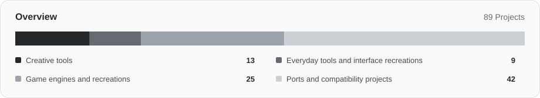

# Awesome RemakeList

Software recreations, game engines and native ports, with the requirements you need before trying them.

**English** · [简体中文](README.zh-CN.md) · [日本語](README.ja.md) · [한국어](README.ko.md) · [Español](README.es.md)

[Browse RemakeList](https://remakelist.com/?utm_source=github&utm_medium=repository&utm_campaign=awesome-remakelist&utm_content=intro-en) · [Suggest a project](https://github.com/CharlexH/awesome-remakelist/issues/new?template=project.yml)

 

Project names link to their authors’ sources. Expand an entry for device, game-file and build requirements; RemakeList adds screenshots and setup context.

## Start here

| Project | Explore | Start |
| --- | --- | --- |
| [Graphite](https://remakelist.com/remakes/graphite/?utm_source=github&utm_medium=repository&utm_campaign=awesome-remakelist&utm_content=graphite-featured-en) | Adobe Illustrator | [Try in a browser](https://editor.graphite.art/) |
| [Webamp](https://remakelist.com/remakes/webamp/?utm_source=github&utm_medium=repository&utm_campaign=awesome-remakelist&utm_content=webamp-featured-en) | Winamp 2 | [Try in a browser](https://webamp.org/) |
| [OpenTTD](https://remakelist.com/remakes/openttd/?utm_source=github&utm_medium=repository&utm_campaign=awesome-remakelist&utm_content=openttd-featured-en) | Transport Tycoon Deluxe | [Download](https://www.openttd.org/) |
| [OpenRCT2](https://remakelist.com/remakes/openrct2/?utm_source=github&utm_medium=repository&utm_campaign=awesome-remakelist&utm_content=openrct2-featured-en) | RollerCoaster Tycoon 2 | [Download and supply your own game files](https://openrct2.io/download) |
| [D2R Mobile](https://remakelist.com/remakes/d2r-mobile/?utm_source=github&utm_medium=repository&utm_campaign=awesome-remakelist&utm_content=d2r-mobile-featured-en) | Diablo II: Resurrected | [Build and supply your own game files](https://github.com/jhaizhou-ops/d2r-mobile/blob/main/README.md) |
| [nxnative](https://remakelist.com/remakes/nxnative/?utm_source=github&utm_medium=repository&utm_campaign=awesome-remakelist&utm_content=nxnative-featured-en) | Nintendo Switch games | [Build and supply your own game files](https://github.com/seedds/nxnative#pack-an-ipa) |

## Browse category

- [Creative tools](#creative) · 13
- [Everyday tools and interface recreations](#everyday) · 9
- [Game engines and recreations](#classic_games) · 26
- [Ports and compatibility projects](#ports) · 43

## Creative tools

### [Compositor](https://github.com/robbietilton/Compositor)

A layer compositing and post-processing editor for Apple silicon Macs, designed around Photoshop-style workflows.

Original or reference: **Adobe Photoshop** · Functional alternative  
[Download](https://github.com/robbietilton/Compositor/releases) · [Browse RemakeList](https://remakelist.com/remakes/compositor/?utm_source=github&utm_medium=repository&utm_campaign=awesome-remakelist&utm_content=compositor-en)

Requirements and screenshots

**Platforms:** Apple silicon Mac · macOS 26+

**Status:** In development · releases available

**What you need:** No Photoshop installation is needed. Requires an Apple silicon Mac and macOS 26+; source builds need Xcode 26+. You are responsible for rights to the edited media.

**What is available:** Downloadable releases require an Apple silicon Mac and macOS 26+; the interface is currently English-only. PSD/PSB import supports 8-bit RGB, not CMYK, and some vectors and vertical text are rasterized. Building from source requires Xcode 26+.

**Code license:** [MIT](https://github.com/robbietilton/Compositor/blob/main/LICENSE)  
**Author:** robbietilton  
[Official documentation](https://github.com/robbietilton/Compositor/blob/main/README.md) · Sources reviewed: 2026-10-12

### [PhotoCraft](https://github.com/storytold/photocraft)

A Rust reimplementation of Photoshop-style image editing workflows by the ArtCraft team, currently in alpha.

Original or reference: **Adobe Photoshop** · Workflow reimplementation  
[Download](https://github.com/storytold/photocraft/releases) · [Browse RemakeList](https://remakelist.com/remakes/photocraft/?utm_source=github&utm_medium=repository&utm_campaign=awesome-remakelist&utm_content=photocraft-en)

Requirements and screenshots

**Platforms:** Windows / macOS / Linux / FreeBSD / Web

**Status:** Alpha · workflows in progress

**What you need:** No Photoshop installation is required. Images you edit need appropriate rights; bundled fonts/icons have separate licenses. ArtCraft marks are excluded from the code license.

**What is available:** Downloadable alpha releases are available without a Photoshop installation. The project lists Windows, macOS, Linux, FreeBSD and web support; PSD interoperability, tool depth and plugin compatibility remain incomplete, so it is not yet a complete replacement for professional workflows.

**Code license:** [MIT OR Apache-2.0](https://github.com/storytold/photocraft/blob/main/LICENSE-MIT)  
**Author:** storytold  
[Official documentation](https://github.com/storytold/photocraft/blob/main/README.md) · Sources reviewed: 2026-10-12

### [Graphite](https://github.com/GraphiteEditor/Graphite)

An open-source vector design tool combining layers and nodes for nondestructive creation in the browser.

Original or reference: **Adobe Illustrator** · Functional alternative  
[Try in a browser](https://editor.graphite.art/) · [Browse RemakeList](https://remakelist.com/remakes/graphite/?utm_source=github&utm_medium=repository&utm_campaign=awesome-remakelist&utm_content=graphite-en)

Requirements and screenshots

**Platforms:** Web

**Status:** Alpha · browser editor available

**What you need:** No Illustrator installation or original program files are needed. Bring your own images, fonts and creative assets.

**What is available:** The browser editor is available now for trying vector design without Illustrator. It remains alpha; broader photo-editing, motion, publishing and VFX capabilities are still evolving, so it should not be treated as a replacement for an entire Adobe workflow.

**Code license:** [MIT OR Apache-2.0](https://graphite.art/license/)  
**Author:** Graphite community  
[Official documentation](https://github.com/GraphiteEditor/Graphite/blob/master/README.md) · Sources reviewed: 2026-10-12

### [Friction](https://github.com/friction2d/friction)

An open-source 2D motion graphics tool with vector and raster animation, timelines and expressions.

Original or reference: **Adobe After Effects** · Functional alternative  
[Download](https://friction.graphics/#download) · [Browse RemakeList](https://remakelist.com/remakes/friction/?utm_source=github&utm_medium=repository&utm_campaign=awesome-remakelist&utm_content=friction-en)

Requirements and screenshots

**Platforms:** Windows / macOS / Linux

**Status:** Desktop downloads · 2D motion graphics

**What you need:** No After Effects installation is required. Bring your own images, fonts, audio and video assets.

**What is available:** Downloads are listed for Windows, Linux and macOS. It can create 2D animation and motion graphics; custom shader effects remain experimental, and After Effects projects, plugins or complete effects chains are not promised to be compatible.

**Code license:** [GPL-3.0-only](https://github.com/friction2d/friction/blob/main/LICENSE.md)  
**Author:** Ole-André Rodlie &amp; contributors  
[Official documentation](https://friction.graphics/) · Sources reviewed: 2026-10-12

### [OpenCut](https://github.com/OpenCut-app/OpenCut)

An open-source video editor targeting CapCut-style editing, with a classic early beta online while the next version is rewritten.

Original or reference: **CapCut** · Functional alternative  
[Try in a browser](https://opencut.app/) · [Browse RemakeList](https://remakelist.com/remakes/opencut/?utm_source=github&utm_medium=repository&utm_campaign=awesome-remakelist&utm_content=opencut-en)

Requirements and screenshots

**Platforms:** Web

**Status:** Early beta · rewrite in progress

**What you need:** No CapCut installation is required. Import video, images and audio you have rights to use.

**What is available:** The official site currently offers the classic early beta. The classic source is archived and the new version is being rewritten; it is a candidate to explore, without assuming it can fully take over a daily CapCut workflow.

**Code license:** [MIT](https://github.com/OpenCut-app/OpenCut/blob/main/LICENSE)  
**Author:** OpenCut contributors  
[Official documentation](https://github.com/OpenCut-app/OpenCut/blob/main/README.md) · Sources reviewed: 2026-10-12

### [Penpot](https://github.com/penpot/penpot)

An open-source collaborative design and prototyping platform, hosted or self-hosted.

Original or reference: **Figma** · Functional alternative  
[Sign up or self-host](https://design.penpot.app) · [Browse RemakeList](https://remakelist.com/remakes/penpot/?utm_source=github&utm_medium=repository&utm_campaign=awesome-remakelist&utm_content=penpot-en)

Requirements and screenshots

**Platforms:** Browser / self-hosted

**Status:** See official documentation

**What you need:** No Figma software or assets are needed. You must export and import your own designs to migrate them.

**What is available:** Sign up for the hosted service or run your own installation. Moving existing designs requires export and import; check the pricing page for hosted service plans.

**Code license:** [MPL-2.0](https://github.com/penpot/penpot/blob/develop/LICENSE)  
**Author:** penpot  
[Official documentation](https://penpot.app/penpot-vs-figma) · Sources reviewed: 2026-10-11

### [VectorCraft](https://github.com/storytold/vectorcraft)

An ArtCraft Rust reimplementation of Adobe Illustrator-style workflows: pen drawing, path booleans, appearance effects and vector illustration.

Original or reference: **Adobe Illustrator** · Workflow reimplementation  
[Download](https://getartcraft.com/apps/vectorcraft) · [Browse RemakeList](https://remakelist.com/remakes/vectorcraft/?utm_source=github&utm_medium=repository&utm_campaign=awesome-remakelist&utm_content=vectorcraft-en)

Requirements and screenshots

**Platforms:** Windows / macOS / Linux / Web

**Status:** Alpha

**What you need:** No original commercial application is required. Supply documents and media you have rights to use; bundled fonts, images and brand marks have separate licenses.

**What is available:** Alpha: useful for trying everyday vector drawing; complex file interchange and effect fidelity still need checking. Desktop installers are available; check the project documentation for platform and file compatibility.

**Code license:** [MIT OR Apache-2.0](https://github.com/storytold/vectorcraft/blob/main/LICENSE-MIT)  
**Author:** ArtCraft  
[Official documentation](https://github.com/storytold/vectorcraft/blob/main/README.md) · Sources reviewed: 2026-10-12

### [FilmCraft](https://github.com/storytold/filmcraft)

An ArtCraft Rust reimplementation of Adobe Premiere Pro-style workflows: source and program monitors, multitrack timelines and trim editing.

Original or reference: **Adobe Premiere Pro** · Workflow reimplementation  
[Download](https://getartcraft.com/apps/filmcraft) · [Browse RemakeList](https://remakelist.com/remakes/filmcraft/?utm_source=github&utm_medium=repository&utm_campaign=awesome-remakelist&utm_content=filmcraft-en)

Requirements and screenshots

**Platforms:** Windows / macOS / Linux

**Status:** Alpha

**What you need:** No original commercial application is required. Supply documents and media you have rights to use; bundled fonts, images and brand marks have separate licenses.

**What is available:** Alpha: editing and export workflows exist; large-media performance, effect rendering and professional project interchange remain incomplete. Desktop installers are available; check the project documentation for platform and file compatibility.

**Code license:** [MIT OR Apache-2.0](https://github.com/storytold/filmcraft/blob/main/LICENSE-MIT)  
**Author:** ArtCraft  
[Official documentation](https://github.com/storytold/filmcraft/blob/main/README.md) · Sources reviewed: 2026-10-12

### [LightCraft](https://github.com/storytold/lightcraft)

An ArtCraft Rust reimplementation of Adobe Lightroom-style workflows: photo-library management, RAW development and nondestructive color adjustment.

Original or reference: **Adobe Lightroom** · Workflow reimplementation  
[Download](https://getartcraft.com/apps/lightcraft) · [Browse RemakeList](https://remakelist.com/remakes/lightcraft/?utm_source=github&utm_medium=repository&utm_campaign=awesome-remakelist&utm_content=lightcraft-en)

Requirements and screenshots

**Platforms:** Windows / macOS / Linux / Web

**Status:** Alpha

**What you need:** No original commercial application is required. Supply documents and media you have rights to use; bundled fonts, images and brand marks have separate licenses.

**What is available:** Alpha: supports trying JPEG, DNG and many camera RAW formats; camera color calibration and some compressed RAW variants remain incomplete. Desktop installers are available; check the project documentation for platform and file compatibility.

**Code license:** [MIT OR Apache-2.0](https://github.com/storytold/lightcraft/blob/main/LICENSE-MIT)  
**Author:** ArtCraft  
[Official documentation](https://github.com/storytold/lightcraft/blob/main/README.md) · Sources reviewed: 2026-10-12

### [EffectCraft](https://github.com/storytold/effectcraft)

An ArtCraft Rust reimplementation of Adobe After Effects-style workflows: layer compositing, keyframe animation, motion graphics and effects.

Original or reference: **Adobe After Effects** · Workflow reimplementation  
[Download](https://getartcraft.com/apps/effectcraft) · [Browse RemakeList](https://remakelist.com/remakes/effectcraft/?utm_source=github&utm_medium=repository&utm_campaign=awesome-remakelist&utm_content=effectcraft-en)

Requirements and screenshots

**Platforms:** Windows / macOS / Linux / Web

**Status:** Early development

**What you need:** No original commercial application is required. Supply documents and media you have rights to use; bundled fonts, images and brand marks have separate licenses.

**What is available:** Early development: suitable for experimenting with animation and compositing, not client delivery; AEP/AEPX projects and After Effects plug-ins are unsupported. Desktop installers are available; check the project documentation for platform and file compatibility.

**Code license:** [MIT OR Apache-2.0](https://github.com/storytold/effectcraft/blob/main/LICENSE-MIT)  
**Author:** ArtCraft  
[Official documentation](https://github.com/storytold/effectcraft/blob/main/README.md) · Sources reviewed: 2026-10-12

### [DesignCraft](https://github.com/storytold/designcraft)

An ArtCraft Rust reimplementation of Adobe InDesign-style workflows: spread layout, threaded text frames, parent pages and publishing documents.

Original or reference: **Adobe InDesign** · Workflow reimplementation  
[Download](https://getartcraft.com/apps/designcraft) · [Browse RemakeList](https://remakelist.com/remakes/designcraft/?utm_source=github&utm_medium=repository&utm_campaign=awesome-remakelist&utm_content=designcraft-en)

Requirements and screenshots

**Platforms:** Windows / macOS / Linux / Web

**Status:** In development

**What you need:** No original commercial application is required. Supply documents and media you have rights to use; bundled fonts, images and brand marks have separate licenses.

**What is available:** In development: layout and export builds are available; complex publishing files, typography and prepress workflows need individual checks. Desktop installers are available; check the project documentation for platform and file compatibility.

**Code license:** [MIT OR Apache-2.0](https://github.com/storytold/designcraft/blob/main/LICENSE-MIT)  
**Author:** ArtCraft  
[Official documentation](https://github.com/storytold/designcraft/blob/main/README.md) · Sources reviewed: 2026-10-12

### [SoundCraft](https://github.com/storytold/soundcraft)

An ArtCraft Rust reimplementation of Avid Pro Tools-style workflows: track recording, an edit window, a mixer and MIDI arrangement.

Original or reference: **Avid Pro Tools** · Workflow reimplementation  
[Download](https://getartcraft.com/apps/soundcraft) · [Browse RemakeList](https://remakelist.com/remakes/soundcraft/?utm_source=github&utm_medium=repository&utm_campaign=awesome-remakelist&utm_content=soundcraft-en)

Requirements and screenshots

**Platforms:** Windows / macOS / Linux / Web

**Status:** Pre-alpha

**What you need:** No original commercial application is required. Supply documents and media you have rights to use; bundled fonts, images and brand marks have separate licenses.

**What is available:** Pre-alpha: recording, editing, mixing and bounce workflows exist; audio-device/buffer selection, MIDI-controller recording and AAF/OMF interchange are still missing. Desktop installers are available; check the project documentation for platform and file compatibility.

**Code license:** [MIT OR Apache-2.0](https://github.com/storytold/soundcraft/blob/main/LICENSE-MIT)  
**Author:** ArtCraft  
[Official documentation](https://github.com/storytold/soundcraft/blob/main/README.md) · Sources reviewed: 2026-10-12

### [CADCraft](https://github.com/storytold/cadcraft)

An ArtCraft Rust reimplementation of Autodesk AutoCAD-style workflows: command-line drafting, object snaps, layers, dimensions and drawing layouts.

Original or reference: **Autodesk AutoCAD** · Workflow reimplementation  
[Download](https://getartcraft.com/apps/cadcraft) · [Browse RemakeList](https://remakelist.com/remakes/cadcraft/?utm_source=github&utm_medium=repository&utm_campaign=awesome-remakelist&utm_content=cadcraft-en)

Requirements and screenshots

**Platforms:** Windows / macOS / Linux / Web

**Status:** Early development

**What you need:** No original commercial application is required. Supply documents and media you have rights to use; bundled fonts, images and brand marks have separate licenses.

**What is available:** Early development: suitable for trying 2D drawings and PDF plotting; it is not a replacement for every AutoCAD 3D, DWG and industry plug-in workflow. Desktop installers are available; check the project documentation for platform and file compatibility.

**Code license:** [MIT OR Apache-2.0](https://github.com/storytold/cadcraft/blob/main/LICENSE-MIT)  
**Author:** ArtCraft  
[Official documentation](https://github.com/storytold/cadcraft/blob/main/README.md) · Sources reviewed: 2026-10-12

## Everyday tools and interface recreations

### [ONLYOFFICE Desktop Editors](https://github.com/ONLYOFFICE/DesktopEditors)

An open-source Microsoft Office alternative combining offline document, spreadsheet, presentation and PDF editing in one desktop app.

Original or reference: **Microsoft Office** · Functional alternative  
[Download](https://www.onlyoffice.com/download-desktop) · [Browse RemakeList](https://remakelist.com/remakes/onlyoffice/?utm_source=github&utm_medium=repository&utm_campaign=awesome-remakelist&utm_content=onlyoffice-en)

Requirements and screenshots

**Platforms:** Windows / macOS / Linux

**Status:** Stable releases available

**What you need:** No Microsoft Office installation or account is needed for local editing. Cloud collaboration requires a compatible service, which may charge.

**What is available:** Installers are available for Windows, macOS and Linux, with local storage and offline editing. Desktop use is free; cloud services and enterprise editions have separate plans. Check complex document layouts before switching.

**Code license:** [AGPL-3.0](https://github.com/ONLYOFFICE/DesktopEditors/blob/master/LICENSE)  
**Author:** ONLYOFFICE  
[Official documentation](https://github.com/ONLYOFFICE/DesktopEditors) · Sources reviewed: 2026-10-12

### [Grist](https://github.com/gristlabs/grist-core)

An open-source alternative for Excel and Airtable workflows, combining relational data with spreadsheet-style editing.

Original or reference: **Microsoft Excel / Airtable** · Functional alternative  
[Download](https://github.com/gristlabs/grist-desktop/releases) · [Browse RemakeList](https://remakelist.com/remakes/grist/?utm_source=github&utm_medium=repository&utm_campaign=awesome-remakelist&utm_content=grist-en)

Requirements and screenshots

**Platforms:** Windows / macOS / Linux

**Status:** Stable releases available

**What you need:** The desktop app edits local files. Self-hosting requires a server environment; hosted plans require an account and have usage and feature limits.

**What is available:** Desktop downloads edit local files on Windows, macOS and Linux; the Community edition can also be self-hosted. Hosted free and paid plans are separate, and enterprise features are not all part of the open-source core.

**Code license:** [Apache-2.0](https://github.com/gristlabs/grist-core/blob/main/LICENSE.txt)  
**Author:** Grist Labs  
[Official documentation](https://github.com/gristlabs/grist-core) · Sources reviewed: 2026-10-12

### [LibreOffice](https://github.com/LibreOffice/core)

A free, open-source Microsoft Office alternative with Writer, Calc and Impress for documents, spreadsheets and presentations.

Original or reference: **Microsoft Office** · Functional alternative  
[Download](https://www.libreoffice.org/download/download-libreoffice/) · [Browse RemakeList](https://remakelist.com/remakes/libreoffice/?utm_source=github&utm_medium=repository&utm_campaign=awesome-remakelist&utm_content=libreoffice-en)

Requirements and screenshots

**Platforms:** Windows / macOS / Linux

**Status:** Stable releases available

**What you need:** No Microsoft Office installation, subscription or account is needed. Install the desktop release for your system and use files you have permission to edit.

**What is available:** Downloads are available for Windows, macOS and Linux, with a complete set of everyday office tools. Try your own files first if you rely on VBA macros, complex Office templates or exact layout matching.

**Code license:** [MPL-2.0 (primarily)](https://www.libreoffice.org/licenses/)  
**Author:** The Document Foundation  
[Official documentation](https://www.libreoffice.org/) · Sources reviewed: 2026-10-12

### [Webamp](https://github.com/captbaritone/webamp)

A browser reimplementation of Winamp 2, with the classic player interface and skin support.

Original or reference: **Winamp 2** · Web reimplementation  
[Try in a browser](https://webamp.org/) · [Browse RemakeList](https://remakelist.com/remakes/webamp/?utm_source=github&utm_medium=repository&utm_campaign=awesome-remakelist&utm_content=webamp-en)

Requirements and screenshots

**Platforms:** Browser

**Status:** See official documentation

**What you need:** No Winamp installation is needed. Audio and third-party skins retain their own rights.

**What is available:** An online player is available to open directly in your browser. No original program is required; bring the audio you want to play.

**Code license:** [MIT](https://github.com/captbaritone/webamp/blob/master/LICENSE.txt)  
**Author:** captbaritone  
[Official documentation](https://github.com/captbaritone/webamp/blob/master/README.md) · Sources reviewed: 2026-10-11

### [WinXP in React](https://github.com/ShizukuIchi/winXP)

A browser recreation of the Windows XP desktop, Start menu and classic small applications.

Original or reference: **Windows XP desktop** · Interface recreation  
[Try in a browser](https://winxp.vercel.app/) · [Browse RemakeList](https://remakelist.com/remakes/winxp/?utm_source=github&utm_medium=repository&utm_campaign=awesome-remakelist&utm_content=winxp-en)

Requirements and screenshots

**Platforms:** Browser

**Status:** See official documentation

**What you need:** No Windows XP installation files are required.

**What is available:** An online demo is available without Windows XP installation files. It covers the recreated desktop and applications; it cannot run arbitrary XP software.

**Code license:** [MIT (project code)](https://github.com/ShizukuIchi/winXP/blob/master/LICENSE)  
**Author:** ShizukuIchi  
[Official documentation](https://github.com/ShizukuIchi/winXP/blob/master/README.md) · Sources reviewed: 2026-10-11

### [PdfCraft](https://github.com/storytold/pdfcraft)

An ArtCraft Rust reimplementation of Adobe Acrobat-style workflows: PDF reading, annotations, page organization, merging and splitting.

Original or reference: **Adobe Acrobat** · Workflow reimplementation  
[Download](https://getartcraft.com/apps/pdfcraft) · [Browse RemakeList](https://remakelist.com/remakes/pdfcraft/?utm_source=github&utm_medium=repository&utm_campaign=awesome-remakelist&utm_content=pdfcraft-en)

Requirements and screenshots

**Platforms:** Windows / macOS / Linux / Web

**Status:** Early alpha

**What you need:** No original commercial application is required. Supply documents and media you have rights to use; bundled fonts, images and brand marks have separate licenses.

**What is available:** Early alpha: reading and page-management workflows are available; it is not a complete substitute for Acrobat editing, signature and prepress workflows. Desktop installers are available; check the project documentation for platform and file compatibility.

**Code license:** [MIT OR Apache-2.0](https://github.com/storytold/pdfcraft/blob/main/LICENSE-MIT)  
**Author:** ArtCraft  
[Official documentation](https://github.com/storytold/pdfcraft/blob/main/README.md) · Sources reviewed: 2026-10-12

### [WordCraft](https://github.com/storytold/wordcraft)

An ArtCraft Rust reimplementation of Microsoft Word-style workflows: word processing, styles, tables, tracked changes and document layout.

Original or reference: **Microsoft Word** · Workflow reimplementation  
[Download](https://getartcraft.com/apps/wordcraft) · [Browse RemakeList](https://remakelist.com/remakes/wordcraft/?utm_source=github&utm_medium=repository&utm_campaign=awesome-remakelist&utm_content=wordcraft-en)

Requirements and screenshots

**Platforms:** Windows / macOS / Linux / Web

**Status:** Alpha

**What you need:** No original commercial application is required. Supply documents and media you have rights to use; bundled fonts, images and brand marks have separate licenses.

**What is available:** Alpha: writing and DOCX workflows are available to try; pagination, chart/SmartArt round-trip fidelity and native printing still need work. Desktop installers are available; check the project documentation for platform and file compatibility.

**Code license:** [MIT OR Apache-2.0](https://github.com/storytold/wordcraft/blob/main/LICENSE-MIT)  
**Author:** ArtCraft  
[Official documentation](https://github.com/storytold/wordcraft/blob/main/README.md) · Sources reviewed: 2026-10-13

### [DeckCraft](https://github.com/storytold/deckcraft)

An ArtCraft Rust reimplementation of Microsoft PowerPoint-style workflows: slide masters, themes, shapes, animation and slide-show playback.

Original or reference: **Microsoft PowerPoint** · Workflow reimplementation  
[Download](https://getartcraft.com/apps/deckcraft) · [Browse RemakeList](https://remakelist.com/remakes/deckcraft/?utm_source=github&utm_medium=repository&utm_campaign=awesome-remakelist&utm_content=deckcraft-en)

Requirements and screenshots

**Platforms:** Windows / macOS / Linux / Web

**Status:** Alpha

**What you need:** No original commercial application is required. Supply documents and media you have rights to use; bundled fonts, images and brand marks have separate licenses.

**What is available:** Alpha: decks can be created and presented; complex PPTX files and animation behavior should not be assumed identical to PowerPoint. Desktop installers are available; check the project documentation for platform and file compatibility.

**Code license:** [MIT OR Apache-2.0](https://github.com/storytold/deckcraft/blob/main/LICENSE-MIT)  
**Author:** ArtCraft  
[Official documentation](https://github.com/storytold/deckcraft/blob/main/README.md) · Sources reviewed: 2026-10-13

### [GridCraft](https://github.com/storytold/gridcraft)

An ArtCraft Rust reimplementation of Microsoft Excel-style workflows: worksheets, formulas, tables, charts and pivot-table workflows.

Original or reference: **Microsoft Excel** · Workflow reimplementation  
[Download](https://getartcraft.com/apps/gridcraft) · [Browse RemakeList](https://remakelist.com/remakes/gridcraft/?utm_source=github&utm_medium=repository&utm_campaign=awesome-remakelist&utm_content=gridcraft-en)

Requirements and screenshots

**Platforms:** Windows / macOS / Linux / Web

**Status:** Alpha

**What you need:** No original commercial application is required. Supply documents and media you have rights to use; bundled fonts, images and brand marks have separate licenses.

**What is available:** Alpha: core spreadsheet workflows can be tried; real-world XLSX fidelity, large-workbook performance, chart depth and legacy-format import still need work. Desktop installers are available; check the project documentation for platform and file compatibility.

**Code license:** [MIT OR Apache-2.0](https://github.com/storytold/gridcraft/blob/main/LICENSE-MIT)  
**Author:** ArtCraft  
[Official documentation](https://github.com/storytold/gridcraft/blob/main/README.md) · Sources reviewed: 2026-10-13

## Game engines and recreations

### [Vanguard Engine](https://github.com/harshilmathur/openra2)

An independent browser RTS engine for Red Alert 2 data, currently focused on a Soviet single-player skirmish development slice.

Original or reference: **Red Alert 2 / Yuri’s Revenge data** · Engine reimplementation  
[Build from source](https://github.com/harshilmathur/openra2/blob/master/README.md#quickstart) · [Browse RemakeList](https://remakelist.com/remakes/vanguard/?utm_source=github&utm_medium=repository&utm_campaign=awesome-remakelist&utm_content=vanguard-en)

Requirements and screenshots

**Platforms:** Browser · local development server

**Status:** Development slice · no formal release

**What you need:** Classic mode needs legally owned RA2/YR files. Original mode uses repository-authored assets and needs no original game; the modes remain separate. Requires Node.js 20.19+ and a local development server.

**What is available:** This is a development slice with no formal release, requiring Node.js 20.19+ and a local development server. Classic mode needs lawfully obtained RA2/YR files; Original mode needs no original game. Allied forces, netplay and Yuri gameplay are not complete, so this is not a full Red Alert 2 recreation.

**Code license:** [GPL-3.0-or-later](https://github.com/harshilmathur/openra2/blob/master/LICENSE)  
**Author:** harshilmathur  
[Official documentation](https://github.com/harshilmathur/openra2/blob/master/README.md) · Sources reviewed: 2026-10-12

### [OpenTTD](https://github.com/OpenTTD/OpenTTD)

Transport Tycoon gameplay rebuilt for modern platforms, with expanded multiplayer support.

Original or reference: **Transport Tycoon Deluxe** · Game reimplementation  
[Download](https://www.openttd.org/) · [Browse RemakeList](https://remakelist.com/remakes/openttd/?utm_source=github&utm_medium=repository&utm_campaign=awesome-remakelist&utm_content=openttd-en)

Requirements and screenshots

**Platforms:** Windows / macOS / Linux

**Status:** See official documentation

**What you need:** Base graphics are required; use free OpenGFX2 or OpenGFX. OpenSFX sound and OpenMSX music are optional. This free route does not need original game files.

**What is available:** Desktop releases are available. Start with the required free OpenGFX2 or OpenGFX graphics; OpenSFX sound and OpenMSX music are optional. No original game files are needed for this route.

**Code license:** [GPL-2.0; third-party components have separate licenses](https://github.com/OpenTTD/OpenTTD/blob/master/COPYING.md)  
**Author:** OpenTTD  
[Official documentation](https://github.com/OpenTTD/OpenTTD/blob/master/README.md) · Sources reviewed: 2026-10-11

### [OpenRCT2](https://github.com/OpenRCT2/OpenRCT2)

RollerCoaster Tycoon 2 on modern platforms, with improvements including cooperative multiplayer.

Original or reference: **RollerCoaster Tycoon 2** · Game reimplementation  
[Download and supply your own game files](https://openrct2.io/download) · [Browse RemakeList](https://remakelist.com/remakes/openrct2/?utm_source=github&utm_medium=repository&utm_campaign=awesome-remakelist&utm_content=openrct2-en)

Requirements and screenshots

**Platforms:** Windows / macOS / Linux

**Status:** See official documentation

**What you need:** You must supply original RCT2 data files. RCT1 data can add scenarios.

**What is available:** Releases are available, but you must supply original RCT2 data files. RCT1 data can add its scenarios; the free engine does not include the original commercial assets.

**Code license:** [GPL-3.0-or-later](https://github.com/OpenRCT2/OpenRCT2/blob/develop/licence.txt)  
**Author:** OpenRCT2  
[Official documentation](https://github.com/OpenRCT2/OpenRCT2/blob/develop/readme.md) · Sources reviewed: 2026-10-11

### [OpenMW](https://github.com/OpenMW/openmw)

A modern open-source engine for Morrowind, improving compatibility and graphics options.

Original or reference: **The Elder Scrolls III: Morrowind** · Engine reimplementation  
[Download and supply your own game files](https://www.openmw.org) · [Browse RemakeList](https://remakelist.com/remakes/openmw/?utm_source=github&utm_medium=repository&utm_campaign=awesome-remakelist&utm_content=openmw-en)

Requirements and screenshots

**Platforms:** Windows / macOS / Linux

**Status:** See official documentation

**What you need:** Playing Morrowind requires owning the original game and configuring its data files.

**What is available:** The engine is available to download, but playing Morrowind requires owning the original game and configuring its data files. Some original mods are incompatible, so check support for your existing mod setup.

**Code license:** [GPLv3; some fonts separately licensed](https://github.com/OpenMW/openmw/blob/master/LICENSE)  
**Author:** OpenMW  
[Official documentation](https://github.com/OpenMW/openmw/blob/master/README.md) · Sources reviewed: 2026-10-11

### [OpenRA](https://github.com/OpenRA/OpenRA)

Classic real-time strategy games reimagined with modern controls and three official game mods.

Original or reference: **Red Alert 1 / Command &amp; Conquer / Dune 2000** · Game reimagining  
[Download](https://www.openra.net/) · [Browse RemakeList](https://remakelist.com/remakes/openra/?utm_source=github&utm_medium=repository&utm_campaign=awesome-remakelist&utm_content=openra-en)

Requirements and screenshots

**Platforms:** Windows / macOS / Linux

**Status:** See official documentation

**What you need:** Original game assets are still used. The official installer can fetch required assets on first run or import them from original discs.

**What is available:** Downloads are available for Windows, macOS and Linux. Original game assets are required; the project says first-run setup can fetch the required assets or import them from original discs.

**Code license:** [GPL-3.0-or-later (engine)](https://github.com/OpenRA/OpenRA/blob/bleed/COPYING)  
**Author:** OpenRA  
[Official documentation](https://www.openra.net/about/) · Sources reviewed: 2026-10-11

### [fheroes2](https://github.com/ihhub/fheroes2)

A recreation of the Heroes of Might and Magic II engine for desktop and Android, with modern improvements.

Original or reference: **Heroes of Might and Magic II** · Engine reimplementation  
[Download and supply your own game files](https://github.com/ihhub/fheroes2/releases) · [Browse RemakeList](https://remakelist.com/remakes/fheroes2/?utm_source=github&utm_medium=repository&utm_campaign=awesome-remakelist&utm_content=fheroes2-en)

Requirements and screenshots

**Platforms:** Windows / macOS / Linux / Android

**Status:** Releases available · original/demo data

**What you need:** Requires full original-game data or official English demo data; INSTALL.md documents the bundled demo-download path. Demo assets provide only their licensed limited content.

**What is available:** Releases require full original-game data or official English demo data; installation guidance explains how to obtain the demo. The demo contains limited content, full play still requires legally owned original assets, and setup differs by platform.

**Code license:** [GPL-2.0-or-later](https://github.com/ihhub/fheroes2/blob/master/LICENSE)  
**Author:** ihhub  
[Official documentation](https://github.com/ihhub/fheroes2/blob/master/README.md) · Sources reviewed: 2026-10-12

### [OpenXcom](https://github.com/OpenXcom/OpenXcom)

A desktop reimplementation of the two classic X-COM games, with support for additional mods.

Original or reference: **UFO: Enemy Unknown / Terror from the Deep** · Game reimplementation  
[Download and supply your own game files](https://github.com/OpenXcom/OpenXcom/releases) · [Browse RemakeList](https://remakelist.com/remakes/openxcom/?utm_source=github&utm_medium=repository&utm_campaign=awesome-remakelist&utm_content=openxcom-en)

Requirements and screenshots

**Platforms:** Windows / macOS / Linux

**Status:** Desktop engine · original data required

**What you need:** Requires unmodified original data from UFO: Enemy Unknown or Terror from the Deep. The Windows installer can extract resources from your owned Steam copy.

**What is available:** Desktop releases require unmodified original data from either game. The Windows installer can extract assets from your owned Steam copy; additional mods may have their own asset requirements.

**Code license:** [GPL-3.0-or-later](https://github.com/OpenXcom/OpenXcom/blob/master/LICENSE.txt)  
**Author:** OpenXcom  
[Official documentation](https://github.com/OpenXcom/OpenXcom/blob/master/README.md) · Sources reviewed: 2026-10-12

### [VCMI](https://github.com/vcmi/vcmi)

An open-source Heroes III engine with desktop and mobile builds, mod support and multiplayer.

Original or reference: **Heroes of Might and Magic III** · Engine reimplementation  
[Download and supply your own game files](https://vcmi.eu/download/) · [Browse RemakeList](https://remakelist.com/remakes/vcmi/?utm_source=github&utm_medium=repository&utm_campaign=awesome-remakelist&utm_content=vcmi-en)

Requirements and screenshots

**Platforms:** Windows / macOS / Linux / Android / iOS

**Status:** Public release · original data required

**What you need:** For the full game, provide owned Heroes III Complete or Shadow of Death data. The launcher can import a GOG offline installer or an existing installation. HD Edition alone is insufficient; it is an optional extension with Complete/SoD still required. The official mod directory separately documents limited demo support.

**What is available:** Release 1.7.5 is public. Windows, macOS, Linux and Android packages are listed; iOS uses TestFlight or sideloading. Full compatibility is not guaranteed. Not run by RemakeList.

**Code license:** [GPL-2.0-or-later code; VCMI-created assets CC-BY-SA 4.0; original game assets separate](https://github.com/vcmi/vcmi/blob/66fa496c6328a276c4eb14c0011b3a9d751dfac3/license.txt)  
**Author:** VCMI Team  
[Official documentation](https://github.com/vcmi/vcmi/blob/66fa496c6328a276c4eb14c0011b3a9d751dfac3/docs/Readme.md) · Sources reviewed: 2026-10-18

### [Julius](https://github.com/bvschaik/julius)

A faithful Caesar III reimplementation that brings the original city builder to modern desktops, Android and other platforms.

Original or reference: **Caesar III** · Game reimplementation  
[Download and supply your own game files](https://github.com/bvschaik/julius/releases/tag/v1.8.0) · [Browse RemakeList](https://remakelist.com/remakes/julius/?utm_source=github&utm_medium=repository&utm_campaign=awesome-remakelist&utm_content=julius-en)

Requirements and screenshots

**Platforms:** Windows · Linux · macOS · Android · Web (Emscripten) · PS Vita · Nintendo Switch

**Status:** Released · original game data required

**What you need:** Provide a full Caesar III installation from your own CD-ROM, GOG or Steam copy, patched to 1.0.1.0. Julius uses that data directory and needs permission to write saves there. Its code license does not supply or license the original game assets.

**What is available:** Version 1.8.0 provides Windows, Linux, macOS and Android downloads, plus Vita, Switch and Emscripten packages. The browser package still needs setup and your game files. Not run by RemakeList.

**Code license:** [AGPL-3.0 · engine code; original Caesar III assets are separate](https://github.com/bvschaik/julius/blob/34d1ecd54befb845c0139b371fa8a0438210dac1/LICENSE.txt)  
**Author:** Bianca van Schaik and contributors  
[Official documentation](https://github.com/bvschaik/julius/blob/34d1ecd54befb845c0139b371fa8a0438210dac1/README.md) · Sources reviewed: 2026-10-18

### [CorsixTH](https://github.com/CorsixTH/CorsixTH)

A Theme Hospital engine recreation with modern desktop support, high resolutions and an editable hospital-building campaign.

Original or reference: **Theme Hospital** · Game reimplementation  
[Download and supply your own game files](https://github.com/CorsixTH/CorsixTH/releases/tag/v0.70.1) · [Browse RemakeList](https://remakelist.com/remakes/corsixth/?utm_source=github&utm_medium=repository&utm_campaign=awesome-remakelist&utm_content=corsixth-en)

Requirements and screenshots

**Platforms:** Windows · macOS · Linux · BSD

**Status:** Released · original or demo data required

**What you need:** Provide legally owned Theme Hospital data from a CD or digital installation and select its data directory on first launch. The official demo is an alternative with one level and most management screens absent. The engine license does not license the original assets.

**What is available:** Version 0.70.1 is available for Windows and macOS, with Linux AppImage and distribution packages. BSD is also supported. The Mac release disables RtMidi hardware MIDI. Not run by RemakeList.

**Code license:** [MIT · engine code; Theme Hospital assets are separate](https://github.com/CorsixTH/CorsixTH/blob/master/LICENSE.txt)  
**Author:** CorsixTH team and contributors  
[Official documentation](https://github.com/CorsixTH/CorsixTH/blob/master/README.md) · Sources reviewed: 2026-10-19

### [Warzone 2100](https://github.com/Warzone2100/warzone2100)

The community-maintained continuation of the 1999 3D strategy game, with a full campaign, customizable units and desktop multiplayer.

Original or reference: **Warzone 2100 (1999)** · Open-source continuation  
[Download](https://wz2100.net/) · [Browse RemakeList](https://remakelist.com/remakes/warzone2100/?utm_source=github&utm_medium=repository&utm_campaign=awesome-remakelist&utm_content=warzone2100-en)

Requirements and screenshots

**Platforms:** Windows · macOS · Linux · Web

**Status:** Released · desktop and browser editions

**What you need:** No separately purchased original game or disc image is required. Use the official packages; campaign video files may need a separate official download on some platforms. Code, game data and individual components retain their stated licenses.

**What is available:** Version 4.7.0 offers Windows, macOS and Linux downloads; the Mac bundle supports Intel and Apple silicon. An official browser edition offers campaign and skirmish, with reduced graphics and no online multiplayer. Not run by RemakeList.

**Code license:** [GPL-2.0-or-later and component licenses](https://github.com/Warzone2100/warzone2100/blob/master/COPYING)  
**Author:** Warzone 2100 Project  
[Official documentation](https://github.com/Warzone2100/warzone2100/blob/master/README.md) · Sources reviewed: 2026-10-19

### [ScummVM](https://github.com/scummvm/scummvm)

Run classic adventures such as Monkey Island, Myst and Blade Runner on modern devices using replacement game engines.

Original or reference: **Classic adventure games and RPGs** · Engine reimplementation  
[Download and supply your own game files](https://www.scummvm.org/downloads/) · [Browse RemakeList](https://remakelist.com/remakes/scummvm/?utm_source=github&utm_medium=repository&utm_campaign=awesome-remakelist&utm_content=scummvm-en)

Requirements and screenshots

**Platforms:** Windows / macOS / Linux / Android / iOS

**Status:** Released · compatibility varies by game and port

**What you need:** ScummVM itself includes no games. Most commercial titles require your own supported game data. The official Freeware Games page separately offers complete free releases, including Beneath a Steel Sky; these are different from the limited demos on the Demos page. Extract the selected game into a folder and add that folder in the launcher. Each game keeps its own distribution terms.

**What is available:** Stable 2026.4.0 has Windows, macOS and Linux downloads. On 19 October 2026, the official page still lists Android and iOS builds as 2026.3.0 under older versions. No game was run by RemakeList.

**Code license:** [GPL-3.0-or-later engine code; individual game data retains its own terms](https://github.com/scummvm/scummvm/blob/7d2709da5136866589f7602f5f5a7b17de03420e/COPYING)  
**Author:** ScummVM Team  
[Official documentation](https://github.com/scummvm/scummvm/blob/7d2709da5136866589f7602f5f5a7b17de03420e/README.md) · Sources reviewed: 2026-10-19

### [RigelEngine](https://github.com/lethal-guitar/RigelEngine)

A native Duke Nukem II engine with widescreen, smoother movement, quick saves and improved controller support.

Original or reference: **Duke Nukem II** · Engine reimplementation  
[Download and supply your own game files](https://github.com/lethal-guitar/RigelEngine/releases/tag/v0.9.1) · [Browse RemakeList](https://remakelist.com/remakes/rigelengine/?utm_source=github&utm_medium=repository&utm_campaign=awesome-remakelist&utm_content=rigelengine-en)

Requirements and screenshots

**Platforms:** Windows / macOS / Linux

**Status:** Released · maintenance mode

**What you need:** Provide NUKEM2.CMP from a Duke Nukem II installation. Registered data is needed for the full four-episode game; shareware covers limited content. NUKEM2.F1 through NUKEM2.F5 add optional intro movies. On first launch, select the game-data folder. The official README links a shareware archive and a licensed full-game seller; no original data is included by RemakeList.

**What is available:** Official 0.9.1 packages include Windows x64 ZIP, macOS x64 DMG and Linux x64 DEBs. The release points Apple silicon users to a separate third-party universal Mac build. The README marks its web build as currently unavailable. Not run by RemakeList.

**Code license:** [GPL-2.0-or-later engine code; original Duke Nukem II data is separate](https://github.com/lethal-guitar/RigelEngine/blob/30afeff8f0b105eac77ee0a2fbd54b06e1a49b60/LICENSE.md)  
**Author:** Nikolai Wuttke and contributors  
[Official documentation](https://github.com/lethal-guitar/RigelEngine/blob/30afeff8f0b105eac77ee0a2fbd54b06e1a49b60/README.md) · Sources reviewed: 2026-10-19

### [OpenLoco](https://github.com/OpenLoco/OpenLoco)

A modern C++ reimplementation of Chris Sawyer’s Locomotion, bringing its transport-company simulation to current desktops.

Original or reference: **Chris Sawyer’s Locomotion** · Game reimplementation  
[Download and supply your own game files](https://openloco.io/download/) · [Browse RemakeList](https://remakelist.com/remakes/openloco/?utm_source=github&utm_medium=repository&utm_campaign=awesome-remakelist&utm_content=openloco-en)

Requirements and screenshots

**Platforms:** Windows x86/x64 · Linux x64 · macOS Apple silicon

**Status:** Released · original game data required

**What you need:** Provide data from your legally owned Locomotion copy, such as a Steam or GOG installation. Keep original files separate from the application. OpenGraphics additions do not remove the documented original-data requirement; MIT does not license the commercial game assets.

**What is available:** v26.09 offers Windows 32/64-bit ZIPs, a Linux x86-64 AppImage and a native macOS arm64 app. The Mac download requires Apple silicon and is unsigned and unnotarized. RemakeList has not run these builds.

**Code license:** [MIT · engine code; original game assets are separate](https://github.com/OpenLoco/OpenLoco/blob/v26.09/LICENSE)  
**Author:** OpenLoco developers  
[Official documentation](https://github.com/OpenLoco/OpenLoco/blob/v26.09/README.md) · Sources reviewed: 2026-10-19

### [The Force Engine](https://github.com/TheForceEngine/TheForceEngine)

Play Dark Forces with widescreen, modern mouse controls, quick saves and support for its original community mods.

Original or reference: **Star Wars: Dark Forces** · Engine reimplementation  
[Download and supply your own game files](https://github.com/TheForceEngine/TheForceEngine/releases/tag/v1.22.420) · [Browse RemakeList](https://remakelist.com/remakes/the-force-engine/?utm_source=github&utm_medium=repository&utm_campaign=awesome-remakelist&utm_content=the-force-engine-en)

Requirements and screenshots

**Platforms:** Windows / Linux · macOS source build

**Status:** Released · Dark Forces supported

**What you need:** Provide your purchased Dark Forces installation. The engine attempts to detect Steam and GOG installations; otherwise select the game-data directory in Settings &gt; Game. The engine license does not include the commercial game files.

**What is available:** Official 1.22.420 Windows ZIP is available. The current README recommends Flathub for Linux and documents source builds for macOS. A ready-to-install official Mac package was not established.

**Code license:** [GPL-2.0 engine code; original Dark Forces assets are separate](https://github.com/TheForceEngine/TheForceEngine/blob/master/LICENSE)  
**Author:** Lucius and The Force Engine contributors  
[Official documentation](https://github.com/TheForceEngine/TheForceEngine#readme) · Sources reviewed: 2026-10-19

### [OpenJazz](https://github.com/AlisterT/openjazz)

Revisit the original Jazz Jackrabbit platformer on modern desktops, using your own game files or original shareware data.

Original or reference: **Jazz Jackrabbit** · Engine reimplementation  
[Download and supply your own game files](https://github.com/AlisterT/openjazz/releases/tag/20260301) · [Browse RemakeList](https://remakelist.com/remakes/openjazz/?utm_source=github&utm_medium=repository&utm_campaign=awesome-remakelist&utm_content=openjazz-en)

Requirements and screenshots

**Platforms:** Windows / macOS / Linux

**Status:** Released · original game or shareware data required

**What you need:** Supply files from an owned first-generation Jazz Jackrabbit installation or original shareware release. Complete-game data is separate from the free engine; shareware provides limited episodes. Keep the extracted game files together and point OpenJazz at their directory.

**What is available:** Release 20260301 provides Windows x86-64 and Linux x86-64 binaries; the Linux build requires glibc 2.35. Mac Source Ports separately distributes a signed Universal 2 Mac app for Apple silicon and Intel.

**Code license:** [GPL-2.0-or-later engine code; Jazz Jackrabbit data is separate](https://github.com/AlisterT/openjazz/blob/master/doc/licenses.txt)  
**Author:** AJ Thomson, Carsten Teibes and contributors  
[Official documentation](https://github.com/AlisterT/openjazz#readme) · Sources reviewed: 2026-10-19

### [cnc-port](https://github.com/dk8827/cnc-port)

A source port of Command &amp; Conquer: Tiberian Dawn for modern Macs, with Android and iOS development targets. Game data is separate, and mobile build evidence should not be read as broad device compatibility.

Original or reference: **Command &amp; Conquer: Tiberian Dawn** · Open-source continuation  
[Build and supply your own game files](https://github.com/dk8827/cnc-port#readme) · [Browse RemakeList](https://remakelist.com/remakes/cnc-port/?utm_source=github&utm_medium=repository&utm_campaign=awesome-remakelist&utm_content=cnc-port-en)

Requirements and screenshots

**Platforms:** macOS · Android debug · iOS Simulator

**Status:** Source port · mobile development targets

**What you need:** Prepare C&amp;C Gold Windows 95 GDI and Nod data yourself. The author links community mirrors of the historical freeware release; no data is bundled. The code license grants no rights to the original game, artwork or commercial data.

**What is available:** Source build required. The author exercised Mac menus and tactical gameplay; Android debug APK and iOS Simulator build paths are documented. Mobile build or Simulator launch is not broad physical-device gameplay validation. Community mirrors are not EA-hosted downloads.

**Code license:** [GPLv3 with additional EA terms. The code license grants no rights to the original game, artwork or commercial data.](https://github.com/dk8827/cnc-port#license-and-notice)  
**Author:** dk8827  
[Official documentation](https://github.com/dk8827/cnc-port#readme) · Sources reviewed: 2026-10-19

### [Generals Zero Hour for Mac, iPhone &amp; iPad](https://github.com/ammaarreshi/Generals-Mac-iOS-iPad)

An Apple Silicon Mac, iPhone and iPad port of Generals: Zero Hour built on EA’s source release and GeneralsX, with RTS touch controls. Bring your own game files and follow the Mac build and signing workflow.

Original or reference: **Command &amp; Conquer: Generals — Zero Hour** · Open-source continuation  
[Build and supply your own game files](https://github.com/ammaarreshi/Generals-Mac-iOS-iPad#readme) · [Browse RemakeList](https://remakelist.com/remakes/generals-apple/?utm_source=github&utm_medium=repository&utm_campaign=awesome-remakelist&utm_content=generals-apple-en)

Requirements and screenshots

**Platforms:** Apple Silicon Mac / iPhone / iPad

**Status:** Playable source port · self-build

**What you need:** Own retail or Steam Generals Zero Hour files, a compatible Apple Silicon Mac and the documented build tools are required. The code license grants no rights to the original game, artwork or commercial data.

**What is available:** Follow the Mac source-build guide; iPhone/iPad additionally require Xcode and Apple signing. The author reports campaign and skirmish play. This is a source-build workflow, not an official EA mobile release. Game data and signing are separate prerequisites.

**Code license:** [GPLv3 with upstream terms. The code license grants no rights to the original game, artwork or commercial data.](https://github.com/ammaarreshi/Generals-Mac-iOS-iPad#readme)  
**Author:** ammaarreshi  
[Official documentation](https://github.com/ammaarreshi/Generals-Mac-iOS-iPad#readme) · Sources reviewed: 2026-10-19

### [geow2](https://github.com/techknight/geow2)

A desktop native port of Geometry Wars: Retro Evolved 2 using your own XBLA game data, with six documented modes and local multiplayer.

Original or reference: **Geometry Wars: Retro Evolved 2** · Game reimplementation  
[Download and supply your own game files](https://github.com/techknight/geow2/releases) · [Browse RemakeList](https://remakelist.com/remakes/geow2/?utm_source=github&utm_medium=repository&utm_campaign=awesome-remakelist&utm_content=geow2-en)

Requirements and screenshots

**Platforms:** Windows / macOS 11+ / Linux x64

**Status:** Release packages available.

**What you need:** Bring your own lawfully obtained Xbox Live Arcade · 584108FF · v0x102 · FFmpeg. The project is free to access; the original game is separate. No game files, keys or ready-to-play packages are supplied here.

**What is available:** Official route: Windows / macOS 11+ / Linux x64. Release packages available. Choose the official package matching your system.

**Code license:** [MIT applies to the project’s original code only; original game content and third-party components have separate rights.](https://github.com/techknight/geow2/blob/main/LICENSE)  
**Author:** techknight  
[Official documentation](https://github.com/techknight/geow2#readme) · Sources reviewed: 2026-10-19

### [NOVA Swift](https://github.com/SirStig/NovaSwift)

A Swift engine reimplementation for your own Escape Velocity Nova data, with Apple apps and a beta for other desktop platforms. The author documents fidelity checks, while bugs remain.

Original or reference: **Escape Velocity Nova** · Engine reimplementation  
[Download and supply your own game files](https://sirstig.github.io/NovaSwift/download.html) · [Browse RemakeList](https://remakelist.com/remakes/nova-swift/?utm_source=github&utm_medium=repository&utm_campaign=awesome-remakelist&utm_content=nova-swift-en)

Requirements and screenshots

**Platforms:** macOS / iOS / iPadOS / tvOS / Linux / Windows / Steam Deck

**Status:** Beta; bugs and incomplete testing remain.

**What you need:** Bring your own lawfully obtained EV Nova · original game data. The project is free to access; the original game is separate. No game files, keys or ready-to-play packages are supplied here.

**What is available:** Official route: macOS / iOS / iPadOS / tvOS / Linux / Windows / Steam Deck. Beta; bugs and incomplete testing remain. Choose the official package matching your system.

**Code license:** [MIT applies to the project’s original code only; original game content and third-party components have separate rights.](https://github.com/SirStig/NovaSwift/blob/main/LICENSE)  
**Author:** SirStig  
[Official documentation](https://github.com/SirStig/NovaSwift#readme) · Sources reviewed: 2026-10-19

### [PeonPad](https://github.com/chrissotraidis/peonpad)

A developer-preview iPad port of the Stratagus/Wargus Warcraft II engine with touch RTS controls. Sign the app yourself and copy data extracted from your own game.

Original or reference: **Warcraft II** · Engine reimplementation  
[Download and supply your own game files](https://github.com/chrissotraidis/peonpad/releases) · [Browse RemakeList](https://remakelist.com/remakes/peonpad/?utm_source=github&utm_medium=repository&utm_campaign=awesome-remakelist&utm_content=peonpad-en)

Requirements and screenshots

**Platforms:** iPadOS 16+

**Status:** Developer preview · unsigned IPA · user signing required

**What you need:** Your own Warcraft II game files, plus a Mac or PC with Wargus tooling to produce the complete data.Wargus folder. Copy that folder after installing the signed app. The free IPA contains no game data and does not grant rights to Blizzard content.

**What is available:** Developer preview for iPadOS 16+. The GitHub prerelease provides an unsigned IPA with no Warcraft II data. Sign and install it yourself; compiling the app is optional. On a Mac or PC, use Wargus to extract your own game data, then copy the complete data.Wargus folder to On My iPad/PeonPad/data.Wargus. There is no in-app content importer, App Store release or TestFlight.

**Code license:** [GPL-2.0 applies to the project’s original code only; original game content and third-party components have separate rights.](https://github.com/chrissotraidis/peonpad/blob/main/LICENSE)  
**Author:** chrissotraidis  
[Official documentation](https://github.com/chrissotraidis/peonpad#readme) · Sources reviewed: 2026-10-19

### [Pocket Wormhole](https://github.com/adamkulik/pocket-wormhole)

An Android port of the Project Wormhole FTL engine that reads your own Steam/GOG ftl.dat and adds touch controls. Some UI and cross-engine save transfers have limits.

Original or reference: **FTL: Faster Than Light** · Engine reimplementation  
[Download and supply your own game files](https://github.com/adamkulik/pocket-wormhole/releases) · [Browse RemakeList](https://remakelist.com/remakes/pocket-wormhole/?utm_source=github&utm_medium=repository&utm_campaign=awesome-remakelist&utm_content=pocket-wormhole-en)

Requirements and screenshots

**Platforms:** Android 8+ · GLES 3.0

**Status:** Playable or experimental preview.

**What you need:** Bring your own lawfully obtained Steam / GOG · ftl.dat · ~280 MB. The project is free to access; the original game is separate. No game files, keys or ready-to-play packages are supplied here.

**What is available:** Official route: Android 8+ · GLES 3.0. Playable or experimental preview. Cross-engine save transfer has specific limits; read the guide. Choose the official package matching your system.

**Code license:** [GPL-2.0-or-later applies to the project’s original code only; original game content and third-party components have separate rights.](https://github.com/adamkulik/pocket-wormhole/blob/main/LICENSE)  
**Author:** adamkulik  
[Official documentation](https://github.com/adamkulik/pocket-wormhole#readme) · Sources reviewed: 2026-10-19

### [ra-port](https://github.com/dk8827/ra-port)

An unofficial source port of the first Red Alert for Mac, Linux and mobile targets, built from EA-released code. Bring your game data and build it yourself; network multiplayer is not connected.

Original or reference: **Command &amp; Conquer: Red Alert** · Open-source continuation  
[Build and supply your own game files](https://github.com/dk8827/ra-port#readme) · [Browse RemakeList](https://remakelist.com/remakes/ra-port/?utm_source=github&utm_medium=repository&utm_campaign=awesome-remakelist&utm_content=ra-port-en)

Requirements and screenshots

**Platforms:** macOS / Linux / Android / iOS / iPadOS

**Status:** Source build · original game required

**What you need:** Legally obtained Red Alert 1 Allied and Soviet disc assets. No game data or packaged executables in source repository.

**What is available:** Source builds. Author reports campaigns and skirmish work; no online multiplayer, expansions not focus, no packaged .app or mobile release. Not built, installed or played by RemakeList.

**Code license:** [GPL-3.0 with EA additional terms](https://github.com/dk8827/ra-port#readme)  
**Author:** dk8827  
[Official documentation](https://github.com/dk8827/ra-port#readme) · Sources reviewed: 2026-10-19

### [Rugrats: Search for Reptar — Rust Port](https://github.com/toyz/rugrats)

A Rust reconstruction of the PS1 Rugrats: Search for Reptar for desktop play using your own disc. The author documents every level; installation currently follows a source-build route.

Original or reference: **Rugrats: Search for Reptar** · Game reimplementation  
[Build and supply your own game files](https://github.com/toyz/rugrats#readme) · [Browse RemakeList](https://remakelist.com/remakes/rugrats-rust-port/?utm_source=github&utm_medium=repository&utm_campaign=awesome-remakelist&utm_content=rugrats-rust-port-en)

Requirements and screenshots

**Platforms:** Windows

**Status:** Source build · original game required

**What you need:** Owned PlayStation USA SLUS-00650 disc; no emulator BIOS required; extract locally per README.

**What is available:** Author reports start-to-finish playable and publishes port screenshots. Source build with Rust; do not claim one-click installer. Not built, installed or played by RemakeList.

**Code license:** [MIT OR Apache-2.0 authored code; original game data excluded](https://github.com/toyz/rugrats#readme)  
**Author:** toyz  
[Official documentation](https://github.com/toyz/rugrats#readme) · Sources reviewed: 2026-10-19

### [Rich4 Renew](https://github.com/iam567/rich4-renew-app)

An unofficial Richman 4 recreation for computers and phones, with high-resolution redraws, property trading, stocks, cards and online party play.

Original or reference: **Richman 4** · Game reimplementation  
[Download](https://github.com/iam567/rich4-renew-app/releases/latest) · [Browse RemakeList](https://remakelist.com/remakes/rich4-renew/?utm_source=github&utm_medium=repository&utm_campaign=awesome-remakelist&utm_content=rich4-renew-en)

Requirements and screenshots

**Platforms:** Windows / macOS / Android / iOS

**Status:** Public release v0.6.6 · installation and asset restrictions apply

**What you need:** Running from source requires the author's separately supplied rich4-assets.tar. It contains material derived from the original game, high-resolution redraws, maps and sounds. These assets are excluded from GPL and restricted by the author to private use. Packaging scripts bundle assets into the apps, but release package contents were not independently inspected. Do not treat a free download as permission to redistribute the artwork or original game material.

**What is available:** v0.6.6 provides a Windows ZIP, macOS DMG, Android APK and unsigned iOS IPA. The author states Intel and Apple Silicon support on Mac. iOS requires your own signing; the macOS app is not notarized and the Android APK uses debug signing. No public browser demo was verified. RemakeList has not installed or played these packages.

**Code license:** [GPL-3.0-or-later · code only](https://github.com/iam567/rich4-renew-app/blob/main/LICENSE)  
**Author:** iam567 (Liang)  
[Official documentation](https://github.com/iam567/rich4-renew-app/blob/main/README.md) · Sources reviewed: 2026-10-20

### [Supermodel-VK](https://github.com/Igloo-Garage/Supermodel-VK)

A modernized Supermodel fork for Sega Model 3 arcade games, adding Vulkan rendering, CRT filters, widescreen and a Chinese/English settings interface.

Original or reference: **Sega Model 3 arcade / Supermodel** · emulator-enhancement-fork  
[Download and supply your own game files](https://github.com/Igloo-Garage/Supermodel-VK/releases/latest) · [Browse RemakeList](https://remakelist.com/remakes/supermodel-vk/?utm_source=github&utm_medium=repository&utm_campaign=awesome-remakelist&utm_content=supermodel-vk-en)

Requirements and screenshots

**Platforms:** Windows 10/11 x64 / Linux x86-64 / macOS 11+ (Intel &amp; Apple Silicon)

**Status:** Public build v0.9.0.3a-20261017 · v0.9.2 preview only · own ROMs required

**What you need:** No game ROMs are supplied. Prepare legally obtained Sega Model 3 ROM sets as ZIP files and point the launcher to their folder. The emulator's GPL license does not license game data, artwork or Sega trademarks. Vulkan needs a 1.3 driver, or 1.2 with dynamic rendering and synchronization2; OpenGL 4.1 is the fallback.

**What is available:** v0.9.0.3a-20261017 offers Windows, Linux and universal macOS archives. The README previews the upcoming v0.9.2; the cover is that preview, not proof that every pictured feature ships in the available release. Linux/macOS are less tested by the author. macOS is not notarized, launches with ./supermodel and may run slower through MoltenVK. RemakeList has not installed or run the emulator.

**Code license:** [GPL-3.0-or-later · emulator code](https://github.com/Igloo-Garage/Supermodel-VK/blob/master/Docs/LICENSE.txt)  
**Author:** Igloo-Garage · upstream: The Supermodel Team  
[Official documentation](https://github.com/Igloo-Garage/Supermodel-VK/blob/master/README.md) · Sources reviewed: 2026-10-20

## Ports and compatibility projects

### [D2R Mobile](https://github.com/jhaizhou-ops/d2r-mobile)

Can D2R Mobile run on your iPhone, iPad or Mac? Check the required Switch game files, device compatibility and installation steps before you start.

Original or reference: **Diablo II: Resurrected** · Platform compatibility layer  
[Build and supply your own game files](https://github.com/jhaizhou-ops/d2r-mobile/blob/main/README.md) · [Browse RemakeList](https://remakelist.com/remakes/d2r-mobile/?utm_source=github&utm_medium=repository&utm_campaign=awesome-remakelist&utm_content=d2r-mobile-en)

Requirements and screenshots

**Platforms:** iPhone / iPad / Mac · A14 / M1+

**Status:** Personal build and owned Switch game files required

**What you need:** Your own Switch copy of Diablo II: Resurrected with Reign of the Warlock, updated to console version 1.0.34.0. The tools call this 3.3.94012. PC, PlayStation and Xbox files are not substitutes. Files prepared from your own game: the executable part (ExeFS) and the graphics, sound and other resources (RomFS). An account login or purchase alone does not supply these files. RemakeList provides no game files, keys or install packages. A supported device and a computer to prepare the app. Allow about 5.6 GB for phone resources, another 1 GB for older-device textures, plus app space. A free Apple ID requires re-signing every 7 days and does not enable iCloud save sync.

**What is available:** Choose a build for your system: iOS/iPadOS 26+ uses the standard build; 18–25 needs the older-interface build. Apple silicon Macs use the standard build on macOS 26+, or the older-interface build on macOS 15–25. Meeting the chip minimum (A14/M1) is not proof of tested compatibility. Follow the author’s signing instructions. Mac/Xcode is the main route. Windows packaging has been tested by the author, with its output signed on a Mac for phone play; Sideloadly/AltStore signing and Linux remain unverified. Packages containing game-derived content are for personal use, not redistribution.

**Code license:** [MIT](https://github.com/jhaizhou-ops/d2r-mobile/blob/main/LICENSE)  
**Author:** joe jiang (@happyjoejiang)  
[Official documentation](https://github.com/jhaizhou-ops/d2r-mobile/blob/main/README.md) · Sources reviewed: 2026-10-20

### [MW2 Recompiled](https://github.com/PaulCombal/mw2-recompiled)

A native Windows and Linux recompilation of the Xbox 360 version of Modern Warfare 2 (2009).

Original or reference: **Modern Warfare 2 (2009)** · Static recompilation  
[Download and supply your own game files](https://github.com/PaulCombal/mw2-recompiled/releases) · [Browse RemakeList](https://remakelist.com/remakes/mw2-recompiled/?utm_source=github&utm_medium=repository&utm_campaign=awesome-remakelist&utm_content=mw2-recompiled-en)

Requirements and screenshots

**Platforms:** Windows / Linux

**Status:** Release · original assets required

**What you need:** Provide your owned Xbox 360 disc ISO, USA/Europe version 1.0.557. The launcher applies title update 6. No retail code or data is included.

**What is available:** v0.4.1 is published. Requires 64-bit Windows/Linux, Vulkan 1.2, 8 GB space and a controller. Special Ops is untested; public matchmaking is unsupported. Not run here. Play online only with trusted friends: the unchanged 2009 network code has known security bugs.

**Code license:** [GPL-3.0-only](https://github.com/PaulCombal/mw2-recompiled/blob/master/LICENSE)  
**Author:** PaulCombal  
[Official documentation](https://github.com/PaulCombal/mw2-recompiled/blob/master/README.md) · Sources reviewed: 2026-10-14

### [Zelda 64: Recompiled](https://github.com/Zelda64Recomp/Zelda64Recomp)

A static recompilation of Majora’s Mask into a native desktop port with modern controls and graphics options.

Original or reference: **Majora’s Mask** · Static recompilation  
[Download and supply your own game files](https://github.com/Zelda64Recomp/Zelda64Recomp/releases) · [Browse RemakeList](https://remakelist.com/remakes/zelda64-recompiled/?utm_source=github&utm_medium=repository&utm_campaign=awesome-remakelist&utm_content=zelda64-recompiled-en)

Requirements and screenshots

**Platforms:** Windows / Linux / macOS

**Status:** Release · original assets required

**What you need:** Provide your own North American Nintendo 64 Majora’s Mask ROM. Neither repository nor releases include game assets.

**What is available:** Prebuilt v1.2.2 releases are available for Windows, Linux and macOS. A compatible graphics API is required. Not run here.

**Code license:** [GPL-3.0](https://github.com/Zelda64Recomp/Zelda64Recomp/blob/dev/COPYING)  
**Author:** Zelda64Recomp team  
[Official documentation](https://github.com/Zelda64Recomp/Zelda64Recomp/blob/dev/README.md) · Sources reviewed: 2026-10-14

### [MacNativeGames · Tears of the Kingdom](https://github.com/ly05010419/MacNativeGames)

Build a native Tears of the Kingdom app for Apple silicon Mac or iPhone/iPad from your own Switch files. Experimental; local builds and signing are required.

Original or reference: **The Legend of Zelda: Tears of the Kingdom** · Platform compatibility layer  
[Build and supply your own game files](https://github.com/ly05010419/MacNativeGames#build-the-app) · [Browse RemakeList](https://remakelist.com/remakes/zelda-totk-mac-research/?utm_source=github&utm_medium=repository&utm_campaign=awesome-remakelist&utm_content=zelda-totk-mac-research-en)

Requirements and screenshots

**Platforms:** Apple silicon Mac · macOS 26+; iPhone 14+ / iPad · iOS/iPadOS 26+

**Status:** Experimental · local build and signing · no formal release

**What you need:** Requires your own Switch base game v1.0.0 as XCI/NSP and your own keys/system files from your console. Mac can also use separate cumulative updates v1.1.2, v1.2.1 or v1.4.3 as NSP/NSZ; only v1.4.3 has been tested on iOS. Apple silicon Mac needs macOS 26+ with Metal 4; 16 GB RAM is recommended. A base Mac build needs about 25 GB beyond the input game, plus roughly 17 GB if APFS cloning cannot be used. A fresh updated Mac build needs about 40 GB. iOS builds need full Xcode 26+, iOS/iPadOS 26+, an iPhone 14 or newer for phones, and signing that retains the increased-memory entitlement; allow 45 GB for a fresh base build or 60 GB with an update. The generated app contains original game content: keep it for your own use. This listing supplies no games, keys, firmware, signed apps or derived shaders.

**What is available:** Experimental source build with no formal Releases. The author reports Mac tests on M4 hardware and v1.4.3 gameplay on iPhone 14 and an A16 iPad; these are not RemakeList tests. Earlier Mac observations of roughly 90 FPS after warm-up are not a stable-performance or full-playthrough guarantee. iPhone 14 uses close to 4 GB and was closed by iOS twice at about eight minutes in busy areas. Missing iOS shader variants can leave objects invisible; new Mac scenes can stutter. Online features and amiibo are unsupported.

**Code license:** [Project code MIT · game rights and third-party licenses separate](https://github.com/ly05010419/MacNativeGames/blob/main/LICENSE)  
**Author:** Yong Li / liyong (@liyong2077)  
[Official documentation](https://github.com/ly05010419/MacNativeGames/blob/b75be8cfa704df3701e86130c8ced268e79d6b11/README.md) · Sources reviewed: 2026-10-20

### [Dusklight](https://github.com/TwilitRealm/dusklight)

A native Twilight Princess port with higher resolutions, frame-rate options and a built-in mod browser.

Original or reference: **The Legend of Zelda: Twilight Princess** · Decompilation-based project  
[Download and supply your own game files](https://twilitrealm.dev/install/) · [Browse RemakeList](https://remakelist.com/remakes/dusklight/?utm_source=github&utm_medium=repository&utm_campaign=awesome-remakelist&utm_content=dusklight-en)

Requirements and screenshots

**Platforms:** Windows / Linux / macOS / iOS / Android

**Status:** Release · original assets required

**What you need:** Dump your own retail GameCube or Wii copy of Twilight Princess. The Korean Wii release is unsupported. The project does not provide copyrighted game assets.

**What is available:** Official desktop and mobile builds are available; iOS requires sideloading. D3D12, Vulkan 1.1+ or Metal is recommended. Older graphics backends offer limited accuracy and performance. Not run by RemakeList.

**Code license:** [CC0-1.0 · project code; original game assets excluded](https://github.com/TwilitRealm/dusklight/blob/main/LICENSE.md)  
**Author:** Twilit Realm  
[Official documentation](https://github.com/TwilitRealm/dusklight/blob/main/README.md) · Sources reviewed: 2026-10-18

### [Mega Man X4 Recompiled](https://github.com/mstan/MegaManX4Recomp)

A native Mega Man X4 recompilation with experimental two-player X and Zero co-op, locally or over netplay.

Original or reference: **Mega Man X4** · Static recompilation  
[Download and supply your own game files](https://github.com/mstan/MegaManX4Recomp/releases) · [Browse RemakeList](https://remakelist.com/remakes/mega-man-x4-recompiled/?utm_source=github&utm_medium=repository&utm_campaign=awesome-remakelist&utm_content=mega-man-x4-recompiled-en)

Requirements and screenshots

**Platforms:** Windows / Linux

**Status:** Co-op alpha · original disc required

**What you need:** Supply your own Mega Man X4 USA (SLUS-00561) disc image as a .cue plus .bin set. OpenBIOS is included; a separate BIOS dump is optional. Capcom game content is not covered by the project code license.

**What is available:** Public Windows ZIP and Linux AppImage playtests are available. Co-op is alpha and requires OpenGL; both peers need the same release. Linux requires x86_64 and glibc 2.38+. Not run by RemakeList.

**Code license:** [MIT · original project code; dependencies retain their licenses](https://github.com/mstan/MegaManX4Recomp/blob/master/LICENSE)  
**Author:** Matthew Stanley  
[Official documentation](https://github.com/mstan/MegaManX4Recomp/blob/master/README.md) · Sources reviewed: 2026-10-18

### [Galaxy Android](https://github.com/OpenPort-Labs/Galaxy-Android)

An early native Android port of Super Mario Galaxy with touch controls, gamepad support and ultrawide display.

Original or reference: **Super Mario Galaxy** · Decompilation-based project  
[Download and supply your own game files](https://github.com/OpenPort-Labs/Galaxy-Android/blob/main/docs/INSTALLATION.md) · [Browse RemakeList](https://remakelist.com/remakes/galaxy-android/?utm_source=github&utm_medium=repository&utm_campaign=awesome-remakelist&utm_content=galaxy-android-en)

Requirements and screenshots

**Platforms:** Android 11+ · ARM64

**Status:** Early release · original assets required

**What you need:** Provide your own legally dumped Wii Super Mario Galaxy disc image; the importer extracts local files. Optional Shield-derived materials are separate proprietary data and are not supplied by this listing.

**What is available:** A public APK is available. Early builds have reported graphics, performance and crash issues. The cover is a contributor screenshot of v0.0.1, not a RemakeList test. Not run by RemakeList.

**Code license:** [GPL-3.0 · port code; original game assets excluded](https://github.com/OpenPort-Labs/Galaxy-Android/blob/main/LICENSE)  
**Author:** OpenPort Labs  
[Official documentation](https://github.com/OpenPort-Labs/Galaxy-Android/blob/main/README.md) · Sources reviewed: 2026-10-18

### [Tekken 3 Recompiled](https://github.com/FishB0nes98/Tekken3Recompiled)

A Windows hybrid recompilation preview of Tekken 3 with widescreen, custom outfits and an optional Jun Kazama import.

Original or reference: **Tekken 3** · Static recompilation  
[Download and supply your own game files](https://github.com/FishB0nes98/Tekken3Recompiled/releases/tag/v0.1.4) · [Browse RemakeList](https://remakelist.com/remakes/tekken-3-recompiled/?utm_source=github&utm_medium=repository&utm_campaign=awesome-remakelist&utm_content=tekken-3-recompiled-en)

Requirements and screenshots

**Platforms:** Windows x64

**Status:** Hybrid recompilation preview · own disc required

**What you need:** Provide your own legally owned Tekken 3 USA SLUS-00402 CUE/BIN. Optional Jun additionally requires non-merged tektagt (World C1) and tekken3 (World E1) arcade ZIPs; disable Include Jun Kazama if unavailable. The project says retail game data, Sony BIOS and extracted donor assets are excluded; OpenBIOS is used. Original game rights are not granted by its code license.

**What is available:** Public v0.1.4 Windows x64 Easy Setup preview. Initial setup downloads pinned tools and builds locally, requiring internet and at least 4 GB working space. Linux and Steam Deck are unverified. Not run by RemakeList.

**Source available; license restrictions apply:** [Source available under PolyForm Noncommercial 1.0.0; dependencies retain their licenses](https://github.com/FishB0nes98/Tekken3Recompiled/blob/main/LICENSE)  
**Author:** FishB0nes98  
[Official documentation](https://github.com/FishB0nes98/Tekken3Recompiled/blob/main/README.md) · Sources reviewed: 2026-10-18

### [DevilutionX](https://github.com/diasurgical/DevilutionX)

Diablo and Hellfire on modern computers and phones, with widescreen, controller support and optional quality-of-life improvements.

Original or reference: **Diablo / Hellfire** · Decompilation-based project  
[Download and supply your own game files](https://github.com/diasurgical/DevilutionX/releases/tag/1.5.5) · [Browse RemakeList](https://remakelist.com/remakes/devilutionx/?utm_source=github&utm_medium=repository&utm_campaign=awesome-remakelist&utm_content=devilutionx-en)

Requirements and screenshots

**Platforms:** Windows / macOS / Linux / Android / iOS

**Status:** Released · own data required for the full game

**What you need:** Full Diablo requires DIABDAT.MPQ from your own original CD or purchased installation. Hellfire also requires hellfire.mpq, hfmonk.mpq, hfmusic.mpq and hfvoice.mpq. The official guide offers spawn.mpq for the limited shareware portion; it does not unlock the full game. Chinese, Japanese and Korean text additionally needs the project’s fonts.mpq.

**What is available:** Official 1.5.5 downloads include Windows ZIPs, a universal macOS DMG, Linux builds, an Android APK and an iOS IPA. iOS requires sideloading. Release packages and installation documentation were checked; RemakeList has not run the game.

**Source available; license restrictions apply:** [Source available under Sustainable Use License 1.0; redistribution must be free of charge and non-commercial; original game assets excluded](https://github.com/diasurgical/DevilutionX/blob/0011dc9670c2093d5ab0084c1cdbeb086556563a/LICENSE.md)  
**Author:** diasurgical / DevilutionX contributors  
[Official documentation](https://github.com/diasurgical/DevilutionX/blob/0011dc9670c2093d5ab0084c1cdbeb086556563a/README.md) · Sources reviewed: 2026-10-18

### [ACFA-Port](https://github.com/sulphurs16/acfa-port)

Build your own US PS3 Armored Core for Answer files into a Windows game with modern input and display controls. Requires matching game files and a one-time local setup.

Original or reference: **ARMORED CORE for Answer** · Static recompilation  
[Download and supply your own game files](https://github.com/sulphurs16/acfa-port/releases) · [Browse RemakeList](https://remakelist.com/remakes/acfa-port/?utm_source=github&utm_medium=repository&utm_campaign=awesome-remakelist&utm_content=acfa-port-en)

Requirements and screenshots

**Platforms:** Windows x64

**Status:** Released launcher · local game build

**What you need:** Own US PS3 BLUS30187 game files, RPCS3 and Sony PS3 system software 4.93 are required; update 01.35 is optional. The code license grants no rights to the original game, artwork or commercial data.

**What is available:** Download the author’s launcher, select your game files, then let setup build the game locally. The launcher is not the game; matching files and initial setup are required.

**Code license:** [MIT. The code license grants no rights to the original game, artwork or commercial data.](https://github.com/SulphurS16/ACFA-Port/blob/main/LICENSE)  
**Author:** SulphurS16  
[Official documentation](https://github.com/sulphurs16/acfa-port#readme) · Sources reviewed: 2026-10-19

### [AgePad](https://github.com/chrissotraidis/agepad)

An iPad developer preview for your own Steam Mac copy of Age of Empires II: Definitive Edition, with touch and Pencil controls. Matching versions are required; Steam compatibility and account safety remain unconfirmed.

Original or reference: **Age of Empires II: Definitive Edition** · Platform compatibility layer  
[Build and supply your own game files](https://github.com/chrissotraidis/agepad#readme) · [Browse RemakeList](https://remakelist.com/remakes/agepad/?utm_source=github&utm_medium=repository&utm_campaign=awesome-remakelist&utm_content=agepad-en)

Requirements and screenshots

**Platforms:** iPad · 8 GB+ RAM

**Status:** Developer preview · account-risk boundary

**What you need:** Owned Steam Mac game, matching game/Steam versions, a Mac, an iPad with 8 GB+ RAM and 25 GB free, and sideload signing are required. The code license grants no rights to the original game, artwork or commercial data.

**What is available:** 0.1.0 developer preview: use a Mac to combine the author’s small release app with your own matching game and Steam files, then sign and install it. Steam compatibility and account safety are unconfirmed. Full online matches and devices beyond the author’s M2 iPad are unverified.

**Code license:** [MIT (AgePad code). The code license grants no rights to the original game, artwork or commercial data.](https://github.com/chrissotraidis/agepad#credits-and-license)  
**Author:** chrissotraidis  
[Official documentation](https://github.com/chrissotraidis/agepad#readme) · Sources reviewed: 2026-10-19

### [BearBirdPad](https://github.com/chrissotraidis/bearbirdpad)

An Apple mobile integration of BanjoRecomp with touch controls, saves and local ROM import. Build it on a Mac using your own US 1.0 ROM; the author documents iPhone and iPad playtesting.

Original or reference: **Banjo-Kazooie** · Static recompilation  
[Build and supply your own game files](https://github.com/chrissotraidis/bearbirdpad#readme) · [Browse RemakeList](https://remakelist.com/remakes/bearbirdpad/?utm_source=github&utm_medium=repository&utm_campaign=awesome-remakelist&utm_content=bearbirdpad-en)

Requirements and screenshots

**Platforms:** iPhone / iPad · iOS 16+

**Status:** Self-build developer preview

**What you need:** Own Banjo-Kazooie NTSC-U 1.0 ROM, an Apple Silicon Mac with Xcode and an Apple signing identity are required. The code license grants no rights to the original game, artwork or commercial data.

**What is available:** Build and sign your own app on an Apple Silicon Mac with Xcode or PadMint. Releases publish recipes, not apps. Author-tested on iPhone 14 and iPad Pro; physical-controller and lifecycle coverage remain incomplete. No App Store or TestFlight listing.

**Code license:** [GPL-3.0-or-later. The code license grants no rights to the original game, artwork or commercial data.](https://github.com/chrissotraidis/bearbirdpad#legal-and-acknowledgements)  
**Author:** chrissotraidis  
[Official documentation](https://github.com/chrissotraidis/bearbirdpad#readme) · Sources reviewed: 2026-10-19

### [Birdman64](https://github.com/noahvl/birdman64)

Run your own US Pilotwings 64 ROM natively on Windows or Linux with widescreen, gamepads and configurable controls. Android is experimental; iPhone builds require a separate self-build workflow.

Original or reference: **Pilotwings 64** · Decompilation-based project  
[Download and supply your own game files](https://github.com/noahvl/birdman64/releases) · [Browse RemakeList](https://remakelist.com/remakes/birdman64/?utm_source=github&utm_medium=repository&utm_campaign=awesome-remakelist&utm_content=birdman64-en)

Requirements and screenshots

**Platforms:** Windows / Linux · Android experimental · iOS self-build

**Status:** Desktop releases · mobile experimental

**What you need:** Own USA Pilotwings 64 ROM and internet access for the initial build are required; no ROM is downloaded. The code license grants no rights to the original game, artwork or commercial data.

**What is available:** Desktop releases provide a launcher with one-time local setup. Android is experimental; iPhone/iPad require self-building. Mobile routes have different verification levels; an iOS ready-made download is not provided.

**Code license:** [MIT (project code). The code license grants no rights to the original game, artwork or commercial data.](https://github.com/NoahVl/Birdman64#license)  
**Author:** NoahVl  
[Official documentation](https://github.com/noahvl/birdman64#readme) · Sources reviewed: 2026-10-19

### [Chupathingy](https://github.com/ChupathingyCE/chupathingyce)

A native cross-platform Halo CE port built on the decompilation community’s work, with multiplayer lobbies and dedicated-server support. Requires your own Xbox game maps; optional PC maps use separate folders.

Original or reference: **Halo: Combat Evolved** · Decompilation-based project  
[Download and supply your own game files](https://github.com/ChupathingyCE/chupathingyce/releases) · [Browse RemakeList](https://remakelist.com/remakes/chupathingy/?utm_source=github&utm_medium=repository&utm_campaign=awesome-remakelist&utm_content=chupathingy-en)

Requirements and screenshots

**Platforms:** Windows / macOS / Linux / Android

**Status:** Released · original Xbox data required

**What you need:** Own Halo Combat Evolved Xbox disc image/maps are required. Optional Halo PC or Custom Edition maps use separate folders. The code license grants no rights to the original game, artwork or commercial data.

**What is available:** Author releases are available for Windows, Mac, Linux and Android. Provide Xbox game maps during first setup. Core Xbox maps cannot be replaced with PC maps. Network compatibility depends on the other build; Android has additional map-memory limits.

**Code license:** [GPL-3.0-or-later from 0.8.0; earlier releases through 0.7.5d CC0. The code license grants no rights to the original game, artwork or commercial data.](https://github.com/ChupathingyCE/chupathingyce#license)  
**Author:** Milenko (MrMilenko) and ChupathingyCE contributors; credits retain OpenCE and Halo decomp authors  
[Official documentation](https://github.com/ChupathingyCE/chupathingyce#readme) · Sources reviewed: 2026-10-19

### [CTRPad](https://github.com/chrissotraidis/ctrpad)

An Apple-platform integration of CTR Native and CTR-ModSDK with touch controls and local disc import. Build it on a Mac using your own supported US PlayStation disc image; this targets the original CTR.

Original or reference: **Crash Team Racing (1999)** · Decompilation-based project  
[Build and supply your own game files](https://github.com/chrissotraidis/ctrpad#readme) · [Browse RemakeList](https://remakelist.com/remakes/ctrpad/?utm_source=github&utm_medium=repository&utm_campaign=awesome-remakelist&utm_content=ctrpad-en)

Requirements and screenshots

**Platforms:** Apple Silicon Mac / iPhone / iPad

**Status:** Self-build · Apple gameplay recorded

**What you need:** Own compatible North American NTSC-U single-track raw MODE2/2352 BIN, an Apple Silicon Mac and the documented Apple build/signing tools are required. The code license grants no rights to the original game, artwork or commercial data.

**What is available:** Build your own app with PadMint on an Apple Silicon Mac. Releases publish recipes, not an installable app. Author played Apple builds on Mac, iPhone 14 and iPad Pro; the full physical-controller matrix remains open. No App Store/TestFlight release.

**Code license:** [GPL-3.0. The code license grants no rights to the original game, artwork or commercial data.](https://github.com/chrissotraidis/ctrpad#legal-and-acknowledgements)  
**Author:** chrissotraidis  
[Official documentation](https://github.com/chrissotraidis/ctrpad#readme) · Sources reviewed: 2026-10-19

### [Def Jam: Fight for NY Recompiled](https://github.com/vyanhursky/defjamffny-recomp)

Build a native Windows, Mac or Linux version of Def Jam: Fight for NY from your own supported US Xbox dump. The author shows actual fights; widescreen is beta and story verification covers tested routes.

Original or reference: **Def Jam: Fight for NY** · Static recompilation  
[Download and supply your own game files](https://github.com/vyanhursky/defjamffny-recomp/releases) · [Browse RemakeList](https://remakelist.com/remakes/defjam-ffny-recompiled/?utm_source=github&utm_medium=repository&utm_campaign=awesome-remakelist&utm_content=defjam-ffny-recompiled-en)

Requirements and screenshots

**Platforms:** Windows / Apple Silicon macOS / Linux / Steam Deck

**Status:** Playable release · widescreen beta

**What you need:** Own supported USA original Xbox disc image or extracted dump is required. PS2 and GameCube versions cannot be substituted. The code license grants no rights to the original game, artwork or commercial data.

**What is available:** Download the author’s setup for Windows, Apple Silicon Mac or Linux/Steam Deck and select your own supported dump. The author verifies fights and selected story routes; 16:9 is beta and ultrawide remains experimental. No network multiplayer.

**Code license:** [MIT project code; separate toolkit licenses. The code license grants no rights to the original game, artwork or commercial data.](https://github.com/vyanhursky/defjamffny-recomp#credits-and-licensing)  
**Author:** vyanhursky  
[Official documentation](https://github.com/vyanhursky/defjamffny-recomp#readme) · Sources reviewed: 2026-10-19

### [DOAXVB Native PC Port](https://github.com/norain211/doaxvb-re)

A native PC port of Dead or Alive Xtreme Beach Volleyball built from your own US Xbox dump, with local saves and modern display settings. Long play sessions are documented, with remaining pool-transition and rendering issues.

Original or reference: **Dead or Alive Xtreme Beach Volleyball** · Static recompilation  
[Download and supply your own game files](https://github.com/norain211/doaxvb-re/releases) · [Browse RemakeList](https://remakelist.com/remakes/doaxvb-native/?utm_source=github&utm_medium=repository&utm_campaign=awesome-remakelist&utm_content=doaxvb-native-en)

Requirements and screenshots

**Platforms:** Windows / macOS / Linux

**Status:** Playable beta · known visual issues

**What you need:** Own supported USA Xbox disc image or extracted game files are required; generated game content stays on your computer. The code license grants no rights to the original game, artwork or commercial data.

**What is available:** Use the author’s desktop setup/release route with your own supported USA game files. Long sessions are documented, with pool/rendering defects still listed. End-of-vacation carry was tested from an edited day-14 save, not a complete fresh run.

**Code license:** [GPL-3.0-or-later. The code license grants no rights to the original game, artwork or commercial data.](https://github.com/norain211/doaxvb-re#license)  
**Author:** NoRain211  
[Official documentation](https://github.com/norain211/doaxvb-re#readme) · Sources reviewed: 2026-10-19

### [Forza Horizon 1: ReImagined](https://github.com/Dyotson/ForzaHorizon1-ReImagined)

A native Linux port built from your own Xbox 360 Forza Horizon files, with community online services and high-frame-rate options. Windows remains experimentally supported.

Original or reference: **Forza Horizon** · Static recompilation  
[Download and supply your own game files](https://github.com/dyotson/forzahorizon1-reimagined/releases) · [Browse RemakeList](https://remakelist.com/remakes/forza-horizon-reimagined/?utm_source=github&utm_medium=repository&utm_campaign=awesome-remakelist&utm_content=forza-horizon-reimagined-en)

Requirements and screenshots

**Platforms:** Linux x64 / Windows 10–11 x64

**Status:** Playable or experimental preview.

**What you need:** Bring your own lawfully obtained Xbox 360 · 4D5309C9 · Disc 1 / Games on Demand. The project is free to access; the original game is separate. No game files, keys or ready-to-play packages are supplied here.

**What is available:** Official route: Linux x64 / Windows 10–11 x64. Playable or experimental preview. Linux gameplay is reported; native Windows gameplay is unverified. Choose the official package matching your system.

**Code license:** [MIT applies to the project’s original code only; original game content and third-party components have separate rights.](https://github.com/Dyotson/ForzaHorizon1-ReImagined/blob/main/LICENSE)  
**Author:** Dyotson  
[Official documentation](https://github.com/Dyotson/ForzaHorizon1-ReImagined#readme) · Sources reviewed: 2026-10-19

### [Gears of War 2 PC Port](https://github.com/santiquiroz/gears-of-war-2-pc-port)

A native PC port for your own Xbox 360 Gears of War 2 files, with high-resolution rendering and experimental co-op. Campaign coverage is incomplete and Android performance drops as devices warm up.

Original or reference: **Gears of War 2** · Static recompilation  
[Download and supply your own game files](https://github.com/santiquiroz/gears-of-war-2-pc-port/releases) · [Browse RemakeList](https://remakelist.com/remakes/gears-of-war-2-native/?utm_source=github&utm_medium=repository&utm_campaign=awesome-remakelist&utm_content=gears-of-war-2-native-en)

Requirements and screenshots

**Platforms:** Windows 10–11 x64 / Android 10+ ARM64

**Status:** Playable or experimental preview.

**What you need:** Bring your own lawfully obtained Xbox 360 · 4D53082D · default.xex + GearGame. The project is free to access; the original game is separate. No game files, keys or ready-to-play packages are supplied here.

**What is available:** Official route: Windows 10–11 x64 / Android 10+ ARM64. Playable or experimental preview. Full-game coverage has not been verified. Android remains experimental. Choose the official package matching your system.

**Code license:** [BSD-3-Clause applies to the project’s original code only; original game content and third-party components have separate rights.](https://github.com/santiquiroz/gears-of-war-2-pc-port/blob/master/LICENSE)  
**Author:** santiquiroz  
[Official documentation](https://github.com/santiquiroz/gears-of-war-2-pc-port#readme) · Sources reviewed: 2026-10-19

### [GoldenEye 007 PC Port](https://github.com/jkdansereau/goldeneye-pc-port)

A GoldenEye 007 PC port that reads assets from your own N64 ROM, with widescreen, mouse controls and split-screen. Version 0.5.0 remains pre-1.0.

Original or reference: **GoldenEye 007** · Decompilation-based project  
[Download and supply your own game files](https://github.com/jkdansereau/goldeneye-pc-port/releases) · [Browse RemakeList](https://remakelist.com/remakes/goldeneye-007-pc/?utm_source=github&utm_medium=repository&utm_campaign=awesome-remakelist&utm_content=goldeneye-007-pc-en)

Requirements and screenshots

**Platforms:** Windows / Linux / Steam Deck

**Status:** Playable or experimental preview.

**What you need:** Bring your own lawfully obtained Nintendo 64 · GoldenEye 007 ROM · USA. The project is free to access; the original game is separate. No game files, keys or ready-to-play packages are supplied here.

**What is available:** Official route: Windows / Linux / Steam Deck. Playable or experimental preview. PAL and Japanese ROM support remain incomplete. Choose the official package matching your system.

**Code license:** [MIT applies to the project’s original code only; original game content and third-party components have separate rights.](https://github.com/jkdansereau/goldeneye-pc-port/blob/main/LICENSE)  
**Author:** jkdansereau  
[Official documentation](https://github.com/jkdansereau/goldeneye-pc-port#readme) · Sources reviewed: 2026-10-19

### [Gravity Rush 2 Native Port](https://github.com/HayatoG/gr2_pc)

A Gravity Rush 2 PC port for user-supplied PS4 game files, demonstrated running on Linux. Saves, open-world coverage and other platforms still need verification.

Original or reference: **Gravity Rush 2** · Platform compatibility layer  
[Download and supply your own game files](https://github.com/hayatog/gr2_pc/releases) · [Browse RemakeList](https://remakelist.com/remakes/gravity-rush-2-native/?utm_source=github&utm_medium=repository&utm_campaign=awesome-remakelist&utm_content=gravity-rush-2-native-en)

Requirements and screenshots

**Platforms:** Linux · Vulkan

**Status:** Playable or experimental preview.

**What you need:** Bring your own lawfully obtained PS4 · CUSA03694 · 01.11 · libSceNgs2.sprx. The project is free to access; the original game is separate. No game files, keys or ready-to-play packages are supplied here.

**What is available:** Official route: Linux · Vulkan. Playable or experimental preview. Linux gameplay is reported; native Windows gameplay is unverified. Saves and open-world coverage remain under test. Choose the official package matching your system.

**Code license:** [GPL-2.0 applies to the project’s original code only; original game content and third-party components have separate rights.](https://github.com/HayatoG/gr2_pc/blob/main/port/LICENSE)  
**Author:** HayatoG  
[Official documentation](https://github.com/HayatoG/gr2_pc#readme) · Sources reviewed: 2026-10-19

### [inFAMOUS Second Son Native Port](https://github.com/HayatoG/iss_pc)

An early PC port of inFAMOUS Second Son for your own PS4 files. The author demonstrates early chapters on Linux, with unstable frame rates and known visual faults.

Original or reference: **inFAMOUS Second Son** · Platform compatibility layer  
[Download and supply your own game files](https://github.com/hayatog/iss_pc/releases) · [Browse RemakeList](https://remakelist.com/remakes/infamous-second-son-native/?utm_source=github&utm_medium=repository&utm_campaign=awesome-remakelist&utm_content=infamous-second-son-native-en)

Requirements and screenshots

**Platforms:** Linux · Vulkan

**Status:** Playable or experimental preview.

**What you need:** Bring your own lawfully obtained PS4 · CUSA00223 · 1.00 + 1.07. The project is free to access; the original game is separate. No game files, keys or ready-to-play packages are supplied here.

**What is available:** Official route: Linux · Vulkan. Playable or experimental preview. Frame rate and visual issues remain. Choose the official package matching your system.

**Code license:** [GPL-2.0 applies to the project’s original code only; original game content and third-party components have separate rights.](https://github.com/HayatoG/iss_pc/blob/main/port/LICENSE)  
**Author:** HayatoG  
[Official documentation](https://github.com/HayatoG/iss_pc#readme) · Sources reviewed: 2026-10-19

### [LAS Recomp](https://github.com/peiikai/LASRecomp)

A beta desktop native port that prepares your own Switch Link’s Awakening 1.0.0 files locally, with widescreen and randomizer options. Graphics and seed-generation limits remain.

Original or reference: **The Legend of Zelda: Link’s Awakening** · Static recompilation  
[Download and supply your own game files](https://github.com/peiikai/lasrecomp/releases) · [Browse RemakeList](https://remakelist.com/remakes/las-recomp/?utm_source=github&utm_medium=repository&utm_campaign=awesome-remakelist&utm_content=las-recomp-en)

Requirements and screenshots

**Platforms:** Windows x64 / macOS Apple silicon / Linux x64

**Status:** Beta; bugs and incomplete testing remain.

**What you need:** Bring your own lawfully obtained Nintendo Switch · v1.0.0 · exefs + romfs. The project is free to access; the original game is separate. No game files, keys or ready-to-play packages are supplied here.

**What is available:** Official route: Windows x64 / macOS Apple silicon / Linux x64. Beta; bugs and incomplete testing remain. Linux ARM64 builds are not hardware-tested. Choose the official package matching your system.

**Code license:** [MIT applies to the project’s original code only; original game content and third-party components have separate rights.](https://github.com/peiikai/LASRecomp/blob/main/LICENSE)  
**Author:** peiikai  
[Official documentation](https://github.com/peiikai/LASRecomp#readme) · Sources reviewed: 2026-10-19

### [Lets Go Recomp](https://github.com/raulzrrs/letsgo-recomp)

A Windows native port for your own Pokémon: Let’s Go files, primarily tested with Eevee 1.0.0 in early exploration, capture and battles. Full-game completion is unverified.

Original or reference: **Pokémon: Let’s Go, Eevee! / Pikachu!** · Static recompilation  
[Download and supply your own game files](https://github.com/raulzrrs/letsgo-recomp/releases) · [Browse RemakeList](https://remakelist.com/remakes/lets-go-recomp/?utm_source=github&utm_medium=repository&utm_campaign=awesome-remakelist&utm_content=lets-go-recomp-en)

Requirements and screenshots

**Platforms:** Windows 10–11 x64 · Vulkan 1.3 · AVX2

**Status:** Playable or experimental preview.

**What you need:** Bring your own lawfully obtained Nintendo Switch · exefs + romfs · Eevee 1.0.0. The project is free to access; the original game is separate. No game files, keys or ready-to-play packages are supplied here.

**What is available:** Official route: Windows 10–11 x64 · Vulkan 1.3 · AVX2. Playable or experimental preview. Full-game coverage has not been verified. Eevee 1.0.0 is the main tested version; Pikachu and updates have narrower evidence. Choose the official package matching your system.

**Code license:** [MIT applies to the project’s original code only; original game content and third-party components have separate rights.](https://github.com/raulzrrs/letsgo-recomp/blob/main/LICENSE)  
**Author:** raulzrrs  
[Official documentation](https://github.com/raulzrrs/letsgo-recomp#readme) · Sources reviewed: 2026-10-19

### [Muscle March Recomp](https://github.com/tmcleroy/muscle-march-recomp)

A beta native Muscle March port for desktop and Android using your own WiiWare copy and Wii key, with stick, touch and keyboard controls. Hardware coverage remains limited.

Original or reference: **Muscle March** · Static recompilation  
[Download and supply your own game files](https://github.com/tmcleroy/muscle-march-recomp/releases) · [Browse RemakeList](https://remakelist.com/remakes/muscle-march-recomp/?utm_source=github&utm_medium=repository&utm_campaign=awesome-remakelist&utm_content=muscle-march-recomp-en)

Requirements and screenshots

**Platforms:** Windows 10–11 / macOS 13+ Apple silicon / Linux / Android 8+ ARM64

**Status:** Beta; bugs and incomplete testing remain.

**What you need:** Bring your own lawfully obtained WiiWare · USA WAD + Wii common key. The project is free to access; the original game is separate. No game files, keys or ready-to-play packages are supplied here.

**What is available:** Official route: Windows 10–11 / macOS 13+ Apple silicon / Linux / Android 8+ ARM64. Beta; bugs and incomplete testing remain. Published performance comes from limited devices. The author says releases include translated game code, despite excluding game-data files. Choose the official package matching your system.

**Code license:** [GPL-3.0 applies to the project’s original code only; original game content and third-party components have separate rights.](https://github.com/tmcleroy/muscle-march-recomp/blob/main/LICENSE)  
**Author:** tmcleroy  
[Official documentation](https://github.com/tmcleroy/muscle-march-recomp#readme) · Sources reviewed: 2026-10-19

### [NSMB Wii Multiplayer Recompilation](https://github.com/WitherBlitz/NSMB-Wii-Multiplayer-Recompilation)

A native New Super Mario Bros. Wii port using your own supported USA disc files, with Android touch controls and LAN play across phones and Windows PCs.

Original or reference: **New Super Mario Bros. Wii** · Static recompilation  
[Download and supply your own game files](https://github.com/WitherBlitz/NSMB-Wii-Multiplayer-Recompilation/releases) · [Browse RemakeList](https://remakelist.com/remakes/nsmb-wii-recomp/?utm_source=github&utm_medium=repository&utm_campaign=awesome-remakelist&utm_content=nsmb-wii-recomp-en)

Requirements and screenshots

**Platforms:** Android 11+ ARM64 / Windows 10–11 x64

**Status:** Playable or experimental preview.

**What you need:** Bring your own lawfully obtained Wii · USA SMNE01 · revision 1. The project is free to access; the original game is separate. No game files, keys or ready-to-play packages are supplied here.

**What is available:** Official route: Android 11+ ARM64 / Windows 10–11 x64. Playable or experimental preview. The author says releases include translated game code, despite excluding game-data files. Choose the official package matching your system.

**Code license:** [GPL-3.0 applies to the project’s original code only; original game content and third-party components have separate rights.](https://github.com/WitherBlitz/NSMB-Wii-Multiplayer-Recompilation/blob/main/LICENSE)  
**Author:** WitherBlitz  
[Official documentation](https://github.com/WitherBlitz/NSMB-Wii-Multiplayer-Recompilation#readme) · Sources reviewed: 2026-10-19

### [OpenSA2](https://github.com/kittycache9/OpenSA2)

An experimental native Sonic Adventure 2 port for your own 2012 PC files, with early Windows, Linux and Android builds. Stage coverage remains incomplete.

Original or reference: **Sonic Adventure 2** · Static recompilation  
[Download and supply your own game files](https://github.com/kittycache9/OpenSA2/releases) · [Browse RemakeList](https://remakelist.com/remakes/opensa2/?utm_source=github&utm_medium=repository&utm_campaign=awesome-remakelist&utm_content=opensa2-en)

Requirements and screenshots

**Platforms:** Windows / Linux / Android

**Status:** Playable or experimental preview.

**What you need:** Bring your own lawfully obtained PC · Sonic Adventure 2 (2012) · executable + assets. The project is free to access; the original game is separate. No game files, keys or ready-to-play packages are supplied here.

**What is available:** Official route: Windows / Linux / Android. Playable or experimental preview. Full-game coverage has not been verified. Choose the official package matching your system. Official packages contain recompiled game logic and the port runtime. You must still supply your own supported 2012 PC executable and assets through the installer; these packages are not blank shells.

**Code license:** [GPL-3.0-only applies to the project’s original code only; original game content and third-party components have separate rights.](https://github.com/kittycache9/OpenSA2/blob/main/LICENSE)  
**Author:** kittycache9  
[Official documentation](https://github.com/kittycache9/OpenSA2#readme) · Sources reviewed: 2026-10-19

### [Ottsel](https://github.com/chrissotraidis/ottsel)

An OpenGOAL-based Jak and Daxter Apple-platform port built on your Mac from a supported PS2 disc. This developer preview runs on iPad; physical iPhone play is not yet tested.

Original or reference: **Jak and Daxter: The Precursor Legacy** · Decompilation-based project  
[Build and supply your own game files](https://github.com/chrissotraidis/ottsel#readme) · [Browse RemakeList](https://remakelist.com/remakes/ottsel/?utm_source=github&utm_medium=repository&utm_campaign=awesome-remakelist&utm_content=ottsel-en)

Requirements and screenshots

**Platforms:** iPadOS 18.5+ / macOS Apple silicon

**Status:** Developer preview; build/signing work is required.

**What you need:** Bring your own lawfully obtained PS2 · USA SCUS-97124 · Black Label. The project is free to access; the original game is separate. No game files, keys or ready-to-play packages are supplied here.

**What is available:** Official route: iPadOS 18.5+ / macOS Apple silicon. Developer preview; build/signing work is required. Physical iPad and Mac runs are documented; physical iPhone gameplay is unverified. Build locally using the official instructions.

**Code license:** [ISC applies to the project’s original code only; original game content and third-party components have separate rights.](https://github.com/chrissotraidis/ottsel/blob/main/LICENSE)  
**Author:** chrissotraidis  
[Official documentation](https://github.com/chrissotraidis/ottsel#readme) · Sources reviewed: 2026-10-19

### [Phantom Hourglass Recomp](https://github.com/dguillot-gh/phantom-hourglass-recomp)

A Windows and Android Phantom Hourglass port built from your own DS cartridge dump, combining recompiled ARM9 code with melonDS hardware emulation and flexible screen layouts.

Original or reference: **The Legend of Zelda: Phantom Hourglass** · Static recompilation  
[Build and supply your own game files](https://github.com/dguillot-gh/phantom-hourglass-recomp#readme) · [Browse RemakeList](https://remakelist.com/remakes/phantom-hourglass-recomp/?utm_source=github&utm_medium=repository&utm_campaign=awesome-remakelist&utm_content=phantom-hourglass-recomp-en)

Requirements and screenshots

**Platforms:** Windows / Android

**Status:** Playable or experimental preview.

**What you need:** Bring your own lawfully obtained Nintendo DS · USA · ROM SHA-1: 4c8f52dd719918bbcd46e73a8bae8628139c1b85 / 7e0d26d143992f1eee182b24f1abb9e7f038eacf. The project is free to access; the original game is separate. No game files, keys or ready-to-play packages are supplied here.

**What is available:** Official route: Windows / Android. Playable or experimental preview. Generated app and game-derived build files are for private use; do not redistribute them. Build locally using the official instructions.

**Code license:** [GPL-3.0 applies to the project’s original code only; original game content and third-party components have separate rights.](https://github.com/dguillot-gh/phantom-hourglass-recomp/blob/main/LICENSE)  
**Author:** dguillot-gh  
[Official documentation](https://github.com/dguillot-gh/phantom-hourglass-recomp#readme) · Sources reviewed: 2026-10-19

### [Pinyon Shift](https://github.com/arcanite24/pinyon-shift)

A playable native Forza Horizon preview built locally from your Xbox 360 disc, with desktop and Steam Deck routes, graphics options and owned-update support. Android remains alpha.

Original or reference: **Forza Horizon** · Static recompilation  
[Build and supply your own game files](https://github.com/arcanite24/pinyon-shift#readme) · [Browse RemakeList](https://remakelist.com/remakes/pinyon-shift/?utm_source=github&utm_medium=repository&utm_campaign=awesome-remakelist&utm_content=pinyon-shift-en)

Requirements and screenshots

**Platforms:** Windows / Linux / macOS Apple silicon / Android

**Status:** Playable or experimental preview.

**What you need:** Bring your own lawfully obtained Xbox 360 · Forza Horizon disc · optional owned TU4/DLC. The project is free to access; the original game is separate. No game files, keys or ready-to-play packages are supplied here.

**What is available:** Official route: Windows / Linux / macOS Apple silicon / Android. Playable or experimental preview. Android remains experimental. Build locally using the official instructions.

**Code license:** [BSD-3-Clause applies to the project’s original code only; original game content and third-party components have separate rights.](https://github.com/arcanite24/pinyon-shift/blob/main/LICENSE)  
**Author:** arcanite24  
[Official documentation](https://github.com/arcanite24/pinyon-shift#readme) · Sources reviewed: 2026-10-19

### [Road Trip Recomp](https://github.com/silentsudin/RoadTripAdventure-recomp)

Revisits Road Trip / Choro Q HG2 on desktops and Android, with widescreen, save states and a second-screen map. The first launch prepares the game locally from your own US disc image.

Original or reference: **Road Trip / Choro Q HG2** · Static recompilation  
[Download and supply your own game files](https://github.com/silentsudin/RoadTripAdventure-recomp/releases) · [Browse RemakeList](https://remakelist.com/remakes/road-trip-recomp/?utm_source=github&utm_medium=repository&utm_campaign=awesome-remakelist&utm_content=road-trip-recomp-en)

Requirements and screenshots

**Platforms:** Windows / macOS / Android

**Status:** Preview · original game required

**What you need:** Owned Road Trip USA SLUS-20398 disc image .cue/.bin/.iso/.chd; app builds title locally on first launch.

**What is available:** Author reports Adventure and Quick Race playable; official ZIP/DMG/APK linked. Mac needs Apple Command Line Tools. Not built, installed or played by RemakeList.

**Code license:** [GPL-3.0; third-party notices separate](https://github.com/silentsudin/RoadTripAdventure-recomp#readme)  
**Author:** silentsudin  
[Official documentation](https://github.com/silentsudin/RoadTripAdventure-recomp#readme) · Sources reviewed: 2026-10-19

### [Silent Hill — Native PC Port](https://github.com/SlickAmogus/silent-hill-decomp)

A native Silent Hill port built on the PS1 decompilation, with widescreen, modern controls and optional visual enhancements. Your disc data is required; Windows is the main target and other platforms remain experimental.

Original or reference: **Silent Hill** · Decompilation-based project  
[Download and supply your own game files](https://github.com/SlickAmogus/silent-hill-decomp/releases) · [Browse RemakeList](https://remakelist.com/remakes/silent-hill-native/?utm_source=github&utm_medium=repository&utm_campaign=awesome-remakelist&utm_content=silent-hill-native-en)

Requirements and screenshots

**Platforms:** Windows

**Status:** Preview · original game required

**What you need:** Owned original Silent Hill PlayStation disc image, preferably USA SLUS-00707. Game data excluded.

**What is available:** Author reports full-game playable; Linux/Mac unstable WIP. Main Windows release linked; mobile early. Not built, installed or played by RemakeList.

**Code license:** [GPL-3.0 for port layer only; decompilation and Konami material not relicensed](https://github.com/SlickAmogus/silent-hill-decomp#readme)  
**Author:** Chris Hardin / KushAstronaut / SlickAmogus  
[Official documentation](https://github.com/SlickAmogus/silent-hill-decomp#readme) · Sources reviewed: 2026-10-19

### [SpeedBreaker](https://github.com/speedbreakerproject/speedbreaker)

Runs the Xbox 360 Need for Speed: Most Wanted on modern devices with widescreen and display options. Bring your own Xbox 360 disc image; the iPhone and iPad route is experimental.

Original or reference: **Need for Speed: Most Wanted (2005)** · Static recompilation  
[Download and supply your own game files](https://github.com/speedbreakerproject/speedbreaker/releases) · [Browse RemakeList](https://remakelist.com/remakes/speedbreaker/?utm_source=github&utm_medium=repository&utm_campaign=awesome-remakelist&utm_content=speedbreaker-en)

Requirements and screenshots

**Platforms:** Linux / macOS / iOS / iPadOS

**Status:** Preview · original game required

**What you need:** Owned Xbox 360 Need for Speed Most Wanted (2005) disc image, verified and imported locally. No PC retail edition substitution.

**What is available:** Official downloadable desktop apps and experimental iOS sideload route. Author reports native recompilation; check each release asset before listing platforms. Not built, installed or played by RemakeList.

**Code license:** [GPL-3.0-or-later authored code; original game content excluded](https://github.com/speedbreakerproject/speedbreaker#readme)  
**Author:** project(u) / SpeedBreakerProject  
[Official documentation](https://github.com/speedbreakerproject/speedbreaker#readme) · Sources reviewed: 2026-10-19

### [Renegade Squadron — PC](https://github.com/gtteancum/starwars-renegadesquadron-pc)

A Windows port of PSP Star Wars Battlefront: Renegade Squadron with modern twin-stick controls and higher-resolution rendering. Your own US game files are required; uneven frame pacing remains a known issue.

Original or reference: **Star Wars Battlefront: Renegade Squadron** · Static recompilation  
[Download and supply your own game files](https://github.com/gtteancum/starwars-renegadesquadron-pc/releases) · [Browse RemakeList](https://remakelist.com/remakes/renegade-squadron-pc/?utm_source=github&utm_medium=repository&utm_campaign=awesome-remakelist&utm_content=renegade-squadron-pc-en)

Requirements and screenshots

**Platforms:** Windows

**Status:** Preview · original game required

**What you need:** Own PSP Star Wars Battlefront Renegade Squadron USA ULUS10292; extracted PSP_GAME directory in data/.

**What is available:** Windows builds on Releases; author reports ground/space battles playable with frame-pacing issues. No independent gameplay verification. Not built, installed or played by RemakeList.

**Code license:** [MIT for framework/port, third-party notices separate](https://github.com/gtteancum/starwars-renegadesquadron-pc#readme)  
**Author:** gtteancum  
[Official documentation](https://github.com/gtteancum/starwars-renegadesquadron-pc#readme) · Sources reviewed: 2026-10-19

### [Super Mario Bros. Wonder Recomp](https://github.com/BelmanteGu/SuperMarioWonderRecomp)

Statically recompiles Switch Super Mario Bros. Wonder for desktops and Android with native Vulkan rendering. It requires a source build and your own game, keys and firmware; compatibility is still evolving.

Original or reference: **Super Mario Bros. Wonder** · Static recompilation  
[Build and supply your own game files](https://github.com/BelmanteGu/SuperMarioWonderRecomp#readme) · [Browse RemakeList](https://remakelist.com/remakes/super-mario-wonder-recomp/?utm_source=github&utm_medium=repository&utm_campaign=awesome-remakelist&utm_content=super-mario-wonder-recomp-en)

Requirements and screenshots

**Platforms:** Windows / macOS / Linux / Android

**Status:** Source build · original game required

**What you need:** Own Switch Wonder 1.0.0 title 010015100B514000 dump plus own keys and firmware; personal APK/data must not be shared.

**What is available:** Source build; author reports Mac reference platform, Android Galaxy S23, NVIDIA/Intel Windows and Linux. Known GPU and Windows character-select issues; full playthrough not established. Not built, installed or played by RemakeList.

**Code license:** [MIT authored code; Nintendo game and derivatives excluded](https://github.com/BelmanteGu/SuperMarioWonderRecomp#readme)  
**Author:** Projeto Belmante / BelmanteGu  
[Official documentation](https://github.com/BelmanteGu/SuperMarioWonderRecomp#readme) · Sources reviewed: 2026-10-19

### [Super Street Fighter II Turbo HD Remix — PC Port](https://github.com/saulob/ssf2t-hd-remix-recompiled)

Runs the Xbox Live Arcade Super Street Fighter II Turbo HD Remix natively on Windows with a launcher and local saves. The exact owned game package is required; online play is unavailable and Linux is not hardware verified.

Original or reference: **Super Street Fighter II Turbo HD Remix** · Static recompilation  
[Download and supply your own game files](https://github.com/saulob/ssf2t-hd-remix-recompiled/releases) · [Browse RemakeList](https://remakelist.com/remakes/ssf2t-hd-remix-recomp/?utm_source=github&utm_medium=repository&utm_campaign=awesome-remakelist&utm_content=ssf2t-hd-remix-recomp-en)

Requirements and screenshots

**Platforms:** Windows

**Status:** Preview · original game required

**What you need:** Own Xbox Live Arcade STFS LIVE package Title ID 584108A4 version 0.0.1.3; other versions refused.

**What is available:** v0.1.0 Windows ZIP documented, Linux AppImage experimental. No online play; four online achievements unavailable. Not built, installed or played by RemakeList.

**Code license:** [GPL-2.0-only authored code; TRG launcher explicit license absent at pinned revision](https://github.com/saulob/ssf2t-hd-remix-recompiled#readme)  
**Author:** saulob  
[Official documentation](https://github.com/saulob/ssf2t-hd-remix-recompiled#readme) · Sources reviewed: 2026-10-19

### [The Last Guardian — PC](https://github.com/hayatog/tlg_pc)

An unofficial PC compatibility port for your PS4 copy of The Last Guardian, with controller and keyboard/mouse input. The author tested Linux; Windows packages lack gameplay verification and your game and required system files are needed.

Original or reference: **The Last Guardian** · Platform compatibility layer  
[Download and supply your own game files](https://github.com/hayatog/tlg_pc/releases) · [Browse RemakeList](https://remakelist.com/remakes/last-guardian-pc/?utm_source=github&utm_medium=repository&utm_campaign=awesome-remakelist&utm_content=last-guardian-pc-en)

Requirements and screenshots

**Platforms:** Linux / Windows

**Status:** Preview · original game required

**What you need:** Own PS4 CUSA03627 USA / CUSA03745 EU with update 01.03 merged (~25 GB), own console firmware libSceNgs2.sprx for audio.

**What is available:** Linux/Windows packages linked; author Linux 10+ minute runs; Windows build is not gameplay proof. 60 FPS experimental. Not built, installed or played by RemakeList.

**Code license:** [GPL-2.0 per port/LICENSE and README; game/firmware excluded](https://github.com/hayatog/tlg_pc#readme)  
**Author:** HayatoG  
[Official documentation](https://github.com/hayatog/tlg_pc#readme) · Sources reviewed: 2026-10-19

### [Tiberian Sun Recomp](https://github.com/sp00nznet/tiberiansun-recomp)

Builds a native version of your Tiberian Sun and Firestorm installation with widescreen and display settings. An early playable bring-up with skirmish and opening campaign checks; a full playthrough is unverified.

Original or reference: **Tiberian Sun / Firestorm** · Static recompilation  
[Build and supply your own game files](https://github.com/sp00nznet/tiberiansun-recomp#readme) · [Browse RemakeList](https://remakelist.com/remakes/tiberian-sun-recomp/?utm_source=github&utm_medium=repository&utm_campaign=awesome-remakelist&utm_content=tiberian-sun-recomp-en)

Requirements and screenshots

**Platforms:** Windows / Linux

**Status:** Source build · original game required

**What you need:** Own Steam Tiberian Sun + Firestorm installation with Game.exe, Language.dll and MIX files.

**What is available:** Playable bring-up, source Setup.cmd; author checked menus, skirmishes and first campaign missions, not full campaign completion. Not built, installed or played by RemakeList.

**Code license:** [MIT authored tooling; EA game and generated C excluded](https://github.com/sp00nznet/tiberiansun-recomp#readme)  
**Author:** sp00nznet  
[Official documentation](https://github.com/sp00nznet/tiberiansun-recomp#readme) · Sources reviewed: 2026-10-19

### [Wind Waker HD Android — Plus](https://github.com/Nycolazs/WindWakerHD-Android-Plus)

An Android fork for your Wii U Wind Waker HD, adding Portuguese localization, touch layout tools and device fixes. Your disc image is required; this builds on the Android and Enhanced ports.

Original or reference: **The Legend of Zelda: The Wind Waker HD** · Static recompilation  
[Download and supply your own game files](https://github.com/Nycolazs/WindWakerHD-Android-Plus/releases) · [Browse RemakeList](https://remakelist.com/remakes/wind-waker-hd-android-plus/?utm_source=github&utm_medium=repository&utm_campaign=awesome-remakelist&utm_content=wind-waker-hd-android-plus-en)

Requirements and screenshots

**Platforms:** Android

**Status:** Preview · original game required

**What you need:** Own Wii U Wind Waker HD disc dump WUD/WUX + own keys, or own Cemu WUA archive. Local generated content must not be shared.

**What is available:** Official APK releases; Galaxy S20 FE 5G Snapdragon865 screenshots. Fork of Enhanced/Android port adding Portuguese translation, HUD editor and fixes; not separate original recreation. Not built, installed or played by RemakeList.

**Code license:** [MPL-2.0 code; translation/third-party notices separate](https://github.com/Nycolazs/WindWakerHD-Android-Plus#readme)  
**Author:** Nycolazs  
[Official documentation](https://github.com/Nycolazs/WindWakerHD-Android-Plus#readme) · Sources reviewed: 2026-10-19

### [Wind Waker HD — Mods Fork](https://github.com/asadsi/wwhd-recomp-mods)

An unofficial fork adding optional sea events, a sailable pirate ship and other mods to the native Wind Waker HD port. Bring your Wii U game; co-op is experimental and Android requires a self-build.

Original or reference: **The Legend of Zelda: The Wind Waker HD** · Static recompilation  
[Download and supply your own game files](https://github.com/asadsi/wwhd-recomp-mods/releases) · [Browse RemakeList](https://remakelist.com/remakes/wind-waker-hd-mods/?utm_source=github&utm_medium=repository&utm_campaign=awesome-remakelist&utm_content=wind-waker-hd-mods-en)

Requirements and screenshots

**Platforms:** Windows / macOS / Linux

**Status:** Preview · original game required

**What you need:** Own supported USA/EUR Wii U game dump and required own keys, or own WUA per instructions. Local states/generated code not redistributable.

**What is available:** Unofficial mods branch, not base project author. v0.2.11 documented; desktop packages, optional mods and experimental online co-op. Android build yourself. Not built, installed or played by RemakeList.

**Code license:** [MPL-2.0 code; Nintendo assets excluded](https://github.com/asadsi/wwhd-recomp-mods#readme)  
**Author:** AsadSi / asadsi  
[Official documentation](https://github.com/asadsi/wwhd-recomp-mods#readme) · Sources reviewed: 2026-10-19

### [nxnative](https://github.com/seedds/nxnative)

Build apps from your own supported Switch game files on a Mac, for iPhone, iPad or Apple silicon Mac. Compatibility depends on the game profile and build.

Original or reference: **Nintendo Switch games** · Platform compatibility layer  
[Build and supply your own game files](https://github.com/seedds/nxnative#pack-an-ipa) · [Browse RemakeList](https://remakelist.com/remakes/nxnative/?utm_source=github&utm_medium=repository&utm_campaign=awesome-remakelist&utm_content=nxnative-en)

Requirements and screenshots

**Platforms:** iPhone / iPad · iOS / iPadOS 26+; Apple silicon Mac · local build

**Status:** Local build required · author-reported compatibility

**What you need:** Supply NSP files from your own game, required updates/DLC and your own prod.keys. Build locally on a Mac with Xcode and Homebrew. The iPhone/iPad route produces an unsigned IPA for separate signing and sideloading; Apple silicon Mac uses the Mac app route. Generated packages contain game-derived code and resources for personal use, not redistribution. No commercial games, keys or ready-to-install game packages are supplied here; check your rights to your files.

**What is available:** Check the author’s current game-status table and each game profile before building. Tears of the Kingdom is now reported playable on iPhone; its 60 fps option requires update 1.4.3 and does not guarantee that rate on every device. The Mac app route uses --platform mac-app and opens from Finder on Apple silicon. An iPhone report does not establish Mac compatibility.

**Code license:** [MIT project code · game rights and third-party licenses separate](https://github.com/seedds/nxnative/blob/main/LICENSE)  
**Author:** seedds and contributors  
[Official documentation](https://github.com/seedds/nxnative/blob/main/README.md) · Sources reviewed: 2026-10-25

### [Zelda-Mobile · Tears of the Kingdom](https://github.com/OJZen/totk-mobile)

An experimental native Apple silicon port of Tears of the Kingdom v1.4.3. Build from source with your own game; iPhone gameplay is not verified.

Original or reference: **The Legend of Zelda: Tears of the Kingdom** · Platform compatibility layer  
[Build and supply your own game files](https://github.com/OJZen/totk-mobile/blob/main/docs/getting-started.md) · [Browse RemakeList](https://remakelist.com/remakes/totk-mobile/?utm_source=github&utm_medium=repository&utm_campaign=awesome-remakelist&utm_content=totk-mobile-en)

Requirements and screenshots

**Platforms:** Apple silicon Mac; M1+ iPad; iPhone 15 Pro · experimental

**Status:** Experimental · source build · no formal release

**What you need:** Requires your own Switch base game, v1.4.3 update in .nsz format and matching prod.keys, dumped from your own console. Only v1.4.3 is supported. Prepare an Apple silicon Mac with full Xcode, command line tools, Homebrew and about 60 GB free. iPhone/iPad installation also needs iOS/iPadOS 26+, developer signing, Developer Mode, USB and about 25 GB free on the device. The repository and this listing provide no game files, keys, signed apps or derived shader packages. Code licensing does not grant rights to Nintendo game content.

**What is available:** Experimental source build; no formal Releases. The author reports loading saves and playing scenes on Apple silicon Mac, but has not validated a full playthrough. M1-or-newer iPads run well below 60 FPS at original resolution; controller support is not fully verified. iPhone 15 Pro is verified only through installation, resource transfer and a warm launch to the title screen: gameplay, frame rate, memory and thermals are unmeasured. Other iPhones, including iPhone 13 Pro, are untested. New scenes may stutter while shaders compile.

**Code license:** [Original code: Apache-2.0 · reused components retain their own licenses](https://github.com/OJZen/totk-mobile/blob/main/LICENSE)  
**Author:** JZen (@JZennm)  
[Official documentation](https://github.com/OJZen/totk-mobile/blob/510d95b8da159c0a7da467ad51b10a5a7c7ac133/README.md) · Sources reviewed: 2026-10-20

### [Melee Unlocked](https://github.com/Hero88go/melee-unlocked)

A native PC port of Super Smash Bros. Melee with Slippi online play and high-refresh presentation. Requires your own NTSC 1.02 ISO.

Original or reference: **Super Smash Bros. Melee (NTSC 1.02)** · Platform compatibility layer  
[Download and supply your own game files](https://github.com/Hero88go/melee-unlocked/releases/tag/v0.9.56) · [Browse RemakeList](https://remakelist.com/remakes/melee-unlocked/?utm_source=github&utm_medium=repository&utm_campaign=awesome-remakelist&utm_content=melee-unlocked-en)

Requirements and screenshots

**Platforms:** Windows 10/11 x64 / Linux x86-64 (AVX2, OpenGL 4.5)

**Status:** Beta v0.9.56 · Linux experimental · own ISO required

**What you need:** Supply a lawfully obtained, clean, uncompressed Super Smash Bros. Melee NTSC 1.02 ISO. No original game data is included; the code license does not cover the game's assets.

**What is available:** v0.9.56 offers Windows x64 and experimental Linux x86-64 packages. Linux needs AVX2 and OpenGL 4.5; Static Recomp is Windows-only. RemakeList has not installed or played the builds.

**Code license:** [GPL-3.0-or-later · port code; third-party components keep their own terms.](https://github.com/Hero88go/melee-unlocked/blob/main/LICENSE)  
**Author:** Hero88go / Melee Unlocked contributors  
[Official documentation](https://github.com/Hero88go/melee-unlocked#readme) · Sources reviewed: 2026-10-25

## About this list

This list is generated from published RemakeList records. Additions, changes and removals are reviewed on the website first, then synchronized to GitHub automatically. Project descriptions are maintained in one place. [Data and synchronization notes](docs/data.md)

Functional alternatives, recreations and ports describe different relationships. A code license does not license the original game's assets. Compatibility and performance statements come from the cited sources and do not imply testing by RemakeList. This repository provides no game files, keys or install packages. Some projects publish their source under restricted terms and are not open source.

Suggest a project or report a correction through an Issue. See the contribution guide for the sources to include; generated project records and README entries are updated through RemakeList. [Suggest a project](CONTRIBUTING.md)

Original list text is licensed under CC BY 4.0; generator scripts use MIT. Listed projects and third-party material retain their own licenses. See LICENSE and NOTICE.md.

[CC BY 4.0](LICENSE) · [MIT](scripts/LICENSE) · [NOTICE](NOTICE.md)
